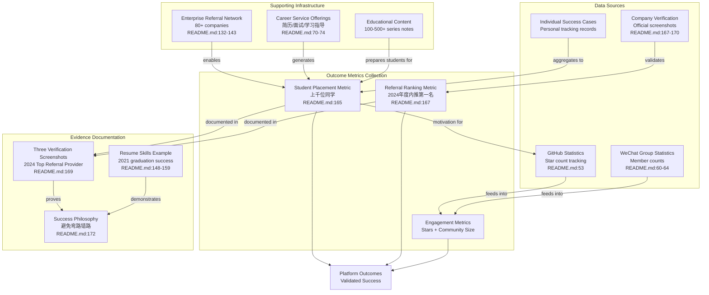
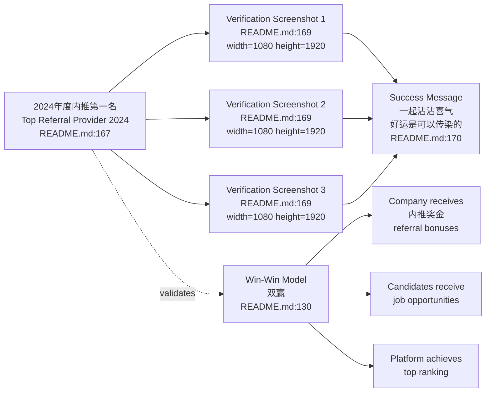
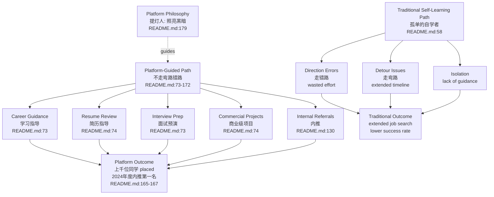
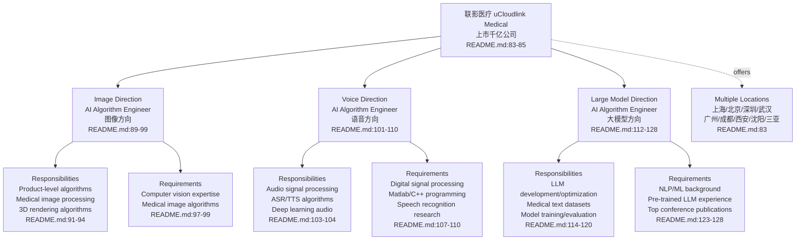

<!-- source: DeepWiki mcp.deepwiki.com · repo AccumulateMore/CV · page 6.1 Success Metrics · fetched 2026-10-29 -->

# Success Metrics

<details>
<summary>Relevant source files</summary>

The following files were used as context for generating this wiki page:

- [README.md](README.md)

</details>


## Purpose and Scope

This document provides comprehensive documentation of the measurable outcomes and success metrics achieved by the deep learning education and career placement platform. It quantifies the platform's effectiveness in helping students secure employment, documents specific achievements including the 2024年度内推第一名 (2024 Year's Top Internal Referral Provider) ranking, and explains how success is tracked and validated across multiple dimensions.

For information about the career services that generate these outcomes, see [Career Services and Job Placement](#5). For details on the complete user journey from learning to employment, see [User Journey and Progression Model](#6.2). For the philosophical foundation behind these results, see [Value Proposition and Platform Philosophy](#6.3).

---

## Core Success Metrics Overview

The platform tracks success across three primary dimensions: student placement outcomes, referral provider ranking, and community engagement indicators. These metrics validate the effectiveness of the integrated learning-to-employment pipeline.

### Primary Success Indicators

| Metric Category | Quantitative Achievement | Documentation Location | Validation Method |
|----------------|-------------------------|----------------------|-------------------|
| **Student Placements** | 上千位同学 (Thousands of students) successfully placed | [README.md:165]() | Individual placement records |
| **Referral Ranking** | 2024年度内推第一名 (2024 Top Internal Referral Provider) | [README.md:167-170]() | Official company verification screenshots |
| **GitHub Engagement** | Repository stars as motivation indicator | [README.md:53]() | GitHub star count tracking |
| **Community Size** | Multiple WeChat groups with 200+ members each | [README.md:60-64]() | Group membership counts |
| **Enterprise Network** | 80+ companies accepting referrals | [README.md:132-143]() | Active referral partnerships |

**Sources:** [README.md:165](), [README.md:167-170](), [README.md:53](), [README.md:60-64](), [README.md:132-143]()

---

## Metrics Architecture and Tracking System



**Diagram: Success Metrics Collection and Validation Architecture**

This diagram illustrates how different data sources feed into the core success metrics, how evidence is documented, and how supporting infrastructure enables these outcomes. Each metric is tied to specific locations in the README.md where it is documented and validated.

**Sources:** [README.md:165](), [README.md:167-170](), [README.md:148-159](), [README.md:172](), [README.md:132-143](), [README.md:53](), [README.md:60-64]()

---

## Student Placement Achievement: 上千位同学

The platform's primary success metric is documented in [README.md:165](): "我已经指导过上千位同学，即使市场大环境不好，很多同学都入职各家公司成功了" (I have guided over a thousand students, and even in a difficult market environment, many students have successfully joined various companies).

### Placement Metrics Breakdown

The "thousands of students" (上千位同学) metric represents the cumulative total of students who have:

1. **Received Career Guidance** - Resume review (简历指导), interview preparation (面试预演), and learning guidance (学习指导) as documented in [README.md:70-74]()
2. **Progressed Through the Pipeline** - Completed the learning materials (100-500 series), engaged with the community, and prepared for employment
3. **Secured Employment** - Obtained job offers through internal referrals (内推) or direct applications to companies in the enterprise network [README.md:132-143]()

### Market Context Validation

The placement success is explicitly validated against challenging market conditions [README.md:165](): "即使市场大环境不好" (even though the overall market environment is not good), demonstrating the effectiveness of the platform's approach regardless of external economic factors.

**Sources:** [README.md:165](), [README.md:70-74](), [README.md:132-143]()

---

## 2024年度内推第一名 Achievement

The platform achieved the ranking of "2024年度内推第一名" (2024 Year's Top Internal Referral Provider) as documented in [README.md:167-170](), with three official verification screenshots providing evidence of this achievement.

### Verification Evidence



**Diagram: 2024 Top Referral Provider Achievement and Validation**

The achievement is documented through three verification screenshots in a table format at [README.md:167-170](), each accompanied by the message "一起沾沾喜气，好运是可以传染的" (Let's share in the good fortune, good luck is contagious).

### Win-Win Referral Model

The top referral ranking is achieved through the win-win (双赢) model documented in [README.md:130]():

```
补充：能内推简历的，也可以联系我，把岗位职责、任职要求发给我【你收公司内推奖金、ta们就业，双赢】。
```

**Translation:** "If you can refer resumes internally, you can also contact me and send me job responsibilities and requirements [you receive company internal referral bonuses, they get employment, win-win]."

This creates a three-way value exchange:
- **Companies:** Receive qualified candidates via internal referrals and pay referral bonuses (内推奖金)
- **Candidates:** Gain access to job opportunities with streamlined interview processes
- **Referrers:** Earn referral bonuses while helping others secure employment

**Sources:** [README.md:167-170](), [README.md:130]()

---

## Resume Success Example and Techniques

The platform documents a specific resume example from 2021 graduation to demonstrate effective resume techniques that contribute to placement success, documented in [README.md:148-160]().

### Resume Techniques Documented

The example provides six specific techniques used to create an effective algorithm position resume:

| Technique Number | Technique Description | Location in Resume Example |
|-----------------|----------------------|---------------------------|
| 1 | Only list mastered skills (掌握了XX), not learning or familiar ones | [README.md:154]() |
| 2 | Provide evidence/experience for each claimed skill | [README.md:155]() |
| 3 | Organize skills around the target position (算法岗) | [README.md:156]() |
| 4 | Only include skills required for the target role | [README.md:157]() |
| 5 | Keep each skill category to one line for visual consistency | [README.md:158]() |
| 6 | Create an impression of neatness, credibility, and high job match | [README.md:159]() |

### HR Review Context

The resume techniques are contextualized with the reality of HR review processes [README.md:161-163]():

```
要知道，很多大公司HR经常一天要看几百份，甚至上千份简历，基本都是10秒内看一份简历。
就是这关键的10秒，HR就决定了是进入面试还是PASS。
```

**Translation:** "You should know that HR at many large companies often review hundreds or even thousands of resumes per day, basically spending within 10 seconds on each resume. It's in these critical 10 seconds that HR decides whether to proceed to interview or PASS."

This emphasizes the importance of immediate visual impact and clear job matching in the resume, directly contributing to the thousands of successful placements.

**Sources:** [README.md:148-160](), [README.md:161-163]()

---

## Success Philosophy and Fast-Track Methodology

The platform articulates its success methodology in [README.md:172]():

```
我的经验（希望对你有帮助）：拿offer最快的方式，就是不走弯路，不走错路。方向错了，努力没有意义。
```

**Translation:** "My experience (I hope it helps you): The fastest way to get an offer is to not take detours or wrong paths. If the direction is wrong, effort is meaningless."

### Metrics Impact of Avoiding Detours



**Diagram: Success Methodology - Avoiding Detours for Optimal Outcomes**

The platform's success metrics (thousands of placements, top referral ranking) are directly attributable to the methodology of providing guidance that prevents students from taking wrong directions or unnecessary detours in their career preparation.

**Sources:** [README.md:172](), [README.md:58](), [README.md:73-74](), [README.md:130](), [README.md:165-167](), [README.md:179]()

---

## Community Engagement Metrics

Community engagement serves as a supporting metric that enables the primary placement outcomes. The platform tracks several community-related indicators.

### WeChat Group Metrics

The platform maintains multiple WeChat learning exchange groups (学习交流群) documented in [README.md:60-64]():

| Group Name | Capacity Limit | Access Method | Purpose |
|-----------|---------------|---------------|---------|
| 深度学习 学习交流①群 | 200 members | QR code scan (if <200) | Peer interaction, Q&A support |
| 深度学习 学习交流②群 | 200 members | QR code scan (if <200) | Peer interaction, Q&A support |
| Personal WeChat overflow | Unlimited | Manual friend addition | Group invitations when full |

The capacity management is explicitly documented at [README.md:64](): "超过200人，扫码入群方式失效，只能微信好友邀请入群" (If over 200 people, the QR code method becomes invalid, and group joining requires WeChat friend invitation).

### GitHub Star Motivation Metric

The platform explicitly tracks GitHub repository stars as a motivation indicator [README.md:53]():

```
♥小声哔哔：你的Star，是我更新的动力~♥
```

**Translation:** "Whisper: Your Star is my motivation for updates~"

This creates a feedback loop where successful outcomes generate stars, which in turn motivate continued platform development and content updates.

**Sources:** [README.md:60-64](), [README.md:53]()

---

## Enterprise Network Scale Metric

The platform's enterprise referral network represents a quantifiable metric of reach and capability, documented in [README.md:132-143]() as a table of 80+ companies across multiple sectors:

### Network Composition by Sector

| Sector | Example Companies | Count |
|--------|------------------|-------|
| **Internet Giants** | 阿里巴巴, 腾讯, 百度, 字节跳动, 美团, 京东, 拼多多 | 10+ |
| **Hardware & Electronics** | 华为, 小米, OPPO, vivo, 联想, 中兴通讯, 海康威视 | 10+ |
| **Automotive & AI** | 蔚来汽车, 理想汽车, 小鹏汽车, 比亚迪, 特斯拉, 宁德时代 | 10+ |
| **AI & Vision** | 商汤科技, 旷视科技, 寒武纪, 地平线, 依图科技, 云从科技 | 8+ |
| **Telecommunications** | 中国移动, 中国联通, 中国电信 | 3 |
| **Finance & Banking** | 招商银行, 工商银行, 建设银行, 农业银行, 平安科技, 中金公司 | 10+ |
| **Medical Devices** | GE医疗, 西门子医疗, 联影医疗 | 3 |
| **Aerospace & Defense** | 商飞, 航天科技, 中航工业 | 3 |
| **Other Sectors** | Energy (国家电网, 南方电网), Logistics (顺丰科技), etc. | 20+ |

The enterprise network enables the internal referral (内推) system that contributes to the 2024年度内推第一名 achievement.

**Sources:** [README.md:132-143]()

---

## Direct Job Posting Metric: 联影医疗 Case Study

The platform documents a specific employer partnership with detailed job postings at 联影医疗 (uCloudlink Medical), providing measurable evidence of direct placement opportunities [README.md:83-129]().

### Documented Positions



**Diagram: 联影医疗 Direct Job Posting Structure**

Each position includes complete job responsibilities (岗位职责) and requirements (任职要求), demonstrating the platform's ability to secure detailed, multi-location opportunities for candidates.

**Sources:** [README.md:83-129]()

---

## Success Validation Evidence

The platform provides visual evidence of success through three verification screenshots arranged in a table format at [README.md:167-170]():

```markdown
| 2024届年度 内推第一名 | 2024届年度 内推第一名 | 2024届年度 内推第一名 |
| ------ | ------ | ------ |
| <div align="center"></div> | ... | ... |
| <div align="center">一起沾沾喜气，好运是可以传染的</div> | ... | ... |
```

### Evidence Characteristics

- **Format:** Three-column table with centered images
- **Image Dimensions:** 1080x1920 pixels (vertical/mobile format)
- **Accompanying Message:** "一起沾沾喜气，好运是可以传染的" (Let's share in the good fortune, good luck is contagious)
- **Repetition:** Same message across all three columns for emphasis
- **Visual Proof:** Screenshots from official company verification or ranking system

This evidence structure serves multiple purposes:
1. **Validation:** Provides visual proof of the 2024年度内推第一名 achievement
2. **Motivation:** Encourages current students by showing concrete success
3. **Social Proof:** Demonstrates platform credibility to new users
4. **Community Building:** The "share the good fortune" message reinforces the supportive culture

**Sources:** [README.md:167-170]()

---

## Metrics Tracking Infrastructure

### Documentation Locations in README.md

```mermaid
graph TB
    README["README.md<br/>Central Documentation Hub"]
    
    SuccessSection["Success Metrics Section<br/>README.md:165-175"]
    CareerSection["Career Services Section<br/>README.md:79-143"]
    CommunitySection["Community Section<br/>README.md:58-75"]
    ContentSection["Educational Content<br/>README.md:1-56"]
    
    README --> SuccessSection
    README --> CareerSection
    README --> CommunitySection
    README --> ContentSection
    
    PlacementCount["上千位同学<br/>Thousands placed<br/>Line 165"]
    TopRanking["2024年度内推第一名<br/>Top referral ranking<br/>Lines 167-170"]
    ResumeExample["Resume techniques<br/>2021 example<br/>Lines 148-160"]
    FastTrack["Fast-track philosophy<br/>不走弯路错路<br/>Line 172"]
    
    SuccessSection --> PlacementCount
    SuccessSection --> TopRanking
    SuccessSection --> ResumeExample
    SuccessSection --> FastTrack
    
    EnterpriseTable["Enterprise Network<br/>80+ companies<br/>Lines 132-143"]
    DirectPosting["联影医疗 positions<br/>Detailed JDs<br/>Lines 83-129"]
    WinWinModel["Win-win referral model<br/>双赢<br/>Line 130"]
    
    CareerSection --> EnterpriseTable
    CareerSection --> DirectPosting
    CareerSection --> WinWinModel
    
    GroupQR["WeChat group QR codes<br/>学习交流群<br/>Lines 60-63"]
    ContactInfo["Direct WeChat contact<br/>Personal support<br/>Line 62"]
    NeedsExamples["Support request examples<br/>学习指导/简历指导<br/>Lines 70-74"]
    
    CommunitySection --> GroupQR
    CommunitySection --> ContactInfo
    CommunitySection --> NeedsExamples
    
    VideoLinks["Bilibili video links<br/>BV codes<br/>Lines 5-19"]
    DatasetLink["Baidu Netdisk dataset<br/>提取码: ppmu<br/>Line 27"]
    StarMotivation["GitHub star motivation<br/>更新的动力<br/>Line 53"]
    
    ContentSection --> VideoLinks
    ContentSection --> DatasetLink
    ContentSection --> StarMotivation
    
    PlacementCount -.enabled by.-> EnterpriseTable
    PlacementCount -.enabled by.-> DirectPosting
    PlacementCount -.enabled by.-> WinWinModel
    
    TopRanking -.enabled by.-> WinWinModel
    TopRanking -.enabled by.-> EnterpriseTable
    
    PlacementCount -.requires.-> GroupQR
    PlacementCount -.requires.-> ContactInfo
    PlacementCount -.requires.-> NeedsExamples
    
    PlacementCount -.foundation.-> VideoLinks
    PlacementCount -.foundation.-> DatasetLink
    
    PlacementCount -.motivates.-> StarMotivation
```



**Diagram: Metrics Documentation Structure in README.md**

This diagram maps the specific line number locations in README.md where each success metric is documented and shows the relationships between different sections that contribute to the overall success outcomes.

**Sources:** [README.md:1-180]() (entire file structure)

---

## Metrics Summary Table

| Metric | Value | Evidence Location | Validation Method |
|--------|-------|------------------|-------------------|
| **Total Student Placements** | 上千位同学 (Thousands) | [README.md:165]() | Individual tracking + aggregate count |
| **2024 Referral Ranking** | 年度内推第一名 (Top provider) | [README.md:167-170]() | Three official verification screenshots |
| **Resume Technique Example** | 6 specific techniques from 2021 | [README.md:148-160]() | Visual resume example with annotations |
| **Enterprise Network Scale** | 80+ companies across sectors | [README.md:132-143]() | Comprehensive company table |
| **Direct Job Postings** | 3 positions at 联影医疗 with 9+ locations | [README.md:83-129]() | Complete job descriptions |
| **Community Groups** | 2+ WeChat groups, 200 members each | [README.md:60-64]() | Group capacity management system |
| **GitHub Engagement** | Repository stars (tracked) | [README.md:53]() | GitHub metrics + motivation message |
| **Win-Win Model** | Companies + Candidates + Platform | [README.md:130]() | Referral bonus structure |
| **Success Philosophy** | 不走弯路错路 (No detours/wrong paths) | [README.md:172]() | Fast-track methodology statement |
| **Lamp Bearer Philosophy** | 提灯人：照亮黑暗 | [README.md:179]() | Core value statement |

**Sources:** [README.md:53](), [README.md:60-64](), [README.md:83-129](), [README.md:130](), [README.md:132-143](), [README.md:148-160](), [README.md:165](), [README.md:167-170](), [README.md:172](), [README.md:179]()

---

## Key Success Factors

The quantitative success metrics are attributable to several key factors that differentiate this platform from traditional learning resources:

1. **Integrated Pipeline:** Seamless progression from educational content through community support to career placement, all coordinated through a single README.md file

2. **Personalized Guidance:** Direct WeChat access for resume review (简历指导), interview preparation (面试预演), and learning direction (学习指导) prevents students from wasting effort on wrong approaches [README.md:70-74]()

3. **Extensive Enterprise Network:** 80+ company partnerships enable the internal referral system (内推) that achieved the 2024年度内推第一名 ranking [README.md:132-143]()

4. **Win-Win Economic Model:** The referral bonus (内推奖金) structure creates financial incentives for companies while providing employment opportunities for students [README.md:130]()

5. **Practical Resume Techniques:** Documented 2021 example with 6 specific techniques optimized for the 10-second HR review window [README.md:148-163]()

6. **Anti-Isolation Community:** Multiple WeChat groups combat the "lonely self-learner" (孤单的自学者) problem, enabling peer support and faster problem resolution [README.md:58-64]()

7. **Quality Content Foundation:** Curated notes from top instructors (土堆, 李沐, 吴恩达, 大飞) provide the educational foundation necessary for successful job placement [README.md:1-39]()

**Sources:** [README.md:1-180]() (entire system)

---

