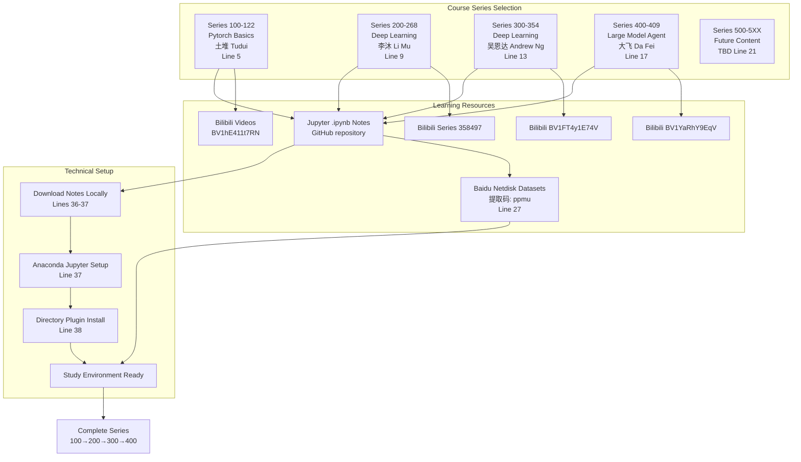
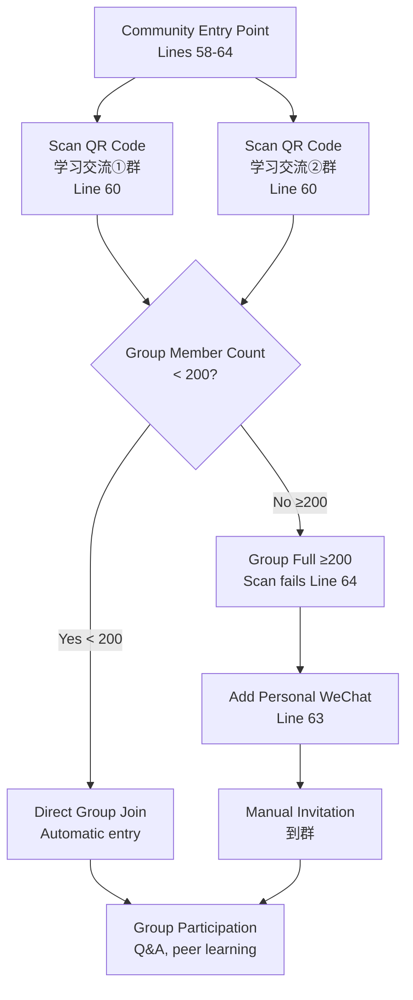
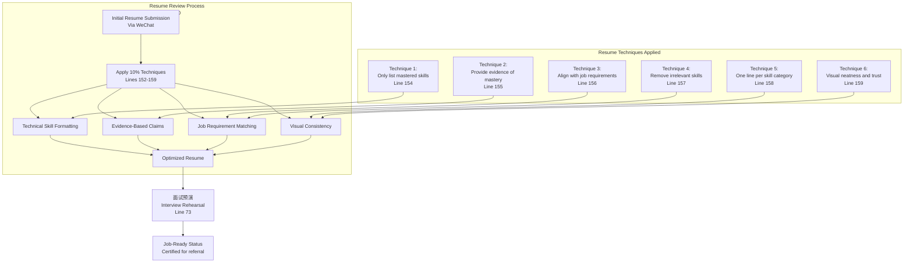
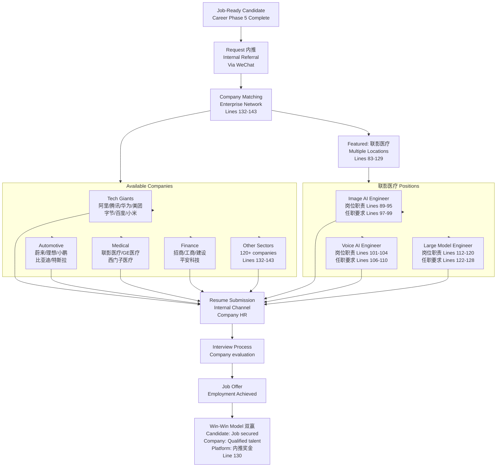
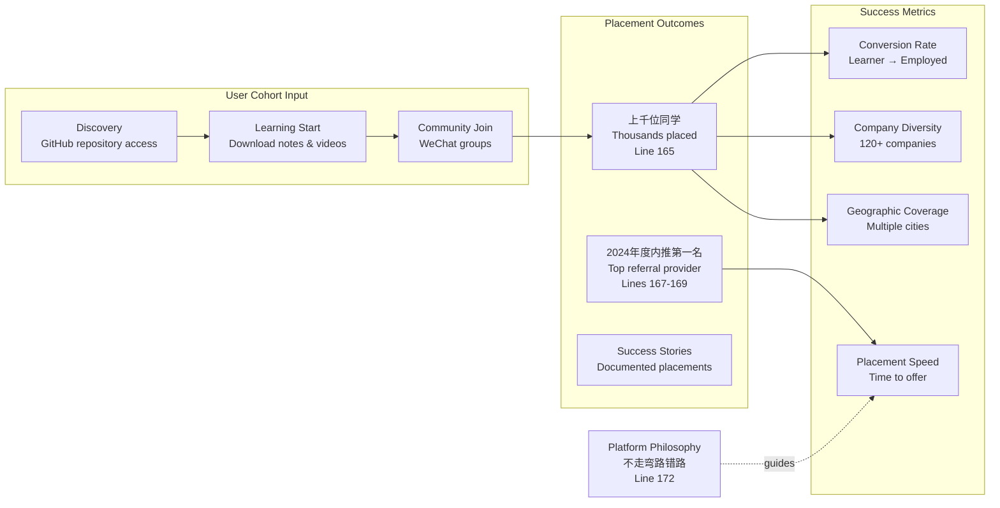
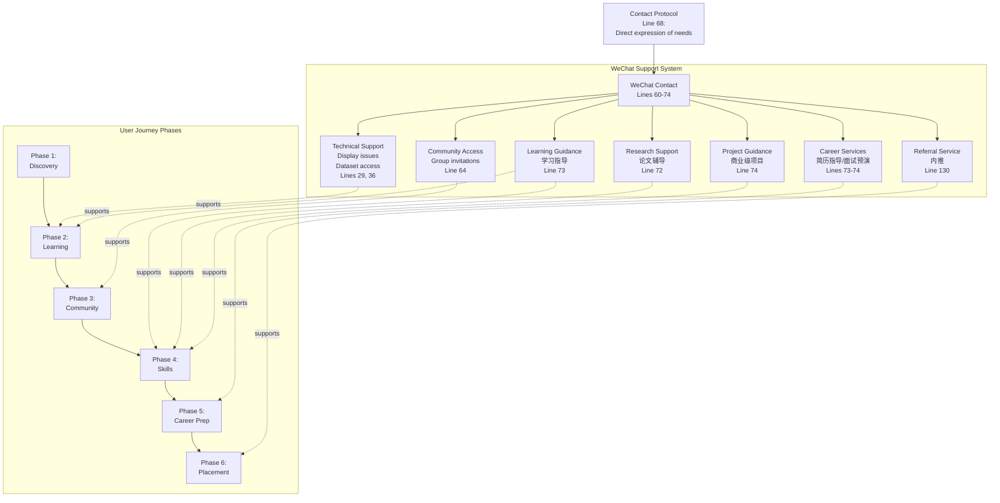
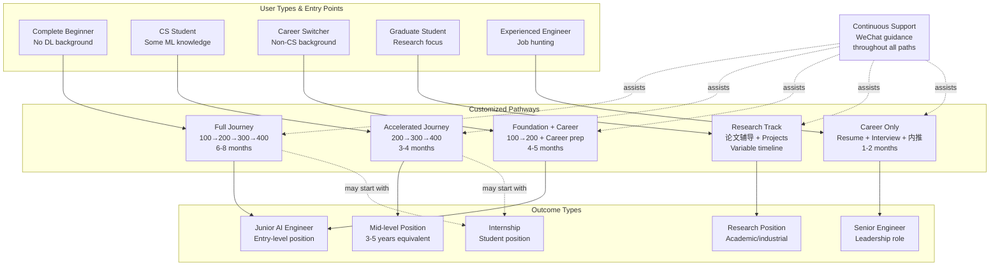

<!-- source: DeepWiki mcp.deepwiki.com · repo AccumulateMore/CV · page 6.2 User Journey and Progression Model · fetched 2026-10-29 -->

# User Journey and Progression Model

Relevant source files

The following files were used as context for generating this wiki page:

- [README.md](README.md)

## Purpose and Scope

This document describes the complete user progression pathway through the CV platform, from initial discovery to successful job placement. It details each stage of the journey, typical timelines, key milestones, and decision points that users encounter as they advance from beginner learners to employed professionals.

For information about specific career services offered, see [Career Services and Job Placement](#5). For community support mechanisms, see [Community and Support System](#4). For success metrics and outcomes, see [Success Metrics](#6.1).

## Journey Overview

The user journey follows a structured yet flexible progression model with six distinct phases. Users advance through these phases at their own pace, with support mechanisms available at each stage.

### Complete User Progression Pipeline

```mermaid
flowchart TD
    subgraph Discovery["PHASE 1: DISCOVERY"]
        D1["GitHub Repository<br/>README.md"]
        D2["Review Content Structure<br/>Lines 1-23"]
        D3{"User Decision Point"}
        D1 --> D2
        D2 --> D3
    end
    
    subgraph Learning["PHASE 2: LEARNING JOURNEY"]
        L1["Select Course Series<br/>100-500 numbering"]
        L2["Access Bilibili Videos<br/>BV codes Lines 5-19"]
        L3["Download .ipynb Notes<br/>Local setup required"]
        L4["Access Baidu Datasets<br/>提取码 ppmu Line 27"]
        L5["Study with Jupyter<br/>Anaconda environment"]
        L6["Progress 100→500<br/>Series completion"]
        L1 --> L2
        L2 --> L3
        L3 --> L4
        L4 --> L5
        L5 --> L6
    end
    
    subgraph Community["PHASE 3: COMMUNITY INTEGRATION"]
        C1["Scan QR Codes<br/>Lines 60-63"]
        C2{"Group Status<br/>≥200 members?"}
        C3["Join 学习交流①群 or ②群<br/>Direct entry"]
        C4["Add Personal WeChat<br/>Manual invitation"]
        C5["Engage in Q&A<br/>Peer learning"]
        C1 --> C2
        C2 -->|"No"| C3
        C2 -->|"Yes"| C4
        C3 --> C5
        C4 --> C5
    end
    
    subgraph Skills["PHASE 4: SKILL DEVELOPMENT"]
        S1["Request 学习指导<br/>Learning guidance"]
        S2["论文辅导<br/>Research support Lines 72"]
        S3["商业级项目<br/>Commercial projects Line 74"]
        S4["Build Portfolio<br/>Job-ready skills"]
        S1 --> S2
        S1 --> S3
        S2 --> S4
        S3 --> S4
    end
    
    subgraph Career["PHASE 5: CAREER PREPARATION"]
        CR1["简历指导<br/>Resume review Lines 148-160"]
        CR2["面试预演<br/>Interview rehearsal Line 73"]
        CR3["Skills Documentation<br/>Portfolio refinement"]
        CR4["Job-Ready Status<br/>Certified competence"]
        CR1 --> CR2
        CR2 --> CR3
        CR3 --> CR4
    end
    
    subgraph Placement["PHASE 6: JOB PLACEMENT"]
        P1["Request 内推<br/>Internal referral Line 130"]
        P2["Match to Companies<br/>Lines 132-143"]
        P3["Submit Resume<br/>Internal channels"]
        P4["Interview Process<br/>Company evaluation"]
        P5["Job Offer<br/>Employment achieved"]
        P1 --> P2
        P2 --> P3
        P3 --> P4
        P4 --> P5
    end
    
    D3 -->|"Commit to Learning"| L1
    L6 --> C1
    C5 --> S1
    S4 --> CR1
    CR4 --> P1
    
    WeChat["WeChat Contact<br/>Lines 60-74<br/>Persistent support"]
    
    WeChat -.->|"Technical help"| L5
    WeChat -.->|"Group access"| C4
    WeChat -.->|"Guidance"| S1
    WeChat -.->|"Career prep"| CR1
    WeChat -.->|"Referral"| P1
    
    Metrics["Success Outcomes<br/>上千位同学 placed<br/>2024年度内推第一名<br/>Lines 165-170"]
    
    P5 --> Metrics
```

Sources: [README.md:1-180]()

## Phase 1: Discovery and Initial Access

### Entry Points

Users discover the platform through GitHub and encounter the central `README.md` file, which serves as the complete system interface. The discovery phase involves understanding the platform's structure and available resources.

**Key Activities:**
- Access repository at https://github.com/AccumulateMore/CV
- Review curriculum structure (lines 1-23)
- Understand four lecture series and instructors
- Assess personal learning goals

**Decision Point:** Users decide whether to commit to the learning journey based on:
- Course content alignment with goals
- Instructor preferences (土堆, 李沐, 吴恩达, 大飞)
- Time availability for self-paced learning

Sources: [README.md:1-23]()

## Phase 2: Learning Journey

### Curriculum Selection and Progression

The learning phase follows a structured 100-500 series numbering system, with users progressing through increasingly advanced content.

Sources: [README.md:1-40]()

### Learning Progression Mechanics

**Technical Requirements:**
- Local download required for proper display (line 36)
- Anaconda Jupyter Notebook environment (line 37)
- Directory plugin for navigation (line 38)
- **Critical:** PyCharm Jupyter not supported (line 37)

**Resource Access Pattern:**
1. Watch video lecture on Bilibili (external platform)
2. Download corresponding `.ipynb` note file from GitHub
3. Access datasets from Baidu Netdisk using extraction code `ppmu`
4. Study in Anaconda Jupyter with directory plugin
5. Complete exercises and projects

**Typical Timeline:**
- Series 100 (23 notes): 2-4 weeks for beginners
- Series 200 (69 notes): 6-8 weeks for deep learning foundations
- Series 300 (55 notes): 4-6 weeks for structured curriculum
- Series 400 (10 notes): 1-2 weeks for agent concepts

Sources: [README.md:34-40](), [README.md:5-27]()

## Phase 3: Community Integration

### Group Joining Mechanism

Community integration can occur parallel to learning, with users joining WeChat groups to escape isolated self-learning (孤单的自学者, line 58).

Sources: [README.md:58-66]()

### Community Engagement Activities

**Primary Functions:**
- Peer-to-peer Q&A support
- Shared learning experiences
- Progress accountability
- Network building for future opportunities

**WeChat Contact Protocol (lines 68-74):**

Valid contact reasons with specific needs:

| Contact Purpose | Example Need | Line Reference |
|-----------------|--------------|----------------|
| 论文辅导 | Research paper guidance (研0研1免费) | Line 72 |
| 学习交流群 | Join learning groups when QR fails | Line 72 |
| 数据集 | Dataset access if link invalid | Line 72 |
| 学习指导 | Learning path optimization | Line 73 |
| 面试预演 | Interview rehearsal | Line 73 |
| 实习 | Internship opportunities | Line 73 |
| 商业级项目 | Commercial project guidance | Line 74 |
| 简历指导 | Resume review | Line 74 |

**Platform Philosophy:** "看人之长,天下皆是吾师" (See others' strengths, everyone is a teacher) - line 66

Sources: [README.md:58-74]()

## Phase 4: Skill Development

### Guided Development Services

After community integration, users transition to personalized skill development with direct guidance from the platform maintainer.

**Service Categories:**

1. **论文辅导 (Research Paper Guidance)**
   - Target: 研0研1 (first/second year graduate students)
   - Pricing: Free for target cohort
   - Promise: "半年掌握三年知识" (Master 3 years of knowledge in 6 months)
   - Source: [README.md:72]()

2. **学习指导 (Learning Path Guidance)**
   - Focus: "不走弯路错路" (Avoid detours and wrong paths)
   - Goal: "快速拿到offer" (Quickly secure job offers)
   - Method: Direct one-on-one guidance via WeChat
   - Source: [README.md:73]()

3. **商业级项目 (Commercial-Grade Projects)**
   - Purpose: "简历增添项目" (Enhance resume with projects)
   - Outcome: "提升核心竞争力" (Improve core competitiveness)
   - Integration: Real-world project experience
   - Source: [README.md:74]()

### Skill Development Timeline

**Typical Progression:**
- Months 1-2: Complete foundational series (100-200)
- Month 3: Community integration and peer learning
- Months 3-4: Advanced series (300-400) with guidance
- Months 4-5: Commercial project development
- Month 5-6: Portfolio building and job preparation

Sources: [README.md:72-74]()

## Phase 5: Career Preparation

### Resume Optimization Process

The platform provides detailed resume guidance based on proven 2021 techniques that resulted in successful placements.

Sources: [README.md:148-160](), [README.md:73]()

### Resume Technique Details

The platform applies six specific techniques derived from successful 2021 placements:

**Technique 1: Selective Skill Listing (Line 154)**
- Only include mastered skills
- Order: Most proficient first, less proficient last
- No unmastered skills listed

**Technique 2: Evidence-Based Claims (Line 155)**
- Each skill claim must have supporting evidence
- Provide relevant experience examples
- Enable interview question targeting

**Technique 3: Job-Centric Organization (Line 156)**
- Structure: Programming languages → Deep learning frameworks → Image processing → Server/database
- Alignment with algorithm engineering requirements

**Technique 4: Relevance Filtering (Line 157)**
- Exclude: Hardware knowledge, organizational skills, non-technical abilities
- Focus: Algorithm engineering technical requirements only

**Technique 5: Consistent Formatting (Line 158)**
- One skill category = one line
- No multi-line entries
- Visual consistency throughout

**Technique 6: Professional Presentation (Line 159)**
- HR perspective: Neat, credible, high job match
- Critical first impression in 10-second review window

**HR Review Context (Lines 161-163):**
- Large companies: HR reviews hundreds to thousands of resumes daily
- Decision time: 10 seconds per resume
- Outcome: Interview or immediate pass

Sources: [README.md:148-163]()

### Interview Preparation Service

**面试预演 (Interview Rehearsal)** - Line 73:
- Mock interview sessions
- "简历拷打问题" (Resume grilling questions)
- Practice with common interview scenarios
- Feedback and improvement cycles

Sources: [README.md:73]()

## Phase 6: Job Placement

### Internal Referral System (内推)

The job placement phase leverages the platform's extensive enterprise network and internal referral channels.

Sources: [README.md:79-143]()

### Placement Process Mechanics

**Step 1: Referral Request**
- Contact via WeChat with job-ready status
- Specify preferred companies or roles
- Submit optimized resume

**Step 2: Company Matching**

Enterprise network spans 120+ companies across sectors (lines 132-143):

| Sector | Companies | Line Range |
|--------|-----------|------------|
| Tech Giants | 阿里巴巴, 腾讯, 美团, 京东, 字节跳动, 百度, 华为 | 134 |
| Consumer Electronics | 小米, OPPO, vivo, 联想 | 135 |
| AI Companies | 商汤科技, 旷视科技, 科大讯飞, 智谱 | 135-139 |
| Automotive | 蔚来, 理想, 小鹏, 比亚迪, 特斯拉 | 136 |
| Telecom | 中国移动, 中国联通, 中国电信 | 137 |
| Medical | 联影医疗, GE医疗, 西门子医疗 | 143 |
| Finance | Major banks, 平安科技, 招联科技 | 140-141 |

**Step 3: Featured Opportunity - 联影医疗**

Multiple AI engineering positions available (lines 83-129):

**Position 1: Image Direction AI Algorithm Engineer (Lines 89-99)**
- Responsibilities: Medical imaging AI algorithms, 3D rendering, image processing
- Requirements: Computer vision expertise, medical image processing algorithms
- Locations: Shanghai, Beijing, Shenzhen, Wuhan, Guangzhou, Chengdu, Xi'an, Shenyang, Sanya

**Position 2: Voice Direction AI Algorithm Engineer (Lines 101-110)**
- Responsibilities: Audio signal processing, ASR/TTS, deep learning for audio
- Requirements: Speech processing experience, neural networks, acoustic models

**Position 3: Large Model Direction AI Algorithm Engineer (Lines 112-128)**
- Responsibilities: LLM development, medical domain applications, model training
- Requirements: NLP/CV background, GPT/LLM experience, top-tier publications

**Step 4: Internal Submission**
- Platform maintainer submits resume through internal channels
- Bypasses standard HR screening
- Direct access to technical interview teams

**Step 5: Interview Process**
- Company conducts technical and cultural interviews
- Candidate prepared via 面试预演 service
- Higher success rate due to pre-qualification

**Step 6: Job Offer**
- Successful placement
- Contributes to platform success metrics

Sources: [README.md:83-143]()

### Win-Win Referral Model (双赢)

The internal referral system creates value for all parties (line 130):

**Candidate Benefits:**
- Bypassed HR screening bottleneck
- Direct technical team access
- Pre-qualified for role
- Interview preparation included

**Company Benefits:**
- Pre-screened qualified candidates
- Reduced hiring time and cost
- Technical skill validation
- Internal referral bonus paid to platform

**Platform Benefits:**
- 内推奖金 (referral bonuses) from companies
- Reputation building
- Success metrics for credibility
- Sustainable business model

**Additional Referral Opportunity:**
Individuals who can provide internal referrals at their companies can contact the platform to participate in the win-win model, receiving 内推奖金 while helping candidates secure employment (line 130).

Sources: [README.md:130]()

## Progression Metrics and Milestones

### Quantitative Success Indicators

The platform tracks specific metrics to measure user progression and system effectiveness:

Sources: [README.md:165-172]()

### Key Milestones

**Historical Achievement:**
- **上千位同学** (Thousands of students) successfully placed in employment (line 165)
- **2024年度内推第一名** (2024 Top Internal Referral Provider) - lines 167-169
- Documented with success story screenshots

**Milestone Indicators:**

| Stage | Milestone | Typical Timeline | Evidence |
|-------|-----------|------------------|----------|
| Learning | Complete Series 100 | 2-4 weeks | Certificate or portfolio |
| Learning | Complete Series 200-300 | 3-6 months | Advanced project completion |
| Community | Join WeChat groups | Week 1-2 | Group membership |
| Skills | Complete commercial project | Month 4-5 | Portfolio project |
| Career | Optimized resume | Month 5 | Resume review complete |
| Career | Interview rehearsal | Month 5-6 | Mock interview sessions |
| Placement | Internal referral submitted | Month 6+ | Resume to company |
| Placement | Job offer received | Month 6-8 | Employment contract |

**Platform Philosophy on Success (Line 172):**
"拿offer最快的方式,就是不走弯路,不走错路。方向错了,努力没有意义。"
(The fastest way to get offers is to avoid detours and wrong paths. If the direction is wrong, effort is meaningless.)

Sources: [README.md:165-174]()

## Support Touchpoints Throughout Journey

### Persistent Support Architecture

WeChat contact serves as a cross-cutting support mechanism available at every phase of the user journey.

Sources: [README.md:29-74](), [README.md:130]()

### Support Service Mapping

**Phase-Specific Support:**

| Journey Phase | Available Support | WeChat Service | Line Reference |
|---------------|-------------------|----------------|----------------|
| Discovery | Repository questions | General inquiry | 60-63 |
| Learning | Display issues, dataset access | Technical support | 29, 36 |
| Learning | Course guidance | 学习指导 | 73 |
| Community | Group joining when full | Manual invitation | 64 |
| Community | Peer connection | Group facilitation | 60-63 |
| Skills | Research paper support | 论文辅导 | 72 |
| Skills | Project development | 商业级项目 | 74 |
| Career Prep | Resume optimization | 简历指导 | 74 |
| Career Prep | Interview practice | 面试预演 | 73 |
| Placement | Job referrals | 内推 service | 130 |
| Placement | Internship access | 实习 opportunities | 73 |

**Contact Efficiency Requirement (Line 68):**
"因为好友申请太多了,添加好友后,直接表达你的需求。"
(Because there are too many friend requests, express your needs directly after adding as friend.)

**Platform Values (Lines 66, 179):**
- "看人之长,天下皆是吾师" (See others' strengths, everyone is a teacher)
- "提灯人去照亮黑暗" (Lamp bearer illuminating darkness)

Sources: [README.md:60-74](), [README.md:130](), [README.md:66](), [README.md:179]()

## Success Pathways and User Types

### Differentiated User Progression Patterns

Different user types follow variations of the core journey based on their starting point and goals.

Sources: [README.md:1-180]()

### Pathway Details

**Path 1: Complete Beginner (Full Journey)**
- Start: Series 100 (Pytorch basics)
- Progress: 100→200→300→400
- Timeline: 6-8 months
- Support: Full learning guidance, community integration
- Outcome: Junior AI engineer position

**Path 2: CS Student (Accelerated Journey)**
- Start: Series 200 (skip Pytorch basics)
- Progress: 200→300→400
- Timeline: 3-4 months
- Support: Advanced guidance, commercial projects
- Outcome: Mid-level position

**Path 3: Career Switcher (Foundation + Career)**
- Start: Series 100-200 (fundamentals)
- Focus: Resume building, interview prep
- Timeline: 4-5 months
- Support: Intensive career services
- Outcome: Entry-level AI engineer

**Path 4: Graduate Student (Research Track)**
- Start: 论文辅导 (research paper guidance) - line 72
- Focus: Research publications, advanced projects
- Timeline: Variable (6-12 months)
- Support: Academic mentoring, research collaboration
- Outcome: Research positions (academic/industrial)

**Path 5: Experienced Engineer (Career Only)**
- Start: Direct career services
- Focus: Resume optimization, interview prep, 内推
- Timeline: 1-2 months
- Support: Executive career guidance
- Outcome: Senior/leadership positions

Sources: [README.md:72-74](), [README.md:148-172]()

### Critical Success Factors

**For All Pathways:**

1. **Technical Setup** (Lines 34-40)
   - Proper Jupyter environment (Anaconda, not PyCharm)
   - Local note download for display issues
   - Dataset access via Baidu Netdisk

2. **Community Engagement** (Lines 58-66)
   - Active participation in learning groups
   - Peer support and accountability
   - Network building

3. **Guided Development** (Lines 68-74)
   - Leveraging WeChat guidance services
   - Following "不走弯路错路" (no detours) principle
   - Evidence-based skill building

4. **Career Preparation** (Lines 148-163)
   - Resume optimization with proven techniques
   - Interview rehearsal and feedback
   - Job requirement alignment

5. **Strategic Placement** (Lines 130-143)
   - Internal referral leverage
   - Company matching based on skills
   - Win-win model participation

**Platform Success Formula (Line 172):**
"拿offer最快的方式,就是不走弯路,不走错路。方向错了,努力没有意义。"

The user journey is designed to eliminate wasted effort through structured guidance, proven techniques, and strategic career services, resulting in the documented success of 上千位同学 (thousands of students) achieving employment.

Sources: [README.md:34-40](), [README.md:58-74](), [README.md:148-172]()

---

