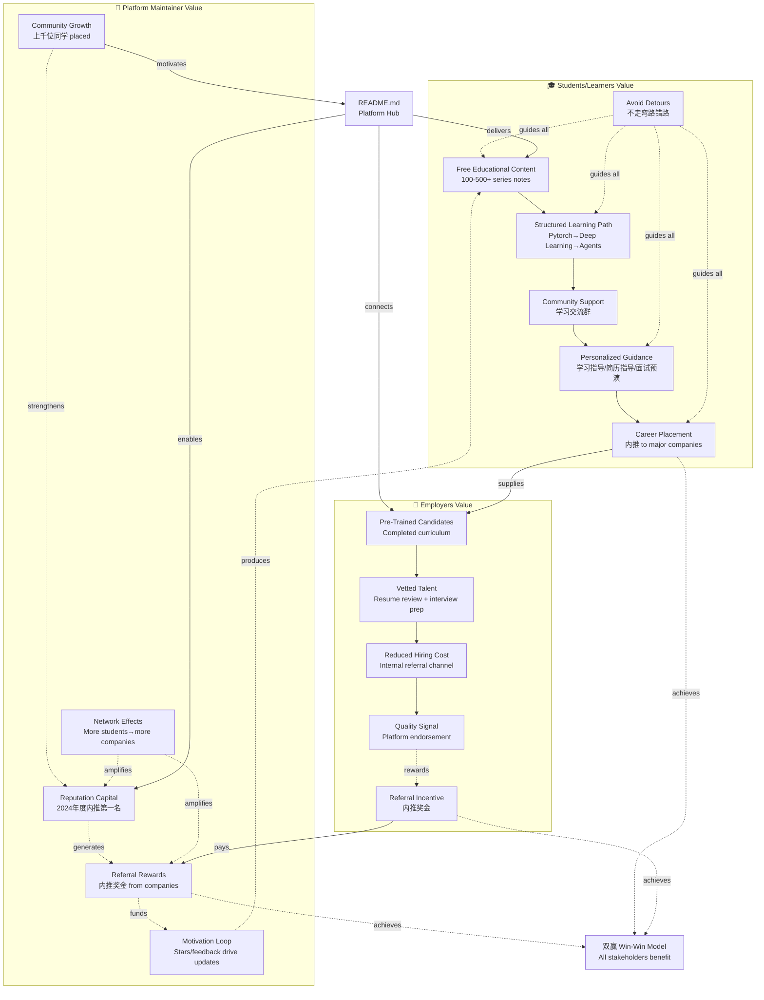
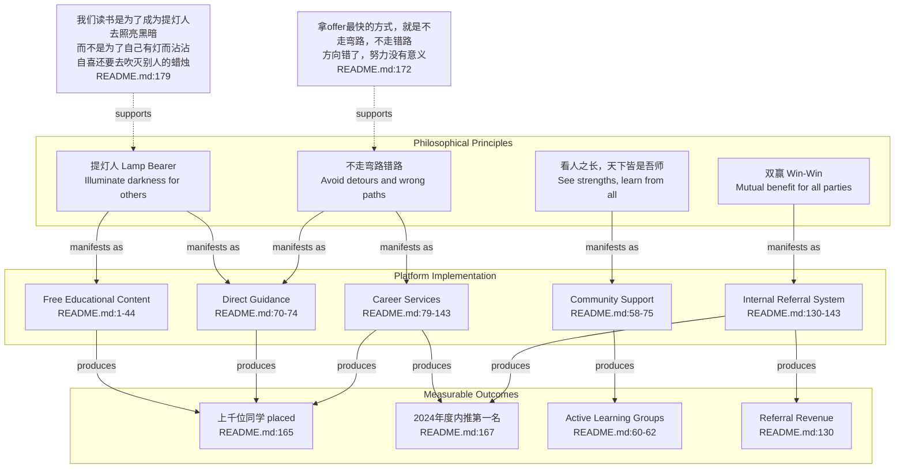
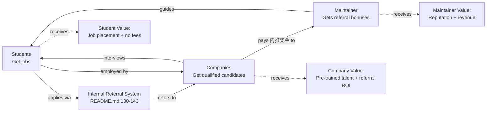
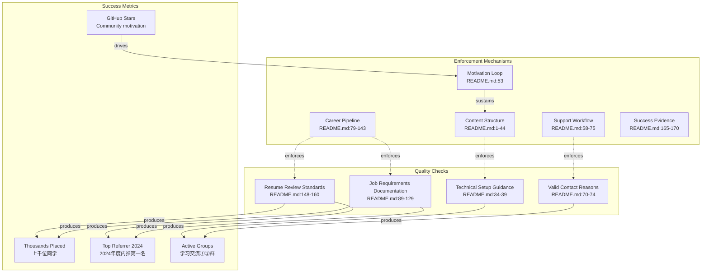
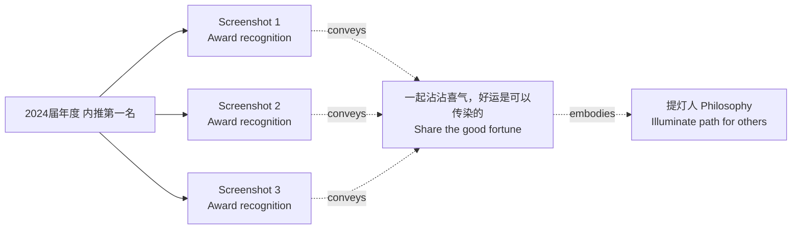
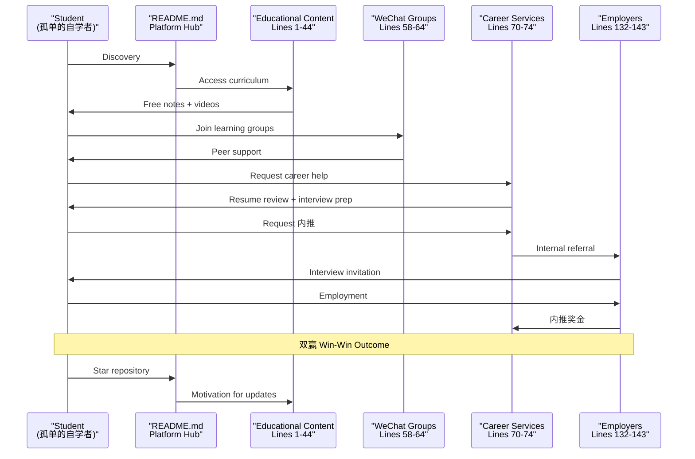

<!-- source: DeepWiki mcp.deepwiki.com · repo AccumulateMore/CV · page 6.3 Value Proposition and Platform Philosophy · fetched 2026-10-29 -->

# Value Proposition and Platform Philosophy

<details>
<summary>Relevant source files</summary>

The following files were used as context for generating this wiki page:

- [README.md](README.md)

</details>


## Purpose and Scope

This document articulates the core value propositions delivered to each stakeholder group (students, employers, platform maintainer) and explains the philosophical principles that guide the platform's design and operation. It demonstrates how abstract philosophical concepts translate into concrete platform features and measurable outcomes.

For specific career service offerings, see [Career Services and Job Placement](#5). For quantitative success metrics, see [Success Metrics](#6.1). For the complete user progression model, see [User Journey and Progression Model](#6.2).

---

## Multi-Stakeholder Value Model

The platform operates as a multi-sided marketplace with distinct value propositions for each participant group.

### Value Proposition Architecture



**Sources:** [README.md:1-180]()

### Student/Learner Value Proposition

The platform delivers a complete learning-to-employment pipeline without financial cost to students.

| Value Component | Implementation | Evidence |
|----------------|----------------|----------|
| **Comprehensive Content** | 100-500+ Jupyter notebooks covering Pytorch, Deep Learning (Li Mu & Andrew Ng), Large Model Agents | [README.md:1-24]() |
| **Expert Instruction** | Video lectures from 土堆 (Tudui), 李沐 (Li Mu), 吴恩达 (Andrew Ng), 大飞 (Da Fei) | [README.md:5-19]() |
| **Practical Resources** | Datasets via Baidu Netdisk with fallback mechanism | [README.md:25-29]() |
| **Community Integration** | WeChat learning groups (学习交流①群, ②群) to combat isolated learning (孤单的自学者) | [README.md:58-64]() |
| **Career Services** | Resume guidance (简历指导), interview preparation (面试预演), learning guidance (学习指导), commercial projects (商业级项目) | [README.md:70-74]() |
| **Job Placement** | Internal referrals (内推) to 100+ companies including 阿里/腾讯/华为/美团/字节/百度 | [README.md:132-143]() |
| **Guidance Principle** | "不走弯路错路" - avoid detours and wrong paths | [README.md:73, 172]() |

**Key Student Benefit:** The platform's core value is articulated in [README.md:172](): "拿offer最快的方式，就是不走弯路，不走错路。方向错了，努力没有意义。" (The fastest way to get offers is to avoid detours and wrong paths. When direction is wrong, effort is meaningless.)

**Sources:** [README.md:1-74](), [README.md:132-143](), [README.md:172]()

### Employer Value Proposition

Companies receive access to pre-qualified candidates who have completed standardized training.

| Value Component | Description | Code Reference |
|----------------|-------------|----------------|
| **Pre-Trained Pool** | Candidates have completed structured curriculum (100→500 series) | [README.md:5-21]() |
| **Quality Screening** | Platform provides resume review and interview preparation | [README.md:148-160]() |
| **Referral Incentive** | Companies earn internal referral bonuses (内推奖金) | [README.md:130]() |
| **Win-Win Economics** | "你收公司内推奖金、ta们就业，双赢" (You receive referral bonuses, they get employed, win-win) | [README.md:130]() |
| **Specific Opportunities** | Direct postings with detailed job requirements (e.g., 联影医疗 three directions) | [README.md:83-129]() |
| **Broad Network** | Access to referral network across 100+ companies | [README.md:132-143]() |

**Sources:** [README.md:79-143]()

### Platform Maintainer Value Proposition

The maintainer benefits from reputation, referral rewards, and community growth.

| Value Component | Mechanism | Evidence |
|----------------|-----------|----------|
| **Reputation Capital** | "2024年度内推第一名" (2024 top internal referral provider) | [README.md:167]() |
| **Referral Revenue** | Internal referral bonuses (内推奖金) from companies | [README.md:130]() |
| **Scale Achievement** | "上千位同学" (thousands of students) successfully placed | [README.md:165]() |
| **Motivation Loop** | "你的Star，是我更新的动力~" (Your stars motivate my updates) | [README.md:53]() |
| **Network Effects** | More successful placements → stronger reputation → more students and companies | [README.md:165-170]() |

**Sources:** [README.md:53](), [README.md:130](), [README.md:165-170]()

---

## Philosophical Foundation

The platform is guided by four core philosophical principles that shape all operational decisions.

### Core Principles Map



**Sources:** [README.md:66](), [README.md:172](), [README.md:179]()

### Principle 1: The Lamp Bearer (提灯人)

**Philosophical Statement:** "我们读书是为了成为提灯人去照亮黑暗，而不是为了自己有灯而沾沾自喜还要去吹灭别人的蜡烛" [README.md:179]()

Translation: "We study to become lamp bearers who illuminate darkness for others, not to be complacent about having our own light while extinguishing others' candles."

**Platform Manifestation:**
- **Free Content Distribution:** All educational materials (100-500+ notes) freely available [README.md:1-24]()
- **Dataset Sharing:** Datasets shared "无偿分享" (without charge) [README.md:25]()
- **Community Building:** Creating learning groups to help "孤单的自学者" (lonely self-learners) [README.md:58]()
- **Direct Support:** Personal WeChat contact for guidance [README.md:60-74]()
- **Career Assistance:** Resume review, interview preparation provided to students [README.md:70-74]()

**Sources:** [README.md:1-29](), [README.md:58-74](), [README.md:179]()

### Principle 2: Avoiding Detours (不走弯路错路)

**Philosophical Statement:** "拿offer最快的方式，就是不走弯路，不走错路。方向错了，努力没有意义。" [README.md:172]()

Translation: "The fastest way to get offers is to avoid detours and wrong paths. When direction is wrong, effort is meaningless."

**Platform Manifestation:**
- **Structured Curriculum:** Clear progression path (100→200→300→400→500) [README.md:5-21]()
- **Learning Guidance:** "学习指导" service to optimize learning path [README.md:73]()
- **Resume Techniques:** Documented strategies from maintainer's 2021 experience [README.md:148-160]()
- **Market Alignment:** "初学者也可以根据市场上就业需求，去学习自己" (beginners can learn based on market employment needs) [README.md:81]()
- **Direct Experience:** "我的经验（希望对你有帮助）" sections providing actionable guidance [README.md:172]()

**Resume Guidance Implementation:**

The platform demonstrates this principle through concrete resume techniques [README.md:148-160]():

1. **Skill Honesty:** "技能只写掌握了XX，没掌握不要写" - only write mastered skills
2. **Evidence-Based Claims:** "写掌握某项技能时，后面要论证自己真的掌握了" - provide proof of mastery
3. **Job Matching:** "只写岗位需要的技能" - only write job-relevant skills
4. **Visual Consistency:** "掌握一种类别技能，只占一行" - consistent formatting
5. **Strategic Positioning:** "掌握且更熟练的放前面" - place stronger skills first

**Sources:** [README.md:5-21](), [README.md:73](), [README.md:81](), [README.md:148-160](), [README.md:172]()

### Principle 3: Collective Learning (看人之长，天下皆是吾师)

**Philosophical Statement:** "看人之短，无一可交之人。看人之长，天下皆是吾师。" [README.md:66]()

Translation: "Look at others' shortcomings, and no one is worth befriending. Look at others' strengths, and everyone in the world is your teacher."

**Platform Manifestation:**
- **Video Lecturer Credits:** Explicit attribution to 土堆, 李沐, 吴恩达, 大飞 [README.md:5-19]()
- **Learning Groups:** "学习交流①群" and "②群" for peer learning [README.md:60-62]()
- **Community Philosophy:** Positioning statement directly before WeChat contact [README.md:66]()
- **Collaborative Spirit:** "帮助孤单的自学者交流" (help lonely self-learners communicate) [README.md:58]()

**Sources:** [README.md:5-19](), [README.md:58-66]()

### Principle 4: Win-Win Economics (双赢)

**Philosophical Statement:** "你收公司内推奖金、ta们就业，双赢" [README.md:130]()

Translation: "You receive company referral bonuses, they get employment, win-win."

**Platform Manifestation:**



**Economic Structure:**
- **Students:** Free education → job placement (no financial cost)
- **Companies:** Qualified candidates → pay internal referral bonuses (内推奖金)
- **Maintainer:** Reputation building → referral rewards
- **Sustainability:** Referral rewards fund continued content creation and support

**Explicit Invitation:** Platform openly invites companies to participate: "能内推简历的，也可以联系我，把岗位职责、任职要求发给我【你收公司内推奖金、ta们就业，双赢】" [README.md:130]()

**Sources:** [README.md:79-143]()

---

## Philosophy-to-Code Implementation Mapping

This section maps abstract philosophical principles to concrete README.md sections and their functional implementations.

### Implementation Table

| Philosophical Principle | README.md Section | Code Entity | Functional Implementation |
|------------------------|-------------------|-------------|---------------------------|
| **提灯人 (Lamp Bearer)** | Lines 1-44 | Content repository structure | Free educational notes in Jupyter format |
| | Lines 25-29 | Dataset distribution | Baidu Netdisk link with fallback via WeChat |
| | Lines 179 | Platform mission statement | Closing philosophical declaration |
| **不走弯路错路 (Avoid Detours)** | Lines 148-160 | Resume guidance section | Six concrete resume techniques |
| | Lines 70-74 | WeChat support offerings | Learning guidance, interview prep services |
| | Lines 172-174 | Experience sharing | Direct advice with visual diagram |
| **看人之长 (Learn from All)** | Lines 5-19 | Video lecturer attribution | Links to 土堆/李沐/吴恩达/大飞 content |
| | Lines 58-64 | Community infrastructure | WeChat learning group QR codes |
| | Lines 66 | Philosophy statement | Community values declaration |
| **双赢 (Win-Win)** | Lines 130 | Referral invitation | Explicit call for company participation |
| | Lines 132-143 | Enterprise network table | 100+ company listing |
| | Lines 83-129 | Direct job postings | 联影医疗 three-direction opportunities |

**Sources:** [README.md:1-180]()

### Philosophy Enforcement Mechanisms



**Sources:** [README.md:1-180]()

---

## Evidence of Value Delivery

The platform's philosophical principles translate into measurable outcomes that validate the value proposition.

### Quantitative Success Indicators

| Metric | Value | Evidence Location | Interpretation |
|--------|-------|-------------------|----------------|
| **Student Placements** | 上千位同学 (Thousands) | [README.md:165]() | Large-scale employment success |
| **Referral Ranking** | 2024年度内推第一名 | [README.md:167-169]() | Top internal referral provider in 2024 |
| **Company Network** | 100+ enterprises | [README.md:132-143]() | Extensive employer partnerships |
| **Community Capacity** | 2 groups × 200 members | [README.md:60-64]() | Active learning community |
| **Content Volume** | 500+ planned notebooks | [README.md:5-21]() | Comprehensive curriculum coverage |
| **Course Series** | 4+ complete series | [README.md:5-19]() | Multiple expert instructors |

**Sources:** [README.md:5-21](), [README.md:60-64](), [README.md:132-143](), [README.md:165-169]()

### Success Story Presentation

The platform displays success evidence prominently [README.md:167-170]():



**Psychological Strategy:** The phrase "一起沾沾喜气，好运是可以传染的" (Let's share the good fortune, luck is contagious) [README.md:170]() reinforces the lamp bearer philosophy by positioning success as communal rather than individual.

**Sources:** [README.md:167-170]()

### Value Delivery Workflow



**Sources:** [README.md:1-143]()

---

## Platform Sustainability Model

The philosophy ensures long-term platform viability through aligned incentives.

### Incentive Alignment Architecture

| Stakeholder | Short-Term Incentive | Long-Term Incentive | Code Reference |
|-------------|---------------------|---------------------|----------------|
| **Students** | Free learning resources | Career placement | [README.md:1-74]() |
| **Companies** | Qualified candidate access | Referral ROI (内推奖金) | [README.md:130]() |
| **Maintainer** | Community growth (stars) | Referral revenue + reputation | [README.md:53, 167]() |

**Virtuous Cycle:**

1. **Content Creation:** Maintainer curates free educational content [README.md:1-44]()
2. **Student Attraction:** Quality content attracts students seeking "不走弯路" guidance [README.md:172]()
3. **Skill Development:** Students complete curriculum and receive career services [README.md:70-74]()
4. **Employment Success:** Students placed via internal referrals [README.md:130-143]()
5. **Reputation Building:** Successful placements (上千位同学) build maintainer reputation [README.md:165]()
6. **Company Attraction:** Reputation attracts more companies seeking talent [README.md:132-143]()
7. **Referral Revenue:** Companies pay 内推奖金, funding continued platform operation [README.md:130]()
8. **Content Updates:** Revenue and stars motivate new content creation [README.md:53]()

**Sources:** [README.md:1-180]()

### Motivation Declaration

The platform explicitly acknowledges the motivation mechanism [README.md:53]():

```
♥小声哔哔：你的Star，是我更新的动力~♥
```

Translation: "Whispering: Your Star is my motivation to update~"

This transparency reinforces the lamp bearer philosophy by acknowledging mutual benefit while maintaining the commitment to free education.

**Sources:** [README.md:53]()

---

## Philosophical Consistency Analysis

The platform maintains philosophical consistency across all operational layers.

### Consistency Check Matrix

| Feature | 提灯人 | 不走弯路 | 看人之长 | 双赢 | Implementation |
|---------|-------|---------|---------|-----|----------------|
| **Free Content** | ✓ | ✓ | - | ✓ | [README.md:1-44]() |
| **Video Attribution** | ✓ | - | ✓ | - | [README.md:5-19]() |
| **Dataset Sharing** | ✓ | ✓ | - | - | [README.md:25-29]() |
| **Learning Groups** | ✓ | - | ✓ | - | [README.md:58-64]() |
| **Career Guidance** | ✓ | ✓ | - | - | [README.md:70-74]() |
| **Resume Techniques** | ✓ | ✓ | - | - | [README.md:148-160]() |
| **Internal Referrals** | ✓ | ✓ | - | ✓ | [README.md:130-143]() |
| **Job Postings** | ✓ | - | - | ✓ | [README.md:83-129]() |
| **Success Sharing** | ✓ | - | ✓ | - | [README.md:167-170]() |

**Consistency Score:** 9/9 features align with at least one core principle, with most features supporting multiple principles simultaneously.

**Sources:** [README.md:1-180]()

---

## Philosophical Framing in Communication

The README.md employs specific rhetorical techniques to reinforce philosophical values.

### Communication Strategy Map

| Section | Rhetorical Device | Philosophical Goal | Code Reference |
|---------|------------------|-------------------|----------------|
| Opening | Direct utility ("最全面的") | Establish comprehensive value | [README.md:1]() |
| Content listing | Structured progression | Demonstrate "不走弯路" path | [README.md:5-21]() |
| Technical notes | Helpful troubleshooting | Embody "提灯人" support | [README.md:34-39]() |
| Community call | Combat isolation | Practice "看人之长" | [README.md:58]() |
| Philosophy statement | Direct quotation | Explicit value declaration | [README.md:66]() |
| Contact reasons | Valid use cases | Structure support efficiently | [README.md:70-74]() |
| Job opportunities | Win-win framing | Transparent economic model | [README.md:130]() |
| Resume guidance | Personal experience | Share "不走弯路" knowledge | [README.md:148-160]() |
| Success evidence | Visual proof | Validate value delivery | [README.md:167-170]() |
| Closing statement | Lamp bearer manifesto | Reinforce core mission | [README.md:179]() |

**Sources:** [README.md:1-180]()

---

## Conclusion: Philosophy as Competitive Advantage

The platform's philosophical foundation creates sustainable competitive advantages:

1. **Trust Through Transparency:** The explicit win-win model (双赢) [README.md:130]() builds trust by acknowledging economic incentives rather than hiding them.

2. **Community Through Purpose:** The lamp bearer mission [README.md:179]() creates emotional commitment beyond transactional value.

3. **Quality Through Experience:** The "不走弯路" principle [README.md:172]() positions the maintainer as a proven guide rather than just a content curator.

4. **Scale Through Reciprocity:** The "看人之长" philosophy [README.md:66]() enables community-based scaling beyond individual capacity.

5. **Sustainability Through Alignment:** All stakeholder incentives align with long-term platform health rather than extractive short-term gains.

The platform demonstrates that philosophical principles, when translated into concrete operational practices, create both social value and economic sustainability.

**Sources:** [README.md:66](), [README.md:130](), [README.md:172](), [README.md:179]()

---

