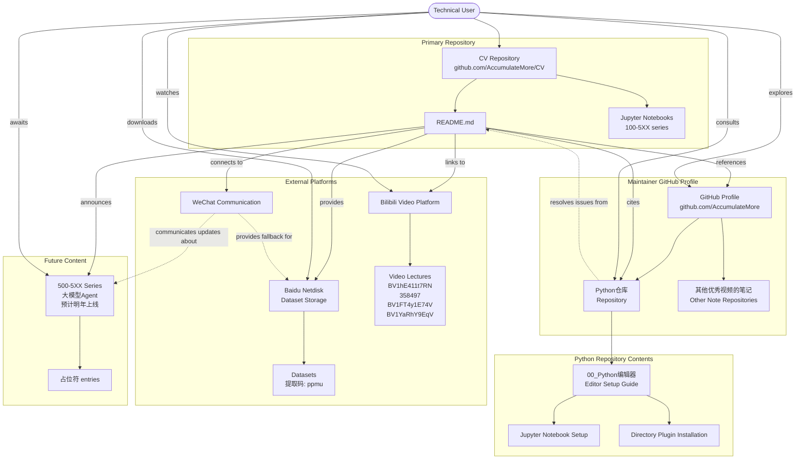
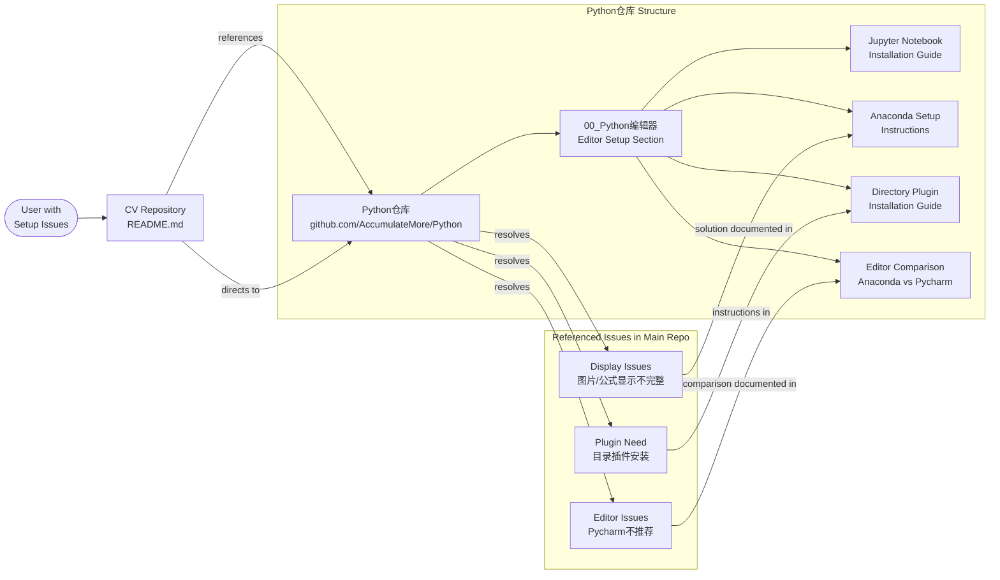
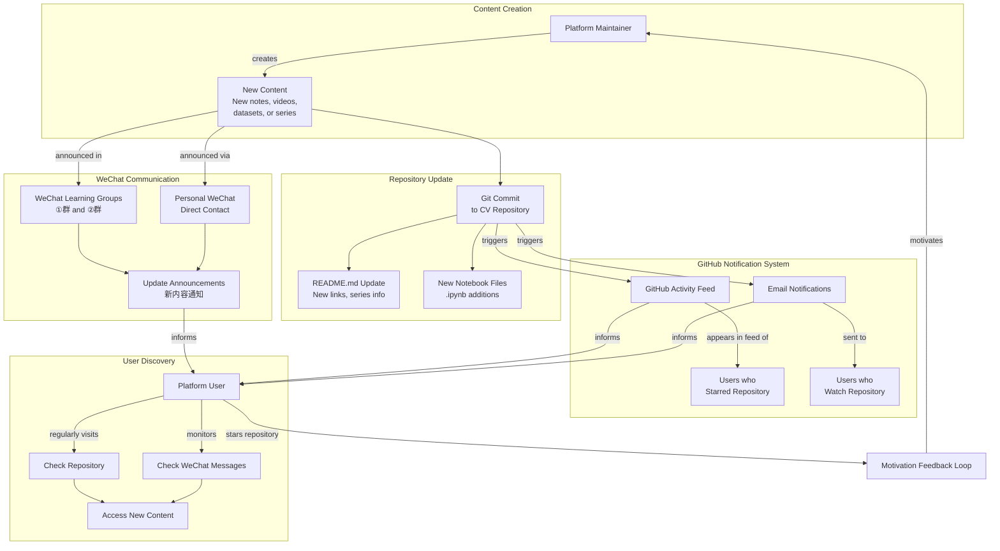
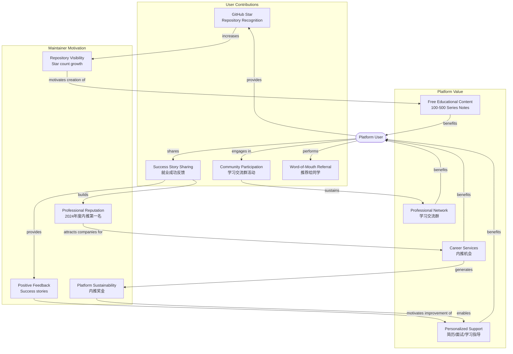
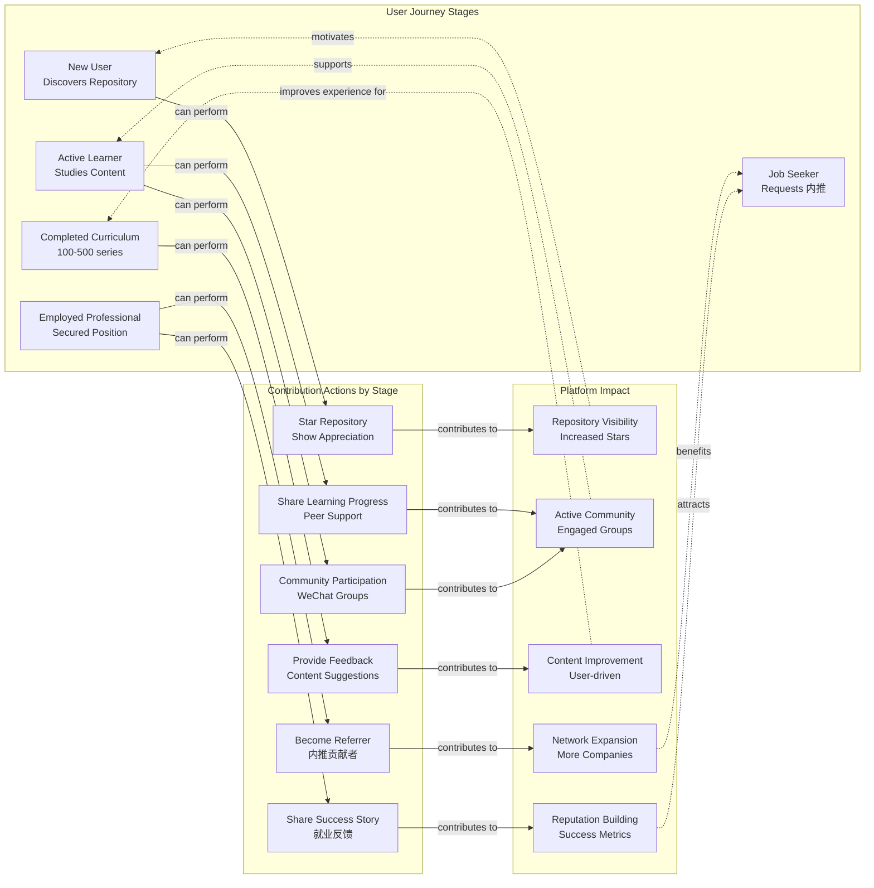
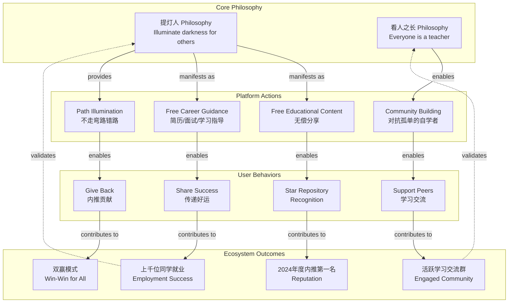

<!-- source: DeepWiki mcp.deepwiki.com · repo AccumulateMore/CV · page 7 Additional Resources and References · fetched 2026-10-29 -->

# Additional Resources and References

<details>
<summary>Relevant source files</summary>

The following files were used as context for generating this wiki page:

- [README.md](README.md)

</details>


This document provides comprehensive information about supplementary resources available to support the deep learning educational platform, including related repositories, methods for staying updated with new content, and ways to engage with and support the platform ecosystem. This page serves as a directory for all external resources referenced throughout the system.

For information about the core educational content, see [Educational Content System](#2). For technical setup guides referenced in external repositories, see [Technical Setup and Access](#3). For community engagement mechanisms, see [Community and Support System](#4).

---

## Overview of External Resource Integration

The platform leverages multiple external resources beyond the primary [README.md:1-180]() file. These include the maintainer's GitHub profile hosting additional repositories, particularly the Python仓库 which contains technical setup documentation, and future content placeholders for ongoing curriculum expansion.

### External Resource Architecture



**Sources:** [README.md:1-180]()

---

## 7.1 Related GitHub Repositories

The platform maintainer hosts multiple repositories on GitHub that complement the main deep learning notes repository. These repositories provide additional learning resources and technical setup documentation.

### 7.1.1 Maintainer GitHub Profile

The maintainer's GitHub profile serves as the central hub for all educational repositories:

- **Profile URL:** https://github.com/AccumulateMore
- **Referenced in:** [README.md:47-49]()

The profile hosts multiple repositories containing notes for various video lecture series beyond the core deep learning content. The README explicitly states: "我的Github主页，还有其他优秀视频的笔记，希望能帮助到你~" (My GitHub homepage has notes for other excellent video series, hoping to help you).

### 7.1.2 Python仓库 (Python Repository)

The Python仓库 is a critical supplementary repository referenced throughout the main README for technical setup guidance. This repository is specifically mentioned when addressing display issues and editor configuration problems.

**Key References:**
- [README.md:37-38](): "或者我的主页Python仓库里面'00_Python编辑器'里面有写" (or in my homepage's Python repository inside '00_Python编辑器' there are instructions)
- [README.md:38-39](): "或者我的主页Python仓库里面'00_Python编辑器'里面有相关链接" (or in my homepage's Python repository inside '00_Python编辑器' there are relevant links)

### Python Repository Content Structure



**Sources:** [README.md:36-39]()

### 7.1.3 Other Educational Repositories

The maintainer's GitHub profile contains additional repositories with notes for "其他优秀视频的笔记" (other excellent video notes). While specific repository names are not enumerated in the main README, users are directed to explore the maintainer's profile for these resources.

**Repository Discovery Pattern:**
1. Access maintainer profile: https://github.com/AccumulateMore
2. Browse repository list
3. Identify repositories containing educational notes
4. Cross-reference with specific learning needs

**Sources:** [README.md:45-49]()

---

## 7.2 Staying Updated

The platform implements multiple mechanisms for users to stay informed about new content, particularly the upcoming 500-5XX series, and to receive notifications about updates to existing materials.

### 7.2.1 Future Content: 500-5XX Series

The curriculum roadmap includes a fifth major series focused on large model agents, currently in planning stages:

**Series Details:**
- **Series Number:** 500-5XX
- **Topic:** 大模型Agent (Large Model Agent)
- **Lecturer:** XXX (to be announced)
- **Status:** 预计明年上线 (expected to launch next year)
- **Current Placeholder:** [README.md:21-23]()

The README contains multiple placeholder entries indicating future content development:
```
大模型Agent 视频讲解【主讲人：XXX】【对应笔记：500-5XX，预计明年上线】

1. 占位符-占位符-占位符-占位符-占位符-占位符-占位符-占位符-占位符-占位符-占位符
```

### Content Update Timeline

```mermaid
gantt
    title "Content Series Development and Update Timeline"
    dateFormat YYYY-MM
    
    section Completed Series
    "100-122: Pytorch (土堆)"           :done, series1, 2020-01, 2023-12
    "200-268: Deep Learning (李沐)"     :done, series2, 2020-06, 2023-12
    "300-354: Deep Learning (吴恩达)"   :done, series3, 2021-01, 2023-12
    "400-409: Large Model Agent (大飞)" :done, series4, 2023-01, 2024-06
    
    section Future Series
    "500-5XX: Large Model Agent (XXX)" :active, series5, 2024-06, 2025-12
    
    section Update Mechanisms
    "GitHub Repository Updates"         :crit, updates1, 2020-01, 2025-12
    "WeChat Group Notifications"        :crit, updates2, 2020-01, 2025-12
    "Star-based Motivation System"      :crit, updates3, 2020-01, 2025-12
```

**Sources:** [README.md:21-23]()

### 7.2.2 GitHub Repository Watch and Star System

The primary mechanism for staying updated is through GitHub's built-in notification system. Users are encouraged to star the repository, which serves dual purposes:

**Star System Functions:**
1. **Update Notifications:** Starred repositories appear in user feeds when updated
2. **Maintainer Motivation:** "你的Star，是我更新的动力~" (Your star is my motivation to update) [README.md:53]()

**Implementation:**
- Navigate to repository: https://github.com/AccumulateMore/CV
- Click "Star" button in top-right corner
- Configure notification preferences in GitHub settings
- Receive updates when new commits, issues, or releases are published

### Update Communication Flow



**Sources:** [README.md:51-53]()

### 7.2.3 WeChat Group Announcements

The WeChat learning groups serve as direct communication channels for content updates:

- **学习交流①群** (Learning Exchange Group 1): [README.md:60-62]()
- **学习交流②群** (Learning Exchange Group 2): [README.md:60-62]()
- **Personal WeChat:** Direct contact for important announcements [README.md:60-62]()

**Announcement Types:**
- New series launches (e.g., 500-5XX series announcement)
- Baidu Netdisk link updates when original links expire
- New video lecture availability
- Critical bug fixes or display issue resolutions

**Sources:** [README.md:58-64]()

### 7.2.4 Update Monitoring Best Practices

**Recommended Update Monitoring Strategy:**

| Monitoring Method | Frequency | Use Case |
|-------------------|-----------|----------|
| GitHub Repository Check | Weekly | Major content additions, new series |
| GitHub Star/Watch Notifications | Automatic | All repository changes |
| WeChat Group Messages | Daily | Urgent updates, link fixes |
| Personal WeChat Contact | As needed | Personalized update inquiries |
| Maintainer Profile Check | Monthly | New repository discoveries |

**Sources:** [README.md:47-53](), [README.md:58-64]()

---

## 7.3 Contributing and Engagement

The platform operates on a community-driven model where user engagement directly influences content development and platform sustainability. Multiple mechanisms exist for users to contribute value and support the ecosystem.

### 7.3.1 GitHub Star Motivation System

The star system serves as the primary feedback mechanism, creating a direct link between user appreciation and maintainer motivation:

**Explicit Motivation Statement:**
```
"♥我的笔记，希望对你有帮助♥"
♥小声哔哔：你的Star，是我更新的动力~♥
```
[README.md:51-53]()

**Star Impact:**
- Increases repository visibility on GitHub
- Appears in "trending repositories" lists
- Signals content quality to new users
- Directly motivates maintainer to create new content

### Engagement Value Exchange Model



**Sources:** [README.md:51-53](), [README.md:165-170]()

### 7.3.2 Success Story Documentation

Users who successfully secure employment through the platform contribute by sharing their success stories, which serve multiple purposes:

**Success Story Value:**
1. **Proof of Concept:** Validates the platform's effectiveness
2. **User Motivation:** Inspires current learners
3. **Reputation Building:** Establishes maintainer credibility
4. **Recruitment Tool:** Attracts new users and companies

**Documented Success Metrics:**
- "上千位同学" (thousands of students) successfully placed [README.md:165]()
- "2024年度内推第一名" (2024 top internal referral provider) [README.md:167-170]()

**Sources:** [README.md:165-170]()

### 7.3.3 Internal Referral Contribution Network

Advanced users and employed alumni can contribute by participating in the internal referral network:

**Contribution Opportunity:**
```
补充：能内推简历的，也可以联系我，把岗位职责、任职要求发给我【你收公司内推奖金、ta们就业，双赢】。
```
[README.md:130]()

**Win-Win Model:**
- **Contributor:** Receives company referral bonus (内推奖金)
- **Job Seeker:** Gains streamlined interview access
- **Platform:** Expands referral network
- **Company:** Receives qualified candidates

### Contribution Pathways



**Sources:** [README.md:51-53](), [README.md:130](), [README.md:165-170]()

### 7.3.4 Enterprise Partnership Contribution

Companies can contribute to the platform by posting job opportunities and providing referral bonuses:

**Company Contribution Model:**
- Post job descriptions with detailed requirements
- Accept internal referrals from platform
- Provide referral bonuses (内推奖金) to referring parties
- Support platform sustainability through win-win arrangements

**Current Enterprise Examples:**
- **联影医疗 (uCloudlink Medical):** Detailed positions posted [README.md:83-129]()
- **Major Tech Companies:** Listed in referral network table [README.md:132-143]()

**Sources:** [README.md:79-143]()

---

## Resource Dependency Matrix

The following table summarizes all external resources and their relationships to the main repository:

| Resource Type | Resource Name | Primary URL/Location | Purpose | Maintainer Control | Fallback Mechanism |
|---------------|---------------|----------------------|---------|-------------------|-------------------|
| **GitHub Repository** | CV Repository | github.com/AccumulateMore/CV | Main content hosting | Full control | N/A (primary) |
| **GitHub Repository** | Python仓库 | github.com/AccumulateMore/Python | Technical setup guide | Full control | Referenced in README |
| **GitHub Profile** | Maintainer Profile | github.com/AccumulateMore | Repository discovery | Full control | N/A |
| **Video Platform** | Bilibili | bilibili.com | Video lecture hosting | No control | None specified |
| **File Storage** | Baidu Netdisk | pan.baidu.com | Dataset storage | Limited control | WeChat contact [README.md:29]() |
| **Communication** | WeChat Groups | QR codes in README | Community support | Moderate control | Personal WeChat |
| **Communication** | Personal WeChat | QR code in README | Direct support | Full control | None needed |
| **Future Content** | 500-5XX Series | To be announced | Upcoming curriculum | Full control | Status tracking in README |

**Sources:** [README.md:1-180]()

---

## Platform Philosophy and Engagement Principles

The platform operates on core philosophical principles that guide all engagement and contribution:

### Guiding Principles

**"看人之短，无一可交之人。看人之长，天下皆是吾师。"**
(Focus on others' shortcomings, and no one is worth befriending. Focus on others' strengths, and everyone in the world is your teacher.)
[README.md:66]()

**"我们读书是为了成为提灯人去照亮黑暗，而不是为了自己有灯而沾沾自喜还要去吹灭别人的蜡烛"**
(We study to become lamp bearers to illuminate the darkness, not to be self-satisfied with our own light and extinguish others' candles)
[README.md:179]()

These principles emphasize:
- Learning from others regardless of status
- Supporting peer learning rather than competition
- Sharing knowledge freely to benefit the community
- Illuminating paths for others as gratitude for one's own learning

### Philosophical Value Flow



**Sources:** [README.md:66](), [README.md:179]()

---

## Accessing Additional Resources Checklist

For users seeking to fully leverage all available resources, follow this comprehensive checklist:

### Essential Actions

- [ ] **Star the main CV repository** for updates and motivation [README.md:53]()
- [ ] **Bookmark maintainer GitHub profile** https://github.com/AccumulateMore [README.md:47-49]()
- [ ] **Access Python仓库** for technical setup guides [README.md:37-38]()
- [ ] **Review 00_Python编辑器 section** for editor configuration [README.md:37-38]()
- [ ] **Join WeChat learning groups** for community updates [README.md:60-62]()
- [ ] **Add personal WeChat** if groups are full (>200 members) [README.md:64]()
- [ ] **Save Baidu Netdisk link** and extraction code (ppmu) [README.md:27]()
- [ ] **Subscribe to Bilibili channels** for video updates
- [ ] **Check README regularly** for 500-5XX series announcements [README.md:21-23]()
- [ ] **Share success stories** after employment to support community

### Advanced Engagement

- [ ] **Explore other repositories** on maintainer's profile for additional notes
- [ ] **Contribute to internal referral network** if employed at partner companies [README.md:130]()
- [ ] **Provide feedback** on content quality and suggestions
- [ ] **Participate actively** in WeChat learning groups
- [ ] **Recommend platform** to peers pursuing deep learning careers
- [ ] **Monitor GitHub issues/discussions** for problem resolution threads

**Sources:** [README.md:1-180]()

---

