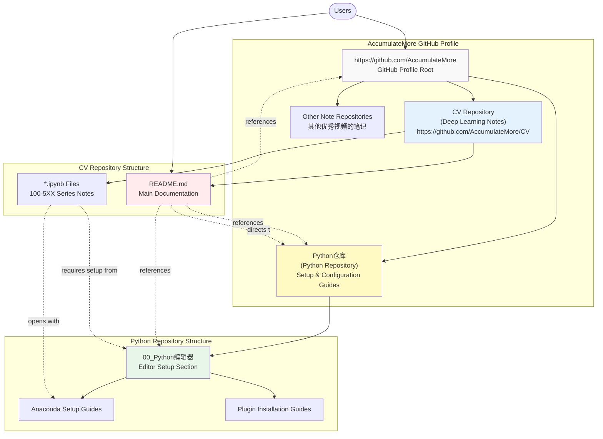
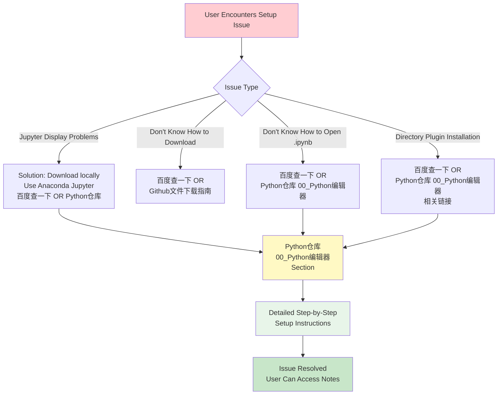
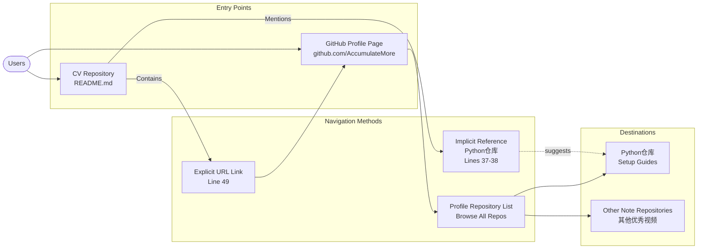
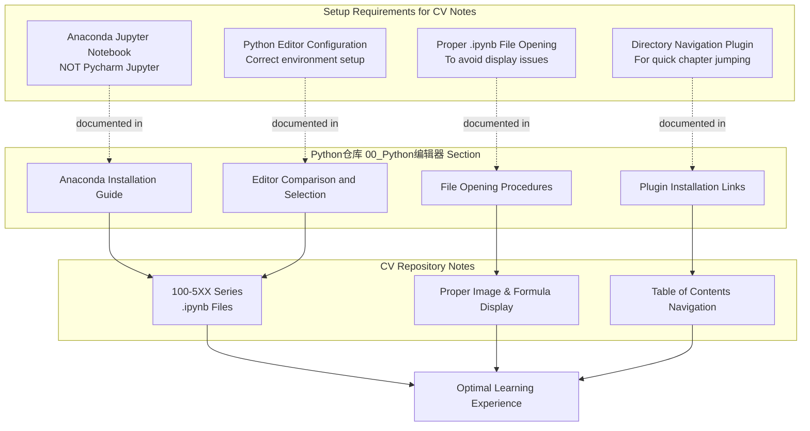

<!-- source: DeepWiki mcp.deepwiki.com · repo AccumulateMore/CV · page 7.1 Related GitHub Repositories · fetched 2026-10-29 -->

# Related GitHub Repositories

<details>
<summary>Relevant source files</summary>

The following files were used as context for generating this wiki page:

- [README.md](README.md)

</details>


## Purpose and Scope

This page documents the maintainer's GitHub ecosystem beyond the primary CV repository. It catalogs related repositories that provide complementary technical resources, particularly the Python仓库 (Python Repository) referenced throughout the main README.md for setup guides and editor configuration. For information about the primary CV repository structure, see [Overview](#1). For details on technical setup procedures, see [Technical Setup and Access](#3).

Sources: [README.md:37-49]()

---

## Maintainer's GitHub Profile

The CV repository is part of a broader collection of educational resources maintained by a single GitHub account. The maintainer's profile serves as a central hub for multiple video lecture note repositories.

### GitHub Homepage Reference

The README.md explicitly directs users to explore additional repositories:

```
我的Github主页，还有其他优秀视频的笔记，希望能帮助到你~
https://github.com/AccumulateMore
```

**Account URL**: `https://github.com/AccumulateMore`

This GitHub profile hosts multiple repositories, each containing curated notes for different video lecture series. The CV repository (deep learning notes) is the flagship resource but not the only educational material available.

Sources: [README.md:45-49]()

---

## Python Repository (Python仓库)

### Purpose and Content

The Python仓库 is referenced twice in the README.md as a companion resource for technical setup and editor configuration. This repository provides foundational setup guides that are prerequisites for using the deep learning notes effectively.

### Specific Sections Referenced

The README.md directs users to specific content within the Python repository:

| Reference Context | Section Name | Purpose |
|------------------|--------------|---------|
| Anaconda Jupyter setup instructions | `00_Python编辑器` | Contains guides for opening Jupyter Notebook files with Anaconda |
| Directory plugin installation | `00_Python编辑器` | Contains links for installing Jupyter Notebook directory navigation plugin |

**Referenced Lines**:
- Line 37: "或者我的主页Python仓库里面"00_Python编辑器"里面有写"
- Line 38: "或者我的主页Python仓库里面"00_Python编辑器"里面有相关链接"

### Technical Guidance Coverage

The `00_Python编辑器` section specifically addresses:

1. **Editor Selection**: How to choose and configure Python editors for Jupyter notebooks
2. **Anaconda Setup**: Step-by-step instructions for Anaconda Jupyter Notebook configuration
3. **Plugin Installation**: Links and procedures for installing the directory navigation plugin
4. **File Opening Procedures**: How to properly open `.ipynb` files to ensure correct rendering

This repository serves as a fallback documentation source when users encounter setup difficulties or need more detailed technical guidance than the brief instructions in the CV repository README.md.

Sources: [README.md:37-38]()

---

## Repository Relationship Architecture

### Dependency Model



**Diagram: Repository Dependency and Reference Model**

This diagram illustrates the hierarchical relationship between repositories under the AccumulateMore profile. The Python仓库 serves as a dependency for the CV repository, providing essential setup documentation that enables proper use of the deep learning notes.

Sources: [README.md:37-38,45-49]()

---

## Cross-Repository Reference Patterns

### Technical Support Flow

The README.md uses a consistent pattern for directing users to the Python repository when technical issues arise:



**Diagram: Technical Support Reference Flow Between Repositories**

This flow demonstrates how the README.md systematically redirects users to the Python仓库 for detailed technical guidance. Each reference provides dual options: either search online (百度查一下) or consult the Python仓库.

Sources: [README.md:36-38]()

---

## Reference Patterns in README.md

### Dual-Source Documentation Strategy

The maintainer employs a two-tier documentation strategy:

| Primary Source | Secondary Source | Use Case |
|----------------|------------------|----------|
| Brief inline instructions in CV README.md | Python仓库 `00_Python编辑器` | Users need quick guidance vs. detailed tutorials |
| External search (百度查一下) | Python仓库 links | Users prefer self-service vs. curated resources |
| Generic problem description | Specific section reference | Users need direction vs. exact solutions |

### Example Reference Format

```
不会打开笔记的，百度查一下"Anaconda如何打开Jupyter Notebook文件"，
或者我的主页Python仓库里面"00_Python编辑器"里面有写。
```

**Pattern Structure**:
1. Identify user knowledge gap ("不会XXX的")
2. Provide generic search query for self-service ("百度查一下'...'")
3. Offer curated alternative ("或者我的主页Python仓库里面'...'")

This pattern appears three times in the README.md:
- Line 36: For downloading files from GitHub
- Line 37: For opening Jupyter Notebook files
- Line 38: For installing directory plugins

Sources: [README.md:36-38]()

---

## Accessing Related Repositories

### Discovery Pathways

Users can discover and access related repositories through multiple pathways:



**Diagram: Repository Discovery and Navigation Paths**

Users have both direct (explicit URL) and indirect (implicit mentions) paths to discover related repositories. The GitHub profile serves as the central hub for browsing all available resources.

Sources: [README.md:37-38,45-49]()

---

## Repository Ecosystem Value Proposition

### Complementary Resource Strategy

The multi-repository approach provides distinct benefits:

| Aspect | CV Repository | Python仓库 | Combined Benefit |
|--------|--------------|-----------|------------------|
| **Content Focus** | Deep learning educational notes | Technical setup and configuration | Separation of concerns |
| **Update Frequency** | Content updates with new lecture series | Stable setup procedures | Focused maintenance |
| **User Journey Stage** | Learning phase | Setup/preparation phase | Progressive guidance |
| **Documentation Depth** | Brief technical notes in README | Detailed step-by-step guides | Appropriate detail level |
| **Discoverability** | High visibility (main repository) | Referenced as needed | Efficient information architecture |

### Cross-Repository Synergy

The repositories work together to support the complete user journey:

1. **User discovers CV repository** via GitHub search or recommendations
2. **User attempts to access notes** but encounters technical issues
3. **README.md references Python仓库** for detailed setup instructions
4. **User follows reference** to `00_Python编辑器` section
5. **User configures environment** successfully using detailed guides
6. **User returns to CV repository** to study deep learning notes
7. **User explores other repositories** from maintainer's profile

This design prevents the CV repository README.md from becoming cluttered with extensive technical documentation while ensuring users have access to necessary setup information.

Sources: [README.md:36-38,45-49]()

---

## Technical Integration Points

### Setup Dependencies

The Python仓库 specifically addresses setup requirements for the CV repository:



**Diagram: Technical Dependency and Setup Flow**

This diagram shows how the Python仓库's `00_Python编辑器` section provides the necessary technical foundation for successfully using the CV repository's deep learning notes.

Sources: [README.md:36-38]()

---

## Future Repository Additions

### Expansion Indicators

The README.md suggests ongoing expansion of the repository ecosystem:

```
我的Github主页，还有其他优秀视频的笔记，希望能帮助到你~
```

This statement indicates:
- **Current State**: Multiple repositories exist beyond CV and Python仓库
- **Content Type**: Notes for "other excellent videos" (其他优秀视频)
- **Future Growth**: Implicit commitment to continued content creation
- **User Discovery**: Encourages profile exploration to find additional resources

The maintainer's approach suggests a pattern of creating separate repositories for each major video lecture series or topic area, maintaining the modular structure evident in the current ecosystem.

Sources: [README.md:45-49]()

---

## Summary Table: Repository Ecosystem

| Repository | Primary Purpose | Key Content | Referenced In | User Access Method |
|-----------|-----------------|-------------|---------------|-------------------|
| **CV Repository** | Deep learning notes repository | 100-5XX series `.ipynb` files, curriculum guide | Main entry point | Direct GitHub URL |
| **Python仓库** | Technical setup and configuration | `00_Python编辑器` section with setup guides | CV README.md lines 37-38 | Implicit reference, profile browsing |
| **Other Repositories** | Notes for additional video series | Unspecified video lecture notes | CV README.md line 47 | Profile browsing |
| **GitHub Profile** | Central discovery hub | Repository list and overview | CV README.md line 49 | https://github.com/AccumulateMore |

Sources: [README.md:36-49]()

---

