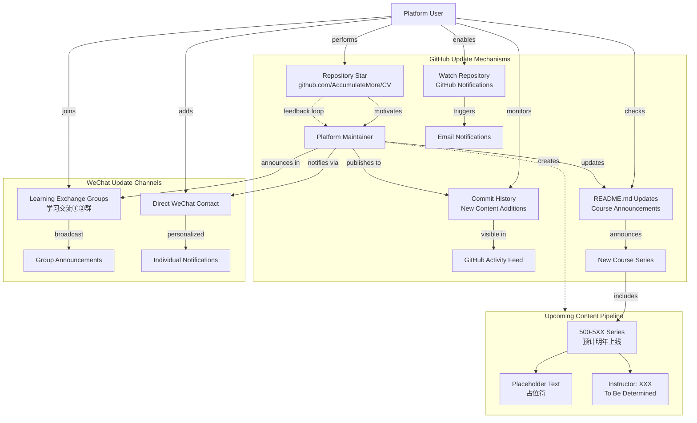
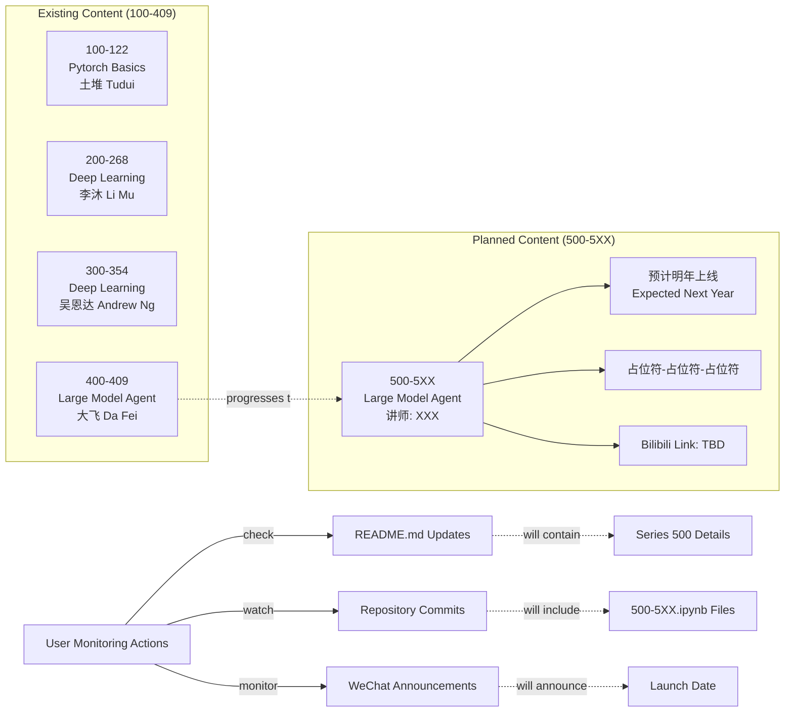
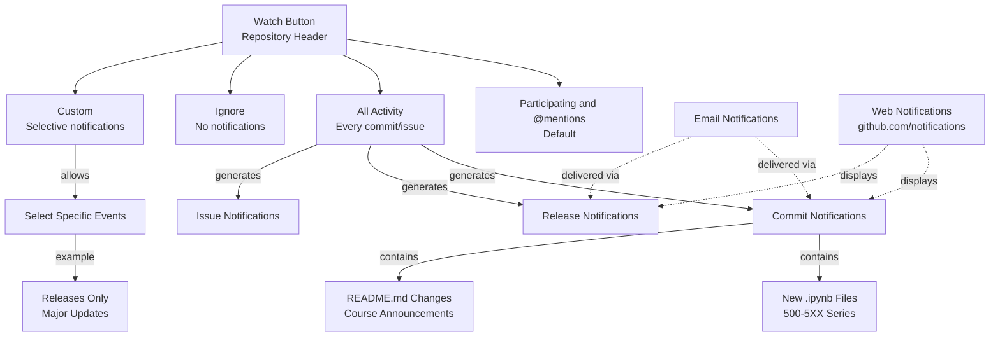
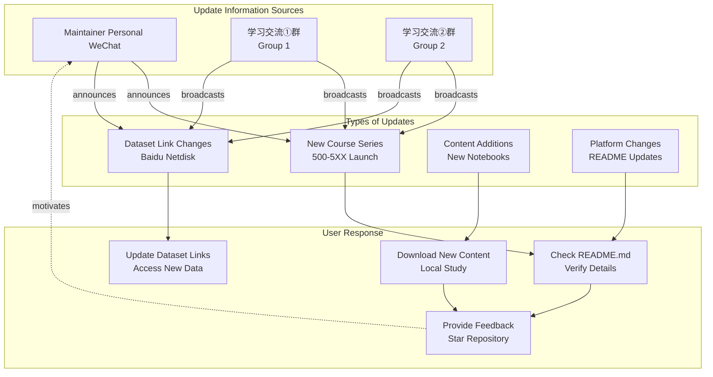
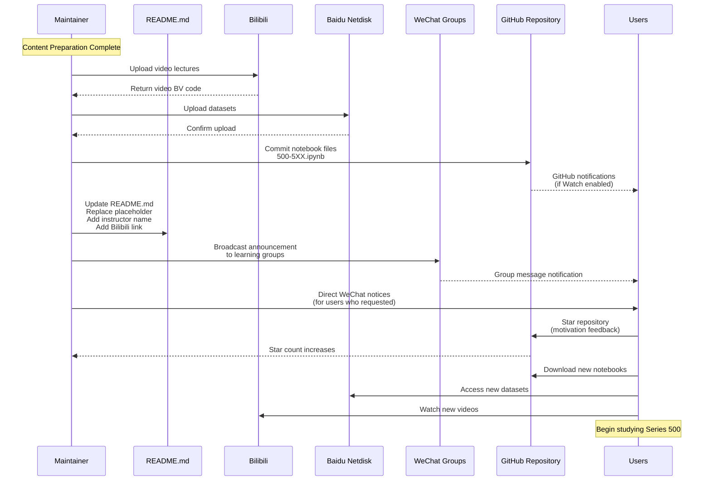
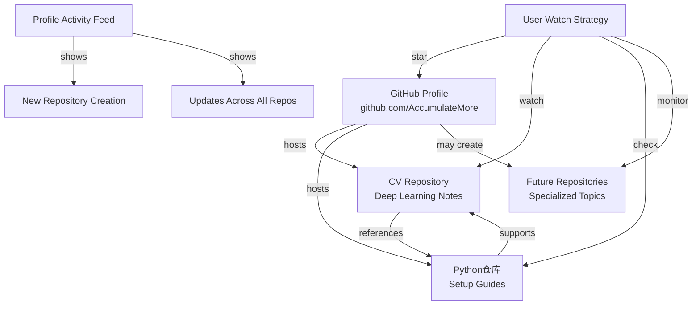
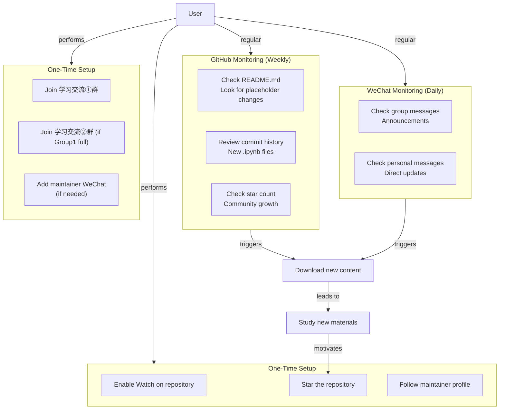
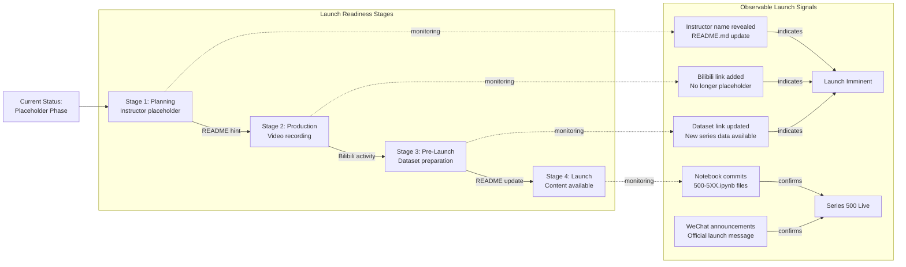
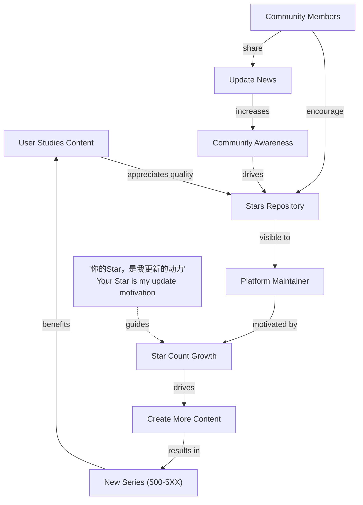

<!-- source: DeepWiki mcp.deepwiki.com · repo AccumulateMore/CV · page 7.2 Staying Updated · fetched 2026-10-29 -->

# Staying Updated

<details>
<summary>Relevant source files</summary>

The following files were used as context for generating this wiki page:

- [README.md](README.md)

</details>


## Purpose and Scope

This page documents the mechanisms for staying informed about new content, updates, and announcements in the deep learning notes repository. It explains how the platform communicates updates through its decentralized infrastructure, the role of GitHub stars in motivating content creation, and how users can monitor for new course series (particularly the upcoming 500-5XX series). For information about the broader community engagement infrastructure, see [Community and Support System](#4).

---

## Update Communication Architecture

The platform does not implement a centralized notification system. Instead, it leverages existing platform features across GitHub and WeChat to communicate updates to users.



**Sources:** [README.md:1-54]()

---

## GitHub Star Motivation System

The repository explicitly links GitHub stars to maintainer motivation for creating new content. This creates a direct feedback mechanism where user engagement drives content production.

### Star-Driven Content Creation

The README contains a specific motivation statement:

> "♥小声哔哔：你的Star，是我更新的动力~♥"
> 
> Translation: "Your Star is my motivation to update"

This statement appears in [README.md:53]() and establishes stars as the primary metric for measuring user appreciation and support.

| Engagement Type | Location | Purpose | Impact |
|-----------------|----------|---------|--------|
| **GitHub Star** | Repository header | Show appreciation | Motivates new content creation |
| **Repository Watch** | GitHub notifications | Receive updates | Enables automatic notifications |
| **WeChat Group Join** | Learning exchange groups | Community updates | Real-time announcement access |
| **Direct WeChat Contact** | Personal communication | Immediate notifications | Personalized update alerts |

### How to Star the Repository

Users can star the repository through GitHub's native interface:

1. Navigate to `https://github.com/AccumulateMore/CV`
2. Click the "Star" button in the repository header
3. Optionally enable "Watch" for commit notifications
4. Check "Releases only" or "All Activity" based on preference

**Sources:** [README.md:51-53]()

---

## Future Content: 500-5XX Series

The repository includes a placeholder for future content expansion in the 500-series range, which represents the next phase of course materials beyond the existing 100-400 series.

### Series 500-5XX Specifications



The placeholder structure in [README.md:21-23]() follows the established pattern:

```
大模型Agent 视频讲解【主讲人：XXX】【对应笔记：500-5XX，预计明年上线】

1. 占位符-占位符-占位符-占位符-占位符-占位符-占位符-占位符-占位符-占位符-占位符
```

### What We Know About Series 500

| Attribute | Status | Details |
|-----------|--------|---------|
| **Topic** | Confirmed | 大模型Agent (Large Model Agent) |
| **Note Range** | Defined | 500-5XX |
| **Instructor** | Unannounced | XXX (placeholder) |
| **Video Platform** | Expected | Bilibili (following existing pattern) |
| **Dataset** | Likely | Will be added to Baidu Netdisk link |
| **Timeline** | Estimated | 预计明年上线 (Expected next year) |
| **Launch Status** | Pre-production | Placeholder phase |

**Sources:** [README.md:21-23]()

---

## GitHub Watch and Notification Features

GitHub provides native notification mechanisms that users can configure to receive updates automatically.

### Watch Configuration Options

Users who enable "Watch" on the repository at `https://github.com/AccumulateMore/CV` can choose notification levels:



### Monitoring Repository Changes

Users can track updates through multiple GitHub interfaces:

1. **Commit History**: `https://github.com/AccumulateMore/CV/commits/main`
   - New notebook files appear as commits
   - README.md updates announce new series
   
2. **Activity Feed**: Personal GitHub dashboard
   - Shows starred repository activity
   - Displays new commits and releases

3. **File-Specific Watch**: Monitor `README.md` directly
   - Changes to [README.md:1-180]() indicate updates
   - New series announcements appear in structured format

**Sources:** [README.md:1-180]()

---

## WeChat-Based Update Channels

The WeChat infrastructure serves as the primary real-time communication channel for updates and announcements.

### Learning Exchange Groups

The two WeChat learning groups function as broadcast channels for announcements:

| Group | Purpose | Capacity | Update Role |
|-------|---------|----------|-------------|
| **学习交流①群** | Learning exchange | 200 members | Receives maintainer announcements |
| **学习交流②群** | Learning exchange | 200 members | Receives maintainer announcements |

Group members in [README.md:60-64]() receive:
- New course series launch announcements
- Dataset link updates when links expire
- Major platform changes
- Community events and opportunities

### Direct WeChat Contact

Users who add the maintainer's personal WeChat can request specific update notifications:

Valid reasons for contact listed in [README.md:70-74]():
- 要数据集 (Request datasets) - includes update notifications
- 要进学习交流群 (Join learning groups) - for announcement access
- Updates about specific course series



**Sources:** [README.md:58-74]()

---

## Update Announcement Pattern

Based on the existing structure in [README.md:1-23](), new content follows a predictable announcement pattern that users can monitor.

### Standard Announcement Format

When new series are announced, they follow this template structure:

```
[Topic] 视频讲解【主讲人：[Instructor]】【对应笔记：[Range]】

1. [Bilibili URL or Placeholder]
```

### Historical Pattern Analysis

| Series | Announcement Format | Current Status |
|--------|-------------------|----------------|
| **100-122** | Pytorch 视频讲解【主讲人：土堆】 | ✓ Active |
| **200-268** | 深度学习 视频讲解【主讲人：李沐】 | ✓ Active |
| **300-354** | 深度学习 视频讲解【主讲人：吴恩达】 | ✓ Active |
| **400-409** | 大模型Agent 视频讲解【主讲人：大飞】 | ✓ Active |
| **500-5XX** | 大模型Agent 视频讲解【主讲人：XXX】 | ⏳ Placeholder |

### Expected Update Sequence for Series 500

When the 500-5XX series launches, users can expect the following update sequence:



**Sources:** [README.md:5-23]()

---

## Dataset Update Notifications

Dataset links occasionally expire, requiring updates that are communicated through the update channels.

### Current Dataset Access

The primary dataset link in [README.md:27]():
```
链接: https://pan.baidu.com/s/1KTW2WsTy6TFpNdK_WwjBmg 提取码: ppmu
```

### Fallback Mechanism

When the dataset link expires, users are directed to WeChat contact in [README.md:29]():
```
补充说明：数据集链接如果失效了，下面有微信，可以联系我。
```

### Dataset Update Process

| Event | Action | Communication Channel | User Response |
|-------|--------|---------------------|---------------|
| Link expires | User notices broken link | - | Contact WeChat |
| Maintainer receives report | Upload to new Baidu location | - | Generate new link |
| New link available | Update README.md | GitHub commit | Check README |
| Announcement sent | Broadcast to groups | WeChat groups | Update local link |
| Individual assistance | Provide link directly | Direct WeChat | Access datasets |

**Sources:** [README.md:25-29]()

---

## Monitoring the GitHub Homepage

The maintainer's GitHub profile provides access to related repositories that may also receive updates.

### Related Repository Network

The README references the maintainer's homepage in [README.md:45-49]():

```
更多笔记：

我的Github主页，还有其他优秀视频的笔记，希望能帮助到你~

1. https://github.com/AccumulateMore
```

Users monitoring for updates should also watch:
- **Main Profile**: `https://github.com/AccumulateMore`
- **Python Repository**: Referenced in [README.md:37-38]() for setup guides
- **Future Repositories**: May be created for specialized topics

### Cross-Repository Update Strategy



**Sources:** [README.md:37-38](), [README.md:45-49]()

---

## No Automated Notification Systems

The platform explicitly does not implement custom notification infrastructure. All updates rely on existing platform features.

### What Is NOT Available

| Feature | Status | Alternative |
|---------|--------|-------------|
| **Email Subscription** | Not implemented | GitHub Watch email |
| **RSS Feed** | Not provided | GitHub commit feed |
| **Mobile App** | Not available | WeChat mobile app |
| **Newsletter** | Not published | WeChat group messages |
| **Push Notifications** | Not custom | GitHub/WeChat native |
| **Update Calendar** | Not maintained | Monitor README changes |

### Why This Approach

The decentralized update system aligns with the platform's architecture:

1. **Single-File Simplicity**: No backend infrastructure required
2. **Platform Leverage**: Uses existing GitHub/WeChat features
3. **Low Maintenance**: No custom notification server to maintain
4. **Direct Communication**: WeChat enables immediate two-way contact
5. **Community-Driven**: Groups facilitate peer-to-peer update sharing

**Sources:** [README.md:1-180]()

---

## Practical Staying Updated Checklist

Users who want to stay informed about updates should implement the following monitoring strategy:

### Weekly Monitoring Tasks



### Recommended Update Monitoring Schedule

| Frequency | Action | Platform | Expected Information |
|-----------|--------|----------|---------------------|
| **Daily** | Check WeChat groups | WeChat | Immediate announcements |
| **Weekly** | Check README.md | GitHub | Placeholder status changes |
| **Weekly** | Review commit history | GitHub | New notebook additions |
| **Monthly** | Check maintainer profile | GitHub | New repositories |
| **As needed** | Contact via WeChat | WeChat | Specific update questions |

**Sources:** [README.md:1-180]()

---

## Update Timeline Expectations

Based on the current placeholder status and typical course production timelines, users can form reasonable expectations about the 500-5XX series launch.

### Timeline Indicators

The phrase "预计明年上线" (expected next year) in [README.md:21]() provides a general timeframe, but specific dates depend on:

1. **Instructor Selection**: "XXX" placeholder must be replaced with confirmed instructor
2. **Video Recording**: Bilibili video series must be recorded and uploaded
3. **Note Preparation**: Jupyter notebooks must be created and tested
4. **Dataset Curation**: Supporting datasets must be collected and uploaded
5. **Quality Review**: Content must meet platform standards

### Monitoring Readiness Indicators

Users can watch for these signals that indicate Series 500 is approaching launch:



**Sources:** [README.md:21-23]()

---

## Community-Driven Update Awareness

The WeChat learning groups serve as a community notification system where members share update discoveries.

### Peer Update Sharing

In the learning exchange groups ([README.md:60-64]()), members often:
- Share when they notice README updates
- Discuss new content as it becomes available
- Help each other access updated dataset links
- Coordinate downloading new materials

### Motivation Loop

The star motivation system creates a feedback loop:



This community-driven approach means that active WeChat group participation naturally keeps users informed about updates through peer communication.

**Sources:** [README.md:53](), [README.md:58-64]()

---

## Summary

The CV repository's update communication system is decentralized and relies on existing platform infrastructure rather than custom notification systems. Users stay informed through:

- **GitHub Stars**: Motivate content creation and signal support
- **GitHub Watch**: Enable automatic commit notifications
- **WeChat Groups**: Provide real-time announcement broadcasts
- **Direct WeChat**: Offer personalized update notifications
- **README Monitoring**: Track placeholder changes for Series 500
- **Community Sharing**: Leverage peer-to-peer update awareness

The upcoming 500-5XX series represents the next phase of content expansion, currently in placeholder stage with an expected launch timeline of "next year" (明年). Users who implement the recommended monitoring strategy will be promptly informed when new content becomes available.

**Sources:** [README.md:1-180]()

---

