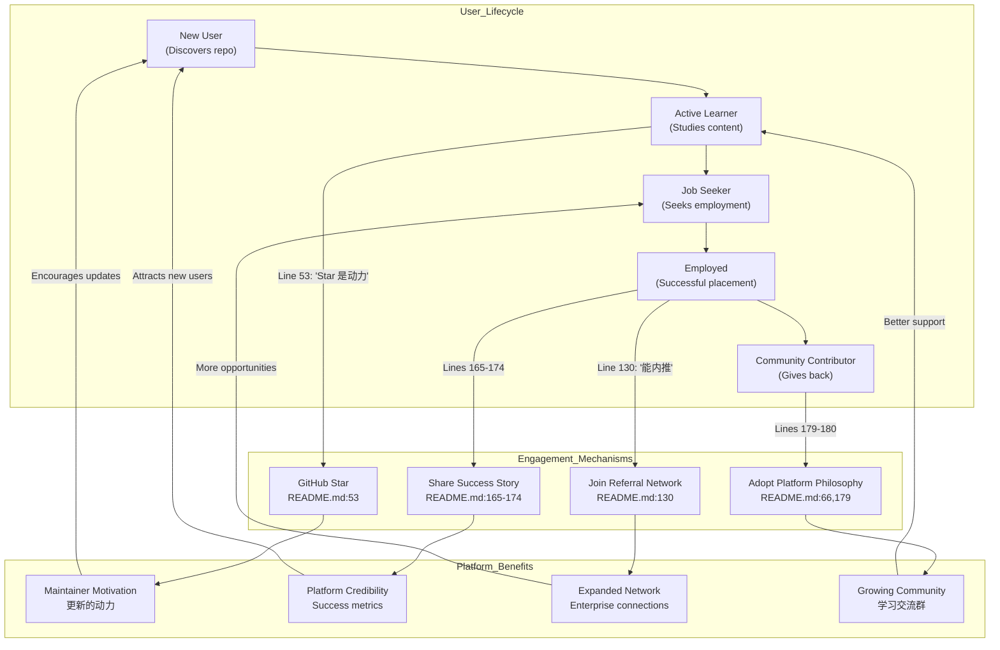
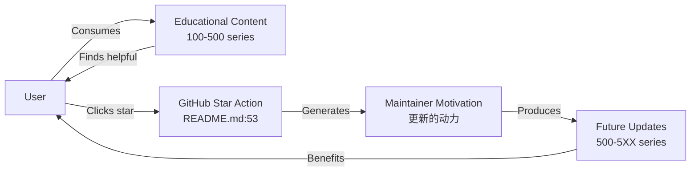
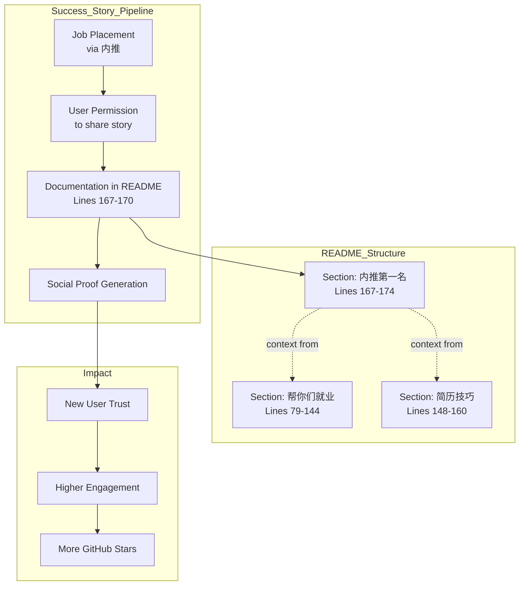
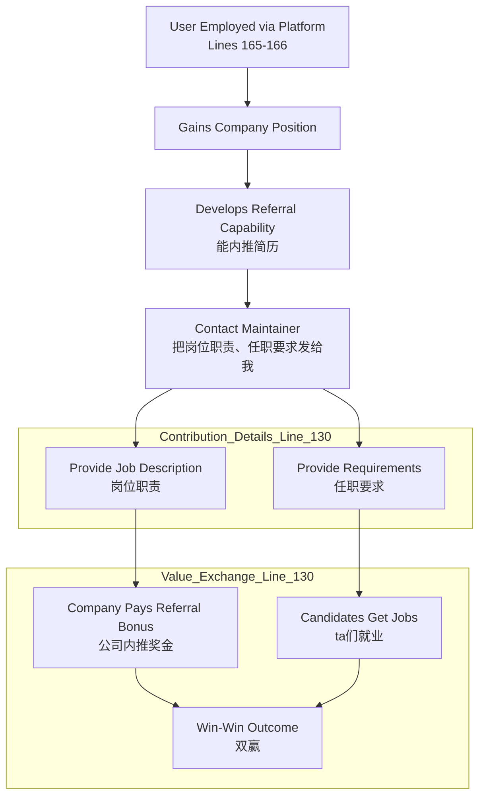
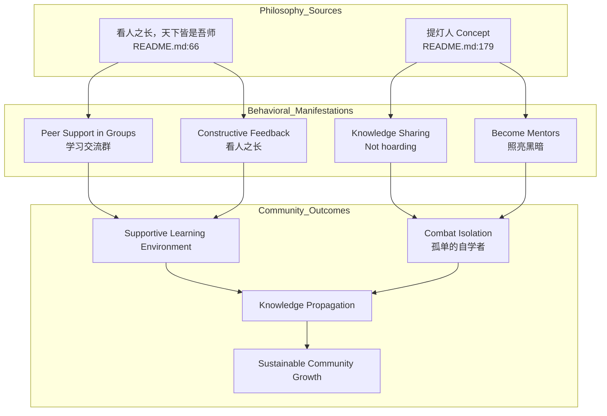
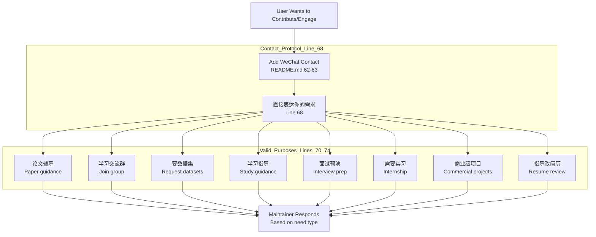

<!-- source: DeepWiki mcp.deepwiki.com · repo AccumulateMore/CV · page 7.3 Contributing and Engagement · fetched 2026-10-29 -->

# Contributing and Engagement

Relevant source files

The following files were used as context for generating this wiki page:

- [README.md](README.md)

This document explains the mechanisms through which users can support and contribute to the platform's growth, including the GitHub star system as a motivation mechanism, success story sharing, community engagement models, and the philosophical foundation that encourages users to become "lamp bearers" (提灯人) for others. This page focuses on how users transition from content consumers to community contributors.

For information about joining learning groups and accessing support, see [Community and Support System](#4). For details about job placement outcomes, see [Platform Outcomes and Success Stories](#6).

## Overview of Contribution Model

The platform employs a non-traditional contribution model where users support the system through engagement rather than code contributions. Since the repository consists of a single documentation file, traditional open-source contribution mechanisms (pull requests, code reviews) are not applicable.

**Sources:** [README.md:51-53](), [README.md:165-174](), [README.md:179-180]()

## GitHub Star Mechanism

The primary contribution mechanism is the GitHub star system, which serves as both a success metric and a motivation tool for the maintainer.

### Star as Motivation Token

The platform explicitly states the relationship between user engagement and content updates:

| Reference | Text | Function |
|-----------|------|----------|
| [README.md:53]() | `♥小声哔哔：你的Star，是我更新的动力~♥` | Direct motivation statement |
| [README.md:51]() | `"♥我的笔记，希望对你有帮助♥"` | Value proposition |

The star mechanism operates as a lightweight feedback loop where user appreciation directly translates to maintainer motivation for content updates, particularly for future series (500-5XX) mentioned in [README.md:21]().

**Sources:** [README.md:51-53](), [README.md:21]()

### Star Count as Social Proof

While not explicitly displayed in the README, GitHub stars serve as social proof for new users discovering the repository. This implicit contribution mechanism helps attract additional learners without requiring active marketing efforts.

**Sources:** [README.md:53]()

## Success Story Sharing

Users who successfully secure employment through the platform contribute by allowing their success stories to be shared, creating credibility and demonstrating the system's effectiveness.

### Success Metrics Documentation

The platform documents concrete outcomes as evidence of effectiveness:

| Metric | Location | Value |
|--------|----------|-------|
| Total placements | [README.md:165]() | `上千位同学` (thousands of students) |
| Referral ranking | [README.md:167]() | `2024届年度 内推第一名` (2024 top internal referral provider) |
| Visual evidence | [README.md:167-170]() | Three screenshot images with captions |

**Sources:** [README.md:165-174]()

### Anonymous Success Evidence

The platform displays success screenshots with the message `一起沾沾喜气，好运是可以传染的` (share the good fortune, luck is contagious) in [README.md:170](), creating a positive emotional association while maintaining user privacy through screenshot formatting.

**Sources:** [README.md:167-170]()

## Community Referral Network Contribution

Advanced users who secure positions at companies can contribute by joining the referral network, creating a reciprocal value exchange.

### Referral Network Expansion Model

The platform explicitly invites users who can provide internal referrals to contribute:

**Sources:** [README.md:130](), [README.md:165-166]()

### Enterprise Network Table Structure

The referral network is documented in a structured table format spanning [README.md:132-143](), containing 8 columns and multiple rows listing companies across technology, automotive, finance, and healthcare sectors. This table serves as both a contribution invitation and a demonstration of network breadth.

**Sources:** [README.md:132-143]()

## Philosophical Foundation and Cultural Contribution

Users contribute to the platform's culture by adopting and propagating its philosophical principles, which emphasize mutual learning and community support.

### Core Philosophical Statements

The platform articulates two key philosophical principles that guide engagement:

| Line | Chinese Text | Translation | Purpose |
|------|--------------|-------------|---------|
| [README.md:66]() | `看人之短，无一可交之人。看人之长，天下皆是吾师。` | See others' shortcomings, no one is worth befriending. See others' strengths, everyone is a teacher. | Community interaction guidance |
| [README.md:179]() | `我们读书是为了成为提灯人去照亮黑暗，而不是为了自己有灯而沾沾自喜还要去吹灭别人的蜡烛` | We study to become lamp bearers illuminating darkness, not to boast about our own light or extinguish others' candles. | Purpose of learning |

**Sources:** [README.md:66](), [README.md:179-180]()

### Anti-Pattern: Isolated Learning

The platform explicitly identifies `孤单的自学者` (isolated self-learners) in [README.md:58]() as a problem it aims to solve. Users contribute by actively participating in community groups rather than learning in isolation, thereby strengthening the community ecosystem.

**Sources:** [README.md:58]()

## Engagement Workflow and Contact Protocol

The platform defines specific engagement protocols to manage contributor interactions efficiently.

### Valid Contribution Reasons

Users are explicitly instructed to state their purpose when initiating contact, as documented in [README.md:68-74]():

**Sources:** [README.md:68-74]()

### High-Volume Request Management

The platform acknowledges high contact volume (`因为好友申请太多了` - too many friend requests) in [README.md:68](), necessitating the structured approach where users immediately state their intent. This protocol enables efficient triage and response.

**Sources:** [README.md:68]()

## Contribution Impact Metrics

The platform demonstrates measurable impact from user contributions and engagement:

### Quantitative Impact

| Metric Type | Value | Location | Contribution Source |
|-------------|-------|----------|---------------------|
| Total successful placements | `上千位同学` | [README.md:165]() | Success story sharing + referrals |
| Referral ranking | `2024届年度内推第一名` | [README.md:167]() | Network expansion contributions |
| Group structure | Two groups (学习交流①群, ②群) | [README.md:60-62]() | Community engagement |
| Enterprise network size | 64+ companies | [README.md:132-143]() | Referral network contributions |

**Sources:** [README.md:60-62](), [README.md:132-143](), [README.md:165-170]()

### Qualitative Impact

The platform emphasizes the collective benefit model (`双赢` - win-win) mentioned in [README.md:130](), where:

1. **Contributors receive**: Company referral bonuses (`公司内推奖金`)
2. **Candidates receive**: Employment opportunities (`ta们就业`)
3. **Platform receives**: Enhanced credibility and network effects
4. **Community receives**: More opportunities and support resources

**Sources:** [README.md:130]()

## Summary: Contribution Mechanisms

The following table summarizes all contribution mechanisms and their implementations in the codebase:

| Mechanism | Implementation | File Reference | Impact |
|-----------|---------------|----------------|--------|
| GitHub Stars | Motivation token system | [README.md:53]() | Content update encouragement |
| Success Story Sharing | Screenshot documentation with permission | [README.md:167-170]() | Social proof and credibility |
| Referral Network Expansion | Company contact + job posting provision | [README.md:130]() | Network growth and opportunities |
| Philosophy Adoption | Behavioral guidelines in community | [README.md:66,179]() | Culture propagation |
| Structured Engagement | WeChat contact with stated purpose | [README.md:68-74]() | Efficient contribution processing |

**Sources:** [README.md:53](), [README.md:66](), [README.md:68-74](), [README.md:130](), [README.md:167-170](), [README.md:179-180]()