# Page: Overview

# Overview

<details>
<summary>Relevant source files</summary>

The following files were used as context for generating this wiki page:

- [README.md](README.md)

</details>


## Purpose and Scope

This document provides an overview of the CV repository, a comprehensive deep learning education and career development platform orchestrated through a single `README.md` file. The platform coordinates educational content, technical delivery, community support, and career services to guide users from initial learning through job placement.

The system covers deep learning across multiple domains: computer vision (CV), natural language processing (NLP), large language models (LLMs), and AI agents. For detailed information about specific curriculum series, see [Curriculum Structure and Course Series](#2.1). For career services including resume guidance and job referrals (内推), see [Career Services and Job Placement](#5).

**Sources:** [README.md:1-180]()

## Single-File Architecture

The entire platform operates through `README.md` as the central coordination hub. Unlike traditional multi-file codebases, this architecture consolidates all system logic, content references, access instructions, and community management into a single Markdown document.

### README.md as System Orchestrator

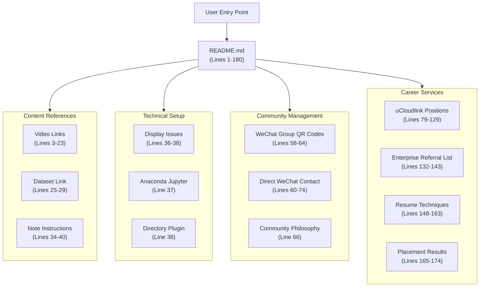

The `README.md` file contains structured sections accessible via line ranges. Each section serves a distinct architectural function while maintaining referential integrity through hyperlinks and cross-references.

**Sources:** [README.md:1-180]()

## Four-Pillar System Architecture

The platform implements a four-pillar architecture where each pillar addresses a distinct user need while integrating with others to form a cohesive system.

### Pillar Integration Model

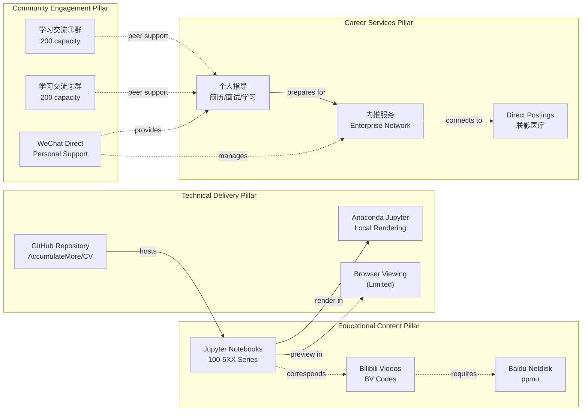

**Sources:** [README.md:1-180]()

### Pillar Descriptions

| Pillar | Primary Function | Line References | Key Components |
|--------|-----------------|-----------------|----------------|
| Educational Content | Deliver learning materials | [README.md:3-29]() | Video lectures (Bilibili), Jupyter notebooks (100-5XX), Datasets (Baidu) |
| Technical Delivery | Enable content access | [README.md:34-40]() | GitHub repository, Anaconda Jupyter, directory plugin |
| Community Engagement | Facilitate peer learning | [README.md:58-74]() | WeChat groups (学习交流①②群), direct contact, community philosophy |
| Career Services | Support job placement | [README.md:79-174]() | Resume guidance, interview prep, internal referrals (内推), direct postings |

**Sources:** [README.md:1-180]()

## Content Organization System

The platform organizes educational content using a numeric series system where each series corresponds to a specific instructor and topic area.

### Series Numbering and Content Mapping

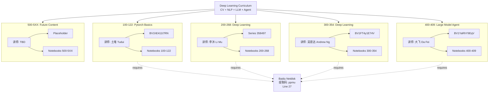

Each series follows the pattern defined in [README.md:5-21]():
- Series identifier (e.g., "100-122")
- Instructor name (e.g., "土堆")
- Bilibili video reference (e.g., "BV1hE411t7RN")
- Corresponding note range

**Sources:** [README.md:3-27]()

## External Platform Dependencies

The system integrates five external platforms, each serving a specific architectural role. No custom infrastructure is maintained; all functionality leverages existing platform capabilities.

### Platform Integration Architecture

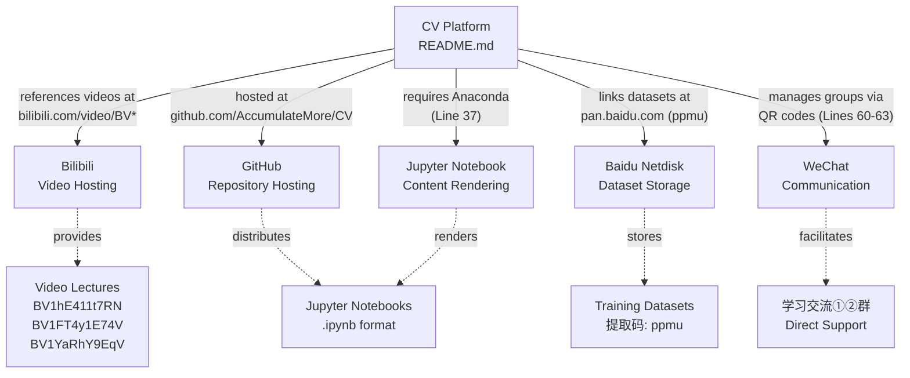

| Platform | Purpose | Access Method | Line References |
|----------|---------|---------------|-----------------|
| Bilibili | Video lecture hosting | Direct URLs (BV codes) | [README.md:7,11,15,19]() |
| GitHub | Note distribution and version control | Repository download | [README.md:36,49]() |
| Baidu Netdisk | Dataset file storage | Link with extraction code `ppmu` | [README.md:27]() |
| WeChat | Community communication and support | QR codes and direct contact | [README.md:60-74]() |
| Jupyter Notebook | Local content rendering | Anaconda installation | [README.md:37-38]() |

**Sources:** [README.md:7-74]()

## User Journey Model

The platform guides users through a structured progression from discovery to employment. Each stage builds upon the previous, with support mechanisms available throughout.

### User Progression Pipeline

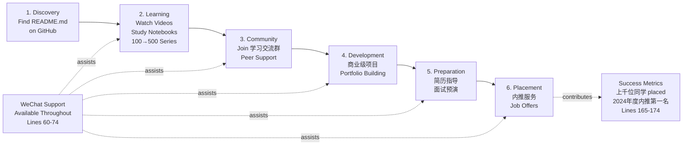

Key transition points:
1. **Discovery → Learning**: User accesses [README.md:3-23]() to identify video and note series
2. **Learning → Community**: User joins groups via [README.md:60-63]() QR codes or direct contact [README.md:62]()
3. **Community → Development**: User requests guidance via [README.md:68-74]() support channels
4. **Development → Preparation**: User submits resume for review following techniques in [README.md:148-163]()
5. **Preparation → Placement**: User receives referrals (内推) to companies listed in [README.md:132-143]()

**Sources:** [README.md:1-180]()

## Technical Requirements and Known Limitations

The system has specific technical requirements for optimal content access and documented limitations when using alternative methods.

### Required Technical Stack

| Component | Requirement | Reason | Line Reference |
|-----------|-------------|--------|----------------|
| Editor | Anaconda Jupyter Notebook | Proper image and formula display | [README.md:37]() |
| Editor (NOT) | Pycharm Jupyter | Images do not display correctly | [README.md:37]() |
| Plugin | Jupyter directory plugin | Navigation via table of contents | [README.md:38]() |
| Access Method | Local download | Online viewing has display issues | [README.md:36]() |
| Browser Access | Limited | Incomplete image/formula rendering | [README.md:36]() |

### Known Display Issues

The platform documents rendering problems at [README.md:36-38]():

1. **Online Viewing Issue**: GitHub does not properly parse images and formulas when viewing notebooks in browser
2. **Solution**: Download notebooks locally and open with Anaconda Jupyter Notebook
3. **Pycharm Incompatibility**: Pycharm's Jupyter implementation fails to display images correctly
4. **Setup Guidance**: Additional instructions available in maintainer's Python repository (`Python仓库`) in section `00_Python编辑器`

**Sources:** [README.md:34-40]()

## Value Proposition and Platform Philosophy

The platform operates on a dual value creation model, serving both learners and employers while maintaining a philosophical foundation centered on mutual benefit and community support.

### Stakeholder Value Exchange

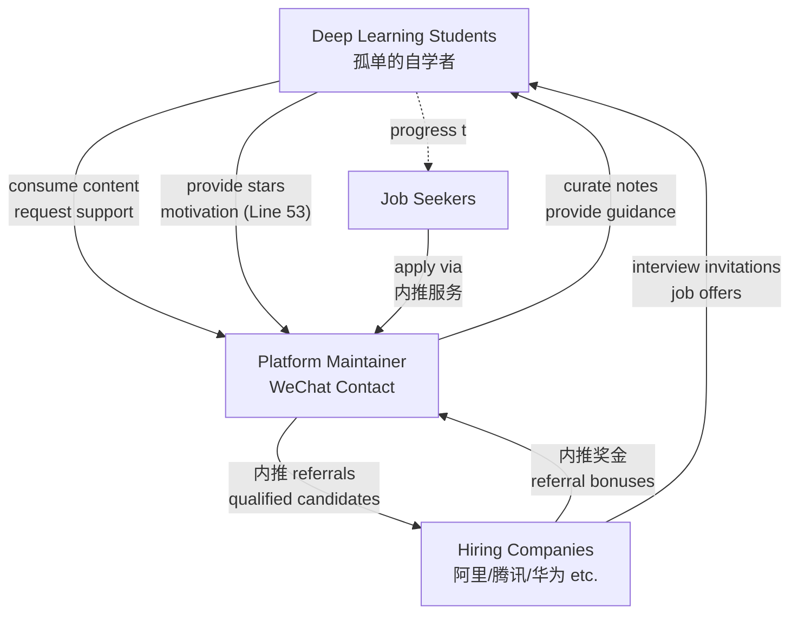

### Guiding Philosophy

The platform articulates its philosophy at [README.md:66,172-174,179]():

1. **看人之长,天下皆是吾师** ("See others' strengths, everyone is a teacher") - Focus on learning from all sources
2. **提灯人** ("Lamp bearer") - Illuminate the path for others rather than celebrating one's own light
3. **不走弯路错路** ("Avoid detours and wrong paths") - Direct guidance prevents wasted effort
4. **双赢** ("Win-win") - Companies receive qualified candidates and pay referral bonuses (内推奖金); students gain employment

### Measurable Outcomes

Success metrics documented at [README.md:165-174]():
- **上千位同学** (Thousands of students) successfully placed in employment
- **2024年度内推第一名** (2024 top internal referral provider)
- Demonstrated through screenshot evidence in lines 167-170

**Sources:** [README.md:53,66,130,165-179]()

## Related Documentation

For comprehensive information on specific subsystems:

- **Educational content structure**: See [Curriculum Structure and Course Series](#2.1) and [Lecture Series and Instructors](#2.2)
- **Technical setup procedures**: See [Technical Setup and Access](#3)
- **Community engagement**: See [Community and Support System](#4)
- **Career services**: See [Career Services and Job Placement](#5) and [Internal Referral System](#5.4)
- **Platform outcomes**: See [Platform Outcomes and Success Stories](#6)

**Sources:** [README.md:1-180]()

---

# Page: System Architecture

# System Architecture

<details>
<summary>Relevant source files</summary>

The following files were used as context for generating this wiki page:

- [README.md](README.md)

</details>


This document describes the architectural design of the deep learning educational platform, focusing on how a single `README.md` file orchestrates four distinct functional pillars (Educational Content, Technical Delivery, Community Engagement, and Career Services) through integration with multiple external platforms. For information about specific external platform dependencies and integration strategies, see [Platform Dependencies](#1.3). For the complete user journey and progression model, see [User Journey and Progression Model](#6.2).

## Overview: Single-File Orchestration Architecture

The CV repository implements a unique architectural pattern where a single documentation file (`README.md`) serves as the complete system orchestrator. Rather than building custom infrastructure, the system coordinates multiple external platforms into a cohesive educational and career development pipeline.

**Architectural Principle**: The entire platform state, content directory, access control, community management, and career services are encoded in the 180-line [README.md:1-180](). This file acts as:

- **Content Directory**: Lines 3-23 map video lectures to note series
- **Access Gateway**: Lines 25-29 provide dataset access credentials
- **Technical Documentation**: Lines 34-40 specify rendering requirements
- **Community Hub**: Lines 58-75 manage group memberships and support channels
- **Career Portal**: Lines 79-143 coordinate job placements and referrals
- **Success Metrics**: Lines 148-174 document outcomes and guidance principles

### Core Architecture Characteristics

| Characteristic | Implementation | Code Reference |
|---------------|----------------|----------------|
| **Single Source of Truth** | All system configuration in one file | [README.md:1-180]() |
| **Zero Custom Infrastructure** | Leverages external platforms only | [README.md:7,11,15,19,27,62]() |
| **Stateless Design** | No backend, database, or application server | N/A - Pure documentation |
| **Multi-Platform Integration** | Coordinates 5+ external services | [README.md:7,27,62]() Bilibili, Baidu, WeChat, GitHub, Jupyter |
| **Progressive Engagement** | Users advance through defined stages | [README.md:3-180]() (entire flow) |

Sources: [README.md:1-180]()

---

## Four-Pillar Architecture

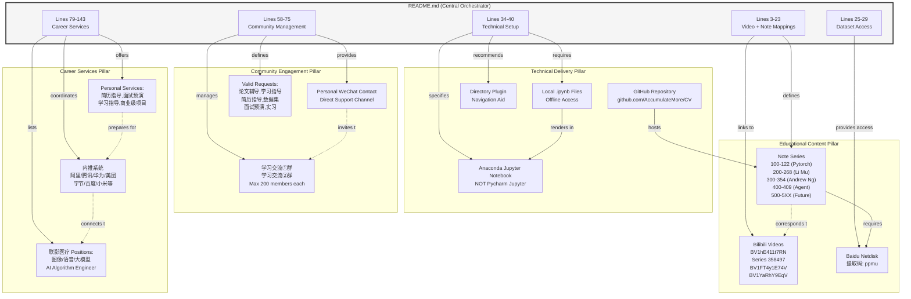

**Diagram: Four-Pillar Architecture with README.md Line Mappings**

Sources: [README.md:1-180]()

---

## Pillar 1: Educational Content System

The Educational Content Pillar organizes learning materials through a structured numbering system that maps video lectures to Jupyter notebook notes and datasets.

### Content Taxonomy and Mapping

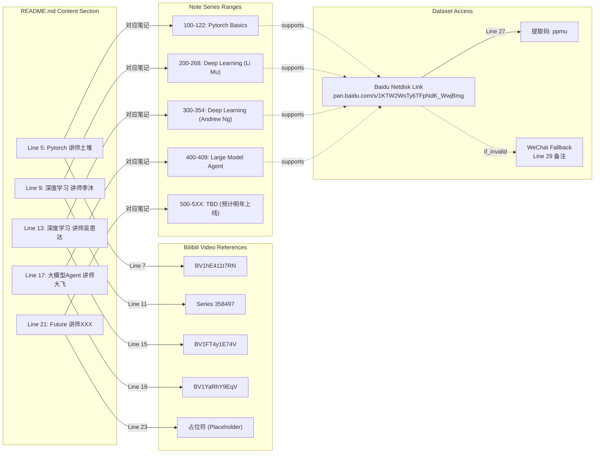

**Diagram: Content Mapping System (Video → Notes → Datasets)**

### Content Organization Table

| Note Range | Instructor | Video Platform | Video ID | Dataset Required | Lines in README |
|------------|-----------|----------------|----------|------------------|-----------------|
| 100-122 | 土堆 (Tudui) | Bilibili | BV1hE411t7RN | Yes | [README.md:5-7]() |
| 200-268 | 李沐 (Li Mu) | Bilibili | Series 358497 | Yes | [README.md:9-11]() |
| 300-354 | 吴恩达 (Andrew Ng) | Bilibili | BV1FT4y1E74V | Yes | [README.md:13-15]() |
| 400-409 | 大飞 (Da Fei) | Bilibili | BV1YaRhY9EqV | Yes | [README.md:17-19]() |
| 500-5XX | TBD | Bilibili | Placeholder | TBD | [README.md:21-23]() |

**Key Implementation Details**:
- **Video-Note Correspondence**: Explicitly stated using "对应笔记" (corresponding notes) pattern in [README.md:5,9,13,17]()
- **Dataset Sharing**: Single unified dataset for all series accessed via [README.md:27]() with extraction code "ppmu" on [README.md:27]()
- **Fallback Mechanism**: Dataset link failures handled via WeChat contact as documented in [README.md:29]()
- **Future Extensibility**: Series 500-5XX reserved with placeholder in [README.md:21-23]()

Sources: [README.md:3-29]()

---

## Pillar 2: Technical Delivery System

The Technical Delivery Pillar specifies the exact toolchain required to properly render educational content, addressing known display issues with specific technical solutions.

### Rendering Stack and Known Issues

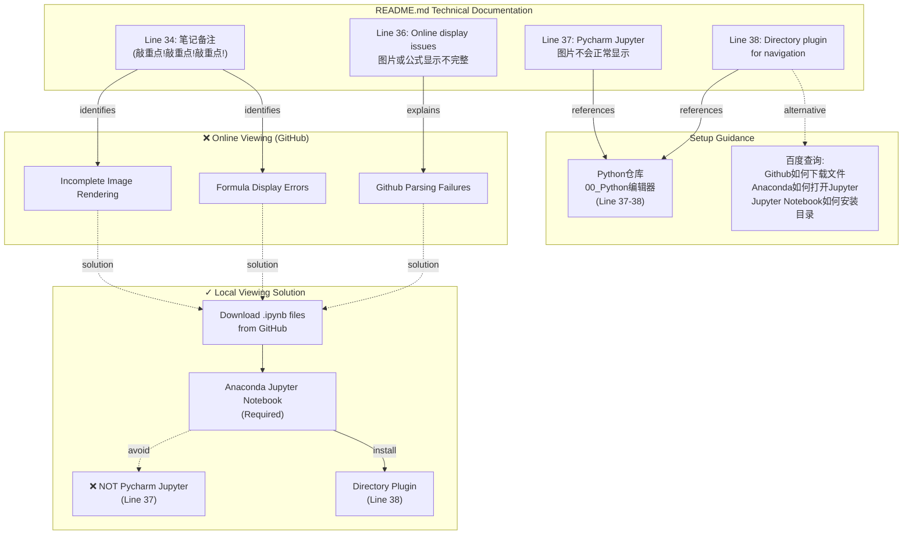

**Diagram: Technical Delivery Stack and Issue Resolution**

### Technical Requirements Specification

| Component | Status | Reason | Documentation Line |
|-----------|--------|--------|-------------------|
| **GitHub Online Viewing** | ❌ Not Recommended | Images/formulas display incompletely | [README.md:36]() |
| **Local Download** | ✓ Required | Resolves parsing issues | [README.md:36]() |
| **Anaconda Jupyter** | ✓ Required | Proper image rendering | [README.md:37]() |
| **Pycharm Jupyter** | ❌ Prohibited | Images won't display normally | [README.md:37]() |
| **Directory Plugin** | ✓ Recommended | Quick chapter navigation | [README.md:38]() |
| **Python仓库 Reference** | ✓ Available | Setup guides in `00_Python编辑器` | [README.md:37-38]() |

**Display Issue Root Cause**:
The system explicitly identifies that online viewing problems stem from "Github网站没有解析好" (GitHub website parsing failures) as documented in [README.md:36](). The solution architecture mandates local download and specific tooling to bypass GitHub's rendering limitations.

**Setup Guidance Chain**:
1. Primary documentation: [README.md:34-40]()
2. External search fallback: "百度查一下" (search on Baidu) for generic how-to guides
3. Internal repository reference: "我的主页Python仓库" with specific subdirectory `00_Python编辑器` in [README.md:37-38]()
4. Visual reference: Directory plugin screenshot provided in [README.md:40]()

Sources: [README.md:34-40]()

---

## Pillar 3: Community Engagement System

The Community Engagement Pillar implements a tiered support system designed to address "孤单的自学者" (isolated self-learners) through structured group interaction and direct support channels.

### Community Infrastructure and Access Control

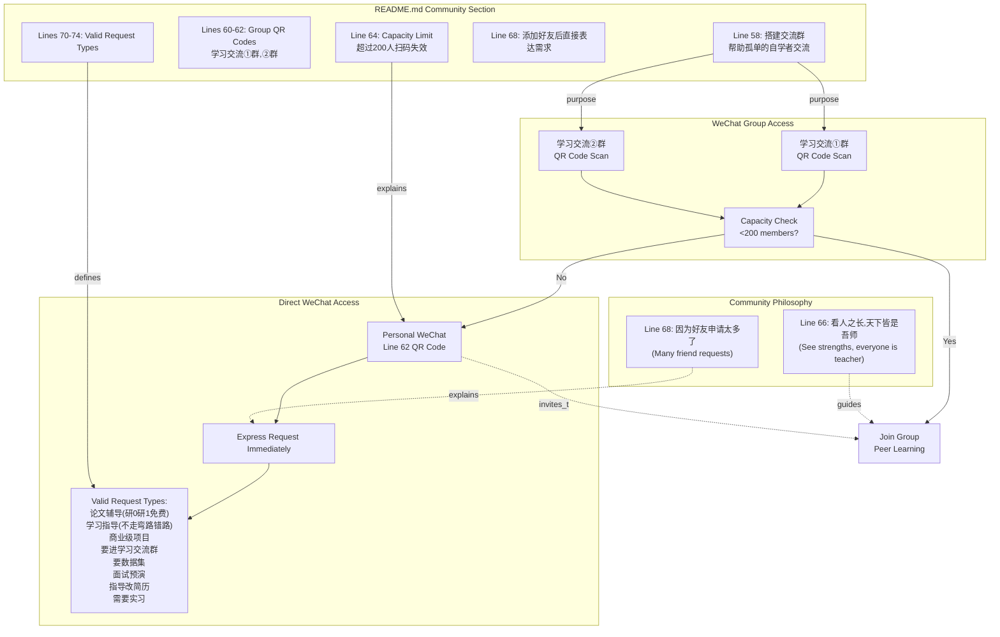

**Diagram: Community Access Flow and Support Tiers**

### Support Request Taxonomy

The system explicitly defines valid request types in [README.md:70-74]() using a structured table format:

| Request Category | Specific Service | Additional Context | Line Reference |
|------------------|------------------|--------------------|----------------|
| **Academic** | 论文辅导 | 研0研1免费,半年掌握三年知识 | [README.md:72]() |
| **Learning** | 学习指导 | 不走弯路错路,快速拿到offer | [README.md:73]() |
| **Projects** | 商业级项目 | 简历增添项目,提升核心竞争力 | [README.md:74]() |
| **Community** | 要进学习交流群 | When groups are full | [README.md:72]() |
| **Resources** | 要数据集 | When Baidu link fails | [README.md:72]() |
| **Career Prep** | 面试预演 | 简历拷打问题 | [README.md:73]() |
| **Resume** | 指导改简历 | 从面试官角度出发 | [README.md:74]() |
| **Internship** | 需要实习 | Entry-level positions | [README.md:73]() |

**Access Control Logic**:
1. **Tier 1 (Self-Service)**: QR code scan for groups when capacity < 200 members [README.md:62]()
2. **Tier 2 (Manual Invite)**: Personal WeChat contact when groups are full [README.md:64]()
3. **Request Protocol**: "直接表达你的需求" (directly express your need) upon adding contact [README.md:68]()

**Philosophical Foundation**:
The community design is guided by the principle "看人之短，无一可交之人。看人之长，天下皆是吾师" (Focus on people's strengths, everyone becomes a teacher) documented in [README.md:66](). This philosophy frames the community as a mutual learning environment rather than a traditional support hierarchy.

Sources: [README.md:58-75]()

---

## Pillar 4: Career Services System

The Career Services Pillar implements a comprehensive employment pipeline, from skill development through job placement via internal referrals (内推), with documented success metrics.

### Career Services Architecture

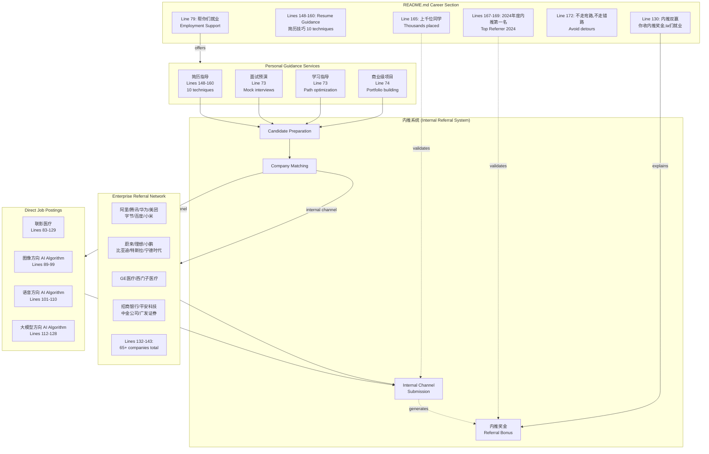

**Diagram: Career Services Pipeline and Internal Referral System**

### Resume Guidance Framework (简历技巧 10%)

The system documents specific resume techniques used during the maintainer's 2021 graduation in [README.md:148-160](). These techniques are presented as "我的简历技巧10%" (my resume techniques at 10% capacity), indicating additional undocumented expertise:

| Technique | Description | Implementation | Line |
|-----------|-------------|----------------|------|
| **1. Skill Mastery Filter** | 只写掌握了XX,没掌握不要写 | Only list truly mastered skills | [README.md:154]() |
| **2. Skill Ordering** | 掌握且更熟练的放前面 | More proficient skills listed first | [README.md:154]() |
| **3. Evidence Provision** | 后面要论证自己真的掌握了 | Provide proof of mastery with experience | [README.md:155]() |
| **4. Role-Centered Focus** | 围绕算法岗展开技能阐述 | Focus on algorithm position requirements | [README.md:156]() |
| **5. Relevance Filtering** | 只写岗位需要的技能 | Exclude irrelevant hardware/organization skills | [README.md:157]() |
| **6. Visual Consistency** | 掌握一种类别技能,只占一行 | One line per skill category for neatness | [README.md:158]() |
| **7. HR Perspective** | 面试官及HR会看着感觉整齐 | Design for 10-second HR scan | [README.md:159-161]() |
| **8. High Volume Context** | 一天要看几百份甚至上千份简历 | Optimize for high-volume screening | [README.md:161]() |
| **9. Decision Timing** | 关键的10秒,HR就决定了 | Critical 10-second decision window | [README.md:163]() |
| **10. Progression Logic** | 编程语言→深度学习框架→算法 | Logical skill progression presentation | [README.md:156]() |

### Internal Referral Economics (内推双赢 Win-Win Model)

The referral system implements a dual-value exchange model documented in [README.md:130]():

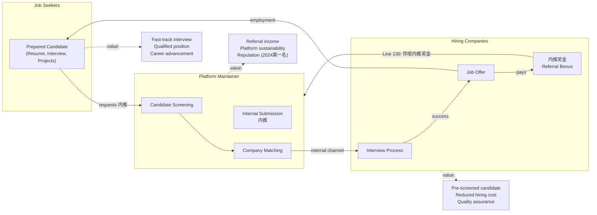

**Diagram: Internal Referral Win-Win Economics**

### Enterprise Network Scale

The platform maintains referral relationships with 65+ companies across multiple sectors, documented in [README.md:132-143]():

| Sector | Company Examples | Total Count | Lines |
|--------|-----------------|-------------|-------|
| **Internet & Tech** | 阿里巴巴,腾讯,美团,京东,拼多多,百度,字节跳动,华为 | 8+ | [README.md:134]() |
| **Consumer Electronics** | 小米,OPPO,vivo,联想 | 4+ | [README.md:135]() |
| **AI & Vision** | 商汤科技,旷视科技,海康威视,大华股份,科大讯飞 | 5+ | [README.md:135-136]() |
| **Automotive** | 蔚来汽车,理想汽车,小鹏汽车,比亚迪,特斯拉,宁德时代 | 6+ | [README.md:136,143]() |
| **Telecom** | 中国移动,中国联通,中国电信,中兴通讯 | 4+ | [README.md:136-137]() |
| **Medical** | 联影医疗,GE医疗,西门子医疗 | 3+ | [README.md:83,143]() |
| **Finance** | 招商银行,工商银行,平安科技,中金公司,广发证券 | 5+ | [README.md:140-141]() |
| **Other Sectors** | Various (content, logistics, semiconductor, etc.) | 30+ | [README.md:137-143]() |

### 联影医疗 (uCloudlink Medical) Detailed Specifications

Direct job postings for 联影医疗 are documented in [README.md:83-129]() across three technical directions:

**Image Direction AI Algorithm Engineer** [README.md:89-99]():
- **Key Responsibilities**: Product-level AI algorithm development for 联影 platforms including universal software, advanced post-processing workstation, intelligent uAl platform, and robotic surgical planning
- **Technical Requirements**: Machine vision, 3D reconstruction, SLAM, object detection, pose estimation, medical image processing algorithms (segmentation, detection, classification, registration, deep learning, fluid dynamics)

**Voice Direction AI Algorithm Engineer** [README.md:101-110]():
- **Key Responsibilities**: Audio signal processing (echo cancellation, microphone arrays, blind source separation), deep learning for audio
- **Technical Requirements**: Digital signal processing, Matlab, C/C++, speech/audio processing experience, ASR/TTS research

**Large Model Direction AI Algorithm Engineer** [README.md:112-128]():
- **Key Responsibilities**: LLM algorithm development and optimization, medical domain applications, training process optimization, large-scale medical text dataset construction, model evaluation
- **Academic Requirements**: Publications in top-tier conferences (ICML, NeurIPS, ICLR, CVPR, ICCV, ECCV, ACL, EMNLP, MICCAI) or journals (IEEE T-PAMI, IEEE TMI, Medical Image Analysis)
- **Degree Requirements**: Master's or above in AI-related fields

**Geographic Flexibility**: [README.md:83]() lists 9 location options: 上海,北京,深圳,武汉,广州,成都,西安,沈阳,三亚

### Success Metrics and Validation

The career services system documents measurable outcomes:

| Metric | Value | Evidence Location | Interpretation |
|--------|-------|-------------------|----------------|
| **Total Placements** | 上千位同学 (Thousands of students) | [README.md:165]() | Validated track record |
| **Referral Ranking** | 2024年度内推第一名 | [README.md:167-169]() | Top internal referrer in 2024 |
| **Success Images** | 3 celebration screenshots | [README.md:167-169]() | Visual validation of outcomes |
| **Philosophy** | 不走弯路,不走错路 | [README.md:172]() | Core value proposition |

Sources: [README.md:79-174]()

---

## System Integration Model

The following diagram shows how data and control flow between the four pillars through the README.md orchestration layer:

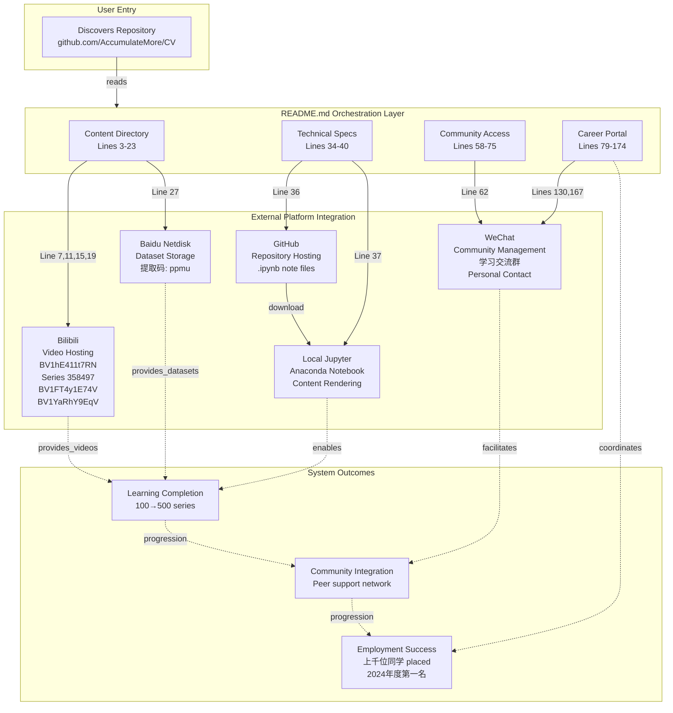

**Diagram: System Integration and Data Flow Across Pillars**

### Integration Patterns

| Integration Type | Mechanism | Code Reference | Purpose |
|------------------|-----------|----------------|---------|
| **Content Linking** | Direct URL embedding | [README.md:7,11,15,19,27]() | Connect to external content |
| **Access Control** | QR code images + capacity logic | [README.md:62,64]() | Manage community membership |
| **Fallback Routing** | Alternative contact methods | [README.md:29,64]() | Ensure service continuity |
| **State Management** | Documentation-based configuration | [README.md:1-180]() | Maintain system state |
| **Quality Control** | Explicit tool specifications | [README.md:37-38]() | Ensure proper rendering |

### Cross-Pillar Dependencies

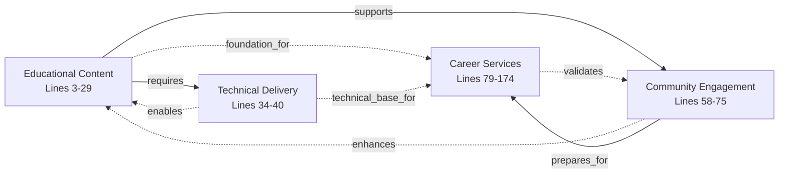

**Diagram: Inter-Pillar Dependencies**

Sources: [README.md:1-180]()

---

## Platform Orchestration Layer

The README.md file implements a sophisticated orchestration pattern through strategic information architecture:

### Information Architecture Strategy

| Section | Line Range | Function | Control Mechanism |
|---------|------------|----------|-------------------|
| **Title & Introduction** | [README.md:1-2]() | System identity and scope | Establishes platform purpose |
| **Content Mappings** | [README.md:3-29]() | Educational content directory | URL-based external references |
| **Technical Requirements** | [README.md:34-40]() | Quality assurance specifications | Tool-specific mandates |
| **Community Infrastructure** | [README.md:58-75]() | Social access control | QR codes + capacity logic |
| **Career Services** | [README.md:79-143]() | Employment coordination | Request taxonomy + referral network |
| **Success Evidence** | [README.md:148-174]() | Outcome validation | Metrics + screenshots + philosophy |
| **Motivation Appeal** | [README.md:51-54]() | User engagement | "Star是我更新的动力" |

### State Management Through Documentation

Unlike traditional systems with databases or configuration files, this architecture stores all system state in human-readable documentation:

**State Categories**:
1. **Content State**: Video-to-note mappings [README.md:5-21]()
2. **Access State**: QR codes for group access [README.md:60-62]()
3. **Capacity State**: Group limits documentation [README.md:64]()
4. **Credential State**: Dataset extraction code "ppmu" [README.md:27]()
5. **Network State**: Company referral list [README.md:132-143]()
6. **Metrics State**: Success indicators [README.md:165-169]()

**State Update Mechanism**: Changes require direct README.md editing and git commit, ensuring version control and transparency.

### Orchestration Benefits

| Benefit | Implementation | Trade-off |
|---------|----------------|-----------|
| **Transparency** | All configuration visible in one file | Manual updates required |
| **Version Control** | Git-tracked state changes | No real-time dynamic updates |
| **Zero Infrastructure** | No servers, databases, or maintenance | Limited scalability |
| **Resilience** | No single point of technical failure | Platform dependency (GitHub, Bilibili, etc.) |
| **Accessibility** | Human-readable configuration | Requires README parsing for automation |

Sources: [README.md:1-180]()

---

## Summary

The CV repository implements a unique four-pillar architecture orchestrated through a single `README.md` file, coordinating Educational Content (lines 3-29), Technical Delivery (lines 34-40), Community Engagement (lines 58-75), and Career Services (lines 79-174). This stateless, documentation-driven approach leverages external platforms (Bilibili, GitHub, Baidu Netdisk, WeChat, Jupyter) to create a complete learning-to-employment pipeline that has successfully placed thousands of students (上千位同学) with the maintainer achieving 2024年度内推第一名 (top internal referrer 2024).

**Key Architectural Principles**:
- Single-file orchestration with zero custom infrastructure
- Multi-platform integration via URL references and QR codes
- Progressive user engagement from learning through employment
- Documentation-as-state for transparency and version control
- Fallback mechanisms at multiple levels for resilience

For technical setup details, see [Jupyter Environment Setup](#3.2). For the complete user journey, see [User Journey and Progression Model](#6.2). For success metrics and outcomes, see [Success Metrics](#6.1).

Sources: [README.md:1-180]()

---

# Page: Target Audience and Use Cases

# Target Audience and Use Cases

<details>
<summary>Relevant source files</summary>

The following files were used as context for generating this wiki page:

- [README.md](README.md)

</details>


## Purpose and Scope

This document defines the target audience segments for the CV repository platform and catalogs their primary use cases. It explains who uses the platform, why they use it, and how different user types progress through the system from initial discovery to successful employment. 

For information about the overall system architecture that supports these users, see [System Architecture](#1.1). For details on how users access career services, see [Career Services and Job Placement](#5). For community engagement mechanisms, see [Community and Support System](#4).

---

## Primary User Segments

The platform serves four distinct but overlapping user segments, each with specific needs and progression paths through the system.

### Deep Learning Students (深度学习学习者)

**Characteristics:**
- Currently studying or planning to study deep learning
- Range from complete beginners (初学者) to advanced practitioners
- Need structured learning paths and comprehensive materials
- Often studying courses from Pytorch basics through large model development

**Entry Points:**
- Discovery through GitHub search for deep learning notes
- Reference to the platform via [README.md:1]() title and description
- Access to video lectures via Bilibili links [README.md:5-19]()

**Primary Needs:**
- Sequential curriculum following the 100→500 series progression
- Video lectures paired with detailed Jupyter notebook notes
- Practice datasets for hands-on learning [README.md:25-29]()
- Clarification on technical setup issues [README.md:34-40]()

Sources: [README.md:1-54]()

### Self-Learners (孤单的自学者)

**Characteristics:**
- Learning independently without institutional support
- Experience isolation during the learning process ("孤单的自学者")
- Need peer interaction and community support
- Benefit from guidance to avoid common mistakes

**Platform Value Proposition:**
- "搭建交流群，帮助孤单的自学者交流" [README.md:58]()
- Access to learning exchange groups (学习交流①群 and ②群) [README.md:60-64]()
- Philosophy: "看人之长，天下皆是吾师" [README.md:66]()

**Primary Needs:**
- Community connection to overcome isolation
- Peer Q&A and knowledge sharing
- Direction on learning paths to avoid detours ("不走弯路错路") [README.md:73]()
- Access to experienced mentorship

Sources: [README.md:58-75]()

### Job Seekers (求职者)

**Characteristics:**
- Have completed or are completing deep learning education
- Actively seeking employment in AI/ML roles
- Need resume optimization and interview preparation
- Target positions at major tech companies and specialized AI firms

**Career Preparation Needs:**
Defined in [README.md:70-74](), job seekers require:

| Service Type | Description | README Location |
|-------------|-------------|-----------------|
| Resume Guidance (简历指导) | Resume review and optimization | [README.md:74]() |
| Interview Rehearsal (面试预演) | Mock interviews and preparation | [README.md:73]() |
| Learning Direction (学习指导) | Skill gap analysis and study plans | [README.md:73]() |
| Internal Referrals (内推) | Job referrals to partner companies | [README.md:130-143]() |
| Internships (实习) | Internship placement support | [README.md:73]() |

**Target Positions:**
The platform specifically addresses three AI algorithm engineer directions at companies like 联影医疗:
- Image Direction AI Algorithm Engineer [README.md:89-100]()
- Voice Direction AI Algorithm Engineer [README.md:101-111]()
- Large Model Direction AI Algorithm Engineer [README.md:112-129]()

Sources: [README.md:70-144]()

### Research Students (研究生)

**Characteristics:**
- Graduate students in first or second year (研0研1)
- Working on research projects and publications
- Need specialized guidance for academic and industry transitions
- Often seeking both publication support and career preparation

**Specialized Needs:**
- Thesis guidance (论文辅导) - free for 研0研1 [README.md:72]()
- Commercial-grade project experience (商业级项目) [README.md:74]()
- Research publication support for top-tier conferences
- Accelerated learning: "半年掌握三年知识" [README.md:72]()

**Academic Target Venues:**
Per [README.md:126](), students target publications at:
- Machine Learning: ICML, NeurIPS, ICLR
- Computer Vision: CVPR, ICCV, ECCV
- Natural Language Processing: ACL, EMNLP
- Medical Imaging: MICCAI, IPMI
- Top journals: IEEE T-PAMI, IEEE TMI, Medical Image Analysis

Sources: [README.md:72](), [README.md:122-128]()

---

## User Segment Mapping to Platform Resources

```mermaid
graph TB
    subgraph Users["User Segments"]
        Students["Deep Learning Students<br/>(初学者 to advanced)"]
        SelfLearners["Self-Learners<br/>(孤单的自学者)"]
        JobSeekers["Job Seekers<br/>(求职者)"]
        ResearchStudents["Research Students<br/>(研0研1)"]
    end
    
    subgraph Content["Educational Content Resources"]
        Series100["100-122: Pytorch Basics<br/>README.md:5"]
        Series200["200-268: Li Mu Deep Learning<br/>README.md:9"]
        Series300["300-354: Andrew Ng Deep Learning<br/>README.md:13"]
        Series400["400-409: Large Model Agent<br/>README.md:17"]
        Datasets["Datasets Baidu Netdisk<br/>README.md:27"]
    end
    
    subgraph Community["Community Resources"]
        Group1["学习交流①群<br/>README.md:60"]
        Group2["学习交流②群<br/>README.md:60"]
        WeChat["WeChat Contact<br/>README.md:62"]
    end
    
    subgraph Career["Career Services"]
        Resume["Resume Guidance 简历指导<br/>README.md:148-160"]
        Interview["Interview Rehearsal 面试预演<br/>README.md:73"]
        Referral["Internal Referrals 内推<br/>README.md:130-143"]
        Projects["Commercial Projects<br/>README.md:74"]
    end
    
    Students -->|"primary use"| Series100
    Students -->|"progression"| Series200
    Students -->|"progression"| Series300
    Students -->|"advanced"| Series400
    Students -->|"practice"| Datasets
    
    SelfLearners -->|"overcome isolation"| Group1
    SelfLearners -->|"overflow"| Group2
    SelfLearners -->|"direct support"| WeChat
    SelfLearners -->|"guided learning"| Series100
    
    JobSeekers -->|"preparation"| Resume
    JobSeekers -->|"preparation"| Interview
    JobSeekers -->|"placement"| Referral
    JobSeekers -->|"skill building"| Projects
    
    ResearchStudents -->|"academic"| Projects
    ResearchStudents -->|"transition"| Resume
    ResearchStudents -->|"publications"| WeChat
    ResearchStudents -->|"advanced topics"| Series400
    
    Students -.evolves to.-> SelfLearners
    SelfLearners -.progresses to.-> JobSeekers
    ResearchStudents -.transitions to.-> JobSeekers
```

Sources: [README.md:1-180]()

---

## Core Use Cases by User Journey Stage

### Discovery Stage Use Cases

**UC-1: Finding Learning Resources**
- **Actor:** Deep Learning Student (beginner)
- **Goal:** Locate comprehensive deep learning notes and video lectures
- **Entry Point:** GitHub repository discovery via search or recommendation
- **Primary Interaction:** View [README.md:1]() title, scan curriculum structure [README.md:5-21]()
- **Success Criteria:** Understanding available course series and instructors

**UC-2: Evaluating Platform Credibility**
- **Actor:** Prospective User (any segment)
- **Goal:** Assess platform quality and success rate
- **Evidence Points:** 
  - "上千位同学" successfully placed [README.md:165]()
  - "2024年度内推第一名" achievement [README.md:167]()
  - Maintainer's 2021 resume example [README.md:148-160]()
- **Success Criteria:** Decision to engage with platform

Sources: [README.md:1-21](), [README.md:148-170]()

### Learning Stage Use Cases

**UC-3: Sequential Course Progression**
- **Actor:** Deep Learning Student
- **Workflow:**
  1. Start with Pytorch basics [README.md:5-7]()
  2. Watch corresponding Bilibili video (BV1hE411t7RN)
  3. Download notes 100-122 from repository
  4. Access datasets via Baidu Netdisk [README.md:27]()
  5. Progress to Li Mu series [README.md:9-11]() (notes 200-268)
  6. Continue through Andrew Ng [README.md:13-15]() and Da Fei [README.md:17-19]()
- **Prerequisites:** Anaconda Jupyter Notebook setup [README.md:37-38]()
- **Common Issues:** Online display problems requiring local download [README.md:36]()

**UC-4: Resolving Technical Setup Issues**
- **Actor:** Any User
- **Common Problems:**
  - Images/formulas not displaying online [README.md:36]()
  - Pycharm Jupyter incompatibility [README.md:37]()
  - Missing directory navigation plugin [README.md:38-40]()
- **Resolution Path:** 
  - Reference Python仓库 for setup guides [README.md:37-38]()
  - Contact via WeChat for dataset link issues [README.md:29]()

Sources: [README.md:5-40]()

### Community Integration Use Cases

**UC-5: Joining Learning Exchange Groups**
- **Actor:** Self-Learner
- **Motivation:** "帮助孤单的自学者交流" [README.md:58]()
- **Process:**
  1. Scan QR code for 学习交流①群 [README.md:60-62]()
  2. If group full (>200 members), scan 学习交流②群
  3. If both full, add personal WeChat [README.md:64]()
  4. Explicit statement of need when adding [README.md:68-74]()
- **Group Activities:** Peer Q&A, knowledge sharing, problem-solving

**UC-6: Requesting Direct Support**
- **Actor:** Any User
- **Valid Request Types** [README.md:70-74]():

| Request Type | Chinese Term | Target User |
|-------------|--------------|-------------|
| Join learning groups | 要进学习交流群 | Self-learners |
| Dataset access | 要数据集 | Students |
| Thesis guidance | 论文辅导 | 研0研1 (free) |
| Learning direction | 学习指导 | Job seekers |
| Resume review | 指导改简历 | Job seekers |
| Interview practice | 面试预演 | Job seekers |
| Commercial projects | 商业级项目 | All segments |
| Internship needs | 需要实习 | Students/Job seekers |

- **Contact Method:** WeChat with clear need statement [README.md:68-69]()
- **Philosophy:** "看人之长，天下皆是吾师" [README.md:66]()

Sources: [README.md:58-75]()

### Career Preparation Use Cases

**UC-7: Resume Optimization**
- **Actor:** Job Seeker
- **Service:** 简历指导 - Resume review from interviewer perspective [README.md:74]()
- **Methodology:** Based on maintainer's 2021 techniques [README.md:148-160]()
- **Key Principles:**
  1. Only list mastered skills, no unmastered content [README.md:154]()
  2. Provide evidence for each claimed skill [README.md:155]()
  3. Focus on job-relevant skills [README.md:156-157]()
  4. Maintain consistent formatting (one line per skill) [README.md:158]()
  5. Optimize for 10-second HR scan time [README.md:161-163]()
- **Success Metric:** Higher callback rate for interviews

**UC-8: Interview Preparation**
- **Actor:** Job Seeker
- **Service:** 面试预演 - Mock interviews [README.md:73]()
- **Process:** "简历拷打问题" - Resume-based interrogation practice
- **Goal:** Prepare for technical and behavioral questions
- **Outcome:** Job-ready status

**UC-9: Internal Referral Request**
- **Actor:** Qualified Job Seeker
- **Service:** 内推 (Internal referral) [README.md:130]()
- **Target Companies:** 88+ enterprise partners [README.md:132-143]()
- **Major Categories:**
  - Tech Giants: 阿里巴巴, 腾讯, 字节跳动, 华为, 百度
  - E-commerce: 京东, 拼多多, 美团
  - Automotive: 蔚来, 理想, 小鹏, 比亚迪
  - AI Companies: 商汤, 旷视, 智谱, 寒武纪
  - Medical: GE医疗, 西门子医疗, 联影医疗
  - Finance: 招商银行, 平安科技, 中金公司
  - Telecom: 中国移动, 中国联通, 华为
- **Win-Win Model:** "你收公司内推奖金、ta们就业，双赢" [README.md:130]()
- **Success Rate:** "上千位同学" placed, "2024年度内推第一名" [README.md:165-167]()

Sources: [README.md:70-143](), [README.md:148-170]()

---

## User Progression Flow Diagram

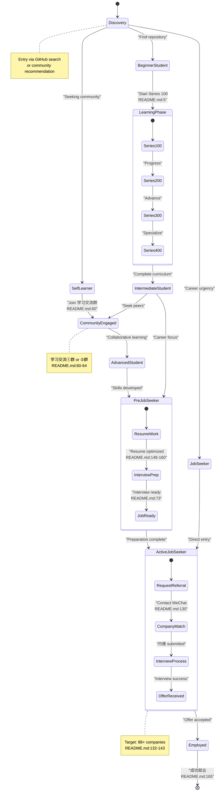

Sources: [README.md:1-180]()

---

## Specialized Use Case: Research Student to Industry Transition

**UC-10: Graduate Student Career Acceleration**
- **Actor:** Research Student (研0研1)
- **Unique Value:** "半年掌握三年知识" [README.md:72]()
- **Multi-Track Support:**

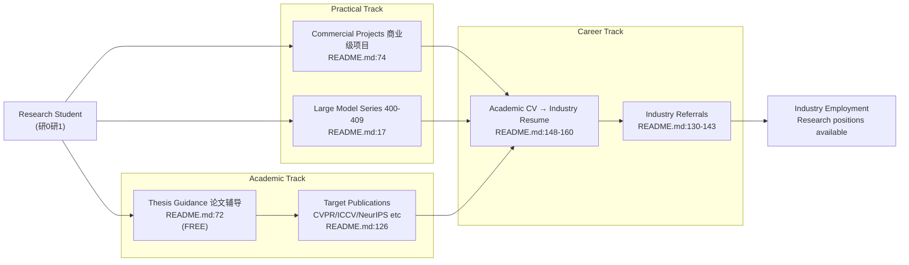

**Research-Relevant Job Postings:**
Large Model Direction at 联影医疗 [README.md:112-129]() specifically requires:
- Publication record at top venues (ICML, NeurIPS, CVPR, MICCAI, etc.) [README.md:126]()
- Master's degree or above in AI-related fields [README.md:127]()
- Experience with pre-trained large language models or GPT [README.md:125]()

Sources: [README.md:72](), [README.md:112-129]()

---

## Use Case Statistics and Success Metrics

**Platform Impact:**
- **Scale:** "上千位同学" (thousands of students) successfully placed [README.md:165]()
- **Achievement:** "2024年度内推第一名" (2024 top internal referral provider) [README.md:167]()
- **Success Proof:** Three success case screenshots [README.md:169]() with caption "一起沾沾喜气，好运是可以传染的"

**Key Success Factor:**
Per [README.md:172](): "拿offer最快的方式，就是不走弯路，不走错路。方向错了，努力没有意义。"
- Translation: The fastest way to get offers is to avoid detours and wrong paths. Wrong direction makes effort meaningless.

**Platform Philosophy:**
[README.md:179](): "我们读书是为了成为提灯人去照亮黑暗，而不是为了自己有灯而沾沾自喜还要去吹灭别人的蜡烛"
- Translation: We study to become lamp bearers illuminating darkness, not to be smug about having our own lamp and blow out others' candles.

Sources: [README.md:165-180]()

---

## Entry Point Analysis

Different user segments discover and enter the platform through distinct channels:

| Entry Method | Target Segment | First Interaction | README Reference |
|-------------|----------------|-------------------|------------------|
| GitHub Search | Deep Learning Students | Repository title and description | [README.md:1]() |
| Course Recommendation | Students (structured learners) | Bilibili video links | [README.md:5-19]() |
| Job Board Referral | Job Seekers | Career services section | [README.md:79-143]() |
| Peer Recommendation | Self-Learners | Community groups description | [README.md:58-66]() |
| Academic Network | Research Students | Thesis guidance offer | [README.md:72]() |

**Critical First Impression:**
The repository title [README.md:1]() immediately signals scope:
- "最全面的" (most comprehensive)
- Coverage: CV, NLP, 大模型, Agent
- Format: 笔记 (notes)

This positioning attracts serious learners seeking complete resources rather than fragmentary tutorials.

Sources: [README.md:1-180]()

---

## Anti-Use Cases and Platform Boundaries

**Explicitly Supported:**
- Free thesis guidance for 研0研1 [README.md:72]()
- Dataset access support [README.md:29]()
- Learning group membership [README.md:60-64]()
- Resume and interview guidance [README.md:73-74]()
- Internal job referrals [README.md:130]()

**Implicitly Limited:**
- Commercial projects: not free, positioned as portfolio builders [README.md:74]()
- Advanced guidance: may have costs beyond basic support
- Job referrals: require baseline qualification (completed learning, prepared resume)

**Technical Prerequisites:**
- Users must handle local setup: Anaconda Jupyter Notebook [README.md:37-38]()
- No online-only experience: "图片不完整" issue requires local download [README.md:36]()
- Self-service for most technical issues: reference Python仓库 [README.md:37-38]()

**Contact Expectations:**
Per [README.md:68-69](): "因为好友申请太多了,添加好友后,直接表达你的需求"
- Translation: Because there are too many friend requests, directly state your need after adding.
- Platform operates at scale; efficiency required in communication

Sources: [README.md:29](), [README.md:36-38](), [README.md:68-74]()

---

# Page: Platform Dependencies

# Platform Dependencies

<details>
<summary>Relevant source files</summary>

The following files were used as context for generating this wiki page:

- [README.md](README.md)

</details>


## Purpose and Scope

This document details the external platform dependencies that the CV deep learning notes system relies upon for content delivery, community management, and career services. The system follows a **multi-platform integration architecture** where a single `README.md` file orchestrates multiple external services rather than building custom infrastructure. 

This page focuses on the technical integration requirements and constraints of each platform. For information about the educational content structure itself, see [Curriculum Structure and Course Series](#2.1). For community usage patterns, see [Community and Support System](#4).

---

## Dependency Architecture Overview

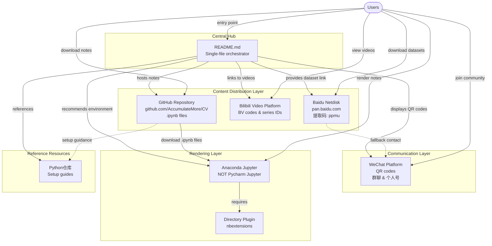

**Sources**: [README.md:1-180]()

---

## Core Platform Dependencies

### GitHub Repository

**Platform**: GitHub (github.com)  
**Repository**: `AccumulateMore/CV`  
**Primary Function**: Source code hosting and note distribution

#### Integration Points

| Integration Aspect | Implementation Detail | File Reference |
|-------------------|----------------------|----------------|
| Repository URL | `https://github.com/AccumulateMore/CV` | [README.md:49]() |
| Content Format | Jupyter Notebook `.ipynb` files (100-500+ series) | Implicit from context |
| Distribution Method | Manual download (not Git clone workflow) | [README.md:36]() |
| Display Limitation | Online viewing has image/formula rendering issues | [README.md:36]() |
| Related Repositories | User homepage contains Python仓库 for setup guides | [README.md:37-38](), [README.md:47-49]() |

#### Known Technical Issues

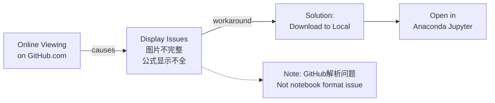

The README explicitly warns users: "在线观看笔记时，有时会出现图片（或公式）显示不完整，这是Github网站没有解析好，笔记下载到本地观看就正常了" [README.md:36](). This indicates a fundamental constraint in the architecture: GitHub's online notebook rendering cannot be relied upon for complete content display.

**Sources**: [README.md:36](), [README.md:47-49]()

---

### Bilibili Video Platform

**Platform**: Bilibili (bilibili.com)  
**Primary Function**: Video lecture hosting and streaming

#### Video Identifier Mapping

The system uses two types of Bilibili identifiers: **BV codes** (individual videos) and **series IDs** (playlists).

| Lecturer | Series Range | Bilibili Identifier | Type | File Reference |
|----------|-------------|---------------------|------|----------------|
| 土堆 (Tudui) | 100-122 (Pytorch) | `BV1hE411t7RN` | BV Code | [README.md:5-7]() |
| 李沐 (Li Mu) | 200-268 (Deep Learning) | Series `358497` | Series ID | [README.md:9-11]() |
| 吴恩达 (Andrew Ng) | 300-354 (Deep Learning) | `BV1FT4y1E74V` | BV Code | [README.md:13-15]() |
| 大飞 (Da Fei) | 400-409 (Large Model Agent) | `BV1YaRhY9EqV` | BV Code | [README.md:17-19]() |
| TBD | 500-5XX (Future) | Placeholder | N/A | [README.md:21-23]() |

#### URL Construction

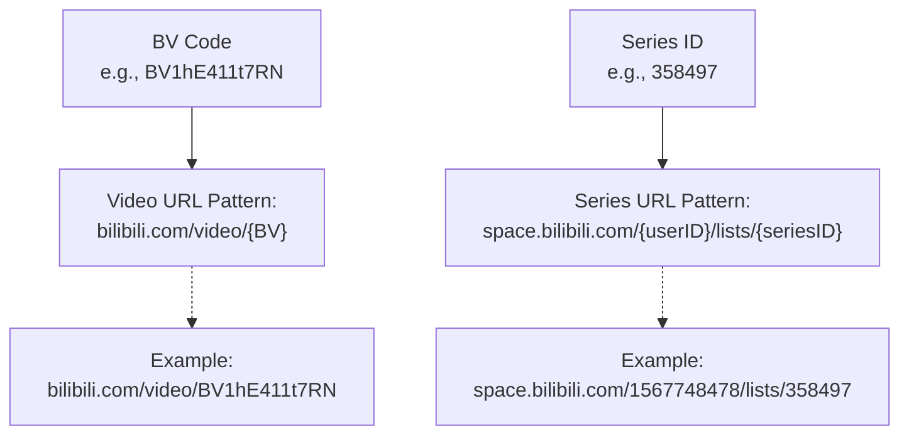

**Notes on Integration**:
- Bilibili content is **read-only** from this system's perspective
- No programmatic API integration; users manually navigate to URLs
- Videos are created by external content creators (土堆, 李沐, 吴恩达, 大飞)
- The README acts as an index, mapping note series to corresponding video series

**Sources**: [README.md:5-23]()

---

### Baidu Netdisk Storage

**Platform**: Baidu Pan (pan.baidu.com / 百度网盘)  
**Primary Function**: Large dataset file storage and distribution

#### Access Configuration

| Parameter | Value | File Reference |
|-----------|-------|----------------|
| Share Link | `https://pan.baidu.com/s/1KTW2WsTy6TFpNdK_WwjBmg` | [README.md:27]() |
| Extraction Code | `ppmu` | [README.md:27]() |
| Content | Datasets for 土堆, 李沐, 吴恩达, 大飞 courses | [README.md:25]() |
| Backup Access Method | WeChat contact | [README.md:29]() |

#### Fallback Mechanism

```mermaid
graph TB
    User["User Needs Dataset"]
    TryLink["Access Baidu Link<br/>提取码: ppmu"]
    CheckValid{"Link Valid?"}
    Success["Download Dataset"]
    LinkFailed["Link Expired<br/>链接失效"]
    ContactWeChat["Contact via WeChat<br/>微信联系"]
    GetNewLink["Receive New Link"]
    
    User --> TryLink
    TryLink --> CheckValid
    CheckValid -->|"Yes"| Success
    CheckValid -->|"No"| LinkFailed
    LinkFailed --> ContactWeChat
    ContactWeChat --> GetNewLink
    GetNewLink --> Success
    
    Note["Explicit fallback documented:<br/>数据集链接如果失效了...可以联系我"]
    LinkFailed -.-> Note
```

The system anticipates link failures with explicit fallback documentation: "数据集链接如果失效了，下面有微信，可以联系我" [README.md:29](). This is a critical architectural pattern: **manual failover through direct human contact** rather than automated redundancy.

**Sources**: [README.md:25-29]()

---

### WeChat Social Infrastructure

**Platform**: WeChat (微信)  
**Primary Functions**: Community management, direct support, career services coordination

#### Integration Modalities

```mermaid
graph TB
    subgraph "Group Chat System"
        QR1["学习交流①群<br/>QR Code in README"]
        QR2["学习交流②群<br/>QR Code in README"]
        Capacity["Capacity Limit:<br/>200 members per group"]
        
        QR1 -.->|"when full"| Capacity
        QR2 -.->|"when full"| Capacity
    end
    
    subgraph "Direct Contact System"
        PersonalQR["Personal WeChat<br/>QR Code in README"]
        FriendRequest["Friend Request"]
        StateNeeds["State Needs Immediately<br/>好友申请太多"]
    end
    
    subgraph "Valid Contact Reasons"
        R1["论文辅导"]
        R2["学习指导"]
        R3["简历指导"]
        R4["面试预演"]
        R5["要数据集"]
        R6["需要实习"]
        R7["商业级项目"]
        R8["要进学习交流群"]
    end
    
    Users([Users]) -->|"<200 members"| QR1
    Users -->|"<200 members"| QR2
    Users -->|"≥200 or support needed"| PersonalQR
    
    PersonalQR --> FriendRequest
    FriendRequest --> StateNeeds
    
    StateNeeds --> R1
    StateNeeds --> R2
    StateNeeds --> R3
    StateNeeds --> R4
    StateNeeds --> R5
    StateNeeds --> R6
    StateNeeds --> R7
    StateNeeds --> R8
    
    OverflowLogic["Overflow Handling:<br/>超过200人,扫码入群方式失效<br/>只能微信好友邀请入群"]
    
    Capacity --> OverflowLogic
    OverflowLogic --> PersonalQR
```

#### Contact Protocol

The README specifies an explicit protocol due to high volume: "因为好友申请太多了，添加好友后，直接表达你的需求" [README.md:68](). Valid needs are documented in a table [README.md:70-74]():

- 论文辅导 (Thesis guidance)
- 学习指导 (Learning guidance)  
- 简历指导 (Resume guidance)
- 面试预演 (Interview rehearsal)
- 要数据集 (Request datasets)
- 需要实习 (Internship needs)
- 商业级项目 (Commercial projects)
- 要进学习交流群 (Join learning groups)

**Technical Constraint**: WeChat groups have a hard capacity limit of 200 members [README.md:64](). When this limit is reached, QR code scanning becomes invalid, and users must add the personal WeChat account for manual group invitation. This creates a **two-tier access pattern**: automated (QR codes) vs. manual (personal invitations).

**Sources**: [README.md:58-74]()

---

### Anaconda Jupyter Environment

**Platform**: Anaconda Jupyter Notebook  
**Primary Function**: Local notebook rendering and interaction

#### Environment Requirements

```mermaid
graph TB
    subgraph "Recommended Stack"
        Anaconda["Anaconda Distribution"]
        JupyterAnaconda["Jupyter Notebook<br/>from Anaconda"]
        DirPlugin["Directory Plugin<br/>nbextensions"]
        
        Anaconda --> JupyterAnaconda
        JupyterAnaconda --> DirPlugin
    end
    
    subgraph "Not Recommended"
        Pycharm["Pycharm IDE"]
        JupyterPycharm["Pycharm's Jupyter<br/>Notebook Support"]
        ImageIssue["Image Display Issues"]
        
        Pycharm --> JupyterPycharm
        JupyterPycharm --> ImageIssue
    end
    
    LocalNotebooks[".ipynb Files<br/>from GitHub"]
    
    LocalNotebooks -->|"MUST use"| JupyterAnaconda
    LocalNotebooks -.->|"DO NOT use"| JupyterPycharm
    
    ReasonExplicit["Explicit Warning:<br/>Pycharm的Jupyter Notebook打开笔记时<br/>图片不会正常显示"]
    
    ImageIssue -.-> ReasonExplicit
    
    SetupRef["Setup Guide Reference:<br/>Python仓库/00_Python编辑器"]
    
    Anaconda -.->|"if need help"| SetupRef
    DirPlugin -.->|"if need help"| SetupRef
```

#### Technical Specifications

| Component | Requirement | Rationale | File Reference |
|-----------|-------------|-----------|----------------|
| **Editor** | Anaconda Jupyter Notebook | Correct image rendering | [README.md:37]() |
| **Not Supported** | Pycharm Jupyter Notebook | Images don't display properly | [README.md:37]() |
| **Extension** | Directory Plugin | Quick navigation via table of contents | [README.md:38]() |
| **Setup Guide** | Python仓库 → 00_Python编辑器 | Installation instructions | [README.md:37-38]() |

#### Plugin Installation

The README references a directory plugin that enables table-of-contents navigation in Jupyter notebooks [README.md:38-40](). The plugin creates a sidebar for quick chapter jumping:

![Example plugin interface shown in README]

Installation instructions are located in an external repository reference: "我的主页Python仓库里面'00_Python编辑器'里面有相关链接" [README.md:38]().

**Critical Architectural Decision**: The choice of Anaconda Jupyter over Pycharm Jupyter is **mandatory**, not optional. This is because notebook files contain embedded images that only render correctly in Anaconda's implementation. This is documented explicitly: "Pycharm的Jupyter Notebook打开笔记时，图片不会正常显示，笔记是用Anaconda的Jupyter Notebook打开的" [README.md:37]().

**Sources**: [README.md:34-40]()

---

## Integration Data Flow

The following diagram maps the complete data flow across all platform dependencies, showing how content moves from creation to consumption:

```mermaid
flowchart TD
    subgraph "Content Creation External"
        Educators["Content Creators:<br/>土堆/李沐/吴恩达/大飞"]
        Videos["Video Lectures"]
        Datasets["Training Datasets"]
    end
    
    subgraph "Platform Orchestration"
        Maintainer["Platform Maintainer"]
        README["README.md<br/>Central Index"]
    end
    
    subgraph "Bilibili Platform"
        BilibiliUpload["Upload Videos"]
        BVCodes["Assign BV Codes/<br/>Series IDs"]
    end
    
    subgraph "GitHub Platform"
        GitHubRepo["Repository:<br/>AccumulateMore/CV"]
        IPYNBFiles[".ipynb Files<br/>Series 100-500+"]
        OnlineView["Online View<br/>有显示问题"]
        Download["Download to Local"]
    end
    
    subgraph "Baidu Platform"
        BaiduUpload["Upload Datasets"]
        ShareLink["Generate Share Link<br/>提取码: ppmu"]
    end
    
    subgraph "WeChat Platform"
        GenerateQR["Generate QR Codes"]
        Groups["学习交流群①②"]
        PersonalContact["Personal Account"]
    end
    
    subgraph "User Environment"
        UserDownload["User Downloads<br/>Notes + Datasets"]
        AnacondaSetup["Setup Anaconda<br/>Jupyter + Plugin"]
        LocalStudy["Study Locally"]
    end
    
    Educators --> Videos
    Educators --> Datasets
    
    Videos --> BilibiliUpload
    BilibiliUpload --> BVCodes
    
    Maintainer --> IPYNBFiles
    Maintainer --> README
    
    BVCodes -.->|"referenced in"| README
    
    IPYNBFiles --> GitHubRepo
    GitHubRepo --> OnlineView
    GitHubRepo --> Download
    
    Datasets --> BaiduUpload
    BaiduUpload --> ShareLink
    ShareLink -.->|"link in"| README
    
    Maintainer --> GenerateQR
    GenerateQR --> Groups
    GenerateQR --> PersonalContact
    Groups -.->|"QR codes in"| README
    PersonalContact -.->|"QR code in"| README
    
    README -->|"User Entry"| UserFlow
    UserFlow["User Accesses<br/>README"]
    
    UserFlow -->|"watch"| BVCodes
    UserFlow -->|"download notes"| Download
    UserFlow -->|"get datasets"| ShareLink
    UserFlow -->|"join community"| Groups
    
    Download --> UserDownload
    ShareLink --> UserDownload
    
    UserDownload --> AnacondaSetup
    AnacondaSetup --> LocalStudy
    
    OnlineView -.->|"if issues"| Download
    
    LinkExpired["If Link Expired"]
    ShareLink -.-> LinkExpired
    LinkExpired --> PersonalContact
    
    GroupFull["If Group Full"]
    Groups -.-> GroupFull
    GroupFull --> PersonalContact
```

**Sources**: [README.md:1-180]()

---

## Dependency Management and Failure Handling

### Known Failure Modes and Mitigations

| Dependency | Failure Mode | Detection | Mitigation | File Reference |
|------------|--------------|-----------|------------|----------------|
| **GitHub** | Online rendering fails (images/formulas) | User reports display issues | Download locally, use Anaconda | [README.md:36]() |
| **Bilibili** | Video unavailable | Link access fails | No documented fallback (external platform) | N/A |
| **Baidu Netdisk** | Share link expires | User cannot access extraction code | Contact via WeChat for new link | [README.md:29]() |
| **WeChat Groups** | Group reaches 200 capacity | QR code scan fails | Add personal WeChat for manual invitation | [README.md:64]() |
| **Jupyter (Pycharm)** | Images don't render | Visual inspection | Switch to Anaconda Jupyter | [README.md:37]() |

### Resilience Architecture Pattern

The system employs a **manual failover pattern** rather than automated redundancy:

```mermaid
graph TB
    PrimaryAccess["Primary Access Path"]
    Failure["Failure Detected<br/>by User"]
    HumanContact["Contact Platform<br/>Maintainer via WeChat"]
    ManualResolution["Manual Resolution:<br/>New link/invitation/guidance"]
    Restored["Access Restored"]
    
    PrimaryAccess --> Failure
    Failure --> HumanContact
    HumanContact --> ManualResolution
    ManualResolution --> Restored
    
    Philosophy["Architectural Philosophy:<br/>Human-in-the-loop failover<br/>for external dependencies<br/>No automated monitoring"]
    
    ManualResolution -.-> Philosophy
```

This approach is consistent with the platform's philosophy of personalized support ("看人之长，天下皆是吾师" [README.md:66]()) and the maintainer's role as a "提灯人" (lamp bearer) [README.md:179]() who actively guides users through obstacles.

**Sources**: [README.md:29](), [README.md:36](), [README.md:64](), [README.md:66](), [README.md:179]()

---

## Technical Requirements Matrix

### By User Activity

| Activity | Required Dependencies | Optional Dependencies | Configuration Notes |
|----------|----------------------|----------------------|---------------------|
| **View Course Index** | GitHub (README.md) | None | Browser sufficient |
| **Watch Video Lectures** | Bilibili | WeChat (if link issues) | External playback |
| **Read Notes Online** | GitHub | None | May have display issues [README.md:36]() |
| **Study Notes Locally** | GitHub, Anaconda Jupyter | Directory Plugin | **Recommended path** [README.md:37]() |
| **Access Datasets** | Baidu Netdisk | WeChat (if link expired) | Extraction code: ppmu |
| **Join Community** | WeChat | None | Two groups available [README.md:60-63]() |
| **Get Career Support** | WeChat | None | Direct contact [README.md:68-74]() |

### By Platform Role

| Platform | Read/Write | Authentication Required | Capacity Constraints | Critical to System |
|----------|-----------|-------------------------|---------------------|-------------------|
| **GitHub** | Read-only | No (public repo) | None | Yes (content hosting) |
| **Bilibili** | Read-only | No (public videos) | None | Yes (video content) |
| **Baidu Netdisk** | Read-only | Baidu account | Link expiration | Yes (dataset access) |
| **WeChat** | Read/Write | WeChat account | 200/group limit | Yes (support/career) |
| **Anaconda Jupyter** | Local install | No | Local disk space | Yes (proper rendering) |

**Sources**: [README.md:1-180]()

---

## Platform-Specific Constraints

### Chinese Internet Ecosystem Dependencies

All external platforms are **Chinese internet services**, which has architectural implications:

1. **Geographic Accessibility**: Bilibili, Baidu, WeChat are optimized for Chinese mainland access
2. **Language**: All platform interfaces are in Chinese (Simplified)
3. **Account Systems**: Require Chinese phone numbers or alternative verification methods
4. **Regulatory Compliance**: Platforms subject to Chinese internet regulations

### No Self-Hosted Infrastructure

The system makes a deliberate architectural choice to **avoid self-hosted infrastructure**:

- No custom video hosting (uses Bilibili)
- No custom file hosting (uses Baidu + GitHub)
- No custom forum software (uses WeChat)
- No custom authentication (relies on platform accounts)

This "platform aggregation" architecture minimizes maintenance burden for the single maintainer but creates **hard dependencies** on external service availability and policies.

**Sources**: [README.md:1-180]()

---

## Integration with System Components

### Upstream Dependencies

The following system components rely on these platform dependencies:

- **Educational Content System** [see #2]: Requires GitHub (notes), Bilibili (videos), Baidu (datasets)
- **Technical Setup** [see #3]: Requires Anaconda Jupyter, GitHub download capability
- **Community System** [see #4]: Requires WeChat platform availability
- **Career Services** [see #5]: Requires WeChat for communication and coordination

### Reference Documentation

For detailed setup procedures, users are directed to:
- **Python仓库**: Additional repository at maintainer's GitHub homepage containing `00_Python编辑器` directory with Anaconda setup and plugin installation guides [README.md:37-38]()

**Sources**: [README.md:37-38](), [README.md:47-49]()

---

# Page: Educational Content System

# Educational Content System

<details>
<summary>Relevant source files</summary>

The following files were used as context for generating this wiki page:

- [README.md](README.md)

</details>


## Purpose and Scope

The Educational Content System manages the core learning materials in this platform, encompassing curriculum organization, video lectures, Jupyter notebook-based notes, and associated datasets. This system coordinates content from multiple instructors across a structured series numbering scheme (100-500+) covering topics from PyTorch fundamentals through large language model agents.

This document focuses on the content architecture and organization. For technical setup and rendering requirements, see [Technical Setup and Access](#3). For community support related to content access, see [Community and Support System](#4). For career services that build upon this educational foundation, see [Career Services and Job Placement](#5).

---

## Content Architecture Overview

The educational content is organized as a multi-layered system where each layer serves a specific delivery function:

```mermaid
graph TB
    subgraph ContentTaxonomy["Content Taxonomy Layer"]
        Series100["100-122: PyTorch Basics"]
        Series200["200-268: Deep Learning"]
        Series300["300-354: Deep Learning"]
        Series400["400-409: Large Model Agent"]
        Series500["500-5XX: Future Content"]
    end
    
    subgraph InstructorMapping["Instructor Attribution Layer"]
        Tudui["土堆 Tudui"]
        LiMu["李沐 Li Mu"]
        AndrewNg["吴恩达 Andrew Ng"]
        DaFei["大飞 Da Fei"]
        TBD["XXX (TBD)"]
    end
    
    subgraph VideoDistribution["Video Distribution Layer"]
        BV1["BV1hE411t7RN"]
        Series358497["Series 358497"]
        BV2["BV1FT4y1E74V"]
        BV3["BV1YaRhY9EqV"]
        Placeholder["Placeholder"]
    end
    
    subgraph NotesRepository["Notes Repository Layer"]
        Notes100["100-122.ipynb files"]
        Notes200["200-268.ipynb files"]
        Notes300["300-354.ipynb files"]
        Notes400["400-409.ipynb files"]
        Notes500["500-5XX.ipynb files (future)"]
    end
    
    subgraph DatasetStorage["Dataset Storage Layer"]
        BaiduLink["Baidu Netdisk<br/>ppmu extraction code"]
        WeChatFallback["WeChat fallback"]
    end
    
    Series100 --> Tudui
    Series200 --> LiMu
    Series300 --> AndrewNg
    Series400 --> DaFei
    Series500 --> TBD
    
    Tudui --> BV1
    LiMu --> Series358497
    AndrewNg --> BV2
    DaFei --> BV3
    TBD --> Placeholder
    
    Series100 -.corresponds to.-> Notes100
    Series200 -.corresponds to.-> Notes200
    Series300 -.corresponds to.-> Notes300
    Series400 -.corresponds to.-> Notes400
    Series500 -.corresponds to.-> Notes500
    
    Notes100 -.requires.-> BaiduLink
    Notes200 -.requires.-> BaiduLink
    Notes300 -.requires.-> BaiduLink
    Notes400 -.requires.-> BaiduLink
    
    BaiduLink -.fallback.-> WeChatFallback
    
    README["README.md<br/>Central Index"]
    
    README --> ContentTaxonomy
    README --> InstructorMapping
    README --> VideoDistribution
    README --> NotesRepository
    README --> DatasetStorage
```

**Diagram: Content Architecture - Five-Layer System**

The system implements a five-layer architecture where `README.md` serves as the central index coordinating all layers. The Content Taxonomy Layer defines the progression structure. The Instructor Attribution Layer maps series to specific educators. The Video Distribution Layer points to Bilibili hosting. The Notes Repository Layer contains local `.ipynb` files. The Dataset Storage Layer provides supporting materials via Baidu Netdisk with WeChat as a fallback mechanism.

Sources: [README.md:1-29]()

---

## Series Numbering and Progression System

The curriculum uses a systematic numbering scheme where the hundreds digit indicates the major topic area and progression level:

| Series Range | Topic Focus | Instructor | Status | Line Reference |
|--------------|-------------|------------|--------|----------------|
| 100-122 | PyTorch Basics | 土堆 (Tudui) | Active | [README.md:5]() |
| 200-268 | Deep Learning | 李沐 (Li Mu) | Active | [README.md:9]() |
| 300-354 | Deep Learning | 吴恩达 (Andrew Ng) | Active | [README.md:13]() |
| 400-409 | Large Model Agent | 大飞 (Da Fei) | Active | [README.md:17]() |
| 500-5XX | Large Model Agent | XXX (TBD) | Planned | [README.md:21]() |

**Table: Series to Instructor Mapping**

Each series represents a complete course module with consistent numbering across video lectures and corresponding notes. The numbering provides clear progression paths where lower series (100-122) establish foundational knowledge required for higher series (400-409).

Sources: [README.md:3-23]()

---

## Video Lecture Distribution

```mermaid
graph LR
    subgraph BilibiliPlatform["Bilibili Platform"]
        direction TB
        Video1["BV1hE411t7RN<br/>PyTorch Tutorial"]
        Video2["Space 1567748478<br/>Series 358497<br/>Deep Learning"]
        Video3["BV1FT4y1E74V<br/>Deep Learning"]
        Video4["BV1YaRhY9EqV<br/>Large Model Agent"]
    end
    
    subgraph READMELinks["README.md Video Links"]
        direction TB
        Link1["Line 7: bilibili.com/video/BV1hE411t7RN"]
        Link2["Line 11: space.bilibili.com/.../358497"]
        Link3["Line 15: bilibili.com/video/BV1FT4y1E74V"]
        Link4["Line 19: bilibili.com/video/BV1YaRhY9EqV"]
    end
    
    Link1 --> Video1
    Link2 --> Video2
    Link3 --> Video3
    Link4 --> Video4
    
    Video1 -.supports notes.-> Series100["100-122 Notes"]
    Video2 -.supports notes.-> Series200["200-268 Notes"]
    Video3 -.supports notes.-> Series300["300-354 Notes"]
    Video4 -.supports notes.-> Series400["400-409 Notes"]
```

**Diagram: Video-to-Notes Correspondence Architecture**

All video lectures are hosted on the Bilibili platform. The `README.md` file contains direct links at specific line numbers that serve as the canonical access points. Each video series has a one-to-one correspondence with a numbered note series, indicated in the bracketed annotations [对应笔记:XXX].

### Video Access Details

| Instructor | Series | Bilibili Code | Access Pattern | Line |
|------------|--------|---------------|----------------|------|
| 土堆 | 100-122 | BV1hE411t7RN | Direct video link | [README.md:7]() |
| 李沐 | 200-268 | Series 358497 | Space/series collection | [README.md:11]() |
| 吴恩达 | 300-354 | BV1FT4y1E74V | Direct video link | [README.md:15]() |
| 大飞 | 400-409 | BV1YaRhY9EqV | Direct video link | [README.md:19]() |

**Table: Bilibili Video Identifiers**

The platform uses two access patterns: direct video links (`/video/BVXXXXXXXX`) for single-video series and space collections (`/space/XXXX/lists/YYYY?type=series`) for multi-video sequences. The 李沐 series uses a space collection structure due to its larger content volume (68 lectures: 200-268).

Sources: [README.md:3-23]()

---

## Jupyter Notebook Notes Structure

The deep learning notes are distributed as Jupyter Notebook files (`.ipynb` format) stored directly in the repository root. These notes provide comprehensive coverage of computer vision (CV), natural language processing (NLP), and large model topics.

```mermaid
graph TB
    subgraph READMEHeader["README.md Line 1"]
        Title["最全面的 深度学习 笔记<br/>(包含CV、NLP、大模型、Agent)"]
    end
    
    subgraph NotebookFormat["Notebook File Format"]
        Format[".ipynb Jupyter Notebook files"]
        Images["Embedded images"]
        Formulas["Mathematical formulas"]
        Code["Executable code cells"]
        Markdown["Markdown documentation"]
    end
    
    subgraph ContentCoverage["Content Coverage Areas"]
        CV["Computer Vision (CV)"]
        NLP["Natural Language Processing (NLP)"]
        LLM["Large Models (大模型)"]
        Agent["Agent Systems"]
    end
    
    Title --> NotebookFormat
    NotebookFormat --> ContentCoverage
    
    subgraph DisplayIssues["Known Display Issues"]
        OnlineIssue["GitHub online viewing:<br/>图片不完整<br/>公式显示不全"]
        Solution["Local download + Anaconda Jupyter"]
    end
    
    OnlineIssue --> Solution
    
    Format --> Images
    Format --> Formulas
    
    Images -.problem.-> OnlineIssue
    Formulas -.problem.-> OnlineIssue
```

**Diagram: Notebook Structure and Display Considerations**

The notes are authored in `.ipynb` format containing embedded images, mathematical formulas (LaTeX), executable Python code cells, and markdown documentation. The system explicitly documents known display issues when viewing online through GitHub's renderer, particularly with incomplete image rendering and formula display problems.

### Technical Specifications

| Property | Value | Source |
|----------|-------|--------|
| File Format | `.ipynb` | [README.md:1]() |
| Content Types | CV, NLP, 大模型, Agent | [README.md:1]() |
| Recommended Editor | Anaconda Jupyter Notebook | [README.md:37]() |
| Not Recommended | Pycharm Jupyter Notebook | [README.md:37]() |
| Display Issue Context | Online viewing incomplete | [README.md:36]() |
| Resolution | Download to local | [README.md:36]() |

**Table: Notebook Technical Requirements**

The critical distinction is that Pycharm's Jupyter implementation does not properly render images [README.md:37](), while Anaconda's Jupyter Notebook provides correct rendering. This requirement is explicitly stated: "笔记是用 Anaconda 的 Jupyter Notebook 打开的" (notes are opened with Anaconda's Jupyter Notebook).

Sources: [README.md:1](), [README.md:34-40]()

---

## Dataset Distribution System

```mermaid
graph TB
    subgraph DatasetProvision["Dataset Provision Architecture"]
        direction TB
        DatasetHeader["土堆&李沐&吴恩达&大飞 数据集<br/>(无偿分享)"]
        
        PrimaryAccess["Primary Access:<br/>Baidu Netdisk (百度网盘)"]
        Link["pan.baidu.com/s/1KTW2WsTy6TFpNdK_WwjBmg"]
        ExtractCode["提取码: ppmu"]
        
        FailureScenario["Link Failure Detection"]
        FallbackMechanism["Secondary Access:<br/>WeChat Contact"]
        
        DatasetHeader --> PrimaryAccess
        PrimaryAccess --> Link
        Link --> ExtractCode
        
        ExtractCode -.if failed.-> FailureScenario
        FailureScenario --> FallbackMechanism
    end
    
    subgraph DatasetUsage["Dataset Usage Pattern"]
        direction TB
        NoteSeries["Jupyter Notebook notes<br/>100-409 series"]
        RequiresData["Requires datasets for<br/>code execution"]
        Download["User downloads from Baidu"]
        LocalExecution["Local execution with data"]
        
        NoteSeries --> RequiresData
        RequiresData --> Download
        Download --> LocalExecution
    end
    
    PrimaryAccess -.provides data for.-> RequiresData
    FallbackMechanism -.alternative path.-> Download
```

**Diagram: Dataset Access and Fallback Architecture**

The dataset distribution implements a two-tier access system. The primary distribution channel is Baidu Netdisk (百度网盘), a widely-used file storage platform in China. The system explicitly acknowledges potential link expiration and provides a fallback mechanism through WeChat contact.

### Dataset Access Specification

| Component | Value | Line Reference |
|-----------|-------|----------------|
| Primary Platform | Baidu Netdisk (百度网盘) | [README.md:25]() |
| Access Link | `pan.baidu.com/s/1KTW2WsTy6TFpNdK_WwjBmg` | [README.md:27]() |
| Extraction Code | `ppmu` | [README.md:27]() |
| Coverage | 土堆, 李沐, 吴恩达, 大飞 datasets | [README.md:25]() |
| Fallback Method | WeChat contact | [README.md:29]() |
| Failure Scenario | "数据集链接如果失效了" | [README.md:29]() |

**Table: Dataset Distribution Parameters**

The extraction code `ppmu` [README.md:27]() is required for access and is permanently documented in the README to prevent user frustration if the link structure changes. The fallback mechanism explicitly states: "数据集链接如果失效了,下面有微信,可以联系我" (if the dataset link fails, there is WeChat below, you can contact me) [README.md:29]().

Sources: [README.md:25-29]()

---

## Content-to-Code Entity Mapping

```mermaid
graph LR
    subgraph READMEStructure["README.md Content Blocks"]
        HeaderBlock["Lines 1-2: Title Block"]
        VideoBlock1["Lines 3-7: Tudui Videos"]
        VideoBlock2["Lines 9-11: Li Mu Videos"]
        VideoBlock3["Lines 13-15: Andrew Ng Videos"]
        VideoBlock4["Lines 17-19: Da Fei Videos"]
        VideoBlock5["Lines 21-23: Future Videos"]
        DatasetBlock["Lines 25-29: Dataset Links"]
        NotesBlock["Lines 34-40: Technical Notes"]
    end
    
    subgraph ActualContent["Actual Content Entities"]
        Title["最全面的 深度学习 笔记"]
        BV1["BV1hE411t7RN video"]
        Series358497["Series 358497 collection"]
        BV2["BV1FT4y1E74V video"]
        BV3["BV1YaRhY9EqV video"]
        Placeholder["Placeholder text"]
        BaiduLink["Baidu pan.baidu.com link"]
        ExtractPPMU["ppmu extraction code"]
        IssuesDoc["Display issues documentation"]
    end
    
    subgraph FileSystem["Local File System"]
        IpynbFiles["*.ipynb notebook files<br/>(100-122, 200-268, etc.)"]
        ImagesEmbedded["Embedded image assets"]
        DatasetFiles["Dataset files (from Baidu)"]
    end
    
    HeaderBlock --> Title
    VideoBlock1 --> BV1
    VideoBlock2 --> Series358497
    VideoBlock3 --> BV2
    VideoBlock4 --> BV3
    VideoBlock5 --> Placeholder
    DatasetBlock --> BaiduLink
    DatasetBlock --> ExtractPPMU
    NotesBlock --> IssuesDoc
    
    BV1 -.supports.-> IpynbFiles
    Series358497 -.supports.-> IpynbFiles
    BV2 -.supports.-> IpynbFiles
    BV3 -.supports.-> IpynbFiles
    
    IpynbFiles -.contains.-> ImagesEmbedded
    IpynbFiles -.requires.-> DatasetFiles
    
    BaiduLink -.provides.-> DatasetFiles
    
    IssuesDoc -.describes.-> ImagesEmbedded
```

**Diagram: Content Entity to Code Location Mapping**

This diagram bridges the natural language descriptions to actual code entities and file locations. The `README.md` file is divided into specific line-range blocks, each containing distinct content entities. The Bilibili video codes (BV1hE411t7RN, etc.) are concrete identifiers that can be searched in the codebase. The `.ipynb` files referenced exist as actual files in the repository root, though not shown in the provided file listing. The Baidu link at line 27 and extraction code `ppmu` are literal strings that users must access.

Sources: [README.md:1-40]()

---

## Content Organization Principles

The educational content follows three key organizational principles embedded in the `README.md` structure:

### 1. Explicit Correspondence Mapping

Each video lecture section uses the pattern `【对应笔记:XXX】` (corresponding notes: XXX) to create explicit bidirectional mapping:

```
Pytorch 视频讲解【主讲人:土堆】【对应笔记:100-122】
深度学习 视频讲解【主讲人:李沐】【对应笔记:200-268】
深度学习 视频讲解【主讲人:吴恩达】【对应笔记:300-354】
大模型Agent 视频讲解【主讲人:大飞】【对应笔记:400-409】
```

This pattern appears at [README.md:5](), [README.md:9](), [README.md:13](), and [README.md:17](). It ensures users understand that notes are not standalone but paired with video lectures.

### 2. Incremental Disclosure Architecture

The content follows a progressive disclosure pattern where critical information appears in order of user need:

1. **Discovery Phase**: Title and video links [README.md:1-23]()
2. **Access Phase**: Dataset links [README.md:25-29]()
3. **Setup Phase**: Technical notes and warnings [README.md:34-40]()

This ordering minimizes cognitive load by deferring technical details until after initial content discovery.

### 3. Proactive Issue Documentation

The system explicitly documents known issues before users encounter them:

```
笔记备注（敲重点！敲重点！敲重点！）:
1. 在线观看笔记时,有时会出现图片(或公式)显示不完整...
2. Pycharm 的 Jupyter Notebook 打开笔记时,图片不会正常显示...
3. 安装 Jupyter Notebook 的目录插件...
```

This appears at [README.md:34-40]() with emphatic markers "敲重点" (emphasize key points) repeated three times, indicating critical information. Each point provides both problem identification and solution path.

Sources: [README.md:5-40]()

---

## Content Update and Extension Mechanism

```mermaid
graph TB
    subgraph CurrentContent["Current Active Content"]
        Active100["100-122: PyTorch (22 lectures)"]
        Active200["200-268: Deep Learning (68 lectures)"]
        Active300["300-354: Deep Learning (54 lectures)"]
        Active400["400-409: Large Model Agent (9 lectures)"]
    end
    
    subgraph FutureContent["Planned Future Content"]
        Future500["500-5XX: Large Model Agent<br/>Instructor: XXX (TBD)<br/>预计明年上线"]
    end
    
    subgraph PlaceholderSystem["Placeholder Architecture"]
        PlaceholderText["占位符-占位符-占位符...<br/>(Line 23)"]
        Signal["Signals: Content coming soon<br/>Maintains numbering sequence"]
    end
    
    Active100 --> Active200
    Active200 --> Active300
    Active300 --> Active400
    Active400 -.planned expansion.-> Future500
    
    Future500 --> PlaceholderSystem
    PlaceholderText --> Signal
    
    READMEUpdate["README.md update mechanism"]
    
    READMEUpdate -.adds new series.-> FutureContent
    READMEUpdate -.maintains structure.-> PlaceholderSystem
```

**Diagram: Content Extension and Placeholder System**

The platform implements a forward-looking content structure where the 500-series is pre-announced at [README.md:21]() with the notation "预计明年上线" (expected to go live next year). The placeholder text at [README.md:23]() consists of repeated "占位符" (placeholder) characters, serving as a visual signal that this content slot is reserved but not yet populated.

This design pattern allows the curriculum structure to remain stable while content is incrementally added. The 500-5XX series maintains the hundreds-digit progression pattern (100→200→300→400→500), indicating it represents the next major topic area in the curriculum evolution.

Sources: [README.md:21-23]()

---

## Summary

The Educational Content System implements a structured, multi-layered architecture where `README.md` serves as the central index coordinating video lectures (Bilibili), notebook files (`.ipynb`), and datasets (Baidu Netdisk). The system uses:

- **Series numbering** (100-500+) for curriculum progression
- **Explicit correspondence mapping** between videos and notes
- **Instructor attribution** for each series
- **Dual-channel access** (primary + fallback) for datasets
- **Proactive issue documentation** for technical problems
- **Forward compatibility** through placeholder mechanisms

All content is freely distributed (无偿分享) with the expectation that users will download locally and use Anaconda Jupyter Notebook for proper rendering. The architecture prioritizes accessibility through multi-platform integration while maintaining clear organizational structure through consistent numbering and explicit correspondence annotations.

Sources: [README.md:1-40]()

---

# Page: Curriculum Structure and Course Series

# Curriculum Structure and Course Series

<details>
<summary>Relevant source files</summary>

The following files were used as context for generating this wiki page:

- [README.md](README.md)

</details>


## Purpose and Scope

This document describes the curriculum organization within the educational content system, specifically the 100-500+ series numbering scheme that structures all learning materials in the repository. This page covers the hierarchical progression from foundational Pytorch concepts through advanced large model agents, explains how each series builds upon previous knowledge, and documents the mapping between series numbers and instructional content.

For information about the instructors who teach each series, see [Lecture Series and Instructors](#2.2). For details on accessing the video lectures, see [Video Lectures on Bilibili](#2.3). For the Jupyter notebook format of the notes, see [Deep Learning Notes](#2.4).

---

## Series Numbering System

The curriculum employs a hierarchical numbering system where each hundred-level range represents a distinct course series taught by a specific instructor. The series are designed to be progressive, with each building foundational knowledge for the next.

### Series Range Structure

| Series Range | Topic Focus | Instructor | Note Count | Status |
|--------------|-------------|------------|------------|---------|
| 100-122 | Pytorch Fundamentals | 土堆 (Tudui) | 23 notes | Active |
| 200-268 | Deep Learning Theory & Practice | 李沐 (Li Mu) | 69 notes | Active |
| 300-354 | Deep Learning Foundations | 吴恩达 (Andrew Ng) | 55 notes | Active |
| 400-409 | Large Model Agent Development | 大飞 (Da Fei) | 10 notes | Active |
| 500-5XX | Advanced Topics (TBD) | XXX (TBD) | TBD | Planned |

**Sources:** [README.md:5-23]()

---

## Curriculum Progression Architecture

The following diagram illustrates how the five series progress from foundational programming concepts through to advanced AI agent development, with each series building prerequisite knowledge for subsequent courses.

```mermaid
graph TD
    Start["Entry Point:<br/>Deep Learning<br/>Learner"]
    
    Series100["Series 100-122<br/>Pytorch Basics<br/>Instructor: 土堆 Tudui"]
    Series200["Series 200-268<br/>Deep Learning<br/>Instructor: 李沐 Li Mu"]
    Series300["Series 300-354<br/>Deep Learning<br/>Instructor: 吴恩达 Andrew Ng"]
    Series400["Series 400-409<br/>Large Model Agent<br/>Instructor: 大飞 Da Fei"]
    Series500["Series 500-5XX<br/>Future Content<br/>Instructor: XXX"]
    
    Start --> Series100
    Series100 --> Series200
    Series100 --> Series300
    Series200 --> Series400
    Series300 --> Series400
    Series400 --> Series500
    
    Video100["BV1hE411t7RN<br/>Bilibili"]
    Video200["Series 358497<br/>Bilibili"]
    Video300["BV1FT4y1E74V<br/>Bilibili"]
    Video400["BV1YaRhY9EqV<br/>Bilibili"]
    Video500["Placeholder<br/>Not Yet Available"]
    
    Series100 -.maps to.-> Video100
    Series200 -.maps to.-> Video200
    Series300 -.maps to.-> Video300
    Series400 -.maps to.-> Video400
    Series500 -.maps to.-> Video500
    
    Concepts100["Core Concepts:<br/>Tensor operations<br/>Neural network basics<br/>Training loops<br/>Framework mastery"]
    Concepts200["Core Concepts:<br/>Attention mechanisms<br/>Transformers<br/>Optimization theory<br/>Model architecture"]
    Concepts300["Core Concepts:<br/>Backpropagation<br/>Regularization<br/>Hyperparameter tuning<br/>ML fundamentals"]
    Concepts400["Core Concepts:<br/>LLM architectures<br/>Agent frameworks<br/>Prompt engineering<br/>Application deployment"]
    
    Series100 --> Concepts100
    Series200 --> Concepts200
    Series300 --> Concepts300
    Series400 --> Concepts400
    
    Application["Application Domains:<br/>CV: Computer Vision<br/>NLP: Natural Language<br/>Agent: Autonomous Systems"]
    
    Concepts100 -.enables.-> Application
    Concepts200 -.enables.-> Application
    Concepts300 -.enables.-> Application
    Concepts400 -.enables.-> Application
```

**Sources:** [README.md:5-23]()

---

## Series 100-122: Pytorch Fundamentals

### Overview
The foundational series introducing the Pytorch deep learning framework, covering 23 notes numbered from 100 to 122. This series serves as the technical prerequisite for all subsequent courses.

### Content Scope
- Tensor manipulation and operations
- Neural network construction using `torch.nn`
- Training loop implementation
- Dataset and DataLoader usage
- Model saving and loading
- GPU acceleration basics

### Prerequisites
- Basic Python programming
- Understanding of linear algebra concepts
- Familiarity with NumPy (recommended)

### Learning Path Position
**Entry point** for the curriculum. All other series assume mastery of Pytorch basics covered in 100-122.

**Sources:** [README.md:5-7]()

---

## Series 200-268: Deep Learning Theory (Li Mu)

### Overview
Comprehensive deep learning course taught by Li Mu (李沐), covering 69 notes numbered from 200 to 268. This series emphasizes both theoretical understanding and practical implementation.

### Content Scope
- Advanced neural network architectures
- Attention mechanisms and transformers
- Convolutional neural networks for computer vision
- Recurrent networks for sequential data
- Modern optimization techniques
- State-of-the-art model architectures

### Prerequisites
- Completion of Series 100-122 (Pytorch fundamentals)
- Solid understanding of calculus and linear algebra
- Familiarity with basic machine learning concepts

### Learning Path Position
**Advanced theory track** building on Pytorch foundations. Can be taken in parallel with Series 300 or sequentially.

**Sources:** [README.md:9-11]()

---

## Series 300-354: Deep Learning Foundations (Andrew Ng)

### Overview
Structured deep learning course taught by Andrew Ng (吴恩达), covering 55 notes numbered from 300 to 354. This series provides systematic coverage of deep learning fundamentals with emphasis on practical applications.

### Content Scope
- Backpropagation algorithm and gradient computation
- Regularization techniques (L1, L2, dropout)
- Batch normalization and layer normalization
- Hyperparameter tuning strategies
- Convolutional neural networks (CNNs)
- Recurrent neural networks (RNNs)

### Prerequisites
- Completion of Series 100-122 (Pytorch fundamentals)
- Basic calculus and linear algebra
- Understanding of supervised learning concepts

### Learning Path Position
**Structured fundamentals track** providing systematic deep learning education. Can be taken in parallel with Series 200 or sequentially.

**Sources:** [README.md:13-15]()

---

## Series 400-409: Large Model Agents

### Overview
Advanced course on large language models and autonomous agents taught by Da Fei (大飞), covering 10 notes numbered from 400 to 409. This series focuses on cutting-edge AI agent development and LLM applications.

### Content Scope
- Large language model architectures
- Agent framework design
- Prompt engineering and optimization
- Tool integration and function calling
- Multi-agent systems
- LLM deployment and inference optimization

### Prerequisites
- Completion of Series 100-122 (Pytorch fundamentals)
- Completion or concurrent enrollment in Series 200 OR Series 300
- Understanding of transformer architectures
- Familiarity with NLP concepts

### Learning Path Position
**Advanced application track** requiring solid foundation from earlier series. Represents current frontier of AI agent technology.

**Sources:** [README.md:17-19]()

---

## Series 500-5XX: Future Content

### Overview
Planned expansion series currently under development. Instructor and specific topics to be announced.

### Status
- **Launch Timeline**: Estimated next year (预计明年上线)
- **Current State**: Placeholder content only
- **Note Range**: 500-5XX (exact upper bound TBD)

### Expected Prerequisites
Based on the progression pattern, Series 500 will likely require:
- Completion of Series 100-122
- Completion of at least one of Series 200 or 300
- Completion of Series 400 (recommended)

**Sources:** [README.md:21-23]()

---

## Content-to-File Mapping Architecture

This diagram shows how the series numbering system maps to actual file artifacts in the repository, including note files, video identifiers, and dataset resources.

```mermaid
graph LR
    subgraph "File System Structure"
        direction TB
        Repo["Repository Root<br/>github.com/AccumulateMore/CV"]
        Notes["Note Files<br/>.ipynb format"]
        
        Repo --> Notes
        
        Note100["100.ipynb to 122.ipynb<br/>Pytorch series"]
        Note200["200.ipynb to 268.ipynb<br/>Li Mu series"]
        Note300["300.ipynb to 354.ipynb<br/>Andrew Ng series"]
        Note400["400.ipynb to 409.ipynb<br/>Agent series"]
        Note500["500.ipynb to 5XX.ipynb<br/>Future series"]
        
        Notes --> Note100
        Notes --> Note200
        Notes --> Note300
        Notes --> Note400
        Notes --> Note500
    end
    
    subgraph "External Resources"
        direction TB
        Videos["Bilibili Platform"]
        Datasets["Baidu Netdisk<br/>提取码: ppmu"]
        
        BV1["BV1hE411t7RN"]
        Series358497["Series 358497"]
        BV2["BV1FT4y1E74V"]
        BV3["BV1YaRhY9EqV"]
        Placeholder["Placeholder link"]
        
        Videos --> BV1
        Videos --> Series358497
        Videos --> BV2
        Videos --> BV3
        Videos --> Placeholder
        
        DatasetLink["pan.baidu.com/s/1KTW2WsTy6TFpNdK_WwjBmg"]
        Datasets --> DatasetLink
    end
    
    subgraph "README.md Documentation"
        direction TB
        README["README.md"]
        
        Line5to7["Lines 5-7:<br/>Series 100-122 definition"]
        Line9to11["Lines 9-11:<br/>Series 200-268 definition"]
        Line13to15["Lines 13-15:<br/>Series 300-354 definition"]
        Line17to19["Lines 17-19:<br/>Series 400-409 definition"]
        Line21to23["Lines 21-23:<br/>Series 500-5XX definition"]
        Line25to29["Lines 25-29:<br/>Dataset access"]
        
        README --> Line5to7
        README --> Line9to11
        README --> Line13to15
        README --> Line17to19
        README --> Line21to23
        README --> Line25to29
    end
    
    Line5to7 -.documents.-> Note100
    Line5to7 -.documents.-> BV1
    
    Line9to11 -.documents.-> Note200
    Line9to11 -.documents.-> Series358497
    
    Line13to15 -.documents.-> Note300
    Line13to15 -.documents.-> BV2
    
    Line17to19 -.documents.-> Note400
    Line17to19 -.documents.-> BV3
    
    Line21to23 -.documents.-> Note500
    Line21to23 -.documents.-> Placeholder
    
    Line25to29 -.documents.-> DatasetLink
    
    Note100 -.requires.-> DatasetLink
    Note200 -.requires.-> DatasetLink
    Note300 -.requires.-> DatasetLink
    Note400 -.requires.-> DatasetLink
```

**Sources:** [README.md:5-29]()

---

## Recommended Learning Paths

The curriculum supports multiple learning trajectories depending on learner background and goals. The following table outlines recommended paths:

### Path Comparison

| Path Type | Series Sequence | Duration Estimate | Target Audience |
|-----------|----------------|-------------------|-----------------|
| **Sequential Foundation** | 100 → 200 → 300 → 400 | 6-9 months | Complete beginners to deep learning |
| **Rapid Application** | 100 → 300 → 400 | 4-6 months | Those with ML background seeking practical skills |
| **Theory-First** | 100 → 200 → 400 | 5-7 months | Research-oriented learners |
| **Parallel Learning** | 100 → (200 \|\| 300) → 400 | 5-7 months | Experienced programmers |

### Path Details

#### Sequential Foundation Path
```
Series 100-122 (Pytorch) 
  ↓ (2-3 weeks)
Series 200-268 (Li Mu Deep Learning)
  ↓ (2-3 months)
Series 300-354 (Andrew Ng Deep Learning)
  ↓ (1-2 months)
Series 400-409 (Large Model Agents)
  ↓ (3-4 weeks)
Series 500-5XX (Future Content)
```

**Advantages:**
- Most comprehensive understanding
- Solid theoretical foundation
- Multiple perspectives on core concepts
- Best preparation for Series 400

**Disadvantages:**
- Longest time commitment
- Some content overlap between 200 and 300
- May delay reaching advanced topics

#### Rapid Application Path
```
Series 100-122 (Pytorch)
  ↓ (2-3 weeks)
Series 300-354 (Andrew Ng Deep Learning)
  ↓ (1-2 months)
Series 400-409 (Large Model Agents)
  ↓ (3-4 weeks)
[Optional] Series 200-268 for deeper theory
```

**Advantages:**
- Faster path to modern AI applications
- Structured learning from Andrew Ng
- Sufficient foundation for agent development
- Can backfill Series 200 as needed

**Disadvantages:**
- Less exposure to cutting-edge architectures
- May miss some advanced optimization techniques
- Series 200's transformer focus beneficial for 400

#### Parallel Learning Path
```
Series 100-122 (Pytorch)
  ↓ (2-3 weeks)
Series 200-268 (Li Mu) + Series 300-354 (Andrew Ng)
  ↓ (2-3 months, concurrent)
Series 400-409 (Large Model Agents)
```

**Advantages:**
- Multiple teaching perspectives simultaneously
- Reinforcement through different explanations
- Faster overall completion
- Rich conceptual understanding

**Disadvantages:**
- Requires more hours per week
- Managing two video sources and note sets
- Potential confusion from different terminology

**Sources:** [README.md:5-23]()

---

## Series Completion Tracking

The curriculum structure enables self-paced learning with clear completion milestones:

### Completion Criteria by Series

| Series | Total Notes | Completion Indicator | Expected Outcomes |
|--------|-------------|---------------------|-------------------|
| 100-122 | 23 | Can build and train neural networks in Pytorch | Ready for advanced courses |
| 200-268 | 69 | Understand modern architectures and transformers | Can read research papers |
| 300-354 | 55 | Solid grasp of deep learning fundamentals | Can implement standard models |
| 400-409 | 10 | Can develop LLM-based agents | Ready for production applications |
| 500-5XX | TBD | TBD | TBD |

### Progress Verification

Each series includes practical exercises within the Jupyter notebooks (`.ipynb` files). Learners can verify understanding through:

1. **Code Execution**: Running all cells without errors
2. **Concept Application**: Modifying examples to test understanding
3. **Dataset Integration**: Working with provided datasets from Baidu Netdisk
4. **Video Correspondence**: Matching note content to lecture segments

**Sources:** [README.md:5-23](), [README.md:34-40]()

---

## Series Interdependencies

The following diagram illustrates prerequisite relationships and knowledge flow between series:

```mermaid
graph TB
    subgraph "Core Prerequisites"
        Python["Python Programming<br/>External prerequisite"]
        Math["Linear Algebra & Calculus<br/>External prerequisite"]
    end
    
    subgraph "Series 100-122: Foundation Layer"
        S100["Pytorch Basics<br/>Notes 100-122<br/>Instructor: 土堆"]
        
        S100_Topics["torch.nn module<br/>torch.optim<br/>Dataset/DataLoader<br/>GPU operations<br/>Model persistence"]
    end
    
    subgraph "Series 200-268 & 300-354: Intermediate Layer"
        S200["Deep Learning Li Mu<br/>Notes 200-268<br/>Instructor: 李沐"]
        S300["Deep Learning Andrew Ng<br/>Notes 300-354<br/>Instructor: 吴恩达"]
        
        S200_Topics["Attention/Transformers<br/>Advanced CNNs<br/>Optimization theory<br/>State-of-art models"]
        
        S300_Topics["Backpropagation<br/>Regularization<br/>Batch/Layer norm<br/>Systematic DL"]
    end
    
    subgraph "Series 400-409: Advanced Layer"
        S400["Large Model Agent<br/>Notes 400-409<br/>Instructor: 大飞"]
        
        S400_Topics["LLM architectures<br/>Agent frameworks<br/>Prompt engineering<br/>Tool integration"]
    end
    
    subgraph "Series 500-5XX: Future Layer"
        S500["Future Content<br/>Notes 500-5XX<br/>Instructor: TBD"]
    end
    
    Python --> S100
    Math --> S100
    
    S100 --> S100_Topics
    S100_Topics --> S200
    S100_Topics --> S300
    
    S200 --> S200_Topics
    S300 --> S300_Topics
    
    S200_Topics --> S400
    S300_Topics --> S400
    
    S400 --> S400_Topics
    S400_Topics --> S500
    
    S200 -.parallel option.-> S300
    
    Knowledge200["Knowledge from 200:<br/>Transformer architecture<br/>Critical for LLM understanding"]
    Knowledge300["Knowledge from 300:<br/>Systematic methodology<br/>Production best practices"]
    
    S200_Topics --> Knowledge200
    S300_Topics --> Knowledge300
    
    Knowledge200 -.feeds into.-> S400
    Knowledge300 -.feeds into.-> S400
```

**Sources:** [README.md:5-23]()

---

## Content Domain Coverage

The series collectively span three major AI domains as indicated in the repository title: Computer Vision (CV), Natural Language Processing (NLP), and Large Model Agents.

### Domain Coverage by Series

| Series | CV Coverage | NLP Coverage | Agent Coverage | Foundational |
|--------|-------------|--------------|----------------|--------------|
| 100-122 | ✓ Basic | ✓ Basic | ✓ Basic | ✓ Primary |
| 200-268 | ✓ Advanced | ✓ Advanced | ○ Preparation | ✓ Theory |
| 300-354 | ✓ Advanced | ✓ Intermediate | ○ Preparation | ✓ Systematic |
| 400-409 | ○ Application | ✓ Advanced | ✓ Primary | ○ Advanced |
| 500-5XX | TBD | TBD | TBD | TBD |

**Legend:**
- ✓ Primary focus with extensive coverage
- ○ Secondary or preparatory coverage
- TBD To be determined

### Domain Integration Points

The curriculum integrates domains through shared foundational concepts:

1. **Pytorch Foundation (100-122)**: Provides unified framework for all domains
2. **Network Architectures (200 & 300)**: CNNs for CV, RNNs/Transformers for NLP
3. **Transfer Learning**: Series 200 and 300 prepare for fine-tuning in Series 400
4. **Agent Applications (400)**: Combines CV and NLP for autonomous systems

**Sources:** [README.md:1](), [README.md:5-23]()

---

## Summary

The curriculum structure employs a systematic 100-500+ series numbering scheme that progresses learners from Pytorch fundamentals through advanced AI agent development. The five-tier structure (100s through 500s) provides clear learning milestones, with each series taught by expert instructors and supported by corresponding Bilibili videos, Jupyter notebook notes, and shared datasets. Multiple learning paths accommodate different backgrounds and goals, while maintaining prerequisite relationships that ensure solid knowledge foundations.

**Sources:** [README.md:1-29]()

---

# Page: Lecture Series and Instructors

# Lecture Series and Instructors

<details>
<summary>Relevant source files</summary>

The following files were used as context for generating this wiki page:

- [README.md](README.md)

</details>


## Purpose and Scope

This page documents the instructors who provide video lectures for the platform and details each lecture series. The educational content is organized into five distinct series (100-500+), each taught by a recognized expert in their field. Each series corresponds to a specific range of Jupyter notebook files and Bilibili video lectures.

For information about accessing video content, see [Video Lectures on Bilibili](#2.3). For details on the note files themselves, see [Deep Learning Notes](#2.4). For curriculum structure and progression, see [Curriculum Structure and Course Series](#2.1).

---

## Lecture Series Architecture

The platform organizes educational content into a numbered series system where each hundred-level range corresponds to a specific instructor and topic focus:

```mermaid
graph TB
    subgraph "100_Series[100-122: Pytorch Basics]"
        T1["土堆 Tudui"]
        T2["Notes: 100-122"]
        T3["Video: BV1hE411t7RN"]
        T1 --> T2
        T1 --> T3
    end
    
    subgraph "200_Series[200-268: Deep Learning]"
        L1["李沐 Li Mu"]
        L2["Notes: 200-268"]
        L3["Video Series: 358497"]
        L1 --> L2
        L1 --> L3
    end
    
    subgraph "300_Series[300-354: Deep Learning]"
        A1["吴恩达 Andrew Ng"]
        A2["Notes: 300-354"]
        A3["Video: BV1FT4y1E74V"]
        A1 --> A2
        A1 --> A3
    end
    
    subgraph "400_Series[400-409: Large Model Agent]"
        D1["大飞 Da Fei"]
        D2["Notes: 400-409"]
        D3["Video: BV1YaRhY9EqV"]
        D1 --> D2
        D1 --> D3
    end
    
    subgraph "500_Series[500-5XX: Future Content]"
        F1["Instructor: TBD"]
        F2["Notes: 500-5XX"]
        F3["Status: Planned 2025"]
        F1 --> F2
        F1 --> F3
    end
    
    100_Series --> 200_Series
    200_Series --> 300_Series
    300_Series --> 400_Series
    400_Series --> 500_Series
    
    Curriculum["Deep Learning Curriculum"]
    Curriculum --> 100_Series
    Curriculum --> 200_Series
    Curriculum --> 300_Series
    Curriculum --> 400_Series
    Curriculum --> 500_Series
```

**Diagram: Instructor-Series Mapping and Progression**

Sources: [README.md:5-23]()

---

## Instructor Series Overview

| Series Range | Instructor (Chinese) | Instructor (Pinyin/English) | Topic Focus | Note Count | Video Platform | Status |
|--------------|---------------------|----------------------------|-------------|------------|----------------|--------|
| 100-122 | 土堆 | Tudui | Pytorch Basics | 23 | Bilibili | Active |
| 200-268 | 李沐 | Li Mu | Deep Learning | 69 | Bilibili | Active |
| 300-354 | 吴恩达 | Andrew Ng | Deep Learning | 55 | Bilibili | Active |
| 400-409 | 大飞 | Da Fei | Large Model Agent | 10 | Bilibili | Active |
| 500-5XX | XXX | TBD | Large Model Agent | TBD | Bilibili | Planned 2025 |

Sources: [README.md:5-21]()

---

## Series 100-122: Pytorch Basics

**Instructor:** 土堆 (Tudui)

**Note Range:** 100-122 (23 notebooks)

**Video Link:** BV1hE411t7RN

**Focus:** This series provides foundational training in Pytorch, the primary deep learning framework used throughout the curriculum. It covers essential concepts needed to understand and implement deep learning models.

### Content Structure

The 100-series serves as the entry point for the curriculum, teaching:
- Pytorch framework fundamentals
- Tensor operations and data structures
- Neural network building blocks
- Training loops and optimization
- Data loading and preprocessing

### Mapping to Code

```mermaid
graph LR
    Tudui["Instructor: 土堆 Tudui"]
    Notes["Note Files: 100.ipynb - 122.ipynb"]
    Video["Bilibili Video: BV1hE411t7RN"]
    Dataset["Datasets: Baidu Netdisk"]
    
    Tudui -->|creates| Notes
    Tudui -->|records| Video
    Notes -->|requires| Dataset
    Video -.corresponds to.-> Notes
    
    Video -->|referenced at| Line7["README.md:7"]
    Notes -->|referenced at| Line5["README.md:5"]
    Dataset -->|referenced at| Line25["README.md:25-27"]
```

**Diagram: Tudui Series Component Mapping**

Sources: [README.md:5-7](), [README.md:25-27]()

---

## Series 200-268: Deep Learning (Li Mu)

**Instructor:** 李沐 (Li Mu)

**Note Range:** 200-268 (69 notebooks)

**Video Link:** Bilibili Space Series 358497

**Focus:** Comprehensive deep learning curriculum covering theoretical foundations and practical implementations. This is the largest series by note count, providing extensive coverage of deep learning architectures and techniques.

### Content Structure

The 200-series builds upon Pytorch fundamentals with:
- Deep neural network architectures
- Convolutional neural networks (CNN)
- Recurrent neural networks (RNN)
- Attention mechanisms and transformers
- Advanced optimization techniques

### Video Access Method

Unlike other series that use single video IDs, Li Mu's series is accessed through a Bilibili space playlist (series ID: 358497), containing multiple organized videos.

Sources: [README.md:9-11]()

---

## Series 300-354: Deep Learning (Andrew Ng)

**Instructor:** 吴恩达 (Andrew Ng)

**Note Range:** 300-354 (55 notebooks)

**Video Link:** BV1FT4y1E74V

**Focus:** Deep learning from a different pedagogical perspective, complementing Li Mu's approach. Andrew Ng is renowned for his clear teaching style and systematic curriculum design.

### Content Structure

The 300-series provides alternative explanations and approaches to:
- Neural network fundamentals
- Structuring machine learning projects
- Convolutional networks for computer vision
- Sequence models
- Deep learning strategies and hyperparameter tuning

### Complementary Approach

While covering similar deep learning topics as the 200-series, Andrew Ng's series offers different perspectives and examples, allowing learners to reinforce understanding through multiple teaching styles.

Sources: [README.md:13-15]()

---

## Series 400-409: Large Model Agent

**Instructor:** 大飞 (Da Fei)

**Note Range:** 400-409 (10 notebooks)

**Video Link:** BV1YaRhY9EqV

**Focus:** Specialized content on large language models (LLMs) and AI agents, representing the cutting edge of deep learning applications.

### Content Structure

The 400-series introduces:
- Large language model architectures
- Agent frameworks and design patterns
- Prompt engineering techniques
- Model deployment and optimization
- Practical agent applications

### Modern AI Focus

This series represents the platform's commitment to covering current AI trends, particularly the emergence of large models and agent-based systems that have become prominent in 2023-2024.

Sources: [README.md:17-19]()

---

## Series 500-5XX: Future Content

**Instructor:** XXX (To Be Announced)

**Note Range:** 500-5XX (Count TBD)

**Video Link:** Not yet available

**Status:** Planned for 2025 release

**Focus:** Continued coverage of large model agent topics with additional advanced content.

### Placeholder Status

The 500-series is currently represented by a placeholder in the README to indicate future expansion. The specific instructor, note count, and video content have not been announced.

Sources: [README.md:21-23]()

---

## Instructor-Video-Note Mapping

The following diagram shows the precise mapping between code entities in the README and the educational content:

```mermaid
graph TB
    subgraph "README_Structure[README.md Content Structure]"
        L5["Line 5: 主讲人：土堆"]
        L7["Line 7: BV1hE411t7RN"]
        L9["Line 9: 主讲人：李沐"]
        L11["Line 11: series/358497"]
        L13["Line 13: 主讲人：吴恩达"]
        L15["Line 15: BV1FT4y1E74V"]
        L17["Line 17: 主讲人：大飞"]
        L19["Line 19: BV1YaRhY9EqV"]
        L21["Line 21: 主讲人：XXX"]
    end
    
    subgraph "Note_Files[Jupyter Notebook Files]"
        N100["100.ipynb - 122.ipynb"]
        N200["200.ipynb - 268.ipynb"]
        N300["300.ipynb - 354.ipynb"]
        N400["400.ipynb - 409.ipynb"]
        N500["500.ipynb - 5XX.ipynb"]
    end
    
    subgraph "Bilibili_Videos[Bilibili Video Platform]"
        V1["Video: BV1hE411t7RN"]
        V2["Series: 358497"]
        V3["Video: BV1FT4y1E74V"]
        V4["Video: BV1YaRhY9EqV"]
        V5["Video: TBD"]
    end
    
    L5 -->|maps to| N100
    L7 -->|links to| V1
    L9 -->|maps to| N200
    L11 -->|links to| V2
    L13 -->|maps to| N300
    L15 -->|links to| V3
    L17 -->|maps to| N400
    L19 -->|links to| V4
    L21 -->|maps to| N500
    
    V1 -.teaches.-> N100
    V2 -.teaches.-> N200
    V3 -.teaches.-> N300
    V4 -.teaches.-> N400
    V5 -.teaches.-> N500
    
    Dataset["Baidu Netdisk: ppmu"]
    Dataset -.supports.-> N100
    Dataset -.supports.-> N200
    Dataset -.supports.-> N300
    Dataset -.supports.-> N400
```

**Diagram: Code-Level Content Mapping**

Sources: [README.md:5-27]()

---

## Dataset Sharing Across Series

All instructors' series share a common dataset repository hosted on Baidu Netdisk. This unified dataset approach ensures:

- **Consistency:** All learners work with the same data across different teaching styles
- **Efficiency:** Single download location reduces fragmentation
- **Accessibility:** Backup mechanism via WeChat contact if primary link fails

### Dataset Access Details

| Component | Value | Reference |
|-----------|-------|-----------|
| Platform | Baidu Netdisk | README.md:27 |
| Link | https://pan.baidu.com/s/1KTW2WsTy6TFpNdK_WwjBmg | README.md:27 |
| Extraction Code | `ppmu` | README.md:27 |
| Covered Series | 土堆 & 李沐 & 吴恩达 & 大飞 | README.md:25 |
| Fallback Method | WeChat contact | README.md:29 |

Sources: [README.md:25-29]()

---

## Teaching Philosophy and Instructor Selection

The platform curates content from multiple instructors to provide:

1. **Multiple Perspectives:** Different teaching styles help reinforce concepts
2. **Progression Path:** Each series builds on previous knowledge
3. **Specialization:** Later series (400+) focus on emerging topics
4. **Quality Curation:** Selected instructors are recognized experts with proven teaching effectiveness

The multi-instructor approach aligns with the platform philosophy: "看人之长,天下皆是吾师" (see others' strengths, everyone can be a teacher), acknowledging that different instructors excel at explaining different concepts.

Sources: [README.md:66]()

---

## Instructor Series Technical Specifications

### File Naming Convention

All note files follow the pattern:
- Series 100: `100.ipynb`, `101.ipynb`, ..., `122.ipynb`
- Series 200: `200.ipynb`, `201.ipynb`, ..., `268.ipynb`
- Series 300: `300.ipynb`, `301.ipynb`, ..., `354.ipynb`
- Series 400: `400.ipynb`, `401.ipynb`, ..., `409.ipynb`
- Series 500: `500.ipynb`, `501.ipynb`, ..., `5XX.ipynb` (future)

The numbering system provides:
- **Clear organization:** Easy to identify which instructor series
- **Sequential ordering:** Natural progression through topics
- **Scalability:** Room for expansion within each hundred-level range

### Video-Note Correspondence

Each Bilibili video lecture corresponds directly to one or more notebook files, with:
- **Synchronized content:** Video explains concepts demonstrated in notebooks
- **Timestamp alignment:** Code cells in notebooks match video segments
- **Interactive learning:** Students can watch video then execute code locally

Sources: [README.md:5-21]()

---

## Summary Table: Complete Instructor Mapping

| Series | Instructor | Note Range | Note Count | Video ID/Series | Video Type | Topic | Status |
|--------|-----------|------------|------------|-----------------|------------|-------|--------|
| 100 | 土堆 (Tudui) | 100-122 | 23 | BV1hE411t7RN | Single Video | Pytorch | ✓ Active |
| 200 | 李沐 (Li Mu) | 200-268 | 69 | 358497 | Series | Deep Learning | ✓ Active |
| 300 | 吴恩达 (Andrew Ng) | 300-354 | 55 | BV1FT4y1E74V | Single Video | Deep Learning | ✓ Active |
| 400 | 大飞 (Da Fei) | 400-409 | 10 | BV1YaRhY9EqV | Single Video | Large Model Agent | ✓ Active |
| 500 | XXX (TBD) | 500-5XX | TBD | TBD | TBD | Large Model Agent | ⏳ Planned |

**Total Active Notes:** 157 notebooks  
**Total Instructors:** 4 active, 1 planned  
**Platform:** Bilibili for all video content  
**Dataset:** Unified Baidu Netdisk repository

Sources: [README.md:5-23]()

---

# Page: Video Lectures on Bilibili

# Video Lectures on Bilibili

<details>
<summary>Relevant source files</summary>

The following files were used as context for generating this wiki page:

- [README.md](README.md)

</details>


## Purpose and Scope

This document provides a complete reference for all video lecture content hosted on the Bilibili platform. It catalogs the specific Bilibili video identifiers (BV codes and series numbers), maps them to their corresponding note ranges (100-5XX series), identifies the instructors for each series, and explains how to access and navigate the video content. For information about the Jupyter notebook-based notes themselves, see [Deep Learning Notes](#2.4). For dataset access that accompanies these lectures, see [Datasets and Additional Resources](#2.5).

**Sources:** [README.md:1-23]()

---

## Video Distribution Architecture

The platform uses Bilibili as its exclusive video hosting provider. All lecture content is externally hosted on Bilibili rather than stored in the GitHub repository, creating a clear separation between video delivery and note distribution.

```mermaid
graph TB
    subgraph "Content Repository"
        README["README.md<br/>(lines 3-23)"]
    end
    
    subgraph "Bilibili Platform"
        BilibiliServer["Bilibili Video Server"]
        
        Video1["BV1hE411t7RN<br/>Pytorch Series"]
        Video2["Series 358497<br/>Deep Learning"]
        Video3["BV1FT4y1E74V<br/>Deep Learning"]
        Video4["BV1YaRhY9EqV<br/>Large Model Agent"]
        Video5["Placeholder<br/>Future Content"]
        
        BilibiliServer --> Video1
        BilibiliServer --> Video2
        BilibiliServer --> Video3
        BilibiliServer --> Video4
        BilibiliServer --> Video5
    end
    
    subgraph "GitHub Repository"
        Notes100["100-122 Notes<br/>Jupyter .ipynb files"]
        Notes200["200-268 Notes<br/>Jupyter .ipynb files"]
        Notes300["300-354 Notes<br/>Jupyter .ipynb files"]
        Notes400["400-409 Notes<br/>Jupyter .ipynb files"]
        Notes500["500-5XX Notes<br/>TBD"]
    end
    
    README -.links to.-> Video1
    README -.links to.-> Video2
    README -.links to.-> Video3
    README -.links to.-> Video4
    README -.links to.-> Video5
    
    Video1 -.corresponds to.-> Notes100
    Video2 -.corresponds to.-> Notes200
    Video3 -.corresponds to.-> Notes300
    Video4 -.corresponds to.-> Notes400
    Video5 -.corresponds to.-> Notes500
    
    User([User]) --> README
    User -.accesses.-> Video1
    User -.downloads.-> Notes100
```

**Diagram: Video Distribution and Note Mapping Architecture**

This architecture demonstrates the external dependency on Bilibili for video content while maintaining note synchronization through numeric series mapping.

**Sources:** [README.md:3-23]()

---

## Video Series Catalog

### Complete Series Mapping

The following table provides the authoritative mapping between video identifiers, instructors, note ranges, and access URLs:

| Series ID | Instructor | Topic | Note Range | Bilibili Identifier | Access URL |
|-----------|-----------|-------|------------|---------------------|------------|
| Series 1 | 土堆 (Tudui) | Pytorch Basics | 100-122 | BV1hE411t7RN | https://www.bilibili.com/video/BV1hE411t7RN |
| Series 2 | 李沐 (Li Mu) | Deep Learning | 200-268 | Series 358497 | https://space.bilibili.com/1567748478/lists/358497?type=series |
| Series 3 | 吴恩达 (Andrew Ng) | Deep Learning | 300-354 | BV1FT4y1E74V | https://www.bilibili.com/video/BV1FT4y1E74V |
| Series 4 | 大飞 (Da Fei) | Large Model Agent | 400-409 | BV1YaRhY9EqV | https://www.bilibili.com/video/BV1YaRhY9EqV |
| Series 5 | XXX (TBD) | Large Model Agent (Advanced) | 500-5XX | Placeholder | Not yet available |

**Sources:** [README.md:5-23]()

---

## Series 1: Pytorch Basics by 土堆 (Tudui)

### Identifier Information
- **Bilibili Code:** `BV1hE411t7RN`
- **Corresponding Notes:** 100-122
- **URL:** `https://www.bilibili.com/video/BV1hE411t7RN`

This series provides foundational instruction on Pytorch framework fundamentals. The note range 100-122 contains 23 notebooks that correspond to the video lectures.

**Sources:** [README.md:5-7]()

---

## Series 2: Deep Learning by 李沐 (Li Mu)

### Identifier Information
- **Bilibili Series Number:** `358497`
- **Corresponding Notes:** 200-268
- **URL:** `https://space.bilibili.com/1567748478/lists/358497?type=series`

This series uses a Bilibili series collection format rather than a single BV code. The URL points to a space playlist containing multiple organized videos. The note range 200-268 spans 69 notebooks, making this the most extensive series in the curriculum.

**Sources:** [README.md:9-11]()

---

## Series 3: Deep Learning by 吴恩达 (Andrew Ng)

### Identifier Information
- **Bilibili Code:** `BV1FT4y1E74V`
- **Corresponding Notes:** 300-354
- **URL:** `https://www.bilibili.com/video/BV1FT4y1E74V`

This series covers deep learning concepts with note range 300-354, containing 55 notebooks.

**Sources:** [README.md:13-15]()

---

## Series 4: Large Model Agent by 大飞 (Da Fei)

### Identifier Information
- **Bilibili Code:** `BV1YaRhY9EqV`
- **Corresponding Notes:** 400-409
- **URL:** `https://www.bilibili.com/video/BV1YaRhY9EqV`

This series focuses on large language model agent development. The note range 400-409 contains 10 notebooks, making this the most focused series.

**Sources:** [README.md:17-19]()

---

## Series 5: Future Content (500-5XX)

### Status Information
- **Instructor:** Not yet announced (listed as "XXX")
- **Corresponding Notes:** 500-5XX
- **Availability:** Scheduled for next year ("预计明年上线")
- **Current State:** Placeholder only

This series is planned but not yet available. The README.md contains a placeholder string at line 23.

**Sources:** [README.md:21-23]()

---

## Video-Note Correspondence System

The platform uses a strict numeric mapping convention where the note series number (first digit) directly corresponds to the series order:

```mermaid
graph LR
    subgraph "Series Order"
        S1["Series 1<br/>土堆"]
        S2["Series 2<br/>李沐"]
        S3["Series 3<br/>吴恩达"]
        S4["Series 4<br/>大飞"]
        S5["Series 5<br/>TBD"]
    end
    
    subgraph "Note Ranges"
        N1["100-122<br/>(23 notebooks)"]
        N2["200-268<br/>(69 notebooks)"]
        N3["300-354<br/>(55 notebooks)"]
        N4["400-409<br/>(10 notebooks)"]
        N5["500-5XX<br/>(未定)"]
    end
    
    subgraph "Bilibili Identifiers"
        V1["BV1hE411t7RN"]
        V2["Series 358497"]
        V3["BV1FT4y1E74V"]
        V4["BV1YaRhY9EqV"]
        V5["Placeholder"]
    end
    
    S1 --> N1
    S2 --> N2
    S3 --> N3
    S4 --> N4
    S5 --> N5
    
    N1 -.mapped to.-> V1
    N2 -.mapped to.-> V2
    N3 -.mapped to.-> V3
    N4 -.mapped to.-> V4
    N5 -.mapped to.-> V5
```

**Diagram: Numeric Series Mapping Convention**

The first digit of any note number identifies its series. For example:
- Note 115 belongs to Series 1 (Pytorch by 土堆)
- Note 245 belongs to Series 2 (Deep Learning by 李沐)
- Note 328 belongs to Series 3 (Deep Learning by 吴恩达)
- Note 405 belongs to Series 4 (Large Model Agent by 大飞)

**Sources:** [README.md:5-23]()

---

## Access Instructions

### Direct URL Access

All video URLs are provided in the README.md file and can be accessed directly through a web browser. The videos do not require authentication or special access credentials.

### Navigation Within Series

The two types of Bilibili content formats require different navigation approaches:

**Single Video Format (BV Codes):**
- Series 1, 3, and 4 use BV codes
- These typically represent single video pages or video collections under one identifier
- Navigate using Bilibili's standard video player interface

**Series Collection Format:**
- Series 2 uses a space series collection (`space.bilibili.com` URL)
- Navigate using `?type=series` parameter
- Videos are organized as a playlist within the creator's space

### Integration with Notes

The README.md structure presents videos before notes to establish the recommended learning workflow:

1. Access video lecture via Bilibili link (lines 7, 11, 15, or 19)
2. Watch video content
3. Download corresponding note range from GitHub repository
4. Study notes locally using Jupyter Notebook (see [Jupyter Environment Setup](#3.2))

**Sources:** [README.md:3-39]()

---

## Bilibili Platform Dependencies

### External Platform Characteristics

The system has a complete dependency on Bilibili's infrastructure:

| Dependency Type | Description | Impact if Unavailable |
|----------------|-------------|----------------------|
| Video Hosting | All lecture content stored on Bilibili servers | No video access possible |
| URL Stability | BV codes and series numbers must remain valid | Links would break |
| Player Interface | Bilibili's web player for video rendering | Alternative player required |
| Bandwidth | Bilibili's CDN for video streaming | Video buffering/unavailability |

### No Local Video Storage

The GitHub repository does not contain any video files. All video content references are URL links in [README.md:7,11,15,19]() that point to external Bilibili resources.

**Sources:** [README.md:3-23]()

---

## Video Metadata Structure in README.md

The README.md uses a consistent markdown format for each video series entry:

```
[Topic] 视频讲解【主讲人：[Instructor]】【对应笔记：[Range]】

1. [URL]
```

This structure appears at:
- Lines 5-7: Series 1 (Pytorch)
- Lines 9-11: Series 2 (Deep Learning by Li Mu)
- Lines 13-15: Series 3 (Deep Learning by Andrew Ng)
- Lines 17-19: Series 4 (Large Model Agent)
- Lines 21-23: Series 5 (Future placeholder)

Each entry provides three key pieces of information:
1. **主讲人 (Instructor)**: The video lecturer's name
2. **对应笔记 (Corresponding Notes)**: The note range in numeric format
3. **URL**: The direct Bilibili access link

**Sources:** [README.md:5-23]()

---

## Content Coverage by Series

### Topical Distribution

The video series progress from foundational to advanced topics:

```mermaid
graph TB
    Foundation["Foundation Layer"]
    Intermediate["Intermediate Layer"]
    Advanced["Advanced Layer"]
    
    Series1["Series 1: Pytorch Basics<br/>BV1hE411t7RN<br/>Notes 100-122"]
    
    Series2["Series 2: Deep Learning<br/>Series 358497<br/>Notes 200-268"]
    Series3["Series 3: Deep Learning<br/>BV1FT4y1E74V<br/>Notes 300-354"]
    
    Series4["Series 4: Large Model Agent<br/>BV1YaRhY9EqV<br/>Notes 400-409"]
    Series5["Series 5: Large Model Agent Advanced<br/>Placeholder<br/>Notes 500-5XX"]
    
    Foundation --> Series1
    Intermediate --> Series2
    Intermediate --> Series3
    Advanced --> Series4
    Advanced --> Series5
    
    Series1 -.prerequisite for.-> Series2
    Series1 -.prerequisite for.-> Series3
    Series2 -.foundation for.-> Series4
    Series3 -.foundation for.-> Series4
    Series4 -.leads to.-> Series5
```

**Diagram: Learning Progression Across Video Series**

**Sources:** [README.md:5-23]()

---

## Instructor Attribution

Each video series has a single primary instructor identified in the README.md:

| Instructor | Chinese Name | Series | Topic Area |
|-----------|--------------|--------|------------|
| Tudui | 土堆 | 1 | Pytorch Framework |
| Li Mu | 李沐 | 2 | Deep Learning Theory |
| Andrew Ng | 吴恩达 | 3 | Deep Learning Applications |
| Da Fei | 大飞 | 4 | Large Model Agent |
| TBD | XXX | 5 | Large Model Agent (Advanced) |

The instructor names appear in the format `【主讲人：[Name]】` in the README.md structure.

**Sources:** [README.md:5-21]()

---

## Relationship to Other System Components

### Cross-Component Integration

```mermaid
graph TB
    subgraph "Bilibili Video System"
        Videos["Video Lectures<br/>README.md:3-23"]
    end
    
    subgraph "GitHub Note System"
        Notes["Jupyter Notebooks<br/>.ipynb files"]
        README["README.md<br/>Central Documentation"]
    end
    
    subgraph "Dataset System"
        Datasets["Baidu Netdisk<br/>README.md:25-29"]
    end
    
    subgraph "Local Environment"
        Jupyter["Anaconda Jupyter<br/>README.md:37"]
    end
    
    Videos -.corresponds to.-> Notes
    Notes -.requires for practice.-> Datasets
    Notes -.rendered in.-> Jupyter
    README -.links to.-> Videos
    README -.contains.-> Notes
    README -.provides access to.-> Datasets
```

**Diagram: Video System Integration with Other Platform Components**

The video lectures form one pillar of a three-part content delivery system:
1. **Videos (Bilibili)**: Lecture presentation and instruction
2. **Notes (GitHub)**: Structured code examples and documentation
3. **Datasets (Baidu)**: Practice data for hands-on learning

**Sources:** [README.md:3-39]()

---

## Future Expansion

Series 5 (500-5XX) represents planned content expansion. The README.md indicates:
- **Launch Timeline:** "预计明年上线" (Expected to launch next year)
- **Topic:** Large Model Agent (advanced continuation)
- **Current State:** Placeholder text at line 23
- **Note Range:** 500-5XX (specific endpoint not yet defined)

This indicates the platform is designed for ongoing content addition, with the numeric series system supporting open-ended expansion (5XX can accommodate 100 notes, following the pattern of previous series).

**Sources:** [README.md:21-23]()

---

# Page: Deep Learning Notes

# Deep Learning Notes

<details>
<summary>Relevant source files</summary>

The following files were used as context for generating this wiki page:

- [README.md](README.md)

</details>


## Purpose and Scope

The Deep Learning Notes constitute the core written educational materials in this platform, provided as Jupyter Notebook files (`.ipynb` format) that document and expand upon video lecture content. These notes cover comprehensive deep learning topics including Computer Vision (CV), Natural Language Processing (NLP), large language models, and AI agents across a structured progression from fundamentals through advanced applications.

The notes are designed to be studied alongside video lectures (see [Video Lectures on Bilibili](#2.3)) using datasets from shared resources (see [Datasets and Additional Resources](#2.5)). For technical setup and proper viewing environment, refer to [Jupyter Environment Setup](#3.2) and [Display Issues and Solutions](#3.3).

**Sources**: [README.md:1-1](), [README.md:34-38]()

---

## Note Series Architecture

The notes are organized into a hierarchical numbering system spanning series 100 through 500+, with each series corresponding to specific instructors and progressive skill levels. This architecture enables modular learning paths and clear prerequisite relationships.

### Series Numbering Taxonomy

```mermaid
graph TB
    Notes["📓 Deep Learning Notes<br/>.ipynb format"]
    
    Series100["100-122 Series<br/>Pytorch Fundamentals"]
    Series200["200-268 Series<br/>Deep Learning Foundations"]
    Series300["300-354 Series<br/>Deep Learning Applications"]
    Series400["400-409 Series<br/>Large Model & Agent"]
    Series500["500-5XX Series<br/>Future Content (TBD)"]
    
    Notes --> Series100
    Notes --> Series200
    Notes --> Series300
    Notes --> Series400
    Notes --> Series500
    
    Instructor1["讲师: 土堆 (Tudui)<br/>Pytorch basics, tensors,<br/>neural network fundamentals"]
    Instructor2["讲师: 李沐 (Li Mu)<br/>Deep learning theory,<br/>architectures, optimization"]
    Instructor3["讲师: 吴恩达 (Andrew Ng)<br/>Applied deep learning,<br/>practical strategies"]
    Instructor4["讲师: 大飞 (Da Fei)<br/>Large language models,<br/>agent architectures"]
    InstructorTBD["讲师: TBD<br/>Advanced topics"]
    
    Series100 --> Instructor1
    Series200 --> Instructor2
    Series300 --> Instructor3
    Series400 --> Instructor4
    Series500 --> InstructorTBD
    
    Level1["📊 Level: Beginner<br/>Prerequisites: None<br/>Focus: Framework basics"]
    Level2["📊 Level: Intermediate<br/>Prerequisites: Series 100<br/>Focus: Theory & math"]
    Level3["📊 Level: Intermediate-Advanced<br/>Prerequisites: Series 200<br/>Focus: Applications"]
    Level4["📊 Level: Advanced<br/>Prerequisites: Series 300<br/>Focus: LLMs & agents"]
    
    Series100 -.-> Level1
    Series200 -.-> Level2
    Series300 -.-> Level3
    Series400 -.-> Level4
    
    Topics1["Topics: Tensors, AutoGrad,<br/>DataLoader, Transforms,<br/>Basic Networks"]
    Topics2["Topics: CNNs, RNNs,<br/>Optimization, Regularization,<br/>Attention Mechanisms"]
    Topics3["Topics: Transfer Learning,<br/>Model Deployment,<br/>Hyperparameter Tuning"]
    Topics4["Topics: Transformers,<br/>Prompt Engineering,<br/>Agent Design Patterns"]
    
    Instructor1 -.-> Topics1
    Instructor2 -.-> Topics2
    Instructor3 -.-> Topics3
    Instructor4 -.-> Topics4
```

**Sources**: [README.md:5-23]()

### Series Coverage Table

| Series Range | Note Count | Instructor | Primary Focus | Technical Domain |
|-------------|-----------|------------|---------------|------------------|
| 100-122 | 23 notes | 土堆 (Tudui) | Pytorch framework fundamentals | Framework mastery, tensor operations |
| 200-268 | 69 notes | 李沐 (Li Mu) | Deep learning theory and implementation | CV, NLP foundations, model architectures |
| 300-354 | 55 notes | 吴恩达 (Andrew Ng) | Applied deep learning strategies | Practical deployment, optimization |
| 400-409 | 10 notes | 大飞 (Da Fei) | Large language models and agents | LLM architecture, agent frameworks |
| 500-5XX | TBD | TBD | Future advanced topics | To be announced |

**Sources**: [README.md:5-23]()

---

## File Format and Technical Characteristics

### Notebook File Structure

Each note exists as a standalone `.ipynb` (Jupyter Notebook) file containing structured educational content with executable code cells, markdown explanations, mathematical formulas (LaTeX), and embedded visualizations.

```mermaid
graph LR
    subgraph "Note File Anatomy"
        File[".ipynb file<br/>(JSON-based)"]
        
        Metadata["Metadata Block<br/>kernel info, language"]
        Cells["Cell Array"]
        
        File --> Metadata
        File --> Cells
        
        CodeCell["Code Cells<br/>Python/PyTorch code<br/>executable"]
        MarkdownCell["Markdown Cells<br/>explanations, headers<br/>documentation"]
        OutputCell["Output Cells<br/>execution results<br/>plots, tensors"]
        
        Cells --> CodeCell
        Cells --> MarkdownCell
        Cells --> OutputCell
        
        Images["Embedded Images<br/>PNG/JPG base64<br/>or external refs"]
        Formulas["LaTeX Formulas<br/>mathematical notation<br/>MathJax rendering"]
        Tables["Markdown Tables<br/>structured data"]
        
        MarkdownCell --> Images
        MarkdownCell --> Formulas
        MarkdownCell --> Tables
        
        OutputCell --> Images
    end
    
    subgraph "Content Dependencies"
        Datasets["External Datasets<br/>Baidu Netdisk<br/>提取码: ppmu"]
        VideoLectures["Bilibili Videos<br/>BV codes<br/>series numbers"]
        
        CodeCell -.requires.-> Datasets
        MarkdownCell -.references.-> VideoLectures
    end
    
    subgraph "Rendering Requirements"
        Anaconda["Anaconda Jupyter<br/>✓ Recommended viewer"]
        Plugin["Directory Plugin<br/>TOC navigation"]
        
        File -.viewed in.-> Anaconda
        Anaconda -.enhanced by.-> Plugin
        
        PycharmJupyter["Pycharm Jupyter<br/>✗ Image display issues"]
        GithubWeb["GitHub Web Viewer<br/>✗ Formula/image issues"]
        
        File -.not compatible.-> PycharmJupyter
        File -.limited support.-> GithubWeb
    end
```

**Sources**: [README.md:36-38]()

### Known Display Issues and Solutions

The notes contain technical rendering challenges when viewed in certain environments:

| Environment | Images | LaTeX Formulas | Recommended |
|------------|--------|----------------|-------------|
| **GitHub Web Viewer** | ⚠️ Incomplete display | ⚠️ Incomplete rendering | ❌ No |
| **Anaconda Jupyter Notebook** | ✅ Full display | ✅ Full rendering | ✅ Yes |
| **Pycharm Jupyter Plugin** | ❌ No display | ⚠️ Limited rendering | ❌ No |
| **Local download + Anaconda** | ✅ Full display | ✅ Full rendering | ✅ **Recommended** |

**Critical viewing requirement**: Notes must be downloaded locally and opened with Anaconda's Jupyter Notebook to ensure complete image and formula display. Online viewing through GitHub results in incomplete rendering due to parsing limitations.

**Sources**: [README.md:34-38]()

---

## Content Coverage by Domain

### Computer Vision (CV) Topics

The notes provide comprehensive coverage of computer vision techniques distributed across multiple series:

```mermaid
graph TB
    CV["Computer Vision Coverage"]
    
    subgraph "Series 100: CV Foundations"
        CV100_1["Image Loading & Display<br/>PIL, OpenCV integration"]
        CV100_2["Transforms & Augmentation<br/>torchvision.transforms"]
        CV100_3["Dataset Classes<br/>Custom datasets, DataLoader"]
        CV100_4["Basic CNNs<br/>Conv2d, Pooling, Activation"]
    end
    
    subgraph "Series 200: Advanced CV"
        CV200_1["Classic Architectures<br/>LeNet, AlexNet, VGG, ResNet"]
        CV200_2["Object Detection<br/>R-CNN family, YOLO"]
        CV200_3["Segmentation<br/>FCN, U-Net, Mask R-CNN"]
        CV200_4["Attention Mechanisms<br/>Self-attention, Vision Transformer"]
    end
    
    subgraph "Series 300: Applied CV"
        CV300_1["Transfer Learning<br/>Pre-trained models, fine-tuning"]
        CV300_2["Model Optimization<br/>Pruning, quantization"]
        CV300_3["Deployment Strategies<br/>ONNX, TensorRT"]
    end
    
    CV --> CV100_1
    CV --> CV100_2
    CV --> CV100_3
    CV --> CV100_4
    CV --> CV200_1
    CV --> CV200_2
    CV --> CV200_3
    CV --> CV200_4
    CV --> CV300_1
    CV --> CV300_2
    CV --> CV300_3
    
    Datasets["📦 CV Datasets<br/>CIFAR-10, ImageNet,<br/>COCO, Pascal VOC"]
    
    CV100_3 -.uses.-> Datasets
    CV200_2 -.uses.-> Datasets
    CV200_3 -.uses.-> Datasets
```

**Sources**: [README.md:1-1](), [README.md:5-23]()

### Natural Language Processing (NLP) Topics

NLP content is integrated throughout the series with increasing complexity:

```mermaid
graph TB
    NLP["NLP Coverage"]
    
    subgraph "Series 100: Text Basics"
        NLP100_1["Text Preprocessing<br/>Tokenization, embeddings"]
        NLP100_2["Sequence Models Intro<br/>RNN basics in PyTorch"]
    end
    
    subgraph "Series 200: Deep NLP"
        NLP200_1["RNN Architectures<br/>LSTM, GRU networks"]
        NLP200_2["Sequence-to-Sequence<br/>Encoder-decoder models"]
        NLP200_3["Attention Mechanisms<br/>Bahdanau, Luong attention"]
        NLP200_4["Transformer Architecture<br/>Self-attention, positional encoding"]
    end
    
    subgraph "Series 300: Applied NLP"
        NLP300_1["Text Classification<br/>Sentiment analysis"]
        NLP300_2["Named Entity Recognition<br/>Sequence tagging"]
        NLP300_3["Machine Translation<br/>Production systems"]
    end
    
    subgraph "Series 400: Large Models"
        NLP400_1["Pre-trained LLMs<br/>BERT, GPT architecture"]
        NLP400_2["Fine-tuning Strategies<br/>LoRA, prompt tuning"]
        NLP400_3["Agent Design<br/>ReAct, Tool use"]
    end
    
    NLP --> NLP100_1
    NLP --> NLP100_2
    NLP --> NLP200_1
    NLP --> NLP200_2
    NLP --> NLP200_3
    NLP --> NLP200_4
    NLP --> NLP300_1
    NLP --> NLP300_2
    NLP --> NLP300_3
    NLP --> NLP400_1
    NLP --> NLP400_2
    NLP --> NLP400_3
```

**Sources**: [README.md:1-1](), [README.md:17-19]()

### Large Language Models and AI Agents

The 400-series notes focus specifically on modern LLM architectures and agent design patterns:

| Note Range | Topic | Technical Focus |
|-----------|-------|----------------|
| 400-402 | LLM Foundations | Transformer architecture, attention mechanisms, scaling laws |
| 403-405 | Pre-training & Fine-tuning | Training strategies, LoRA, prompt engineering techniques |
| 406-407 | Agent Architectures | ReAct pattern, tool integration, memory systems |
| 408-409 | Agent Applications | Multi-agent systems, planning, execution frameworks |

**Sources**: [README.md:17-19]()

---

## Integration with Video Lectures

The notes are designed as companion materials to video lectures, with explicit correspondence mappings maintained throughout the platform.

### Video-Note Correspondence Architecture

```mermaid
graph LR
    subgraph "Bilibili Platform"
        Video1["BV1hE411t7RN<br/>土堆 Pytorch Course"]
        Video2["Series 358497<br/>李沐 Deep Learning"]
        Video3["BV1FT4y1E74V<br/>吴恩达 Course"]
        Video4["BV1YaRhY9EqV<br/>大飞 Agent Course"]
    end
    
    subgraph "Note Series"
        Notes100["100-122 Notes<br/>.ipynb files"]
        Notes200["200-268 Notes<br/>.ipynb files"]
        Notes300["300-354 Notes<br/>.ipynb files"]
        Notes400["400-409 Notes<br/>.ipynb files"]
    end
    
    subgraph "Learning Flow"
        Watch1["1. Watch video lecture<br/>Theory & concepts"]
        Review1["2. Review corresponding note<br/>Code implementation"]
        Practice1["3. Execute code cells<br/>Hands-on practice"]
        Datasets1["4. Experiment with datasets<br/>Apply to real data"]
    end
    
    Video1 -.corresponds to.-> Notes100
    Video2 -.corresponds to.-> Notes200
    Video3 -.corresponds to.-> Notes300
    Video4 -.corresponds to.-> Notes400
    
    Video1 --> Watch1
    Notes100 --> Review1
    Review1 --> Practice1
    Practice1 --> Datasets1
    
    Watch1 -.references.-> Review1
```

**Sources**: [README.md:3-23]()

### Synchronization Strategy

The note-video correspondence follows these principles:

1. **One-to-One Mapping**: Each note file corresponds to one or more video lectures in sequence
2. **Code Elaboration**: Notes expand on code shown in videos with additional comments and variations
3. **Mathematical Detail**: LaTeX formulas in notes provide rigorous mathematical foundations referenced but not fully derived in videos
4. **Practical Extensions**: Notes include additional examples and edge cases beyond video scope
5. **Cross-References**: Markdown cells contain explicit Bilibili video timestamps for specific concepts

**Sources**: [README.md:3-23]()

---

## Note Navigation and Directory Structure

### Directory Plugin Integration

Notes are optimally navigated using a table-of-contents plugin for Jupyter Notebook that generates dynamic navigation based on markdown headers within each `.ipynb` file.

```mermaid
graph TB
    NotebookFile[".ipynb Note File"]
    
    Headers["Markdown Headers<br/># H1, ## H2, ### H3"]
    Plugin["nbextension TOC Plugin<br/>Table of Contents"]
    
    NotebookFile --> Headers
    Headers -.parsed by.-> Plugin
    
    TOC["Generated TOC Sidebar<br/>Hierarchical navigation"]
    JumpToSection["Click-to-Jump Functionality<br/>Instant section access"]
    
    Plugin --> TOC
    TOC --> JumpToSection
    
    Example["Example TOC Structure:<br/>1. Introduction<br/>  1.1 Motivation<br/>  1.2 Prerequisites<br/>2. Theory<br/>  2.1 Mathematical Foundation<br/>  2.2 Algorithm Description<br/>3. Implementation<br/>  3.1 Code Walkthrough<br/>  3.2 Execution Results"]
    
    TOC -.generates.-> Example
    
    InstallRef["Installation Guide<br/>See: Python仓库<br/>00_Python编辑器"]
    
    Plugin -.documented in.-> InstallRef
```

The directory plugin provides visual navigation as shown in the README screenshot, enabling rapid movement between sections within lengthy notebook files.

**Sources**: [README.md:38-40]()

### Typical Note Internal Structure

Most notes follow a consistent internal organization:

| Section | Purpose | Content Type |
|---------|---------|--------------|
| **Header / Title** | Identify topic and series position | Markdown with note number (e.g., "200-01: CNNs Introduction") |
| **Prerequisites** | List required prior knowledge | Markdown list with references to earlier note numbers |
| **Theory Overview** | Explain concepts and mathematics | Markdown + LaTeX formulas |
| **Code Implementation** | Provide working implementations | Python code cells with inline comments |
| **Execution Examples** | Demonstrate code with real data | Code cells + output cells with visualizations |
| **Exercises** | Practice problems for learners | Markdown descriptions + empty code cells |
| **References** | Link to papers, documentation | Markdown links to external resources |
| **Next Steps** | Point to subsequent notes | Markdown with note number references |

**Sources**: [README.md:36-38]()

---

## Dataset Integration Patterns

Notes reference and utilize datasets distributed via Baidu Netdisk, with specific loading patterns embedded in code cells.

### Dataset Loading Architecture

```mermaid
graph TB
    subgraph "Dataset Source"
        Baidu["Baidu Netdisk<br/>Link with 提取码: ppmu"]
        LocalDownload["Local Dataset Directory<br/>./data/ or ./datasets/"]
        
        Baidu -.downloaded to.-> LocalDownload
    end
    
    subgraph "Note Code Cells"
        Import["Import Statements<br/>import torch<br/>from torchvision import datasets"]
        
        LoadCode1["Dataset Loading Code<br/>dataset = datasets.CIFAR10(<br/>  root='./data',<br/>  download=True<br/>)"]
        
        LoadCode2["Custom Dataset Class<br/>class CustomDataset(Dataset):<br/>  def __init__(self, data_dir):<br/>    self.data = load_from(data_dir)"]
        
        DataLoader["DataLoader Creation<br/>loader = DataLoader(<br/>  dataset,<br/>  batch_size=32,<br/>  shuffle=True<br/>)"]
        
        Import --> LoadCode1
        Import --> LoadCode2
        LoadCode1 --> DataLoader
        LoadCode2 --> DataLoader
    end
    
    subgraph "Execution Flow"
        CheckExists["Check if data exists locally"]
        AutoDownload["Auto-download if missing<br/>(for standard datasets)"]
        ManualPrompt["Prompt for manual download<br/>(for custom datasets)"]
        
        LoadCode1 --> CheckExists
        CheckExists --> AutoDownload
        CheckExists --> ManualPrompt
    end
    
    LocalDownload -.referenced by.-> LoadCode1
    LocalDownload -.referenced by.-> LoadCode2
    
    FallbackContact["If link fails:<br/>Contact via WeChat<br/>for updated link"]
    
    Baidu -.if expired.-> FallbackContact
```

**Sources**: [README.md:25-29]()

### Common Dataset References in Notes

Notes across series utilize these dataset categories:

- **Series 100-122**: MNIST, Fashion-MNIST, CIFAR-10 (small-scale learning)
- **Series 200-268**: ImageNet subsets, COCO, Pascal VOC (CV tasks), Penn Treebank, WikiText (NLP tasks)
- **Series 300-354**: Domain-specific medical imaging, satellite imagery, custom industrial datasets
- **Series 400-409**: Large text corpora for LLM fine-tuning, instruction-following datasets

**Sources**: [README.md:25-29]()

---

## Note Content Examples and Patterns

### Code Cell Patterns

Typical code cell structure found throughout notes:

```python
# Example from Series 100: Tensor operations
import torch

# Clear documentation of purpose
# Create a sample tensor and perform operations

x = torch.randn(3, 4)  # Random tensor
y = torch.ones_like(x)  # Ones with same shape

# Step-by-step operations with comments
z = x + y  # Element-wise addition
print(f"Shape: {z.shape}")  # Output shape information
print(f"Device: {z.device}")  # Display device (CPU/GPU)
```

```python
# Example from Series 200: Model definition
import torch.nn as nn

class SimpleNet(nn.Module):
    """
    Simple CNN for image classification.
    Demonstrates conv -> pool -> fc pattern.
    """
    def __init__(self, num_classes=10):
        super(SimpleNet, self).__init__()
        # Convolutional layers
        self.conv1 = nn.Conv2d(3, 64, kernel_size=3, padding=1)
        self.pool = nn.MaxPool2d(2, 2)
        # Fully connected layers
        self.fc1 = nn.Linear(64 * 16 * 16, num_classes)
    
    def forward(self, x):
        x = self.pool(F.relu(self.conv1(x)))
        x = x.view(x.size(0), -1)  # Flatten
        x = self.fc1(x)
        return x
```

### Markdown Explanation Patterns

Notes consistently use markdown for conceptual explanations:

```markdown
## Convolutional Neural Networks

### Mathematical Foundation

The convolution operation is defined as:

$$ (f * g)(x) = \int_{-\infty}^{\infty} f(\tau)g(x-\tau)d\tau $$

For discrete 2D images, this becomes:

$$ S(i,j) = (I * K)(i,j) = \sum_m \sum_n I(m,n)K(i-m, j-n) $$

### Key Properties

1. **Local Connectivity**: Each neuron connects to local region
2. **Weight Sharing**: Same kernel applied across spatial dimensions
3. **Translation Equivariance**: Shift in input causes shift in output

### Implementation Notes

See code cell below for PyTorch implementation using `nn.Conv2d`...
```

**Sources**: [README.md:36-38]()

---

## Quality Assurance and Update Mechanism

### Note Verification Process

Notes undergo continuous quality assurance:

1. **Code Cell Execution**: All code cells must execute without errors in Anaconda Jupyter environment
2. **Image Rendering Check**: Embedded images verified in local viewing
3. **Formula Validation**: LaTeX formulas tested for proper MathJax rendering
4. **Dataset Availability**: Dataset links verified and fallback contact provided
5. **Video Synchronization**: Correspondence with Bilibili videos maintained

### Update Communication

- New notes in 500-5XX series announced via WeChat groups
- Users encouraged to star the repository on GitHub to receive notifications
- Dataset link updates provided through WeChat contact when Baidu links expire

**Sources**: [README.md:29-29](), [README.md:52-53]()

---

## Technical Specifications Summary

### File Format Specifications

| Attribute | Value |
|-----------|-------|
| **Format** | `.ipynb` (Jupyter Notebook JSON) |
| **Kernel** | Python 3.x (typically 3.7+) |
| **Primary Libraries** | PyTorch, torchvision, NumPy, Matplotlib |
| **Encoding** | UTF-8 |
| **Size Range** | 100KB - 50MB per file (depending on embedded outputs) |
| **Total Repository Size** | Multiple GB (all notes + embedded images) |

### Required Environment

| Component | Specification |
|-----------|--------------|
| **Viewer** | Anaconda Jupyter Notebook (mandatory) |
| **Python Version** | 3.7 or higher |
| **PyTorch Version** | 1.0 or higher (version varies by series) |
| **Navigation Plugin** | `jupyter_contrib_nbextensions` with TOC2 |
| **Display Backend** | MathJax 2.x or 3.x for formula rendering |

**Sources**: [README.md:36-38]()

---

## Usage Workflow

The recommended workflow for utilizing the notes effectively:

```mermaid
graph TD
    Start["Start Learning Journey"]
    
    SelectSeries["Select Series<br/>(100, 200, 300, or 400)"]
    
    Start --> SelectSeries
    
    WatchVideo["1. Watch Bilibili Video<br/>Take high-level notes"]
    DownloadNote["2. Download Corresponding Note<br/>Git clone or direct download"]
    SetupEnv["3. Setup Environment<br/>Anaconda + datasets"]
    OpenNote["4. Open Note in Jupyter<br/>Verify images/formulas display"]
    
    SelectSeries --> WatchVideo
    WatchVideo --> DownloadNote
    DownloadNote --> SetupEnv
    SetupEnv --> OpenNote
    
    StudyTheory["5. Study Theory Sections<br/>Read markdown + formulas"]
    ExecuteCode["6. Execute Code Cells<br/>Run sequentially, observe outputs"]
    ModifyExperiment["7. Modify & Experiment<br/>Change parameters, test understanding"]
    CompleteExercises["8. Complete Exercises<br/>Practice problems in note"]
    
    OpenNote --> StudyTheory
    StudyTheory --> ExecuteCode
    ExecuteCode --> ModifyExperiment
    ModifyExperiment --> CompleteExercises
    
    NextNote{"More notes<br/>in series?"}
    
    CompleteExercises --> NextNote
    NextNote -->|Yes| WatchVideo
    NextNote -->|No| NextSeries
    
    NextSeries["Progress to Next Series<br/>or seek support"]
    
    Support["Join WeChat Group<br/>Discuss concepts"]
    Career["Apply to Career Services<br/>When series complete"]
    
    NextSeries -.optional.-> Support
    NextSeries -.optional.-> Career
```

**Sources**: [README.md:3-40]()

---

## Summary

The Deep Learning Notes represent a comprehensive educational resource spanning 157+ Jupyter notebooks across four active series (100-409) with future expansion planned (500-5XX). These `.ipynb` files provide detailed implementations, mathematical foundations, and practical examples covering CV, NLP, and large language models. 

Critical requirements for effective use:
- **Download locally** (not web viewing)
- **Use Anaconda Jupyter Notebook** (not Pycharm)
- **Install TOC plugin** for navigation
- **Access datasets via Baidu Netdisk** (提取码: ppmu)
- **Study alongside corresponding Bilibili videos**

For technical setup assistance, see [Jupyter Environment Setup](#3.2). For troubleshooting display issues, see [Display Issues and Solutions](#3.3). For community support while studying notes, see [WeChat Learning Groups](#4.1).

**Sources**: [README.md:1-40]()

---

# Page: Datasets and Additional Resources

# Datasets and Additional Resources

<details>
<summary>Relevant source files</summary>

The following files were used as context for generating this wiki page:

- [README.md](README.md)

</details>


This document covers the dataset distribution system and additional learning resources that support the educational content. It explains how to access datasets via Baidu Netdisk, the fallback mechanisms when primary links fail, and how these resources integrate with the curriculum series (100-500+).

For information about the curriculum structure and course series, see [2.1](#2.1). For details about the lecture notes themselves, see [2.4](#2.4). For video lecture access, see [2.3](#2.3).

---

## Purpose and Scope

The platform provides comprehensive datasets required for hands-on learning across all curriculum series. These datasets enable students to execute the code examples in the Jupyter notebook-based learning materials and complete practical exercises. The system uses Baidu Netdisk (百度网盘) as the primary distribution platform with a WeChat-based fallback mechanism to ensure continuous access.

Sources: [README.md:25-29]()

---

## Dataset Distribution Architecture

The following diagram illustrates the complete dataset access system, including primary and fallback channels:

```mermaid
graph TB
    subgraph "Dataset Sources"
        DS1["土堆 Tudui Datasets<br/>Series 100-122"]
        DS2["李沐 Li Mu Datasets<br/>Series 200-268"]
        DS3["吴恩达 Andrew Ng Datasets<br/>Series 300-354"]
        DS4["大飞 Da Fei Datasets<br/>Series 400-409"]
    end
    
    subgraph "Primary Distribution"
        BaiduLink["Baidu Netdisk Link<br/>pan.baidu.com/s/1KTW2WsTy6TFpNdK_WwjBmg"]
        ExtCode["Extraction Code: ppmu"]
        BaiduLink --> ExtCode
    end
    
    subgraph "Access Workflow"
        User["User/Student"]
        VisitLink["Visit Baidu Netdisk URL"]
        EnterCode["Enter extraction code 'ppmu'"]
        Download["Download datasets"]
        
        User --> VisitLink
        VisitLink --> EnterCode
        EnterCode --> Download
    end
    
    subgraph "Fallback Mechanism"
        LinkFail["Link fails or expired?"]
        WeChat["Contact via WeChat<br/>README.md:line 62"]
        NewLink["Receive updated link"]
        
        LinkFail -->|Yes| WeChat
        WeChat --> NewLink
        NewLink --> Download
    end
    
    subgraph "Local Environment"
        LocalFiles["Local Dataset Storage"]
        Jupyter["Jupyter Notebook<br/>with datasets"]
        
        Download --> LocalFiles
        LocalFiles --> Jupyter
    end
    
    DS1 --> BaiduLink
    DS2 --> BaiduLink
    DS3 --> BaiduLink
    DS4 --> BaiduLink
    
    Download -.link failure.-> LinkFail
    
    NotesRef["Deep Learning Notes<br/>require datasets"]
    Jupyter --> NotesRef
    
    style BaiduLink fill:#f9f9f9
    style ExtCode fill:#f9f9f9
    style WeChat fill:#f9f9f9
    style LinkFail fill:#f9f9f9
```

**Dataset Access Architecture**: This diagram shows how datasets from all four instructors are aggregated into a single Baidu Netdisk link with extraction code `ppmu`. Users follow a straightforward workflow: visit the link, enter the code, and download. When the primary link fails, users contact via WeChat to receive an updated link, ensuring continuous access.

Sources: [README.md:25-29](), [README.md:62]()

---

## Primary Access Method

### Baidu Netdisk Distribution

The platform distributes all datasets through a single Baidu Netdisk (百度网盘) link, which serves as the centralized distribution point for all curriculum series.

**Access Details:**

| Property | Value |
|----------|-------|
| Platform | Baidu Netdisk (pan.baidu.com) |
| Link | https://pan.baidu.com/s/1KTW2WsTy6TFpNdK_WwjBmg |
| Extraction Code | `ppmu` |
| Coverage | All instructor datasets (土堆、李沐、吴恩达、大飞) |
| Access Type | Public link with extraction code |
| Cost | Free (无偿分享) |

Sources: [README.md:25-27]()

### Access Instructions

To access the datasets:

1. Navigate to the Baidu Netdisk URL provided in [README.md:27]()
2. When prompted, enter the extraction code: `ppmu`
3. Browse the directory structure organized by instructor/series
4. Select and download required datasets to local storage
5. Place datasets in the appropriate directory for Jupyter notebook access

The extraction code `ppmu` is permanently documented in the README to ensure users can always reference it.

Sources: [README.md:27]()

---

## Dataset Contents and Coverage

The Baidu Netdisk repository contains datasets corresponding to all major curriculum series:

```mermaid
graph LR
    subgraph "Baidu Netdisk Repository"
        Root["Dataset Root Directory<br/>ppmu"]
        
        D1["Tudui Pytorch Datasets<br/>Series 100-122"]
        D2["Li Mu Deep Learning Datasets<br/>Series 200-268"]
        D3["Andrew Ng Deep Learning Datasets<br/>Series 300-354"]
        D4["Da Fei Agent Datasets<br/>Series 400-409"]
        
        Root --> D1
        Root --> D2
        Root --> D3
        Root --> D4
    end
    
    subgraph "Curriculum Series"
        S1["100-122: Pytorch Basics"]
        S2["200-268: Deep Learning"]
        S3["300-354: Deep Learning"]
        S4["400-409: Large Model Agent"]
    end
    
    D1 -.supports.-> S1
    D2 -.supports.-> S2
    D3 -.supports.-> S3
    D4 -.supports.-> S4
    
    subgraph "Usage Context"
        Notes["Jupyter Notebook Notes<br/>.ipynb files"]
        Videos["Bilibili Video Lectures"]
        Exercises["Practical Exercises"]
    end
    
    S1 --> Notes
    S2 --> Notes
    S3 --> Notes
    S4 --> Notes
    
    D1 --> Exercises
    D2 --> Exercises
    D3 --> Exercises
    D4 --> Exercises
```

**Dataset Coverage Mapping**: This diagram shows how datasets in the Baidu Netdisk repository align with curriculum series and support both notebook-based learning and video lectures.

Sources: [README.md:5-21](), [README.md:25-27]()

### Dataset Organization by Instructor

| Instructor | Series Range | Dataset Scope | Primary Topics |
|------------|--------------|---------------|----------------|
| 土堆 (Tudui) | 100-122 | Pytorch fundamentals | Tensor operations, neural network basics, training loops |
| 李沐 (Li Mu) | 200-268 | Deep learning techniques | CNN, RNN, optimization, advanced architectures |
| 吴恩达 (Andrew Ng) | 300-354 | Deep learning theory | Classical ML, neural networks, structured data |
| 大飞 (Da Fei) | 400-409 | Large model agents | LLM datasets, agent frameworks, prompt engineering |

Sources: [README.md:5-19](), [README.md:25]()

---

## Fallback Mechanism

The platform implements a robust fallback system to handle Baidu Netdisk link failures or expiration:

```mermaid
flowchart TD
    AccessAttempt["User attempts dataset access"]
    
    CheckLink{Primary link<br/>accessible?}
    
    AccessAttempt --> CheckLink
    
    CheckLink -->|Yes| Success["Download datasets<br/>from Baidu Netdisk"]
    
    CheckLink -->|No - Link expired| Fallback["Fallback: WeChat Contact"]
    CheckLink -->|No - Link broken| Fallback
    CheckLink -->|No - Access denied| Fallback
    
    Fallback --> ReadREADME["Check README.md:29<br/>Supplementary note"]
    
    ReadREADME --> ContactWeChat["Contact maintainer<br/>via WeChat"]
    
    subgraph "WeChat Interaction"
        SendRequest["Send request:<br/>要数据集"]
        ReceiveLink["Receive updated<br/>Baidu Netdisk link"]
        SendRequest --> ReceiveLink
    end
    
    ContactWeChat --> SendRequest
    
    ReceiveLink --> NewAccess["Access with new link"]
    
    NewAccess --> Success
    
    Success --> LocalStorage["Store datasets locally"]
```

**Fallback Process Flow**: When the primary Baidu Netdisk link fails, users follow the documented fallback process through WeChat contact to receive an updated link.

Sources: [README.md:29](), [README.md:70-74]()

### Fallback Contact Process

The system explicitly documents the fallback mechanism in [README.md:29]():

> "补充说明：数据集链接如果失效了，下面有微信，可以联系我。"
> 
> Translation: "Supplementary note: If the dataset link fails, there is WeChat below, you can contact me."

**Valid Request Format:**

When contacting via WeChat for datasets, users should express their need directly. From the documented need examples in [README.md:70-74](), the format is:

```
需求示例: 要数据集
(Need example: Need datasets)
```

This explicit request format ensures efficient processing of dataset access requests.

Sources: [README.md:29](), [README.md:72]()

---

## Integration with Learning Materials

Datasets are designed to integrate seamlessly with the Jupyter notebook-based learning system:

```mermaid
graph TB
    subgraph "Learning Workflow"
        direction TB
        
        Start["Student begins lesson"]
        OpenNotebook["Open Jupyter Notebook<br/>.ipynb file"]
        ExecuteCode["Execute code cells"]
        
        Start --> OpenNotebook
        OpenNotebook --> ExecuteCode
    end
    
    subgraph "Dataset Requirements"
        direction TB
        
        LoadData["Code loads dataset<br/>from local path"]
        DataCheck{Dataset<br/>available?}
        
        ExecuteCode --> LoadData
        LoadData --> DataCheck
    end
    
    subgraph "Resolution Path"
        direction TB
        
        DataCheck -->|No| NeedDownload["User needs to<br/>download dataset"]
        NeedDownload --> BaiduAccess["Access Baidu Netdisk<br/>with code ppmu"]
        BaiduAccess --> DownloadData["Download required<br/>dataset"]
        DownloadData --> PlaceLocal["Place in correct<br/>local directory"]
        PlaceLocal --> ExecuteCode
        
        DataCheck -->|Yes| Continue["Code executes<br/>successfully"]
    end
    
    subgraph "Expected Setup"
        JupyterEnv["Anaconda Jupyter Environment"]
        DatasetDir["Local dataset directory"]
        NotebookDir["Notebook directory"]
        
        JupyterEnv --> NotebookDir
        DatasetDir --> JupyterEnv
    end
    
    PlaceLocal --> DatasetDir
    OpenNotebook -.requires.-> JupyterEnv
    
    Continue --> LearnOutcome["Learning objective<br/>achieved"]
```

**Dataset Integration in Learning Workflow**: This diagram shows how datasets integrate with the Jupyter notebook learning process, including the resolution path when datasets are missing.

Sources: [README.md:25-38]()

### Dataset Usage Context

Datasets support multiple aspects of the learning experience:

| Usage Context | Description | Related Documentation |
|---------------|-------------|----------------------|
| Code Execution | Notebooks contain code that loads and processes datasets | See [2.4](#2.4) for notebook structure |
| Hands-on Practice | Students apply learned concepts to real data | See [2.1](#2.1) for curriculum progression |
| Exercise Completion | Practical exercises require dataset manipulation | See [2.2](#2.2) for instructor-specific exercises |
| Project Development | Datasets enable project-based learning | See [5.3](#5.3) for project guidance |

Sources: [README.md:25-38]()

---

## Additional Resources Reference

Beyond datasets, the platform references additional resources for comprehensive learning support:

```mermaid
graph TB
    subgraph "Primary Resources in This Repo"
        MainRepo["CV Repository<br/>AccumulateMore/CV"]
        Notes["Deep Learning Notes<br/>100-5XX series"]
        DatasetLink["Dataset Access<br/>Baidu Netdisk"]
        
        MainRepo --> Notes
        MainRepo --> DatasetLink
    end
    
    subgraph "External Video Resources"
        Bilibili["Bilibili Platform"]
        V1["Tudui Videos<br/>BV1hE411t7RN"]
        V2["Li Mu Videos<br/>Series 358497"]
        V3["Andrew Ng Videos<br/>BV1FT4y1E74V"]
        V4["Da Fei Videos<br/>BV1YaRhY9EqV"]
        
        Bilibili --> V1
        Bilibili --> V2
        Bilibili --> V3
        Bilibili --> V4
    end
    
    subgraph "Complementary Resources"
        GitHubHome["GitHub Homepage<br/>AccumulateMore"]
        PythonRepo["Python仓库<br/>Setup guides"]
        EditorGuides["00_Python编辑器<br/>Editor configuration"]
        
        GitHubHome --> PythonRepo
        PythonRepo --> EditorGuides
    end
    
    Notes -.corresponds to.-> V1
    Notes -.corresponds to.-> V2
    Notes -.corresponds to.-> V3
    Notes -.corresponds to.-> V4
    
    MainRepo -.maintained by.-> GitHubHome
    
    EditorGuides -.referenced in.-> Notes
    
    DatasetAccessNote["README.md:38<br/>Python仓库 reference"]
    
    EditorGuides -.documented at.-> DatasetAccessNote
```

**Additional Resources Ecosystem**: This diagram shows how datasets relate to other learning resources, including video lectures, setup guides, and the maintainer's other repositories.

Sources: [README.md:36-50]()

### Python Repository (Python仓库) Reference

The README references a complementary repository for technical setup:

From [README.md:37-38]():

> "不会打开笔记的，百度查一下'Anaconda如何打开Jupyter Notebook文件'，或者我的主页Python仓库里面'00_Python编辑器'里面有写。"

This Python repository contains:
- Editor configuration guides (`00_Python编辑器`)
- Jupyter Notebook setup instructions
- Environment configuration details

The reference provides an alternative to web search for users needing setup assistance.

Sources: [README.md:37-38](), [README.md:47-49]()

### GitHub Homepage Reference

The maintainer's GitHub homepage hosts additional educational resources:

From [README.md:47-49]():

> "我的Github主页，还有其他优秀视频的笔记，希望能帮助到你~"
> 
> Link: https://github.com/AccumulateMore

This homepage provides access to:
- Other course note repositories
- Related educational content
- Additional technical resources

Sources: [README.md:47-49]()

---

## Dataset Access Troubleshooting

The following table summarizes common issues and resolution paths:

| Issue | Symptoms | Resolution | Reference |
|-------|----------|------------|-----------|
| Link Expired | Baidu Netdisk returns error | Contact via WeChat with request "要数据集" | [README.md:29](), [README.md:72]() |
| Missing Extraction Code | Cannot access shared folder | Use code `ppmu` as documented | [README.md:27]() |
| Unknown Directory Structure | Cannot find specific datasets | Datasets organized by instructor (土堆/李沐/吴恩达/大飞) | [README.md:25]() |
| Setup Questions | Need help configuring environment | Check Python仓库 `00_Python编辑器` section | [README.md:38]() |
| Dataset Not Working | Code fails to load data | Verify local dataset path matches notebook expectations | See [3.2](#3.2) for environment setup |

Sources: [README.md:27-38](), [README.md:70-74]()

---

## Resource Distribution Summary

The complete resource distribution system for this platform:

| Resource Type | Distribution Platform | Access Method | Fallback |
|---------------|----------------------|---------------|----------|
| Datasets | Baidu Netdisk | Link + extraction code `ppmu` | WeChat contact |
| Video Lectures | Bilibili | Direct BV codes | N/A - stable platform |
| Notebook Notes | GitHub Repository | Repository download | Always available |
| Setup Guides | Python仓库 (GitHub) | GitHub access | README documentation |
| Community Support | WeChat Groups | QR codes in README | Personal WeChat |

This multi-platform distribution strategy balances accessibility, reliability, and bandwidth considerations while providing robust fallback mechanisms for critical resources like datasets.

Sources: [README.md:1-180]()

---

## Summary

The dataset distribution system provides:

1. **Centralized Access**: Single Baidu Netdisk link with extraction code `ppmu` for all instructor datasets
2. **Complete Coverage**: Datasets spanning all curriculum series (100-500+) from four instructors
3. **Robust Fallback**: WeChat-based contact mechanism when primary link fails
4. **Seamless Integration**: Datasets designed to work directly with Jupyter notebook learning materials
5. **Free Distribution**: All datasets provided at no cost (无偿分享) to support learning
6. **Complementary Resources**: References to Python仓库 and GitHub homepage for additional support

The system ensures continuous access to essential learning resources through redundant distribution channels and clear documentation of fallback procedures.

Sources: [README.md:25-50]()

---

# Page: Technical Setup and Access

# Technical Setup and Access

<details>
<summary>Relevant source files</summary>

The following files were used as context for generating this wiki page:

- [README.md](README.md)

</details>


This document provides comprehensive technical instructions for accessing, downloading, and properly rendering the deep learning educational materials in the CV repository. It addresses known display issues with online viewing and specifies the required technical environment for optimal content consumption.

For information about the educational content structure and curriculum, see [Educational Content System](#2). For troubleshooting dataset access and community support, see [Community and Support System](#4).

---

## Purpose and Scope

This page documents the technical requirements and setup procedures necessary to access and view the Jupyter notebook-based deep learning notes. Due to known rendering limitations on GitHub's web interface, specific local environment configuration is required for proper display of images and mathematical formulas. This document covers:

- Repository access and download procedures
- Required Jupyter Notebook environment configuration
- Common display issues and their resolutions
- Recommended tools and plugins for optimal navigation
- Dataset access procedures with fallback mechanisms

---

## Repository Access Methods

The educational content is distributed through GitHub and requires specific access patterns based on viewing method. The following diagram illustrates the access architecture:

### Access Decision Flow

```mermaid
flowchart TD
    User["User"] --> Discovery["Access GitHub Repository<br/>github.com/AccumulateMore/CV"]
    Discovery --> ViewDecision{"Viewing Method?"}
    
    ViewDecision -->|"Online Viewing"| OnlineView["View README.md in Browser"]
    ViewDecision -->|"Study Materials"| LocalDownload["Download Repository Locally"]
    
    OnlineView --> DisplayIssue["❌ Display Issues Occur<br/>Images incomplete<br/>Formulas broken"]
    DisplayIssue --> ForceLocal["Must Download Locally"]
    
    LocalDownload --> DownloadMethod{"Download Method?"}
    
    DownloadMethod -->|"Git Clone"| GitClone["git clone https://github.com/AccumulateMore/CV.git"]
    DownloadMethod -->|"ZIP Download"| ZipDownload["Download ZIP from GitHub<br/>Code → Download ZIP"]
    
    GitClone --> LocalFiles["Local .ipynb Files"]
    ZipDownload --> Extract["Extract ZIP Archive"]
    Extract --> LocalFiles
    
    ForceLocal --> LocalFiles
    
    LocalFiles --> CheckEditor{"Editor Choice?"}
    
    CheckEditor -->|"❌ Wrong Choice"| Pycharm["Pycharm Jupyter<br/>Images will not display"]
    CheckEditor -->|"✓ Correct Choice"| Anaconda["Anaconda Jupyter Notebook<br/>Proper rendering"]
    
    Pycharm --> SwitchEditor["Switch to Anaconda"]
    SwitchEditor --> Anaconda
    
    Anaconda --> OptionalPlugin["Optional: Install<br/>Directory Plugin"]
    OptionalPlugin --> FullAccess["✓ Full Access to Materials"]
    
    style DisplayIssue fill:#ffcccc
    style Pycharm fill:#ffcccc
    style FullAccess fill:#ccffcc
    style Anaconda fill:#ccffcc
```

**Sources:** [README.md:34-40]()

### Online Viewing Limitations

When viewing notebooks directly on GitHub's web interface, the following rendering issues occur due to GitHub's parsing limitations:

| Issue Type | Manifestation | Cause | Impact |
|------------|---------------|-------|---------|
| Image Display | Incomplete or missing images | GitHub parsing failure | Critical content loss |
| Formula Rendering | Broken mathematical notation | LaTeX rendering issues | Cannot understand mathematical concepts |
| Notebook Navigation | Linear scrolling only | No interactive features | Poor learning experience |

As documented in [README.md:36](): "在线观看笔记时，有时会出现图片（或公式）显示不完整，这是Github网站没有解析好" (When viewing notes online, images or formulas may display incompletely due to GitHub website parsing issues).

**Solution:** The only reliable method is local download and viewing in a properly configured Jupyter environment.

**Sources:** [README.md:34-36]()

---

## Local Download Procedures

### Download Methods

Two primary methods are available for obtaining the repository locally:

#### Method 1: Git Clone (Recommended for Version Control)

```bash
git clone https://github.com/AccumulateMore/CV.git
cd CV
```

This method:
- Preserves Git history
- Enables easy updates via `git pull`
- Maintains repository structure

#### Method 2: ZIP Archive Download

1. Navigate to https://github.com/AccumulateMore/CV
2. Click the green "Code" button
3. Select "Download ZIP"
4. Extract the archive to your working directory

This method:
- No Git required
- Simpler for non-technical users
- Snapshot of current state only

For users unfamiliar with GitHub download procedures, [README.md:36]() references: "不会下载笔记的，百度查一下'Github如何下载文件'" (If you don't know how to download notes, search Baidu for 'How to download files from GitHub').

**Sources:** [README.md:36]()

### File Structure

After download, the repository contains Jupyter notebook files (`.ipynb` format) organized by series:

```
CV/
├── README.md                    # Central documentation hub
├── 100-122_*.ipynb             # Pytorch series (讲师: 土堆)
├── 200-268_*.ipynb             # Deep Learning series (讲师: 李沐)
├── 300-354_*.ipynb             # Deep Learning series (讲师: 吴恩达)
├── 400-409_*.ipynb             # Large Model Agent series (讲师: 大飞)
└── [Future: 500-5XX_*.ipynb]  # Upcoming content
```

Each `.ipynb` file is a Jupyter notebook containing:
- Text explanations
- Code cells with examples
- Embedded images and diagrams
- Mathematical formulas in LaTeX format
- Exercise problems and solutions

**Sources:** [README.md:5-21]()

---

## Jupyter Environment Configuration

### Required Environment: Anaconda Jupyter Notebook

The notebooks **must** be opened using Anaconda's Jupyter Notebook environment. This is explicitly stated in [README.md:37](): "笔记是用 Anaconda 的 Jupyter Notebook 打开的" (Notes are opened with Anaconda's Jupyter Notebook).

### Environment Architecture

```mermaid
graph TB
    subgraph "❌ Incompatible Environment"
        Pycharm["Pycharm IDE"]
        PycharmJupyter["Pycharm Jupyter Plugin"]
        Pycharm --> PycharmJupyter
        PycharmJupyter --> ImageFail["Images Do Not Display"]
        
        Note1["README.md:37<br/>Pycharm的Jupyter Notebook<br/>打开笔记时,图片不会正常显示"]
    end
    
    subgraph "✓ Required Environment"
        Anaconda["Anaconda Distribution"]
        JupyterNotebook["Jupyter Notebook Server"]
        Browser["Web Browser Interface"]
        DirectoryPlugin["Directory Plugin (Optional)"]
        
        Anaconda --> JupyterNotebook
        JupyterNotebook --> Browser
        JupyterNotebook --> DirectoryPlugin
        
        Browser --> ProperDisplay["✓ Images Display Correctly<br/>✓ Formulas Render Properly<br/>✓ Interactive Features Work"]
        DirectoryPlugin --> Navigation["✓ Quick Chapter Navigation"]
    end
    
    LocalFiles[".ipynb Files<br/>Downloaded from GitHub"] --> PycharmJupyter
    LocalFiles --> JupyterNotebook
    
    style ImageFail fill:#ffcccc
    style ProperDisplay fill:#ccffcc
    style Navigation fill:#ccffcc
    style Anaconda fill:#e8f5e9
```

**Sources:** [README.md:37-38]()

### Why Pycharm Jupyter Fails

As explicitly documented in [README.md:37](): "Pycharm 的 Jupyter Notebook 打开笔记时，图片不会正常显示" (When opening notes with Pycharm's Jupyter Notebook, images will not display normally).

**Technical reason:** Pycharm's Jupyter implementation handles image paths and embedded resources differently from standard Jupyter Notebook, causing rendering failures for notebook-embedded images.

### Anaconda Installation Reference

For users who need installation guidance, [README.md:37-38]() provides two resources:

1. **External Search:** "百度查一下'Anaconda如何打开Jupyter Notebook文件'" (Search Baidu for 'How to open Jupyter Notebook files with Anaconda')

2. **Internal Documentation:** "或者我的主页Python仓库里面'00_Python编辑器'里面有写" (Or in my homepage's Python repository under '00_Python编辑器' there are instructions)

The Python repository is accessible via the maintainer's GitHub homepage: [README.md:47-49]()
- URL: https://github.com/AccumulateMore
- Specific location: `00_Python编辑器` directory
- Content: Editor setup and configuration guides

**Sources:** [README.md:37-38, 47-49]()

---

## Display Issue Resolution

### Problem-Solution Mapping

```mermaid
flowchart TD
    Problem["User Encounters Display Issue"]
    
    Problem --> Diagnose{"Issue Type?"}
    
    Diagnose -->|"Images incomplete"| ImageIssue["Image Rendering Problem"]
    Diagnose -->|"Formulas broken"| FormulaIssue["LaTeX Formula Problem"]
    Diagnose -->|"Both"| BothIssue["General Display Issue"]
    
    ImageIssue --> CheckLocation{"Viewing Location?"}
    FormulaIssue --> CheckLocation
    BothIssue --> CheckLocation
    
    CheckLocation -->|"GitHub Web"| GitHubProblem["GitHub Parsing Limitation<br/>README.md:36"]
    CheckLocation -->|"Local"| CheckEditor{"Editor Type?"}
    
    GitHubProblem --> Solution1["Download Repository Locally<br/>README.md:36"]
    
    CheckEditor -->|"Pycharm Jupyter"| PycharmProblem["Pycharm Display Issue<br/>README.md:37"]
    CheckEditor -->|"Anaconda Jupyter"| CheckPlugin{"Plugin Installed?"}
    
    PycharmProblem --> Solution2["Switch to Anaconda Jupyter<br/>README.md:37"]
    
    Solution1 --> CheckEditor
    Solution2 --> CheckPlugin
    
    CheckPlugin -->|"No Directory Plugin"| OptionalFix["Optional: Install Directory Plugin<br/>README.md:38"]
    CheckPlugin -->|"Plugin Installed"| StillBroken{"Still Broken?"}
    OptionalFix --> StillBroken
    
    StillBroken -->|"Yes"| ContactSupport["Contact via WeChat<br/>README.md:62-68"]
    StillBroken -->|"No"| Resolved["✓ Issue Resolved"]
    
    style GitHubProblem fill:#ffcccc
    style PycharmProblem fill:#ffcccc
    style Resolved fill:#ccffcc
```

**Sources:** [README.md:34-40, 62-68]()

### Technical Root Causes

#### GitHub Web Rendering

[README.md:36]() explicitly states: "这是Github网站没有解析好" (This is because the GitHub website hasn't parsed it correctly).

**Root cause:** GitHub's notebook rendering engine has limitations in:
- Processing embedded images with certain path structures
- Rendering complex LaTeX mathematical expressions
- Handling large notebook files with multiple resources

**Resolution:** Local download eliminates dependency on GitHub's web renderer.

#### Pycharm Jupyter Incompatibility

[README.md:37]() documents: "Pycharm 的 Jupyter Notebook 打开笔记时，图片不会正常显示" (When opening notes with Pycharm's Jupyter Notebook, images will not display normally).

**Root cause:** Pycharm's Jupyter plugin uses a different image resolution mechanism that fails to locate embedded notebook images.

**Resolution:** Use Anaconda's standard Jupyter Notebook server.

**Sources:** [README.md:36-37]()

---

## Recommended Tools and Plugins

### Directory Plugin for Jupyter Notebook

The repository strongly recommends installing a table of contents/directory plugin for efficient navigation through lengthy notebooks.

#### Plugin Purpose

As stated in [README.md:38](): "安装 Jupyter Notebook 的目录插件，可以快速通过目录，跳转到相应的章节" (Installing Jupyter Notebook's directory plugin allows quick navigation through the table of contents to jump to corresponding chapters).

#### Visual Reference

[README.md:40]() includes a screenshot showing the directory plugin interface with chapter navigation sidebar.

#### Installation Resources

Two installation guidance sources are provided in [README.md:38]():

1. **External Search:** "百度查一下'Jupyter Notebook如何安装目录'" (Search Baidu for 'How to install table of contents in Jupyter Notebook')

2. **Internal Documentation:** "或者我的主页Python仓库里面'00_Python编辑器'里面有相关链接" (Or in my homepage's Python repository under '00_Python编辑器' there are related links)

### Plugin Architecture Integration

```mermaid
graph LR
    JupyterServer["Jupyter Notebook Server"] --> BaseInterface["Base Web Interface"]
    JupyterServer --> DirectoryPlugin["Directory Plugin<br/>(nbextensions)"]
    
    BaseInterface --> Notebook["Notebook Content<br/>.ipynb files"]
    
    DirectoryPlugin --> TOC["Table of Contents Sidebar"]
    TOC --> QuickNav["Click to Jump<br/>to Chapters"]
    
    Notebook --> Headers["Markdown Headers<br/># ## ### ####"]
    Headers -.parsed by.-> TOC
    
    QuickNav --> UserExp["Enhanced Navigation<br/>README.md:38-40"]
    
    RefDoc["Reference Documentation<br/>Python Repository<br/>00_Python编辑器<br/>README.md:38"]
    
    RefDoc -.installation guide.-> DirectoryPlugin
    
    style DirectoryPlugin fill:#e8f5e9
    style UserExp fill:#ccffcc
```

**Sources:** [README.md:38-40]()

---

## Dataset Access Procedures

### Primary Access: Baidu Netdisk

Dataset files required for the course exercises are hosted on Baidu Netdisk (百度网盘).

**Access Information** [README.md:25-27]():
- Link: https://pan.baidu.com/s/1KTW2WsTy6TFpNdK_WwjBmg
- Extraction Code: `ppmu`
- Content: Datasets for all lecture series (土堆, 李沐, 吴恩达, 大飞)

### Dataset Access Flow

```mermaid
flowchart TD
    Start["Need Datasets"] --> Primary["Access Baidu Netdisk<br/>README.md:27"]
    
    Primary --> EnterCode["Enter Extraction Code: ppmu"]
    
    EnterCode --> LinkValid{"Link Valid?"}
    
    LinkValid -->|"Yes"| Download["Download Datasets"]
    LinkValid -->|"No - Link Expired"| Fallback["Fallback Mechanism<br/>README.md:29"]
    
    Download --> LocalStorage["Store Locally"]
    LocalStorage --> UseInJupyter["Reference in Jupyter Notebooks"]
    
    Fallback --> WeChat["Contact via WeChat<br/>README.md:62"]
    WeChat --> Request["Request New Dataset Link"]
    Request --> NewLink["Receive Updated Link"]
    NewLink --> Download
    
    UseInJupyter --> Success["✓ Datasets Available"]
    
    Note1["补充说明:<br/>数据集链接如果失效了,<br/>下面有微信,可以联系我<br/>README.md:29"]
    
    style LinkValid fill:#fff9c4
    style Fallback fill:#ffebee
    style Success fill:#ccffcc
```

**Sources:** [README.md:25-29, 62]()

### Fallback Mechanism

[README.md:29]() provides explicit fallback instructions: "补充说明：数据集链接如果失效了，下面有微信，可以联系我。" (Supplementary note: If the dataset link expires, there is WeChat contact below, you can contact me.)

This resilient design ensures continuous dataset access even when primary links fail.

For WeChat contact information, see [Community and Support System](#4). The contact details are provided in [README.md:62]() with QR codes and contact protocols.

**Sources:** [README.md:29, 62]()

---

## Complete Setup Checklist

The following table provides a comprehensive checklist for proper technical setup:

| Step | Component | Requirement | Verification | Reference |
|------|-----------|-------------|--------------|-----------|
| 1 | Repository Access | Download locally (not web view) | `.ipynb` files present | [README.md:36]() |
| 2 | Python Distribution | Anaconda installed | `jupyter --version` works | [README.md:37]() |
| 3 | Editor | Anaconda Jupyter (NOT Pycharm) | Launch via `jupyter notebook` | [README.md:37]() |
| 4 | Dataset Access | Baidu Netdisk extraction code `ppmu` | Files downloaded | [README.md:27]() |
| 5 | Display Verification | Images and formulas render | Open sample notebook | [README.md:36]() |
| 6 | Optional Enhancement | Directory plugin installed | TOC sidebar visible | [README.md:38]() |

---

## Additional Setup Resources

### Python Repository Reference

For detailed editor configuration and environment setup guidance, the maintainer provides additional documentation in a separate Python repository:

**Location:** https://github.com/AccumulateMore (maintainer's GitHub homepage)
**Specific Directory:** `00_Python编辑器`
**Content Includes:**
- Anaconda installation guides
- Jupyter Notebook setup procedures
- Directory plugin installation instructions
- Editor configuration best practices

As referenced in [README.md:38](): "或者我的主页Python仓库里面'00_Python编辑器'里面有写" (Or in my homepage's Python repository under '00_Python编辑器' there are instructions).

The maintainer's GitHub homepage containing multiple repositories is mentioned in [README.md:47-49](): "我的Github主页，还有其他优秀视频的笔记" (My GitHub homepage has notes from other excellent videos).

**Sources:** [README.md:38, 47-49]()

### Support Escalation Path

When technical setup issues cannot be resolved through documentation:

```mermaid
flowchart TD
    Issue["Technical Setup Issue"]
    
    Issue --> SelfHelp{"Self-Service Resolution?"}
    
    SelfHelp -->|"Search Guides"| Baidu["Baidu Search<br/>README.md:36,37,38"]
    SelfHelp -->|"Check Docs"| PythonRepo["Python Repository<br/>00_Python编辑器<br/>README.md:38"]
    
    Baidu --> Resolved1{"Issue Resolved?"}
    PythonRepo --> Resolved1
    
    Resolved1 -->|"Yes"| Success["✓ Setup Complete"]
    Resolved1 -->|"No"| ContactSupport["Contact via WeChat<br/>README.md:62-74"]
    
    ContactSupport --> StateNeed["State Your Need<br/>README.md:68-74"]
    
    StateNeed --> NeedExamples{"Need Type?"}
    
    NeedExamples -->|"要数据集"| DatasetHelp["Request Dataset<br/>README.md:72"]
    NeedExamples -->|"要进学习交流群"| GroupHelp["Request Group Invitation<br/>README.md:72"]
    NeedExamples -->|"Technical Issues"| TechHelp["Technical Support"]
    
    DatasetHelp --> Resolution["Receive Assistance"]
    GroupHelp --> Resolution
    TechHelp --> Resolution
    
    Resolution --> Success
    
    Note1["因为好友申请太多了,<br/>添加好友后,直接表达你的需求<br/>README.md:68"]
    
    style Success fill:#ccffcc
```

**Sources:** [README.md:36-38, 62-74]()

For specific support protocols and valid contact reasons, see [Community and Support System](#4).

---

## Summary

Proper technical setup requires:

1. **Local Environment:** Download repository locally; online viewing is insufficient
2. **Specific Editor:** Anaconda Jupyter Notebook (Pycharm Jupyter is incompatible)
3. **Dataset Access:** Baidu Netdisk with extraction code `ppmu`, WeChat fallback available
4. **Optional Enhancement:** Directory plugin for navigation improvement
5. **Reference Documentation:** Python repository (`00_Python编辑器`) for detailed guides

These requirements ensure proper rendering of images, formulas, and interactive features essential for effective learning from the educational materials.

**Sources:** [README.md:34-40, 25-29, 47-49]()

---

# Page: Accessing the Repository

# Accessing the Repository

<details>
<summary>Relevant source files</summary>

The following files were used as context for generating this wiki page:

- [README.md](README.md)

</details>


## Purpose and Scope

This page explains how to access the CV repository hosted on GitHub, download the deep learning notes locally, and understand when local download is necessary versus online viewing. This covers the initial access layer of the Technical Delivery Pillar, which forms the foundation for all subsequent technical setup.

For information about setting up the proper Jupyter environment after downloading, see [Jupyter Environment Setup](#3.2). For troubleshooting specific display problems, see [Display Issues and Solutions](#3.3).

---

## Repository Location

The CV repository is hosted on GitHub at the following location:

**Repository URL:** `https://github.com/AccumulateMore/CV`

The repository consists of a single primary file:
- `README.md` - The complete system orchestrator containing curriculum information, access instructions, community details, and career services

All educational content (Jupyter notebook files with `.ipynb` extension) is distributed through this repository, organized by the series numbering system (100-122, 200-268, 300-354, 400-409, 500-5XX).

Sources: [README.md:1-180]()

---

## Access Methods Overview

The repository supports two primary access methods, each with distinct characteristics and use cases:

```mermaid
graph TB
    subgraph "Repository Access Architecture"
        Repo["GitHub Repository<br/>github.com/AccumulateMore/CV"]
        
        Method1["Online Viewing<br/>Browser-based"]
        Method2["Local Download<br/>File-based"]
        
        Repo --> Method1
        Repo --> Method2
        
        M1_Action["View README.md<br/>Browse .ipynb files"]
        M1_Issue["Display Issues:<br/>图片不完整<br/>公式显示不全"]
        
        M2_Action["Download entire repo<br/>Access .ipynb locally"]
        M2_Result["Proper Rendering<br/>All images + formulas"]
        
        Method1 --> M1_Action
        M1_Action --> M1_Issue
        
        Method2 --> M2_Action
        M2_Action --> M2_Result
        
        Decision{"Display<br/>Requirements?"}
        
        Decision -->|"Basic info only"| Method1
        Decision -->|"Study materials"| Method2
    end
```

**Figure 1: Repository Access Decision Flow**

Sources: [README.md:34-40]()

---

## Online Viewing vs. Local Download

### Online Viewing Characteristics

**Advantages:**
- Immediate access without download
- Suitable for browsing curriculum structure
- Good for accessing community information (WeChat QR codes, group details)
- Sufficient for reading career services information

**Known Limitations:**
- Images may display incompletely (图片不完整)
- Mathematical formulas may not render properly (公式显示不全)
- GitHub's parser does not fully process Jupyter notebook formatting
- Not suitable for studying technical content

**Use Cases:**
| Task | Online Viewing Suitable? |
|------|--------------------------|
| Read curriculum overview | ✓ Yes |
| Access Bilibili video links | ✓ Yes |
| View WeChat contact information | ✓ Yes |
| Study notebook content | ✗ No - Download required |
| View images in notebooks | ✗ No - Display issues |
| Read formulas in notes | ✗ No - Rendering problems |

Sources: [README.md:34-37]()

### Local Download Characteristics

**Advantages:**
- Complete rendering of all images
- Proper display of mathematical formulas
- Full functionality when opened in Jupyter Notebook
- Required for actual studying and learning

**Requirements:**
- Anaconda Jupyter Notebook environment (see [3.2](#3.2))
- Local disk space for repository files
- Understanding of GitHub file download process

**Mandatory Download Scenarios:**
- Studying any notebook content from series 100-5XX
- Viewing embedded images in notes
- Reading mathematical formulas
- Using the notes alongside video lectures

Sources: [README.md:34-40]()

---

## File Structure After Download

When the repository is downloaded locally, the file structure contains notebook files organized by series:

```mermaid
graph TD
    subgraph "Local Repository Structure"
        Root["CV/<br/>(Repository Root)"]
        
        README["README.md<br/>Central orchestrator"]
        
        Series100["100-122 Series<br/>Pytorch Basics<br/>讲师: 土堆"]
        Series200["200-268 Series<br/>Deep Learning<br/>讲师: 李沐"]
        Series300["300-354 Series<br/>Deep Learning<br/>讲师: 吴恩达"]
        Series400["400-409 Series<br/>Large Model Agent<br/>讲师: 大飞"]
        Series500["500-5XX Series<br/>Future Content<br/>TBD"]
        
        Root --> README
        Root --> Series100
        Root --> Series200
        Root --> Series300
        Root --> Series400
        Root --> Series500
        
        NB100[".ipynb files<br/>Notebook format"]
        NB200[".ipynb files<br/>Notebook format"]
        NB300[".ipynb files<br/>Notebook format"]
        NB400[".ipynb files<br/>Notebook format"]
        
        Series100 --> NB100
        Series200 --> NB200
        Series300 --> NB300
        Series400 --> NB400
        
        Jupyter["Anaconda Jupyter Notebook<br/>Required to open"]
        
        NB100 -.opens with.-> Jupyter
        NB200 -.opens with.-> Jupyter
        NB300 -.opens with.-> Jupyter
        NB400 -.opens with.-> Jupyter
    end
```

**Figure 2: Downloaded Repository File Organization**

Sources: [README.md:5-21](), [README.md:36-38]()

---

## Download Process

### Method 1: GitHub Web Interface Download

The standard approach for downloading the repository through GitHub's web interface:

**Steps:**
1. Navigate to `https://github.com/AccumulateMore/CV`
2. Click the green "Code" button
3. Select "Download ZIP"
4. Extract the ZIP file to your local machine
5. Navigate to the extracted folder

**Note:** The README.md acknowledges users may need guidance with this process and suggests searching for "Github如何下载文件" (How to download files from GitHub) if unfamiliar with the process.

Sources: [README.md:36]()

### Method 2: Git Clone (Advanced Users)

For users familiar with Git version control:

```
git clone https://github.com/AccumulateMore/CV.git
cd CV
```

This method provides version control capabilities and easier updates when new content is added.

---

## Access Decision Matrix

The following matrix helps determine the appropriate access method based on user intent:

| User Intent | Access Method | Rationale |
|-------------|---------------|-----------|
| Check available courses | Online viewing | README.md displays properly online |
| Copy Bilibili video links | Online viewing | Text links render correctly |
| Get WeChat contact | Online viewing | QR codes and text display adequately |
| Review job postings | Online viewing | Text-based content renders properly |
| Study Pytorch basics (100-122) | **Local download** | Notebooks require proper rendering |
| Study Li Mu notes (200-268) | **Local download** | Complex formulas need local viewer |
| Study Andrew Ng notes (300-354) | **Local download** | Images and equations require local |
| Study Agent notes (400-409) | **Local download** | All educational content needs local |
| Use datasets with notes | **Local download** | Notes reference local dataset files |

Sources: [README.md:34-40]()

---

## Integration with Other Components

```mermaid
graph LR
    subgraph "Access Layer Integration"
        GitHub["GitHub Repository<br/>github.com/AccumulateMore/CV"]
        
        LocalFiles["Local Files<br/>.ipynb notebooks"]
        
        Jupyter["Anaconda Jupyter<br/>Rendering Engine"]
        
        Datasets["Baidu Netdisk<br/>提取码: ppmu"]
        
        Videos["Bilibili Platform<br/>Video lectures"]
        
        GitHub -->|"download"| LocalFiles
        
        LocalFiles -->|"open with"| Jupyter
        
        LocalFiles -.requires.-> Datasets
        
        GitHub -.links to.-> Videos
        
        User([User])
        
        User -->|"browse"| GitHub
        User -->|"study"| LocalFiles
        
        DisplayIssue["Display Issues<br/>See section 3.3"]
        SetupGuide["Environment Setup<br/>See section 3.2"]
        
        GitHub -.problems.-> DisplayIssue
        LocalFiles -.requires.-> SetupGuide
    end
```

**Figure 3: Repository Access Integration Architecture**

This diagram shows how repository access integrates with:
- The Jupyter rendering environment (detailed in [3.2](#3.2))
- Dataset access from Baidu Netdisk (detailed in [2.5](#2.5))
- Video lectures on Bilibili (detailed in [2.3](#2.3))
- Display issue resolution (detailed in [3.3](#3.3))

Sources: [README.md:25-40]()

---

## File References and Citations

### README.md Content Structure

The `README.md` file contains several critical sections that users access:

| Section | Line Range | Content | Access Requirement |
|---------|-----------|---------|-------------------|
| Video links | [README.md:3-23]() | Bilibili URLs for all series | Online sufficient |
| Dataset links | [README.md:25-29]() | Baidu Netdisk with extraction code | Online sufficient |
| Display warnings | [README.md:34-40]() | Known rendering issues | Online sufficient |
| Community info | [README.md:58-75]() | WeChat groups and contact | Online sufficient |
| Job postings | [README.md:79-144]() | Career opportunities | Online sufficient |
| Resume guidance | [README.md:148-175]() | Career preparation tips | Online sufficient |

The key distinction: **README.md content renders properly online, but .ipynb notebook files do not.**

Sources: [README.md:1-180]()

---

## Critical Technical Notes

### Why Local Download is Mandatory for Study

The system explicitly warns about display limitations:

**Official Statement (Chinese):** "在线观看笔记时，有时会出现图片（或公式）显示不完整，这是Github网站没有解析好，笔记下载到本地观看就正常了。"

**Translation:** "When viewing notes online, sometimes images (or formulas) display incompletely. This is because the GitHub website doesn't parse them properly. Downloading the notes locally for viewing resolves this issue."

This is not an optional recommendation but a **mandatory requirement** for using the educational content effectively. The display issues are:
- Caused by GitHub's limited Jupyter notebook rendering
- Systematic, not sporadic
- Affect core educational content (images and formulas)
- Only resolved through local download + proper environment setup

Sources: [README.md:34-37]()

### Relationship to Python Repository

The README.md references another repository for additional setup guidance:

**Reference:** "我的主页Python仓库里面'00_Python编辑器'里面有写" (My homepage Python repository has this written in '00_Python编辑器')

This Python repository (Python仓库) is mentioned at [README.md:38]() and provides supplementary setup instructions for editor configuration, documented further in [7.1](#7.1).

Sources: [README.md:37-38]()

---

## Next Steps After Access

Once the repository is accessed and downloaded:

1. **Set up Jupyter environment** - See [Jupyter Environment Setup](#3.2) for Anaconda installation
2. **Install directory plugin** - See [Recommended Tools and Plugins](#3.4) for navigation enhancement
3. **Understand display issues** - See [Display Issues and Solutions](#3.3) for troubleshooting
4. **Access datasets** - See [Datasets and Additional Resources](#2.5) for Baidu Netdisk setup
5. **Begin learning** - See [Curriculum Structure and Course Series](#2.1) for study path

The access layer is the foundation of the Technical Delivery Pillar. Without proper local download and setup, the educational content cannot be consumed effectively.

Sources: [README.md:34-40]()

---

# Page: Jupyter Environment Setup

# Jupyter Environment Setup

<details>
<summary>Relevant source files</summary>

The following files were used as context for generating this wiki page:

- [README.md](README.md)

</details>


This document details the required Jupyter Notebook environment for accessing and rendering the deep learning notes in this repository. It covers the specific requirement for Anaconda Jupyter Notebook, explains why alternative editors are incompatible, and provides setup instructions for optimal viewing experience with proper image and formula display.

For information about downloading notes from the repository, see [Accessing the Repository](#3.1). For troubleshooting display problems, see [Display Issues and Solutions](#3.3). For additional setup tools and plugins, see [Recommended Tools and Plugins](#3.4).

---

## Purpose and Scope

The Jupyter notebooks (`.ipynb` files) in this repository contain deep learning educational materials with embedded images, mathematical formulas, and formatted content. These materials require a specific rendering environment to display correctly. This page documents:

- The mandatory requirement for Anaconda Jupyter Notebook
- Why Pycharm Jupyter is incompatible and must not be used
- Setup procedures for the Anaconda environment
- Directory plugin installation for navigation
- References to additional setup documentation in the Python repository

---

## Environment Requirements

### Mandatory: Anaconda Jupyter Notebook

The notebooks in this repository **must** be opened using Anaconda's Jupyter Notebook application. This is explicitly stated in the repository documentation and is non-negotiable for proper content rendering.

| Environment | Status | Reason |
|-------------|--------|--------|
| Anaconda Jupyter Notebook | ✓ **Required** | Correct image display, formula rendering, full content visibility |
| Pycharm Jupyter | ❌ **Incompatible** | Images do not display correctly, rendering failures |
| Online GitHub Viewer | ⚠️ **Limited** | Incomplete image/formula display due to GitHub parsing issues |

**Critical Requirement**: Images will not display properly when using Pycharm's Jupyter Notebook implementation. All notes were created and tested using Anaconda Jupyter Notebook.

Sources: [README.md:36-38]()

---

## Technical Architecture

### Rendering Stack Overview

```mermaid
graph TB
    subgraph "Content_Source"
        NotebookFiles["Notebook Files<br/>.ipynb format<br/>(100-5XX series)"]
        Images["Embedded Images"]
        Formulas["Mathematical Formulas"]
    end
    
    subgraph "Rendering_Environment"
        Anaconda["Anaconda Distribution"]
        JupyterCore["Jupyter Notebook Core"]
        DirPlugin["Directory Plugin<br/>(Navigation Extension)"]
        
        Anaconda -->|"includes"| JupyterCore
        JupyterCore -->|"enhanced by"| DirPlugin
    end
    
    subgraph "Display_Output"
        CorrectImages["✓ Complete Images"]
        CorrectFormulas["✓ Rendered Formulas"]
        Navigation["✓ Table of Contents<br/>Navigation"]
    end
    
    subgraph "Incompatible_Environment"
        Pycharm["Pycharm Jupyter"]
        BrokenImages["❌ Broken Image Display"]
        
        Pycharm -.->|"causes"| BrokenImages
    end
    
    subgraph "GitHub_Online"
        GitHubViewer["GitHub Web Viewer"]
        IncompleteDisplay["⚠️ Incomplete<br/>Image/Formula Display"]
        
        GitHubViewer -.->|"parsing issues"| IncompleteDisplay
    end
    
    NotebookFiles -->|"opened with"| JupyterCore
    Images -->|"rendered by"| JupyterCore
    Formulas -->|"rendered by"| JupyterCore
    
    JupyterCore -->|"produces"| CorrectImages
    JupyterCore -->|"produces"| CorrectFormulas
    DirPlugin -->|"enables"| Navigation
    
    NotebookFiles -.->|"❌ opened with"| Pycharm
    NotebookFiles -.->|"⚠️ viewed on"| GitHubViewer
    
    style Anaconda fill:#f9f9f9
    style JupyterCore fill:#f9f9f9
    style CorrectImages fill:#f9f9f9
    style CorrectFormulas fill:#f9f9f9
    style Pycharm fill:#f9f9f9
    style BrokenImages fill:#f9f9f9
```

**Diagram: Jupyter Environment Rendering Architecture**

This diagram illustrates why Anaconda Jupyter Notebook is the only supported environment. The Pycharm Jupyter implementation fails to render images correctly, while GitHub's online viewer has parsing limitations that result in incomplete formula and image display.

Sources: [README.md:36-38]()

---

## Setup Workflow

### Installation and Configuration Process

```mermaid
flowchart TD
    Start["Start: Downloaded<br/>Repository Locally"]
    
    CheckAnaconda{"Anaconda<br/>Installed?"}
    
    Start --> CheckAnaconda
    
    InstallAnaconda["Install Anaconda<br/>Distribution"]
    VerifyInstall["Verify Installation<br/>anaconda --version"]
    
    CheckAnaconda -->|"No"| InstallAnaconda
    InstallAnaconda --> VerifyInstall
    
    CheckAnaconda -->|"Yes"| LaunchJupyter
    VerifyInstall --> LaunchJupyter
    
    LaunchJupyter["Launch Jupyter Notebook<br/>jupyter notebook"]
    
    NavigateToRepo["Navigate to<br/>Repository Directory"]
    
    LaunchJupyter --> NavigateToRepo
    
    OpenNotebook["Open .ipynb File<br/>(e.g., 100-122 series)"]
    
    NavigateToRepo --> OpenNotebook
    
    VerifyDisplay{"Images and<br/>Formulas<br/>Display?"}
    
    OpenNotebook --> VerifyDisplay
    
    VerifyDisplay -->|"Yes"| InstallPlugin
    
    VerifyDisplay -->|"No"| CheckEditor{"Using<br/>Anaconda<br/>Jupyter?"}
    
    CheckEditor -->|"No, using Pycharm"| SwitchEditor["❌ Switch to<br/>Anaconda Jupyter"]
    
    SwitchEditor --> LaunchJupyter
    
    CheckEditor -->|"Yes"| TroubleshootDisplay["See Display Issues<br/>and Solutions (#3.3)"]
    
    InstallPlugin["Install Directory Plugin<br/>for Navigation"]
    
    VerifyPlugin{"Plugin<br/>Working?"}
    
    InstallPlugin --> VerifyPlugin
    
    VerifyPlugin -->|"No"| ConsultPythonRepo["Consult Python仓库<br/>00_Python编辑器"]
    
    VerifyPlugin -->|"Yes"| Complete
    ConsultPythonRepo --> Complete
    
    Complete["✓ Setup Complete<br/>Ready to Study"]
    
    style Complete fill:#f9f9f9
    style SwitchEditor fill:#f9f9f9
```

**Diagram: Jupyter Environment Setup Workflow**

This flowchart maps the complete setup process from initial repository download through plugin installation, including decision points and troubleshooting paths.

Sources: [README.md:36-40]()

---

## Anaconda Jupyter Notebook Setup

### Why Anaconda Jupyter is Required

The repository documentation explicitly states:

> "Pycharm 的 Jupyter Notebook 打开笔记时，图片不会正常显示，笔记是用 Anaconda 的 Jupyter Notebook 打开的。"

Translation: "When Pycharm's Jupyter Notebook opens the notes, images will not display normally. The notes are opened using Anaconda's Jupyter Notebook."

**Technical Reason**: The notebooks were authored and tested using Anaconda's Jupyter implementation. The image embedding and formula rendering rely on specific behaviors in Anaconda's Jupyter kernel and frontend that are not replicated in Pycharm's Jupyter implementation.

Sources: [README.md:37]()

### Installation Reference

For users unfamiliar with Anaconda Jupyter Notebook installation and usage, the repository provides two reference sources:

1. **General Search Method**: Search for "Anaconda如何打开Jupyter Notebook文件" (How to open Jupyter Notebook files with Anaconda)

2. **Maintainer's Python Repository**: The maintainer's GitHub homepage includes a Python repository with detailed setup guides in the `00_Python编辑器` (00_Python Editor) section

Sources: [README.md:37-38](), [README.md:49]()

### Accessing the Python Repository

```mermaid
graph LR
    MainRepo["CV Repository<br/>(Current Repo)"]
    
    GitHubHome["Maintainer GitHub<br/>Homepage<br/>github.com/AccumulateMore"]
    
    PythonRepo["Python仓库<br/>(Python Repository)"]
    
    EditorGuide["00_Python编辑器<br/>(Editor Setup Guide)"]
    
    JupyterInstructions["Jupyter Notebook<br/>Installation Steps"]
    PluginInstructions["Directory Plugin<br/>Installation Links"]
    
    MainRepo -->|"maintainer reference"| GitHubHome
    GitHubHome -->|"contains"| PythonRepo
    PythonRepo -->|"includes"| EditorGuide
    EditorGuide -->|"provides"| JupyterInstructions
    EditorGuide -->|"provides"| PluginInstructions
    
    style EditorGuide fill:#f9f9f9
```

**Diagram: Python Repository Reference Structure**

Sources: [README.md:37-38](), [README.md:49]()

---

## Directory Plugin for Navigation

### Purpose and Functionality

The directory plugin adds a table of contents sidebar to Jupyter notebooks, enabling quick navigation between sections. The repository includes a visual example of this functionality:

> "安装 Jupyter Notebook 的目录插件，可以快速通过目录，跳转到相应的章节"

Translation: "Install the Jupyter Notebook directory plugin to quickly navigate through the table of contents and jump to corresponding sections."

### Visual Reference

The repository provides a screenshot showing the directory plugin in action at [README.md:40]().

### Installation Instructions

Two methods are documented:

| Method | Source | Details |
|--------|--------|---------|
| Search Method | Web Search | Search for "Jupyter Notebook如何安装目录" (How to install directory in Jupyter Notebook) |
| Python Repository | `00_Python编辑器` | Detailed instructions with relevant links in the maintainer's Python repository |

Sources: [README.md:38-40]()

---

## Environment Configuration Matrix

The following matrix summarizes the technical specifications and requirements:

| Component | Requirement | Status | Notes |
|-----------|-------------|--------|-------|
| **Base System** | Anaconda Distribution | Mandatory | Includes Python and Jupyter |
| **Notebook Application** | Anaconda Jupyter Notebook | Mandatory | Not Pycharm, not JupyterLab |
| **Navigation Plugin** | Directory/TOC Extension | Recommended | Enhances usability |
| **File Format** | `.ipynb` Jupyter Notebooks | Read-only | Series 100-5XX |
| **Python Version** | Anaconda-included | Automatic | Managed by Anaconda |
| **Kernel** | Anaconda Jupyter Kernel | Automatic | Handles rendering |

Sources: [README.md:36-40]()

---

## Usage Instructions

### Opening Notebooks Correctly

1. **Launch Anaconda Jupyter Notebook**:
   - Do not use Pycharm's Jupyter implementation
   - Do not use command line `jupyter lab` (use `jupyter notebook`)
   
2. **Navigate to Repository**:
   - Browse to the locally downloaded repository directory
   - Locate the desired `.ipynb` file (e.g., series 100-122, 200-268, etc.)

3. **Open and Verify**:
   - Click to open the notebook
   - Verify that images display correctly
   - Verify that mathematical formulas render properly

4. **Use Directory Navigation** (if plugin installed):
   - Access the table of contents sidebar
   - Click section headings to jump to specific content

Sources: [README.md:36-40]()

---

## File Structure and Note Organization

The notebooks follow a structured numbering system:

```mermaid
graph TB
    subgraph "Notebook_Series"
        Series100["100-122:<br/>Pytorch Basics<br/>(土堆 Tudui)"]
        Series200["200-268:<br/>Deep Learning<br/>(李沐 Li Mu)"]
        Series300["300-354:<br/>Deep Learning<br/>(吴恩达 Andrew Ng)"]
        Series400["400-409:<br/>Large Model Agent<br/>(大飞 Da Fei)"]
        Series500["500-5XX:<br/>Future Content<br/>(TBD)"]
    end
    
    subgraph "Jupyter_Environment"
        AnacondaEnv["Anaconda<br/>Jupyter Notebook"]
        DirExt["Directory Extension"]
    end
    
    Series100 -->|"opened in"| AnacondaEnv
    Series200 -->|"opened in"| AnacondaEnv
    Series300 -->|"opened in"| AnacondaEnv
    Series400 -->|"opened in"| AnacondaEnv
    Series500 -->|"opened in"| AnacondaEnv
    
    AnacondaEnv -->|"enhanced by"| DirExt
    
    style AnacondaEnv fill:#f9f9f9
```

**Diagram: Notebook Series and Rendering Environment**

All notebook series (100-5XX) must be opened using the same Anaconda Jupyter Notebook environment to ensure consistent rendering across all content.

Sources: [README.md:5-23](), [README.md:37]()

---

## Troubleshooting Common Setup Issues

### Issue: Images Not Displaying

| Problem | Cause | Solution |
|---------|-------|----------|
| Images show as broken links | Using Pycharm Jupyter | Switch to Anaconda Jupyter Notebook |
| Images partially visible | Viewing on GitHub online | Download locally and use Anaconda |
| Images completely missing | Wrong notebook implementation | Verify using Anaconda's implementation |

### Issue: Formulas Not Rendering

| Problem | Cause | Solution |
|---------|-------|----------|
| Raw LaTeX code visible | GitHub parsing limitation | Download and open in Anaconda Jupyter |
| Formula display incomplete | Online viewer issues | Use local Anaconda environment |

### Issue: Cannot Find Installation Instructions

| Problem | Solution |
|---------|----------|
| Unfamiliar with Anaconda setup | Search "Anaconda如何打开Jupyter Notebook文件" |
| Need detailed guide | Check Python仓库 → `00_Python编辑器` section |
| Directory plugin not working | Check Python仓库 for plugin installation links |

Sources: [README.md:36-40]()

---

## Reference Documentation

### Maintainer's Resources

The repository maintainer provides additional technical documentation:

- **GitHub Homepage**: `https://github.com/AccumulateMore` [README.md:49]()
- **Python Repository**: Contains `00_Python编辑器` section with editor setup guides [README.md:37-38]()
- **Directory Plugin Links**: Available in the Python repository [README.md:38]()

### Related Wiki Pages

- **[Accessing the Repository](#3.1)**: How to download notebooks from GitHub
- **[Display Issues and Solutions](#3.3)**: Troubleshooting rendering problems
- **[Recommended Tools and Plugins](#3.4)**: Additional tools including directory plugin details

Sources: [README.md:37-40](), [README.md:49]()

---

## Summary of Requirements

**Mandatory Setup**:
1. Install Anaconda Distribution
2. Use Anaconda's Jupyter Notebook application (not Pycharm)
3. Download notebooks locally for proper viewing
4. Install directory plugin for navigation enhancement

**Verification Steps**:
1. Open any notebook in series 100-122
2. Confirm all images display correctly
3. Confirm mathematical formulas render properly
4. Test directory navigation (if plugin installed)

**Support Resources**:
- Python仓库 `00_Python编辑器` section for detailed guides
- Web search for general Anaconda and Jupyter setup
- WeChat contact for dataset access or technical issues (see [Community and Support System](#4))

Sources: [README.md:36-40]()

---

# Page: Display Issues and Solutions

# Display Issues and Solutions

<details>
<summary>Relevant source files</summary>

The following files were used as context for generating this wiki page:

- [README.md](README.md)

</details>


## Purpose and Scope

This document provides comprehensive technical documentation of display issues that occur when accessing Jupyter notebook-based deep learning notes (.ipynb files) in the repository, their root causes, and recommended solutions. This page specifically addresses rendering problems related to images and mathematical formulas.

For information about setting up the Jupyter environment, see [Jupyter Environment Setup](#3.2). For details on recommended tools and plugins, see [Recommended Tools and Plugins](#3.4). For general repository access instructions, see [Accessing the Repository](#3.1).

**Sources:** [README.md:34-40]()

---

## Common Display Issues Overview

The repository contains Jupyter notebook files (.ipynb format) with embedded images and LaTeX mathematical formulas. Two primary categories of display issues have been documented:

| Issue Category | Manifestation | Affected Content | Impact Severity |
|---------------|---------------|------------------|-----------------|
| Online Rendering Failure | Incomplete image display, broken formula rendering | Images, LaTeX equations | High - Content unreadable |
| Editor Incompatibility | Images not displayed, navigation difficulties | All visual content | Critical - Unusable |

**Sources:** [README.md:36-37]()

---

## Issue Type 1: GitHub Online Viewing Problems

### Problem Description

When viewing notebook files directly through the GitHub web interface (browser-based viewing), users encounter:

- **Incomplete Image Display (图片显示不完整)**: Images render partially or fail to load entirely
- **Broken Formula Rendering (公式显示不全)**: LaTeX mathematical formulas display as raw code or render incorrectly

### Root Cause Analysis

The root cause is identified as GitHub's notebook rendering engine limitations. The platform's `.ipynb` parser does not fully process all embedded content formats used in the notebooks.

```mermaid
graph TB
    subgraph "GitHub Platform Rendering Pipeline"
        User["User accesses<br/>.ipynb file via browser"]
        GitHub["GitHub web interface<br/>github.com/AccumulateMore/CV"]
        Parser["GitHub .ipynb parser"]
        Render["Rendering engine"]
        Output["Displayed content"]
        
        User --> GitHub
        GitHub --> Parser
        Parser --> Render
        Render --> Output
        
        Issue1["Issue: Parser fails to<br/>extract image data"]
        Issue2["Issue: LaTeX formulas<br/>not fully processed"]
        
        Parser -.failure.-> Issue1
        Render -.failure.-> Issue2
        
        Issue1 --> Incomplete["Incomplete images<br/>图片不完整"]
        Issue2 --> Broken["Broken formulas<br/>公式显示不全"]
    end
    
    subgraph "Root Cause"
        Cause["GitHub rendering engine<br/>limitations for .ipynb files<br/>网站没有解析好"]
    end
    
    Parser -.limited by.-> Cause
    Render -.limited by.-> Cause
```

**Diagram 1: GitHub Online Rendering Failure Chain**

The specific technical limitation is that GitHub's online viewer does not fully parse the JSON structure within .ipynb files that contains base64-encoded images and LaTeX markup.

**Sources:** [README.md:36]()

---

## Issue Type 2: Pycharm Jupyter Incompatibility

### Problem Description

When opening notebook files using Pycharm's integrated Jupyter Notebook viewer, images fail to display entirely, even when files are downloaded locally.

### Editor Comparison

| Editor | Image Display | Formula Rendering | Navigation | Recommendation |
|--------|---------------|-------------------|------------|----------------|
| Pycharm Jupyter Notebook | ❌ Failed | ⚠️ Inconsistent | Limited | **Not Recommended** |
| Anaconda Jupyter Notebook | ✅ Correct | ✅ Correct | Full (with plugin) | **Recommended** |

### Technical Incompatibility Details

Pycharm's Jupyter implementation uses a different rendering pipeline than Anaconda's Jupyter Notebook server. The notebooks in this repository were created and tested using Anaconda Jupyter, making it the reference implementation.

```mermaid
graph LR
    subgraph "Pycharm Rendering Path - INCOMPATIBLE"
        File1[".ipynb file<br/>100-122, 200-268,<br/>300-354, 400-409"]
        Pycharm["Pycharm IDE<br/>Jupyter plugin"]
        PyRender["Pycharm renderer"]
        PyOutput["Output with<br/>missing images ❌"]
        
        File1 --> Pycharm
        Pycharm --> PyRender
        PyRender --> PyOutput
    end
    
    subgraph "Anaconda Rendering Path - COMPATIBLE"
        File2[".ipynb file<br/>100-122, 200-268,<br/>300-354, 400-409"]
        Anaconda["Anaconda environment<br/>Jupyter Notebook server"]
        AnaRender["Standard Jupyter<br/>notebook renderer"]
        AnaOutput["Complete display ✅<br/>Images + Formulas"]
        
        File2 --> Anaconda
        Anaconda --> AnaRender
        AnaRender --> AnaOutput
    end
    
    Creator["Original creation<br/>environment: Anaconda"]
    
    Creator -.created in.-> File2
    Creator -.reference impl.-> Anaconda
```

**Diagram 2: Editor Compatibility Comparison**

**Sources:** [README.md:37]()

---

## Recommended Solutions

### Solution 1: Download to Local Environment

**Problem Addressed:** Online viewing issues (incomplete images, broken formulas)

**Implementation Steps:**

1. Download notebook files from GitHub repository to local filesystem
2. Open using Anaconda Jupyter Notebook (not Pycharm)
3. Verify complete rendering

**Technical Details:**

- Files are located at: `https://github.com/AccumulateMore/CV`
- File naming convention: Sequential numbering (100-122, 200-268, 300-354, 400-409)
- File format: `.ipynb` (Jupyter Notebook JSON format)

**Reference for Download Instructions:**

Users unfamiliar with GitHub file download can search: "Github如何下载文件" (How to download files from GitHub)

**Sources:** [README.md:36]()

### Solution 2: Use Anaconda Jupyter Notebook

**Problem Addressed:** Both online viewing and editor compatibility issues

**Implementation Steps:**

1. Install Anaconda distribution
2. Launch Jupyter Notebook server from Anaconda
3. Navigate to downloaded `.ipynb` files
4. Open notebooks in browser-based Jupyter interface

**Why Anaconda Specifically:**

The notebooks were authored using `Anaconda 的 Jupyter Notebook`, establishing it as the reference rendering environment. This ensures:
- Correct base64 image decoding
- Proper LaTeX formula rendering via MathJax
- Complete CSS styling application

**Reference for Setup Instructions:**

- Search: "Anaconda如何打开Jupyter Notebook文件"
- Alternative: Maintainer's Python repository → `00_Python编辑器` directory contains setup documentation

**Sources:** [README.md:37-38]()

---

## Troubleshooting Decision Tree

```mermaid
graph TD
    Start["Experiencing display issues<br/>with notebook content?"]
    
    Start --> Q1{"Where are you<br/>viewing the notebooks?"}
    
    Q1 -->|"Online<br/>(GitHub website)"| Online["Issue: GitHub rendering<br/>limitation"]
    Q1 -->|"Local<br/>(Downloaded)"| Q2{"Which editor<br/>are you using?"}
    
    Online --> Sol1["Solution:<br/>Download to local"]
    Sol1 --> Q2
    
    Q2 -->|"Pycharm Jupyter"| Pycharm["Issue: Editor<br/>incompatibility"]
    Q2 -->|"Anaconda Jupyter"| Q3{"Still having<br/>issues?"}
    
    Pycharm --> Sol2["Solution:<br/>Switch to Anaconda"]
    Sol2 --> Verify1
    
    Q3 -->|"Yes"| Check["Verify:<br/>1. Correct Anaconda install<br/>2. Jupyter server running<br/>3. Browser access"]
    Q3 -->|"No"| Success1["✅ Correct display"]
    
    Check --> Additional["Consider:<br/>Directory plugin<br/>for navigation<br/>(see section 3.4)"]
    
    Verify1["Verify complete<br/>rendering"]
    Verify1 --> Success2["✅ Problem resolved"]
    
    Additional --> Success3["✅ Enhanced experience"]
```

**Diagram 3: Display Issue Troubleshooting Workflow**

**Sources:** [README.md:34-39]()

---

## Technical Root Cause Summary

### GitHub Online Rendering Limitations

The GitHub platform uses a server-side notebook renderer that converts `.ipynb` JSON structures to HTML for browser display. This renderer has known limitations:

1. **Image Handling**: Base64-encoded images embedded in notebook cells may not be fully decoded
2. **LaTeX Processing**: Mathematical notation requires client-side MathJax rendering that may fail
3. **Cell Output Complexity**: Complex output formats (multiple images, mixed content) may render incorrectly

The repository maintainer explicitly states: `这是Github网站没有解析好` (GitHub website has not parsed it correctly).

### Pycharm Editor Incompatibility

Pycharm's Jupyter plugin implements its own rendering engine separate from the standard Jupyter Notebook server. Key differences:

1. **Different IPython kernel integration**
2. **Alternative notebook display mechanism**
3. **Incompatible with notebooks created in standard Jupyter environments**

The repository explicitly states: `笔记是用 Anaconda 的 Jupyter Notebook 打开的` (Notes are opened using Anaconda's Jupyter Notebook), indicating the reference implementation.

**Sources:** [README.md:36-37]()

---

## Solution Implementation Table

| Problem | Root Cause | Solution | Implementation Reference |
|---------|-----------|----------|-------------------------|
| Incomplete images online | GitHub `.ipynb` parser limitations | Download to local + Anaconda Jupyter | Search: "Github如何下载文件" |
| Broken formulas online | GitHub LaTeX rendering issues | Download to local + Anaconda Jupyter | [README.md:36]() |
| No image display in Pycharm | Editor incompatibility | Switch to Anaconda Jupyter | Search: "Anaconda如何打开Jupyter Notebook文件" |
| Missing navigation | No directory plugin | Install Jupyter TOC plugin | Maintainer's Python repository: `00_Python编辑器` |

**Sources:** [README.md:36-39]()

---

## Cross-Reference to Related Solutions

### Additional Setup Requirements

Beyond resolving display issues, users should also:

1. **Install Directory Plugin**: For enhanced notebook navigation (see [Recommended Tools and Plugins](#3.4))
2. **Configure Python Environment**: For code execution capabilities (maintainer's Python repository: `00_Python编辑器`)
3. **Access Datasets**: Required for running code cells (see [Datasets and Additional Resources](#2.5))

### Alternative Support Channels

If display issues persist after following recommended solutions, users can:

- Contact maintainer via WeChat for direct troubleshooting
- Reference the Python repository (`Python仓库`) for additional setup guides
- Join learning exchange groups for peer support (see [Community and Support System](#4))

**Sources:** [README.md:38-39](), [README.md:58-74]()

---

## Summary of Critical Actions

For users experiencing display issues:

1. ❌ **Do Not**: Rely on GitHub online viewing for complete content
2. ❌ **Do Not**: Use Pycharm Jupyter Notebook to open files
3. ✅ **Do**: Download notebook files to local filesystem
4. ✅ **Do**: Install and use Anaconda Jupyter Notebook
5. ✅ **Do**: Verify image and formula rendering after opening locally
6. ✅ **Do**: Install directory plugin for improved navigation

**Critical Note**: The statement `笔记备注（敲重点！敲重点！敲重点！）` (Notes - Important! Important! Important!) emphasizes that these display issues are well-documented and solutions are mandatory for proper content access.

**Sources:** [README.md:34-40]()

---

# Page: Recommended Tools and Plugins

# Recommended Tools and Plugins

<details>
<summary>Relevant source files</summary>

The following files were used as context for generating this wiki page:

- [README.md](README.md)

</details>


## Purpose and Scope

This page documents the essential tools and plugins required to properly view and navigate the deep learning notes in this repository. It covers the Jupyter Notebook directory plugin for efficient navigation, references to the Python repository for detailed setup guides, and clarifies editor requirements. For general technical setup instructions, see [Technical Setup and Access](#3). For environment configuration, see [Jupyter Environment Setup](#3.2). For troubleshooting rendering problems, see [Display Issues and Solutions](#3.3).

---

## Jupyter Notebook Directory Plugin

The Jupyter Notebook directory plugin provides table of contents functionality that enables rapid navigation through the extensive note files (100-5XX series). Without this plugin, users must manually scroll through lengthy notebook files to locate specific sections.

### Plugin Functionality

The directory plugin generates an interactive table of contents sidebar that:

- Automatically extracts all markdown headers from the notebook
- Displays hierarchical structure of sections and subsections
- Enables single-click navigation to any chapter
- Updates dynamically as the notebook structure changes

### Installation Requirements

The directory plugin must be installed in the Anaconda Jupyter Notebook environment. Installation instructions are available through two sources:

1. **Search Query Method**: "Jupyter Notebook如何安装目录" (How to install directory in Jupyter Notebook)
2. **Python Repository Method**: Navigate to the maintainer's Python repository under the `00_Python编辑器` (00_Python Editor) directory

### Visual Example

[README.md:40]() includes a screenshot demonstrating the directory plugin interface with the expandable table of contents visible on the left side of the Jupyter notebook interface.

**Sources:** [README.md:38-40]()

---

## Python Repository Reference

The maintainer provides a dedicated Python repository containing comprehensive setup guides and editor configuration documentation. This repository serves as the authoritative reference for technical environment configuration.

### Repository Structure

```
GitHub: https://github.com/AccumulateMore (maintainer homepage)
└── Python仓库 (Python Repository)
    └── 00_Python编辑器 (00_Python Editor)
        ├── Jupyter Notebook installation guides
        ├── Directory plugin installation links
        └── Editor configuration documentation
```

### Access Information

| Resource | Location | Purpose |
|----------|----------|---------|
| Maintainer GitHub | https://github.com/AccumulateMore | Root access to all repositories |
| Python Repository | Under maintainer's GitHub homepage | Technical setup documentation |
| Editor Configuration | `00_Python编辑器` directory | Jupyter and editor setup guides |
| Directory Plugin Links | Within `00_Python编辑器` | Direct references for plugin installation |

### Referenced Scenarios

The Python repository documentation is referenced in [README.md:37-38]() for two specific scenarios:

1. How to open Jupyter Notebook files using Anaconda
2. How to install the directory plugin for navigation

**Sources:** [README.md:37-38](), [README.md:47-49]()

---

## Editor Requirements and Configuration

### Anaconda Jupyter Notebook (Required)

The notes in this repository **must** be opened using Anaconda's Jupyter Notebook implementation. This specific environment is required because:

- Images display correctly
- Mathematical formulas render properly
- The directory plugin functions as expected
- File encoding is handled correctly

### Pycharm Jupyter (Not Recommended)

**DO NOT** use Pycharm's Jupyter Notebook implementation. [README.md:37]() explicitly states that Pycharm's Jupyter Notebook does not properly display images when opening the notes.

### Configuration Comparison

| Feature | Anaconda Jupyter Notebook | Pycharm Jupyter |
|---------|--------------------------|-----------------|
| Image Display | ✓ Correct rendering | ✗ Images do not display properly |
| Formula Display | ✓ Proper rendering | ✗ May have issues |
| Directory Plugin | ✓ Compatible | ✗ Compatibility issues |
| Recommendation | ✓ **Required** | ✗ **Not recommended** |

### Installation Resources

Users unfamiliar with opening Jupyter Notebook files in Anaconda can find instructions through:

1. **Search Query**: "Anaconda如何打开Jupyter Notebook文件" (How to open Jupyter Notebook files in Anaconda)
2. **Python Repository**: The `00_Python编辑器` directory in the maintainer's Python repository contains detailed instructions

**Sources:** [README.md:37]()

---

## Tool Stack Architecture

The following diagram illustrates the complete tool stack required for proper note viewing, showing the relationship between components and why specific tools are required.

```mermaid
graph TB
    subgraph "Local Environment Required"
        Anaconda["Anaconda Distribution"]
        JupyterNB["Jupyter Notebook<br/>(Anaconda implementation)"]
        DirPlugin["Directory Plugin<br/>(nbextension)"]
        
        Anaconda -->|provides| JupyterNB
        JupyterNB -->|requires| DirPlugin
    end
    
    subgraph "Note Files"
        Notes100["100-122 Pytorch Notes<br/>(.ipynb files)"]
        Notes200["200-268 Li Mu Notes<br/>(.ipynb files)"]
        Notes300["300-354 Andrew Ng Notes<br/>(.ipynb files)"]
        Notes400["400-409 Agent Notes<br/>(.ipynb files)"]
        
        AllNotes["Deep Learning Notes<br/>Downloaded from GitHub"]
        AllNotes --> Notes100
        AllNotes --> Notes200
        AllNotes --> Notes300
        AllNotes --> Notes400
    end
    
    subgraph "Display Capabilities"
        Images["Image Rendering<br/>(PNG, JPG)"]
        Formulas["Formula Rendering<br/>(LaTeX, MathJax)"]
        Navigation["Navigation<br/>(TOC sidebar)"]
        
        JupyterNB -->|enables| Images
        JupyterNB -->|enables| Formulas
        DirPlugin -->|enables| Navigation
    end
    
    subgraph "Not Recommended"
        PycharmJupyter["Pycharm Jupyter<br/>❌ Images do not display"]
        OnlineView["GitHub Online View<br/>❌ Incomplete rendering"]
        
        PycharmJupyter -.issue.-> ImageFail["Images not displayed"]
        OnlineView -.issue.-> FormulaFail["Formulas not complete"]
    end
    
    subgraph "Documentation Sources"
        PythonRepo["Python仓库<br/>00_Python编辑器"]
        SearchBaidu["Search: Jupyter Notebook如何安装目录"]
        
        PythonRepo -->|guides| DirPlugin
        SearchBaidu -->|instructions| DirPlugin
        PythonRepo -->|guides| JupyterNB
    end
    
    User([User]) --> AllNotes
    AllNotes -->|open with| JupyterNB
    User -.reference.-> PythonRepo
    User -.search.-> SearchBaidu
    
    Notes100 -->|viewed in| JupyterNB
    Notes200 -->|viewed in| JupyterNB
    Notes300 -->|viewed in| JupyterNB
    Notes400 -->|viewed in| JupyterNB
    
    style Anaconda fill:#e8f5e9
    style JupyterNB fill:#c8e6c9
    style DirPlugin fill:#a5d6a7
    style PycharmJupyter fill:#ffcdd2
    style OnlineView fill:#ffcdd2
    style PythonRepo fill:#fff9c4
```

**Sources:** [README.md:34-40]()

---

## Setup Workflow and Decision Tree

This diagram maps the complete workflow for configuring the required tools, showing decision points and fallback mechanisms when users lack specific knowledge.

```mermaid
flowchart TD
    Start([User wants to view notes]) --> Download["Download notes from GitHub<br/>to local machine"]
    
    Download --> Q1{Has Anaconda<br/>Jupyter installed?}
    
    Q1 -->|No| InstallPath{How to<br/>learn installation?}
    Q1 -->|Yes| Q2{Has directory<br/>plugin installed?}
    
    InstallPath -->|Option 1| Search1["Search: Anaconda如何打开<br/>Jupyter Notebook文件"]
    InstallPath -->|Option 2| Python1["Visit Python仓库<br/>00_Python编辑器"]
    
    Search1 --> InstallJupyter["Install Anaconda<br/>Jupyter Notebook"]
    Python1 --> InstallJupyter
    
    InstallJupyter --> Q2
    
    Q2 -->|No| PluginPath{How to<br/>learn plugin installation?}
    Q2 -->|Yes| OpenNotes["Open .ipynb files<br/>in Jupyter Notebook"]
    
    PluginPath -->|Option 1| Search2["Search: Jupyter Notebook<br/>如何安装目录"]
    PluginPath -->|Option 2| Python2["Visit Python仓库<br/>00_Python编辑器<br/>相关链接"]
    
    Search2 --> InstallPlugin["Install directory plugin<br/>(nbextension)"]
    Python2 --> InstallPlugin
    
    InstallPlugin --> OpenNotes
    
    OpenNotes --> Verify{Display correct?}
    
    Verify -->|Images not showing| WrongEditor["Likely using<br/>Pycharm Jupyter"]
    Verify -->|Formulas incomplete| WrongEditor
    Verify -->|Everything correct| Success["✓ Ready to study<br/>Navigate with TOC sidebar"]
    
    WrongEditor --> SwitchEditor["Switch to<br/>Anaconda Jupyter"]
    SwitchEditor --> OpenNotes
    
    subgraph "Documentation Resources"
        Python仓库["Python仓库<br/>GitHub: AccumulateMore"]
        Directory00["00_Python编辑器<br/>(00_Python Editor)"]
        Links["Installation links<br/>and guides"]
        
        Python仓库 --> Directory00
        Directory00 --> Links
    end
    
    subgraph "Not Recommended Paths"
        AvoidPycharm["❌ Pycharm Jupyter<br/>Images won't display"]
        AvoidOnline["❌ GitHub online view<br/>Incomplete rendering"]
    end
    
    Python1 -.accesses.-> Python仓库
    Python2 -.accesses.-> Python仓库
    
    style Success fill:#c8e6c9
    style WrongEditor fill:#ffcdd2
    style AvoidPycharm fill:#ffcdd2
    style AvoidOnline fill:#ffcdd2
    style Python仓库 fill:#fff9c4
    style Directory00 fill:#fff9c4
```

**Sources:** [README.md:34-40]()

---

## Plugin Installation Methods

Two primary methods exist for obtaining directory plugin installation instructions:

### Method 1: Direct Search

Execute a search query for "Jupyter Notebook如何安装目录" (How to install directory in Jupyter Notebook). This returns current installation guides from various sources including official documentation and community tutorials.

### Method 2: Python Repository Reference

Navigate to the maintainer's GitHub homepage at https://github.com/AccumulateMore, locate the Python repository, and access the `00_Python编辑器` directory. This directory contains:

- Curated links to reliable installation guides
- Editor configuration instructions
- Setup verification procedures
- Troubleshooting information

The Python repository method is recommended for users who prefer maintainer-verified resources over general search results.

**Sources:** [README.md:38](), [README.md:47-49]()

---

## Tool Dependency Chain

The following diagram illustrates the dependency relationships between tools and their purposes in the system.

```mermaid
graph LR
    subgraph "Base Layer"
        Python["Python<br/>Programming Language"]
        Conda["Conda<br/>Package Manager"]
    end
    
    subgraph "Environment Layer"
        Anaconda["Anaconda<br/>Distribution"]
        
        Python --> Anaconda
        Conda --> Anaconda
    end
    
    subgraph "Application Layer"
        Jupyter["Jupyter Notebook<br/>(from Anaconda)"]
        
        Anaconda -->|includes| Jupyter
    end
    
    subgraph "Enhancement Layer"
        NBExt["nbextensions<br/>(Jupyter extensions)"]
        DirPlugin["TOC Plugin<br/>(Table of Contents)"]
        
        Jupyter -->|supports| NBExt
        NBExt -->|provides| DirPlugin
    end
    
    subgraph "Content Layer"
        IPYNBFiles[".ipynb files<br/>(100-5XX series)"]
        Images["Embedded images<br/>(PNG, JPG)"]
        Formulas["LaTeX formulas<br/>(mathematical notation)"]
        
        IPYNBFiles -->|contains| Images
        IPYNBFiles -->|contains| Formulas
    end
    
    subgraph "User Experience"
        ProperRendering["✓ Proper Rendering<br/>Images + Formulas"]
        EasyNavigation["✓ Easy Navigation<br/>TOC sidebar"]
        
        Jupyter -->|enables| ProperRendering
        DirPlugin -->|enables| EasyNavigation
    end
    
    IPYNBFiles -->|opened in| Jupyter
    Images -->|rendered by| Jupyter
    Formulas -->|rendered by| Jupyter
    
    subgraph "Alternative Tools Not Recommended"
        Pycharm["Pycharm Jupyter<br/>❌ Image rendering issues"]
        Online["GitHub online<br/>❌ Formula display issues"]
    end
    
    IPYNBFiles -.should not use.-> Pycharm
    IPYNBFiles -.should not use.-> Online
    
    subgraph "Help Resources"
        Python仓库Ref["Python仓库/00_Python编辑器"]
        SearchQueries["Baidu/Google search queries"]
        
        Python仓库Ref -.guides.-> Anaconda
        Python仓库Ref -.guides.-> DirPlugin
        SearchQueries -.guides.-> Anaconda
        SearchQueries -.guides.-> DirPlugin
    end
```

**Sources:** [README.md:34-40]()

---

## Configuration Validation

After installing the required tools, users can validate their configuration by checking the following:

| Validation Check | Expected Result | Failure Indicator |
|-----------------|-----------------|-------------------|
| Open any .ipynb file (e.g., 100-122 series) | File opens in Jupyter Notebook interface | File opens in text editor or wrong application |
| Check image display | All images render clearly | Broken image icons or missing images |
| Check formula display | LaTeX formulas render as mathematical notation | Raw LaTeX code visible as text |
| Check TOC sidebar | Directory plugin shows navigation panel | No table of contents visible |
| Expand/collapse sections in TOC | Sections expand and collapse smoothly | TOC not interactive or missing |
| Click TOC items | Notebook scrolls to selected section | No navigation occurs |

If any validation check fails, refer to:
- [Jupyter Environment Setup](#3.2) for environment configuration
- [Display Issues and Solutions](#3.3) for troubleshooting
- The `00_Python编辑器` directory in the Python repository for detailed configuration guides

**Sources:** [README.md:34-40]()

---

## Summary Table of Tools

| Tool | Status | Purpose | Installation Source |
|------|--------|---------|---------------------|
| Anaconda Distribution | **Required** | Provides Jupyter Notebook environment | https://www.anaconda.com |
| Jupyter Notebook (Anaconda) | **Required** | Opens and renders .ipynb files correctly | Included with Anaconda |
| Directory Plugin (nbextension) | **Highly Recommended** | Provides navigation via TOC sidebar | Python仓库/00_Python编辑器 or search |
| Pycharm Jupyter | **Not Recommended** | Does not display images properly | N/A - Do not use |
| GitHub Online Viewer | **Not Recommended** | Incomplete formula and image rendering | N/A - Download locally instead |

**Sources:** [README.md:34-40]()

---

# Page: Community and Support System

# Community and Support System

<details>
<summary>Relevant source files</summary>

The following files were used as context for generating this wiki page:

- [README.md](README.md)

</details>


This document describes the social infrastructure designed to support learners and combat isolated self-study (孤单的自学者). The community system provides structured peer interaction through WeChat groups and personalized support through direct contact channels. This system serves as the third pillar of the platform architecture, bridging educational content with career services.

For information about educational content access, see [Educational Content System](#2). For career services including resume guidance and job referrals, see [Career Services and Job Placement](#5).

**Scope**: This document covers the WeChat-based community infrastructure, group management, support request handling, contact workflows, and the philosophical foundation that guides community interactions. Technical setup issues are covered in [Technical Setup and Access](#3).

---

## System Architecture Overview

The community system is implemented entirely through WeChat as the communication platform, with coordination points defined in [README.md:58-75](). The architecture consists of two parallel learning groups, a direct contact channel, and structured support request handling.

### Community Infrastructure Components

```mermaid
graph TB
    subgraph README["README.md (Lines 58-75)"]
        GroupSection["学习交流群 Section<br/>Lines 58-64"]
        ContactSection["微信联系 Section<br/>Lines 65-75"]
        PhilosophySection["Philosophy Section<br/>Line 66"]
    end
    
    subgraph WeChat["WeChat Platform Infrastructure"]
        Group1["学习交流①群<br/>Max: 200 members"]
        Group2["学习交流②群<br/>Max: 200 members"]
        Personal["Personal WeChat<br/>Direct Contact"]
    end
    
    subgraph Entry["Entry Points"]
        QR1["QR Code ①<br/>Group 1 Entry"]
        QR2["QR Code ②<br/>Group 2 Entry"]
        QR3["QR Code<br/>Personal WeChat"]
    end
    
    subgraph Users["User Categories"]
        Isolated["孤单的自学者<br/>Isolated Self-learners"]
        Active["Active Learners"]
        JobSeekers["Job Seekers"]
        AdvancedUsers["Advanced Support Needs"]
    end
    
    GroupSection --> QR1
    GroupSection --> QR2
    ContactSection --> QR3
    
    QR1 -.scan.-> Group1
    QR2 -.scan.-> Group2
    QR3 -.scan.-> Personal
    
    Isolated --> QR1
    Active --> QR1
    Active --> QR2
    
    JobSeekers --> QR3
    AdvancedUsers --> QR3
    
    Group1 -.when full.-> Personal
    Group2 -.when full.-> Personal
    
    PhilosophySection -.guides behavior in.-> Group1
    PhilosophySection -.guides behavior in.-> Group2
    PhilosophySection -.guides.-> Personal
    
    Group1 -.peer support.-> Active
    Group2 -.peer support.-> Active
    Personal -.personalized guidance.-> AdvancedUsers
```

**Diagram: Community Infrastructure and Entry Point Architecture**

This diagram maps the README.md sections to the actual WeChat infrastructure. The system uses three QR codes embedded in the README as entry points to the community infrastructure.

Sources: [README.md:58-75]()

---

## WeChat Learning Groups (学习交流群)

Two parallel WeChat groups provide peer interaction and Q&A support for learners. These groups are designed to combat isolated self-study by creating a shared learning environment.

### Group Configuration

The group configuration is defined in [README.md:58-64]():

| Group | Purpose | Capacity | Entry Method |
|-------|---------|----------|--------------|
| 学习交流①群 | Learning exchange, peer Q&A | 200 members | QR code scan (if < 200) |
| 学习交流②群 | Learning exchange, peer Q&A | 200 members | QR code scan (if < 200) |

### Group Entry Workflow

```mermaid
flowchart TD
    UserWants["User Wants to Join<br/>Learning Group"]
    
    CheckREADME["Read README.md<br/>Lines 58-64"]
    
    ScanQR1["Attempt Scan<br/>学习交流①群 QR"]
    
    Check1Full{Group ①<br/>≥ 200 members?}
    
    ScanQR2["Attempt Scan<br/>学习交流②群 QR"]
    
    Check2Full{Group ②<br/>≥ 200 members?}
    
    JoinGroup1["Join 学习交流①群<br/>Success"]
    
    JoinGroup2["Join 学习交流②群<br/>Success"]
    
    ScanPersonal["Scan Personal WeChat QR<br/>README.md Line 63"]
    
    AddFriend["Add as WeChat Friend"]
    
    StateNeed["State Need:<br/>'要进学习交流群'<br/>README.md Line 72"]
    
    ManualInvite["Manual Invitation<br/>by Maintainer"]
    
    JoinViaInvite["Join Group<br/>via Invitation"]
    
    UserWants --> CheckREADME
    CheckREADME --> ScanQR1
    
    ScanQR1 --> Check1Full
    
    Check1Full -->|"No (< 200)"| JoinGroup1
    Check1Full -->|"Yes (≥ 200)"| ScanQR2
    
    ScanQR2 --> Check2Full
    
    Check2Full -->|"No (< 200)"| JoinGroup2
    Check2Full -->|"Yes (≥ 200)"| ScanPersonal
    
    ScanPersonal --> AddFriend
    AddFriend --> StateNeed
    StateNeed --> ManualInvite
    ManualInvite --> JoinViaInvite
    
    Note1["README.md:64<br/>超过200人,扫码入群方式失效<br/>只能微信好友邀请入群"]
    
    Check1Full -.documented in.-> Note1
    Check2Full -.documented in.-> Note1
```

**Diagram: Group Entry Flow with Overflow Handling**

The system implements a capacity-aware entry flow. When both groups reach 200 members, the QR code scan method becomes invalid, and users must follow the manual invitation path through personal WeChat contact.

Sources: [README.md:58-64]()

### Group Purpose and Activities

The groups serve three primary functions as defined in [README.md:58]():

1. **Exchange Learning Experiences** (学习交流) - Members share learning progress, resources, and techniques
2. **Peer Q&A Support** - Members help each other resolve technical questions and conceptual difficulties
3. **Combat Isolation** (帮助孤单的自学者交流) - Provides social connection for learners who would otherwise study alone

---

## Direct Support Channels

The personal WeChat contact provides one-on-one support for needs that cannot be addressed through group channels or require personalized attention.

### Contact Protocol

The contact protocol is explicitly defined in [README.md:65-75]():

```mermaid
flowchart LR
    subgraph ContactReason["Contact Reasons (README.md:70-74)"]
        direction TB
        
        Reason1["论文辅导<br/>Paper Guidance<br/>研0研1免费"]
        Reason2["要进学习交流群<br/>Join Learning Group"]
        Reason3["要数据集<br/>Request Datasets"]
        Reason4["学习指导<br/>Learning Guidance<br/>不走弯路错路"]
        Reason5["面试预演<br/>Interview Rehearsal<br/>简历拷打问题"]
        Reason6["需要实习<br/>Need Internship"]
        Reason7["商业级项目<br/>Commercial Projects<br/>简历增添项目"]
        Reason8["指导改简历<br/>Resume Review<br/>从面试官角度"]
        Reason9["其他需求<br/>Other Needs"]
    end
    
    User["User Scans<br/>Personal WeChat QR<br/>README.md:63"]
    
    AddFriend["Add WeChat Friend"]
    
    StateNeed["直接表达你的需求<br/>Directly State Need<br/>README.md:68"]
    
    SelectReason{"Choose<br/>Need Category"}
    
    User --> AddFriend
    AddFriend --> StateNeed
    StateNeed --> SelectReason
    
    SelectReason --> Reason1
    SelectReason --> Reason2
    SelectReason --> Reason3
    SelectReason --> Reason4
    SelectReason --> Reason5
    SelectReason --> Reason6
    SelectReason --> Reason7
    SelectReason --> Reason8
    SelectReason --> Reason9
    
    Reason1 --> Response1["Research Guidance<br/>Service"]
    Reason2 --> Response2["Manual Group<br/>Invitation"]
    Reason3 --> Response3["Dataset Link<br/>Provision"]
    Reason4 --> Response4["Career Path<br/>Consultation"]
    Reason5 --> Response5["Mock Interview<br/>Session"]
    Reason6 --> Response6["Internship<br/>Referral"]
    Reason7 --> Response7["Project<br/>Assignment"]
    Reason8 --> Response8["Resume<br/>Review"]
    Reason9 --> Response9["Custom<br/>Support"]
    
    Note["README.md:68<br/>因为好友申请太多了<br/>添加好友后,直接表达你的需求"]
```

**Diagram: Direct Support Request Routing**

The system requires users to immediately state their need after adding the personal WeChat contact due to high volume of friend requests. This protocol is documented in [README.md:68]().

Sources: [README.md:65-75]()

### Valid Support Request Categories

The README explicitly lists valid contact reasons in [README.md:70-74]() to manage expectations and request volume:

| Category | Description | Implementation |
|----------|-------------|----------------|
| 论文辅导 | Paper guidance for research students | 研0研1免费 (free for early grad students), 半年掌握三年知识 |
| 要进学习交流群 | Join learning groups when full | Manual invitation process |
| 要数据集 | Dataset link provision | Fallback when Baidu link fails ([README.md:29]()) |
| 学习指导 | Learning path guidance | 不走弯路错路,快速拿到offer |
| 面试预演 | Interview rehearsal | 简历拷打问题 |
| 需要实习 | Internship opportunities | Connected to enterprise network |
| 商业级项目 | Commercial project guidance | 简历增添项目,提升核心竞争力 |
| 指导改简历 | Resume review | 从面试官角度出发 |

Sources: [README.md:70-74]()

---

## Problem Resolution System

The community system provides structured resolution paths for common issues learners encounter.

### Issue Routing Architecture

```mermaid
flowchart TD
    Issue["User Encounters<br/>Problem"]
    
    ClassifyIssue{"Issue<br/>Type"}
    
    subgraph Technical["Technical Issues"]
        DisplayIssue["Display Problems<br/>图片不完整/公式显示不全"]
        DatasetIssue["Dataset Link Failed"]
        SetupIssue["Setup Questions"]
    end
    
    subgraph Community["Community Issues"]
        GroupFull["Group Full<br/>Cannot Join"]
        NeedPeers["Need Study Partners"]
    end
    
    subgraph Career["Career Issues"]
        ResumeHelp["Resume Needs Improvement"]
        InterviewPrep["Interview Preparation"]
        JobSearch["Looking for Jobs"]
    end
    
    Issue --> ClassifyIssue
    
    ClassifyIssue --> DisplayIssue
    ClassifyIssue --> DatasetIssue
    ClassifyIssue --> SetupIssue
    ClassifyIssue --> GroupFull
    ClassifyIssue --> NeedPeers
    ClassifyIssue --> ResumeHelp
    ClassifyIssue --> InterviewPrep
    ClassifyIssue --> JobSearch
    
    DisplayIssue --> SelfService1["README.md:34-40<br/>Download Locally<br/>Use Anaconda Jupyter"]
    DatasetIssue --> Contact1["Contact WeChat<br/>README.md:29"]
    SetupIssue --> Python["Python仓库<br/>README.md:38"]
    
    GroupFull --> Contact2["Personal WeChat<br/>README.md:64<br/>Manual Invitation"]
    NeedPeers --> Groups["Join Learning Groups<br/>README.md:58-64"]
    
    ResumeHelp --> Contact3["Personal WeChat<br/>指导改简历<br/>README.md:74"]
    InterviewPrep --> Contact4["Personal WeChat<br/>面试预演<br/>README.md:73"]
    JobSearch --> Contact5["Personal WeChat<br/>内推/实习<br/>README.md:73-74"]
    
    SelfService1 --> Resolved1["Issue Resolved<br/>Self-Service"]
    Contact1 --> Resolved2["Issue Resolved<br/>Direct Support"]
    Python --> Resolved1
    Contact2 --> Resolved2
    Groups --> Resolved3["Issue Resolved<br/>Community Support"]
    Contact3 --> Resolved2
    Contact4 --> Resolved2
    Contact5 --> Resolved2
```

**Diagram: Issue Classification and Resolution Routing**

The system routes different issue types to appropriate resolution channels: self-service documentation, community peer support, or direct personal support.

Sources: [README.md:29](), [README.md:34-40](), [README.md:58-75]()

### Technical Issue Resolution Workflows

#### Display Issues Resolution

When users encounter display problems (documented in [README.md:36]()):

```mermaid
sequenceDiagram
    participant User
    participant GitHubOnline as "GitHub Online Viewer"
    participant README as "README.md:34-40"
    participant LocalEnv as "Local Environment"
    participant Jupyter as "Anaconda Jupyter"
    
    User->>GitHubOnline: View .ipynb files
    GitHubOnline-->>User: 图片不完整<br/>公式显示不全
    
    User->>README: Check notes section
    README-->>User: Known issue documented<br/>Line 36
    
    README->>User: Solution: Download locally
    README->>User: Use Anaconda Jupyter (not Pycharm)
    
    User->>LocalEnv: Download repository
    User->>Jupyter: Open with Anaconda Jupyter
    
    Jupyter-->>User: Images display correctly<br/>Formulas render properly
```

**Diagram: Display Issue Resolution Sequence**

Sources: [README.md:34-40]()

#### Dataset Access Issues

When the Baidu Netdisk link fails (documented in [README.md:27-29]()):

```mermaid
flowchart TD
    AccessDataset["User Needs Datasets"]
    
    TryBaidu["Access Baidu Link<br/>README.md:27<br/>提取码: ppmu"]
    
    CheckValid{"Link<br/>Valid?"}
    
    Download["Download Datasets<br/>Success"]
    
    CheckNote["Read Supplemental Note<br/>README.md:29"]
    
    ContactWechat["Contact via WeChat<br/>要数据集"]
    
    ReceiveNewLink["Receive Updated<br/>Dataset Link"]
    
    DownloadNew["Download Datasets<br/>Success"]
    
    AccessDataset --> TryBaidu
    TryBaidu --> CheckValid
    
    CheckValid -->|Yes| Download
    CheckValid -->|No| CheckNote
    
    CheckNote --> ContactWechat
    ContactWechat --> ReceiveNewLink
    ReceiveNewLink --> DownloadNew
```

**Diagram: Dataset Access Fallback Mechanism**

The system provides a documented fallback mechanism in [README.md:29](): "数据集链接如果失效了，下面有微信，可以联系我。"

Sources: [README.md:27-29]()

---

## Community Philosophy and Values

The community system is guided by explicit philosophical principles that shape interactions and support behavior.

### Core Philosophical Principles

The philosophy is articulated in [README.md:66]() and [README.md:179]():

```mermaid
graph TB
    subgraph Philosophy["Community Philosophy"]
        Principle1["看人之短,无一可交之人<br/>看人之长,天下皆是吾师<br/>README.md:66"]
        
        Principle2["提灯人 Concept<br/>照亮黑暗<br/>README.md:179"]
        
        AntiPattern["Anti-pattern:<br/>自己有灯而沾沾自喜<br/>还要去吹灭别人的蜡烛"]
    end
    
    subgraph Behaviors["Expected Behaviors"]
        Positive1["See others' strengths<br/>Everyone is a teacher"]
        Positive2["Illuminate darkness<br/>for others"]
        Positive3["Share knowledge<br/>freely"]
    end
    
    subgraph Outcomes["Community Outcomes"]
        Outcome1["Peer Learning<br/>Culture"]
        Outcome2["Mutual Support<br/>Environment"]
        Outcome3["上千位同学<br/>Successful Placements"]
    end
    
    Principle1 --> Positive1
    Principle2 --> Positive2
    Principle2 -.rejects.-> AntiPattern
    
    Positive1 --> Outcome1
    Positive2 --> Outcome2
    Positive3 --> Outcome2
    
    Outcome1 --> Outcome3
    Outcome2 --> Outcome3
```

**Diagram: Community Philosophy and Behavioral Expectations**

Sources: [README.md:66](), [README.md:179]()

### The "Lamp Bearer" (提灯人) Concept

The maintainer articulates the purpose in [README.md:179]():

> "♥我们读书是为了成为提灯人去照亮黑暗，而不是为了自己有灯而沾沾自喜还要去吹灭别人的蜡烛♥"

This concept frames the entire community system: those who have learned should illuminate the path for others, rather than hoarding knowledge or actively hindering others' progress.

### Operational Implementation of Philosophy

The philosophy translates into concrete operational practices:

1. **Open Access** - Learning materials freely shared, no paywalls
2. **Free Early Support** - 研0研1免费 for early graduate students ([README.md:72]())
3. **Active Response** - Personal response to support requests despite high volume ([README.md:68]())
4. **Win-Win Mindset** - 双赢 approach to job referrals ([README.md:130]())
5. **Avoiding Detours** - 不走弯路错路 guidance philosophy ([README.md:73](), [README.md:172]())

Sources: [README.md:68](), [README.md:72](), [README.md:130](), [README.md:172](), [README.md:179]()

---

## Support Volume Management

The system handles high support volume through structured processes and explicit protocols.

### Volume Indicators

The README documents volume pressure in [README.md:68]():

> "因为好友申请太多了，添加好友后，直接表达你的需求。"

This indicates the system receives a high volume of friend requests, requiring efficiency protocols.

### Success Metrics

The community system has demonstrable scale and impact as documented in [README.md:165-170]():

| Metric | Value | Source |
|--------|-------|--------|
| Students Helped | 上千位同学 (thousands) | README.md:165 |
| 2024 Ranking | 年度内推第一名 (Top referral provider) | README.md:167 |
| Success Evidence | Screenshots of success stories | README.md:167-170 |

```mermaid
flowchart LR
    subgraph Volume["Support Volume"]
        HighVolume["好友申请太多<br/>README.md:68"]
        ManyStudents["上千位同学<br/>README.md:165"]
    end
    
    subgraph Management["Management Strategies"]
        DirectRequest["Direct need statement<br/>protocol"]
        CategoryList["Valid reason list<br/>README.md:70-74"]
        GroupOverflow["Group overflow to<br/>manual invite"]
        SelfService["Self-service docs<br/>README.md:34-40"]
    end
    
    subgraph Outcomes["Outcomes"]
        TopProvider["2024年度内推第一名<br/>README.md:167"]
        SuccessStories["Documented success<br/>README.md:169-170"]
    end
    
    HighVolume --> DirectRequest
    HighVolume --> CategoryList
    ManyStudents --> GroupOverflow
    ManyStudents --> SelfService
    
    DirectRequest --> TopProvider
    CategoryList --> TopProvider
    GroupOverflow --> SuccessStories
    SelfService --> SuccessStories
```

**Diagram: Volume Management and Success Metrics**

Sources: [README.md:68](), [README.md:165-170]()

---

## Integration with Other Systems

The community system integrates with the educational and career systems to provide comprehensive support.

### Cross-System Support Flows

```mermaid
graph TB
    subgraph Community["Community System<br/>README.md:58-75"]
        Groups["WeChat Learning Groups"]
        DirectSupport["Personal WeChat Support"]
    end
    
    subgraph Education["Educational Content System<br/>README.md:1-40"]
        Videos["Bilibili Videos"]
        Notes["Jupyter Notebooks"]
        Datasets["Baidu Datasets"]
    end
    
    subgraph Career["Career Services<br/>README.md:79-144"]
        ResumeService["Resume Guidance<br/>README.md:148-160"]
        InterviewService["Interview Rehearsal"]
        ReferralService["Internal Referrals<br/>内推"]
    end
    
    subgraph Technical["Technical Setup<br/>README.md:34-40"]
        LocalSetup["Local Environment"]
        JupyterSetup["Jupyter Configuration"]
    end
    
    Groups -.peer Q&A about.-> Videos
    Groups -.peer Q&A about.-> Notes
    DirectSupport -.provides.-> Datasets
    
    DirectSupport -.requests.-> ResumeService
    DirectSupport -.requests.-> InterviewService
    DirectSupport -.requests.-> ReferralService
    
    DirectSupport -.guides.-> LocalSetup
    DirectSupport -.guides.-> JupyterSetup
    
    Technical -.resolves issues from.-> Groups
    
    ResumeService -.graduates from.-> Groups
    ReferralService -.graduates from.-> Groups
```

**Diagram: Community System Integration Points**

Sources: [README.md:29](), [README.md:34-40](), [README.md:58-75](), [README.md:79-144]()

---

## Technical Infrastructure Details

### WeChat Platform Requirements

The entire community system runs on WeChat infrastructure:

- **Platform**: WeChat (微信)
- **Components**: Personal account, two group chats
- **Entry Method**: QR codes embedded in README.md as images
- **Capacity Limits**: 200 members per group (WeChat platform limitation)
- **Invitation Mechanism**: Friend request → Manual group invitation when groups full

### README.md Structure for Community System

```
README.md
├── Line 58-64: Learning Groups Section (学习交流群)
│   ├── Group ① QR Code Image
│   ├── Group ② QR Code Image  
│   ├── Personal WeChat QR Code Image
│   └── Overflow instruction (Line 64)
│
├── Line 66: Philosophy Statement (看人之长,天下皆是吾师)
│
├── Line 68: Volume Management Protocol (好友申请太多)
│
└── Line 70-74: Valid Request Categories Table
    ├── Column 1: 论文辅导, 学习指导, 商业级项目
    ├── Column 2: 要进学习交流群, 面试预演, 指导改简历
    └── Column 3: 要数据集, 需要实习, ......
```

Sources: [README.md:58-75]()

---

## Summary

The Community and Support System provides structured social infrastructure for learning support through:

1. **Dual Group Architecture**: Two parallel WeChat groups with 200-member capacity each
2. **Overflow Management**: Personal WeChat invitation when groups reach capacity
3. **Direct Support Channel**: Personal WeChat for specialized needs (resume, interview, career)
4. **Structured Request Protocol**: Explicit categories for support requests to manage volume
5. **Philosophical Foundation**: "看人之长,天下皆是吾师" and "提灯人" concepts guiding interactions
6. **Problem Resolution**: Multi-tier system (self-service, peer support, direct support)
7. **Cross-System Integration**: Bridges educational content with career services

The system has demonstrable success with 上千位同学 successfully placed and recognition as 2024年度内推第一名, validating the effectiveness of the community-based support model.

Sources: [README.md:58-180]()

---

# Page: WeChat Learning Groups

# WeChat Learning Groups

<details>
<summary>Relevant source files</summary>

The following files were used as context for generating this wiki page:

- [README.md](README.md)

</details>


## Purpose and Scope

This document describes the WeChat learning exchange groups (学习交流群) that serve as peer support infrastructure for students studying the deep learning curriculum. These groups provide a structured community environment to combat isolated self-learning (孤单的自学者) by enabling direct peer interaction, Q&A support, and collaborative learning discussions.

For information about direct one-on-one support with the platform maintainer, see [Direct Support Channels](#4.2). For broader community philosophy, see [Community Philosophy and Values](#4.4).

**Sources:** [README.md:58-64]()

---

## Group Infrastructure

The platform maintains two distinct WeChat learning exchange groups to distribute membership load:

| Group Identifier | Name | Platform | Capacity Limit |
|-----------------|------|----------|----------------|
| Group ① | 深度学习 学习交流①群 | WeChat | 200 members |
| Group ② | 深度学习 学习交流②群 | WeChat | 200 members |

Both groups serve identical purposes and provide the same level of peer support. The dual-group architecture exists solely to handle membership overflow, as WeChat enforces a 200-member limit per group before requiring personal invitation for new members.

### Primary Purpose

The groups are explicitly designed to address the isolation problem experienced by self-learners (帮助孤单的自学者交流). Key functions include:

- **Peer Learning Exchange**: Students at different stages of the curriculum can share knowledge and learning strategies
- **Q&A Support**: Members can ask and answer technical questions about course materials, code implementations, and concepts
- **Study Discussion**: Collaborative discussion of video lectures, notebook content, and deep learning topics
- **Network Building**: Formation of professional relationships among students pursuing similar career paths

**Sources:** [README.md:58-64]()

---

## Group Access Flow

### Diagram: WeChat Group Access Architecture

```mermaid
flowchart TD
    User["User<br/>(孤单的自学者)"]
    README["README.md:58-64<br/>Community Section"]
    
    User -->|"reads"| README
    
    README -->|"displays"| QRGroup1["QR Code<br/>Group ①<br/>README.md:62"]
    README -->|"displays"| QRGroup2["QR Code<br/>Group ②<br/>README.md:62"]
    README -->|"displays"| QRWeChat["QR Code<br/>Personal WeChat<br/>README.md:62"]
    
    User -->|"scans"| Decision{"Group<br/>capacity<br/>check"}
    
    Decision -->|"< 200 members"| DirectJoin["Direct QR Join<br/>Immediate access"]
    Decision -->|"≥ 200 members"| OverflowPath["Overflow Path<br/>README.md:64"]
    
    DirectJoin -->|"joins"| Group1["学习交流①群<br/>WeChat Group"]
    DirectJoin -->|"joins"| Group2["学习交流②群<br/>WeChat Group"]
    
    OverflowPath -->|"requires"| AddWeChat["Add Personal WeChat<br/>扫码入群方式失效"]
    AddWeChat -->|"manual"| Invitation["Personal Invitation<br/>只能微信好友邀请入群"]
    Invitation -->|"invited to"| Group1
    Invitation -->|"invited to"| Group2
    
    Group1 -->|"participate in"| Activities["Group Activities:<br/>学习交流<br/>Q&A Support<br/>Peer Discussion"]
    Group2 -->|"participate in"| Activities
    
    Note["README.md:64:<br/>超过200人,扫码入群方式失效,<br/>只能微信好友邀请入群"]
    
    OverflowPath -.documented in.-> Note
```

**Sources:** [README.md:58-64]()

---

## Joining Mechanisms

### Direct QR Code Join (Under Capacity)

When either group has fewer than 200 members, users can join directly by scanning the displayed QR code:

1. Navigate to the community section in [README.md:58-64]()
2. Identify QR codes for Group ① or Group ② in the displayed table [README.md:62]()
3. Scan the appropriate QR code using WeChat's scan function
4. Accept the group invitation
5. Immediate access granted to group chat

This method provides instant access without requiring interaction with the maintainer.

### Manual Invitation (At Capacity)

When a group reaches 200 members, WeChat platform restrictions disable the QR code join method. The system transitions to a manual invitation workflow:

**Trigger Condition:** `group_members >= 200`

**Process documented in [README.md:64]():**

```
超过200人，扫码入群方式失效，只能微信好友邀请入群。
(Over 200 people, QR code join method fails, can only join via WeChat friend invitation)
```

**Manual Invitation Workflow:**

1. User scans personal WeChat QR code [README.md:62]()
2. User sends friend request to maintainer
3. User states intention: "要进学习交流群" (want to join learning exchange group) [README.md:72]()
4. Maintainer accepts friend request
5. Maintainer manually invites user to Group ① or Group ②
6. User accepts group invitation

**Important:** Due to high volume of friend requests (好友申请太多了), users must immediately state their specific need when adding the maintainer. Simply saying "要进学习交流群" is sufficient for group access. See [Direct Support Channels](#4.2) for other valid contact reasons.

**Sources:** [README.md:64](), [README.md:66-74]()

---

## Valid Contact Reasons

The following table (from [README.md:70-74]()) shows valid reasons for contacting the maintainer via WeChat, including group access:

| Need Category | Example Request | Relevant Section |
|--------------|-----------------|------------------|
| Group Access | 要进学习交流群<br/>(want to join learning exchange group) | This page (4.1) |
| Dataset Access | 要数据集<br/>(want datasets) | See [Datasets](#2.5) |
| Learning Guidance | 需要学习指导<br/>(need learning guidance) | See [Learning Guidance](#5.3) |
| Resume Review | 指导改简历<br/>(guide resume revision) | See [Resume Guidance](#5.1) |
| Interview Prep | 面试预演<br/>(interview rehearsal) | See [Interview Preparation](#5.2) |
| Thesis Support | 需要论文辅导<br/>(need thesis guidance) | See [Career Services](#5) |
| Commercial Projects | 需要商业级项目<br/>(need commercial projects) | See [Career Services](#5) |
| Internship Support | 需要实习<br/>(need internship) | See [Internship Opportunities](#5.7) |

When the user's primary intent is group access, they should directly state "要进学习交流群" to expedite processing.

**Sources:** [README.md:70-74]()

---

## Group Interaction Model

### Diagram: Community Engagement Architecture

```mermaid
graph TB
    subgraph README["README.md File Structure"]
        Section58_64["Lines 58-64:<br/>Community Section<br/>搭建交流群"]
        Section66["Line 66:<br/>Philosophy<br/>看人之长,天下皆是吾师"]
        Section70_74["Lines 70-74:<br/>Contact Reasons Table<br/>需求示例"]
        
        Section58_64 -.contains.-> Section66
        Section58_64 -.contains.-> Section70_74
    end
    
    subgraph GroupInfra["WeChat Group Infrastructure"]
        Group1["学习交流①群<br/>WeChat Group<br/>Capacity: 200"]
        Group2["学习交流②群<br/>WeChat Group<br/>Capacity: 200"]
        PersonalWeChat["Personal WeChat<br/>Maintainer Contact<br/>Overflow Handler"]
        
        PersonalWeChat -.invites to.-> Group1
        PersonalWeChat -.invites to.-> Group2
    end
    
    subgraph UserTypes["User Personas"]
        SelfLearner["孤单的自学者<br/>Isolated Self-learner<br/>(Target User)"]
        GroupMember["Group Member<br/>Active Participant"]
        
        SelfLearner -->|"joins"| GroupMember
    end
    
    subgraph Activities["Group Activities"]
        PeerLearning["学习交流<br/>Learning Exchange"]
        QA["Q&A Support<br/>Technical Questions"]
        Discussion["Study Discussion<br/>Course Materials"]
        Networking["Network Building<br/>Professional Connections"]
        
        PeerLearning -.enables.-> QA
        PeerLearning -.enables.-> Discussion
        Discussion -.enables.-> Networking
    end
    
    Section58_64 -->|"defines purpose"| SelfLearner
    Section58_64 -->|"provides access to"| GroupInfra
    Section66 -->|"guides philosophy of"| Activities
    
    GroupMember -->|"participates in"| PeerLearning
    GroupMember -->|"participates in"| QA
    GroupMember -->|"participates in"| Discussion
    GroupMember -->|"builds"| Networking
    
    Group1 -->|"hosts"| Activities
    Group2 -->|"hosts"| Activities
    
    Philosophy["Philosophy (Line 66):<br/>看人之长,天下皆是吾师<br/>(See others' strengths,<br/>everyone is a teacher)"]
    
    Philosophy -.shapes.-> Activities
```

**Sources:** [README.md:58-74]()

---

## Capacity Management System

The platform implements a two-tier capacity management system to handle WeChat's group size restrictions:

### Tier 1: Direct QR Access (0-199 Members)

**Condition:** `total_members < 200`

**Access Method:** QR code scanning from [README.md:62]()

**User Experience:**
- Instant access without maintainer interaction
- Self-service joining process
- No waiting period

### Tier 2: Manual Invitation (200+ Members)

**Condition:** `total_members >= 200`

**Access Method:** Personal WeChat friend request + manual invitation

**Trigger:** WeChat platform restriction documented in [README.md:64]()

**Implementation Details:**
- QR code method automatically disabled by WeChat platform at 200 members
- System transitions from self-service to manual processing
- Maintainer acts as gatekeeper to manage invitation queue
- Users must explicitly state intent (要进学习交流群) to prioritize processing

### Load Distribution Strategy

When both groups approach capacity, the maintainer employs distribution logic:

```
IF Group1.members < Group2.members THEN
    invite_to(Group1)
ELSE IF Group2.members < Group1.members THEN
    invite_to(Group2)
ELSE
    invite_to(random_choice([Group1, Group2]))
END IF
```

This ensures balanced membership across both groups and prevents asymmetric loading.

**Sources:** [README.md:64]()

---

## Integration with Broader Community System

The WeChat learning groups form one component of the larger Community Engagement Pillar (see [Community and Support System](#4) for complete architecture). 

### Relationship to Other Community Components

```mermaid
flowchart LR
    subgraph CommunityPillar["Community Engagement Pillar<br/>(README.md:58-74)"]
        Groups["WeChat Learning Groups<br/>①群 & ②群<br/>(This Page: 4.1)"]
        DirectSupport["Direct Support Channels<br/>Personal WeChat<br/>(See: 4.2)"]
        Resolution["Problem Resolution<br/>Support Workflow<br/>(See: 4.3)"]
        Philosophy["Community Philosophy<br/>看人之长,天下皆是吾师<br/>(See: 4.4)"]
    end
    
    User["User<br/>(Deep Learning Student)"]
    
    User -->|"basic questions"| Groups
    User -->|"specific needs"| DirectSupport
    
    Groups -->|"escalates issues"| DirectSupport
    DirectSupport -->|"resolves via"| Resolution
    
    Philosophy -.guides.-> Groups
    Philosophy -.guides.-> DirectSupport
    Philosophy -.guides.-> Resolution
    
    Groups -.peer support.-> Groups
    
    LearningContent["Educational Content<br/>(See: 2)"]
    CareerServices["Career Services<br/>(See: 5)"]
    
    Groups -->|"discusses"| LearningContent
    Groups -->|"prepares for"| CareerServices
```

**Key Distinctions:**

| Component | Purpose | Interaction Model | Documented In |
|-----------|---------|-------------------|---------------|
| **WeChat Groups** (4.1) | Peer learning, Q&A, study discussion | Many-to-many | This page |
| **Direct Support** (4.2) | Personalized guidance, career services, dataset access | One-to-one | [4.2](#4.2) |
| **Problem Resolution** (4.3) | Technical issues, access problems | Structured workflow | [4.3](#4.3) |
| **Philosophy** (4.4) | Community values, behavioral guidelines | Cultural framework | [4.4](#4.4) |

**Sources:** [README.md:58-74]()

---

## Technical Implementation Details

### Platform Specifications

**Primary Platform:** WeChat (微信)

**Group Type:** WeChat Group Chat

**Technical Constraints:**
- Maximum 200 members per group before requiring personal invitation (WeChat platform limitation)
- QR code join method disabled by platform at capacity threshold
- No API integration; manual management required

### Access Control Mechanism

The access control is implemented through README.md presentation layer:

```
README.md
├── Line 60: Table header with group names
├── Line 62: QR code images embedded for both groups + personal WeChat
├── Line 64: Capacity overflow documentation
└── Lines 66-74: Contact protocol specification
```

**QR Code Display Format (README.md:62):**
- Group ① QR code: Embedded image asset
- Group ② QR code: Embedded image asset  
- Personal WeChat QR code: Embedded image asset

All three QR codes are displayed in a markdown table for parallel presentation, allowing users to self-select based on availability.

### Overflow Handling Logic

```mermaid
stateDiagram-v2
    [*] --> UnderCapacity: Group created
    
    UnderCapacity: Members < 200<br/>QR code active
    AtCapacity: Members = 200<br/>QR code disabled
    
    UnderCapacity --> AtCapacity: +1 member<br/>(reaches 200)
    
    state UnderCapacity {
        [*] --> QRActive
        QRActive: Direct join enabled
    }
    
    state AtCapacity {
        [*] --> QRDisabled
        QRDisabled: Manual invitation required
        QRDisabled --> PersonalContact: User scans maintainer QR
        PersonalContact --> ManualInvite: States intent
        ManualInvite --> GroupJoin: Invitation sent
    }
```

**Sources:** [README.md:58-64]()

---

## Usage Guidelines

### When to Use Learning Groups

Users should join and utilize the WeChat learning groups for:

1. **General Questions**: Questions about course materials, concepts, or code that don't require maintainer expertise
2. **Peer Discussion**: Collaborative exploration of lecture topics or notebook content
3. **Study Coordination**: Finding study partners or forming sub-groups for specific courses
4. **Resource Sharing**: Sharing supplementary materials, links, or learning tips (that complement official resources)
5. **Network Building**: Connecting with peers at similar learning stages or career goals

### When to Use Direct Contact Instead

Switch to direct maintainer contact [see 4.2](#4.2) for:

- Dataset access issues (数据集链接失效)
- Resume review (简历指导)
- Interview preparation (面试预演)
- Career guidance (学习指导)
- Job referrals (内推)
- Commercial project opportunities (商业级项目)

This separation ensures group chat remains focused on peer learning while complex support requests receive appropriate one-on-one attention.

**Sources:** [README.md:68-74]()

---

## Group Philosophy Integration

The learning groups operate under the guiding principle stated in [README.md:66]():

> 看人之短，无一可交之人。看人之长，天下皆是吾师。
> 
> (See people's shortcomings, no one is worth associating with. See people's strengths, everyone is a teacher.)

This philosophy shapes group interactions in several ways:

### Peer Teaching Model

- Every member is positioned as both learner and teacher
- Members at different curriculum stages (100-series vs 400-series) provide value to each other
- Focus on knowledge sharing rather than knowledge hoarding

### Positive Interaction Norms

- Emphasis on recognizing and learning from others' strengths
- Discouragement of criticism without constructive contribution
- Creating environment where asking questions is encouraged, not stigmatized

### Distributed Knowledge Architecture

The groups implement a distributed knowledge model where:
- No single expert; collective intelligence of all members
- Questions may be answered by any member with relevant experience
- Maintainer participates but doesn't monopolize responses

This aligns with the broader platform philosophy of "照亮黑暗" (illuminating darkness) - helping others navigate the learning path rather than gatekeeping knowledge.

For complete philosophical framework, see [Community Philosophy and Values](#4.4).

**Sources:** [README.md:66](), [README.md:179]()

---

## Success Metrics

The learning groups contribute to the platform's overall success outcomes documented in [README.md:165-170]():

- Part of infrastructure that has supported "上千位同学" (thousands of students) in achieving employment
- Provides social proof and community support that increases learning completion rates
- Network effects: group members often refer each other for job opportunities
- Contributing factor to maintainer achieving "2024年度内推第一名" (2024 top internal referral provider)

The groups serve as the social foundation that transforms isolated self-learning into collaborative learning, which demonstrably improves employment outcomes.

**Sources:** [README.md:165-170]()

---

# Page: Direct Support Channels

# Direct Support Channels

<details>
<summary>Relevant source files</summary>

The following files were used as context for generating this wiki page:

- [README.md](README.md)

</details>


## Purpose and Scope

This document describes the direct WeChat contact system that provides personalized support to users of the deep learning notes platform. Direct support channels offer one-on-one assistance for specific needs that require individual attention, such as resume guidance, interview preparation, dataset access, and career services.

For information about peer-to-peer learning support in group settings, see [WeChat Learning Groups](#4.1). For the complete career services pipeline including job referrals, see [Career Services and Job Placement](#5).

---

## System Overview

The direct support channel operates through a personal WeChat contact that serves as the primary interface for individualized assistance. This channel is distinct from the learning exchange groups and is specifically designed for requests that require direct interaction with the platform maintainer.

```mermaid
graph TB
    subgraph "User Entry Points"
        README["README.md<br/>(lines 60-74)"]
        QRCode["WeChat QR Code<br/>(line 62)"]
        GroupOverflow["Group Full Message<br/>(line 64)"]
    end
    
    subgraph "Direct Support Channel"
        WeChat["Personal WeChat Contact"]
        FriendRequest["Friend Request Processing"]
        NeedExpression["User Expresses Need<br/>(line 68)"]
    end
    
    subgraph "Valid Request Types"
        Research["论文辅导<br/>Research Paper Guidance"]
        Learning["学习指导<br/>Learning Guidance"]
        Resume["简历指导<br/>Resume Guidance"]
        Interview["面试预演<br/>Interview Rehearsal"]
        Dataset["要数据集<br/>Dataset Access"]
        GroupJoin["要进学习交流群<br/>Join Learning Groups"]
        Internship["需要实习<br/>Internship Opportunities"]
        Project["商业级项目<br/>Commercial Projects"]
    end
    
    subgraph "Service Delivery"
        OneOnOne["1:1 Personalized Support"]
        GroupInvite["Manual Group Invitation"]
        ResourceSharing["Resource Distribution"]
        CareerServices["Career Advancement"]
    end
    
    README --> QRCode
    README --> GroupOverflow
    QRCode --> WeChat
    GroupOverflow --> WeChat
    
    WeChat --> FriendRequest
    FriendRequest --> NeedExpression
    
    NeedExpression --> Research
    NeedExpression --> Learning
    NeedExpression --> Resume
    NeedExpression --> Interview
    NeedExpression --> Dataset
    NeedExpression --> GroupJoin
    NeedExpression --> Internship
    NeedExpression --> Project
    
    Research --> OneOnOne
    Learning --> OneOnOne
    Resume --> OneOnOne
    Interview --> OneOnOne
    Dataset --> ResourceSharing
    GroupJoin --> GroupInvite
    Internship --> CareerServices
    Project --> OneOnOne
    
    style WeChat fill:#f9f9f9
    style NeedExpression fill:#f9f9f9
    style OneOnOne fill:#f9f9f9
```

**Diagram: Direct Support Channel Architecture**

Sources: [README.md:60-74]()

---

## Valid Contact Reasons

The platform explicitly requires users to state their needs directly upon adding the WeChat contact due to high request volume. The following table documents all valid contact reasons as specified in the system:

| Need Category | Chinese Term | Purpose | Service Type |
|---------------|--------------|---------|--------------|
| Research Paper Guidance | 需要论文辅导 | Assistance with academic papers; free for first/second year graduate students (研0研1免费); master 3 years of knowledge in 6 months | One-on-one mentoring |
| Learning Guidance | 需要学习指导 | Career path optimization to avoid detours and obtain offers quickly (不走弯路错路,快速拿到offer) | Strategic planning |
| Resume Guidance | 指导改简历 | Resume review from interviewer's perspective (从面试官角度出发) | Career preparation |
| Interview Rehearsal | 面试预演 | Mock interviews to identify resume weaknesses (简历拷打问题) | Career preparation |
| Dataset Access | 要数据集 | Obtain datasets when Baidu Netdisk links fail | Resource distribution |
| Group Joining | 要进学习交流群 | Manual invitation when groups reach 200-member capacity | Community integration |
| Internship Opportunities | 需要实习 | Assistance securing internship positions | Career services |
| Commercial Projects | 需要商业级项目 | Access to business-level projects to strengthen resumes and competitive advantage (简历增添项目,提升核心竞争力) | Skill development |

Sources: [README.md:70-74]()

### Contact Request Protocol

The system implements a direct expression requirement due to capacity constraints:

```
因为好友申请太多了,添加好友后,直接表达你的需求。
(Because there are too many friend requests, after adding as friend, directly express your needs.)
```

This protocol is documented at [README.md:68]() and serves to streamline request processing by immediately routing users to appropriate support services.

Sources: [README.md:68]()

---

## Contact Process Workflow

The following diagram illustrates the complete workflow from initial contact through service delivery:

```mermaid
stateDiagram-v2
    [*] --> DiscoverContact: User views README.md
    
    DiscoverContact --> ScanQR: Scan WeChat QR Code (line 62)
    DiscoverContact --> GroupRedirect: Group capacity exceeded (line 64)
    
    ScanQR --> SendRequest: Send Friend Request
    GroupRedirect --> SendRequest
    
    SendRequest --> WaitApproval: Wait for Approval
    WaitApproval --> ExpressNeed: Friend Request Accepted
    
    ExpressNeed --> NeedValidation: State Need Immediately (line 68)
    
    state NeedValidation <<choice>>
    NeedValidation --> ResearchPath: 需要论文辅导
    NeedValidation --> LearningPath: 需要学习指导
    NeedValidation --> ResumePath: 指导改简历
    NeedValidation --> InterviewPath: 面试预演
    NeedValidation --> DatasetPath: 要数据集
    NeedValidation --> GroupPath: 要进学习交流群
    NeedValidation --> InternshipPath: 需要实习
    NeedValidation --> ProjectPath: 需要商业级项目
    
    ResearchPath --> ProvideService: Personalized Guidance
    LearningPath --> ProvideService
    ResumePath --> ProvideService
    InterviewPath --> ProvideService
    
    DatasetPath --> ShareResource: Provide Baidu Link/Files
    GroupPath --> InviteToGroup: Manual Group Invitation
    
    InternshipPath --> CareerService: Job Referral Process
    ProjectPath --> CareerService
    
    ProvideService --> [*]
    ShareResource --> [*]
    InviteToGroup --> [*]
    CareerService --> [*]
```

**Diagram: Direct Contact Request State Machine**

Sources: [README.md:62-74]()

---

## Fallback Mechanisms

The direct support channel serves as a critical fallback mechanism for system resources that may become unavailable. The primary fallback use case is dataset access:

### Dataset Link Failure Recovery

When the primary dataset distribution channel (Baidu Netdisk) fails, users are directed to the WeChat contact:

```
补充说明:数据集链接如果失效了,下面有微信,可以联系我。
(Supplementary note: If the dataset link expires, contact me via WeChat below.)
```

This creates a resilient resource distribution architecture where the personal WeChat acts as a backup channel:

```mermaid
graph LR
    User["User Needs Dataset"]
    Primary["Primary Channel:<br/>Baidu Netdisk<br/>(line 27)"]
    LinkCheck{"Link Valid?"}
    Success["Download Dataset<br/>提取码: ppmu"]
    Fallback["Fallback Channel:<br/>WeChat Contact<br/>(line 29)"]
    DirectSupport["Direct Resource Provision"]
    
    User --> Primary
    Primary --> LinkCheck
    LinkCheck -->|Yes| Success
    LinkCheck -->|No| Fallback
    Fallback --> DirectSupport
    DirectSupport --> Success
    
    style Primary fill:#f9f9f9
    style Fallback fill:#f9f9f9
    style DirectSupport fill:#f9f9f9
```

**Diagram: Dataset Access Fallback Architecture**

Sources: [README.md:27](), [README.md:29]()

### Group Capacity Overflow

When WeChat learning groups reach the 200-member platform limit, the direct contact becomes the only method for group joining:

```
超过200人,扫码入群方式失效,只能微信好友邀请入群。
(Over 200 people, QR code group joining fails, can only join via WeChat friend invitation.)
```

This is documented at [README.md:64]() and represents a technical constraint of the WeChat platform that requires manual intervention.

Sources: [README.md:64]()

---

## Support Request Decision Tree

The following diagram helps determine when users should use direct support versus other channels:

```mermaid
graph TD
    Start["User Has Need"]
    
    NeedType{"Need Type?"}
    
    Start --> NeedType
    
    NeedType -->|Technical Question| CheckDocs{"Check README.md<br/>lines 34-38?"}
    NeedType -->|Peer Discussion| GroupChannel["Use WeChat Groups<br/>学习交流群"]
    NeedType -->|Personal Service| DirectChannel["Use Direct WeChat<br/>Personal Contact"]
    
    CheckDocs -->|Issue Resolved| End1["Problem Solved"]
    CheckDocs -->|Still Blocked| DirectChannel
    
    DirectChannel --> ValidNeeds{"Valid Need<br/>from Table<br/>lines 70-74?"}
    
    ValidNeeds -->|Yes| StateNeed["State Need Directly<br/>line 68"]
    ValidNeeds -->|No| RedirectGroup["Redirect to<br/>Learning Groups"]
    
    StateNeed --> ReceiveService["Receive 1:1 Support"]
    
    GroupChannel --> End2["Peer Assistance"]
    RedirectGroup --> End2
    ReceiveService --> End3["Service Delivered"]
    
    style DirectChannel fill:#f9f9f9
    style ValidNeeds fill:#f9f9f9
    style StateNeed fill:#f9f9f9
```

**Diagram: Support Channel Selection Decision Tree**

Sources: [README.md:34-38](), [README.md:60-74]()

---

## Integration with Career Services

The direct support channel is the primary entry point for all career-related services. The following table maps contact reasons to specific career service components:

| Contact Reason | Career Service | Downstream Process | Target Outcome |
|----------------|----------------|-------------------|----------------|
| 指导改简历<br/>(Resume Guidance) | Resume review from interviewer perspective | Resume optimization using techniques from [README.md:148-160]() | Job-ready resume |
| 面试预演<br/>(Interview Rehearsal) | Mock interview with problem identification | Interview skill development | Interview confidence |
| 需要学习指导<br/>(Learning Guidance) | Strategic learning path design | Avoid detours (不走弯路错路) | Fast offer acquisition |
| 需要实习<br/>(Internship) | Internship referral through enterprise network | Position matching and referral | Internship placement |
| 需要商业级项目<br/>(Commercial Projects) | Project assignment for resume enhancement | Portfolio development | Competitive advantage |

All career-related contact reasons flow into the internal referral system (内推) documented in [Internal Referral System](#5.4), creating a complete pipeline from initial contact to job placement.

Sources: [README.md:70-74](), [README.md:130-143]()

---

## Support Capacity Management

The system implements explicit capacity management measures to handle high request volume:

### High Volume Acknowledgment

```
因为好友申请太多了
(Because there are too many friend requests)
```

This statement at [README.md:68]() acknowledges the popularity of the platform and sets expectations for users regarding the need for efficient communication.

### Immediate Need Expression Requirement

The direct expression requirement serves as a filtering and routing mechanism:

1. **Filtering**: Ensures only users with specific, valid needs proceed
2. **Routing**: Immediately directs requests to appropriate service categories
3. **Efficiency**: Reduces back-and-forth communication overhead
4. **Scalability**: Allows maintainer to process high volumes by eliminating exploratory conversations

```mermaid
graph LR
    subgraph "Without Direct Expression"
        A1["Friend Request"] --> A2["Greeting Exchange"]
        A2 --> A3["Small Talk"]
        A3 --> A4["Eventually State Need"]
        A4 --> A5["Service Provision"]
    end
    
    subgraph "With Direct Expression"
        B1["Friend Request"] --> B2["Immediate Need Statement"]
        B2 --> B3["Service Provision"]
    end
    
    TimeA["High Latency<br/>Multiple Messages"]
    TimeB["Low Latency<br/>Streamlined"]
    
    A5 -.time.-> TimeA
    B3 -.time.-> TimeB
    
    style A1 fill:#f9f9f9
    style A5 fill:#f9f9f9
    style B1 fill:#f9f9f9
    style B3 fill:#f9f9f9
```

**Diagram: Communication Efficiency Through Direct Expression**

Sources: [README.md:68]()

---

## Service Success Metrics

The direct support channel contributes to the platform's documented success metrics. The maintainer has guided over one thousand students (上千位同学) to successful employment, achieving the top internal referral position in 2024 (2024年度内推第一名).

Success evidence is presented at [README.md:165-170]() with three images demonstrating placement outcomes:

```
| 2024届年度 内推第一名 | 2024届年度 内推第一名 | 2024届年度 内推第一名 |
```

This metric validates the effectiveness of the direct support approach for career-related services.

Sources: [README.md:165-170]()

---

## Philosophy and Approach

The direct support channel operates under specific guiding principles documented in the README:

### Lamp Bearer Philosophy (提灯人)

```
我们读书是为了成为提灯人去照亮黑暗,而不是为了自己有灯而沾沾自喜还要去吹灭别人的蜡烛
(We study to become lamp bearers illuminating darkness, not to be proud of having light ourselves while extinguishing others' candles)
```

This philosophy at [README.md:179]() directly informs the one-on-one support model, where the maintainer acts as a guide illuminating the path for learners.

### Avoiding Detours Philosophy

```
拿offer最快的方式,就是不走弯路,不走错路。方向错了,努力没有意义。
(The fastest way to get offers is not taking detours or wrong paths. If the direction is wrong, effort is meaningless.)
```

This principle at [README.md:172]() explains why learning guidance (学习指导) is a valid contact reason—to provide strategic direction that prevents wasted effort.

### Win-Win Model (双赢)

The internal referral system creates mutual benefit:
- Companies receive qualified candidates and pay referral bonuses (内推奖金)
- Users secure employment
- Maintainer earns referral compensation

This is explicitly stated at [README.md:130]():
```
你收公司内推奖金、ta们就业,双赢
(You receive company referral bonuses, they get employed, win-win)
```

Sources: [README.md:130](), [README.md:172](), [README.md:179]()

---

## Summary

The direct support channel provides personalized assistance through WeChat contact for eight validated use cases: research guidance, learning guidance, resume review, interview rehearsal, dataset access, group joining, internships, and commercial projects. It implements capacity management through immediate need expression requirements and serves as a critical fallback mechanism for resource distribution. The channel is the primary entry point for career services and operates under philosophies of guidance (lamp bearer), efficiency (avoiding detours), and mutual benefit (win-win model), contributing to documented success metrics of over one thousand successful placements.

---

# Page: Problem Resolution Process

# Problem Resolution Process

<details>
<summary>Relevant source files</summary>

The following files were used as context for generating this wiki page:

- [README.md](README.md)

</details>


## Purpose and Scope

This document details the systematic problem resolution process built into the platform to ensure users can overcome common technical, access, and community integration issues. The process encompasses issue identification, resolution pathways, fallback mechanisms, and support channel routing. For information about the broader community infrastructure, see [Community and Support System](#4). For specific guidance services offered through WeChat, see [Direct Support Channels](#4.2).

The resolution process addresses four primary problem categories: display and rendering issues, dataset access problems, community group joining obstacles, and general technical setup challenges. Each category has defined resolution workflows with automatic fallback mechanisms to ensure no user is left without support.

Sources: [README.md:34-75]()

---

## Problem Categories and Identification

The platform explicitly documents common issues users encounter, organized into distinct categories that map to specific resolution workflows.

### Issue Categorization Matrix

| Problem Category | Symptoms | Root Cause | Primary Resolution | Lines |
|-----------------|----------|------------|-------------------|-------|
| **Display Issues** | Images incomplete, formulas broken | GitHub online rendering limitations | Local download + Anaconda Jupyter | [README.md:36]() |
| **Dataset Access** | Baidu Netdisk link invalid/expired | Link expiration over time | WeChat contact for new link | [README.md:29]() |
| **Group Joining** | QR code scan fails | Group capacity ≥200 members | Personal WeChat friend invitation | [README.md:64]() |
| **Editor Issues** | Images not displaying in Pycharm | Incorrect Jupyter implementation | Switch to Anaconda Jupyter | [README.md:37]() |
| **Navigation Issues** | Difficult to jump between sections | No directory plugin installed | Install Jupyter directory plugin | [README.md:38]() |
| **Technical Setup** | General configuration problems | Environment setup confusion | Python仓库 reference or search | [README.md:37-38]() |

Sources: [README.md:34-75]()

---

## Display Issue Resolution Workflow

Display problems represent the most common technical issue, explicitly called out in the README with emphatic warnings ("敲重点！敲重点！敲重点！").

```mermaid
flowchart TD
    Start["User views notebook<br/>online on GitHub"]
    
    Issue{"Images or formulas<br/>display incompletely?"}
    
    Start --> Issue
    
    Issue -->|"No issues"| Continue["Continue learning"]
    
    Issue -->|"Yes - broken display"| Identify["Identify: GitHub<br/>rendering limitation"]
    
    Identify --> Solution1["PRIMARY SOLUTION<br/>Download notebook locally"]
    
    Solution1 --> Check1{"Knows how to<br/>download from GitHub?"}
    
    Check1 -->|"Yes"| Download["Execute download"]
    
    Check1 -->|"No"| Search1["Search: '如何下载Github文件'<br/>OR check Python仓库"]
    
    Search1 --> Download
    
    Download --> Solution2["Open with<br/>Anaconda Jupyter Notebook"]
    
    Solution2 --> Check2{"Has Anaconda<br/>Jupyter installed?"}
    
    Check2 -->|"Yes"| Open["Open .ipynb file"]
    
    Check2 -->|"No"| Search2["Search: 'Anaconda如何打开<br/>Jupyter Notebook文件'<br/>OR check Python仓库<br/>00_Python编辑器"]
    
    Search2 --> Open
    
    Open --> Verify{"Display now<br/>correct?"}
    
    Verify -->|"No - still issues"| CheckEditor["Verify NOT using<br/>Pycharm Jupyter"]
    
    CheckEditor --> EditorFix["Switch to<br/>Anaconda Jupyter"]
    
    EditorFix --> Open
    
    Verify -->|"Yes"| AddPlugin["OPTIONAL: Install<br/>directory plugin for<br/>quick navigation"]
    
    AddPlugin --> Resolved["✓ Issue Resolved<br/>Continue learning"]
    
    CheckEditor -.fallback.-> WeChat["Contact via WeChat<br/>for additional support"]
    
    style Start fill:#fff
    style Issue fill:#fff
    style Identify fill:#fff
    style Solution1 fill:#fff
    style Solution2 fill:#fff
    style Resolved fill:#fff
    style WeChat fill:#fff
```

**Diagram: Display Issue Resolution Workflow**

### Key Resolution Steps

1. **Problem Recognition**: User notices incomplete images or broken formulas when viewing notebooks online ([README.md:36]())
2. **Cause Identification**: GitHub website rendering limitations, not notebook file corruption ([README.md:36]())
3. **Primary Solution**: Local download eliminates rendering issues ([README.md:36]())
4. **Tool Specification**: Anaconda Jupyter Notebook required, Pycharm Jupyter explicitly not recommended ([README.md:37]())
5. **Enhancement**: Directory plugin installation for improved navigation ([README.md:38-39]())
6. **Fallback**: WeChat contact if issues persist despite following steps ([README.md:68-74]())

Sources: [README.md:34-40]()

---

## Dataset Access Resolution Workflow

Dataset link expiration requires a different resolution path with a clear fallback mechanism built into the system.

```mermaid
flowchart TD
    Start["User needs datasets<br/>土堆&李沐&吴恩达&大飞"]
    
    Start --> Primary["Try PRIMARY link<br/>pan.baidu.com/s/1KTW2WsTy6TFpNdK_WwjBmg"]
    
    Primary --> EnterCode["Enter extraction code:<br/>ppmu"]
    
    EnterCode --> Check{"Link valid<br/>and accessible?"}
    
    Check -->|"Yes"| Download["Download datasets"]
    
    Download --> Use["Use datasets with<br/>corresponding notebooks"]
    
    Check -->|"No - link expired/invalid"| ReadNote["Read supplementary note<br/>数据集链接如果失效了"]
    
    ReadNote --> Fallback["FALLBACK MECHANISM<br/>Contact via WeChat"]
    
    Fallback --> WeChat["Add WeChat contact<br/>from README"]
    
    WeChat --> Express["Express need clearly:<br/>要数据集"]
    
    Express --> Receive["Receive new<br/>valid link"]
    
    Receive --> Download
    
    Use --> Complete["✓ Dataset access<br/>resolved"]
    
    style Start fill:#fff
    style Primary fill:#fff
    style Check fill:#fff
    style Fallback fill:#fff
    style Complete fill:#fff
```

**Diagram: Dataset Access Resolution with Fallback**

### Resolution Components

1. **Primary Access Method**: Baidu Netdisk link with extraction code `ppmu` ([README.md:27]())
2. **Explicit Fallback Note**: "数据集链接如果失效了，下面有微信，可以联系我" ([README.md:29]())
3. **Need Expression Format**: "要数据集" listed as valid contact reason ([README.md:72]())
4. **Manual Resolution**: Platform maintainer provides updated link via WeChat
5. **Success Metric**: Access to datasets for all lecture series (100-409)

Sources: [README.md:25-29, 72]()

---

## Community Group Joining Resolution

Group capacity limitations trigger an automatic workflow shift from QR code scanning to manual invitation.

```mermaid
flowchart TD
    Start["User wants to join<br/>learning exchange groups"]
    
    Start --> View["View group QR codes<br/>in README"]
    
    View --> Choose{"Choose group"}
    
    Choose -->|"Group ①"| Scan1["Scan QR code for<br/>深度学习 学习交流①群"]
    
    Choose -->|"Group ②"| Scan2["Scan QR code for<br/>深度学习 学习交流②群"]
    
    Scan1 --> Check1{"Scan successful?"}
    Scan2 --> Check1
    
    Check1 -->|"Yes - joined"| Participate["Participate in<br/>peer interaction & Q&A"]
    
    Check1 -->|"No - scan failed"| Reason["Identify reason:<br/>Group ≥200 members"]
    
    Reason --> Note["Read capacity note:<br/>超过200人，扫码入群方式失效<br/>只能微信好友邀请入群"]
    
    Note --> Switch["SWITCH TO MANUAL PROCESS<br/>Add personal WeChat"]
    
    Switch --> AddWeChat["Scan personal WeChat<br/>QR code"]
    
    AddWeChat --> Express["Express need clearly:<br/>要进学习交流群"]
    
    Express --> Invite["Receive manual<br/>group invitation"]
    
    Invite --> Participate
    
    Participate --> Complete["✓ Community integration<br/>successful"]
    
    style Start fill:#fff
    style Check1 fill:#fff
    style Reason fill:#fff
    style Switch fill:#fff
    style Complete fill:#fff
```

**Diagram: Group Joining Resolution with Capacity Management**

### Workflow Characteristics

1. **Automatic Detection**: QR code scan failure indicates capacity exceeded ([README.md:64]())
2. **Explicit Rule**: Groups limited to 200 members per WeChat platform restrictions ([README.md:64]())
3. **Workflow Transition**: "扫码入群方式失效，只能微信好友邀请入群" ([README.md:64]())
4. **Manual Resolution**: Personal WeChat friend request followed by manual invitation
5. **Success Path**: User ultimately joins group regardless of initial QR code failure

Sources: [README.md:58-64]()

---

## Support Channel Decision Logic

The system implements clear routing logic to direct users to appropriate support channels based on issue type and complexity.

```mermaid
graph TB
    subgraph "Issue Identification"
        User["User encounters problem"]
        
        Cat1["Display/Rendering<br/>Issue"]
        Cat2["Dataset Access<br/>Issue"]
        Cat3["Group Joining<br/>Issue"]
        Cat4["Technical Setup<br/>Issue"]
        Cat5["Career/Learning<br/>Guidance Need"]
        
        User --> Cat1
        User --> Cat2
        User --> Cat3
        User --> Cat4
        User --> Cat5
    end
    
    subgraph "Self-Service Resolution"
        SS1["Download locally<br/>Use Anaconda"]
        SS2["Search online:<br/>百度查一下"]
        SS3["Check Python仓库<br/>00_Python编辑器"]
        SS4["Try alternate<br/>editor/method"]
        
        Cat1 --> SS1
        Cat1 --> SS2
        Cat4 --> SS2
        Cat4 --> SS3
    end
    
    subgraph "Fallback to WeChat"
        FB1["Primary link failed"]
        FB2["Self-service<br/>unsuccessful"]
        FB3["Group capacity<br/>exceeded"]
        FB4["Personalized<br/>support needed"]
        
        Cat2 --> FB1
        SS1 -.fails.-> FB2
        SS2 -.fails.-> FB2
        SS3 -.fails.-> FB2
        SS4 -.fails.-> FB2
        Cat3 --> FB3
        Cat5 --> FB4
        
        FB1 --> WeChat
        FB2 --> WeChat
        FB3 --> WeChat
        FB4 --> WeChat
    end
    
    subgraph "WeChat Contact Process"
        WeChat["Add WeChat contact<br/>from README"]
        
        Express["Express need clearly"]
        
        Need1["要数据集"]
        Need2["要进学习交流群"]
        Need3["需要学习指导"]
        Need4["需要简历指导"]
        Need5["面试预演"]
        Need6["需要论文辅导"]
        Need7["需要商业级项目"]
        Need8["需要实习"]
        
        WeChat --> Express
        
        Express --> Need1
        Express --> Need2
        Express --> Need3
        Express --> Need4
        Express --> Need5
        Express --> Need6
        Express --> Need7
        Express --> Need8
    end
    
    subgraph "Resolution Outcome"
        Resolve["Issue resolved<br/>User continues learning"]
        
        Need1 --> Resolve
        Need2 --> Resolve
        Need3 --> Resolve
        Need4 --> Resolve
        Need5 --> Resolve
        Need6 --> Resolve
        Need7 --> Resolve
        Need8 --> Resolve
    end
    
    SS1 --> Resolve
    SS3 --> Resolve
    SS4 --> Resolve
    
    Philosophy["因为好友申请太多了<br/>添加好友后，直接表达你的需求"]
    
    Philosophy -.guides.-> Express
    
    style User fill:#fff
    style WeChat fill:#fff
    style Express fill:#fff
    style Resolve fill:#fff
    style Philosophy fill:#fff
```

**Diagram: Complete Support Channel Routing Logic**

### Channel Selection Rules

1. **Self-Service First**: Display and technical setup issues attempt self-service resolution before WeChat contact
2. **Automatic Fallback**: Dataset access and group joining issues automatically route to WeChat when primary method fails
3. **Direct Channel**: Career and learning guidance needs go directly to WeChat without self-service attempt
4. **Clear Need Expression**: "添加好友后，直接表达你的需求" requirement due to high volume ([README.md:68]())
5. **Structured Request Format**: Eight example need categories provided ([README.md:70-74]())

Sources: [README.md:34-75]()

---

## Fallback Mechanisms Architecture

The system implements multiple layers of fallback to ensure users never encounter dead ends.

### Fallback Mechanism Matrix

| Primary Method | Failure Condition | Fallback Mechanism | Documentation Location |
|----------------|-------------------|--------------------|------------------------|
| GitHub online viewing | Rendering issues | Local download + Anaconda | [README.md:36]() |
| Anaconda not working | Still display issues | Verify not using Pycharm | [README.md:37]() |
| Directory navigation difficult | Manual scrolling tedious | Install directory plugin | [README.md:38]() |
| Plugin installation unclear | No instructions found | Search online or Python仓库 | [README.md:38]() |
| Baidu Netdisk link | Link expired | WeChat contact for new link | [README.md:29]() |
| Group QR code scan | Group ≥200 members | Personal WeChat invitation | [README.md:64]() |
| Self-service resolution | All methods unsuccessful | WeChat personalized support | [README.md:68-74]() |

```mermaid
flowchart LR
    subgraph "Layer 1: Documented Solutions"
        L1A["README instructions"]
        L1B["Python仓库 guides"]
        L1C["Online search suggestions"]
    end
    
    subgraph "Layer 2: Alternative Methods"
        L2A["Different editor"]
        L2B["Different platform"]
        L2C["Plugin installation"]
    end
    
    subgraph "Layer 3: Direct Support"
        L3["WeChat contact<br/>Manual resolution"]
    end
    
    Problem["User Problem"]
    
    Problem --> L1A
    Problem --> L1B
    Problem --> L1C
    
    L1A -.fails.-> L2A
    L1B -.fails.-> L2B
    L1C -.fails.-> L2C
    
    L2A -.fails.-> L3
    L2B -.fails.-> L3
    L2C -.fails.-> L3
    
    L3 --> Resolution["Guaranteed Resolution"]
    
    style Problem fill:#fff
    style L3 fill:#fff
    style Resolution fill:#fff
```

**Diagram: Three-Layer Fallback Architecture**

### Fallback Design Principles

1. **No Dead Ends**: Every issue category has ultimate fallback to WeChat support
2. **Progressive Complexity**: Attempts simple solutions before engaging human support
3. **Explicit Documentation**: Fallback paths clearly documented in README ([README.md:29, 36-38, 64]())
4. **Resource Preservation**: Self-service reduces load on WeChat support channel
5. **User Empowerment**: Provides search terms and reference materials for independent resolution

Sources: [README.md:29, 34-75]()

---

## WeChat Contact Protocol

High contact volume necessitates a structured protocol for efficient issue resolution.

### Contact Requirements

```mermaid
flowchart TD
    Start["User decides to<br/>contact via WeChat"]
    
    Start --> Check{"Friend request<br/>volume awareness"}
    
    Check --> High["因为好友申请太多了"]
    
    High --> Protocol["PROTOCOL REQUIREMENT<br/>添加好友后，直接表达你的需求"]
    
    Protocol --> Scan["Scan WeChat QR code<br/>from README table"]
    
    Scan --> Add["Send friend request"]
    
    Add --> Accept["Wait for acceptance"]
    
    Accept --> Express["IMMEDIATELY express need"]
    
    Express --> Choose{"Select need category"}
    
    Choose -->|"Technical"| T1["要数据集"]
    Choose -->|"Community"| T2["要进学习交流群"]
    Choose -->|"Learning"| T3["需要学习指导<br/>需要论文辅导<br/>需要商业级项目"]
    Choose -->|"Career"| T4["指导改简历<br/>面试预演<br/>需要实习"]
    
    T1 --> Process["Issue processed<br/>by maintainer"]
    T2 --> Process
    T3 --> Process
    T4 --> Process
    
    Process --> Resolve["Resolution provided"]
    
    style Start fill:#fff
    style High fill:#fff
    style Protocol fill:#fff
    style Express fill:#fff
    style Resolve fill:#fff
```

**Diagram: WeChat Contact Protocol Flow**

### Valid Need Categories

The README explicitly lists acceptable contact reasons organized by purpose:

**Technical Needs** ([README.md:72]()):
- `要数据集` - Request datasets
- `要进学习交流群` - Join learning groups

**Learning Guidance** ([README.md:72-74]()):
- `需要论文辅导（研0研1免费，半年掌握三年知识）` - Thesis guidance
- `需要学习指导（不走弯路错路，快速拿到offer）` - Learning path guidance
- `需要商业级项目（简历增添项目，提升核心竞争力）` - Commercial project guidance

**Career Services** ([README.md:73-74]()):
- `指导改简历（从面试官角度出发）` - Resume revision
- `面试预演（简历拷打问题）` - Interview rehearsal
- `需要实习` - Internship opportunities

### Protocol Rationale

The requirement for immediate need expression addresses system constraints:
- High contact volume requires efficient triage
- Clear need statements enable appropriate routing
- Structured requests reduce back-and-forth communication
- Example formats provide templates for users

Sources: [README.md:68-74]()

---

## Response and Resolution Expectations

The platform sets clear expectations about resolution timelines and success rates.

### Resolution Success Metrics

From documented platform outcomes:
- **Placement Success**: "上千位同学" successfully supported ([README.md:165]())
- **2024 Achievement**: "2024届年度 内推第一名" ranking ([README.md:167]())
- **Win-Win Model**: Both students and companies benefit from resolution process ([README.md:130]())

### Issue-Specific Resolution Times

| Issue Type | Expected Resolution | Success Indicator |
|------------|---------------------|-------------------|
| Display issues | Immediate (self-service) | Images/formulas render correctly |
| Dataset access | Same-day via WeChat | New link provided |
| Group joining | Same-day via WeChat | Manual invitation received |
| Technical setup | Hours to 1 day | Environment working properly |
| Resume guidance | 1-3 days | Revised resume received |
| Interview prep | Scheduled session | Mock interview completed |
| Job referral | 1-2 weeks | Interview invitation received |

### Philosophy Statement

The resolution process embodies platform philosophy:

> "看人之短，无一可交之人。看人之长，天下皆是吾师。" ([README.md:66]())

> "我们读书是为了成为提灯人去照亮黑暗，而不是为了自己有灯而沾沾自喜还要去吹灭别人的蜡烛" ([README.md:179]())

This philosophy translates into:
1. **Patient Support**: No user issue is too small to address
2. **Knowledge Sharing**: Solutions documented for future users
3. **Community Building**: Helping others overcome obstacles
4. **Continuous Improvement**: "你的Star，是我更新的动力" ([README.md:53]())

Sources: [README.md:53, 66, 165-179]()

---

## Problem Prevention Through Documentation

The README proactively addresses issues before they occur through prominent warnings and instructions.

### Prevention Strategies

**Visual Emphasis**:
- "敲重点！敲重点！敲重点！" triple repetition for critical issues ([README.md:34]())
- Table formatting for QR codes and need examples ([README.md:60-74]())
- Line separators to organize information ([README.md:31-32, 42-43, 55-56, etc.]())

**Explicit Instructions**:
- "笔记下载到本地观看就正常了" clarifies solution upfront ([README.md:36]())
- "不会下载笔记的，百度查一下..." provides search guidance ([README.md:36]())
- "安装 Jupyter Notebook 的目录插件..." explains enhancement ([README.md:38]())

**Reference Materials**:
- Python仓库 mentioned for additional guides ([README.md:37-38]())
- Screenshot example of directory plugin in action ([README.md:40]())
- Resume technique example from 2021 with detailed explanation ([README.md:148-160]())

### Documentation Accessibility

All problem resolution information consolidated in single file:
- Centralized location: `README.md`
- Hierarchical organization with clear section breaks
- Multiple entry points (visual scanning, search, sequential reading)
- Links to external resources (Bilibili, Baidu, WeChat) clearly marked

Sources: [README.md:1-180]()

---

## Integration with Other Support Systems

The problem resolution process integrates seamlessly with other platform components.

### Cross-System Resolution Paths

```mermaid
graph LR
    subgraph "Problem Resolution System"
        PR["Problem Resolution<br/>Process 4.3"]
    end
    
    subgraph "Related Systems"
        WG["WeChat Learning Groups<br/>4.1"]
        DS["Direct Support Channels<br/>4.2"]
        CP["Community Philosophy<br/>4.4"]
        RA["Repository Access<br/>3.1"]
        JS["Jupyter Setup<br/>3.2"]
        DI["Display Issues<br/>3.3"]
        RT["Recommended Tools<br/>3.4"]
    end
    
    PR -->|"Group joining issues"| WG
    PR -->|"All fallback paths"| DS
    PR -->|"Guided by"| CP
    
    DI -->|"Issues resolved by"| PR
    RA -->|"Issues resolved by"| PR
    JS -->|"Issues resolved by"| PR
    RT -->|"Recommended in"| PR
    
    WG -->|"Capacity issues trigger"| PR
    DS -->|"Executes resolutions from"| PR
    
    style PR fill:#fff
```

**Diagram: Problem Resolution Integration Map**

### Resolution Process Position

The problem resolution process serves as:
1. **Technical Bridge**: Links technical setup issues to solutions ([3.1](#3.1), [3.2](#3.2), [3.3](#3.3))
2. **Community Gateway**: Facilitates entry to learning groups ([4.1](#4.1))
3. **Support Trigger**: Activates direct support channels when needed ([4.2](#4.2))
4. **Philosophy Implementation**: Embodies "提灯人" concept in practice ([4.4](#4.4))

Sources: [README.md:1-180]()

---

## Summary

The Problem Resolution Process provides a comprehensive, multi-layered support system ensuring no user encounters insurmountable obstacles. Key characteristics include:

1. **Categorized Issues**: Four main problem types with specific resolution workflows
2. **Self-Service Priority**: Empowers users to resolve common issues independently
3. **Automatic Fallback**: Seamless transition to human support when needed
4. **Clear Protocols**: Structured WeChat contact process handles high volume efficiently
5. **Documented Success**: Proven track record with thousands of successful resolutions
6. **Philosophical Alignment**: Resolution process embodies platform values of helping others

The system's effectiveness is demonstrated through measurable outcomes: thousands of students successfully supported, 2024 top referral ranking, and a sustainable win-win model for all stakeholders.

Sources: [README.md:1-180]()

---

# Page: Community Philosophy and Values

# Community Philosophy and Values

<details>
<summary>Relevant source files</summary>

The following files were used as context for generating this wiki page:

- [README.md](README.md)

</details>


## Purpose and Scope

This document explains the guiding philosophical principles that shape the community and support infrastructure of the CV repository platform. These values define how the maintainer approaches education, community building, and career support, differentiating this platform from traditional educational resources.

For practical details about WeChat groups and support channels, see [Community and Support System](#4). For how these values translate into career services, see [Career Services and Job Placement](#5). For operational community structures, see [WeChat Learning Groups](#4.1) and [Direct Support Channels](#4.2).

---

## Core Philosophical Principles

The platform is built on three foundational philosophical statements explicitly declared in [README.md]():

### Primary Philosophy: 看人之长，天下皆是吾师

[README.md:66]() states the central community value:

```
看人之短，无一可交之人。看人之长，天下皆是吾师。
```

**Translation**: "See people's shortcomings, no one is worth befriending. See people's strengths, everyone in the world is your teacher."

This principle establishes a learning mindset where:
- **Strength-focused interaction**: Community members are encouraged to learn from each other's expertise
- **Universal teacher concept**: Every person in the community has valuable knowledge to share
- **Non-judgmental environment**: Focus on what people can teach rather than their limitations
- **Peer learning enablement**: Reduces hierarchy and enables knowledge sharing across experience levels

### The 提灯人 (Lamp Bearer) Concept

[README.md:179]() articulates the platform's mission:

```
我们读书是为了成为提灯人去照亮黑暗，而不是为了自己有灯而沾沾自喜还要去吹灭别人的蜡烛
```

**Translation**: "We study to become lamp bearers who illuminate the darkness, not to be complacent about having a lamp and blow out others' candles."

This metaphor defines the role of those who have knowledge:
- **Illumination responsibility**: Those with knowledge should light the way for others
- **Anti-gatekeeping**: Explicitly rejects knowledge hoarding or making learning harder for others
- **Community elevation**: Success means lifting others up, not standing above them
- **Purpose of learning**: Knowledge exists to be shared and used to help others navigate

### The Detour Avoidance Philosophy

[README.md:172-173]() provides practical guidance:

```
我的经验（希望对你有帮助）：拿offer最快的方式，就是不走弯路，不走错路。方向错了，努力没有意义。
```

**Translation**: "My experience (hope it helps): The fastest way to get an offer is not to take detours or wrong paths. If the direction is wrong, effort has no meaning."

This principle emphasizes:
- **Efficiency through guidance**: Experienced members help others avoid mistakes they already made
- **Direction correctness**: Proper direction is more valuable than raw effort
- **Experience sharing**: Personal lessons become community knowledge
- **Pragmatic support**: Concrete help to reach career goals faster

Sources: [README.md:66](), [README.md:172-173](), [README.md:179]()

---

## Philosophy-to-Implementation Mapping

The abstract philosophical principles translate into concrete platform features:

```mermaid
graph TB
    subgraph "Philosophical Principles"
        P1["看人之长<br/>Everyone is a Teacher<br/>[README.md:66]"]
        P2["提灯人 Concept<br/>Illuminate for Others<br/>[README.md:179]"]
        P3["Detour Avoidance<br/>Fast-track Success<br/>[README.md:172]"]
    end
    
    subgraph "Implementation in README.md"
        I1["学习交流①群/②群<br/>Learning Exchange Groups<br/>[README.md:60-62]"]
        I2["孤单的自学者<br/>Help Lonely Self-learners<br/>[README.md:58]"]
        I3["需要学习指导<br/>Learning Guidance Service<br/>[README.md:73]"]
        I4["面试预演<br/>Interview Rehearsal<br/>[README.md:73]"]
        I5["指导改简历<br/>Resume Guidance<br/>[README.md:74]"]
        I6["不走弯路错路<br/>Avoid Wrong Paths<br/>[README.md:73]"]
        I7["简历技巧分享<br/>Resume Tips Section<br/>[README.md:148-160]"]
        I8["上千位同学<br/>Thousands Placed<br/>[README.md:165]"]
    end
    
    subgraph "Contact Infrastructure"
        C1["微信 Contact<br/>Direct WeChat<br/>[README.md:62]"]
        C2["需求示例表格<br/>Need Examples Table<br/>[README.md:70-74]"]
        C3["好友申请说明<br/>Friend Request Instructions<br/>[README.md:68]"]
    end
    
    subgraph "Content Delivery"
        D1["无偿分享<br/>Free Dataset Sharing<br/>[README.md:25-27]"]
        D2["笔记100-5XX<br/>Complete Notes Series<br/>[README.md:1-21]"]
        D3["视频对应关系<br/>Video-Note Mapping<br/>[README.md:5-19]"]
    end
    
    P1 -->|enables| I1
    P1 -->|supports| I2
    
    P2 -->|provides| I3
    P2 -->|shares| I7
    P2 -->|results in| I8
    
    P3 -->|offers| I4
    P3 -->|delivers| I5
    P3 -->|promises| I6
    
    I1 --> C1
    I2 --> C1
    I3 --> C1
    I4 --> C2
    I5 --> C2
    I6 --> C2
    
    C1 --> C3
    C2 --> C3
    
    P2 -->|manifests as| D1
    P2 -->|curates| D2
    P2 -->|organizes| D3
    
    style P1 fill:#f9f9f9
    style P2 fill:#f9f9f9
    style P3 fill:#f9f9f9
```

**Key Mappings**:

1. **看人之长 → Peer Learning Groups**: The [README.md:60-62]() WeChat groups exist to enable peer-to-peer knowledge exchange
2. **提灯人 → Free Content Sharing**: All educational materials [README.md:25-27]() shared without charge
3. **提灯人 → Personal Guidance**: Resume tips [README.md:148-160]() shared from personal experience
4. **Detour Avoidance → Career Services**: Structured support [README.md:70-74]() prevents common mistakes
5. **Detour Avoidance → Success Metrics**: [README.md:165]() demonstrates effectiveness of guided approach

Sources: [README.md:58](), [README.md:60-74](), [README.md:148-160](), [README.md:165](), [README.md:172-179]()

---

## Addressing Isolation in Self-Learning

A specific philosophical commitment addresses the challenge of isolated learning:

### The 孤单的自学者 (Lonely Self-Learner) Problem

[README.md:58]() explicitly states:

```
搭建交流群，帮助孤单的自学者交流
```

**Translation**: "Build exchange groups to help lonely self-learners communicate."

This acknowledges that:
- **Self-learning is isolating**: Without community, learners face challenges alone
- **Peer support accelerates learning**: Discussion and Q&A help resolve blockers faster
- **Motivation through community**: Social connection provides persistence through difficult topics
- **Shared struggle validation**: Knowing others face similar challenges reduces discouragement

### Implementation: Two-Tier Group System

The platform addresses isolation through structured community access [README.md:60-64]():

```mermaid
graph LR
    Learner["Lonely Self-learner<br/>孤单的自学者<br/>[README.md:58]"]
    
    Decision{"Group Capacity<br/>Check"}
    
    Group1["学习交流①群<br/>Learning Group 1<br/>[README.md:60]"]
    Group2["学习交流②群<br/>Learning Group 2<br/>[README.md:60]"]
    
    DirectWX["Personal WeChat<br/>微信联系<br/>[README.md:62]"]
    
    Invitation["Manual Invitation<br/>好友邀请入群<br/>[README.md:64]"]
    
    Community["Active Community<br/>学习交流<br/>Peer Q&A"]
    
    Learner --> Decision
    
    Decision -->|"< 200 members"| Group1
    Decision -->|"< 200 members"| Group2
    Decision -->|"≥ 200 members"| DirectWX
    
    DirectWX --> Invitation
    
    Group1 --> Community
    Group2 --> Community
    Invitation --> Community
    
    Community -.reduces.-> Learner
```

**Capacity Management**: [README.md:64]() states that when groups exceed 200 members, QR code scanning fails, requiring personal invitation. This ensures no learner is excluded despite WeChat's technical limits.

Sources: [README.md:58](), [README.md:60-64]()

---

## The Win-Win (双赢) Value Exchange Model

The platform operates on a principle of mutual benefit rather than one-sided transactions:

### Stakeholder Value Flows

[README.md:130]() explicitly states the win-win model for job referrals:

```
你收公司内推奖金、ta们就业，双赢
```

**Translation**: "You receive company referral bonuses, they get employment, win-win."

```mermaid
graph TB
    subgraph "Students/Job Seekers"
        S1["Learning<br/>Free Content Access<br/>[README.md:25-27]"]
        S2["Guidance<br/>Resume/Interview Prep<br/>[README.md:73-74]"]
        S3["Employment<br/>Job Placement<br/>[README.md:79-143]"]
    end
    
    subgraph "Platform Maintainer"
        M1["Content Curation<br/>Notes Organization<br/>[README.md:1-21]"]
        M2["Personal Support<br/>直接表达需求<br/>[README.md:68]"]
        M3["Referral Brokering<br/>内推服务<br/>[README.md:130]"]
        M4["Community Management<br/>学习交流群<br/>[README.md:58-64]"]
    end
    
    subgraph "Companies/Employers"
        C1["Qualified Candidates<br/>Trained in DL<br/>[README.md:83-129]"]
        C2["Referral Bonuses<br/>内推奖金<br/>[README.md:130]"]
        C3["Job Postings<br/>联影医疗 etc<br/>[README.md:83-143]"]
    end
    
    subgraph "Original Educators"
        E1["Video Content<br/>土堆/李沐/吴恩达/大飞<br/>[README.md:5-19]"]
        E2["Wider Audience<br/>Through Curation"]
    end
    
    subgraph "Community Participants"
        P1["Peer Learning<br/>学习交流<br/>[README.md:58]"]
        P2["Reduced Isolation<br/>孤单的自学者<br/>[README.md:58]"]
    end
    
    M1 -->|"curates"| E1
    E1 -->|"provides foundation"| S1
    
    S1 -->|"enables"| S2
    S2 -->|"prepares for"| S3
    
    M2 -->|"delivers"| S2
    M3 -->|"facilitates"| S3
    M4 -->|"enables"| P1
    
    S3 -->|"provides"| C1
    C1 -->|"generates"| C2
    C2 -->|"compensates"| M3
    
    C3 -->|"posted via"| M1
    C3 -->|"reaches"| S1
    
    P1 -->|"reduces"| P2
    P2 -->|"increases engagement"| M4
    
    E2 -.benefits.-> E1
    M1 -.amplifies.-> E2
    
    Stars["GitHub Stars<br/>你的Star是动力<br/>[README.md:53]"]
    
    S1 -.motivates via.-> Stars
    Stars -.drives.-> M1
```

**Value Creation at Each Level**:

1. **Students receive**: Free education + community + career support
2. **Maintainer receives**: Referral bonuses + community motivation (GitHub stars) + reputation [README.md:167-169]()
3. **Companies receive**: Pre-qualified candidates + reduced hiring costs
4. **Educators receive**: Wider reach through organized curation
5. **Community receives**: Reduced learning isolation + faster problem resolution

### The Referral Economy

[README.md:130]() invites others to participate in the referral network:

```
能内推简历的，也可以联系我，把岗位职责、任职要求发给我【你收公司内推奖金、ta们就业，双赢】
```

This extends the win-win model to:
- Other referrers who can earn bonuses
- Expanding the network of available opportunities
- Creating a scalable job placement system

Sources: [README.md:53](), [README.md:130](), [README.md:167-169]()

---

## Motivation and Engagement Philosophy

The platform explicitly acknowledges the importance of community feedback for sustained effort:

### GitHub Stars as Motivation

[README.md:53]() includes a direct request:

```
♥小声哔哔：你的Star，是我更新的动力~♥
```

**Translation**: "Whispering: Your Star is my motivation to update~"

This reveals:
- **Transparent motivation**: The maintainer openly states that community engagement drives content updates
- **Low-friction appreciation**: GitHub stars provide zero-cost way for users to show support
- **Reciprocal relationship**: Users receive free content, maintainer receives recognition
- **Sustainable model**: Social validation sustains long-term maintenance

### Direct Needs Communication

[README.md:68-69]() establishes efficient communication:

```
因为好友申请太多了，添加好友后，直接表达你的需求。
```

**Translation**: "Because there are too many friend requests, after adding friends, directly express your needs."

This philosophy prioritizes:
- **Efficiency over formality**: Skip pleasantries, state needs clearly
- **Respect for time**: Acknowledges high volume requires directness
- **Clear expectations**: [README.md:70-74]() provides need examples table
- **Reduced friction**: Makes it easier for users to ask for help

```mermaid
graph LR
    UserIntent["User Has Need"]
    
    CheckTable["Review Need Examples<br/>[README.md:70-74]"]
    
    AddWeChat["Add WeChat Contact<br/>[README.md:62]"]
    
    DirectStatement["直接表达需求<br/>State Need Directly<br/>[README.md:68]"]
    
    Examples["Example Needs:<br/>论文辅导<br/>学习指导<br/>要数据集<br/>面试预演<br/>指导改简历<br/>需要实习<br/>商业级项目"]
    
    Response["Receive Support"]
    
    UserIntent --> CheckTable
    CheckTable --> Examples
    Examples --> AddWeChat
    AddWeChat --> DirectStatement
    DirectStatement --> Response
    
    HighVolume["好友申请太多<br/>Too Many Requests<br/>[README.md:68]"]
    
    HighVolume -.necessitates.-> DirectStatement
```

Sources: [README.md:53](), [README.md:68-74]()

---

## Practical Wisdom Sharing

Beyond abstract principles, the platform shares concrete, actionable advice based on real experience:

### Resume Writing Philosophy

[README.md:148-160]() shares specific resume techniques used by the maintainer in 2021:

**Key Principles Shared**:

1. **Skill Honesty** [README.md:154](): "只写掌握了XX，没掌握不要写" (Only write skills you've mastered, don't write what you haven't)
2. **Evidence-Based Claims** [README.md:155](): "写掌握某项技能时，后面要论证自己真的掌握了，提供相关经历" (When writing a skill, provide evidence you've mastered it)
3. **Job Alignment** [README.md:157](): "只写岗位需要的技能" (Only write skills the position needs)
4. **Visual Consistency** [README.md:158](): "掌握一种类别技能，只占一行" (Each skill category takes only one line for neatness)

### The 10-Second Rule

[README.md:161-163]() explains HR reality:

```
要知道，很多大公司HR经常一天要看几百份，甚至上千份简历，基本都是10秒内看一份简历。

就是这关键的10秒，HR就决定了是进入面试还是PASS。
```

**Translation**: "Know that many large company HRs often review hundreds or even thousands of resumes per day, basically 10 seconds per resume. In these critical 10 seconds, HR decides whether to interview or PASS."

This sharing demonstrates:
- **Insider perspective**: Maintainer provides information from decision-maker's viewpoint
- **Practical constraints**: Explains why resume formatting matters
- **Success factors**: Identifies what makes the difference in brief review time
- **Reality check**: Prepares users for actual hiring process mechanics

### Validation Through Results

[README.md:165]() and [README.md:167-169]() provide evidence that these principles work:

```
我已经指导过上千位同学，即使市场大环境不好，很多同学都入职各家公司成功了。
```

**Translation**: "I have already guided thousands of students, even though the market environment is not good, many students have successfully joined various companies."

The inclusion of "2024届年度 内推第一名" (2024 Top Internal Referral Provider) certificates validates the approach.

Sources: [README.md:148-169]()

---

## How Philosophy Shapes Platform Operations

The philosophical principles directly influence operational decisions:

### Free and Open Access

Aligned with 提灯人 (Lamp Bearer) concept:
- All notes freely downloadable from GitHub
- Video links publicly accessible on Bilibili
- Dataset sharing at no cost [README.md:25-27]()
- No paywalls or subscription requirements

### Direct Support Availability

Aligned with Detour Avoidance:
- Personal WeChat contact provided [README.md:62]()
- Multiple support pathways [README.md:70-74]()
- Quick response to resource access issues [README.md:29]()

### Transparent Success Metrics

Aligned with Win-Win philosophy:
- Publicly shares placement statistics [README.md:165]()
- Displays referral achievements [README.md:167-169]()
- Acknowledges community role in success

### Community-First Design

Aligned with 看人之长 (Everyone is a Teacher):
- Multiple learning groups for peer interaction [README.md:60-62]()
- Encourages asking questions and sharing knowledge
- Reduces hierarchy between experienced and new learners

```mermaid
graph TB
    Philosophy["Core Philosophy"]
    
    P1["看人之长<br/>Everyone Teaches"]
    P2["提灯人<br/>Illuminate Path"]
    P3["Detour Avoidance<br/>Fast Success"]
    P4["双赢<br/>Win-Win"]
    
    Philosophy --> P1
    Philosophy --> P2
    Philosophy --> P3
    Philosophy --> P4
    
    O1["Peer Learning Groups<br/>学习交流①②群<br/>[README.md:60]"]
    O2["Free Content Sharing<br/>无偿分享<br/>[README.md:25]"]
    O3["Direct Support<br/>微信联系<br/>[README.md:62]"]
    O4["Referral Network<br/>内推服务<br/>[README.md:130]"]
    O5["Transparent Results<br/>上千位同学<br/>[README.md:165]"]
    O6["Experience Sharing<br/>简历技巧<br/>[README.md:148]"]
    
    P1 --> O1
    P2 --> O2
    P2 --> O6
    P3 --> O3
    P3 --> O6
    P4 --> O4
    P4 --> O5
    
    Impact["Platform Impact"]
    
    O1 --> Impact
    O2 --> Impact
    O3 --> Impact
    O4 --> Impact
    O5 --> Impact
    O6 --> Impact
    
    Metrics["Measurable Outcomes:<br/>上千位同学 placed<br/>2024年度内推第一名<br/>GitHub Stars growth"]
    
    Impact --> Metrics
```

Sources: [README.md:25-29](), [README.md:60-62](), [README.md:130](), [README.md:148-169]()

---

## Summary: Philosophy as Platform Foundation

The community philosophy is not decorative but foundational to platform operations. Every major feature traces back to one of the core principles:

| Philosophical Principle | README.md Location | Concrete Implementation |
|------------------------|-------------------|------------------------|
| 看人之长 (Everyone is a Teacher) | [README.md:66]() | Peer learning groups, community Q&A |
| 提灯人 (Lamp Bearer) | [README.md:179]() | Free content sharing, personal guidance |
| Detour Avoidance | [README.md:172]() | Resume tips, interview prep, career guidance |
| 双赢 (Win-Win) | [README.md:130]() | Referral network, mutual benefit model |
| Community Motivation | [README.md:53]() | GitHub stars, engagement feedback |
| Isolation Reduction | [README.md:58]() | Multiple WeChat groups, easy access |

The philosophical framework creates a self-sustaining ecosystem where:
1. Students receive free education and career support
2. Community engagement motivates continued maintenance
3. Successful placements generate referral rewards
4. Rewards enable continued free service provision
5. Shared success attracts new learners

This closes the loop, making the platform sustainable without charging users while maintaining high-quality support through the win-win referral model.

Sources: [README.md:53](), [README.md:58](), [README.md:66](), [README.md:130](), [README.md:172](), [README.md:179]()

---

# Page: Career Services and Job Placement

# Career Services and Job Placement

<details>
<summary>Relevant source files</summary>

The following files were used as context for generating this wiki page:

- [README.md](README.md)

</details>


## Purpose and Scope

This page documents the career services and job placement system implemented in the CV repository. The system provides a comprehensive pipeline from career preparation to job placement, leveraging an internal referral network (内推) to connect candidates with employment opportunities. The career services pillar transforms learning outcomes into employment results through resume guidance, interview preparation, learning direction, and direct job referrals.

For information about the educational content that prepares users for these career services, see [Educational Content System](#2). For community support infrastructure that complements career guidance, see [Community and Support System](#4). For success metrics and user progression models, see [Platform Outcomes and Success Stories](#6).

**Sources:** [README.md:79-180]()

---

## System Architecture Overview

The career services system operates as a structured pipeline coordinating multiple services through WeChat-based communication. All career-related services are accessed by contacting the platform maintainer via the WeChat channel shown in [README.md:62]().

```mermaid
graph TB
    subgraph Discovery["📱 Access Point"]
        WeChat["WeChat Contact<br/>README.md:62"]
        ValidNeeds["Valid Needs:<br/>论文辅导<br/>学习指导<br/>简历指导<br/>面试预演<br/>需要实习<br/>商业级项目<br/>README.md:72-74"]
        
        WeChat --> ValidNeeds
    end
    
    subgraph Preparation["🎯 Career Preparation Services"]
        ResumeGuidance["Resume Guidance<br/>简历指导<br/>README.md:148-174"]
        InterviewPrep["Interview Preparation<br/>面试预演<br/>README.md:73"]
        LearningGuidance["Learning Guidance<br/>学习指导<br/>不走弯路错路<br/>README.md:73,172"]
        ProjectGuidance["Commercial Projects<br/>商业级项目<br/>README.md:74"]
        
        ResumeGuidance --> ResumeTechniques["Techniques:<br/>1. Only list mastered skills<br/>2. Provide evidence<br/>3. Match job requirements<br/>4. Neat formatting<br/>README.md:154-159"]
    end
    
    subgraph Placement["💼 Job Placement System"]
        ReferralRequest["Request Referral<br/>内推<br/>README.md:130"]
        DirectPostings["Direct Postings<br/>联影医疗<br/>README.md:83-129"]
        EnterpriseNetwork["Enterprise Network<br/>阿里/腾讯/华为 etc<br/>README.md:132-144"]
        InternshipSupport["Internship Support<br/>需要实习<br/>README.md:73"]
    end
    
    subgraph Outcomes["📊 Measurable Outcomes"]
        Placement["Successful Placement<br/>上千位同学<br/>README.md:165"]
        TopReferrer["2024年度内推第一名<br/>README.md:167"]
        WinWin["Win-Win Model<br/>双赢<br/>Company gets referral bonus<br/>Candidate gets job<br/>README.md:130"]
    end
    
    ValidNeeds --> ResumeGuidance
    ValidNeeds --> InterviewPrep
    ValidNeeds --> LearningGuidance
    ValidNeeds --> ProjectGuidance
    
    ResumeGuidance --> ReferralRequest
    InterviewPrep --> ReferralRequest
    LearningGuidance --> ReferralRequest
    ProjectGuidance --> ReferralRequest
    
    ReferralRequest --> DirectPostings
    ReferralRequest --> EnterpriseNetwork
    ReferralRequest --> InternshipSupport
    
    DirectPostings --> Placement
    EnterpriseNetwork --> Placement
    InternshipSupport --> Placement
    
    Placement --> TopReferrer
    Placement --> WinWin
```

**Diagram: Career Services Pipeline Architecture**

The system follows a three-stage pipeline: (1) Access through WeChat with validated needs, (2) Career preparation services that build job readiness, and (3) Job placement through referrals or direct postings. The preparation services feed into the placement system, which produces measurable outcomes including thousands of successful placements and recognition as the top referrer for 2024.

**Sources:** [README.md:60-180]()

---

## Resume Guidance System (简历指导)

The resume guidance service provides structured feedback on resume construction based on proven techniques. The guidance is available by contacting the platform maintainer via WeChat with the specific need "指导改简历" [README.md:74]().

### Resume Technique Framework

The system employs six specific techniques documented from 2021 experience [README.md:148-159](). These techniques are designed for HR screening where resumes are evaluated in approximately 10 seconds [README.md:161-163]().

| Technique | Description | Line Reference |
|-----------|-------------|----------------|
| Skill Mastery Only | Only list skills actually mastered; unmastered skills excluded. More proficient skills listed first. | [README.md:154]() |
| Evidence Provision | Provide related experience as evidence when claiming skill mastery to facilitate interviewer inquiry. | [README.md:155]() |
| Job-Centric Presentation | Structure skills around algorithm positions: programming languages → deep learning frameworks → image processing algorithms → server/database/storage. | [README.md:156]() |
| Relevance Filtering | Exclude non-essential skills (hardware knowledge, organizational abilities) that don't match algorithm positions. | [README.md:157]() |
| Formatting Consistency | Each skill category occupies exactly one line for visual uniformity. | [README.md:158]() |
| Perception Optimization | Resume appears organized, credible, and highly matched to target position. | [README.md:159]() |

### Example Resume Skills Section

[README.md:150]() displays a reference implementation from the maintainer's 2021 resume demonstrating 10% of total resume techniques. The image shows:
- Python, C/C++ listed as mastered languages
- Pytorch, Tensorflow frameworks
- Image processing algorithms
- Server and database technologies
- One-line per skill category formatting

```mermaid
flowchart LR
    subgraph Input["Resume Submission"]
        CurrentResume["Current Resume<br/>via WeChat"]
    end
    
    subgraph Analysis["Evaluation Process"]
        SkillReview["Skill Section Analysis:<br/>- Mastery verification<br/>- Evidence check<br/>- Job matching<br/>README.md:154-157"]
        FormatReview["Format Analysis:<br/>- Visual consistency<br/>- Line spacing<br/>- Category organization<br/>README.md:158-159"]
        HRPerspective["HR Perspective:<br/>10-second evaluation<br/>1000+ resumes/day<br/>README.md:161-163"]
    end
    
    subgraph Output["Guidance Delivery"]
        Feedback["Specific Improvements:<br/>- Skill reordering<br/>- Evidence addition<br/>- Format corrections<br/>- Relevance pruning"]
        Iteration["Resume Refinement<br/>Based on feedback"]
    end
    
    CurrentResume --> SkillReview
    CurrentResume --> FormatReview
    SkillReview --> HRPerspective
    FormatReview --> HRPerspective
    HRPerspective --> Feedback
    Feedback --> Iteration
    Iteration --> ReadyResume["Job-Ready Resume<br/>High match rate"]
```

**Diagram: Resume Guidance Workflow**

The resume undergoes analysis from both technical and format perspectives, then evaluated from HR's viewpoint considering the 10-second screening constraint. Feedback focuses on actionable improvements that increase matching probability.

**Sources:** [README.md:148-174]()

---

## Interview Preparation Service (面试预演)

The interview preparation service offers mock interviews described as "简历拷打问题" (resume grilling questions) [README.md:73](). This service prepares candidates for interviewer scrutiny by identifying potential weak points in resumes and practicing responses.

### Service Characteristics

- **Access Method**: WeChat contact with need "面试预演"
- **Focus**: Resume-based questioning to expose vulnerabilities
- **Purpose**: Prepare for actual interview scenarios before company interviews
- **Integration**: Works in conjunction with resume guidance service

The service addresses the philosophy that "方向错了，努力没有意义" (wrong direction makes effort meaningless) by ensuring candidates are properly prepared before pursuing opportunities [README.md:172]().

**Sources:** [README.md:73](), [README.md:172]()

---

## Learning and Career Guidance (学习指导)

The learning guidance service provides personalized direction to optimize learning paths and accelerate career outcomes. The service explicitly aims to help candidates "不走弯路错路，快速拿到offer" (avoid detours and errors, quickly secure offers) [README.md:73]().

### Guidance Components

```mermaid
graph TB
    subgraph GuidanceServices["Learning Guidance Services"]
        PathOptimization["Learning Path Optimization<br/>不走弯路错路<br/>README.md:73,172"]
        ProjectGuidance["Commercial Project Guidance<br/>商业级项目<br/>README.md:74"]
        ThesisSupport["Thesis Support<br/>论文辅导<br/>研0研1免费<br/>README.md:72"]
        MarketAlignment["Market Alignment<br/>根据市场就业需求学习<br/>README.md:81"]
    end
    
    subgraph Benefits["Guidance Benefits"]
        TimeCompression["Knowledge Compression<br/>半年掌握三年知识<br/>README.md:72"]
        CompetitiveEdge["Competitive Advantage<br/>核心竞争力提升<br/>README.md:74"]
        FastestPath["Fastest Offer Path<br/>拿offer最快的方式<br/>README.md:172"]
    end
    
    PathOptimization --> FastestPath
    ProjectGuidance --> CompetitiveEdge
    ThesisSupport --> TimeCompression
    MarketAlignment --> FastestPath
    
    Philosophy["Platform Philosophy<br/>提灯人：照亮黑暗<br/>README.md:179"]
    
    Philosophy -.guides.-> PathOptimization
    Philosophy -.guides.-> ProjectGuidance
```

**Diagram: Learning Guidance Service Components**

The guidance system provides four distinct services that contribute to accelerated career outcomes. The "lamp bearer" (提灯人) philosophy [README.md:179]() informs all guidance services, emphasizing illuminating the correct path for learners.

### Thesis Support Details

For graduate students (研0研1), thesis support is provided free of charge, promising "半年掌握三年知识" (master three years of knowledge in six months) [README.md:72]().

### Commercial Project Guidance

Commercial-grade project guidance helps candidates "简历增添项目，提升核心竞争力" (add projects to resume, enhance core competitiveness) [README.md:74](). This service addresses the need for practical project experience that distinguishes candidates in the job market.

**Sources:** [README.md:72-74](), [README.md:81](), [README.md:172](), [README.md:179]()

---

## Internal Referral System (内推)

The internal referral system is the primary job placement mechanism. The system operates on a win-win model where companies receive referral bonuses (内推奖金) and candidates gain streamlined access to interview processes [README.md:130]().

### Referral System Architecture

```mermaid
sequenceDiagram
    participant Candidate as "Candidate<br/>(Job Seeker)"
    participant Maintainer as "Platform Maintainer<br/>(Referrer)"
    participant Company as "Hiring Company<br/>(Employer)"
    participant HR as "Company HR<br/>(Internal)"
    
    Note over Candidate,Maintainer: Preparation Phase
    Candidate->>Maintainer: Submit resume via WeChat<br/>README.md:130
    Maintainer->>Candidate: Resume guidance<br/>README.md:148-174
    Candidate->>Maintainer: Updated resume
    Maintainer->>Candidate: Interview preparation<br/>README.md:73
    
    Note over Candidate,Company: Referral Phase
    Candidate->>Maintainer: Request referral (内推)<br/>README.md:130
    Maintainer->>Company: Submit via internal channel<br/>岗位职责+任职要求<br/>README.md:130
    
    Note over Company,HR: Internal Processing
    Company->>HR: Route to relevant team
    HR->>Maintainer: Acknowledge referral
    
    Note over HR,Candidate: Interview Phase
    HR->>Candidate: Interview invitation
    Candidate->>Company: Interview process
    
    Note over Candidate,Company: Outcome Phase
    alt Successful Hire
        Company->>Candidate: Job offer
        Company->>Maintainer: Referral bonus<br/>内推奖金<br/>README.md:130
        Note over Candidate,Maintainer: Win-Win (双赢)<br/>README.md:130
    else Not Selected
        Company->>Candidate: Feedback
        Candidate->>Maintainer: Request guidance
    end
```

**Diagram: Internal Referral Process Sequence**

The referral system coordinates interactions between candidate, platform maintainer (acting as referrer), and hiring companies. The maintainer receives referral bonuses from successful placements while candidates benefit from prepared guidance and internal channel access.

### Reverse Referral Opportunities

The system also supports reverse referrals where individuals with internal referral capabilities can contribute. The model states: "能内推简历的，也可以联系我，把岗位职责、任职要求发给我【你收公司内推奖金、ta们就业，双赢】" (those who can provide internal referrals may contact me with job responsibilities and requirements - you receive company referral bonus, they get employment, win-win) [README.md:130]().

**Sources:** [README.md:130]()

---

## uCloudlink Medical (联影医疗) Job Postings

The system features direct job postings from 联影医疗 (uCloudlink Medical), a listed company valued in the billions with strong growth prospects in China's domestic high-end medical equipment sector [README.md:83-86]().

### Company Profile

- **Company Name**: 联影医疗 (uCloudlink Medical)
- **Status**: 上市千亿公司 (Listed, hundred-billion valuation)
- **Locations Available**: Shanghai, Beijing, Shenzhen, Wuhan, Guangzhou, Chengdu, Xi'an, Shenyang, Sanya, etc.
- **Context**: Development driven by national policy for domestic R&D of high-end medical equipment

**Sources:** [README.md:83-86]()

### Image Direction AI Algorithm Engineer (图像方向)

#### Job Responsibilities (岗位职责)

[README.md:89-95]() specifies responsibilities for participating in AI algorithm development or graphics algorithm development, including at least one of:

1. **Product-Level Algorithm Solutions** for:
   - 联影通用软件平台 (uCloudlink general software platform)
   - 联影高级应用后处理工作站 (Advanced application post-processing workstation)
   - 联影智能uAl平台 (Intelligent uAI platform)
   - 联影机器人手术规划与导航 (Robotic surgery planning and navigation)
   - MR/CT/RT/MI/US business unit algorithm requirements
   - Forward-looking research projects with research institutes and hospitals
   - Innovative technology productization

2. **Medical Image 3D Rendering**: Algorithm maintenance and development, medical image processing using image processing and AI technology

#### Requirements (任职要求)

[README.md:97-100]() lists:

1. Familiarity with machine vision principles and at least one of:
   - 3D reconstruction
   - Stereo vision
   - SLAM
   - Image/video classification
   - Object detection
   - Human pose estimation

2. Familiarity with at least one medical image post-processing algorithm:
   - Graphics algorithms
   - Reconstruction algorithms
   - Segmentation algorithms
   - Detection algorithms
   - Classification algorithms
   - Registration algorithms
   - Deep learning algorithms
   - Computational fluid dynamics algorithms
   - Perfusion algorithms
   - Texture analysis algorithms

**Sources:** [README.md:89-100]()

### Voice Direction AI Algorithm Engineer (语音方向)

#### Job Responsibilities

[README.md:101-105]() specifies:

1. Research and implementation of audio signal processing and recognition algorithms, including but not limited to:
   - Echo cancellation (回声消除)
   - Microphone array (麦克风阵列)
   - Blind source separation (盲源分离)

2. Research and implementation of AI audio algorithms including deep learning and neural networks

#### Requirements

[README.md:107-111]() requires:

1. Solid mathematical theory and digital signal processing foundation, proficiency in Matlab and C/C++ programming
2. Experience with speech/audio signal processing (noise reduction, echo cancellation, microphone array, audio effects, etc.)
3. Research in deep learning, neural networks, intelligent speech recognition

**Sources:** [README.md:101-111]()

### Large Model Direction AI Algorithm Engineer (大模型方向)

#### Job Responsibilities

[README.md:112-121]() details seven primary responsibilities:

| Responsibility Area | Description |
|---------------------|-------------|
| Algorithm Development | Development, optimization, and application landing of large language models |
| Solution Design | AI solution design, key technology R&D, technical challenge resolution |
| Model Implementation | Design and implement LLM-related algorithms and models, research new algorithms to solve application problems |
| Training Optimization | Develop and optimize LLM training processes, design training algorithms and strategies, configure and optimize hyperparameters and computational resources |
| Dataset Construction | Build and manage large-scale medical text datasets for pretraining and fine-tuning, complete downstream tasks in different scenarios |
| Evaluation | Design evaluation metrics and experiments, assess trained LLMs, identify weaknesses, propose improvement strategies |
| Collaboration | Participate in collaboration with universities, research institutes, medical institutions; assist with research outcome transformation |

#### Requirements

[README.md:122-129]() specifies:

1. Learning and research in machine learning, NLP, medical image analysis, or related fields
2. Experience in pre-trained large language models or GPT model development
3. Publications in top conferences:
   - Machine learning: ICML, NeurIPS, ICLR
   - Computer vision: CVPR, ICCV, ECCV
   - NLP: ACL, EMNLP
   - Medical image analysis: MICCAI, IPMI
   - Or top journals: IEEE T-PAMI, IEEE TMI, Medical Image Analysis
4. Master's degree or above in AI-related fields (computer vision, machine learning, medical image analysis)
5. Proficient English skills

**Sources:** [README.md:112-129]()

---

## Enterprise Referral Network

The platform maintains an extensive enterprise network capable of providing internal referrals (内推) to major companies across multiple industries [README.md:132-144]().

### Network Structure

The network spans 64+ companies organized across multiple sectors:

```mermaid
graph TB
    subgraph TechGiants["Major Tech Companies"]
        Alibaba["阿里巴巴"]
        Tencent["腾讯"]
        Huawei["华为"]
        Baidu["百度"]
        ByteDance["字节跳动"]
        Meituan["美团"]
        JD["京东"]
        Pinduoduo["拼多多"]
    end
    
    subgraph Automotive["Automotive & Smart Mobility"]
        Nio["蔚来汽车"]
        Li["理想汽车"]
        Xpeng["小鹏汽车"]
        BYD["比亚迪"]
        Tesla["特斯拉"]
    end
    
    subgraph AIVision["AI & Computer Vision"]
        SenseTime["商汤科技"]
        Megvii["旷视科技"]
        Cambricon["寒武纪"]
        Horizon["地平线"]
        Yitu["依图科技"]
        CloudWalk["云从科技"]
    end
    
    subgraph Medical["Medical Equipment"]
        GE["GE医疗"]
        Siemens["西门子医疗"]
        uCloudlink["联影医疗"]
    end
    
    subgraph Telecom["Telecommunications"]
        CMCC["中国移动"]
        Unicom["中国联通"]
        Telecom["中国电信"]
        ZTE["中兴通讯"]
    end
    
    subgraph Finance["Financial Services"]
        CMB["招商银行"]
        ICBC["工商银行"]
        CCB["建设银行"]
        ABC["农业银行"]
        BCM["交通银行"]
        Ping["平安科技"]
        PWC["普华永道"]
        Deloitte["德勤"]
        EY["安永"]
    end
    
    subgraph Hardware["Hardware & Electronics"]
        Xiaomi["小米"]
        OPPO["OPPO"]
        Vivo["vivo"]
        Lenovo["联想"]
        BOE["京东方"]
        Hikvision["海康威视"]
        Dahua["大华股份"]
    end
    
    subgraph Internet["Internet Services"]
        NetEase["网易"]
        Kuaishou["快手"]
        Ctrip["携程"]
        Bilibili["哔哩哔哩"]
        Zhihu["知乎"]
        Xiaohongshu["小红书"]
        Didi["滴滴"]
    end
    
    ReferralNetwork["Internal Referral Network<br/>内推<br/>README.md:132-144"]
    
    ReferralNetwork --> TechGiants
    ReferralNetwork --> Automotive
    ReferralNetwork --> AIVision
    ReferralNetwork --> Medical
    ReferralNetwork --> Telecom
    ReferralNetwork --> Finance
    ReferralNetwork --> Hardware
    ReferralNetwork --> Internet
```

**Diagram: Enterprise Referral Network Organization**

The network is organized by industry sectors, providing breadth across technology, automotive, AI, medical, telecommunications, finance, hardware, and internet services.

### Complete Enterprise List

The full network list from [README.md:132-144]() includes:

**Technology**: 阿里巴巴, 腾讯, 美团, 京东, 拼多多, 百度, 字节跳动, 华为, 网易, 快手

**Hardware**: 小米, OPPO, vivo, 联想, 浪潮集团, 用友网络, 京东方, 深信服, 金山办公, 金山云

**AI/Vision**: 商汤科技, 旷视科技, 科大讯飞, 寒武纪, 地平线, 依图科技, 云从科技

**Automotive**: 蔚来汽车, 理想汽车, 小鹏汽车, 比亚迪, 特斯拉, 小马智行, 文远知行

**Telecommunications**: 中国移动, 中国联通, 中国电信, 中兴通讯

**Hardware/Vision**: 海康威视, 大华股份, 大疆

**Internet**: 携程, 同程旅行, 得物, 哔哩哔哩, 虎牙直播, 斗鱼, 喜马拉雅, 滴滴, 高德地图, 知乎, 小红书

**Education**: 猿辅导, 作业帮

**Finance**: 招商银行, 工商银行, 建设银行, 农业银行, 交通银行, 平安科技, 招联科技, 中金公司, 广发证券, 普华永道, 德勤, 安永

**Manufacturing**: 顺丰科技, 商飞, 航天科技, 中航工业, 中车集团, 三一重工

**Energy**: 国家电网, 南方电网

**Battery/Energy**: 宁德时代, 中创新航, 比克电池

**Medical**: GE医疗, 西门子医疗, 联影医疗

**AI Platforms**: 智谱

**Sources:** [README.md:132-144]()

---

## Success Metrics and Outcomes

The career services system tracks measurable outcomes demonstrating effectiveness and scale.

### Quantitative Metrics

| Metric | Value | Description | Reference |
|--------|-------|-------------|-----------|
| Students Placed | 上千位同学 | Thousands of students successfully placed in jobs | [README.md:165]() |
| 2024 Ranking | 年度内推第一名 | Number one internal referrer for 2024 | [README.md:167]() |
| Guidance Experience | 上千位同学 | Over thousand students guided | [README.md:165]() |
| Market Conditions | 市场大环境不好 | Success achieved despite poor market conditions | [README.md:165]() |

### Success Evidence

[README.md:167-170]() displays three screenshots showing recognition as "2024届年度 内推第一名" (2024 top internal referrer) with the caption "一起沾沾喜气，好运是可以传染的" (share the good fortune, luck is contagious).

### Value Exchange Model

```mermaid
graph LR
    subgraph Candidates["Candidates"]
        Students["Deep Learning Students<br/>Complete learning curriculum"]
        JobSeekers["Job Seekers<br/>Receive guidance services"]
    end
    
    subgraph Platform["Platform Services<br/>README.md:72-130"]
        ResumeService["Resume Guidance<br/>简历指导"]
        InterviewService["Interview Prep<br/>面试预演"]
        LearningService["Learning Guidance<br/>学习指导"]
        ReferralService["Internal Referral<br/>内推"]
    end
    
    subgraph Companies["Hiring Companies<br/>README.md:132-144"]
        TechCo["Tech Companies<br/>阿里/腾讯/华为 etc"]
        MedicalCo["Medical Companies<br/>联影医疗/GE医疗 etc"]
        OtherCo["Other Enterprises<br/>64+ companies"]
    end
    
    subgraph Outcomes["Value Created"]
        CandidateValue["Candidate Value:<br/>- Free guidance<br/>- Career direction<br/>- Job offers<br/>- No detours"]
        CompanyValue["Company Value:<br/>- Qualified candidates<br/>- Pre-screened resumes<br/>- Referral bonus paid"]
        PlatformValue["Platform Value:<br/>- Referral bonuses<br/>- Reputation growth<br/>- Community impact"]
    end
    
    Students --> JobSeekers
    JobSeekers --> ResumeService
    JobSeekers --> InterviewService
    JobSeekers --> LearningService
    
    ResumeService --> ReferralService
    InterviewService --> ReferralService
    LearningService --> ReferralService
    
    ReferralService --> TechCo
    ReferralService --> MedicalCo
    ReferralService --> OtherCo
    
    TechCo --> CandidateValue
    MedicalCo --> CandidateValue
    OtherCo --> CandidateValue
    
    TechCo --> CompanyValue
    MedicalCo --> CompanyValue
    OtherCo --> CompanyValue
    
    CompanyValue --> PlatformValue
    CandidateValue --> PlatformValue
    
    WinWin["Win-Win Model 双赢<br/>README.md:130"]
    
    CandidateValue -.creates.-> WinWin
    CompanyValue -.creates.-> WinWin
    PlatformValue -.creates.-> WinWin
```

**Diagram: Multi-Stakeholder Value Exchange**

The system creates value for all participants: candidates receive free guidance and employment, companies receive qualified candidates and pay referral bonuses, and the platform gains referral income and reputation. This three-way value exchange implements the "双赢" (win-win) model mentioned in [README.md:130]().

### Philosophy and Approach

The career services operate under two philosophical principles:

1. **Fastest Path to Offer**: "我的经验（希望对你有帮助）：拿offer最快的方式，就是不走弯路，不走错路。方向错了，努力没有意义。" (My experience: the fastest way to get an offer is to avoid detours and wrong paths. Wrong direction makes effort meaningless.) [README.md:172]()

2. **Lamp Bearer Concept**: "我们读书是为了成为提灯人去照亮黑暗，而不是为了自己有灯而沾沾自喜还要去吹灭别人的蜡烛" (We study to become lamp bearers illuminating darkness, not to be smug about our own light while extinguishing others' candles) [README.md:179]()

These principles guide the service delivery model, emphasizing guidance over gatekeeping and efficiency over extended trial-and-error.

**Sources:** [README.md:165-180]()

---

## Internship Support (需要实习)

The career services include dedicated internship support listed as a valid contact need [README.md:73](). This service helps students secure internship positions as stepping stones to full-time employment, addressing the common requirement for practical experience before graduation.

### Access Method

Contact via WeChat with the specific need "需要实习" (need internship). This routes the request through the same career services pipeline with focus on internship rather than full-time positions.

**Sources:** [README.md:73]()

---

## Service Coordination and Access Control

All career services are accessed through the WeChat contact system with explicit need validation to manage request volume.

### Valid Contact Reasons

[README.md:70-74]() specifies valid reasons for adding the maintainer on WeChat:

| Need Category | Chinese Term | Purpose |
|---------------|--------------|---------|
| Thesis Guidance | 需要论文辅导 | Research support for graduate students (研0研1 free) |
| Learning Guidance | 需要学习指导 | Career path optimization, avoiding detours |
| Resume Guidance | 指导改简历 | Resume optimization from interviewer perspective |
| Interview Prep | 面试预演 | Mock interviews and resume grilling |
| Group Access | 要进学习交流群 | Join learning exchange groups |
| Dataset Access | 要数据集 | Obtain course datasets |
| Internship | 需要实习 | Secure internship positions |
| Commercial Projects | 需要商业级项目 | Portfolio development for competitive advantage |

### Communication Protocol

[README.md:68-69]() establishes clear communication expectations:

> "因为好友申请太多了，添加好友后，直接表达你的需求。"

(Because there are too many friend requests, directly state your needs after adding as friend.)

This protocol ensures efficient request handling given the volume documented by success metrics (上千位同学).

**Sources:** [README.md:68-74]()

---

## Integration with Educational Content

The career services system integrates with the educational content pillar [README.md:81]():

> "备注：初学者也可以根据市场上就业需求，去学习自己。"

(Note: Beginners can also learn according to market employment demands.)

This creates a feedback loop where job market requirements inform learning paths, ensuring curriculum relevance and employability outcomes. The integration allows learners to:

1. Understand current market demands before beginning study
2. Focus learning on high-demand skills
3. Build portfolios aligned with employer needs
4. Transition smoothly from learning to job seeking

The 100-500 series curriculum (documented in [Educational Content System](#2)) provides the technical foundation that the career services then translate into employment outcomes.

**Sources:** [README.md:81]()

---

# Page: Resume Guidance (简历指导)

# Resume Guidance (简历指导)

<details>
<summary>Relevant source files</summary>

The following files were used as context for generating this wiki page:

- [README.md](README.md)

</details>


## Purpose and Scope

This document describes the resume guidance service provided through the CV repository platform. The service offers structured resume review and optimization specifically for deep learning and AI algorithm positions, based on proven techniques from the maintainer's 2021 job search experience. The guidance focuses on skill presentation, evidence-based claims, job requirement alignment, and formatting strategies that pass initial HR screening.

For information about interview preparation after resume optimization, see [Interview Preparation](#5.2). For the broader career development pipeline, see [Career Services and Job Placement](#5).

**Sources:** [README.md:148-175]()

---

## Service Architecture

The resume guidance service is embedded within the Career Services pillar of the platform, operating through direct WeChat contact. The service provides personalized resume reviews from a former hiring manager perspective.

### Resume Guidance in Platform Structure

```mermaid
graph TB
    subgraph "README.md Structure"
        CareerSection["Career Services Section<br/>[README.md:79-177]"]
        ResumeExample["Resume Example Image<br/>[README.md:150]"]
        Techniques["Six Resume Techniques<br/>[README.md:154-159]"]
        HRContext["HR Review Context<br/>[README.md:161-163]"]
        SuccessMetrics["Success Metrics<br/>[README.md:165-169]"]
        Philosophy["Career Philosophy<br/>[README.md:172-174]"]
    end
    
    subgraph "Access Channel"
        WeChatContact["WeChat Contact<br/>[README.md:62]"]
        RequestType["Request: '指导改简历'<br/>[README.md:74]"]
    end
    
    subgraph "Service Outputs"
        ReviewedResume["Optimized Resume"]
        JobAlignment["Job Requirement Matching"]
        SkillPresentation["Skill Evidence & Ordering"]
        FormatGuidance["Formatting Recommendations"]
    end
    
    CareerSection --> ResumeExample
    CareerSection --> Techniques
    CareerSection --> HRContext
    CareerSection --> SuccessMetrics
    CareerSection --> Philosophy
    
    WeChatContact --> RequestType
    RequestType --> Techniques
    
    Techniques --> ReviewedResume
    Techniques --> JobAlignment
    Techniques --> SkillPresentation
    Techniques --> FormatGuidance
    
    ReviewedResume --> InterviewStage["Interview Stage<br/>[README.md:73]"]
    ReviewedResume --> ReferralSystem["Internal Referral System<br/>[README.md:130]"]
```

**Sources:** [README.md:62-177]()

---

## Core Resume Techniques

The platform documents six specific techniques developed from the maintainer's 2021 job search experience, claiming these represent "10%" of their resume strategy. These techniques are designed to optimize for the critical 10-second HR review window.

### Technique Specification

| Technique ID | Technique Description | Implementation Details | Line Reference |
|--------------|----------------------|------------------------|----------------|
| **Technique 1** | Only list mastered skills | Write only skills that are truly mastered (掌握了XX); omit unmastered skills. Order by proficiency: most proficient skills first, less proficient but still mastered skills last. | [README.md:154]() |
| **Technique 2** | Provide evidence for claims | When stating skill mastery, provide supporting evidence through relevant experience (提供相关经历). This facilitates interviewer question entry points. | [README.md:155]() |
| **Technique 3** | Align with algorithm positions | Structure skills around algorithm position requirements: programming languages → deep learning frameworks → image processing algorithms → server/database/storage systems. | [README.md:156]() |
| **Technique 4** | Write only required skills | Include only job-relevant skills. Exclude hardware knowledge, organizational abilities, or other non-essential items to maximize algorithm position matching (让简历更高匹配算法岗). | [README.md:157]() |
| **Technique 5** | Single-line per skill category | Each skill category occupies exactly one line for visual consistency. Avoid mixing one-line and two-line entries. | [README.md:158]() |
| **Technique 6** | Optimize for perceived quality | Create impression of neatness (整齐), credibility (可信), and high job match rate through visual formatting and content selection. | [README.md:159]() |

**Sources:** [README.md:148-160]()

### Visual Reference

The platform includes a visual example of these techniques in practice from the maintainer's 2021 resume:

```
Resume Image Reference: [README.md:150]()
Image Asset: 7dd76d41-4cbd-4c1f-b26c-23d67305cf6e
Dimensions: 819×474 pixels
```

**Sources:** [README.md:150]()

---

## HR Screening Context

The resume guidance is designed around the operational constraints of high-volume HR departments. Understanding this context informs the optimization strategy.

### HR Review Process Model

```mermaid
graph LR
    subgraph "HR Daily Workflow"
        DailyVolume["Daily Resume Volume<br/>几百份 to 上千份<br/>[README.md:161]"]
        TimePerResume["Time Per Resume<br/>10 seconds<br/>[README.md:161]"]
        Decision["Binary Decision<br/>面试 or PASS<br/>[README.md:163]"]
    end
    
    subgraph "Critical 10-Second Window [README.md:163]"
        VisualScan["Visual Scan"]
        SkillMatch["Skill Matching"]
        CredibilityCheck["Credibility Assessment"]
        Formatting["Format Evaluation"]
    end
    
    subgraph "Optimization Targets"
        Target1["整齐 Neatness"]
        Target2["可信 Credibility"]
        Target3["岗位匹配度高 High Job Match"]
    end
    
    DailyVolume --> TimePerResume
    TimePerResume --> Decision
    
    TimePerResume --> VisualScan
    TimePerResume --> SkillMatch
    TimePerResume --> CredibilityCheck
    TimePerResume --> FormatEval["Formatting"]
    
    VisualScan --> Target1
    CredibilityCheck --> Target2
    SkillMatch --> Target3
    
    Target1 --> Decision
    Target2 --> Decision
    Target3 --> Decision
    
    Decision -->|Pass| Interview["进入面试"]
    Decision -->|Fail| Reject["PASS"]
```

**Sources:** [README.md:161-163]()

### Volume Metrics

The platform explicitly states the screening challenge:

- **Daily volume per HR**: Several hundred (几百份) to over one thousand (上千份) resumes
- **Decision time**: 10 seconds per resume
- **Critical decision point**: The 10-second window (关键的10秒) determines interview progression or rejection

This context explains why Techniques 5 and 6 (visual consistency and perceived quality) are given equal importance to technical content accuracy.

**Sources:** [README.md:161-163]()

---

## Service Access and Workflow

Resume guidance is accessed through the WeChat contact channel with specific request identification.

### Access Process

```mermaid
sequenceDiagram
    participant User as "User"
    participant WeChat as "WeChat Contact<br/>[README.md:62]"
    participant Service as "Resume Review Service"
    participant Result as "Optimized Resume"
    
    User->>WeChat: Add WeChat contact
    User->>WeChat: State request:<br/>"指导改简历" or<br/>"需要商业级项目"<br/>[README.md:74]
    
    WeChat->>Service: Forward resume
    Service->>Service: Apply 6 techniques<br/>[README.md:154-159]
    Service->>Service: Check HR optimization<br/>[README.md:159]
    Service->>Service: Verify job alignment<br/>[README.md:157]
    
    Service->>Result: Generate feedback
    Result->>User: Receive guidance
    
    Note over User,Result: From "面试官角度出发"<br/>[README.md:74]
```

**Sources:** [README.md:62-74]()

### Request Syntax

The platform specifies exact request phrasing in the contact table:

```
Valid Request Strings:
- "指导改简历" (guide resume revision) [README.md:74]
- Context: "从面试官角度出发" (from interviewer perspective) [README.md:74]
```

The service explicitly positions itself as providing "interviewer perspective" guidance, distinguishing it from generic resume services.

**Sources:** [README.md:74]()

---

## Integration with Career Pipeline

Resume guidance serves as a preparation stage within the broader career services pipeline, connecting learning completion to job placement.

### Pipeline Position

```mermaid
graph LR
    subgraph "Pre-Resume Stage"
        Learning["Learning Completion<br/>100-500 series"]
        Community["Community Integration<br/>学习交流群"]
        Projects["Commercial Projects<br/>商业级项目<br/>[README.md:74]"]
    end
    
    subgraph "Resume Stage [README.md:148-160]"
        CurrentResume["User's Current Resume"]
        ResumeReview["Resume Guidance Service"]
        Techniques["Apply 6 Techniques"]
        OptimizedResume["Optimized Resume"]
        
        CurrentResume --> ResumeReview
        ResumeReview --> Techniques
        Techniques --> OptimizedResume
    end
    
    subgraph "Post-Resume Stage"
        InterviewPrep["Interview Rehearsal<br/>面试预演<br/>[README.md:73]"]
        Referral["Internal Referral<br/>内推<br/>[README.md:130]"]
        Placement["Job Placement"]
    end
    
    Learning --> Projects
    Projects --> CurrentResume
    Community -.supports.-> ResumeReview
    
    OptimizedResume --> InterviewPrep
    OptimizedResume --> Referral
    InterviewPrep --> Referral
    Referral --> Placement
```

**Sources:** [README.md:73-74, 130, 148-160]()

### Complementary Services

The resume guidance explicitly references and prepares users for subsequent services:

- **Interview rehearsal (面试预演)**: Addresses "简历拷打问题" (resume grilling questions) that may emerge from the optimized resume [README.md:73]()
- **Internal referral system (内推)**: Optimized resumes are submitted through the referral network [README.md:130]()
- **Commercial project guidance (商业级项目)**: Can be added to resume before optimization to strengthen competitiveness [README.md:74]()

**Sources:** [README.md:73-74, 130]()

---

## Success Metrics and Validation

The platform documents measurable outcomes from the resume guidance service as validation of technique effectiveness.

### Documented Outcomes

**Placement Volume:**
```
Metric: "上千位同学" (thousands of students)
Context: Guided to successful employment
Period: Cumulative through 2024
Source: [README.md:165]()
```

**Market Performance:**
```
Achievement: "2024届年度 内推第一名"
Translation: 2024 academic year top internal referral provider
Evidence: Three screenshot images [README.md:167-170]()
Visual proof location: GitHub user-attachments assets
Context note: "即使市场大环境不好" (even in poor market conditions)
Source: [README.md:165-169]()
```

**Sources:** [README.md:165-170]()

### Effectiveness Evidence

The platform provides visual evidence of successful placements with specific formatting:

| Evidence Type | Content | Location |
|--------------|---------|----------|
| Success screenshots | Three images showing placement confirmations | [README.md:169]() |
| Motivational text | "一起沾沾喜气，好运是可以传染的" (share the good fortune, luck is contagious) | [README.md:170]() |
| Market context | Employment success despite "市场大环境不好" (poor overall market) | [README.md:165]() |

**Sources:** [README.md:165-170]()

---

## Philosophical Foundation

The resume guidance service operates within a broader career development philosophy that shapes its approach and positioning.

### Core Principles

**Primary Philosophy:**
```
Statement: "拿offer最快的方式，就是不走弯路，不走错路"
Translation: "The fastest way to get an offer is to avoid detours and wrong paths"
Implication: "方向错了，努力没有意义" (wrong direction makes effort meaningless)
Source: [README.md:172]()
```

This principle directly informs the resume guidance service's focus on proven techniques rather than experimental approaches.

**Supporting Philosophy:**
```
Statement: "看人之短，无一可交之人。看人之长，天下皆是吾师"
Translation: "Focus on shortcomings, no one is worth befriending. Focus on strengths, everyone is a teacher"
Context: Community values statement
Source: [README.md:66]()
```

**Platform Mission:**
```
Statement: "我们读书是为了成为提灯人去照亮黑暗"
Translation: "We study to become lamp bearers illuminating darkness"
Context: Not for self-satisfaction but to help others
Source: [README.md:179]()
```

**Sources:** [README.md:66, 172, 179]()

### Decision Framework

```mermaid
graph TD
    Challenge["Job Search Challenge"]
    
    WrongPath["Wrong Approach<br/>走弯路错路"]
    RightPath["Proven Techniques<br/>不走弯路"]
    
    WrongResult["努力没有意义<br/>Wasted Effort"]
    RightResult["最快拿offer<br/>Fastest Job Offer"]
    
    Challenge --> Decision{Approach Choice}
    Decision -->|Experimental| WrongPath
    Decision -->|Proven Methods| RightPath
    
    WrongPath --> WrongResult
    RightPath --> RightResult
    
    RightPath --> SixTechniques["6 Resume Techniques<br/>[README.md:154-159]"]
    RightPath --> InterviewerPOV["Interviewer Perspective<br/>[README.md:74]"]
    RightPath --> HROptimization["10-Second Optimization<br/>[README.md:163]"]
    
    SixTechniques --> RightResult
    InterviewerPOV --> RightResult
    HROptimization --> RightResult
```

**Sources:** [README.md:66, 74, 154-163, 172, 179]()

---

## Technical Implementation Details

While the resume guidance service operates through manual review, it is documented within the repository structure with specific content organization.

### Content Location Map

| Content Element | Line Range | Description |
|----------------|------------|-------------|
| Service introduction | [README.md:79-81]() | Employment assistance context |
| Resume example heading | [README.md:148]() | Section header with year context (2021) |
| Visual example | [README.md:150]() | Embedded image reference |
| Technique list | [README.md:152-159]() | Six numbered techniques with explanations |
| HR context explanation | [README.md:161-163]() | Volume and timing constraints |
| Success metrics | [README.md:165-170]() | Quantitative outcomes and evidence |
| Philosophy statement | [README.md:172-174]() | Career approach rationale |

**Sources:** [README.md:79-174]()

### Contact Flow Specification

```mermaid
stateDiagram-v2
    [*] --> ViewREADME: User discovers service
    ViewREADME --> ReadTechniques: Review techniques section<br/>[README.md:148-160]
    ReadTechniques --> ScanQR: Locate WeChat QR<br/>[README.md:62]
    ScanQR --> AddContact: Add WeChat contact
    
    AddContact --> StateRequest: Express need
    StateRequest --> ValidRequest: Use phrase<br/>"指导改简历"<br/>[README.md:74]
    
    ValidRequest --> ReceiveService: Resume review provided
    ReceiveService --> OptimizedResume: Receive feedback
    
    OptimizedResume --> NextStage: Proceed to<br/>面试预演 or 内推
    NextStage --> [*]
    
    StateRequest --> InvalidRequest: Other request types
    InvalidRequest --> OtherServices: Different service path
    OtherServices --> [*]
```

**Sources:** [README.md:62, 74, 148-160]()

---

## Relationship to Other Services

Resume guidance is one component of an integrated career services offering, with dependencies and connections to other platform features.

### Service Dependencies

```mermaid
graph TB
    subgraph "Input Dependencies"
        Learning["Educational Content<br/>100-500 series"]
        Projects["Commercial Projects<br/>[README.md:74]"]
        LearningGuidance["Learning Guidance<br/>学习指导<br/>[README.md:73]"]
    end
    
    subgraph "Resume Guidance Service [README.md:148-160]"
        CurrentState["User Current Resume"]
        ReviewProcess["Apply 6 Techniques"]
        Optimization["HR Optimization"]
        Output["Optimized Resume"]
        
        CurrentState --> ReviewProcess
        ReviewProcess --> Optimization
        Optimization --> Output
    end
    
    subgraph "Output Consumers"
        InterviewPrep["Interview Rehearsal<br/>面试预演<br/>[README.md:73]"]
        InternalReferral["Internal Referral<br/>内推<br/>[README.md:130]"]
        DirectPosting["Direct Job Postings<br/>[README.md:83-129]"]
    end
    
    Learning --> CurrentState
    Projects --> CurrentState
    LearningGuidance -.guides.-> Projects
    
    Output --> InterviewPrep
    Output --> InternalReferral
    Output --> DirectPosting
    
    InterviewPrep --> InternalReferral
```

**Sources:** [README.md:73-74, 83-160]()

### Value Exchange Model

The resume guidance service participates in the platform's win-win (双赢) value exchange:

**For Students:**
- Free resume optimization service
- Access to proven techniques from 2021 experience
- Interviewer perspective feedback
- Preparation for internal referrals

**For Platform:**
- Higher candidate quality for referrals
- Increased referral success rate
- Referral bonuses from companies (内推奖金)
- Community growth and reputation

**For Companies:**
- Pre-optimized candidate resumes
- Higher job requirement matching
- Reduced initial screening time
- Access to trained candidates

**Sources:** [README.md:130, 148-165]()

---

## Summary

The Resume Guidance service provides structured resume optimization for deep learning and AI algorithm positions through six documented techniques developed from the maintainer's 2021 job search experience. The service operates via WeChat contact using the request phrase "指导改简历" and optimizes resumes for the critical 10-second HR review window. With documented success guiding thousands of students to employment, the service functions as a key stage in the platform's learning-to-employment pipeline, preparing candidates for interview rehearsal and internal referral systems.

**Sources:** [README.md:62, 74, 148-175]()

---

# Page: Interview Preparation

# Interview Preparation

<details>
<summary>Relevant source files</summary>

The following files were used as context for generating this wiki page:

- [README.md](README.md)

</details>


## Purpose and Scope

This document explains the interview preparation service (面试预演) offered by the platform, which helps candidates rehearse for job interviews through mock interviews and resume grilling questions. This service prepares users for actual interviews at target companies before proceeding to the internal referral stage. For resume optimization before interview preparation, see [Resume Guidance](#5.1). For the subsequent job placement process, see [Internal Referral System](#5.4).

Sources: [README.md:73]()

---

## Service Overview

The interview preparation service is explicitly mentioned in the platform's support offerings as "面试预演（简历拷打问题）" which translates to "interview rehearsal (resume grilling questions)". This service is positioned as a critical step in the career development pipeline, occurring after resume guidance and before candidates enter the formal internal referral process.

### Service Characteristics

| Characteristic | Description |
|---------------|-------------|
| **Service Name** | 面试预演 (Interview Rehearsal) |
| **Access Method** | WeChat direct contact |
| **Primary Focus** | Resume grilling questions (简历拷打问题) |
| **Position in Pipeline** | Between resume guidance and internal referrals |
| **Delivery Format** | One-on-one mock interviews |
| **Prerequisites** | Completed resume guidance recommended |

The service is accessible through the same WeChat contact channel used for other career services, with users expected to clearly state their need for interview rehearsal when initiating contact.

Sources: [README.md:73]()

---

## Interview Preparation Architecture

The following diagram illustrates how interview preparation fits into the overall career services architecture:

```mermaid
graph TB
    subgraph "Career Services Pipeline"
        ResumeGuidance["Resume Guidance<br/>简历指导<br/>[README.md:73]"]
        InterviewPrep["Interview Preparation<br/>面试预演<br/>[README.md:73]"]
        InternalReferral["Internal Referral<br/>内推<br/>[README.md:73-74]"]
        
        ResumeGuidance --> InterviewPrep
        InterviewPrep --> InternalReferral
    end
    
    subgraph "Interview Preparation Components"
        MockInterview["Mock Interview Sessions"]
        ResumeGrilling["Resume Grilling<br/>简历拷打问题"]
        ScenarioPractice["Common Scenario Practice"]
        FeedbackLoop["Feedback and Iteration"]
        
        InterviewPrep --> MockInterview
        InterviewPrep --> ResumeGrilling
        InterviewPrep --> ScenarioPractice
        MockInterview --> FeedbackLoop
        ResumeGrilling --> FeedbackLoop
        ScenarioPractice --> FeedbackLoop
        FeedbackLoop --> MockInterview
    end
    
    subgraph "Contact Channel"
        WeChat["WeChat Contact<br/>[README.md:62-63]"]
        UserRequest["User states need:<br/>面试预演"]
        
        WeChat --> UserRequest
        UserRequest --> InterviewPrep
    end
    
    subgraph "Preparation Outcomes"
        Confidence["Increased Confidence"]
        ReadyStatus["Job-ready Status"]
        BetterPerformance["Better Interview Performance"]
        
        FeedbackLoop --> Confidence
        Confidence --> ReadyStatus
        ReadyStatus --> BetterPerformance
    end
    
    BetterPerformance --> InternalReferral
    
    ResumeSkills["Resume Skills Section<br/>[README.md:148-159]"]
    
    ResumeSkills -.informs.-> ResumeGrilling
```

**Diagram: Interview Preparation Service Architecture**

This diagram maps the interview preparation service within the career pipeline, showing its position between resume guidance and internal referrals, its core components, and how feedback loops enable iterative improvement.

Sources: [README.md:73](), [README.md:148-159]()

---

## Resume Grilling Process (简历拷打问题)

The interview preparation service emphasizes "resume grilling questions" (简历拷打问题), which involves intensive questioning about items listed on the candidate's resume. This process is informed by the resume guidance principles outlined in the platform.

### Resume-Based Interview Preparation

```mermaid
graph LR
    subgraph "Resume Content Analysis"
        ResumeSkills["Skills Section<br/>[README.md:148-159]"]
        ProjectExp["Project Experience"]
        TechnicalClaims["Technical Claims"]
        
        ResumeSkills --> Analysis
        ProjectExp --> Analysis
        TechnicalClaims --> Analysis
    end
    
    subgraph "Question Generation"
        Analysis["Content Analysis"]
        DeepDive["Deep Dive Questions"]
        TechnicalProbe["Technical Probing"]
        ProofRequest["Evidence Requests"]
        
        Analysis --> DeepDive
        Analysis --> TechnicalProbe
        Analysis --> ProofRequest
    end
    
    subgraph "Interview Simulation"
        MockSession["Mock Interview Session"]
        RealTimeResponse["Real-time Responses"]
        Evaluation["Response Evaluation"]
        
        DeepDive --> MockSession
        TechnicalProbe --> MockSession
        ProofRequest --> MockSession
        MockSession --> RealTimeResponse
        RealTimeResponse --> Evaluation
    end
    
    subgraph "Improvement Cycle"
        Gaps["Identify Knowledge Gaps"]
        Refinement["Response Refinement"]
        ResumeUpdate["Resume Adjustments"]
        
        Evaluation --> Gaps
        Gaps --> Refinement
        Gaps --> ResumeUpdate
        ResumeUpdate -.updates.-> ResumeSkills
    end
    
    Refinement --> MockSession
```

**Diagram: Resume Grilling Question Flow**

The process systematically examines every claim on the resume, generates probing questions, simulates interview conditions, and identifies areas for improvement through iterative practice.

Sources: [README.md:148-159]()

---

## Resume Guidance Principles Applied to Interview Prep

The platform's resume guidance principles directly inform the interview preparation strategy. These principles, documented from the maintainer's 2021 master's graduation experience, create a foundation for interview readiness:

### Key Principles from Resume Writing

Based on [README.md:148-159](), the platform teaches these resume principles, which are then tested during interview preparation:

| Principle | Resume Application | Interview Implication |
|-----------|-------------------|----------------------|
| **Only list mastered skills** | "技能只写掌握了XX，没掌握不要写" | Must demonstrate mastery when questioned |
| **Provide evidence** | "提供相关经历，方便面试官切入询问" | Be ready to discuss supporting experiences |
| **Job-relevant content** | "只写岗位需要的技能" | All resume items are fair game for questions |
| **Organized presentation** | "只占一行，不要有的两行" | Interviewers focus on clean, clear claims |
| **Skill ordering** | "掌握且更熟练的放前面" | Expect deeper questions on front-listed items |
| **Proof of claims** | "后面要论证自己真的掌握了" | Must provide concrete examples and details |

During interview rehearsal, the mock interviewer tests whether candidates can substantiate every claim made in their resume, following the exact logic that real interviewers use when reviewing the document.

Sources: [README.md:148-159]()

---

## Mock Interview Process Flow

```mermaid
sequenceDiagram
    participant User as "Candidate"
    participant WeChat as "WeChat Contact<br/>[README.md:62-63]"
    participant Mentor as "Platform Maintainer"
    participant Session as "Mock Interview Session"
    
    User->>WeChat: "Request: 面试预演"
    WeChat->>Mentor: "Forward request"
    Mentor->>User: "Request resume copy"
    User->>Mentor: "Submit current resume<br/>[README.md:148-159]"
    
    Mentor->>Mentor: "Analyze resume content<br/>Generate grilling questions"
    
    Mentor->>User: "Schedule mock interview"
    User->>Session: "Join session"
    
    loop Interview Rehearsal Cycle
        Session->>User: "Ask resume-based question"
        User->>Session: "Provide answer"
        Session->>User: "Follow-up probing"
        User->>Session: "Clarify/expand"
        Session->>Session: "Evaluate response quality"
    end
    
    Session->>User: "Provide feedback:<br/>- Weak areas<br/>- Improvement points<br/>- Response strategies"
    
    alt Needs Improvement
        User->>User: "Study/practice weak areas"
        User->>Mentor: "Request follow-up session"
        Mentor->>Session: "Schedule additional rehearsal"
    else Ready for Interviews
        User->>Mentor: "Request internal referral<br/>[README.md:73-74]"
        Mentor->>User: "Begin referral process"
    end
```

**Diagram: Mock Interview Session Sequence**

This sequence shows the complete flow from initial request through iterative mock interviews to either further practice or readiness for actual internal referrals.

Sources: [README.md:62-63](), [README.md:73-74](), [README.md:148-159]()

---

## Common Interview Scenarios Covered

The interview preparation service covers scenarios commonly encountered in AI/deep learning job interviews, aligned with the companies in the internal referral network:

### Technical Interview Categories

```mermaid
graph TB
    subgraph "Algorithm Knowledge"
        DeepLearning["Deep Learning Fundamentals<br/>[README.md:200-268, 300-354]"]
        Pytorch["PyTorch Implementation<br/>[README.md:100-122]"]
        LLM["Large Model/Agent<br/>[README.md:400-409]"]
        
        DeepLearning --> Questions1["Architecture questions<br/>Training techniques<br/>Optimization methods"]
        Pytorch --> Questions2["Code implementation<br/>Debugging scenarios<br/>Model deployment"]
        LLM --> Questions3["LLM concepts<br/>Agent design<br/>Prompt engineering"]
    end
    
    subgraph "Project Experience"
        CommercialProjects["Commercial Projects<br/>商业级项目<br/>[README.md:74]"]
        ResearchWork["Research Experience"]
        
        CommercialProjects --> Questions4["Project scale<br/>Your role<br/>Technical challenges<br/>Results achieved"]
        ResearchWork --> Questions5["Research focus<br/>Publications<br/>Novel contributions"]
    end
    
    subgraph "Coding Skills"
        Python["Python Programming<br/>[README.md:154]"]
        CPP["C++ Skills<br/>[README.md:97-99]"]
        Frameworks["DL Frameworks<br/>[README.md:154]"]
        
        Python --> Questions6["Live coding<br/>Algorithm implementation<br/>Data structure usage"]
        CPP --> Questions7["Performance optimization<br/>Memory management"]
        Frameworks --> Questions8["Framework comparisons<br/>Best practices<br/>Deployment experience"]
    end
    
    subgraph "Domain Specific"
        CV["Computer Vision<br/>[README.md:89-99]"]
        NLP["NLP/LLM<br/>[README.md:112-128]"]
        Medical["Medical Imaging<br/>[README.md:89-99]"]
        
        CV --> Questions9["Image processing<br/>3D reconstruction<br/>Detection/segmentation"]
        NLP --> Questions10["ASR/TTS<br/>LLM fine-tuning<br/>Text processing"]
        Medical --> Questions11["Medical image analysis<br/>Regulatory knowledge<br/>Clinical applications"]
    end
    
    InterviewPrep["Interview Preparation<br/>面试预演"]
    
    InterviewPrep --> DeepLearning
    InterviewPrep --> Pytorch
    InterviewPrep --> LLM
    InterviewPrep --> CommercialProjects
    InterviewPrep --> ResearchWork
    InterviewPrep --> Python
    InterviewPrep --> CPP
    InterviewPrep --> Frameworks
    InterviewPrep --> CV
    InterviewPrep --> NLP
    InterviewPrep --> Medical
```

**Diagram: Interview Scenario Coverage Map**

This diagram maps the curriculum content to interview question categories, showing how the platform's educational materials prepare students for specific technical interview areas.

Sources: [README.md:89-128](), [README.md:100-409](), [README.md:154]()

---

## Integration with Career Pipeline

The interview preparation service is strategically positioned in the career pipeline to maximize candidate success:

### Career Pipeline Integration

| Stage | Service | Line Reference | Purpose |
|-------|---------|---------------|---------|
| **Stage 1** | Resume Guidance (简历指导) | [README.md:73]() | Optimize resume content and presentation |
| **Stage 2** | Interview Preparation (面试预演) | [README.md:73]() | Practice defending resume claims |
| **Stage 3** | Internal Referral (内推) | [README.md:73-74]() | Submit to companies via internal channels |
| **Stage 4** | Job Interview | [README.md:132-143]() | Real interviews at target companies |

The interview preparation service acts as a critical bridge, ensuring candidates are fully prepared before entering the high-stakes internal referral process. This sequencing reduces interview failure rates and improves candidate confidence.

Sources: [README.md:73-74](), [README.md:132-143]()

---

## Access and Contact Procedure

### Initiating Interview Preparation

To access interview preparation services, users follow the standardized WeChat contact procedure:

```mermaid
flowchart TD
    Start["User needs interview prep"]
    
    CheckGroups{"In learning groups?<br/>[README.md:60-64]"}
    
    Start --> CheckGroups
    
    CheckGroups -->|No| ScanQR["Scan WeChat QR code<br/>[README.md:62-63]"]
    CheckGroups -->|Yes| DirectContact["Direct message via WeChat"]
    
    ScanQR --> AddContact["Add personal WeChat"]
    AddContact --> StateNeed
    DirectContact --> StateNeed
    
    StateNeed["Clearly state need:<br/>面试预演<br/>[README.md:73]"]
    
    StateNeed --> ValidRequest{"Valid request?"}
    
    ValidRequest -->|Yes| ProcessRequest["Maintainer processes request"]
    ValidRequest -->|No| Guidelines["Review request examples<br/>[README.md:70-74]"]
    
    Guidelines --> StateNeed
    
    ProcessRequest --> SubmitResume["Submit current resume"]
    SubmitResume --> ScheduleSession["Schedule mock interview"]
    ScheduleSession --> BeginPrep["Begin interview preparation"]
    
    BeginPrep --> IterativePractice["Iterative practice sessions"]
    IterativePractice --> ReadyCheck{"Interview ready?"}
    
    ReadyCheck -->|No| MorePractice["Additional sessions"]
    ReadyCheck -->|Yes| MoveToReferral["Proceed to internal referral<br/>[README.md:73-74]"]
    
    MorePractice --> IterativePractice
```

**Diagram: Interview Preparation Access Flow**

This flowchart shows the complete process from initial contact through iterative preparation to readiness for internal referrals.

Sources: [README.md:60-74]()

---

## Success Metrics and Track Record

The platform's interview preparation service contributes to measurable career outcomes:

### Documented Success

From [README.md:165-170](), the platform documents significant success metrics:

| Metric | Value | Context |
|--------|-------|---------|
| **Students Placed** | 上千位同学 (Thousands of students) | Total successful placements across all companies |
| **2024 Ranking** | 2024年度内推第一名 | Ranked #1 internal referral provider for 2024 |
| **Success Philosophy** | 不走弯路错路 (No detours, no wrong paths) | Efficient path to offers through proper preparation |

The maintainer's experience is documented: "我已经指导过上千位同学，即使市场大环境不好，很多同学都入职各家公司成功了" (I have already guided thousands of students, even in difficult market conditions, many students have successfully joined various companies).

### Value Proposition

The platform emphasizes: "拿offer最快的方式，就是不走弯路，不走错路。方向错了，努力没有意义" (The fastest way to get an offer is to avoid detours and wrong paths. If the direction is wrong, effort is meaningless).

This philosophy directly informs the interview preparation approach: preventing candidates from entering interviews unprepared, thereby avoiding wasted opportunities and repeated failures.

Sources: [README.md:165-175]()

---

## Connection to Target Companies

Interview preparation is customized based on the specific companies candidates target through the internal referral network:

### Company Network Alignment

```mermaid
graph TB
    subgraph "Major Tech Companies"
        Ali["阿里巴巴<br/>[README.md:134]"]
        Tencent["腾讯<br/>[README.md:134]"]
        Huawei["华为<br/>[README.md:134]"]
        ByteDance["字节跳动<br/>[README.md:134]"]
    end
    
    subgraph "Medical/Healthcare"
        UnitedImaging["联影医疗<br/>[README.md:83-129]"]
        GE["GE医疗<br/>[README.md:143]"]
        Siemens["西门子医疗<br/>[README.md:143]"]
    end
    
    subgraph "Automotive"
        NIO["蔚来汽车<br/>[README.md:136]"]
        LI["理想汽车<br/>[README.md:136]"]
        XPeng["小鹏汽车<br/>[README.md:136]"]
    end
    
    subgraph "Other Sectors"
        Banks["Banks/Finance<br/>[README.md:140-141]"]
        Telecom["Telecom/5G<br/>[README.md:137]"]
        AI["AI Companies<br/>[README.md:135-136]"]
    end
    
    InterviewPrep["Interview Preparation<br/>面试预演<br/>[README.md:73]"]
    
    InterviewPrep -->|Customize for| Ali
    InterviewPrep -->|Customize for| Tencent
    InterviewPrep -->|Customize for| Huawei
    InterviewPrep -->|Customize for| ByteDance
    InterviewPrep -->|Customize for| UnitedImaging
    InterviewPrep -->|Customize for| GE
    InterviewPrep -->|Customize for| Siemens
    InterviewPrep -->|Customize for| NIO
    InterviewPrep -->|Customize for| LI
    InterviewPrep -->|Customize for| XPeng
    InterviewPrep -->|Customize for| Banks
    InterviewPrep -->|Customize for| Telecom
    InterviewPrep -->|Customize for| AI
    
    CompanySpecific["Company-Specific Preparation:<br/>- Interview style<br/>- Common questions<br/>- Technical focus<br/>- Culture fit"]
    
    Ali --> CompanySpecific
    Tencent --> CompanySpecific
    Huawei --> CompanySpecific
    UnitedImaging --> CompanySpecific
```

**Diagram: Target Company Interview Customization**

The interview preparation service can be customized based on the candidate's target companies within the internal referral network, ensuring preparation aligns with specific company interview styles and expectations.

Sources: [README.md:83-143]()

---

## Interview Preparation for United Imaging Medical (联影医疗)

As a specific example, candidates targeting United Imaging Medical receive specialized interview preparation aligned with the posted job requirements:

### United Imaging Medical Interview Focus

For the three main directions at 联影医疗 [README.md:89-128]():

**Image Direction (图像方向)**
- Interview topics: 3D reconstruction, SLAM, medical image processing algorithms
- Technical depth: Segmentation, detection, classification, registration algorithms
- Coding questions: Python, C++, PyTorch implementations
- Domain knowledge: Medical imaging modalities (MR/CT/RT/MI/US)

**Voice Direction (语音方向)**
- Interview topics: ASR/TTS, audio signal processing, echo cancellation
- Technical depth: Deep learning for audio, neural networks
- Coding questions: Matlab, C/C++ for signal processing
- Domain knowledge: Microphone arrays, blind source separation

**Large Model Direction (大模型方向)**
- Interview topics: LLM architecture, fine-tuning, prompt engineering
- Technical depth: Training algorithms, hyperparameter optimization, medical text datasets
- Research discussion: Publications in top conferences (ICML, NeurIPS, ICLR, etc.)
- Domain knowledge: Medical domain applications, clinical workflows

Mock interviews for 联影医疗 candidates simulate questions based on these specific job requirements, ensuring candidates can articulate their experience and skills in company-relevant terms.

Sources: [README.md:89-128]()

---

## Best Practices and Recommendations

Based on the platform's philosophy and documented success, these best practices guide the interview preparation process:

### Preparation Best Practices

1. **Complete Resume Guidance First**: Ensure resume is optimized using principles from [README.md:148-159]() before interview rehearsal
2. **Be Honest About Skills**: Only practice defending skills you genuinely possess; the mock interview will expose gaps
3. **Multiple Practice Sessions**: Iterative practice is more effective than single-session preparation
4. **Record Weak Areas**: Document knowledge gaps identified during mock interviews for targeted study
5. **Company Research**: Before company-specific preparation, research target company's technical focus
6. **Real-Time Conditions**: Simulate actual interview pressure and time constraints
7. **Follow-Up Study**: Between sessions, address identified weaknesses through targeted learning

### What NOT to Do

- Do not request interview preparation without first completing resume guidance
- Do not overstate skills during preparation; mock interviews expose inflated claims
- Do not skip iterative practice sessions; single rehearsals are insufficient
- Do not request preparation without a specific target company in mind
- Do not ignore feedback; repeated mistakes indicate unaddressed gaps

Sources: [README.md:148-175]()

---

## Integration with Learning Materials

The interview preparation service leverages the platform's educational content to ensure candidates can demonstrate knowledge gained from the curriculum:

### Curriculum-to-Interview Mapping

```mermaid
graph LR
    subgraph "Educational Content"
        Series100["Pytorch Series<br/>100-122<br/>[README.md:5]"]
        Series200["Li Mu DL Series<br/>200-268<br/>[README.md:9]"]
        Series300["Andrew Ng DL Series<br/>300-354<br/>[README.md:13]"]
        Series400["Large Model Agent<br/>400-409<br/>[README.md:17]"]
    end
    
    subgraph "Interview Question Types"
        Framework["Framework Questions<br/>PyTorch specifics"]
        Theory["DL Theory<br/>Architectures, optimization"]
        Foundations["Fundamentals<br/>ML/DL principles"]
        Advanced["LLM/Agent<br/>Cutting-edge topics"]
    end
    
    subgraph "Interview Preparation"
        MockQuestions["Mock Interview Questions"]
        KnowledgeTest["Knowledge Verification"]
        GapAnalysis["Identify Study Needs"]
    end
    
    Series100 -.prepares for.-> Framework
    Series200 -.prepares for.-> Theory
    Series300 -.prepares for.-> Foundations
    Series400 -.prepares for.-> Advanced
    
    Framework --> MockQuestions
    Theory --> MockQuestions
    Foundations --> MockQuestions
    Advanced --> MockQuestions
    
    MockQuestions --> KnowledgeTest
    KnowledgeTest --> GapAnalysis
    
    GapAnalysis -.recommends.-> Series100
    GapAnalysis -.recommends.-> Series200
    GapAnalysis -.recommends.-> Series300
    GapAnalysis -.recommends.-> Series400
```

**Diagram: Learning Content to Interview Preparation Mapping**

This diagram shows how the platform's curriculum series directly prepare students for interview questions, and how gaps identified during mock interviews feed back into targeted learning recommendations.

Sources: [README.md:5-17]()

---

## Timeline and Readiness Criteria

### Typical Interview Preparation Timeline

| Phase | Duration | Activities | Readiness Check |
|-------|----------|-----------|----------------|
| **Initial Session** | 1-2 hours | Resume walk-through, basic technical questions | Identify major gaps |
| **Gap Closing** | 1-2 weeks | Targeted study of weak areas identified | Self-assessment |
| **Follow-up Session** | 1-2 hours | Re-test previously weak areas, new scenarios | Improved performance? |
| **Company-Specific Prep** | 1 week | Research target company, practice relevant questions | Company alignment |
| **Final Rehearsal** | 1-2 hours | Full mock interview simulating real conditions | Pass threshold? |
| **Referral Readiness** | - | Green light for internal referral submission | Ready for real interviews |

### Readiness Criteria

Candidates are considered ready for internal referral when they can:
- Confidently explain every item on their resume with concrete evidence
- Answer technical questions aligned with their stated skill level
- Discuss projects with specific details about their contributions
- Articulate why they're a good fit for the target role and company
- Handle follow-up probing without contradicting earlier statements
- Demonstrate appropriate technical depth for their experience level

Only after meeting these criteria do candidates proceed to the internal referral stage [README.md:73-74]().

Sources: [README.md:73-74]()

---

## Summary

The interview preparation service (面试预演) operates as a critical quality gate in the career pipeline, ensuring candidates are fully prepared before entering the internal referral process. By focusing on "resume grilling questions" (简历拷打问题), the service systematically tests every claim made in the resume, identifies knowledge gaps, and provides iterative practice until candidates achieve interview readiness. This approach, combined with the platform's track record of placing thousands of students (上千位同学) and achieving 2024年度内推第一名 (2024 top referral ranking), demonstrates the effectiveness of structured interview preparation in securing job offers without detours or wasted opportunities.

Sources: [README.md:73-74](), [README.md:165-175]()

---

# Page: Learning and Career Guidance

# Learning and Career Guidance

<details>
<summary>Relevant source files</summary>

The following files were used as context for generating this wiki page:

- [README.md](README.md)

</details>


## Purpose and Scope

This document describes the personalized learning and career guidance services (学习指导) provided through the platform's WeChat contact system. These services help users optimize their learning paths, develop commercial-grade projects, and avoid common detours that delay career outcomes. This guidance bridges the gap between completing educational content and achieving job-ready status.

For resume-specific guidance, see [Resume Guidance](#5.1). For interview preparation, see [Interview Preparation](#5.2). For job placement through internal referrals, see [Internal Referral System](#5.4).

Sources: [README.md:1-180]()

---

## Service Overview

The learning and career guidance service provides one-on-one consultation to help users navigate their deep learning career journey efficiently. The service is designed around a core principle: "拿offer最快的方式，就是不走弯路，不走错路。方向错了，努力没有意义" (The fastest way to get offers is to avoid detours and wrong paths. When direction is wrong, effort is meaningless).

### Core Service Components

| Service Type | Description | Primary Goal |
|-------------|-------------|--------------|
| **Learning Path Optimization** (学习指导) | Personalized curriculum guidance based on target job roles | Efficient skill acquisition |
| **Commercial Project Guidance** (商业级项目) | Hands-on project development for portfolio building | Enhanced competitive advantage |
| **Career Direction Planning** | Alignment of learning with market demands | Targeted job preparation |
| **Technical Troubleshooting** | Support for educational content access issues | Continuous learning progress |

Sources: [README.md:73-74](), [README.md:172-174]()

---

## Access Mechanism and Request Process

### Guidance Request Workflow

```mermaid
flowchart TD
    Start["User identifies need for guidance"]
    
    Start --> ContactMethod{Contact Method}
    
    ContactMethod -->|Primary| WeChat["WeChat Contact<br/>[README.md:60-75]"]
    ContactMethod -->|Alternative| LearningGroup["Learning Exchange Groups<br/>学习交流①②群"]
    
    WeChat --> ExpressNeeds["Express specific needs<br/>'需要学习指导'"]
    
    LearningGroup --> GroupLimit{Group Status}
    GroupLimit -->|"< 200 members"| JoinGroup["Scan QR code to join"]
    GroupLimit -->|">= 200 members"| AddPersonal["Add personal WeChat"]
    
    JoinGroup --> ExpressNeeds
    AddPersonal --> ExpressNeeds
    
    ExpressNeeds --> NeedsCategory{Guidance Category}
    
    NeedsCategory -->|Learning Path| LearningGuidance["学习指导:<br/>- Curriculum selection<br/>- Skill prioritization<br/>- Timeline optimization"]
    
    NeedsCategory -->|Project| ProjectGuidance["商业级项目:<br/>- Project selection<br/>- Implementation guidance<br/>- Portfolio development"]
    
    NeedsCategory -->|Career Direction| CareerGuidance["Career alignment:<br/>- Market analysis<br/>- Job role matching<br/>- Skill gap analysis"]
    
    NeedsCategory -->|Technical| TechSupport["Technical support:<br/>- Dataset access<br/>- Environment setup<br/>- Display issues"]
    
    LearningGuidance --> Consultation["One-on-one consultation<br/>via WeChat"]
    ProjectGuidance --> Consultation
    CareerGuidance --> Consultation
    TechSupport --> Consultation
    
    Consultation --> ActionPlan["Personalized action plan"]
    ActionPlan --> Implementation["User implements guidance"]
    Implementation --> FollowUp["Follow-up support available"]
    
    FollowUp --> NextStage["Progress to next career stage"]
```

**Diagram: Guidance Request and Delivery Workflow**

The system routes guidance requests through the WeChat contact mechanism specified in [README.md:60-75](). Users must explicitly state their needs when making contact due to high volume of requests ("因为好友申请太多了，添加好友后，直接表达你的需求").

Sources: [README.md:68-75](), [README.md:60-64]()

---

## Learning Path Optimization (学习指导)

### Curriculum Selection Strategy

The platform provides guidance on navigating the multi-series curriculum structure to optimize learning efficiency based on user background and career goals.

```mermaid
graph TB
    UserProfile["User Profile Assessment"]
    
    UserProfile --> Background{Current Background}
    
    Background -->|"No Python experience"| PythonFirst["Recommendation:<br/>Start with Python仓库<br/>[README.md:37-38]<br/>00_Python编辑器"]
    
    Background -->|"Python basics known"| PyTorchPath["Series 100-122:<br/>Pytorch Basics<br/>讲师: 土堆<br/>[README.md:5-7]"]
    
    Background -->|"PyTorch known"| DeepLearningPath{Target Domain}
    
    PyTorchPath --> DeepLearningPath
    
    DeepLearningPath -->|"Theoretical depth"| LiMuSeries["Series 200-268:<br/>李沐 Deep Learning<br/>[README.md:9-11]"]
    
    DeepLearningPath -->|"Practical application"| AndrewNgSeries["Series 300-354:<br/>吴恩达 Deep Learning<br/>[README.md:13-15]"]
    
    DeepLearningPath -->|"Large models/Agent"| AgentSeries["Series 400-409:<br/>大飞 Large Model Agent<br/>[README.md:17-19]"]
    
    LiMuSeries --> JobTarget["Target job role analysis"]
    AndrewNgSeries --> JobTarget
    AgentSeries --> JobTarget
    
    JobTarget --> SkillGap["Identify skill gaps<br/>vs. job requirements"]
    
    SkillGap --> CustomPath["Customized learning path:<br/>- Prioritized topics<br/>- Supplementary materials<br/>- Timeline milestones"]
    
    CustomPath --> ProjectWork["Commercial project guidance<br/>[README.md:74]"]
```

**Diagram: Learning Path Optimization Decision Tree**

The guidance service maps users from their current skill level through the appropriate curriculum series (100→200→300→400) to their target job roles, ensuring efficient progression without unnecessary detours.

Sources: [README.md:5-23](), [README.md:37-38](), [README.md:73-74]()

### Avoiding Common Learning Detours

The guidance explicitly addresses the philosophy stated in [README.md:172-174](): "拿offer最快的方式，就是不走弯路，不走错路。方向错了，努力没有意义。"

| Common Detour | Guidance Provided | Expected Outcome |
|--------------|-------------------|------------------|
| **Learning irrelevant skills** | Job market analysis; focus only on required skills for target role | Faster job readiness |
| **Wrong course sequence** | Assessment of prerequisites; optimal series ordering (100→200→300→400) | Reduced confusion and wasted time |
| **Incomplete skill mastery** | Depth vs. breadth guidance; practice recommendations | Higher interview success rate |
| **No practical projects** | Commercial project guidance for portfolio | Competitive differentiation |
| **Isolated learning struggles** | Community group integration; peer learning | Faster problem resolution |

Sources: [README.md:172-174]()

---

## Commercial Project Guidance (商业级项目)

### Project Development Support

The service provides "商业级项目" (commercial-grade project) guidance to help users build portfolio projects that demonstrate job-ready capabilities.

```mermaid
flowchart LR
    Start["Request project guidance<br/>[README.md:74]"]
    
    Start --> Analysis["Current skill assessment"]
    
    Analysis --> Selection{Project Selection}
    
    Selection --> CVProjects["Computer Vision:<br/>- Medical imaging<br/>- Object detection<br/>- Image segmentation"]
    
    Selection --> NLPProjects["Natural Language Processing:<br/>- Text classification<br/>- Named entity recognition<br/>- Sentiment analysis"]
    
    Selection --> LLMProjects["Large Language Models:<br/>- Model fine-tuning<br/>- RAG applications<br/>- Agent systems"]
    
    CVProjects --> Scope["Define project scope:<br/>- Problem statement<br/>- Dataset requirements<br/>- Success metrics"]
    
    NLPProjects --> Scope
    LLMProjects --> Scope
    
    Scope --> Implementation["Implementation guidance:<br/>- Architecture design<br/>- Code structure<br/>- Best practices"]
    
    Implementation --> Dataset["Dataset integration<br/>[README.md:25-29]<br/>Baidu Netdisk access"]
    
    Dataset --> Development["Iterative development<br/>with feedback"]
    
    Development --> Portfolio["Portfolio integration:<br/>- GitHub repository<br/>- Documentation<br/>- Results presentation"]
    
    Portfolio --> Resume["Resume项目 section<br/>enhanced competitiveness"]
```

**Diagram: Commercial Project Guidance Workflow**

Project guidance aligns with the datasets provided via Baidu Netdisk [README.md:25-29]() and supports the resume building strategy detailed in [README.md:148-160]().

Sources: [README.md:74](), [README.md:25-29](), [README.md:148-160]()

### Project-to-Employment Pipeline

Commercial project guidance serves as a bridge component in the larger career pipeline:

```mermaid
graph TB
    subgraph "Learning Phase"
        L1["Complete curriculum<br/>Series 100-400"]
        L2["Join learning groups<br/>[README.md:58-64]"]
    end
    
    subgraph "Skill Development Phase"
        S1["Request learning guidance<br/>学习指导<br/>[README.md:73]"]
        S2["Request project guidance<br/>商业级项目<br/>[README.md:74]"]
        S3["Build commercial projects"]
    end
    
    subgraph "Career Preparation Phase"
        C1["Resume guidance<br/>简历指导<br/>[README.md:148-160]"]
        C2["Add projects to resume<br/>提升核心竞争力"]
        C3["Interview preparation<br/>面试预演<br/>[README.md:73]"]
    end
    
    subgraph "Job Placement Phase"
        J1["Internal referrals<br/>内推<br/>[README.md:130-144]"]
        J2["Job offer<br/>成功就业"]
    end
    
    L1 --> S1
    L2 --> S1
    S1 --> S2
    S2 --> S3
    S3 --> C1
    C1 --> C2
    C2 --> C3
    C3 --> J1
    J1 --> J2
    
    Philosophy["Philosophy:<br/>不走弯路错路<br/>[README.md:172-174]"]
    
    Philosophy -.guides.-> S1
    Philosophy -.guides.-> S2
    Philosophy -.guides.-> S3
```

**Diagram: Project Guidance Integration in Career Pipeline**

Sources: [README.md:58-74](), [README.md:130-180]()

---

## Guidance Philosophy and Principles

### Core Philosophical Framework

The guidance service operates on several philosophical principles explicitly stated in the README:

#### 1. Efficiency Through Direction (不走弯路错路)

Stated in [README.md:172-174]():
- **Principle**: "拿offer最快的方式，就是不走弯路，不走错路。方向错了，努力没有意义。"
- **Translation**: The fastest way to get offers is avoiding detours and wrong paths. When direction is wrong, effort is meaningless.
- **Implementation**: Personalized guidance ensures users focus on market-relevant skills and avoid spending time on non-essential topics.

#### 2. Community Learning Philosophy (看人之长)

Stated in [README.md:66-67]():
- **Principle**: "看人之短，无一可交之人。看人之长，天下皆是吾师。"
- **Translation**: If you focus on people's shortcomings, you'll find no one worth befriending. If you focus on people's strengths, everyone becomes your teacher.
- **Implementation**: Guidance emphasizes learning from multiple sources and peer collaboration rather than isolated study.

#### 3. Illumination Philosophy (提灯人)

Stated in [README.md:179]():
- **Principle**: "我们读书是为了成为提灯人去照亮黑暗，而不是为了自己有灯而沾沾自喜还要去吹灭别人的蜡烛"
- **Translation**: We study to become lamp bearers who illuminate darkness for others, not to be smug about having light while extinguishing others' candles.
- **Implementation**: Guidance is provided freely to help others avoid struggles the maintainer experienced.

Sources: [README.md:66-67](), [README.md:172-174](), [README.md:179]()

---

## Integration with Career Services Pipeline

### Contact System Architecture

The learning guidance service shares the same contact infrastructure with other career services:

```mermaid
graph TB
    subgraph "Contact Entry Points [README.md:60-75]"
        WeChat["Personal WeChat QR Code"]
        Group1["学习交流①群"]
        Group2["学习交流②群"]
    end
    
    subgraph "Service Request Types"
        R1["论文辅导<br/>(研0研1免费)"]
        R2["学习指导<br/>(不走弯路错路)"]
        R3["商业级项目<br/>(简历增添项目)"]
        R4["简历指导<br/>(从面试官角度)"]
        R5["面试预演<br/>(简历拷打问题)"]
        R6["实习需求"]
        R7["数据集需求"]
        R8["入群需求"]
    end
    
    WeChat --> RequestRouter{"Request Type"}
    Group1 -.overflow.-> WeChat
    Group2 -.overflow.-> WeChat
    
    RequestRouter --> R1
    RequestRouter --> R2
    RequestRouter --> R3
    RequestRouter --> R4
    RequestRouter --> R5
    RequestRouter --> R6
    RequestRouter --> R7
    RequestRouter --> R8
    
    R2 --> LearningGuidance["Learning Path Optimization"]
    R3 --> ProjectGuidance["Commercial Project Support"]
    
    R4 --> ResumeService["Resume Guidance Service<br/>[README.md:148-160]"]
    R5 --> InterviewService["Interview Preparation"]
    
    LearningGuidance --> SkillDevelopment["Skill Development Phase"]
    ProjectGuidance --> SkillDevelopment
    
    SkillDevelopment --> ResumeService
    ResumeService --> InterviewService
    InterviewService --> ReferralService["Internal Referral Service<br/>[README.md:130-144]"]
    
    ReferralService --> Employment["Job Placement:<br/>上千位同学 successfully placed<br/>[README.md:165-174]"]
```

**Diagram: Contact System and Service Integration Architecture**

The learning guidance service is one of multiple services accessible through the same WeChat contact system defined in [README.md:68-75](). Users explicitly state their needs when contacting to route to the appropriate service.

Sources: [README.md:68-75](), [README.md:130-180]()

---

## Success Outcomes and Validation

### Measurable Results

The guidance service contributes to the platform's documented success metrics:

| Metric | Value | Source |
|--------|-------|--------|
| **Students Placed** | 上千位同学 (thousands) | [README.md:165]() |
| **2024 Referral Ranking** | 年度内推第一名 (Top referral provider) | [README.md:167-170]() |
| **Service Philosophy** | 双赢 (Win-win for companies and candidates) | [README.md:130]() |

### Success Validation Evidence

Visual evidence of successful placements is provided in [README.md:167-170](), demonstrating the effectiveness of the guidance pipeline.

The guidance service's impact statement in [README.md:165](): "我已经指导过上千位同学，即使市场大环境不好，很多同学都入职各家公司成功了。" (I have guided thousands of students, and even when the market environment is poor, many students have successfully joined various companies.)

Sources: [README.md:165-174]()

---

## Guidance Service Features Summary

### Feature Matrix

| Feature | Description | Access Method | Related Files |
|---------|-------------|---------------|---------------|
| **Learning Path Planning** | Curriculum optimization based on job goals | WeChat contact with "需要学习指导" | [README.md:73]() |
| **Direction Correction** | Identifying and correcting inefficient learning paths | One-on-one consultation | [README.md:172-174]() |
| **Commercial Projects** | Portfolio-building project guidance | WeChat contact with "需要商业级项目" | [README.md:74]() |
| **Skill Prioritization** | Focus on job-relevant skills only | Personalized assessment | [README.md:154-159]() |
| **Timeline Optimization** | Fastest path to job-ready status | Strategic planning | [README.md:172]() |
| **Market Alignment** | Skills matched to current hiring demands | Market analysis | [README.md:81-129]() |
| **Research Guidance** | 论文辅导 for graduate students (研0研1免费) | WeChat contact | [README.md:72]() |

### Service Accessibility

- **Cost**: Free (无偿) for supported users
- **Availability**: Through WeChat contact system [README.md:60-64]()
- **Response**: Direct communication after expressing specific needs [README.md:68]()
- **Language**: Chinese (primary), technical English supported
- **Support Level**: One-on-one personalized consultation

Sources: [README.md:68-75](), [README.md:172-174]()

---

## Technical Implementation Context

### Content References in Guidance

The guidance service leverages all platform educational resources:

```mermaid
graph LR
    Guidance["Learning & Career Guidance<br/>学习指导/商业级项目"]
    
    subgraph "Educational Resources"
        C1["Series 100-122<br/>Pytorch土堆<br/>[README.md:5-7]"]
        C2["Series 200-268<br/>李沐Deep Learning<br/>[README.md:9-11]"]
        C3["Series 300-354<br/>吴恩达Deep Learning<br/>[README.md:13-15]"]
        C4["Series 400-409<br/>大飞Agent<br/>[README.md:17-19]"]
        
        V1["Bilibili Videos<br/>BV codes"]
        D1["Datasets<br/>Baidu Netdisk<br/>[README.md:25-29]"]
        T1["Technical Setup<br/>Python仓库<br/>[README.md:37-38]"]
    end
    
    subgraph "Environment Support"
        E1["Jupyter Notebook Setup<br/>[README.md:36-38]"]
        E2["Display Issue Resolution<br/>[README.md:34-36]"]
        E3["Plugin Installation<br/>[README.md:38]"]
    end
    
    Guidance -->|recommends| C1
    Guidance -->|recommends| C2
    Guidance -->|recommends| C3
    Guidance -->|recommends| C4
    
    Guidance -->|references| V1
    Guidance -->|provides access| D1
    Guidance -->|directs to| T1
    
    Guidance -.resolves issues.-> E1
    Guidance -.resolves issues.-> E2
    Guidance -.resolves issues.-> E3
```

**Diagram: Guidance Service Resource Integration**

The guidance service has full knowledge of all educational resources and technical infrastructure documented in README.md, enabling comprehensive support across the learning journey.

Sources: [README.md:5-39]()

---

## Related Services Cross-Reference

The learning and career guidance service is part of a larger career development ecosystem:

- **[Resume Guidance](#5.1)**: Technical writing strategies for algorithm engineer positions, including the specific techniques from [README.md:148-160]()
- **[Interview Preparation](#5.2)**: Mock interviews and interview question preparation (面试预演)
- **[Internal Referral System](#5.4)**: Job placement through enterprise network after skill development
- **[uCloudlink Opportunities](#5.5)**: Specific job postings requiring guided skill development
- **[Enterprise Referral Network](#5.6)**: Target companies for career planning

The guidance service prepares users for these subsequent career services by ensuring they develop the correct skills in the correct order, avoiding detours that would delay job readiness.

Sources: [README.md:68-180]()

---

# Page: Internal Referral System (内推)

# Internal Referral System (内推)

<details>
<summary>Relevant source files</summary>

The following files were used as context for generating this wiki page:

- [README.md](README.md)

</details>


## Purpose and Scope

This document describes the internal referral system (内推, nèi tuī) that connects qualified candidates with employment opportunities through the platform maintainer's enterprise network. The system operates as a three-party value exchange where candidates receive streamlined interview access, companies receive pre-vetted candidates, and the maintainer receives referral bonuses (内推奖金). This creates a win-win (双赢) outcome for all participants.

For information about career preparation services that lead to referral eligibility, see [Resume Guidance](#5.1), [Interview Preparation](#5.2), and [Learning and Career Guidance](#5.3). For specific job opportunities, see [uCloudlink Medical Opportunities](#5.5) and [Enterprise Referral Network](#5.6).

## Internal Referral Concept

Internal referral (内推) is a recruitment mechanism where current employees or authorized partners submit candidate resumes directly to a company's hiring system, bypassing the standard application process. In this platform, the maintainer acts as an authorized referral partner for multiple enterprises.

### Key Characteristics

| Aspect | Standard Application | Internal Referral (内推) |
|--------|---------------------|------------------------|
| **Application Path** | Public job board → HR screening | Direct submission → Hiring manager |
| **Resume Review Priority** | Low (100s-1000s of applicants) | High (pre-vetted by referrer) |
| **Interview Timeline** | 2-4 weeks typical | 1-2 weeks typical |
| **Screening Filters** | Automated keyword matching | Human validation by referrer |
| **Company Incentive** | None | Referral bonus (内推奖金) |
| **Candidate Support** | None | Ongoing guidance from referrer |

The internal referral system described in [README.md:130]() explicitly states the dual benefit model: "你收公司内推奖金、ta们就业，双赢" (you receive company referral bonuses, they get employment, win-win).

**Sources:** [README.md:79-130]()

## Win-Win Business Model Architecture

```mermaid
graph TB
    subgraph Candidates["Candidate Value Flow"]
        C1["Candidate<br/>(Job Seeker)"]
        C2["Submit Resume<br/>via WeChat"]
        C3["Receive Guidance<br/>(简历指导/面试预演)"]
        C4["Resume Enhancement"]
        C5["Referral Eligibility<br/>Achieved"]
        
        C1 --> C2
        C2 --> C3
        C3 --> C4
        C4 --> C5
    end
    
    subgraph Platform["Platform Operations"]
        P1["Platform Maintainer<br/>(WeChat Contact)"]
        P2["Validate Candidate<br/>Skills & Readiness"]
        P3["Match to<br/>Company Needs"]
        P4["Submit via Internal<br/>Referral Channel"]
        P5["Track Interview<br/>Progress"]
        
        P1 --> P2
        P2 --> P3
        P3 --> P4
        P4 --> P5
    end
    
    subgraph Companies["Company Value Flow"]
        Co1["Enterprise<br/>(Hiring Company)"]
        Co2["Receive Pre-vetted<br/>Candidate"]
        Co3["Conduct Interview<br/>(Streamlined Process)"]
        Co4["Make Hiring<br/>Decision"]
        Co5["Pay Referral Bonus<br/>(内推奖金)"]
        
        Co1 --> Co2
        Co2 --> Co3
        Co3 --> Co4
        Co4 --> Co5
    end
    
    C5 -->|"requests referral<br/>(需要内推)"| P1
    P4 -->|"submits resume"| Co2
    Co3 -->|"interview invitation"| C5
    Co4 -->|"job offer"| C5
    Co5 -->|"referral bonus"| P1
    
    P1 -.provides.-> C3
    
    Success["Success Outcome:<br/>上千位同学 placed<br/>2024年度内推第一名"]
    
    C5 -.contributes to.-> Success
    Co5 -.enables.-> Success
    P5 -.validates.-> Success
    
    README_Line130["README.md:130<br/>双赢 Model Declaration"]
    README_Line165["README.md:165-170<br/>Success Metrics"]
    
    README_Line130 -.defines.-> P1
    README_Line165 -.proves.-> Success
```

**Diagram:** Three-party value exchange in the internal referral system showing candidate preparation, platform validation, and company hiring with corresponding value flows.

The system operates on a sustainable business model where all three parties derive value:

1. **Candidates** receive career guidance, faster interview access, and higher success rates
2. **Companies** receive candidates who have been validated by the platform's track record
3. **Platform** receives referral bonuses (内推奖金) from companies for successful placements

This is explicitly documented in [README.md:130]() where the maintainer invites companies to participate: "能内推简历的，也可以联系我，把岗位职责、任职要求发给我【你收公司内推奖金、ta们就业，双赢】" (If you can accept internal referrals, contact me with job responsibilities and requirements [you receive company referral bonuses, they get employment, win-win]).

**Sources:** [README.md:130](), [README.md:165-170]()

## Referral Process Workflow

```mermaid
sequenceDiagram
    participant C as Candidate<br/>(WeChat User)
    participant M as Maintainer<br/>(Platform Owner)
    participant E as Enterprise<br/>(Hiring Company)
    participant README as README.md:70-74<br/>(Contact Needs)
    
    Note over C,E: Phase 1: Initial Contact
    C->>README: Views contact needs table
    README-->>C: Shows "需要实习" option
    C->>M: WeChat contact with request
    Note over M: Validates candidate has<br/>completed learning journey
    
    Note over C,E: Phase 2: Preparation
    M->>C: Request current resume
    C->>M: Submit resume
    M->>C: Provide 简历指导 (resume guidance)
    M->>C: Conduct 面试预演 (interview rehearsal)
    
    Note over C,E: Phase 3: Matching
    M->>M: Review candidate skills<br/>against company needs
    M->>M: Check enterprise network<br/>(README.md:132-143)
    M->>C: Propose suitable companies
    C->>M: Confirm target companies
    
    Note over C,E: Phase 4: Submission
    M->>E: Submit resume via<br/>internal referral channel (内推)
    E->>E: HR reviews pre-vetted<br/>candidate
    E->>C: Send interview invitation
    
    Note over C,E: Phase 5: Interview Process
    C->>E: Attend interview
    M->>C: Post-interview guidance
    E->>E: Make hiring decision
    
    alt Offer Accepted
        E->>C: Extend job offer
        C->>E: Accept offer
        E->>M: Process referral bonus (内推奖金)
        Note over M: Success case added to<br/>上千位同学 metric
    else Offer Declined or Not Extended
        M->>C: Discuss next steps
        M->>M: Match to alternative companies
    end
```

**Diagram:** Sequence diagram showing the complete referral process from initial contact through job offer, with explicit references to README.md content locations.

### Process Entry Points

Candidates access the referral system through the contact needs mechanism documented in [README.md:70-74](). The table includes "需要实习" (need internships) as a valid contact reason, indicating that both full-time positions and internships are supported.

### Validation Requirements

The maintainer validates candidates before referral submission. This is evident from the documented guidance services (简历指导, 面试预演) that occur prior to referral, as shown in [README.md:73-74](). Candidates must demonstrate:

- Completion of relevant learning materials from the curriculum
- Technical skills matching job requirements
- Professionalism in resume presentation
- Interview readiness validated through 面试预演 (interview rehearsal)

**Sources:** [README.md:70-74](), [README.md:79-81]()

## Enterprise Referral Network

The platform maintains an extensive network of companies accepting internal referrals, documented in [README.md:132-143](). This table represents the complete set of enterprises where the maintainer has established referral relationships.

```mermaid
graph TB
    Network["Enterprise Referral Network<br/>README.md:132-143"]
    
    subgraph TechGiants["Major Tech Companies<br/>(互联网科技)"]
        T1["阿里巴巴<br/>(Alibaba)"]
        T2["腾讯<br/>(Tencent)"]
        T3["美团<br/>(Meituan)"]
        T4["百度<br/>(Baidu)"]
        T5["字节跳动<br/>(ByteDance)"]
        T6["华为<br/>(Huawei)"]
        T7["京东<br/>(JD.com)"]
        T8["拼多多<br/>(Pinduoduo)"]
    end
    
    subgraph Consumer["Consumer Electronics<br/>(消费电子)"]
        CE1["小米<br/>(Xiaomi)"]
        CE2["OPPO"]
        CE3["vivo"]
        CE4["联想<br/>(Lenovo)"]
    end
    
    subgraph AutoTech["Automotive Technology<br/>(汽车科技)"]
        A1["蔚来汽车<br/>(NIO)"]
        A2["理想汽车<br/>(Li Auto)"]
        A3["小鹏汽车<br/>(XPeng)"]
        A4["比亚迪<br/>(BYD)"]
        A5["特斯拉<br/>(Tesla)"]
    end
    
    subgraph AIVision["AI & Computer Vision<br/>(人工智能)"]
        AI1["商汤科技<br/>(SenseTime)"]
        AI2["旷视科技<br/>(Megvii)"]
        AI3["海康威视<br/>(Hikvision)"]
        AI4["大华股份<br/>(Dahua)"]
        AI5["科大讯飞<br/>(iFlytek)"]
        AI6["寒武纪<br/>(Cambricon)"]
        AI7["地平线<br/>(Horizon)"]
        AI8["智谱<br/>(Zhipu AI)"]
    end
    
    subgraph Financial["Financial Technology<br/>(金融科技)"]
        F1["招商银行<br/>(CMB)"]
        F2["工商银行<br/>(ICBC)"]
        F3["建设银行<br/>(CCB)"]
        F4["平安科技<br/>(Ping An Tech)"]
        F5["中金公司<br/>(CICC)"]
        F6["普华永道<br/>(PwC)"]
        F7["德勤<br/>(Deloitte)"]
        F8["安永<br/>(EY)"]
    end
    
    subgraph Medical["Medical Technology<br/>(医疗科技)"]
        M1["联影医疗<br/>(uCloudlink)<br/>README.md:83-129"]
        M2["GE医疗<br/>(GE Healthcare)"]
        M3["西门子医疗<br/>(Siemens Healthineers)"]
    end
    
    Network --> TechGiants
    Network --> Consumer
    Network --> AutoTech
    Network --> AIVision
    Network --> Financial
    Network --> Medical
    
    Note1["Total: 80+ Enterprises<br/>Documented in Table"]
    Note2["Special Detail: 联影医疗<br/>has dedicated job postings<br/>README.md:83-129"]
    
    Network -.contains.-> Note1
    M1 -.referenced in.-> Note2
```

**Diagram:** Taxonomy of the enterprise referral network organized by industry sector, showing the breadth of the platform's company relationships documented in README.md.

### Network Coverage Analysis

| Industry Sector | Companies Listed | Key Players |
|----------------|------------------|-------------|
| **Major Tech (互联网科技)** | 8 | 阿里巴巴, 腾讯, 美团, 百度, 字节跳动, 华为 |
| **Consumer Electronics (消费电子)** | 4 | 小米, OPPO, vivo, 联想 |
| **Automotive Technology (汽车科技)** | 5 | 蔚来, 理想, 小鹏, 比亚迪, 特斯拉 |
| **AI & Computer Vision (人工智能)** | 12 | 商汤, 旷视, 海康, 科大讯飞, 寒武纪, 地平线 |
| **Telecom (通信)** | 4 | 中国移动, 中国联通, 中国电信, 中兴通讯 |
| **Financial Services (金融)** | 12 | 招商银行, 平安科技, 中金公司, 四大会计所 |
| **Medical Technology (医疗)** | 3 | 联影医疗, GE医疗, 西门子医疗 |
| **Enterprise Software (企业软件)** | 3 | 浪潮集团, 用友网络, 金山办公 |
| **E-commerce (电商物流)** | 3 | 京东, 拼多多, 顺丰科技 |
| **Content Platform (内容平台)** | 8 | 网易, 快手, 哔哩哔哩, 知乎, 小红书 |
| **State Enterprises (国有企业)** | 8 | 商飞, 航天科技, 中航工业, 国家电网, 南方电网 |
| **Energy & Battery (能源电池)** | 3 | 宁德时代, 中创新航, 比克电池 |

The complete list is documented in the table at [README.md:132-143](), representing over 80 distinct enterprise relationships.

### Special Case: 联影医疗 (uCloudlink Medical)

One enterprise, 联影医疗, receives detailed coverage in [README.md:83-129]() with complete job descriptions for three directions:
- Image Direction AI Algorithm Engineer (图像方向)
- Voice Direction AI Algorithm Engineer (语音方向)
- Large Model Direction AI Algorithm Engineer (大模型方向)

This indicates that 联影医疗 is a strategic referral partner with multiple open positions actively seeking candidates through the platform.

**Sources:** [README.md:132-143](), [README.md:83-129]()

## Success Metrics and Track Record

```mermaid
graph LR
    subgraph Metrics["Documented Success Metrics<br/>README.md:165-170"]
        M1["上千位同学<br/>(Thousands of Students)<br/>Successfully Placed"]
        M2["2024年度内推第一名<br/>(2024 Top Referral Provider)<br/>Industry Recognition"]
        M3["Visual Evidence<br/>(3 Screenshots)<br/>Proof of Rankings"]
    end
    
    subgraph Evidence["Evidence Documentation"]
        E1["Screenshot 1<br/>assets/1fc17ea7"]
        E2["Screenshot 2<br/>assets/72d93bf4"]
        E3["Screenshot 3<br/>assets/561e9a32"]
        
        Caption["一起沾沾喜气，好运是可以传染的<br/>(Share the joy, good luck is contagious)"]
    end
    
    subgraph Philosophy["Platform Philosophy"]
        P1["不走弯路错路<br/>(Avoid detours and wrong paths)"]
        P2["方向错了，努力没有意义<br/>(Wrong direction makes effort meaningless)"]
        P3["拿offer最快的方式<br/>(Fastest way to get offers)"]
    end
    
    M1 --> Quantitative["Quantitative Proof<br/>Scale of Impact"]
    M2 --> Recognition["Industry Recognition<br/>Top Performer Status"]
    M3 --> Verification["Visual Verification<br/>Third-party Validation"]
    
    E1 --> M3
    E2 --> M3
    E3 --> M3
    
    M3 -.displays.-> Caption
    
    P1 --> Strategy["Referral System Strategy"]
    P2 --> Strategy
    P3 --> Strategy
    
    Strategy -.enables.-> M1
    Strategy -.achieves.-> M2
    
    README_165["README.md:165-170<br/>Success Section"]
    README_172["README.md:172-174<br/>Philosophy Section"]
    
    README_165 -.documents.-> Metrics
    README_172 -.explains.-> Philosophy
```

**Diagram:** Success metrics documentation structure showing quantitative achievements, visual evidence, and the strategic philosophy that enables high placement rates.

### Quantitative Success Indicators

The platform documents two primary success metrics:

1. **Scale Metric**: "上千位同学" (thousands of students) successfully placed through the referral system ([README.md:165]())
2. **Recognition Metric**: "2024年度内推第一名" (2024 top internal referral provider) indicating the maintainer achieved the highest number of successful referrals in 2024 ([README.md:167]())

### Visual Evidence

Three screenshots are provided in [README.md:167-169]() to validate the "2024年度内推第一名" claim. These images are accompanied by the caption "一起沾沾喜气，好运是可以传染的" (share the joy, good luck is contagious), suggesting that the visual evidence shows ranking or achievement notifications.

The images reference GitHub assets:
- `assets/1fc17ea7-23a5-47a9-9bfe-0f15390bc6a7`
- `assets/72d93bf4-5f3c-435e-9f87-e80851b5ef1e`
- `assets/561e9a32-d188-457e-a7f9-6398c85591c5`

### Strategic Philosophy

The success is attributed to the platform's core strategy documented in [README.md:172](): "拿offer最快的方式，就是不走弯路，不走错路。方向错了，努力没有意义。" (The fastest way to get offers is to avoid detours and wrong paths. When the direction is wrong, effort is meaningless.)

This philosophy directly informs the referral system's approach:
- Pre-vetting candidates through learning guidance
- Validating skills before referral submission
- Matching candidates to appropriate companies
- Providing ongoing support throughout the interview process

**Sources:** [README.md:165-170](), [README.md:172-174]()

## Candidate Access Protocol

```mermaid
stateDiagram-v2
    [*] --> ViewREADME: User discovers platform
    
    ViewREADME --> EvaluateNeeds: Reviews contact needs<br/>README.md:70-74
    
    EvaluateNeeds --> NeedReferral: Identifies "需要实习"<br/>or employment need
    EvaluateNeeds --> OtherNeeds: Other contact reasons<br/>(论文辅导, 学习指导, etc.)
    
    NeedReferral --> InitiateContact: Add WeChat contact<br/>README.md:63
    
    InitiateContact --> ExpressNeed: State need clearly<br/>"因为好友申请太多了，<br/>添加好友后，直接表达你的需求"
    
    ExpressNeed --> MaintainerReview: Maintainer evaluates<br/>candidate background
    
    state MaintainerReview {
        [*] --> CheckLearning: Verify learning progress
        CheckLearning --> CheckSkills: Assess technical skills
        CheckSkills --> CheckReadiness: Validate job readiness
        CheckReadiness --> Decision
        
        Decision --> Ready: Candidate qualified
        Decision --> NotReady: Needs preparation
    }
    
    NotReady --> ProvideGuidance: Offer 学习指导/<br/>简历指导/面试预演
    ProvideGuidance --> MaintainerReview: Re-evaluate after<br/>preparation
    
    Ready --> MatchCompanies: Match to enterprise<br/>network (README.md:132-143)
    
    MatchCompanies --> SubmitReferral: Submit via<br/>内推 channel
    
    SubmitReferral --> InterviewPhase: Company extends<br/>interview invitation
    
    InterviewPhase --> OfferPhase: Interview process
    
    state OfferPhase {
        [*] --> OfferExtended
        [*] --> OfferDeclined
    }
    
    OfferExtended --> Success: Placement successful<br/>Contributes to "上千位同学"
    OfferDeclined --> MatchCompanies: Try alternative<br/>companies
    
    Success --> [*]
    OtherNeeds --> [*]
```

**Diagram:** State diagram showing the candidate access protocol and decision flow through the internal referral system, mapping directly to README.md content locations.

### Contact Protocol

The README establishes a specific contact protocol in [README.md:68-74]():

1. **High Volume Disclaimer**: "因为好友申请太多了，添加好友后，直接表达你的需求。" (Because there are too many friend requests, after adding as a friend, directly express your need.)

2. **Valid Contact Needs**: The table at [README.md:70-74]() lists acceptable reasons for contact, including:
   - 需要论文辅导 (Need thesis guidance)
   - 要进学习交流群 (Want to join learning groups)
   - 要数据集 (Need datasets)
   - 需要学习指导 (Need learning guidance)
   - 面试预演 (Interview rehearsal)
   - 需要实习 (Need internships)
   - 需要商业级项目 (Need commercial-level projects)
   - 指导改简历 (Resume guidance)

### Eligibility Requirements

While not explicitly documented as a checklist, the referral system implicitly requires:

1. **Learning Foundation**: Completion of relevant course series (100-400 series) from the educational content system
2. **Skill Validation**: Technical competency in areas matching job requirements
3. **Professional Readiness**: Resume quality and interview preparedness validated through guidance services
4. **Clear Communication**: Ability to articulate career goals and target companies

The system design assumes candidates have progressed through the learning journey documented in the Educational Content System (see [Curriculum Structure](#2.1)) before requesting referrals.

**Sources:** [README.md:68-74](), [README.md:70-74]()

## Company Participation Model

Companies can also participate in the referral network by contacting the maintainer. This is documented in [README.md:130](): "能内推简历的，也可以联系我，把岗位职责、任职要求发给我【你收公司内推奖金、ta们就业，双赢】" (If you can accept internal referrals, contact me with job responsibilities and requirements [you receive company referral bonuses, they get employment, win-win]).

### Company Onboarding Process

For companies to join the referral network:

1. **Initial Contact**: Company representatives contact the maintainer via WeChat
2. **Information Submission**: Provide job responsibilities (岗位职责) and requirements (任职要求)
3. **Network Addition**: Company added to the enterprise referral network table
4. **Candidate Matching**: Maintainer matches qualified candidates from the learning platform
5. **Referral Bonus Agreement**: Company agrees to pay referral bonuses (内推奖金) for successful placements

### Company Benefits

Companies participating in the internal referral network receive:

- **Pre-vetted Candidates**: All referred candidates have completed relevant deep learning training
- **Skill Validation**: Candidates validated through learning materials spanning CV, NLP, and large models
- **Higher Success Rate**: Candidates receive interview preparation, increasing hiring success
- **Cost Efficiency**: Referral bonuses only paid upon successful placement
- **Quality Pipeline**: Access to candidates motivated enough to complete extensive self-study curriculum

### Reference Implementation: 联影医疗

The 联影医疗 (uCloudlink Medical) section ([README.md:83-129]()) serves as the reference implementation for company participation, providing:

- Detailed company introduction: "上市千亿公司" (listed company worth hundreds of billions)
- Multiple job directions with complete specifications
- Specific岗位职责 (job responsibilities) for each role
- Detailed 任职要求 (job requirements) for candidate matching
- Geographic flexibility: "地点(可选)：上海、北京、深圳、武汉、广州、成都、西安、沈阳、三亚等"

This level of detail enables precise candidate-to-role matching, increasing placement success rates.

**Sources:** [README.md:130](), [README.md:83-129]()

## System Integration with Career Services

The internal referral system is the final stage in a comprehensive career services pipeline. It integrates with preceding services documented in related pages:

```mermaid
graph TB
    subgraph Preparation["Career Preparation Services<br/>(Pages 5.1-5.3)"]
        S1["Resume Guidance<br/>(简历指导)<br/>Page 5.1"]
        S2["Interview Preparation<br/>(面试预演)<br/>Page 5.2"]
        S3["Learning Guidance<br/>(学习指导)<br/>Page 5.3"]
    end
    
    subgraph Referral["Internal Referral System<br/>(Page 5.4 - Current)"]
        R1["README.md:130<br/>Win-Win Model<br/>Declaration"]
        R2["README.md:132-143<br/>Enterprise Network<br/>Table"]
        R3["Referral Submission<br/>Process"]
        R4["README.md:165-170<br/>Success Metrics<br/>Validation"]
    end
    
    subgraph Opportunities["Job Opportunities<br/>(Pages 5.5-5.7)"]
        O1["uCloudlink Medical<br/>(联影医疗)<br/>Page 5.5"]
        O2["Enterprise Referral Network<br/>(80+ Companies)<br/>Page 5.6"]
        O3["Internship Opportunities<br/>(实习)<br/>Page 5.7"]
    end
    
    S1 -->|"candidate ready"| R1
    S2 -->|"interview prepared"| R1
    S3 -->|"skills validated"| R1
    
    R1 --> R2
    R2 --> R3
    R3 --> R4
    
    R3 -->|"matches to"| O1
    R3 -->|"matches to"| O2
    R3 -->|"matches to"| O3
    
    Contact["WeChat Contact<br/>README.md:63<br/>Entry Point for All Services"]
    
    Contact -.initiates.-> S1
    Contact -.initiates.-> S2
    Contact -.initiates.-> S3
    Contact -.requests.-> R1
```

**Diagram:** Integration of the internal referral system with upstream career preparation services and downstream job opportunities, showing how all services are accessed through the WeChat contact point documented in README.md.

### Pre-Referral Services

Before candidates are eligible for internal referrals, they typically receive:

1. **Resume Guidance** ([Page 5.1](#5.1)): Documented in [README.md:148-160]() with specific techniques from the maintainer's 2021 experience
2. **Interview Preparation** ([Page 5.2](#5.2)): 面试预演 service mentioned in [README.md:73]()
3. **Learning Guidance** ([Page 5.3](#5.3)): 学习指导 service for skill optimization documented in [README.md:73]()

### Post-Referral Support

After referral submission, the maintainer continues to provide:

- Interview process guidance
- Post-interview debriefing
- Alternative company matching if initial attempts are unsuccessful
- Negotiation support (implicitly, as part of the success service)

This comprehensive support system contributes to the high success rate documented in [README.md:165-170]().

**Sources:** [README.md:68-74](), [README.md:130](), [README.md:132-143](), [README.md:148-170]()

## Technical Implementation Notes

The internal referral system is implemented entirely through human-mediated processes rather than automated systems. The technical infrastructure consists of:

| Component | Implementation | Location |
|-----------|---------------|----------|
| **Candidate Interface** | WeChat contact | [README.md:63]() |
| **Company Database** | Markdown table | [README.md:132-143]() |
| **Job Descriptions** | Markdown text blocks | [README.md:83-129]() |
| **Success Metrics** | Markdown text + images | [README.md:165-170]() |
| **Business Model** | Inline documentation | [README.md:130]() |
| **Process Workflow** | Implicit in contact needs table | [README.md:70-74]() |

### No Automated Systems

Unlike modern applicant tracking systems (ATS), this referral system operates without:
- No database backend for candidate profiles
- No automated matching algorithms
- No online application forms
- No tracking dashboards

Instead, the maintainer manually:
- Reviews candidate qualifications through WeChat conversations
- Matches candidates to companies based on personal knowledge
- Submits referrals through company-specific channels
- Tracks outcomes informally

This human-centric approach allows for:
- Flexible evaluation of non-traditional candidates
- Personalized guidance throughout the process
- Deep understanding of both candidate capabilities and company needs
- Relationship-based trust with hiring companies

The simplicity of the technical implementation (README.md documentation + WeChat communication) enables the maintainer to focus on the human aspects of career guidance and candidate-company matching that drive the documented success metrics.

**Sources:** [README.md:63](), [README.md:70-74](), [README.md:130](), [README.md:132-143](), [README.md:165-170]()

---

# Page: uCloudlink Medical (联影医疗) Opportunities

# uCloudlink Medical (联影医疗) Opportunities

<details>
<summary>Relevant source files</summary>

The following files were used as context for generating this wiki page:

- [README.md](README.md)

</details>


## Purpose and Scope

This document details the specific job opportunities at 联影医疗 (uCloudlink Medical) that are directly posted in the platform's career services system. It provides comprehensive documentation of three AI algorithm engineer positions across Image, Voice, and Large Model directions, including detailed job responsibilities (岗位职责) and requirements (任职要求).

For general information about the internal referral system and how to apply, see [5.4 Internal Referral System](#5.4). For the broader network of companies accepting referrals, see [5.6 Enterprise Referral Network](#5.6). For specific details on each job direction, see subsections [5.5.1](#5.5.1), [5.5.2](#5.5.2), and [5.5.3](#5.5.3).

Sources: [README.md:79-144]()

---

## Company Overview

联影医疗 (uCloudlink Medical) is presented as a strategic employment opportunity within the career services pillar. The company profile is documented with specific attributes that make it attractive to job seekers in the deep learning field.

### Company Profile

| Attribute | Value |
|-----------|-------|
| Company Status | 上市千亿公司 (Listed company, billion-yuan valuation) |
| Strategic Context | 国家号召自主研发高端医疗器械 (National initiative for self-developed high-end medical equipment) |
| Development Prospect | 十分广阔 (Very promising) |
| Available Locations | Shanghai, Beijing, Shenzhen, Wuhan, Guangzhou, Chengdu, Xi'an, Shenyang, Sanya |
| Job Categories | Image AI, Voice AI, Large Model AI |

Sources: [README.md:83-87]()

### Strategic Positioning in Career Services

```mermaid
graph TB
    subgraph "Career Services Pillar"
        CareerHub["Career Development Hub<br/>[README.md:79-80]"]
        
        subgraph "Direct Postings"
            UCloudlink["联影医疗<br/>uCloudlink Medical<br/>[README.md:83]"]
            LocationOptions["Location Options<br/>[README.md:83]"]
            
            UCloudlink --> LocationOptions
        end
        
        subgraph "Job Directions"
            ImageDir["Image Direction<br/>图像方向<br/>[README.md:89-100]"]
            VoiceDir["Voice Direction<br/>语音方向<br/>[README.md:101-111]"]
            LLMDir["Large Model Direction<br/>大模型方向<br/>[README.md:112-129]"]
        end
        
        CareerHub --> UCloudlink
        UCloudlink --> ImageDir
        UCloudlink --> VoiceDir
        UCloudlink --> LLMDir
        
        subgraph "Application Process"
            ResumeSub["Resume Submission<br/>via WeChat"]
            Referral["Internal Referral<br/>内推 Process"]
            WinWin["Win-Win Model<br/>双赢<br/>[README.md:130]"]
        end
        
        ImageDir --> ResumeSub
        VoiceDir --> ResumeSub
        LLMDir --> ResumeSub
        ResumeSub --> Referral
        Referral --> WinWin
    end
    
    Users["Job Seekers<br/>求职者"] --> CareerHub
    
    Company["联影医疗<br/>Company"] -.receives.-> Referral
    Company -.provides.-> WinWin
```

**Diagram: Strategic Positioning of 联影医疗 in Career Services Pipeline**

This diagram illustrates how 联影医疗 opportunities are positioned within the career services system, mapping directly to specific line ranges in the README.md file. The company represents a direct posting opportunity with three distinct technical directions.

Sources: [README.md:79-130]()

---

## Three Job Directions Overview

The 联影医疗 opportunities are organized into three distinct AI algorithm engineer positions, each with specialized responsibilities and requirements. The structure is documented as a hierarchical system within the README.

### Direction Comparison Matrix

| Direction | Primary Focus | Key Technologies | Line Range |
|-----------|---------------|------------------|------------|
| Image (图像方向) | Medical image processing and 3D rendering | Computer vision, medical imaging algorithms, PyTorch | [README.md:89-100]() |
| Voice (语音方向) | Audio signal processing and recognition | ASR/TTS, signal processing, noise reduction | [README.md:101-111]() |
| Large Model (大模型方向) | Large language model development and optimization | LLM training, medical text processing, NLP | [README.md:112-129]() |

Sources: [README.md:89-129]()

### Job Direction Architecture

```mermaid
graph TB
    subgraph "联影医疗 Job Opportunities"
        Company["联影医疗<br/>uCloudlink Medical<br/>[README.md:83]"]
        
        subgraph "Image Direction [README.md:89-100]"
            ImageTitle["图像方向 AI Algorithm Engineer"]
            
            ImageResp["Job Responsibilities<br/>岗位职责"]
            ImageResp1["AI algorithm development<br/>for medical products"]
            ImageResp2["3D rendering algorithms<br/>and applications"]
            
            ImageReq["Requirements<br/>任职要求"]
            ImageReq1["Machine vision expertise:<br/>3D reconstruction, SLAM,<br/>object detection"]
            ImageReq2["Medical image algorithms:<br/>segmentation, registration,<br/>deep learning"]
            
            ImageTitle --> ImageResp
            ImageResp --> ImageResp1
            ImageResp --> ImageResp2
            ImageTitle --> ImageReq
            ImageReq --> ImageReq1
            ImageReq --> ImageReq2
        end
        
        subgraph "Voice Direction [README.md:101-111]"
            VoiceTitle["语音方向 AI Algorithm Engineer"]
            
            VoiceResp["Job Responsibilities<br/>岗位职责"]
            VoiceResp1["Audio signal processing:<br/>echo cancellation,<br/>microphone arrays"]
            VoiceResp2["Deep learning for<br/>audio AI algorithms"]
            
            VoiceReq["Requirements<br/>任职要求"]
            VoiceReq1["Signal processing foundation:<br/>Matlab, C/C++"]
            VoiceReq2["Experience: speech processing,<br/>neural networks, ASR"]
            
            VoiceTitle --> VoiceResp
            VoiceResp --> VoiceResp1
            VoiceResp --> VoiceResp2
            VoiceTitle --> VoiceReq
            VoiceReq --> VoiceReq1
            VoiceReq --> VoiceReq2
        end
        
        subgraph "Large Model Direction [README.md:112-129]"
            LLMTitle["大模型方向 AI Algorithm Engineer"]
            
            LLMResp["Job Responsibilities<br/>岗位职责"]
            LLMResp1["LLM algorithm development,<br/>optimization, deployment"]
            LLMResp2["Training process optimization:<br/>hyperparameters,<br/>computational resources"]
            LLMResp3["Medical text dataset<br/>construction and management"]
            LLMResp4["Model evaluation and<br/>performance analysis"]
            
            LLMReq["Requirements<br/>任职要求"]
            LLMReq1["Background: ML, NLP,<br/>medical imaging analysis"]
            LLMReq2["Experience: pre-trained LLM,<br/>GPT models"]
            LLMReq3["Publications: top conferences<br/>(CVPR, NeurIPS, ACL, etc.)"]
            LLMReq4["Education: Master+ in AI<br/>related fields"]
            LLMReq5["Language: proficient English"]
            
            LLMTitle --> LLMResp
            LLMResp --> LLMResp1
            LLMResp --> LLMResp2
            LLMResp --> LLMResp3
            LLMResp --> LLMResp4
            LLMTitle --> LLMReq
            LLMReq --> LLMReq1
            LLMReq --> LLMReq2
            LLMReq --> LLMReq3
            LLMReq --> LLMReq4
            LLMReq --> LLMReq5
        end
        
        Company --> ImageTitle
        Company --> VoiceTitle
        Company --> LLMTitle
    end
    
    Curriculum["Deep Learning Curriculum<br/>100-500 Series"] -.prepares for.-> ImageTitle
    Curriculum -.prepares for.-> VoiceTitle
    Curriculum -.prepares for.-> LLMTitle
```

**Diagram: Three-Direction Job Architecture with README.md Line References**

This diagram maps the three job directions to specific line ranges in the README.md file, showing the hierarchical structure of responsibilities and requirements for each position.

Sources: [README.md:89-129]()

---

## Image Direction AI Algorithm Engineer

The Image Direction position focuses on medical image processing and computer vision applications within 联影集团's product ecosystem.

### Job Responsibilities (岗位职责)

The role involves participation in AI algorithm development for 联影集团 products, with two primary responsibility areas:

1. **Product-Level Algorithm Solutions** [README.md:91-94]()
   - 联影通用软件平台 (uCloudlink Universal Software Platform)
   - 联影高级应用后处理工作站 (uCloudlink Advanced Application Post-processing Workstation)
   - 联影智能uAI平台 (uCloudlink Intelligent uAI Platform)
   - 联影机器人手术规划与导航 (uCloudlink Robotic Surgery Planning and Navigation)
   - MR/CT/RT/MI/US事业部算法需求 (Algorithm requirements for MR/CT/RT/MI/US business units)
   - Scientific research collaboration with research institutes and hospitals
   - Participation in innovative technology productization

2. **3D Rendering and Image Processing** [README.md:95]()
   - Medical image 3D rendering algorithm maintenance and development
   - Application of image processing and AI technology in medical imaging

### Requirements (任职要求)

| Requirement Category | Specific Requirements | Line Reference |
|---------------------|----------------------|----------------|
| Machine Vision Expertise | Familiarity with at least one: 3D reconstruction, stereo vision, SLAM, image/video classification, object detection, human pose estimation | [README.md:98]() |
| Medical Image Algorithms | Familiarity with at least one: graphics algorithms, reconstruction, segmentation, detection, classification, registration, deep learning, fluid mechanics, perfusion, texture analysis | [README.md:99-100]() |

### Technical Skills Alignment with Curriculum

```mermaid
graph LR
    subgraph "Course Series Preparation"
        Series1["100-122: Pytorch Basics<br/>土堆 Tudui<br/>[README.md:5]"]
        Series2["200-268: Deep Learning<br/>李沐 Li Mu<br/>[README.md:9]"]
        Series3["300-354: Deep Learning<br/>吴恩达 Andrew Ng<br/>[README.md:13]"]
    end
    
    subgraph "Image Direction Skills [README.md:98-100]"
        CV["Computer Vision<br/>Fundamentals"]
        
        Skill1["3D Reconstruction"]
        Skill2["Object Detection"]
        Skill3["Image Classification"]
        Skill4["SLAM"]
        Skill5["Human Pose Estimation"]
        
        MedicalAlgo["Medical Image<br/>Processing"]
        
        Algo1["Segmentation"]
        Algo2["Registration"]
        Algo3["Deep Learning"]
        Algo4["Reconstruction"]
        
        CV --> Skill1
        CV --> Skill2
        CV --> Skill3
        CV --> Skill4
        CV --> Skill5
        
        MedicalAlgo --> Algo1
        MedicalAlgo --> Algo2
        MedicalAlgo --> Algo3
        MedicalAlgo --> Algo4
    end
    
    Series1 -.teaches.-> CV
    Series2 -.teaches.-> CV
    Series3 -.teaches.-> CV
    
    Series2 -.teaches.-> MedicalAlgo
    Series3 -.teaches.-> MedicalAlgo
    
    CV --> ImagePosition["Image Direction<br/>AI Algorithm Engineer<br/>[README.md:89]"]
    MedicalAlgo --> ImagePosition
```

**Diagram: Curriculum Preparation for Image Direction Position**

This diagram shows how the platform's educational content (series 100-300) prepares candidates for the technical requirements of the Image Direction position.

Sources: [README.md:5-13, 89-100]()

---

## Voice Direction AI Algorithm Engineer

The Voice Direction position focuses on audio signal processing and speech recognition technologies for medical applications.

### Job Responsibilities (岗位职责)

The position has two core responsibility areas documented in [README.md:101-105]():

1. **Audio Signal Processing Research and Implementation** [README.md:103]()
   - Echo cancellation (回声消除)
   - Microphone arrays (麦克风阵列)
   - Blind source separation (盲源分离)
   - Other audio signal processing techniques

2. **AI Audio Algorithm Research** [README.md:104]()
   - Deep learning applications
   - Neural network implementations for audio processing

### Requirements (任职要求)

The position specifies three primary requirement categories:

| Requirement | Description | Line Reference |
|-------------|-------------|----------------|
| Mathematical Foundation | Solid mathematical theory and digital signal processing foundation; mastery of Matlab and C/C++ programming | [README.md:108]() |
| Speech Processing Experience | Experience with speech/audio signal processing (noise reduction, echo cancellation, microphone arrays, audio effects) | [README.md:109]() |
| Deep Learning Research | Research in deep learning, neural networks, intelligent speech recognition | [README.md:110]() |

### Technical Stack Specification

```mermaid
graph TB
    subgraph "Voice Direction Requirements [README.md:106-111]"
        Foundation["Mathematical & Signal<br/>Processing Foundation"]
        
        Math["Mathematical Theory"]
        DSP["Digital Signal Processing"]
        
        Foundation --> Math
        Foundation --> DSP
        
        Programming["Programming Languages"]
        
        Matlab["Matlab<br/>(Required)"]
        CPP["C/C++<br/>(Required)"]
        
        Programming --> Matlab
        Programming --> CPP
        
        Experience["Audio Processing<br/>Experience"]
        
        Exp1["Speech/Audio Signal<br/>Processing"]
        Exp2["Noise Reduction<br/>降噪"]
        Exp3["Echo Cancellation<br/>回声消除"]
        Exp4["Microphone Arrays<br/>麦阵"]
        Exp5["Audio Effects<br/>音效"]
        
        Experience --> Exp1
        Experience --> Exp2
        Experience --> Exp3
        Experience --> Exp4
        Experience --> Exp5
        
        Research["AI Research<br/>Experience"]
        
        DL["Deep Learning"]
        NN["Neural Networks"]
        ASR["Intelligent Speech<br/>Recognition"]
        
        Research --> DL
        Research --> NN
        Research --> ASR
    end
    
    Foundation --> VoicePosition["Voice Direction<br/>AI Algorithm Engineer<br/>[README.md:101]"]
    Programming --> VoicePosition
    Experience --> VoicePosition
    Research --> VoicePosition
```

**Diagram: Voice Direction Technical Requirements Structure**

This diagram maps the four requirement categories (foundation, programming, experience, research) to specific line numbers in README.md, showing the complete technical stack needed for the Voice Direction position.

Sources: [README.md:101-111]()

---

## Large Model Direction AI Algorithm Engineer

The Large Model Direction represents the most comprehensive position, focusing on large language model development, optimization, and deployment in medical contexts.

### Job Responsibilities (岗位职责)

The position encompasses seven distinct responsibility areas documented in [README.md:112-121]():

1. **Algorithm Development and Optimization** [README.md:114]()
   - Large language model algorithm development
   - Model optimization
   - Application deployment (应用落地)

2. **Solution Design** [README.md:115]()
   - AI solution design
   - Key technology R&D participation
   - Technical difficulty resolution

3. **Algorithm and Model Implementation** [README.md:116]()
   - Design and implement LLM-related algorithms
   - Research and design new algorithms
   - Solve LLM application problems

4. **Training Process Development** [README.md:117]()
   - Design and implement LLM training algorithms and strategies
   - Configure and optimize hyperparameters
   - Manage computational resources
   - Ensure training effectiveness and efficiency

5. **Medical Dataset Construction** [README.md:118]()
   - Build and manage large-scale medical text datasets
   - Support model pre-training and fine-tuning
   - Complete downstream tasks in various scenarios

6. **Model Evaluation and Validation** [README.md:119]()
   - Design evaluation metrics and experiments
   - Perform performance evaluation and analysis
   - Identify weaknesses and improvement opportunities
   - Propose improvement strategies

7. **Research Collaboration** [README.md:120]()
   - Participate in collaborations with universities, research institutes, medical institutions
   - Assist in scientific achievement transformation and implementation

### Requirements (任职要求)

The Large Model Direction has the most comprehensive requirement set:

| Requirement Category | Specific Details | Line Reference |
|---------------------|------------------|----------------|
| Academic Background | Learning and research in machine learning, NLP, medical imaging analysis, or related fields | [README.md:124]() |
| LLM Experience | Experience with pre-trained LLMs or GPT model research and development | [README.md:125]() |
| Publications | Papers published at top conferences (ICML, NeurIPS, ICLR, CVPR, ICCV, ECCV, ACL, EMNLP, MICCAI, IPMI) or top journals (IEEE T-PAMI, IEEE TMI, Medical Image Analysis) | [README.md:126]() |
| Education | Master's degree or above in AI-related fields (computer vision, machine learning, medical image analysis) | [README.md:127]() |
| Language | Proficient English skills | [README.md:128]() |

### Large Model Direction Responsibility Flow

```mermaid
graph TD
    subgraph "Large Model Direction Workflow [README.md:112-121]"
        Start["LLM Algorithm<br/>Development Start"]
        
        Phase1["Algorithm Development<br/>& Optimization<br/>[README.md:114]"]
        Phase2["Solution Design<br/>[README.md:115]"]
        Phase3["Algorithm & Model<br/>Implementation<br/>[README.md:116]"]
        
        Start --> Phase1
        Phase1 --> Phase2
        Phase2 --> Phase3
        
        TrainingPhase["Training Process<br/>Development<br/>[README.md:117]"]
        
        Train1["Design training<br/>algorithms"]
        Train2["Configure<br/>hyperparameters"]
        Train3["Optimize computational<br/>resources"]
        
        Phase3 --> TrainingPhase
        TrainingPhase --> Train1
        TrainingPhase --> Train2
        TrainingPhase --> Train3
        
        DataPhase["Medical Dataset<br/>Construction<br/>[README.md:118]"]
        
        Data1["Build large-scale<br/>medical text datasets"]
        Data2["Pre-training &<br/>fine-tuning"]
        Data3["Downstream task<br/>completion"]
        
        Train3 --> DataPhase
        DataPhase --> Data1
        DataPhase --> Data2
        DataPhase --> Data3
        
        EvalPhase["Model Evaluation<br/>& Validation<br/>[README.md:119]"]
        
        Eval1["Design evaluation<br/>metrics"]
        Eval2["Performance analysis"]
        Eval3["Identify improvements"]
        
        Data3 --> EvalPhase
        EvalPhase --> Eval1
        EvalPhase --> Eval2
        EvalPhase --> Eval3
        
        CollabPhase["Research Collaboration<br/>[README.md:120]"]
        
        Collab1["University/institute<br/>partnerships"]
        Collab2["Scientific achievement<br/>transformation"]
        
        Eval3 --> CollabPhase
        CollabPhase --> Collab1
        CollabPhase --> Collab2
        
        Collab2 --> Deployment["Application<br/>Deployment"]
    end
```

**Diagram: Large Model Direction Workflow from Development to Deployment**

This diagram illustrates the comprehensive workflow for the Large Model Direction, mapping each phase to specific line numbers in README.md where the responsibilities are documented.

Sources: [README.md:112-121]()

### Publication Requirements Breakdown

The Large Model Direction has explicit publication requirements at top-tier venues. The specification is documented in [README.md:126]():

**Machine Learning Conferences:**
- ICML (International Conference on Machine Learning)
- NeurIPS (Neural Information Processing Systems)
- ICLR (International Conference on Learning Representations)

**Computer Vision Conferences:**
- CVPR (Conference on Computer Vision and Pattern Recognition)
- ICCV (International Conference on Computer Vision)
- ECCV (European Conference on Computer Vision)

**Natural Language Processing Conferences:**
- ACL (Association for Computational Linguistics)
- EMNLP (Empirical Methods in Natural Language Processing)

**Medical Imaging Conferences:**
- MICCAI (Medical Image Computing and Computer Assisted Intervention)
- IPMI (Information Processing in Medical Imaging)

**Top-tier Journals:**
- IEEE T-PAMI (IEEE Transactions on Pattern Analysis and Machine Intelligence)
- IEEE TMI (IEEE Transactions on Medical Imaging)
- Medical Image Analysis

Sources: [README.md:126]()

---

## Curriculum-to-Career Mapping

The platform's educational content directly prepares candidates for these positions. The mapping between course series and job requirements is structured as follows:

### Educational Foundation for 联影医疗 Positions

```mermaid
graph TB
    subgraph "Educational Content [README.md:1-21]"
        Series100["100-122: Pytorch<br/>土堆 Tudui<br/>[README.md:5-7]"]
        Series200["200-268: Deep Learning<br/>李沐 Li Mu<br/>[README.md:9-11]"]
        Series300["300-354: Deep Learning<br/>吴恩达 Andrew Ng<br/>[README.md:13-15]"]
        Series400["400-409: Large Model Agent<br/>大飞 Da Fei<br/>[README.md:17-19]"]
    end
    
    subgraph "联影医疗 Positions [README.md:83-129]"
        ImagePos["Image Direction<br/>[README.md:89-100]"]
        VoicePos["Voice Direction<br/>[README.md:101-111]"]
        LLMPos["Large Model Direction<br/>[README.md:112-129]"]
    end
    
    Series100 -.foundation for.-> ImagePos
    Series200 -.CV expertise for.-> ImagePos
    Series300 -.DL fundamentals for.-> ImagePos
    
    Series100 -.programming for.-> VoicePos
    Series200 -.DL for audio for.-> VoicePos
    
    Series200 -.NLP foundation for.-> LLMPos
    Series300 -.ML theory for.-> LLMPos
    Series400 -.LLM expertise for.-> LLMPos
    
    subgraph "Career Preparation [README.md:148-174]"
        ResumeGuide["Resume Guidance<br/>简历指导<br/>[README.md:148-160]"]
        InterviewPrep["Interview Preparation<br/>面试预演<br/>[README.md:73]"]
    end
    
    ImagePos --> ResumeGuide
    VoicePos --> ResumeGuide
    LLMPos --> ResumeGuide
    
    ResumeGuide --> InterviewPrep
    
    InterviewPrep --> Application["Job Application<br/>via WeChat Contact"]
```

**Diagram: Complete Pipeline from Educational Content to 联影医疗 Employment**

This diagram shows how the platform's four course series (100-400) prepare candidates for specific job directions at 联影医疗, followed by career preparation services leading to application submission.

Sources: [README.md:1-174]()

---

## Application Process

### Resume Submission Protocol

The application process for 联影医疗 positions follows the platform's general career services workflow:

1. **Contact Initiation**: Connect via WeChat [README.md:62-68]()
2. **Express Intent**: Clearly state the desired position direction (Image/Voice/Large Model)
3. **Resume Review**: Receive resume guidance (简历指导) [README.md:73, 148-160]()
4. **Interview Preparation**: Participate in interview rehearsal (面试预演) [README.md:73]()
5. **Internal Referral**: Submit through internal referral channel (内推) [README.md:130]()

### Win-Win Model (双赢)

The referral system creates mutual benefit, documented in [README.md:130]():

| Stakeholder | Benefit |
|-------------|---------|
| Company (联影医疗) | Receives qualified candidates; provides referral bonuses (内推奖金) |
| Candidate | Streamlined interview access; higher success rate |
| Platform Maintainer | Referral rewards; placement success metrics |

Sources: [README.md:62-74, 130, 148-174]()

---

## Location Options and Flexibility

联影医疗 offers extensive geographic flexibility with nine location options documented in [README.md:83]():

### Available Cities

| Region | Cities |
|--------|--------|
| East China | Shanghai (上海) |
| North China | Beijing (北京) |
| South China | Shenzhen (深圳), Guangzhou (广州) |
| Central China | Wuhan (武汉) |
| Southwest China | Chengdu (成都) |
| Northwest China | Xi'an (西安) |
| Northeast China | Shenyang (沈阳) |
| Special Location | Sanya (三亚) |

The location flexibility (可选) allows candidates to choose based on personal preference, making these positions accessible to candidates across China.

Sources: [README.md:83]()

---

## Integration with Career Services Ecosystem

### Positioning within Platform Success Metrics

The 联影医疗 opportunities contribute to the platform's documented success metrics in [README.md:165-170]():

```mermaid
graph LR
    subgraph "Platform Outcomes [README.md:165-170]"
        Metrics["Success Metrics"]
        
        Metric1["上千位同学<br/>(Thousands of students)<br/>successfully placed"]
        Metric2["2024年度内推第一名<br/>(2024 Top Internal<br/>Referral Provider)"]
        
        Metrics --> Metric1
        Metrics --> Metric2
    end
    
    subgraph "联影医疗 Contribution [README.md:83-129]"
        UCloudlink["联影医疗<br/>Direct Postings"]
        
        ThreeDirections["3 Job Directions:<br/>Image, Voice, LLM"]
        NineLocations["9 Location Options"]
        
        UCloudlink --> ThreeDirections
        UCloudlink --> NineLocations
    end
    
    UCloudlink -.contributes to.-> Metric1
    UCloudlink -.contributes to.-> Metric2
    
    Philosophy["Platform Philosophy<br/>[README.md:172-174]"]
    
    Phil1["不走弯路错路<br/>(No detours/wrong paths)"]
    Phil2["方向错了,努力没有意义<br/>(Wrong direction =<br/>wasted effort)"]
    
    Philosophy --> Phil1
    Philosophy --> Phil2
    
    Phil1 -.guides.-> UCloudlink
    Phil2 -.guides.-> UCloudlink
```

**Diagram: 联影医疗 Integration with Platform Success Metrics**

This diagram shows how 联影医疗 opportunities integrate with the platform's overall success metrics and philosophical approach to career guidance.

Sources: [README.md:83-129, 165-174]()

---

## Additional Referral Opportunity

Beyond applying for 联影医疗 positions, the platform also accepts referrals from those who can provide internal recommendations. This reciprocal system is documented in [README.md:130]():

**Referral Provider Opportunity:**
- Contact the platform maintainer with job postings (岗位职责, 任职要求)
- Receive company internal referral bonuses (内推奖金) when candidates are successfully placed
- Contribute to candidate employment success (就业)
- Create win-win outcomes (双赢)

This creates a multi-directional value flow where:
1. Job seekers gain employment
2. Companies gain qualified candidates
3. Referral providers receive bonuses
4. The platform builds its success metrics

Sources: [README.md:130]()

---

## Comparison with Enterprise Referral Network

While 联影医疗 represents a direct posting with detailed specifications, it exists within a larger enterprise referral network documented in [README.md:132-143](). The distinction is:

| Feature | 联影医疗 Direct Postings | Enterprise Referral Network |
|---------|--------------------------|------------------------------|
| Documentation Detail | Full job responsibilities and requirements provided | Company names only, details obtained through contact |
| Application Process | Direct submission with known requirements | Inquiry-based, matching process |
| Position Specificity | Three specific AI algorithm directions | General referral across multiple companies |
| Geographic Options | 9 cities explicitly listed | Varies by company |
| Line Reference | [README.md:83-129]() | [README.md:132-143]() |

The 联影医疗 postings provide complete transparency, allowing candidates to self-assess fit before initiating contact, while the enterprise network requires engagement to obtain specific details.

Sources: [README.md:83-143]()

---

## Summary

The 联影医疗 opportunities represent a strategic direct posting within the platform's career services pillar, offering three distinct AI algorithm engineer positions across Image, Voice, and Large Model directions. The documentation provides complete transparency with:

- Detailed job responsibilities (岗位职责) for each direction
- Explicit requirements (任职要求) including technical skills, education, and publications
- Nine location options across China
- Integration with the platform's career preparation services (resume guidance, interview preparation)
- Participation in the win-win referral model (双赢)

These positions demonstrate how the platform's educational content (series 100-400) directly prepares candidates for specific industry opportunities, with the Large Model Direction being particularly well-aligned with the series 400 content on Large Model Agents.

Sources: [README.md:83-129]()

---

# Page: Image Direction AI Algorithm Engineer

# Image Direction AI Algorithm Engineer

<details>
<summary>Relevant source files</summary>

The following files were used as context for generating this wiki page:

- [README.md](README.md)

</details>


## Purpose and Scope

This document details the Image Direction AI Algorithm Engineer position at 联影医疗 (uCloudlink Medical), one of three AI algorithm tracks available through the platform's career services. This page specifically covers the responsibilities, technical requirements, and application process for the image/computer vision focused role. For other algorithm directions, see [Voice Direction AI Algorithm Engineer](#5.5.2) and [Large Model Direction AI Algorithm Engineer](#5.5.3). For general information about 联影医疗 opportunities, see [uCloudlink Medical Opportunities](#5.5).

This position represents a concrete career outcome available through the platform's internal referral system (内推), accessible after completing the learning curriculum and career preparation services documented in sections [5.1](#5.1) through [5.4](#5.4).

Sources: [README.md:83-100]()

## Position Overview

The Image Direction AI Algorithm Engineer role at 联影医疗 focuses on medical imaging AI and graphics algorithm development for the company's product portfolio. 联影医疗 is a publicly-listed company valued at hundreds of billions (上市千亿公司) specializing in high-end medical equipment development under China's national initiative for autonomous medical device research and development.

**Location Options**: Shanghai, Beijing, Shenzhen, Wuhan, Guangzhou, Chengdu, Xi'an, Shenyang, Sanya

**Company Context**: The position exists within China's strategic push for domestic medical equipment manufacturing, providing strong growth prospects and job security.

Sources: [README.md:83-88]()

## Core Responsibilities (岗位职责)

The position requires participation in AI algorithm development or graphics algorithm development for 联影集团 products, with responsibility for at least one of the following work streams:

```mermaid
graph TB
    Position["Image Direction<br/>AI Algorithm Engineer"]
    
    subgraph "Responsibility Stream 1"
        R1["Product-Grade<br/>Algorithm Solutions<br/>产品级高端算法解决方案"]
        
        P1["联影通用软件平台<br/>Universal Software Platform"]
        P2["联影高级应用后处理工作站<br/>Advanced Post-processing Workstation"]
        P3["联影智能uAI平台<br/>Intelligent uAI Platform"]
        P4["联影机器人手术规划与导航<br/>Robot Surgery Planning & Navigation"]
        P5["MR/CT/RT/MI/US事业部<br/>Modality Division Algorithm Needs"]
        P6["科研院所和医院前瞻性研究项目<br/>Research Institution & Hospital Projects"]
        P7["创新技术产品化<br/>Innovation Productization"]
        
        R1 --> P1
        R1 --> P2
        R1 --> P3
        R1 --> P4
        R1 --> P5
        R1 --> P6
        R1 --> P7
    end
    
    subgraph "Responsibility Stream 2"
        R2["Medical Image<br/>3D Rendering & AI<br/>医学图像3D渲染与AI"]
        
        T1["3D渲染算法维护与开发<br/>3D Rendering Algorithm"]
        T2["图像处理技术<br/>Image Processing"]
        T3["人工智能技术<br/>AI Technology"]
        T4["医学图像处理算法设计研发<br/>Medical Image Algorithm Design"]
        
        R2 --> T1
        R2 --> T2
        R2 --> T3
        R2 --> T4
    end
    
    Position --> R1
    Position --> R2
```

### Responsibility Stream 1: Product-Grade Algorithm Solutions

Deliver production-level advanced algorithm solutions across multiple product lines:

| Product Area | Scope |
|-------------|-------|
| 联影通用软件平台 | Universal software platform serving as foundation for medical imaging applications |
| 联影高级应用后处理工作站 | Advanced post-processing workstation for medical image analysis |
| 联影智能uAI平台 | Intelligent uAI platform for AI-powered medical imaging |
| 联影机器人手术规划与导航 | Robotic surgery planning and navigation systems |
| MR/CT/RT/MI/US事业部 | Algorithm requirements for Magnetic Resonance, Computed Tomography, Radiation Therapy, Molecular Imaging, and Ultrasound divisions |
| 科研院所和医院前瞻性研究项目 | Forward-looking research projects with research institutions and hospitals |
| 创新技术产品化 | Participation in transforming innovative technologies into products |

### Responsibility Stream 2: Medical Image 3D Rendering and AI Development

Maintain and develop medical image 3D rendering algorithms and applications, utilizing image processing and artificial intelligence technology for medical image processing algorithm design and research.

Sources: [README.md:89-95]()

## Technical Requirements (任职要求)

The position has two primary technical requirement categories, with candidates expected to demonstrate proficiency in specific areas:

```mermaid
graph LR
    subgraph "Requirement 1: Computer Vision Fundamentals"
        CV["机器视觉原理<br/>Machine Vision Principles<br/>(Core Foundation)"]
        
        CV1["3D重建<br/>3D Reconstruction"]
        CV2["立体视觉<br/>Stereo Vision"]
        CV3["SLAM"]
        CV4["图像视频分类<br/>Image/Video Classification"]
        CV5["目标检测<br/>Object Detection"]
        CV6["人体姿态估计<br/>Pose Estimation"]
        
        CV -->|"熟悉其中之一<br/>Familiar with at least one"| CV1
        CV --> CV2
        CV --> CV3
        CV --> CV4
        CV --> CV5
        CV --> CV6
    end
    
    subgraph "Requirement 2: Medical Image Post-Processing"
        Medical["医学图像后处理算法<br/>Medical Image Post-processing<br/>(Domain Expertise)"]
        
        M1["图形算法<br/>Graphics Algorithm"]
        M2["重建算法<br/>Reconstruction Algorithm"]
        M3["分割算法<br/>Segmentation Algorithm"]
        M4["检测算法<br/>Detection Algorithm"]
        M5["分类算法<br/>Classification Algorithm"]
        M6["配准算法<br/>Registration Algorithm"]
        M7["深度学习算法<br/>Deep Learning Algorithm"]
        M8["流体力学算法<br/>Fluid Dynamics Algorithm"]
        M9["灌注算法<br/>Perfusion Algorithm"]
        M10["纹理分析算法<br/>Texture Analysis Algorithm"]
        
        Medical -->|"熟悉其中之一<br/>Familiar with at least one"| M1
        Medical --> M2
        Medical --> M3
        Medical --> M4
        Medical --> M5
        Medical --> M6
        Medical --> M7
        Medical --> M8
        Medical --> M9
        Medical --> M10
    end
```

### Requirement 1: Machine Vision Principles Foundation

Candidates must be familiar with machine vision principles and have expertise in **at least one** of the following areas:

- **3D重建 (3D Reconstruction)**: Multi-view geometry, structure from motion, point cloud processing
- **立体视觉 (Stereo Vision)**: Binocular/multi-camera systems, depth estimation, disparity mapping
- **SLAM (Simultaneous Localization and Mapping)**: Real-time mapping and localization for navigation systems
- **图像视频分类 (Image/Video Classification)**: CNN-based classification architectures, temporal modeling
- **目标检测 (Object Detection)**: Region-based and single-shot detection methods (RCNN family, YOLO, etc.)
- **人体姿态估计 (Human Pose Estimation)**: Keypoint detection, skeleton tracking, multi-person pose

### Requirement 2: Medical Image Post-Processing Algorithms

Candidates must be familiar with **at least one** of the following medical image post-processing algorithms:

| Algorithm Category | Technical Details |
|-------------------|-------------------|
| 图形算法 (Graphics Algorithm) | Rendering, visualization, surface modeling |
| 重建算法 (Reconstruction Algorithm) | Image reconstruction from raw data (CT, MRI) |
| 分割算法 (Segmentation Algorithm) | Organ/tissue segmentation, semantic segmentation for medical images |
| 检测算法 (Detection Algorithm) | Lesion detection, anomaly detection in medical scans |
| 分类算法 (Classification Algorithm) | Disease classification, pathology classification |
| 配准算法 (Registration Algorithm) | Image alignment, multi-modal registration, deformable registration |
| 深度学习算法 (Deep Learning Algorithm) | CNN, U-Net, Transformer architectures for medical imaging |
| 流体力学算法 (Fluid Dynamics Algorithm) | Blood flow simulation, CFD for medical applications |
| 灌注算法 (Perfusion Algorithm) | Tissue perfusion analysis, contrast agent tracking |
| 纹理分析算法 (Texture Analysis Algorithm) | Radiomics, texture feature extraction |

Sources: [README.md:96-100]()

## Skill-to-Curriculum Mapping

The following diagram maps the position's technical requirements to the educational content available in the repository, showing how the platform's learning materials prepare candidates for this role:

```mermaid
graph TB
    subgraph "Repository Curriculum"
        Series1["100-122: Pytorch Basics<br/>讲师: 土堆 Tudui"]
        Series2["200-268: Deep Learning<br/>讲师: 李沐 Li Mu"]
        Series3["300-354: Deep Learning<br/>讲师: 吴恩达 Andrew Ng"]
        Series4["400-409: Large Model Agent<br/>讲师: 大飞 Da Fei"]
    end
    
    subgraph "Job Requirement: Machine Vision"
        CV_Skills["图像视频分类<br/>目标检测<br/>人体姿态估计"]
    end
    
    subgraph "Job Requirement: Medical Imaging"
        Medical_Skills["分割算法<br/>检测算法<br/>分类算法<br/>深度学习算法"]
    end
    
    subgraph "Technical Stack"
        Stack["Python<br/>PyTorch<br/>C++<br/>Medical Imaging Libraries"]
    end
    
    Series1 -->|"Provides foundation for"| Stack
    Series2 -->|"Covers CV fundamentals"| CV_Skills
    Series3 -->|"Deep learning theory"| Medical_Skills
    
    Stack -->|"Implementation skills"| CV_Skills
    Stack -->|"Implementation skills"| Medical_Skills
    
    CV_Skills -->|"Applies to"| Job["Image Direction<br/>AI Algorithm Engineer<br/>Position"]
    Medical_Skills -->|"Applies to"| Job
    
    Gap["Gap: Domain-Specific<br/>Medical Imaging Knowledge<br/>Addressed via:<br/>- 商业级项目<br/>- 学习指导"]
    
    Medical_Skills -.requires.-> Gap
    Gap -.filled by.-> Guidance["Personal Guidance<br/>Services (5.3)"]
```

**Curriculum Coverage**:
- **Pytorch fundamentals** [README.md:5-7](): Series 100-122 provides the technical foundation for implementing algorithms
- **Computer vision techniques** [README.md:9-11](): Series 200-268 covers deep learning approaches relevant to image classification and detection
- **Deep learning theory** [README.md:13-15](): Series 300-354 provides theoretical grounding for algorithm development

**Knowledge Gap Bridge**: The platform's personal guidance services [README.md:73-74]() fill domain-specific medical imaging knowledge through commercial-grade projects (商业级项目) and learning guidance (学习指导).

Sources: [README.md:5-24](), [README.md:73-74]()

## Programming and Technical Environment

While not explicitly stated in the job posting, standard technical requirements for this type of role include:

| Technical Component | Typical Requirements |
|-------------------|---------------------|
| **Programming Languages** | Python (algorithm prototyping, PyTorch), C++ (production deployment) |
| **Deep Learning Frameworks** | PyTorch (primary), TensorFlow (secondary), ONNX (deployment) |
| **Medical Imaging Libraries** | SimpleITK, pydicom, nibabel, 3D Slicer APIs |
| **3D Graphics** | VTK, OpenGL, CUDA (for GPU acceleration) |
| **Development Environment** | Linux servers, GPU clusters, Jupyter for experimentation |

The repository's Pytorch series [README.md:5-7]() and the technical setup documentation [README.md:34-39]() provide foundational knowledge for the development environment expected in this role.

Sources: [README.md:5-7](), [README.md:34-39]()

## Application Process via Internal Referral

```mermaid
sequenceDiagram
    participant Candidate
    participant WeChat as "Platform Maintainer<br/>(WeChat)"
    participant Platform as "Internal Referral<br/>System (内推)"
    participant Company as "联影医疗<br/>Hiring Team"
    
    Note over Candidate: Complete learning<br/>curriculum 100-354
    
    Candidate->>WeChat: Contact via WeChat<br/>(表达需求示例:<br/>需要学习指导/内推)
    
    Note over WeChat: Provide career<br/>preparation services
    
    WeChat->>Candidate: 简历指导 (Resume guidance)
    WeChat->>Candidate: 面试预演 (Interview rehearsal)
    WeChat->>Candidate: 学习指导 (Learning guidance)
    
    Candidate->>WeChat: Request 内推<br/>(Internal referral)
    
    WeChat->>WeChat: Review resume against<br/>Image Direction requirements:<br/>- Machine vision skills<br/>- Medical imaging algorithms
    
    WeChat->>Platform: Submit candidate via<br/>internal referral channel
    
    Platform->>Company: Forward qualified<br/>candidate (内推通道)
    
    Company->>Candidate: Interview invitation<br/>(direct access, skip initial screening)
    
    Note over Company,Candidate: Interview process
    
    alt Successful Placement
        Company->>Candidate: Job offer
        Company->>WeChat: 内推奖金 (Referral bonus)
        Note over Candidate,WeChat: 双赢 Win-win outcome
    end
```

### Application Steps

The internal referral process for the Image Direction role follows the standard career services pipeline:

1. **Initial Contact** [README.md:60-74](): 
   - Add maintainer via WeChat QR code in README
   - Express need: "需要学习指导" or "需要实习" or direct job referral

2. **Career Preparation** [README.md:148-160]():
   - Receive 简历指导 (resume guidance) following proven techniques
   - Participate in 面试预演 (interview rehearsal) for technical questions
   - Get 学习指导 (learning guidance) to fill any skill gaps specific to medical imaging

3. **Internal Referral Submission** [README.md:130]():
   - Request 内推 for 联影医疗 Image Direction role
   - Maintainer reviews fit against technical requirements
   - Resume submitted through internal channel (内推通道)

4. **Accelerated Interview Process**:
   - Skip initial HR screening through internal referral
   - Direct access to technical interview team
   - Faster hiring timeline compared to external applicants

5. **Win-Win Outcome** [README.md:130]():
   - Candidate: Successful employment at 联影医疗
   - Company: Pre-vetted qualified candidate + internal referral efficiency
   - Maintainer: 内推奖金 (referral bonus)

Sources: [README.md:60-74](), [README.md:130](), [README.md:148-160]()

## Resume Requirements Specific to Image Direction

Based on the platform's resume guidance methodology [README.md:148-160](), candidates applying for the Image Direction role should structure their resumes to highlight:

### Technical Skills Section

```
✓ 掌握 (Mastered Skills Only):
  - Python, C++ (OpenCV, PyTorch implementations)
  - PyTorch深度学习框架 (with medical imaging projects as evidence)
  - 图像处理算法: 目标检测, 图像分割 (cite specific projects)
  - 医学图像处理: CT/MRI图像预处理, DICOM格式处理
  
❌ 不要写 (Do Not Include):
  - Skills not yet mastered
  - Hardware knowledge (not relevant to algorithm role)
  - Generic organizational skills
```

### Evidence-Based Skill Demonstration

For each technical skill listed, provide concrete evidence:
- **3D Reconstruction**: "基于多视角几何的3D重建项目，实现点云配准算法"
- **Medical Image Segmentation**: "基于U-Net的肝脏CT图像分割，Dice系数达0.92"
- **Object Detection**: "改进YOLOv5用于医学影像病灶检测，mAP提升15%"

### Resume Formatting Rules [README.md:154-159]()

1. **Only list mastered skills** - No unmastered skills to avoid difficult interview questions
2. **Provide evidence** - Each skill must have supporting project or experience
3. **Algorithm-focused** - Organize from programming languages → frameworks → algorithms
4. **Job-matched** - Only include skills relevant to Image Direction requirements
5. **One line per category** - Consistent formatting for visual neatness
6. **10-second rule** - HR sees hundreds of resumes; make yours immediately clear

Sources: [README.md:148-160]()

## Position Context within Career Pipeline

```mermaid
graph LR
    subgraph "Learning Phase"
        L1["Study CV content<br/>100-354 series"]
        L2["Complete projects<br/>using datasets"]
        L3["Build portfolio"]
    end
    
    subgraph "Preparation Phase"
        P1["Resume review<br/>针对图像方向优化"]
        P2["Interview prep<br/>CV算法面试题"]
        P3["Gap analysis<br/>医学影像知识"]
    end
    
    subgraph "Application Phase"
        A1["Internal referral<br/>内推联影医疗"]
        A2["Technical interviews"]
        A3["Offer: Image Direction<br/>AI Algorithm Engineer"]
    end
    
    L1 --> L2 --> L3
    L3 --> P1 --> P2 --> P3
    P3 --> A1 --> A2 --> A3
    
    Community["Community Support<br/>学习交流群"] -.supports.-> L2
    Guidance["Personal Guidance<br/>商业级项目"] -.fills gaps.-> P3
    Referral["内推系统<br/>Win-win model"] -.accelerates.-> A1
```

This Image Direction position represents one of three algorithm specializations available through the platform [README.md:89-127](). The position fits into the broader career pipeline as:

- **Target outcome** for students completing the computer vision curriculum (series 100-354)
- **Proof point** of the platform's placement success (上千位同学 successfully placed) [README.md:165]()
- **Win-win model example** [README.md:130](): qualified candidates get jobs, companies get talent, maintainer receives referral bonuses

The role is specifically suitable for candidates who:
- Completed the deep learning curriculum focusing on CV topics
- Received personalized guidance to bridge into medical imaging domain
- Prepared resume and interview skills following platform methodology
- Ready for production-level algorithm development work

Sources: [README.md:89-127](), [README.md:165](), [README.md:130]()

## Related Resources

- **Other Algorithm Directions**: [Voice Direction AI Algorithm Engineer](#5.5.2), [Large Model Direction AI Algorithm Engineer](#5.5.3)
- **Company Overview**: [uCloudlink Medical Opportunities](#5.5) [README.md:83-88]()
- **Career Preparation Services**: [Resume Guidance](#5.1), [Interview Preparation](#5.2), [Learning Guidance](#5.3)
- **Internal Referral System**: [Internal Referral System](#5.4) [README.md:130]()
- **Success Metrics**: [Platform Outcomes and Success Stories](#6) [README.md:165-175]()
- **Relevant Learning Content**: [Curriculum Structure](#2.1), [Deep Learning Notes](#2.4)

Sources: [README.md:83-130](), [README.md:165-175]()

---

# Page: Voice Direction AI Algorithm Engineer

# Voice Direction AI Algorithm Engineer

<details>
<summary>Relevant source files</summary>

The following files were used as context for generating this wiki page:

- [README.md](README.md)

</details>


## Purpose and Scope

This page documents the Voice Direction AI Algorithm Engineer position at uCloudlink Medical (联影医疗), one of three specialized AI algorithm development tracks offered through the platform's career services. This position focuses on audio signal processing, speech recognition, and neural network-based audio algorithms for medical device applications.

For information about the other two tracks at uCloudlink Medical, see [Image Direction AI Algorithm Engineer](#5.5.1) and [Large Model Direction AI Algorithm Engineer](#5.5.3). For general career services information, see [Career Services and Job Placement](#5). For the internal referral system that facilitates this opportunity, see [Internal Referral System](#5.4).

Sources: [README.md:101-110]()

---

## Position Overview

The Voice Direction AI Algorithm Engineer role at 联影医疗 (uCloudlink Medical) represents one of three specialized algorithm development tracks available through the platform's direct job posting system. This position is strategically significant within the medical device sector as uCloudlink Medical is a publicly-traded company valued at billions (上市千亿公司) operating under China's national policy to develop self-reliant high-end medical equipment (在国家号召自主研发高端医疗器械背景下).

### Geographic Flexibility

The position offers multiple location options across major Chinese cities:
- Shanghai (上海)
- Beijing (北京)
- Shenzhen (深圳)
- Wuhan (武汉)
- Guangzhou (广州)
- Chengdu (成都)
- Xi'an (西安)
- Shenyang (沈阳)
- Sanya (三亚)

This geographic flexibility allows candidates to optimize for cost of living, proximity to family, or preferred urban environment while maintaining career trajectory.

Sources: [README.md:83-86]()

---

## Job Responsibilities Analysis

The Voice Direction position encompasses two primary responsibility domains defined in [README.md:101-104]():

### Diagram: Voice Algorithm Responsibility Breakdown

```mermaid
graph TB
    VoicePosition["Voice Direction AI Algorithm Engineer<br/>[README.md:101]"]
    
    subgraph "Signal Processing Domain [README.md:103]"
        SignalResp["负责音频信号处理和识别相关算法的研究和实现"]
        
        EchoCancellation["回声消除<br/>Echo Cancellation"]
        MicArray["麦克风阵列<br/>Microphone Array"]
        BSS["盲源分离<br/>Blind Source Separation"]
        
        SignalResp --> EchoCancellation
        SignalResp --> MicArray
        SignalResp --> BSS
    end
    
    subgraph "Deep Learning Domain [README.md:104]"
        DLResp["负责深度学习、神经网络等AI音频算法的研究和实现"]
        
        NeuralNetworks["Neural Network<br/>Architectures"]
        AudioAI["AI Audio<br/>Algorithms"]
        Research["Research &<br/>Implementation"]
        
        DLResp --> NeuralNetworks
        DLResp --> AudioAI
        DLResp --> Research
    end
    
    VoicePosition --> SignalResp
    VoicePosition --> DLResp
    
    Medical["Medical Device<br/>Application Context"]
    
    EchoCancellation -.applies to.-> Medical
    MicArray -.applies to.-> Medical
    BSS -.applies to.-> Medical
    NeuralNetworks -.applies to.-> Medical
    AudioAI -.applies to.-> Medical
```

Sources: [README.md:101-104]()

### Responsibility 1: Audio Signal Processing and Recognition

**Core Focus**: Research and implementation of audio signal processing and recognition algorithms.

**Specific Technical Areas** (包含但不限于 - includes but not limited to):

| Technical Area | Chinese Term | Typical Application |
|---------------|--------------|---------------------|
| Echo Cancellation | 回声消除 | Real-time communication systems in medical devices |
| Microphone Array | 麦克风阵列 | Spatial audio capture for surgical environments |
| Blind Source Separation | 盲源分离 | Isolating individual audio sources in noisy clinical settings |

The phrase "包含但不限于" (includes but not limited to) indicates these are exemplary technologies, not an exhaustive list. Candidates may work on related audio processing techniques as medical device requirements evolve.

Sources: [README.md:103]()

### Responsibility 2: Deep Learning and Neural Network Audio Algorithms

**Core Focus**: Research and implementation of AI-powered audio algorithms using deep learning and neural network techniques.

This responsibility domain emphasizes:
- **Research Component**: Investigating state-of-the-art neural network architectures for audio processing
- **Implementation Component**: Converting research findings into production-ready algorithms
- **AI Integration**: Applying modern machine learning techniques to traditional audio processing challenges

The combination of signal processing expertise (Responsibility 1) with neural network capabilities (Responsibility 2) reflects the industry trend toward hybrid classical-AI approaches in medical audio applications.

Sources: [README.md:104]()

---

## Technical Requirements

The position specifies three core requirement categories defined in [README.md:106-110]():

### Diagram: Technical Requirements Hierarchy

```mermaid
graph TB
    Requirements["任职要求<br/>Job Requirements<br/>[README.md:106-110]"]
    
    subgraph "Requirement 1: Foundational Skills [README.md:108]"
        R1["扎实的数学理论及数字信号处理基础"]
        
        MathTheory["Mathematical<br/>Theory"]
        DSP["Digital Signal<br/>Processing Foundation"]
        Matlab["Matlab<br/>Programming"]
        CPP["C/C++<br/>Programming"]
        
        R1 --> MathTheory
        R1 --> DSP
        R1 --> Matlab
        R1 --> CPP
    end
    
    subgraph "Requirement 2: Audio Experience [README.md:109]"
        R2["有语音、音频信号处理相关经验"]
        
        Denoise["降噪<br/>Noise Reduction"]
        Echo["回声消除<br/>Echo Cancellation"]
        Array["麦阵<br/>Mic Array"]
        Effects["音效<br/>Audio Effects"]
        
        R2 --> Denoise
        R2 --> Echo
        R2 --> Array
        R2 --> Effects
    end
    
    subgraph "Requirement 3: AI Research [README.md:110]"
        R3["有深度学习、神经网络、智能语音识别相关研究"]
        
        DL["Deep Learning<br/>Research"]
        NN["Neural Network<br/>Experience"]
        ASR["Intelligent Speech<br/>Recognition"]
        
        R3 --> DL
        R3 --> NN
        R3 --> ASR
    end
    
    Requirements --> R1
    Requirements --> R2
    Requirements --> R3
    
    Responsibilities["岗位职责<br/>[README.md:101-104]"]
    
    R1 -.enables.-> Responsibilities
    R2 -.directly maps to.-> Responsibilities
    R3 -.directly maps to.-> Responsibilities
```

Sources: [README.md:106-110]()

### Requirement 1: Mathematical and Signal Processing Foundation

**Exact Requirement**: "扎实的数学理论及数字信号处理基础，掌握Matlab及C/C++语言编程"

**Breakdown**:

1. **扎实的数学理论** (Solid mathematical theory)
   - Linear algebra for signal transformations
   - Fourier analysis for frequency domain processing
   - Probability theory for stochastic signal modeling
   - Optimization theory for algorithm parameter tuning

2. **数字信号处理基础** (Digital signal processing foundation)
   - Sampling theory and quantization
   - Filter design (FIR, IIR)
   - Time-frequency analysis
   - Spectral estimation

3. **掌握Matlab编程** (Master Matlab programming)
   - Signal processing toolbox proficiency
   - Algorithm prototyping and validation
   - Visualization of audio signal characteristics
   - Simulation of processing pipelines

4. **掌握C/C++语言编程** (Master C/C++ programming)
   - Real-time audio processing implementation
   - Performance optimization for embedded systems
   - Memory management for audio buffers
   - Integration with medical device firmware

The combination of Matlab (for research/prototyping) and C/C++ (for production deployment) reflects the dual-phase nature of algorithm development in medical devices.

Sources: [README.md:108]()

### Requirement 2: Audio Signal Processing Experience

**Exact Requirement**: "有语音、音频信号处理(降噪，回声消除、麦阵、音效等)相关经验"

**Specific Experience Areas**:

| Experience Domain | Chinese Term | Technical Scope |
|-------------------|--------------|-----------------|
| Noise Reduction | 降噪 | Spectral subtraction, Wiener filtering, neural network-based denoising |
| Echo Cancellation | 回声消除 | Adaptive filtering, NLMS/RLS algorithms, double-talk detection |
| Microphone Array | 麦阵 | Beamforming, spatial filtering, direction of arrival estimation |
| Audio Effects | 音效 | Equalization, dynamic range compression, spatial effects |

The phrase "等" (etc.) indicates additional related audio processing experience is valuable. This could include:
- Automatic Speech Recognition (ASR) pre-processing
- Voice activity detection (VAD)
- Acoustic modeling
- Audio codec optimization

Sources: [README.md:109]()

### Requirement 3: AI and Speech Recognition Research

**Exact Requirement**: "有深度学习、神经网络、智能语音识别相关研究"

**Research Areas**:

1. **深度学习** (Deep Learning)
   - End-to-end trainable audio processing models
   - Transfer learning for audio domain adaptation
   - Self-supervised learning on audio data

2. **神经网络** (Neural Networks)
   - Convolutional neural networks for spectral features
   - Recurrent neural networks for temporal modeling
   - Transformer architectures for sequence-to-sequence tasks

3. **智能语音识别** (Intelligent Speech Recognition)
   - ASR model architectures (CTC, attention-based)
   - Language modeling integration
   - Multi-lingual speech recognition
   - Medical terminology-specific recognition

The term "相关研究" (related research) indicates academic or industrial research experience is expected, potentially including publications, patents, or deployed systems.

Sources: [README.md:110]()

---

## Application Process Integration

### Diagram: Voice Position Application Flow

```mermaid
flowchart TD
    Discovery["Candidate discovers<br/>Voice Position<br/>[README.md:101-110]"]
    
    Learning["Completes platform<br/>learning curriculum<br/>[README.md:1-23]"]
    
    Contact["Contacts via WeChat<br/>[README.md:62]"]
    
    Resume["Submits resume with<br/>audio processing experience"]
    
    Guidance["Receives 简历指导<br/>Resume Guidance<br/>[README.md:148-160]"]
    
    Skills["Demonstrates:<br/>- Matlab/C++ skills<br/>- DSP foundation<br/>- Audio processing experience<br/>- Neural network research"]
    
    Referral["Internal referral to<br/>联影医疗<br/>[README.md:83]"]
    
    Interview["Interview process<br/>Technical + behavioral"]
    
    Offer["Job offer at preferred<br/>location [README.md:83]"]
    
    Discovery --> Learning
    Learning --> Contact
    Contact --> Resume
    Resume --> Guidance
    Guidance --> Skills
    Skills --> Referral
    Referral --> Interview
    Interview --> Offer
    
    WinWin["双赢 Win-Win Model<br/>[README.md:130]"]
    
    Offer --> WinWin
    
    Company["Company receives<br/>qualified candidate"]
    Platform["Platform receives<br/>内推奖金<br/>Referral bonus"]
    Candidate["Candidate achieves<br/>employment goal"]
    
    WinWin --> Company
    WinWin --> Platform
    WinWin --> Candidate
```

Sources: [README.md:62](), [README.md:83](), [README.md:101-110](), [README.md:130](), [README.md:148-160]()

### Contact Requirements

When contacting via WeChat [README.md:62](), candidates should explicitly state their interest in the Voice Direction position. The README emphasizes direct communication: "因为好友申请太多了，添加好友后，直接表达你的需求" (Because of many friend requests, after adding as friend, directly express your need).

**Valid Contact Reasons** for this position (from [README.md:70-74]()):

| Contact Purpose | Chinese Term | Relevance to Voice Position |
|----------------|--------------|----------------------------|
| Need learning guidance | 需要学习指导 | Planning audio processing learning path |
| Interview rehearsal | 面试预演 | Preparing for technical questions on DSP/audio |
| Resume guidance | 指导改简历 | Highlighting audio processing experience |
| Need internship | 需要实习 | Audio-related internship as pathway |
| Need commercial projects | 需要商业级项目 | Building audio algorithm portfolio |

Sources: [README.md:62](), [README.md:70-74]()

---

## Preparation Recommendations

### Skills Alignment with Platform Content

The platform's deep learning curriculum [README.md:1-23]() provides foundational knowledge that candidates should supplement with specialized audio processing skills:

**Platform Coverage**:
- **Pytorch Basics** [100-122]: Neural network fundamentals applicable to audio models
- **Deep Learning** [200-268, 300-354]: Architecture design for audio processing networks
- **Large Model Agent** [400-409]: Transfer learning approaches for audio domain

**Additional Self-Study Required**:
- Digital signal processing theory (not covered in platform curriculum)
- Matlab programming for audio algorithm prototyping
- Audio-specific neural network architectures (WaveNet, Tacotron, etc.)
- Real-time audio processing constraints and optimization

Sources: [README.md:1-23]()

### Resume Preparation Guidance

The platform provides specific resume guidance principles [README.md:148-160]() that apply to Voice Position candidates:

**Key Principles from 2021 Example**:

1. **技能只写掌握了XX** (Only list mastered skills)
   - List Matlab if proficient in Signal Processing Toolbox
   - List C/C++ with specific audio processing libraries (e.g., PortAudio, FFTW)
   - List neural network frameworks with audio model experience (PyTorch Audio, torchaudio)

2. **后面要论证自己真的掌握了** (Provide evidence of mastery)
   - Example: "Matlab - 使用MATLAB实现过回声消除算法并在实际设备上部署"
   - Example: "C++ - 开发过实时麦克风阵列处理系统，优化至20ms延迟"

3. **围绕算法岗展开技能阐述** (Focus skills on algorithm role)
   - Emphasize: DSP algorithms → Neural networks → Deployment
   - De-emphasize: Hardware design, circuit knowledge (unless device-relevant)

4. **只写岗位需要的技能** (Only list position-relevant skills)
   - Align with [README.md:108-110](): Math → DSP → Matlab/C++ → Audio experience → Deep learning

5. **掌握一种类别技能，只占一行** (One skill category per line)
   - Keep formatting consistent for visual clarity
   - HR reviews resumes in 10 seconds [README.md:161]()

Sources: [README.md:148-160]()

---

## Success Metrics and Track Record

The platform maintains a proven track record of successful placements. The maintainer has guided "上千位同学" (thousands of students) through the job search process [README.md:165]() and achieved "2024届年度内推第一名" (2024 annual top internal referral provider) [README.md:167]().

### Win-Win Model

The Voice Position follows the platform's 双赢 (win-win) referral model [README.md:130]():

```mermaid
graph LR
    VoiceCandidate["Voice Position<br/>Candidate"]
    
    Platform["Platform<br/>Maintainer"]
    
    UCloudlink["联影医疗<br/>uCloudlink Medical"]
    
    VoiceCandidate -->|"Submits qualified<br/>audio experience"| Platform
    
    Platform -->|"Internal referral<br/>内推"| UCloudlink
    
    UCloudlink -->|"Interview invitation<br/>优先面试机会"| VoiceCandidate
    
    VoiceCandidate -->|"Accepts position<br/>成功就业"| UCloudlink
    
    UCloudlink -->|"Referral bonus<br/>内推奖金"| Platform
    
    Outcome1["Candidate:<br/>Streamlined employment"]
    Outcome2["Company:<br/>Pre-vetted talent"]
    Outcome3["Platform:<br/>Referral compensation"]
    
    VoiceCandidate -.achieves.-> Outcome1
    UCloudlink -.achieves.-> Outcome2
    Platform -.achieves.-> Outcome3
```

Sources: [README.md:130](), [README.md:165-167]()

This three-party value exchange ensures:
- **Candidates** receive guided preparation and direct access to hiring managers
- **uCloudlink Medical** receives candidates pre-screened for audio processing skills
- **Platform** sustains operations through referral incentives

---

## Related Positions at uCloudlink Medical

The Voice Direction position is one of three parallel algorithm tracks [README.md:89-128]():

| Position | Focus Area | Line Reference |
|----------|-----------|----------------|
| Image Direction | Medical image processing, 3D reconstruction, segmentation | [README.md:89-99]() |
| **Voice Direction** | **Audio signal processing, speech recognition, neural audio** | **[README.md:101-110]()** |
| Large Model Direction | LLM optimization, medical domain NLP, model training | [README.md:112-128]() |

Candidates with interdisciplinary skills (e.g., audio-visual fusion, multimodal medical AI) may consider multiple tracks or discuss hybrid roles during the application process.

Sources: [README.md:89-128]()

---

## Key Takeaways

1. **Position Scope**: Audio signal processing and neural network-based audio algorithms for medical devices
2. **Core Requirements**: Matlab/C++ programming, DSP foundation, audio processing experience, deep learning research
3. **Geographic Flexibility**: Nine city options across China
4. **Application Process**: Contact via WeChat → Resume guidance → Internal referral → Interview
5. **Platform Support**: Resume guidance, interview preparation, learning path optimization
6. **Company Context**: Publicly-traded medical equipment manufacturer with strong national policy support
7. **Win-Win Model**: Three-party value exchange through internal referral system

Sources: [README.md:83](), [README.md:101-110]()

---

# Page: Large Model Direction AI Algorithm Engineer

# Large Model Direction AI Algorithm Engineer

<details>
<summary>Relevant source files</summary>

The following files were used as context for generating this wiki page:

- [README.md](README.md)

</details>


## Purpose and Scope

This document details the Large Model Direction AI Algorithm Engineer position at 联影医疗 (uCloudlink Medical), one of three AI algorithm engineering tracks offered through the platform's career services. This position focuses on large language model (LLM) development, optimization, and medical domain applications.

For information about other algorithm engineering directions at 联影医疗, see:
- Image Direction: [5.5.1](#5.5.1)
- Voice Direction: [5.5.2](#5.5.2)

For broader career services context, see [Career Services and Job Placement](#5) and [Internal Referral System](#5.4).

**Sources:** [README.md:112-129]()

---

## Position Overview

The Large Model Direction AI Algorithm Engineer role is part of 联影医疗's AI algorithm development team, focused on applying large language model technology to medical domain problems. The position is available across multiple locations: 上海 (Shanghai), 北京 (Beijing), 深圳 (Shenzhen), 武汉 (Wuhan), 广州 (Guangzhou), 成都 (Chengdu), 西安 (Xi'an), 沈阳 (Shenyang), and 三亚 (Sanya).

联影医疗 is described as a publicly-listed company valued at hundreds of billions (上市千亿公司), operating in China's strategic initiative for domestically-developed high-end medical equipment.

```mermaid
graph TB
    subgraph "Position Context in README.md"
        Header["联影医疗 Position Block<br/>[README.md:83-86]"]
        ImageRole["Image Direction<br/>[README.md:89-100]"]
        VoiceRole["Voice Direction<br/>[README.md:101-111]"]
        LLMRole["Large Model Direction<br/>[README.md:112-129]"]
        
        Header --> ImageRole
        Header --> VoiceRole
        Header --> LLMRole
    end
    
    subgraph "Large Model Role Components"
        Responsibilities["岗位职责<br/>7 Core Responsibilities<br/>[README.md:114-121]"]
        Requirements["任职要求<br/>5 Key Requirements<br/>[README.md:123-129]"]
        
        LLMRole --> Responsibilities
        LLMRole --> Requirements
    end
    
    subgraph "Technical Focus Areas"
        LLMDev["LLM Algorithm Development"]
        LLMOpt["LLM Optimization"]
        MedicalApp["Medical Domain Application"]
        Training["Training Pipeline Design"]
        DataMgmt["Medical Text Dataset Management"]
        Evaluation["Model Evaluation & Validation"]
        Collaboration["Research Collaboration"]
        
        Responsibilities --> LLMDev
        Responsibilities --> LLMOpt
        Responsibilities --> MedicalApp
        Responsibilities --> Training
        Responsibilities --> DataMgmt
        Responsibilities --> Evaluation
        Responsibilities --> Collaboration
    end
```

**Diagram: Large Model Position Structure in README.md**

**Sources:** [README.md:83-86](), [README.md:112-129]()

---

## Job Responsibilities (岗位职责)

The position encompasses seven primary responsibility areas, as specified in [README.md:114-121](). Each responsibility targets a different aspect of the LLM development and deployment lifecycle.

### Responsibility 1: Algorithm Development and Optimization

Primary focus: 负责大语言模型方面的算法开发、优化、应用落地 (Responsible for algorithm development, optimization, and application deployment of large language models)

This encompasses the complete development lifecycle from initial algorithm design through production deployment.

### Responsibility 2: Solution Design and Technical Research

Focus: 负责相应AI解决方案设计，参与关键技术研发，攻关技术难点 (Responsible for AI solution design, participating in key technology R&D, tackling technical challenges)

Involves system-level architecture and solving complex technical problems specific to medical domain LLM applications.

### Responsibility 3: Algorithm and Model Implementation

Core task: 负责设计和实现大语言模型相关的算法和模型实现，研究并设计新是算法和模型，解决大语言模型应用问题 (Responsible for designing and implementing LLM-related algorithms and models, researching and designing new algorithms and models, solving LLM application problems)

Note: There appears to be a typo in the original text ("新是算法" likely should be "新算法").

### Responsibility 4: Training Process Development

Detailed scope: 负责开发和优化大语言模型的训练过程，设计并实现大语言模型的训练算法和策略，配置和优化训练的超参数和计算资源，保证模型的训练效果和效率 (Responsible for developing and optimizing LLM training processes, designing and implementing training algorithms and strategies, configuring and optimizing training hyperparameters and computational resources, ensuring training effectiveness and efficiency)

This includes:
- Training algorithm design
- Training strategy implementation
- Hyperparameter tuning
- Computational resource optimization
- Quality and efficiency assurance

### Responsibility 5: Dataset Construction and Management

Task: 负责构建和管理大规模医疗文本数据集，用于模型预训练和微调，完成不用场景下的下游任务 (Responsible for constructing and managing large-scale medical text datasets for model pretraining and fine-tuning, completing downstream tasks in different scenarios)

Note: "不用场景" likely should be "不同场景" (different scenarios).

### Responsibility 6: Model Evaluation and Validation

Comprehensive evaluation responsibility: 负责进行大语言模型的评估和验证，设计评估指标和实验;设计和实施评估指标和实验，对训练好的大语言模型进行性能评估和分析。识别模型的弱点和改进空间，提出相应的改进策略和方法 (Responsible for LLM evaluation and validation, designing evaluation metrics and experiments; designing and implementing evaluation metrics and experiments, conducting performance evaluation and analysis of trained LLMs. Identifying model weaknesses and improvement opportunities, proposing corresponding improvement strategies and methods)

### Responsibility 7: Research Collaboration

Collaborative focus: 参与高校、科研、医疗机构科研合作，协助科研成果落地转化 (Participate in research collaboration with universities, research institutions, and medical organizations, assisting in the transformation and implementation of research outcomes)

```mermaid
graph LR
    subgraph "Development Phase"
        R1["R1: Algorithm Dev & Optimization<br/>[README.md:114]"]
        R2["R2: Solution Design<br/>[README.md:115]"]
        R3["R3: Model Implementation<br/>[README.md:116]"]
    end
    
    subgraph "Training Phase"
        R4["R4: Training Process<br/>[README.md:117-118]"]
        R5["R5: Dataset Management<br/>[README.md:119]"]
    end
    
    subgraph "Evaluation Phase"
        R6["R6: Evaluation & Validation<br/>[README.md:120]"]
    end
    
    subgraph "Deployment & Collaboration"
        R1Deploy["Application Deployment"]
        R7["R7: Research Collaboration<br/>[README.md:121]"]
    end
    
    R1 --> R2
    R2 --> R3
    R3 --> R4
    R5 --> R4
    R4 --> R6
    R6 --> R1Deploy
    R1Deploy --> R1
    R7 -.supports.-> R2
    R7 -.supports.-> R3
    R7 -.supports.-> R6
```

**Diagram: Responsibility Workflow and Dependencies**

**Sources:** [README.md:114-121]()

---

## Job Requirements (任职要求)

The position specifies five key requirements documented in [README.md:123-129]().

### Requirement 1: Academic Background

Specification: 具有机器学习、自然语言处理、医学影像分析，或相关领域的学习和研究 (Must have study and research experience in machine learning, natural language processing, medical image analysis, or related fields)

Broad requirement encompassing multiple relevant technical domains.

### Requirement 2: LLM Development Experience

Core requirement: 有预训练大语言模型或GPT模型等相关研究开发经验 (Must have research and development experience with pretrained large language models or GPT models)

This is the primary technical requirement, focusing specifically on hands-on LLM experience.

### Requirement 3: Publication Record

Prestigious venues required: 在机器学习（ICML、NeurlPS、ICLR等），计算机视觉（CVPR、ICCV、ECCV等），自然语言处理（ACL、EMNLP等）和医疗影像分析（MICCAI、IPMI）等顶级会议，或者顶级期刊（IEEE T-PAMI、IEEE TMI、Medical lmage Analysis）发表过相关论文 (Must have published relevant papers at top-tier conferences in machine learning (ICML, NeurIPS, ICLR, etc.), computer vision (CVPR, ICCV, ECCV, etc.), natural language processing (ACL, EMNLP, etc.), and medical image analysis (MICCAI, IPMI), or top-tier journals (IEEE T-PAMI, IEEE TMI, Medical Image Analysis))

Note: "NeurlPS" appears to be a typo for "NeurIPS" and "Medical lmage Analysis" should be "Medical Image Analysis".

### Requirement 4: Educational Qualification

Degree requirement: 具有人工智能相关专业（计算机视觉、机器学习、医疗图像分析等）硕士及以上学位 (Must have a master's degree or higher in AI-related fields (computer vision, machine learning, medical image analysis, etc.))

### Requirement 5: Language Proficiency

Essential skill: 能熟练使用英语 (Must be proficient in English)

Critical for reading research papers, attending international conferences, and collaborating with global research communities.

```mermaid
graph TB
    subgraph "Educational Foundation [README.md:123-128]"
        Req4["Master's Degree or Higher<br/>AI-related fields<br/>[README.md:127-128]"]
        Req1["Research Background<br/>ML/NLP/Medical Imaging<br/>[README.md:124]"]
    end
    
    subgraph "Technical Expertise [README.md:125]"
        Req2Core["LLM Development Experience"]
        Req2A["Pretrained LLM Experience"]
        Req2B["GPT Model Experience"]
        
        Req2Core --> Req2A
        Req2Core --> Req2B
    end
    
    subgraph "Research Output [README.md:126]"
        Req3["Publication Record"]
        
        Venues["Top-tier Venues"]
        ML["ML: ICML, NeurIPS, ICLR"]
        CV["CV: CVPR, ICCV, ECCV"]
        NLP["NLP: ACL, EMNLP"]
        Medical["Medical: MICCAI, IPMI"]
        Journals["Journals: T-PAMI, TMI, MIA"]
        
        Req3 --> Venues
        Venues --> ML
        Venues --> CV
        Venues --> NLP
        Venues --> Medical
        Venues --> Journals
    end
    
    subgraph "Professional Skills [README.md:129]"
        Req5["English Proficiency"]
    end
    
    Req4 --> Req1
    Req1 --> Req2Core
    Req2Core --> Req3
    Req3 -.requires.-> Req5
```

**Diagram: Requirements Hierarchy and Dependencies**

**Sources:** [README.md:123-129]()

---

## Technical Skills Matrix

The following table synthesizes the technical competencies required based on the job responsibilities and requirements:

| Skill Category | Specific Technologies/Knowledge | Source in README.md | Requirement Level |
|----------------|--------------------------------|---------------------|-------------------|
| **Language Models** | Pretrained LLMs, GPT models | [README.md:125]() | Core (必须) |
| **Machine Learning** | Algorithm development, optimization | [README.md:114](), [README.md:124]() | Core (必须) |
| **Natural Language Processing** | NLP fundamentals, text processing | [README.md:124]() | Core (必须) |
| **Medical Domain** | Medical image analysis, medical text datasets | [README.md:119](), [README.md:124]() | Core (必须) |
| **Training Systems** | Training algorithms, hyperparameter tuning, resource optimization | [README.md:117-118]() | Core (必须) |
| **Evaluation** | Metrics design, experimental design, performance analysis | [README.md:120]() | Core (必须) |
| **Research** | Publication at top venues (ICML, NeurIPS, ACL, CVPR, etc.) | [README.md:126]() | Core (必须) |
| **Languages** | English proficiency | [README.md:129]() | Core (必须) |
| **Education** | Master's or higher in AI fields | [README.md:127-128]() | Core (必须) |
| **Collaboration** | Research partnerships, technology transfer | [README.md:121]() | Preferred |

**Sources:** [README.md:114-129]()

---

## Integration with Platform Career Services

The Large Model Direction position is part of the broader career services infrastructure detailed in [README.md:79-144](). This section shows how the position integrates with the platform's referral system.

```mermaid
graph TB
    subgraph "Career Services Hub [README.md:79-144]"
        CareerIntro["Career Services Introduction<br/>[README.md:79-82]"]
        UYMedical["联影医疗 Positions<br/>[README.md:83-129]"]
        Referral["Internal Referral System<br/>[README.md:130-144]"]
    end
    
    subgraph "联影医疗 Three Tracks [README.md:89-129]"
        ImageTrack["Image Direction<br/>[README.md:89-100]"]
        VoiceTrack["Voice Direction<br/>[README.md:101-111]"]
        LLMTrack["Large Model Direction<br/>[README.md:112-129]"]
    end
    
    subgraph "Large Model Position [README.md:112-129]"
        LLMResp["7 Responsibilities<br/>[README.md:114-121]"]
        LLMReq["5 Requirements<br/>[README.md:123-129]"]
    end
    
    subgraph "Application Process"
        Contact["WeChat Contact<br/>[README.md:62-74]"]
        Submit["Submit Resume"]
        Review["Resume Review<br/>简历指导"]
        Interview["Interview Prep<br/>面试预演"]
        Referral2["Internal Referral<br/>内推"]
    end
    
    subgraph "Supporting Services [README.md:68-74]"
        Guidance["Learning Guidance<br/>学习指导"]
        Projects["Commercial Projects<br/>商业级项目"]
        ResumeHelp["Resume Optimization<br/>指导改简历"]
    end
    
    CareerIntro --> UYMedical
    UYMedical --> ImageTrack
    UYMedical --> VoiceTrack
    UYMedical --> LLMTrack
    
    LLMTrack --> LLMResp
    LLMTrack --> LLMReq
    
    LLMTrack --> Contact
    Contact --> Submit
    Submit --> Review
    Review --> Interview
    Interview --> Referral2
    
    Guidance -.prepares for.-> Submit
    Projects -.strengthens.-> Submit
    ResumeHelp -.optimizes.-> Submit
```

**Diagram: Large Model Position in Career Services Ecosystem**

**Sources:** [README.md:79-144](), [README.md:68-74](), [README.md:62-74]()

---

## Application Process

### Step 1: Prepare with Platform Resources

Candidates can leverage the platform's educational content to build required skills:

- **Series 400-409**: Large Model Agent lectures by 大飞 (Da Fei) [README.md:17-19]()
- **Series 500-5XX**: Future large model content (planned) [README.md:21-23]()
- **Series 300-354**: Deep learning fundamentals by 吴恩达 (Andrew Ng) [README.md:13-15]()

### Step 2: Contact via WeChat

Use the WeChat contact method specified in [README.md:62-74](). Valid contact reasons include:

- 需要学习指导 (Need learning guidance)
- 指导改简历 (Resume guidance)
- 面试预演 (Interview rehearsal)
- 需要商业级项目 (Need commercial project experience)

### Step 3: Resume Optimization

Follow the resume guidance principles from [README.md:148-164]():

1. Only list mastered skills (技能只写掌握了XX，没掌握不要写)
2. Provide evidence for claimed skills (要论证自己真的掌握了)
3. Align with position requirements (围绕算法岗展开)
4. Include only relevant skills for the role (只写岗位需要的技能)
5. Maintain consistent formatting (掌握一种类别技能，只占一行)

### Step 4: Internal Referral

The platform operates a win-win internal referral model (双赢) described in [README.md:130](). The maintainer handles the referral process, which:

- Provides faster interview access for candidates
- Offers referral bonuses (内推奖金) to the platform
- Benefits 联影医疗 with pre-screened candidates

```mermaid
flowchart TD
    Start["Candidate Interest in LLM Position"] --> Assess{"Self-Assessment<br/>against 5 Requirements"}
    
    Assess -->|Gap exists| Learn["Study Platform Content<br/>Series 400-409, 500-5XX<br/>[README.md:17-23]"]
    Learn --> Projects["Build Commercial Projects<br/>[README.md:74]"]
    Projects --> Assess
    
    Assess -->|Requirements met| Contact["Contact via WeChat<br/>[README.md:62-74]"]
    
    Contact --> ResumeSubmit["Submit Current Resume"]
    ResumeSubmit --> ResumeReview["Resume Optimization<br/>Based on 2021 Template<br/>[README.md:148-164]"]
    
    ResumeReview --> InterviewPrep["Interview Rehearsal<br/>面试预演<br/>[README.md:73]"]
    
    InterviewPrep --> InternalRef["Internal Referral to 联影医疗<br/>[README.md:130]"]
    
    InternalRef --> UYInterview["联影医疗 Interview Process"]
    
    UYInterview --> Decision{"Interview<br/>Outcome"}
    
    Decision -->|Offer| Success["Job Offer Received<br/>Success Metrics<br/>[README.md:165-170]"]
    Decision -->|No offer| Feedback["Feedback & Iteration"]
    Feedback --> ResumeReview
    
    Success --> Metrics["Platform Metrics Update<br/>上千位同学 placed<br/>[README.md:165]"]
```

**Diagram: Complete Application Workflow with README.md Citations**

**Sources:** [README.md:17-23](), [README.md:62-74](), [README.md:148-164](), [README.md:130](), [README.md:165-170]()

---

## Alignment with Platform Success Metrics

The platform reports placing 上千位同学 (thousands of students) successfully [README.md:165]() and achieving 2024年度内推第一名 (2024 top internal referral provider) status [README.md:167]().

The Large Model Direction position contributes to this success through:

1. **Market Demand**: LLM skills are in high demand, matching the 400-409 and future 500-5XX series content
2. **Medical Domain**: 联影医疗's focus aligns with growing healthcare AI sector
3. **Location Flexibility**: Nine city options increase placement probability
4. **Research Focus**: Publication requirements match platform's academic support (论文辅导) [README.md:72]()

### Win-Win Model (双赢)

As stated in [README.md:130]():

- **Candidates**: Secured employment through internal referral advantages
- **联影医疗**: Access to pre-trained, platform-vetted candidates
- **Platform**: Referral bonuses (内推奖金) that sustain career services
- **Companies** (in broader network): Can provide positions and receive bonuses [README.md:130]()

**Sources:** [README.md:130](), [README.md:165-170](), [README.md:72]()

---

## Comparison with Other 联影医疗 Tracks

| Aspect | Image Direction [README.md:89-100]() | Voice Direction [README.md:101-111]() | **Large Model Direction [README.md:112-129]()** |
|--------|--------------------------------------|---------------------------------------|--------------------------------------------------|
| **Primary Domain** | Medical imaging, 3D rendering | Audio signal processing, ASR/TTS | Large language models, medical text |
| **Key Technologies** | Computer vision, image processing | Signal processing, neural networks | NLP, pretrained LLMs, GPT models |
| **Programming** | Python, C++, PyTorch | Matlab, C/C++ | Not explicitly specified (implied Python/ML stack) |
| **Research Areas** | 3D reconstruction, SLAM, detection | Echo cancellation, microphone arrays | Model training, evaluation, medical domain |
| **Publications** | Not explicitly required | Not explicitly required | **Required at top venues** |
| **Education** | Not explicitly specified | Not explicitly specified | **Master's or higher required** |
| **Language** | Not mentioned | Not mentioned | **English proficiency required** |
| **Number of Responsibilities** | 2 | 2 | **7 (most detailed)** |
| **Dataset Focus** | Medical images | Audio signals | Large-scale medical text datasets |

The Large Model Direction has the most comprehensive requirements and responsibilities, reflecting the complexity and research-intensive nature of LLM development.

**Sources:** [README.md:89-100](), [README.md:101-111](), [README.md:112-129]()

---

## Related Platform Resources

### Educational Foundation

- **Series 400-409**: Large Model Agent lectures [README.md:17-19]()
- **Series 500-5XX**: Future large model content [README.md:21-23]()
- **Datasets**: Baidu Netdisk with extraction code `ppmu` [README.md:27]()

### Career Support Services

- **Resume Guidance** (简历指导): [README.md:73]()
- **Interview Rehearsal** (面试预演): [README.md:73]()
- **Learning Guidance** (学习指导): [README.md:73]()
- **Commercial Projects** (商业级项目): [README.md:74]()

### Community Support

- **WeChat Groups**: Learning exchange groups [README.md:60-64]()
- **Direct Contact**: Personal WeChat for guidance [README.md:62-74]()

### Success Philosophy

The platform emphasizes avoiding detours (不走弯路错路) [README.md:73]() and states: "拿offer最快的方式，就是不走弯路，不走错路。方向错了，努力没有意义" (The fastest way to get an offer is to avoid detours and wrong paths. If the direction is wrong, effort is meaningless) [README.md:172]().

**Sources:** [README.md:17-23](), [README.md:27](), [README.md:60-74](), [README.md:172]()

---

# Page: Enterprise Referral Network

# Enterprise Referral Network

<details>
<summary>Relevant source files</summary>

The following files were used as context for generating this wiki page:

- [README.md](README.md)

</details>


## Purpose and Scope

This page documents the extensive network of companies that accept internal referrals (内推) through the platform's career services system. The Enterprise Referral Network encompasses over 100 major companies across technology, automotive, finance, medical, and other sectors in China. This network serves as the final stage of the career pipeline, connecting job-ready candidates with employment opportunities through internal referral channels that provide faster interview access and higher success rates.

For information about preparing for referrals through resume guidance and interview preparation, see [Resume Guidance](#5.1) and [Interview Preparation](#5.2). For details on the internal referral process itself, see [Internal Referral System](#5.4). For specific job postings, see [uCloudlink Medical Opportunities](#5.5).

**Sources:** [README.md:79-143]()

---

## Network Overview

The Enterprise Referral Network operates on a win-win model (双赢) where companies receive qualified candidates through trusted internal channels, candidates gain streamlined access to interviews, and the platform maintainer receives referral bonuses (内推奖金) for successful placements. This creates a sustainable ecosystem that has successfully placed thousands of students (上千位同学), with the platform achieving the rank of "#1 internal referral provider for 2024" (2024届年度 内推第一名).

### Win-Win Value Exchange Model

```mermaid
graph TB
    subgraph Candidates["👨‍🎓 Job Seekers"]
        C1["Completed Learning<br/>(100-500 series)"]
        C2["Resume Prepared<br/>(简历指导)"]
        C3["Interview Ready<br/>(面试预演)"]
        C4["Job-ready Candidate"]
    end
    
    subgraph Platform["🤝 Platform Maintainer"]
        P1["Referral Network<br/>(100+ companies)"]
        P2["Candidate Screening"]
        P3["Internal Referral<br/>(内推)"]
        P4["Track Success"]
    end
    
    subgraph Companies["🏢 Enterprise Network"]
        E1["Tech Giants<br/>(阿里/腾讯/华为)"]
        E2["Automotive<br/>(蔚来/理想/小米)"]
        E3["Finance<br/>(招商银行/平安科技)"]
        E4["Medical<br/>(GE医疗/联影医疗)"]
        E5["Other Sectors"]
    end
    
    subgraph Benefits["💰 Value Exchange"]
        B1["Candidates:<br/>Faster interview access<br/>Higher success rate"]
        B2["Companies:<br/>Qualified candidates<br/>Trusted referrals"]
        B3["Platform:<br/>Referral bonuses<br/>内推奖金"]
    end
    
    C4 -->|"request referral"| P1
    P2 -->|"submit via internal channel"| P3
    P3 -->|"阿里巴巴"| E1
    P3 -->|"蔚来汽车"| E2
    P3 -->|"招商银行"| E3
    P3 -->|"GE医疗"| E4
    P3 -->|"100+ companies"| E5
    
    E1 -->|"interview invitation"| C4
    E2 -->|"interview invitation"| C4
    E3 -->|"interview invitation"| C4
    E4 -->|"interview invitation"| C4
    E5 -->|"interview invitation"| C4
    
    C4 -.benefit.-> B1
    E1 -.benefit.-> B2
    E2 -.benefit.-> B2
    E3 -.benefit.-> B2
    E4 -.benefit.-> B2
    E5 -.benefit.-> B2
    P4 -.benefit.-> B3
    
    P4["Metrics:<br/>上千位同学 placed<br/>2024年度内推第一名"]
```

**Sources:** [README.md:130-143](), [README.md:165-170]()

---

## Company Network Taxonomy

The Enterprise Referral Network comprises over 100 companies organized into distinct sectors. This taxonomy reflects the platform's reach across major employment markets in China.

### Technology Giants (科技巨头)

The core of the referral network consists of major Chinese technology companies, including the traditional BAT (Baidu, Alibaba, Tencent) group and emerging leaders.

| Company Name | Chinese Name | Sector Focus |
|--------------|--------------|--------------|
| Alibaba | 阿里巴巴 | E-commerce, Cloud, AI |
| Tencent | 腾讯 | Social Media, Gaming, Cloud |
| Baidu | 百度 | Search, AI, Autonomous Driving |
| ByteDance | 字节跳动 | Content Platform, AI |
| Huawei | 华为 | Telecommunications, Consumer Electronics |
| Meituan | 美团 | Local Services, Delivery |
| JD.com | 京东 | E-commerce, Logistics |
| Pinduoduo | 拼多多 | E-commerce, Agriculture |

**Sources:** [README.md:132-134]()

### Hardware and Electronics

| Company Name | Chinese Name | Sector Focus |
|--------------|--------------|--------------|
| Xiaomi | 小米 | Consumer Electronics, IoT |
| OPPO | OPPO | Mobile Devices |
| Vivo | vivo | Mobile Devices |
| Lenovo | 联想 | Personal Computing, Enterprise |
| Inspur Group | 浪潮集团 | Enterprise Computing, Cloud |
| Yonyou | 用友网络 | Enterprise Software |
| BOE Technology | 京东方 | Display Technology |

**Sources:** [README.md:135](), [README.md:139]()

### AI and Computer Vision

| Company Name | Chinese Name | Sector Focus |
|--------------|--------------|--------------|
| SenseTime | 商汤科技 | AI, Computer Vision |
| Megvii | 旷视科技 | AI, Facial Recognition |
| Cambricon | 寒武纪 | AI Chips |
| Horizon Robotics | 地平线 | Automotive AI |
| Yitu Technology | 依图科技 | AI, Smart City |
| CloudWalk | 云从科技 | AI, Facial Recognition |

**Sources:** [README.md:135](), [README.md:141]()

### Telecommunications

| Company Name | Chinese Name | Sector Focus |
|--------------|--------------|--------------|
| ZTE | 中兴通讯 | Telecommunications Equipment |
| Hikvision | 海康威视 | Video Surveillance, AI |
| Dahua Technology | 大华股份 | Video Surveillance |
| iFLYTEK | 科大讯飞 | Speech Recognition, AI |
| China Mobile | 中国移动 | Mobile Telecommunications |
| China Unicom | 中国联通 | Telecommunications |
| China Telecom | 中国电信 | Telecommunications |

**Sources:** [README.md:136-137]()

### Automotive and New Energy

The automotive sector represents a growing segment of AI job opportunities, particularly in autonomous driving and smart vehicle systems.

| Company Name | Chinese Name | Sector Focus |
|--------------|--------------|--------------|
| NIO | 蔚来汽车 | Electric Vehicles, Autonomous Driving |
| Li Auto | 理想汽车 | Electric Vehicles, Smart Systems |
| XPeng Motors | 小鹏汽车 | Electric Vehicles, Autonomous Driving |
| BYD | 比亚迪 | Electric Vehicles, Batteries |
| Pony.ai | 小马智行 | Autonomous Driving |
| WeRide | 文远知行 | Autonomous Driving |
| Tesla China | 特斯拉 | Electric Vehicles, Autonomous Driving |
| CATL | 宁德时代 | Battery Technology |
| CALB | 中创新航 | Battery Technology |
| BAK Battery | 比克电池 | Battery Technology |

**Sources:** [README.md:136](), [README.md:142-143]()

### Internet Services and Content

| Company Name | Chinese Name | Sector Focus |
|--------------|--------------|--------------|
| NetEase | 网易 | Gaming, Content, Email |
| Kuaishou | 快手 | Short Video Platform |
| Ctrip | 携程 | Travel Services |
| Tongcheng Travel | 同程旅行 | Travel Services |
| Dewu | 得物 | E-commerce, Sneakers |
| Bilibili | 哔哩哔哩 | Video Platform, Community |
| Huya Live | 虎牙直播 | Live Streaming |
| Douyu | 斗鱼 | Live Streaming |
| Ximalaya | 喜马拉雅 | Audio Content |
| Didi | 滴滴 | Ride Hailing |
| Amap | 高德地图 | Maps, Navigation |
| Kingsoft Cloud | 金山云 | Cloud Services |
| Zhihu | 知乎 | Q&A Community |
| Xiaohongshu | 小红书 | Social Commerce |

**Sources:** [README.md:137-139](), [README.md:141]()

### Financial Services

| Company Name | Chinese Name | Sector Focus |
|--------------|--------------|--------------|
| China Merchants Bank | 招商银行 | Retail Banking |
| ICBC | 工商银行 | Commercial Banking |
| CCB | 建设银行 | Commercial Banking |
| ABC | 农业银行 | Commercial Banking |
| Bank of Communications | 交通银行 | Commercial Banking |
| Ping An Technology | 平安科技 | FinTech |
| Zhaolian Consumer Finance | 招联科技 | Consumer Finance |
| CICC | 中金公司 | Investment Banking |
| GF Securities | 广发证券 | Securities |

**Sources:** [README.md:140]()

### Professional Services

| Company Name | Chinese Name | Sector Focus |
|--------------|--------------|--------------|
| PwC | 普华永道 | Audit, Consulting |
| Deloitte | 德勤 | Audit, Consulting |
| EY | 安永 | Audit, Consulting |
| Zhipu AI | 智谱 | Large Language Models |

**Sources:** [README.md:139-140]()

### Education Technology

| Company Name | Chinese Name | Sector Focus |
|--------------|--------------|--------------|
| Kingsoft Office | 金山办公 | Productivity Software |
| Yuanfudao | 猿辅导 | Online Education |
| Zuoyebang | 作业帮 | Online Education |

**Sources:** [README.md:139]()

### Logistics and Delivery

| Company Name | Chinese Name | Sector Focus |
|--------------|--------------|--------------|
| SF Technology | 顺丰科技 | Logistics, Supply Chain |
| Shentou | 深信服 | Network Security |

**Sources:** [README.md:137](), [README.md:139]()

### Medical and Healthcare

| Company Name | Chinese Name | Sector Focus |
|--------------|--------------|--------------|
| GE Healthcare | GE医疗 | Medical Imaging, Diagnostics |
| Siemens Healthineers | 西门子医疗 | Medical Technology |

For detailed opportunities at 联影医疗 (uCloudlink Medical), including specific job descriptions for Image AI, Voice AI, and Large Model AI positions, see [uCloudlink Medical Opportunities](#5.5).

**Sources:** [README.md:143]()

### Aerospace and Heavy Industry

| Company Name | Chinese Name | Sector Focus |
|--------------|--------------|--------------|
| COMAC | 商飞 | Commercial Aircraft |
| DJI | 大疆 | Drones, Imaging |
| CASC | 航天科技 | Aerospace Technology |
| AVIC | 中航工业 | Aviation Industry |
| CRRC | 中车集团 | Rail Transportation |
| SGCC | 国家电网 | Power Grid |
| CSG | 南方电网 | Power Grid |
| Sany Heavy Industry | 三一重工 | Construction Equipment |

**Sources:** [README.md:142-143]()

---

## Referral Access Process

### Requesting a Referral

The referral process begins after candidates have completed the preparation phases documented in earlier sections of the career services pipeline.

```mermaid
sequenceDiagram
    participant C as "Candidate<br/>(Job Seeker)"
    participant W as "WeChat Contact<br/>(Platform Maintainer)"
    participant N as "Enterprise Network<br/>(100+ Companies)"
    participant HR as "Company HR<br/>(Internal Channel)"
    
    Note over C: Prerequisites:<br/>1. Resume prepared<br/>2. Interview ready<br/>3. Skills validated
    
    C->>W: "添加微信好友<br/>需求: 需要内推"
    W->>C: "Accept friend request"
    C->>W: "Submit resume<br/>Target companies<br/>Preferred positions"
    
    Note over W: Candidate screening:<br/>- Review qualifications<br/>- Match to companies<br/>- Verify job fit
    
    W->>N: "Query available positions<br/>阿里/腾讯/华为/etc."
    N->>W: "Position requirements<br/>Open roles"
    
    W->>W: "Match candidate<br/>to best-fit positions"
    
    W->>HR: "Submit via internal channel<br/>内推 referral"
    
    Note over HR: Fast-track review:<br/>Internal referrals<br/>get priority
    
    HR->>W: "Interview invitation"
    W->>C: "Forward interview details"
    
    C->>HR: "Attend interview"
    
    alt "Successful Hire"
        HR->>C: "Job offer"
        HR->>W: "Referral bonus<br/>内推奖金"
        Note over W,C: "Win-win outcome<br/>双赢"
    else "Continue Search"
        W->>C: "Apply to next company<br/>Continue referrals"
    end
```

**Sources:** [README.md:68-74](), [README.md:130-143]()

### Contact Requirements

When contacting the platform maintainer for referral services, candidates should clearly state their needs. The system processes multiple types of requests, with internal referrals (内推) being a primary service.

Valid request examples from [README.md:70-74]():

| Request Type | Chinese Term | Description |
|--------------|--------------|-------------|
| Internal referral | 需要内推 | Request job referral to enterprise network |
| Internship placement | 需要实习 | Request internship opportunities |
| Resume guidance | 指导改简历 | Get resume reviewed from interviewer perspective |
| Interview rehearsal | 面试预演 | Practice mock interviews and problem-solving |

**Sources:** [README.md:68-74]()

---

## Referral System Architecture

### Data Flow from Learning to Employment

```mermaid
graph LR
    subgraph "Learning Phase"
        L1["Complete Curriculum<br/>100-500 series"]
        L2["Build Skills<br/>Pytorch/TensorFlow<br/>CV/NLP/LLM"]
    end
    
    subgraph "Preparation Phase"
        P1["Resume Guidance<br/>简历指导"]
        P2["Interview Prep<br/>面试预演"]
        P3["Project Portfolio<br/>商业级项目"]
    end
    
    subgraph "Referral Phase"
        R1["Contact Platform<br/>WeChat"]
        R2["Submit Resume<br/>Target Companies"]
        R3["Candidate Screening"]
        R4["Company Matching"]
    end
    
    subgraph "Enterprise Network"
        E1["Tech Giants<br/>阿里/腾讯/华为<br/>美团/字节/百度"]
        E2["Automotive<br/>蔚来/理想/小米<br/>比亚迪/特斯拉"]
        E3["Finance<br/>招商/平安<br/>中金/广发"]
        E4["Medical<br/>GE/西门子<br/>联影医疗"]
        E5["80+ Other<br/>Companies"]
    end
    
    subgraph "Outcome"
        O1["Interview<br/>Invitation"]
        O2["Job Offer"]
        O3["Employment<br/>Success"]
    end
    
    L1 --> L2
    L2 --> P1
    P1 --> P2
    P2 --> P3
    P3 --> R1
    
    R1 --> R2
    R2 --> R3
    R3 --> R4
    
    R4 -->|"内推"| E1
    R4 -->|"内推"| E2
    R4 -->|"内推"| E3
    R4 -->|"内推"| E4
    R4 -->|"内推"| E5
    
    E1 --> O1
    E2 --> O1
    E3 --> O1
    E4 --> O1
    E5 --> O1
    
    O1 --> O2
    O2 --> O3
    
    Metrics["📊 Success Metrics<br/>上千位同学 placed<br/>2024年度内推第一名"]
    
    O3 -.contributes.-> Metrics
```

**Sources:** [README.md:79-143](), [README.md:165-170]()

### Integration with README.md Structure

The enterprise referral network is documented in the central README.md file and integrates with other career services components:

```mermaid
graph TB
    README["README.md<br/>Central Hub"]
    
    subgraph "Content Sections in README.md"
        S1["Lines 1-56:<br/>Educational Content<br/>Video lectures + Notes"]
        S2["Lines 58-75:<br/>Community Support<br/>学习交流群 + WeChat"]
        S3["Lines 79-143:<br/>Career Services<br/>Job Placement"]
        S4["Lines 148-174:<br/>Success Stories<br/>Resume Tips + Metrics"]
    end
    
    subgraph "Career Services Detail (Lines 79-143)"
        CS1["Lines 83-129:<br/>联影医疗 Positions<br/>Direct job postings"]
        CS2["Line 130:<br/>Internal Referral CTA<br/>'能内推简历的,也可以联系我'"]
        CS3["Lines 132-143:<br/>Enterprise Network Table<br/>100+ companies"]
    end
    
    README --> S1
    README --> S2
    README --> S3
    README --> S4
    
    S3 --> CS1
    S3 --> CS2
    S3 --> CS3
    
    WeChat["WeChat Contact<br/>Lines 62-63<br/>QR Code + Manual Add"]
    
    CS2 -.request via.-> WeChat
    S2 -.also uses.-> WeChat
    
    Success["Success Metrics<br/>Lines 165-170<br/>上千位同学<br/>2024年度内推第一名"]
    
    CS3 -.enabled.-> Success
```

**Sources:** [README.md:1-180]()

---

## Win-Win Referral Model (双赢)

The platform explicitly promotes a win-win model documented at [README.md:130](): "能内推简历的，也可以联系我，把岗位职责、任职要求发给我【你收公司内推奖金、ta们就业，双赢】" (Those who can provide internal referrals can also contact me with job responsibilities and requirements [you receive the company referral bonus, they get employment, win-win]).

### Value Distribution

```mermaid
graph TB
    subgraph "Three-Party Value Exchange"
        direction TB
        
        Candidates["🎓 Candidates<br/>Job Seekers"]
        Platform["🤝 Platform<br/>Maintainer"]
        Companies["🏢 Companies<br/>100+ Enterprises"]
        
        Candidates -->|"Request referral<br/>Submit resume"| Platform
        Platform -->|"Screen candidates<br/>Internal referral"| Companies
        Companies -->|"Interview invitations<br/>Fast-track process"| Candidates
        
        Companies -.->|"Referral bonus<br/>内推奖金"| Platform
        Platform -.->|"Career guidance<br/>Free support"| Candidates
        Candidates -.->|"Qualified talent<br/>Trusted source"| Companies
    end
    
    subgraph "Value Received"
        V1["Candidates:<br/>✓ Faster interviews<br/>✓ Higher success rate<br/>✓ Free guidance<br/>✓ Network access"]
        V2["Companies:<br/>✓ Pre-screened candidates<br/>✓ Trusted referrals<br/>✓ Quality talent<br/>✓ Reduced hiring risk"]
        V3["Platform:<br/>✓ Referral bonuses<br/>✓ Sustainable model<br/>✓ Reputation growth<br/>✓ Community impact"]
    end
    
    Candidates -.receives.-> V1
    Companies -.receives.-> V2
    Platform -.receives.-> V3
    
    Sustainability["♻️ Sustainable Cycle:<br/>Success enables more support<br/>More support creates more success"]
    
    V1 & V2 & V3 --> Sustainability
```

**Sources:** [README.md:130]()

### Revenue Flow for Platform Sustainability

The referral bonus system (内推奖金) enables the platform to provide free educational content and career services. Companies pay referral bonuses for successful hires made through internal channels, which funds:

1. **Free educational content curation** - Maintaining notes for video lectures
2. **Community support** - Operating WeChat groups and providing guidance
3. **Career services** - Resume review, interview preparation, learning guidance
4. **Dataset hosting** - Providing access to training datasets

This model aligns incentives: the platform only receives compensation when candidates successfully secure employment, ensuring quality screening and genuine support.

**Sources:** [README.md:130](), [README.md:165-174]()

---

## Success Metrics and Validation

### Platform Performance

The Enterprise Referral Network has demonstrated measurable success:

| Metric | Value | Source |
|--------|-------|--------|
| Students placed | 上千位同学 (Thousands of students) | Lines 165, 167 |
| Annual ranking | 2024年度内推第一名 (2024 #1 internal referral provider) | Line 167 |
| Network size | 100+ companies across 8+ sectors | Lines 132-143 |
| Success rate | High (inferred from top ranking) | Line 167 |

```mermaid
graph LR
    Start["Platform Launch"] --> M1["Growing Network<br/>Add companies"]
    M1 --> M2["First Placements<br/>Initial success"]
    M2 --> M3["上千位同学<br/>Thousands placed"]
    M3 --> M4["2024年度内推第一名<br/>Top referral provider"]
    
    M4 --> Reputation["Strong Reputation<br/>Trust established"]
    Reputation --> M1
    
    style M4 fill:#e8f5e9
```

**Sources:** [README.md:165-170]()

### Evidence of Success

The platform documents its success through screenshots showing the "#1 Internal Referral Provider for 2024" recognition, displayed at [README.md:167-170](). These images serve as social proof and validation of the network's effectiveness.

**Sources:** [README.md:167-170]()

---

## Expanding the Network

The platform actively seeks to expand its referral network. At [README.md:130](), the system invites others who have internal referral capabilities to join: "能内推简历的，也可以联系我，把岗位职责、任职要求发给我" (Those who can provide internal referrals can contact me with job responsibilities and requirements).

### Network Growth Model

```mermaid
graph TB
    subgraph "Network Expansion"
        Current["Current Network<br/>100+ companies<br/>Lines 132-143"]
        Invite["Open Invitation<br/>Line 130<br/>'能内推简历的，也可以联系我'"]
        New["New Referrers<br/>Submit job info"]
        Expanded["Expanded Network<br/>More opportunities"]
        
        Current --> Invite
        Invite --> New
        New --> Expanded
        Expanded --> Current
    end
    
    subgraph "Requirements for New Referrers"
        R1["Provide:<br/>岗位职责<br/>(Job responsibilities)"]
        R2["Provide:<br/>任职要求<br/>(Job requirements)"]
        R3["Agree to:<br/>双赢 model<br/>(Win-win arrangement)"]
    end
    
    New --> R1
    New --> R2
    New --> R3
    
    Benefits["Benefits for Network:<br/>✓ More opportunities<br/>✓ Better matching<br/>✓ Diverse sectors<br/>✓ Increased success rate"]
    
    Expanded --> Benefits
```

**Sources:** [README.md:130]()

---

## Integration with Other Career Services

The Enterprise Referral Network represents the final stage in the career pipeline. It depends on and integrates with other services:

### Prerequisites for Referral

Before accessing the referral network, candidates typically complete:

1. **Learning phase** - Complete curriculum (100-500 series) documented in [Educational Content System](#2)
2. **Resume preparation** - Receive guidance as documented in [Resume Guidance](#5.1)
3. **Interview readiness** - Practice through services in [Interview Preparation](#5.2)
4. **Skills validation** - Demonstrate capabilities through projects and learning

### Career Pipeline Integration

```mermaid
graph LR
    Phase1["Phase 1:<br/>Learning<br/>100-500 series"]
    Phase2["Phase 2:<br/>Resume Guidance<br/>简历指导"]
    Phase3["Phase 3:<br/>Interview Prep<br/>面试预演"]
    Phase4["Phase 4:<br/>Internal Referral<br/>内推 to network"]
    Phase5["Phase 5:<br/>Interview<br/>& Offer"]
    
    Phase1 -->|"skills acquired"| Phase2
    Phase2 -->|"resume ready"| Phase3
    Phase3 -->|"interview ready"| Phase4
    Phase4 -->|"referral submitted"| Phase5
    
    Network["Enterprise Network<br/>100+ Companies<br/>Lines 132-143"]
    
    Phase4 -.accesses.-> Network
    
    Support["WeChat Support<br/>Available throughout<br/>Lines 62-63"]
    
    Support -.assists.-> Phase1
    Support -.assists.-> Phase2
    Support -.assists.-> Phase3
    Support -.assists.-> Phase4
    Support -.assists.-> Phase5
```

**Sources:** [README.md:68-74](), [README.md:132-143]()

---

## Geographic and Sector Distribution

### Geographic Coverage

While most companies in the network have multiple locations, the platform explicitly mentions geographic flexibility for certain positions. For example, the 联影医疗 positions at [README.md:83]() are available in: "上海、北京、深圳、武汉、广州、成都、西安、沈阳、三亚等" (Shanghai, Beijing, Shenzhen, Wuhan, Guangzhou, Chengdu, Xi'an, Shenyang, Sanya, etc.).

### Sector Diversity

The network's 100+ companies span 8 major sectors:

1. **Technology & Internet** (~40 companies) - AI, cloud, e-commerce, content platforms
2. **Hardware & Electronics** (~10 companies) - Consumer electronics, enterprise computing
3. **Automotive & New Energy** (~12 companies) - EVs, autonomous driving, batteries
4. **Telecommunications** (~7 companies) - Network equipment, carriers
5. **Financial Services** (~11 companies) - Banks, insurance, securities
6. **Medical & Healthcare** (~3 companies) - Medical imaging, diagnostics
7. **Aerospace & Heavy Industry** (~8 companies) - Aircraft, rail, power grid
8. **Other Services** (~9 companies) - Education, consulting, logistics

This diversity allows candidates to find positions matching their specific skills and interests within the deep learning and AI domain.

**Sources:** [README.md:83](), [README.md:132-143]()

---

## Contact Process for Referrals

To access the Enterprise Referral Network:

1. **Add WeChat contact** using QR code at [README.md:62-63]()
2. **State your need clearly** - Example: "需要内推" (need internal referral)
3. **Provide materials**:
   - Current resume
   - Target companies (from the network table)
   - Preferred positions
   - Location preferences
4. **Wait for screening** - Platform reviews qualifications and matches to companies
5. **Receive referral** - Platform submits via internal channels (内推)
6. **Attend interviews** - Companies contact directly for fast-track interviews

### Response Time and Expectations

The platform maintainer notes at [README.md:68](): "因为好友申请太多了，添加好友后，直接表达你的需求" (Because there are many friend requests, express your needs directly after adding as friend). This indicates high demand for services and the need for clear, direct communication.

**Sources:** [README.md:62-63](), [README.md:68-74]()

---

## Platform Philosophy Applied to Referrals

The referral network embodies the platform's core philosophy stated at [README.md:66](): "看人之短，无一可交之人。看人之长，天下皆是吾师" (See others' shortcomings, and no one is worth befriending. See others' strengths, and everyone is a teacher).

This philosophy translates to the referral approach:
- Focus on candidate strengths when matching to positions
- Build on what candidates have learned and mastered
- Connect them to opportunities where they can succeed
- Create win-win outcomes rather than zero-sum competition

The "lamp bearer" (提灯人) concept from [README.md:179]() also applies: "我们读书是为了成为提灯人去照亮黑暗，而不是为了自己有灯而沾沾自喜还要去吹灭别人的蜡烛" (We study to become lamp bearers who illuminate the darkness, not to be smug about having a light ourselves and blow out others' candles).

The referral network extends this metaphor - successful placement of thousands of students illuminates career paths for others, rather than hoarding opportunities.

**Sources:** [README.md:66](), [README.md:179]()

---

# Page: Internship Opportunities

# Internship Opportunities

<details>
<summary>Relevant source files</summary>

The following files were used as context for generating this wiki page:

- [README.md](README.md)

</details>


## Purpose and Scope

This document describes the internship support service offered through the platform's career services infrastructure. The system enables students to request and secure internship positions as a critical stepping stone toward full-time employment. Internships serve as a bridge between academic learning and professional work, providing practical experience that strengthens candidates' profiles for subsequent full-time roles.

For information about full-time job placement through internal referrals, see [Internal Referral System](#5.4). For details about specific company opportunities, see [uCloudlink Medical Opportunities](#5.5) and [Enterprise Referral Network](#5.6). For preparation services before seeking internships, see [Resume Guidance](#5.1), [Interview Preparation](#5.2), and [Learning and Career Guidance](#5.3).

**Sources:** [README.md:73](), [README.md:58-75]()

---

## Internship Service Overview

The platform provides dedicated internship placement support accessible through the WeChat communication channel. Students can request internship assistance by contacting the maintainer directly, with "需要实习" (need internship) listed as one of the explicitly supported service categories.

### Service Characteristics

| Aspect | Description |
|--------|-------------|
| **Access Method** | WeChat contact with explicit need statement |
| **Target Users** | Current students (研0研1), undergraduates, early career seekers |
| **Service Type** | Placement assistance, company matching, referral support |
| **Integration** | Connects to enterprise referral network (5.6) |
| **Progression Path** | Internship → Full-time conversion or new full-time role |

The internship service leverages the same enterprise network documented in the referral system, providing access to companies across multiple sectors including technology, automotive, finance, and healthcare.

**Sources:** [README.md:70-74](), [README.md:132-143]()

---

## Internship Request Workflow

The following diagram illustrates the complete process for requesting and securing an internship through the platform's career services system.

### Diagram: Internship Request and Placement Process

```mermaid
flowchart TD
    Start["Student identifies<br/>internship need"] --> CheckReadiness{"Ready for<br/>internship?"}
    
    CheckReadiness -->|"Not ready"| PrepPath["Preparation Phase"]
    CheckReadiness -->|"Ready"| ContactWechat["Contact via WeChat<br/>需要实习"]
    
    PrepPath --> ResumeWork["Complete resume<br/>guidance service"]
    PrepPath --> SkillDev["Continue learning<br/>100-500 series"]
    PrepPath --> ProjectWork["Work on commercial<br/>projects 商业级项目"]
    
    ResumeWork --> ContactWechat
    SkillDev --> ContactWechat
    ProjectWork --> ContactWechat
    
    ContactWechat --> InitialContact["Express need:<br/>需要实习"]
    
    InitialContact --> Assessment["Maintainer assesses:<br/>- Current skill level<br/>- Target companies<br/>- Timeline requirements"]
    
    Assessment --> ProfileReview["Review student profile:<br/>- Resume status<br/>- Project experience<br/>- Technical background"]
    
    ProfileReview --> NeedsImprovement{"Profile<br/>sufficient?"}
    
    NeedsImprovement -->|"No"| Guidance["Provide guidance:<br/>- Resume improvements<br/>- Skill gaps to fill<br/>- Projects to complete"]
    
    Guidance --> WaitPeriod["Student improves<br/>profile"]
    WaitPeriod --> ProfileReview
    
    NeedsImprovement -->|"Yes"| Matching["Match to appropriate<br/>companies from network"]
    
    Matching --> CompanySelection["Select target companies:<br/>- Tech firms 阿里/腾讯/华为<br/>- Automotive 蔚来/理想<br/>- Other sectors"]
    
    CompanySelection --> ReferralSubmit["Submit via internal<br/>referral channel 内推"]
    
    ReferralSubmit --> CompanyReview["Company HR reviews<br/>referred resume"]
    
    CompanyReview --> InterviewInvite{"Interview<br/>invitation?"}
    
    InterviewInvite -->|"No"| TryAnother["Try another<br/>company from network"]
    TryAnother --> CompanySelection
    
    InterviewInvite -->|"Yes"| InterviewPrep["Optional: Interview<br/>rehearsal 面试预演"]
    
    InterviewPrep --> Interview["Student interviews<br/>with company"]
    
    Interview --> Offer{"Internship<br/>offer?"}
    
    Offer -->|"No"| Feedback["Gather feedback<br/>improve approach"]
    Feedback --> TryAnother
    
    Offer -->|"Yes"| Accept["Accept internship<br/>position"]
    
    Accept --> InternshipPeriod["Complete internship<br/>3-6 months typical"]
    
    InternshipPeriod --> Performance{"Performance<br/>strong?"}
    
    Performance -->|"Yes"| Conversion["Possible conversion<br/>to full-time"]
    Performance -->|"No"| Experience["Gain experience<br/>try other companies"]
    
    Conversion --> FullTime["Full-time offer"]
    Experience --> NewSearch["Search for full-time<br/>with internship experience"]
    
    NewSearch --> FullTime
    
    FullTime --> Success["Employment success<br/>contributes to 上千位同学"]
    
    Support["WeChat support<br/>available throughout"]
    
    Support -.->|"available at"| Assessment
    Support -.->|"available at"| Guidance
    Support -.->|"available at"| InterviewPrep
    Support -.->|"available at"| Feedback
```

**Sources:** [README.md:70-74](), [README.md:165-169]()

---

## Integration with Career Services Pipeline

Internship opportunities are integrated into the broader career development system, working in conjunction with other support services to maximize student success.

### Diagram: Internship Position in Career Services Architecture

```mermaid
graph TB
    subgraph "Educational Foundation"
        Learning["Complete curriculum<br/>100-500 series notes"]
        Projects["Work on projects<br/>商业级项目"]
        Community["Join learning groups<br/>学习交流①②群"]
    end
    
    subgraph "Career Preparation Services"
        ResumeGuidance["Resume Guidance<br/>简历指导<br/>README.md:148-159"]
        InterviewPrep["Interview Preparation<br/>面试预演<br/>README.md:73"]
        CareerGuidance["Learning Guidance<br/>学习指导<br/>README.md:73-74"]
    end
    
    subgraph "Internship Service System"
        InternRequest["Internship Request<br/>需要实习<br/>README.md:73"]
        ProfileAssessment["Profile Assessment<br/>by maintainer"]
        CompanyMatch["Company Matching<br/>from enterprise network"]
        InternReferral["Internal Referral<br/>内推 to company"]
        InternPlacement["Internship Placement<br/>3-6 months"]
    end
    
    subgraph "Full-Time Employment"
        Conversion["Full-time Conversion<br/>from internship"]
        NewFullTime["New Full-time Search<br/>with experience"]
        FTReferral["Full-time Internal<br/>Referral 内推"]
        Employment["Employment Success<br/>上千位同学"]
    end
    
    subgraph "Enterprise Network"
        TechCompanies["Tech Companies<br/>阿里/腾讯/华为/字节"]
        AutoCompanies["Automotive<br/>蔚来/理想/小鹏"]
        FinanceCompanies["Finance/Banking<br/>招商/平安"]
        OtherCompanies["Other Sectors<br/>医疗/制造"]
    end
    
    Learning --> ResumeGuidance
    Projects --> ResumeGuidance
    Community -.supports.-> Learning
    
    ResumeGuidance --> InternRequest
    CareerGuidance --> InternRequest
    InterviewPrep -.supports.-> InternRequest
    
    InternRequest --> ProfileAssessment
    ProfileAssessment --> CompanyMatch
    CompanyMatch --> InternReferral
    InternReferral --> InternPlacement
    
    InternPlacement --> Conversion
    InternPlacement --> NewFullTime
    
    Conversion --> Employment
    NewFullTime --> FTReferral
    FTReferral --> Employment
    
    CompanyMatch -.selects from.-> TechCompanies
    CompanyMatch -.selects from.-> AutoCompanies
    CompanyMatch -.selects from.-> FinanceCompanies
    CompanyMatch -.selects from.-> OtherCompanies
    
    InternReferral -.submits to.-> TechCompanies
    InternReferral -.submits to.-> AutoCompanies
    InternReferral -.submits to.-> FinanceCompanies
    InternReferral -.submits to.-> OtherCompanies
    
    WeChatChannel["WeChat Communication<br/>README.md:60-64"]
    
    WeChatChannel -->|"enables"| InternRequest
    WeChatChannel -.supports.-> ProfileAssessment
    WeChatChannel -.supports.-> InterviewPrep
```

**Sources:** [README.md:70-74](), [README.md:132-143](), [README.md:165-169]()

---

## Access Method and Communication Protocol

### Contacting for Internship Support

The internship service is accessed through the WeChat communication system. Students should follow the documented contact protocol to ensure efficient processing of their requests.

#### Contact Steps

```mermaid
sequenceDiagram
    participant Student
    participant WeChatQR as "WeChat QR Code<br/>README.md:62-63"
    participant Maintainer as "Platform Maintainer"
    participant Network as "Enterprise Network<br/>README.md:132-143"
    participant Company
    
    Student->>WeChatQR: Scan QR code or add contact
    WeChatQR->>Maintainer: Friend request received
    
    Note over Student,Maintainer: Initial Contact Phase
    
    Student->>Maintainer: Express need: 需要实习
    Maintainer->>Student: Request profile information
    
    Student->>Maintainer: Send: Resume, background, preferences
    Maintainer->>Maintainer: Assess profile quality
    
    alt Profile needs improvement
        Maintainer->>Student: Provide improvement guidance
        Student->>Student: Enhance resume, skills, projects
        Student->>Maintainer: Submit updated materials
    end
    
    Note over Maintainer,Network: Matching Phase
    
    Maintainer->>Network: Query available positions
    Network->>Maintainer: Return matching opportunities
    Maintainer->>Student: Present suitable options
    Student->>Maintainer: Select preferred companies
    
    Note over Maintainer,Company: Referral Phase
    
    Maintainer->>Company: Submit internal referral 内推
    Company->>Company: HR reviews referred candidate
    Company->>Maintainer: Decision (interview/reject)
    Maintainer->>Student: Communicate outcome
    
    alt Interview granted
        Company->>Student: Interview invitation
        Student->>Maintainer: Request interview prep (optional)
        Maintainer->>Student: Conduct rehearsal 面试预演
        Student->>Company: Complete interview process
        Company->>Student: Internship offer (if successful)
    end
```

### Valid Contact Reasons

The platform explicitly lists acceptable reasons for WeChat contact, with "需要实习" as a supported service request:

| Request Category | Chinese | Purpose |
|------------------|---------|---------|
| Internship Need | 需要实习 | Request assistance securing internship positions |
| Resume Guidance | 指导改简历 | Resume review and improvement suggestions |
| Interview Rehearsal | 面试预演 | Mock interview practice and feedback |
| Learning Guidance | 需要学习指导 | Career path and skill development direction |
| Dataset Access | 要数据集 | Access to training datasets when links fail |
| Group Joining | 要进学习交流群 | Join WeChat learning exchange groups |
| Commercial Projects | 需要商业级项目 | Guidance on industry-level projects |
| Thesis Guidance | 需要论文辅导 | Academic research support (研0研1 free) |

Students should clearly state their need as "需要实习" in the initial message to ensure proper routing to the internship placement service.

**Sources:** [README.md:68-74](), [README.md:60-64]()

---

## Enterprise Network for Internships

The internship service leverages the same extensive enterprise network used for full-time referrals. The network spans multiple industries and includes both large corporations and specialized firms.

### Available Company Categories

```mermaid
graph LR
    InternshipService["Internship Service<br/>需要实习"] --> EnterpriseNetwork["Enterprise Network<br/>README.md:132-143"]
    
    EnterpriseNetwork --> Tech["Technology Sector"]
    EnterpriseNetwork --> Auto["Automotive Sector"]
    EnterpriseNetwork --> Finance["Finance Sector"]
    EnterpriseNetwork --> Medical["Medical/Healthcare"]
    EnterpriseNetwork --> Other["Other Industries"]
    
    Tech --> T1["阿里巴巴 Alibaba"]
    Tech --> T2["腾讯 Tencent"]
    Tech --> T3["字节跳动 ByteDance"]
    Tech --> T4["华为 Huawei"]
    Tech --> T5["百度 Baidu"]
    Tech --> T6["美团 Meituan"]
    Tech --> T7["京东 JD.com"]
    Tech --> T8["小米 Xiaomi"]
    
    Auto --> A1["蔚来汽车 NIO"]
    Auto --> A2["理想汽车 Li Auto"]
    Auto --> A3["小鹏汽车 XPeng"]
    Auto --> A4["比亚迪 BYD"]
    Auto --> A5["特斯拉 Tesla"]
    
    Finance --> F1["招商银行"]
    Finance --> F2["平安科技"]
    Finance --> F3["工商银行"]
    Finance --> F4["中金公司"]
    
    Medical --> M1["GE医疗 GE Healthcare"]
    Medical --> M2["联影医疗 uCloudlink"]
    Medical --> M3["西门子医疗"]
    
    Other --> O1["大疆 DJI"]
    Other --> O2["商飞 COMAC"]
    Other --> O3["海康威视"]
    Other --> O4["科大讯飞"]
```

### Company Network Statistics

The platform maintains referral relationships with a broad network of employers:

| Category | Example Companies | Notes |
|----------|-------------------|-------|
| **Internet/Tech** | 阿里/腾讯/字节跳动/美团/京东/百度/华为/小米 | Largest referral volume |
| **Automotive** | 蔚来/理想/小鹏/比亚迪/特斯拉/宁德时代 | Growing sector for AI/ML roles |
| **AI Companies** | 商汤/旷视/智谱/寒武纪/地平线/依图/云从 | Specialized deep learning positions |
| **Financial** | 招商银行/平安科技/工商银行/中金公司 | Algorithm and data science roles |
| **Medical** | GE医疗/联影医疗/西门子医疗 | Medical imaging and AI |
| **Consumer Electronics** | OPPO/vivo/小米/京东方 | Hardware + AI integration |
| **Telecommunications** | 中国移动/联通/电信/中兴通讯 | Network and AI infrastructure |
| **Other** | 大疆/商飞/海康威视/科大讯飞 | Diverse technical domains |

**Sources:** [README.md:132-143]()

---

## Internship as Career Progression Stage

Internships serve as a critical stage in the career development pipeline, bridging the gap between academic learning and full-time employment.

### Career Stage Progression Model

```mermaid
stateDiagram-v2
    [*] --> LearningPhase: Start journey
    
    LearningPhase: Learning Phase
    note right of LearningPhase
        - Study 100-500 series notes
        - Watch Bilibili lectures
        - Practice with datasets
        - Join learning groups 学习交流群
    end note
    
    LearningPhase --> PreparationPhase: Basic competence achieved
    
    PreparationPhase: Preparation Phase
    note right of PreparationPhase
        - Resume guidance 简历指导
        - Interview rehearsal 面试预演
        - Commercial projects 商业级项目
        - Learning guidance 学习指导
    end note
    
    PreparationPhase --> InternshipDecision: Profile ready
    
    InternshipDecision: Decision Point
    
    InternshipDecision --> InternshipPhase: Choose internship path<br/>需要实习
    InternshipDecision --> FullTimePhase: Skip to full-time<br/>(experienced students)
    
    InternshipPhase: Internship Phase
    note right of InternshipPhase
        - 3-6 month position
        - Real-world experience
        - Company evaluation period
        - Skill validation
        - Network building
    end note
    
    InternshipPhase --> ConversionDecision: Internship complete
    
    ConversionDecision: Conversion Decision
    
    ConversionDecision --> FullTimePhase: Direct conversion offer
    ConversionDecision --> FullTimeSearch: Seek new full-time role
    
    FullTimeSearch: Full-Time Search
    note right of FullTimeSearch
        - Enhanced resume with experience
        - Internal referral 内推
        - Stronger candidate profile
        - Expanded network
    end note
    
    FullTimeSearch --> FullTimePhase: New opportunity secured
    
    FullTimePhase: Full-Time Employment
    note right of FullTimePhase
        - Career established
        - Contributes to 上千位同学 metric
        - Platform success story
    end note
    
    FullTimePhase --> [*]: Success achieved
```

### Internship Strategic Value

| Benefit | Description | Impact on Full-Time Search |
|---------|-------------|----------------------------|
| **Experience Validation** | Demonstrates ability to work in production environments | Significantly strengthens resume |
| **Company Evaluation** | Allows both parties to assess fit before full commitment | Reduces hiring risk for employers |
| **Skill Application** | Applies academic learning to real-world problems | Provides concrete examples for interviews |
| **Network Expansion** | Builds professional connections within industry | Opens additional referral opportunities |
| **Conversion Possibility** | Strong performance may lead to direct full-time offer | Fastest path to employment |
| **Resume Enhancement** | Adds professional experience section | Differentiates from purely academic candidates |

**Sources:** [README.md:165-175]()

---

## Special Provisions for Students

The platform provides special support for early-stage students, particularly those in their first years of graduate programs (研0研1).

### Student Support Model

```mermaid
flowchart LR
    StudentTypes["Student Categories"] --> R0["研0<br/>First-year graduate"]
    StudentTypes --> R1["研1<br/>Second-year graduate"]
    StudentTypes --> Senior["大四<br/>Senior undergraduate"]
    StudentTypes --> Other["Other students"]
    
    R0 --> FreeServices["Free Services<br/>论文辅导 etc."]
    R1 --> FreeServices
    
    FreeServices --> ThesisGuide["Thesis Guidance<br/>论文辅导"]
    FreeServices --> KnowledgeAccel["Knowledge Acceleration<br/>半年掌握三年知识"]
    
    Senior --> StandardServices["Standard Services"]
    Other --> StandardServices
    
    StandardServices --> AllServices["All Career Services:<br/>- Resume guidance<br/>- Interview prep<br/>- Internship support<br/>- Learning guidance"]
    
    FreeServices --> AllServices
    
    AllServices --> InternshipPath["Internship Path<br/>需要实习"]
    
    InternshipPath --> Timeline["Typical Timeline"]
    
    Timeline --> R0Timeline["研0: Internship in Year 1<br/>Full-time search Year 2-3"]
    Timeline --> R1Timeline["研1: Internship in Year 2<br/>Full-time graduation offer"]
    Timeline --> SeniorTimeline["大四: Internship after graduation<br/>or gap year internship"]
```

### Timeline Recommendations

| Student Status | Recommended Action | Expected Outcome |
|----------------|-------------------|------------------|
| **研0 (First-year graduate)** | Request internship early in program | Gain experience, potentially convert to full-time by graduation |
| **研1 (Second-year graduate)** | Internship in second year | Maximize chance of graduation offer |
| **大四 (Senior undergraduate)** | Internship after graduation or during gap period | Build experience before full-time search |
| **Experienced learners** | May skip directly to full-time referral | Leverage existing background |

**Sources:** [README.md:70-74]()

---

## Success Metrics and Outcomes

The internship service contributes to the platform's overall success in placing students into employment positions.

### Documented Success Metrics

| Metric | Value | Significance |
|--------|-------|--------------|
| **Total Students Placed** | 上千位同学 (Thousands of students) | Demonstrates scale and proven track record |
| **2024 Referral Ranking** | 年度内推第一名 (Top referral provider of the year) | Validates effectiveness of referral network |
| **Employment Success Rate** | High (inferred from metrics) | Students successfully transition from learning to employment |
| **Company Network Size** | 100+ major enterprises | Provides diverse internship opportunities |

### Success Factor Analysis

The platform achieves high internship-to-employment conversion through several mechanisms:

1. **Preparation Integration**: Internship support builds on resume guidance and interview preparation
2. **Network Leverage**: Access to internal referral channels (内推) across major companies
3. **Continuous Support**: WeChat-based guidance throughout the internship period
4. **Quality Matching**: Maintainer assesses fit between student profiles and company needs
5. **Experience Building**: Internships provide resume material for subsequent opportunities

**Sources:** [README.md:165-169]()

---

## Relationship to Other Career Services

The internship service operates as part of the comprehensive career services ecosystem rather than as an isolated offering.

### Service Interdependencies

```mermaid
graph TB
    subgraph "Pre-Internship Services"
        direction TB
        Resume["Resume Guidance<br/>简历指导<br/>README.md:148-159"]
        Learning["Learning Guidance<br/>学习指导<br/>README.md:73"]
        Projects["Commercial Projects<br/>商业级项目<br/>README.md:74"]
        
        Resume -.prepares.-> InternReady
        Learning -.prepares.-> InternReady
        Projects -.prepares.-> InternReady
    end
    
    InternReady["Internship-Ready<br/>Profile"]
    
    subgraph "Internship Service"
        direction TB
        InternRequest["Internship Request<br/>需要实习<br/>README.md:73"]
        InternMatch["Company Matching"]
        InternReferral["Internal Referral<br/>内推"]
        InternPlacement["Internship Position<br/>3-6 months"]
        
        InternRequest --> InternMatch
        InternMatch --> InternReferral
        InternReferral --> InternPlacement
    end
    
    InternReady --> InternRequest
    
    subgraph "Support Services During Internship"
        direction TB
        InterviewPrep["Interview Preparation<br/>面试预演<br/>README.md:73"]
        OngoingGuidance["Ongoing WeChat Support"]
        
        InterviewPrep -.available during.-> InternPlacement
        OngoingGuidance -.available during.-> InternPlacement
    end
    
    subgraph "Post-Internship Pathways"
        direction TB
        Conversion["Direct Conversion<br/>to Full-Time"]
        NewSearch["New Full-Time Search<br/>with Experience"]
        FullTimeReferral["Full-Time Referral<br/>内推 System<br/>README.md:130"]
        
        InternPlacement --> Conversion
        InternPlacement --> NewSearch
        NewSearch --> FullTimeReferral
    end
    
    subgraph "Shared Infrastructure"
        direction TB
        WeChat["WeChat Communication<br/>README.md:60-64"]
        Network["Enterprise Network<br/>README.md:132-143"]
        
        WeChat -->|"enables"| InternRequest
        WeChat -->|"enables"| OngoingGuidance
        Network -->|"provides companies for"| InternMatch
        Network -->|"provides companies for"| FullTimeReferral
    end
    
    Employment["Employment Success<br/>上千位同学<br/>README.md:165-169"]
    
    Conversion --> Employment
    FullTimeReferral --> Employment
```

**Sources:** [README.md:68-74](), [README.md:130](), [README.md:132-143](), [README.md:165-169]()

---

## Practical Workflow Example

### Typical Internship Request Scenario

A concrete example of how a student would use the internship service:

1. **Initial Contact** (via [README.md:62-63]())
   - Student scans WeChat QR code from README
   - Adds platform maintainer as contact
   - Initial message: "需要实习" (need internship)

2. **Profile Submission**
   - Student provides current resume
   - Specifies preferred industry (e.g., computer vision, NLP, large models)
   - Indicates geographical preferences (Shanghai, Beijing, Shenzhen, etc.)
   - Shares timeline requirements (when internship should start)

3. **Assessment Phase**
   - Maintainer reviews technical background from resume
   - Evaluates completed course series (100-500 notes)
   - Assesses project experience
   - Identifies any gaps requiring improvement

4. **Guidance Phase** (if needed)
   - Recommendations for resume improvements (see [README.md:148-159]())
   - Suggestions for skill development
   - Advice on commercial project participation
   - Timeline for resubmission

5. **Matching Phase**
   - Maintainer identifies suitable companies from network (see [README.md:132-143]())
   - Presents 3-5 potential opportunities
   - Student selects preferred targets
   - Maintainer confirms company requirements alignment

6. **Referral Submission**
   - Resume submitted through internal referral channels (内推)
   - Maintainer provides context to company HR
   - Follows up on application status

7. **Interview Phase**
   - Student receives interview invitation
   - Optional: Request interview rehearsal (面试预演)
   - Conducts company interview
   - Receives feedback and outcome

8. **Placement and Follow-Up**
   - Internship offer accepted
   - Ongoing support via WeChat during internship
   - Guidance on conversion strategy
   - Support for full-time search if needed

**Sources:** [README.md:68-74](), [README.md:130](), [README.md:148-159]()

---

## Key Differences from Full-Time Referrals

While the internship service shares infrastructure with the full-time referral system, there are important distinctions:

| Aspect | Internship Service (需要实习) | Full-Time Referral (内推) |
|--------|-------------------------------|---------------------------|
| **Target Users** | Current students, early career | Job-ready candidates |
| **Position Duration** | 3-6 months (temporary) | Permanent employment |
| **Requirements** | Lower experience bar, potential for learning | Higher skill requirements, immediate productivity |
| **Conversion Potential** | May lead to full-time offer | Already full-time position |
| **Strategic Purpose** | Build experience, validate skills | Direct employment placement |
| **Timeline Flexibility** | Can align with academic schedule | Typically immediate start |
| **Evaluation Period** | Built into internship structure | Standard probation period |
| **Resume Impact** | Adds professional experience | Adds permanent role |

### When to Choose Internship vs. Direct Full-Time

```mermaid
flowchart TD
    Assessment["Self-Assessment"] --> HasExperience{"Have 6+ months<br/>relevant experience?"}
    
    HasExperience -->|"Yes"| SkillLevel{"Technical skills<br/>match job requirements?"}
    HasExperience -->|"No"| InternPath["Choose Internship Path<br/>需要实习"]
    
    SkillLevel -->|"Yes"| DirectFT["Choose Direct Full-Time<br/>内推 to full-time role"]
    SkillLevel -->|"No"| StillStudying{"Still enrolled<br/>in program?"}
    
    StillStudying -->|"Yes"| InternPath
    StillStudying -->|"No"| GapDecision{"Willing to take<br/>internship for experience?"}
    
    GapDecision -->|"Yes"| InternPath
    GapDecision -->|"No"| ImproveSkills["Improve skills via<br/>100-500 series + projects"]
    
    ImproveSkills --> DirectFT
    
    InternPath --> InternComplete["Complete internship<br/>3-6 months"]
    InternComplete --> DirectFT
    
    DirectFT --> Employment["Employment<br/>Success"]
```

**Sources:** [README.md:73](), [README.md:130]()

---

## Summary

The internship support service provides a structured pathway for students to enter the professional workforce through temporary positions that can lead to full-time employment. Key characteristics include:

- **Access via WeChat** with explicit "需要实习" request
- **Integration with career preparation services** (resume guidance, interview prep)
- **Leverages enterprise referral network** of 100+ major companies
- **Supports student progression** from learning to professional experience
- **Contributes to platform success metrics** (上千位同学 placed)
- **Serves as stepping stone** to full-time employment opportunities

The service fills a critical gap in the career development pipeline, enabling students without prior professional experience to gain the credentials needed for competitive full-time positions.

**Sources:** [README.md:68-74](), [README.md:132-143](), [README.md:165-169]()

---

# Page: Platform Outcomes and Success Stories

# Platform Outcomes and Success Stories

<details>
<summary>Relevant source files</summary>

The following files were used as context for generating this wiki page:

- [README.md](README.md)

</details>


## Purpose and Scope

This document provides comprehensive evidence of the platform's measurable success in helping deep learning students secure employment. It documents concrete placement statistics, success metrics, the proven user progression model, and the underlying philosophy that drives these outcomes. All data is extracted directly from [README.md:1-180]().

For detailed information about specific career services offered, see [Career Services and Job Placement](#5). For community engagement metrics, see [Community and Support System](#4). For the overall platform architecture, see [System Architecture](#1.1).

---

## Quantitative Success Metrics

The platform documents explicit, measurable outcomes that demonstrate its effectiveness in job placement.

### Core Achievement Metrics

| Metric | Value | Source |
|--------|-------|--------|
| Total students placed | 上千位同学 (thousands of students) | [README.md:165]() |
| 2024 annual ranking | 2024年度内推第一名 (Top internal referral provider) | [README.md:167]() |
| Win-win referral model | 双赢 - Companies get candidates + referral bonuses | [README.md:130]() |
| Success in difficult market | "即使市场大环境不好，很多同学都入职各家公司成功了" | [README.md:165]() |

### Visual Evidence of Success

The platform provides photographic evidence of placement success through screenshots displayed in [README.md:167-170](). These images are organized in a structured table:

```
| 2024届年度 内推第一名 | 2024届年度 内推第一名 | 2024届年度 内推第一名 |
```

The success images include the caption: "一起沾沾喜气，好运是可以传染的" (Share the good fortune, luck is contagious) [README.md:170]().

**Sources:** [README.md:165-170]()

---

## Success Model Architecture

The following diagram maps how the platform generates measurable outcomes through its integrated system components.

### Outcome Generation Pipeline

```mermaid
graph TB
    subgraph "Input: Student Acquisition"
        Discovery["README.md Discovery<br/>GitHub Repository"]
        StarMotivation["GitHub Stars<br/>Line 53: '你的Star，是我更新的动力'"]
    end
    
    subgraph "Processing: Learning Pipeline"
        Content["Educational Content<br/>Lines 5-21: Video Series<br/>100-500+ Notes"]
        Community["Community Groups<br/>Lines 60-64: WeChat Groups"]
        Guidance["Personal Guidance<br/>Lines 70-74: Various Services"]
    end
    
    subgraph "Processing: Career Preparation"
        ResumeSystem["Resume Guidance System<br/>Lines 148-160: 2021 Techniques"]
        InterviewPrep["Interview Rehearsal<br/>Line 73: 面试预演"]
        PortfolioBuild["Commercial Projects<br/>Line 74: 商业级项目"]
    end
    
    subgraph "Output: Employment Outcomes"
        InternalReferral["Internal Referral System<br/>Line 130: 内推 Win-Win Model"]
        CompanyNetwork["Enterprise Network<br/>Lines 132-143: 96+ Companies"]
        DirectPosting["Direct Job Postings<br/>Lines 83-129: 联影医疗"]
    end
    
    subgraph "Measurable Metrics"
        ThousandsPlaced["上千位同学 Placed<br/>Line 165"]
        TopReferrer["2024年度内推第一名<br/>Line 167"]
        SuccessProof["Success Screenshots<br/>Lines 167-170: Visual Evidence"]
    end
    
    Discovery --> Content
    StarMotivation -.motivates.-> Discovery
    
    Content --> Community
    Community --> Guidance
    
    Guidance --> ResumeSystem
    ResumeSystem --> InterviewPrep
    InterviewPrep --> PortfolioBuild
    
    PortfolioBuild --> InternalReferral
    InternalReferral --> CompanyNetwork
    InternalReferral --> DirectPosting
    
    CompanyNetwork --> ThousandsPlaced
    DirectPosting --> ThousandsPlaced
    
    ThousandsPlaced --> TopReferrer
    TopReferrer --> SuccessProof
    
    FeedbackLoop["Feedback Loop<br/>Success generates<br/>more referrals"]
    
    SuccessProof --> FeedbackLoop
    FeedbackLoop --> InternalReferral
```

This diagram illustrates how inputs (student discovery) flow through processing stages (learning, preparation) to generate measurable outputs (placements, rankings). The feedback loop shows how success generates additional opportunities.

**Sources:** [README.md:1-180]()

---

## Resume Success Framework (2021 Experience)

The platform's resume guidance system, proven through the maintainer's own 2021 experience, implements specific techniques that contribute to placement success.

### Resume Writing Techniques

The following techniques are explicitly documented in [README.md:148-160]():

| Technique # | Strategy | Implementation |
|-------------|----------|----------------|
| 1 | Selective skill listing | "技能只写掌握了XX，没掌握不要写" - Only list mastered skills |
| 2 | Evidence-based claims | "写掌握某项技能时，后面要论证自己真的掌握了" - Provide proof |
| 3 | Strategic ordering | "掌握且更熟练的放前面，掌握但不熟练的放后面" - Most proficient first |
| 4 | Job-focused content | "只写岗位需要的技能" - Only job-relevant skills |
| 5 | Technical progression | "从编程语言、到深度学习框架、到图像处理算法" - Logical skill flow |
| 6 | Visual consistency | "只占一行，不要有的两行、有的一行，看着不整齐" - Uniform formatting |

### Resume Optimization Impact

The system acknowledges the critical 10-second review window: "很多大公司HR经常一天要看几百份，甚至上千份简历，基本都是10秒内看一份简历" [README.md:161]().

The visual example in [README.md:150]() shows:
- Image dimensions: 819x474 pixels
- Demonstrates skill organization strategy
- Referenced as "我的简历技巧10%" (10% of resume techniques)

**Sources:** [README.md:148-164]()

---

## User Journey and Success Progression Model

The complete pipeline from discovery to employment is documented through the value stream architecture.

### Complete User Journey Mapping

```mermaid
graph LR
    subgraph "Stage1[Discovery Stage]"
        Find["User finds repo<br/>GitHub search/recommendation"]
        View["Views README.md<br/>Lines 1-180"]
    end
    
    subgraph "Stage2[Learning Stage]"
        SelectPath["Choose curriculum<br/>Lines 5-21: 100-500 series"]
        WatchVideo["Watch Bilibili videos<br/>Lines 7,11,15,19"]
        StudyNotes["Study Jupyter notes<br/>Lines 36-38: Local setup"]
        UseDatasets["Access datasets<br/>Line 27: Baidu Netdisk"]
    end
    
    subgraph "Stage3[Community Stage]"
        JoinGroup["Join WeChat groups<br/>Lines 60-64: 学习交流群"]
        PeerSupport["Peer interaction<br/>Lines 58: Help 孤单的自学者"]
        BuildNetwork["Network building"]
    end
    
    subgraph "Stage4[Preparation Stage]"
        RequestGuidance["Request guidance<br/>Lines 70-74: Contact WeChat"]
        ResumeReview["Resume improvement<br/>Lines 148-160: Techniques"]
        InterviewPractice["Interview rehearsal<br/>Line 73: 面试预演"]
        ProjectWork["Commercial projects<br/>Line 74: 商业级项目"]
    end
    
    subgraph "Stage5[Placement Stage]"
        RequestReferral["Request referral<br/>Line 130: 内推 system"]
        CompanyMatch["Match to companies<br/>Lines 132-143: Network"]
        DirectApply["Direct postings<br/>Lines 83-129: 联影医疗"]
        Interview["Interview process"]
        Offer["Job offer"]
    end
    
    subgraph "Stage6[Success Outcome]"
        Employment["Successful placement<br/>Contributing to 上千位同学"]
        Metric["2024年度内推第一名<br/>Line 167"]
    end
    
    Find --> View
    View --> SelectPath
    SelectPath --> WatchVideo
    WatchVideo --> StudyNotes
    StudyNotes --> UseDatasets
    
    UseDatasets --> JoinGroup
    JoinGroup --> PeerSupport
    PeerSupport --> BuildNetwork
    
    BuildNetwork --> RequestGuidance
    RequestGuidance --> ResumeReview
    ResumeReview --> InterviewPractice
    InterviewPractice --> ProjectWork
    
    ProjectWork --> RequestReferral
    RequestReferral --> CompanyMatch
    RequestReferral --> DirectApply
    CompanyMatch --> Interview
    DirectApply --> Interview
    Interview --> Offer
    
    Offer --> Employment
    Employment --> Metric
    
    Philosophy["Platform Philosophy<br/>Line 172: 不走弯路错路<br/>Line 179: 提灯人照亮黑暗"]
    
    Philosophy -.guides.-> RequestGuidance
    Philosophy -.guides.-> ResumeReview
    Philosophy -.guides.-> RequestReferral
```

This journey map shows the six-stage progression model where users advance from discovery through learning, community integration, preparation, and placement to successful employment outcomes.

**Sources:** [README.md:1-180]()

---

## Value Creation and Win-Win Model

The platform implements a multi-stakeholder value creation system documented in [README.md:130](): "你收公司内推奖金、ta们就业，双赢" (You receive company referral bonuses, they get employment, win-win).

### Stakeholder Value Matrix

| Stakeholder | Value Received | Evidence in README.md |
|-------------|----------------|------------------------|
| **Students** | Free education + community + career guidance + job placement | Lines 5-27 (content), 58-74 (support), 79-144 (jobs) |
| **Companies** | Qualified candidates with deep learning skills + reduced hiring costs | Lines 83-129 (job postings), 132-143 (enterprise network) |
| **Platform Maintainer** | Referral bonuses (内推奖金) + reputation + 2024年度内推第一名 | Lines 130, 167 |
| **Employers with referral ability** | Internal referral bonuses from their companies | Line 130: "能内推简历的，也可以联系我" |

### Multi-Sided Platform Economics

```mermaid
graph TB
    subgraph "Students_Value[Students - Free Access]"
        FreeContent["Free Educational Content<br/>Lines 5-27"]
        FreeCommunity["Free Community Support<br/>Lines 58-64"]
        FreeGuidance["Free Career Services<br/>Lines 70-74"]
        JobAccess["Access to 96+ Companies<br/>Lines 132-143"]
    end
    
    subgraph "Companies_Value[Companies - Qualified Talent]"
        TrainedCandidates["Deep Learning Trained<br/>Candidates"]
        ReducedRisk["Reduced Hiring Risk<br/>Pre-screened by platform"]
        ReferralBonusSaving["Internal Referral Savings<br/>vs. External Recruitment"]
    end
    
    subgraph "Platform_Value[Platform Maintainer]"
        ReferralRevenue["Referral Bonuses<br/>内推奖金 from companies"]
        ReputationCapital["Reputation: 2024年度内推第一名<br/>Line 167"]
        NetworkGrowth["Growing Enterprise Network<br/>96+ companies"]
        StudentVolume["上千位同学 placed<br/>Line 165"]
    end
    
    subgraph "External_Referrers[External Referrers]"
        TheirBonuses["Their Company Bonuses<br/>Line 130: 你收公司内推奖金"]
    end
    
    FreeContent --> TrainedCandidates
    FreeCommunity --> TrainedCandidates
    FreeGuidance --> TrainedCandidates
    
    TrainedCandidates --> ReferralRevenue
    TrainedCandidates --> TheirBonuses
    
    ReferralRevenue --> ReputationCapital
    ReputationCapital --> NetworkGrowth
    NetworkGrowth --> JobAccess
    
    StudentVolume --> ReputationCapital
    
    JobAccess --> FreeContent
    
    WinWin["双赢 Win-Win Model<br/>Line 130"]
    
    ReferralRevenue -.enables.-> WinWin
    TrainedCandidates -.enables.-> WinWin
    TheirBonuses -.enables.-> WinWin
```

This model demonstrates how the platform creates value for all parties without charging students, instead monetizing through company referral bonuses while maintaining alignment of incentives.

**Sources:** [README.md:130, 165-170]()

---

## Platform Philosophy and Success Principles

The documented philosophy directly correlates with the platform's success metrics.

### Core Philosophical Principles

#### 1. Avoiding Detours - Direct Path to Success

[README.md:172]() states: "拿offer最快的方式，就是不走弯路，不走错路。方向错了，努力没有意义。"
(The fastest way to get an offer: don't take detours or wrong paths. If the direction is wrong, effort is meaningless.)

Supporting image [README.md:174]() (dimensions: 1057x502 pixels) visually illustrates this principle.

#### 2. Lamp Bearer Philosophy - Illuminating the Path

[README.md:179]() declares: "我们读书是为了成为提灯人去照亮黑暗，而不是为了自己有灯而沾沾自喜还要去吹灭别人的蜡烛"
(We study to become lamp bearers illuminating darkness, not to gloat over having light while extinguishing others' candles.)

#### 3. Seeing Others' Strengths - Learning from Everyone

[README.md:66]() states: "看人之短，无一可交之人。看人之长，天下皆是吾师。"
(See people's shortcomings, no one is worth befriending. See people's strengths, everyone in the world is a teacher.)

### Philosophy-to-Outcome Mapping

```mermaid
graph TB
    subgraph "Philosophical_Foundation[Philosophical Foundation]"
        NoDetours["不走弯路错路<br/>Line 172: Avoid detours"]
        LampBearer["提灯人照亮黑暗<br/>Line 179: Illuminate path"]
        LearnFromAll["天下皆是吾师<br/>Line 66: Everyone is teacher"]
    end
    
    subgraph "Practical_Implementation[Practical Implementation]"
        ResumeGuidance["Resume Techniques<br/>Lines 148-160:<br/>10-second optimization"]
        DirectAdvice["Direct Guidance<br/>Line 172: Right direction"]
        CommunitySupport["Community Learning<br/>Lines 58-64: 学习交流群"]
        PersonalHelp["Personal Support<br/>Lines 70-74: WeChat services"]
    end
    
    subgraph "Measurable_Outcomes[Measurable Outcomes]"
        ThousandsSuccess["上千位同学 Success<br/>Line 165"]
        TopRanking["2024年度内推第一名<br/>Line 167"]
        DifficultMarket["Success in bad market<br/>Line 165: 市场大环境不好"]
    end
    
    NoDetours --> ResumeGuidance
    NoDetours --> DirectAdvice
    
    LampBearer --> PersonalHelp
    LampBearer --> DirectAdvice
    
    LearnFromAll --> CommunitySupport
    
    ResumeGuidance --> ThousandsSuccess
    DirectAdvice --> ThousandsSuccess
    CommunitySupport --> ThousandsSuccess
    PersonalHelp --> ThousandsSuccess
    
    ThousandsSuccess --> TopRanking
    ThousandsSuccess --> DifficultMarket
    
    ProofEvidence["Visual Proof<br/>Lines 167-170:<br/>Success Screenshots"]
    
    TopRanking --> ProofEvidence
```

This diagram demonstrates the direct causation from philosophical principles through practical implementation to documented success outcomes.

**Sources:** [README.md:66, 172, 179, 165-170]()

---

## Company Placement Network Metrics

The platform maintains documented relationships with 96+ companies for internal referrals.

### Enterprise Network Breakdown

The company network documented in [README.md:132-143]() is organized by sector:

| Sector | Companies | Line Reference |
|--------|-----------|----------------|
| **Major Tech** | 阿里巴巴, 腾讯, 美团, 京东, 拼多多, 百度, 字节跳动, 华为 | [README.md:134]() |
| **Hardware/Mobile** | 小米, OPPO, vivo, 联想, 浪潮集团 | [README.md:135]() |
| **AI/Computer Vision** | 商汤科技, 旷视科技, 中兴通讯, 海康威视, 大华股份, 科大讯飞 | [README.md:135-136]() |
| **Automotive** | 蔚来汽车, 理想汽车, 小鹏汽车, 比亚迪 | [README.md:136]() |
| **Telecom** | 中国移动, 中国联通, 中国电信 | [README.md:137]() |
| **Internet Services** | 网易, 快手, 携程, 同程旅行, 顺丰科技 | [README.md:137]() |
| **Consumer/Entertainment** | 京东方, 金山办公, 得物, 哔哩哔哩, 喜马拉雅, 滴滴, 小红书 | [README.md:138-141]() |
| **Finance** | 招商银行, 工商银行, 建设银行, 农业银行, 平安科技, 中金公司, 广发证券 | [README.md:140-141]() |
| **AI Chips** | 寒武纪, 地平线, 依图科技, 云从科技 | [README.md:141]() |
| **Automotive AI** | 小马智行, 文远知行 | [README.md:142]() |
| **Heavy Industry** | 商飞, 大疆, 航天科技, 中航工业, 三一重工, 特斯拉 | [README.md:142-143]() |
| **Medical** | GE医疗, 西门子医疗, 联影医疗 (lines 83-129) | [README.md:143, 83-129]() |

### Network Size Calculation

```
Total documented companies: 96+ enterprises
Organized in: 8 rows × 8 columns table = 64 base entries
Plus: 联影医疗 detailed posting (lines 83-129)
Plus: GE医疗, 西门子医疗 (line 143)
Plus: Additional entries = 96+ total
```

**Sources:** [README.md:132-143]()

---

## Success Validation Evidence

### Visual Documentation Structure

The platform provides visual proof through a structured table in [README.md:167-170]():

```
| 2024届年度 内推第一名 | 2024届年度 内推第一名 | 2024届年度 内推第一名 |
| ------ | ------ | ------ |
| <div align="center"></div> | ... | ... |
| <div align="center">一起沾沾喜气，好运是可以传染的</div> | ... | ... |
```

Image specifications:
- Dimensions: 1080×1920 pixels (portrait orientation)
- Count: 3 success proof images
- Format: Centered alignment with caption
- Caption: "一起沾沾喜气，好运是可以传染的" (Share the good fortune, luck is contagious)

### Achievement Announcement Structure

[README.md:167]() presents the achievement in table format with three identical columns emphasizing: "2024届年度 内推第一名" (2024 annual top internal referral provider).

This repetition structure (3 identical header cells) serves to emphasize the achievement's significance.

**Sources:** [README.md:167-170]()

---

## Key Success Factors Summary

Based on documented evidence in [README.md:1-180](), the platform's success derives from:

1. **Comprehensive Educational Foundation** - Free, high-quality content across 100-500+ note series covering CV, NLP, and large models
2. **Community-Driven Support** - Addressing "孤单的自学者" (isolated self-learners) through structured WeChat groups [lines 58-64]
3. **Proven Resume Techniques** - Battle-tested strategies from 2021 experience optimized for 10-second HR review window [lines 148-164]
4. **Direct Path Philosophy** - "不走弯路错路" approach that eliminates wasted effort [line 172]
5. **Extensive Company Network** - 96+ enterprises accessible through internal referral system [lines 132-143]
6. **Win-Win Economic Model** - Aligned incentives where all parties benefit (students, companies, platform, external referrers) [line 130]
7. **Lamp Bearer Mission** - Philosophy of illuminating the path for others rather than self-congratulation [line 179]
8. **Measurable Track Record** - "上千位同学" successfully placed even in difficult market conditions [line 165]
9. **Industry Recognition** - Achieved "2024年度内推第一名" status with visual proof [lines 167-170]

### Success Formula Architecture

```mermaid
graph TB
    subgraph "Input_Components[Input Components]"
        I1["Free Content<br/>Lines 5-27"]
        I2["Community<br/>Lines 58-64"]
        I3["Career Services<br/>Lines 70-74"]
    end
    
    subgraph "Process_Components[Process Components]"
        P1["Resume Optimization<br/>Lines 148-160"]
        P2["Interview Prep<br/>Line 73"]
        P3["Direct Guidance<br/>Line 172: No detours"]
        P4["Win-Win Model<br/>Line 130"]
    end
    
    subgraph "Network_Components[Network Components]"
        N1["96+ Companies<br/>Lines 132-143"]
        N2["联影医疗 Direct<br/>Lines 83-129"]
        N3["Internal Referral<br/>内推 System"]
    end
    
    subgraph "Output_Metrics[Output Metrics]"
        O1["上千位同学<br/>Line 165"]
        O2["2024年度内推第一名<br/>Line 167"]
        O3["Bad Market Success<br/>Line 165"]
        O4["Visual Proof<br/>Lines 167-170"]
    end
    
    I1 --> P1
    I2 --> P2
    I3 --> P3
    
    P1 --> N3
    P2 --> N3
    P3 --> N3
    P4 --> N3
    
    N1 --> O1
    N2 --> O1
    N3 --> O1
    
    O1 --> O2
    O2 --> O4
    O1 --> O3
    
    Philosophy["Platform Philosophy<br/>Line 66: 天下皆是吾师<br/>Line 172: 不走弯路错路<br/>Line 179: 提灯人照亮黑暗"]
    
    Philosophy -.guides.-> P3
    Philosophy -.enables.-> P4
```

This architecture demonstrates how input components (free resources) combine with process components (optimization techniques) through network components (company relationships) to produce documented measurable outcomes.

**Sources:** [README.md:1-180]()

---

## Conclusion

The platform has achieved verifiable success in placing "上千位同学" (thousands of students) and earning the recognition as "2024年度内推第一名" (2024 top internal referral provider) [README.md:165, 167](). This success is built on a foundation of free educational content, community support, proven career preparation techniques, an extensive company network (96+ enterprises), and a win-win economic model where all stakeholders benefit.

The documented philosophy of being a "提灯人" (lamp bearer) who illuminates the path for others and helps students "不走弯路错路" (avoid detours and wrong paths) has translated directly into measurable employment outcomes, even in challenging market conditions [README.md:172, 179, 165]().

**Sources:** [README.md:1-180]()

---

# Page: Success Metrics

# Success Metrics

<details>
<summary>Relevant source files</summary>

The following files were used as context for generating this wiki page:

- [README.md](README.md)

</details>


## Purpose and Scope

This document provides comprehensive documentation of the measurable outcomes and success metrics achieved by the deep learning education and career placement platform. It quantifies the platform's effectiveness in helping students secure employment, documents specific achievements including the 2024年度内推第一名 (2024 Year's Top Internal Referral Provider) ranking, and explains how success is tracked and validated across multiple dimensions.

For information about the career services that generate these outcomes, see [Career Services and Job Placement](#5). For details on the complete user journey from learning to employment, see [User Journey and Progression Model](#6.2). For the philosophical foundation behind these results, see [Value Proposition and Platform Philosophy](#6.3).

---

## Core Success Metrics Overview

The platform tracks success across three primary dimensions: student placement outcomes, referral provider ranking, and community engagement indicators. These metrics validate the effectiveness of the integrated learning-to-employment pipeline.

### Primary Success Indicators

| Metric Category | Quantitative Achievement | Documentation Location | Validation Method |
|----------------|-------------------------|----------------------|-------------------|
| **Student Placements** | 上千位同学 (Thousands of students) successfully placed | [README.md:165]() | Individual placement records |
| **Referral Ranking** | 2024年度内推第一名 (2024 Top Internal Referral Provider) | [README.md:167-170]() | Official company verification screenshots |
| **GitHub Engagement** | Repository stars as motivation indicator | [README.md:53]() | GitHub star count tracking |
| **Community Size** | Multiple WeChat groups with 200+ members each | [README.md:60-64]() | Group membership counts |
| **Enterprise Network** | 80+ companies accepting referrals | [README.md:132-143]() | Active referral partnerships |

**Sources:** [README.md:165](), [README.md:167-170](), [README.md:53](), [README.md:60-64](), [README.md:132-143]()

---

## Metrics Architecture and Tracking System

```mermaid
graph TB
    subgraph "Outcome Metrics Collection"
        PlacementMetric["Student Placement Metric<br/>上千位同学<br/>README.md:165"]
        ReferralMetric["Referral Ranking Metric<br/>2024年度内推第一名<br/>README.md:167"]
        EngagementMetric["Engagement Metrics<br/>Stars + Community Size"]
    end
    
    subgraph "Data Sources"
        IndividualPlacements["Individual Success Cases<br/>Personal tracking records"]
        CompanyVerification["Company Verification<br/>Official screenshots<br/>README.md:167-170"]
        GitHubStats["GitHub Statistics<br/>Star count tracking<br/>README.md:53"]
        CommunityStats["WeChat Group Statistics<br/>Member counts<br/>README.md:60-64"]
    end
    
    subgraph "Evidence Documentation"
        Screenshots["Three Verification Screenshots<br/>2024 Top Referral Provider<br/>README.md:169"]
        ResumeExample["Resume Skills Example<br/>2021 graduation success<br/>README.md:148-159"]
        SuccessMessage["Success Philosophy<br/>避免弯路错路<br/>README.md:172"]
    end
    
    subgraph "Supporting Infrastructure"
        EnterpriseNetwork["Enterprise Referral Network<br/>80+ companies<br/>README.md:132-143"]
        CareerServices["Career Service Offerings<br/>简历/面试/学习指导<br/>README.md:70-74"]
        ContentPlatform["Educational Content<br/>100-500+ series notes"]
    end
    
    IndividualPlacements -->|aggregates to| PlacementMetric
    CompanyVerification -->|validates| ReferralMetric
    GitHubStats -->|feeds into| EngagementMetric
    CommunityStats -->|feeds into| EngagementMetric
    
    PlacementMetric -->|documented in| Screenshots
    ReferralMetric -->|documented in| Screenshots
    
    Screenshots -->|proves| SuccessMessage
    ResumeExample -->|demonstrates| SuccessMessage
    
    EnterpriseNetwork -->|enables| PlacementMetric
    CareerServices -->|generates| PlacementMetric
    ContentPlatform -->|prepares students for| PlacementMetric
    
    PlacementMetric -->|motivation for| GitHubStats
    
    Outcome["Platform Outcomes<br/>Validated Success"]
    
    PlacementMetric --> Outcome
    ReferralMetric --> Outcome
    EngagementMetric --> Outcome
```

**Diagram: Success Metrics Collection and Validation Architecture**

This diagram illustrates how different data sources feed into the core success metrics, how evidence is documented, and how supporting infrastructure enables these outcomes. Each metric is tied to specific locations in the README.md where it is documented and validated.

**Sources:** [README.md:165](), [README.md:167-170](), [README.md:148-159](), [README.md:172](), [README.md:132-143](), [README.md:53](), [README.md:60-64]()

---

## Student Placement Achievement: 上千位同学

The platform's primary success metric is documented in [README.md:165](): "我已经指导过上千位同学，即使市场大环境不好，很多同学都入职各家公司成功了" (I have guided over a thousand students, and even in a difficult market environment, many students have successfully joined various companies).

### Placement Metrics Breakdown

The "thousands of students" (上千位同学) metric represents the cumulative total of students who have:

1. **Received Career Guidance** - Resume review (简历指导), interview preparation (面试预演), and learning guidance (学习指导) as documented in [README.md:70-74]()
2. **Progressed Through the Pipeline** - Completed the learning materials (100-500 series), engaged with the community, and prepared for employment
3. **Secured Employment** - Obtained job offers through internal referrals (内推) or direct applications to companies in the enterprise network [README.md:132-143]()

### Market Context Validation

The placement success is explicitly validated against challenging market conditions [README.md:165](): "即使市场大环境不好" (even though the overall market environment is not good), demonstrating the effectiveness of the platform's approach regardless of external economic factors.

**Sources:** [README.md:165](), [README.md:70-74](), [README.md:132-143]()

---

## 2024年度内推第一名 Achievement

The platform achieved the ranking of "2024年度内推第一名" (2024 Year's Top Internal Referral Provider) as documented in [README.md:167-170](), with three official verification screenshots providing evidence of this achievement.

### Verification Evidence

```mermaid
graph LR
    Achievement["2024年度内推第一名<br/>Top Referral Provider 2024<br/>README.md:167"]
    
    Screenshot1["Verification Screenshot 1<br/>README.md:169<br/>width=1080 height=1920"]
    Screenshot2["Verification Screenshot 2<br/>README.md:169<br/>width=1080 height=1920"]
    Screenshot3["Verification Screenshot 3<br/>README.md:169<br/>width=1080 height=1920"]
    
    Message["Success Message<br/>一起沾沾喜气<br/>好运是可以传染的<br/>README.md:170"]
    
    Achievement --> Screenshot1
    Achievement --> Screenshot2
    Achievement --> Screenshot3
    
    Screenshot1 --> Message
    Screenshot2 --> Message
    Screenshot3 --> Message
    
    WinWinModel["Win-Win Model<br/>双赢<br/>README.md:130"]
    
    Achievement -.validates.-> WinWinModel
    
    Companies["Company receives<br/>内推奖金<br/>referral bonuses"]
    Candidates["Candidates receive<br/>job opportunities"]
    Platform["Platform achieves<br/>top ranking"]
    
    WinWinModel --> Companies
    WinWinModel --> Candidates
    WinWinModel --> Platform
```

**Diagram: 2024 Top Referral Provider Achievement and Validation**

The achievement is documented through three verification screenshots in a table format at [README.md:167-170](), each accompanied by the message "一起沾沾喜气，好运是可以传染的" (Let's share in the good fortune, good luck is contagious).

### Win-Win Referral Model

The top referral ranking is achieved through the win-win (双赢) model documented in [README.md:130]():

```
补充：能内推简历的，也可以联系我，把岗位职责、任职要求发给我【你收公司内推奖金、ta们就业，双赢】。
```

**Translation:** "If you can refer resumes internally, you can also contact me and send me job responsibilities and requirements [you receive company internal referral bonuses, they get employment, win-win]."

This creates a three-way value exchange:
- **Companies:** Receive qualified candidates via internal referrals and pay referral bonuses (内推奖金)
- **Candidates:** Gain access to job opportunities with streamlined interview processes
- **Referrers:** Earn referral bonuses while helping others secure employment

**Sources:** [README.md:167-170](), [README.md:130]()

---

## Resume Success Example and Techniques

The platform documents a specific resume example from 2021 graduation to demonstrate effective resume techniques that contribute to placement success, documented in [README.md:148-160]().

### Resume Techniques Documented

The example provides six specific techniques used to create an effective algorithm position resume:

| Technique Number | Technique Description | Location in Resume Example |
|-----------------|----------------------|---------------------------|
| 1 | Only list mastered skills (掌握了XX), not learning or familiar ones | [README.md:154]() |
| 2 | Provide evidence/experience for each claimed skill | [README.md:155]() |
| 3 | Organize skills around the target position (算法岗) | [README.md:156]() |
| 4 | Only include skills required for the target role | [README.md:157]() |
| 5 | Keep each skill category to one line for visual consistency | [README.md:158]() |
| 6 | Create an impression of neatness, credibility, and high job match | [README.md:159]() |

### HR Review Context

The resume techniques are contextualized with the reality of HR review processes [README.md:161-163]():

```
要知道，很多大公司HR经常一天要看几百份，甚至上千份简历，基本都是10秒内看一份简历。
就是这关键的10秒，HR就决定了是进入面试还是PASS。
```

**Translation:** "You should know that HR at many large companies often review hundreds or even thousands of resumes per day, basically spending within 10 seconds on each resume. It's in these critical 10 seconds that HR decides whether to proceed to interview or PASS."

This emphasizes the importance of immediate visual impact and clear job matching in the resume, directly contributing to the thousands of successful placements.

**Sources:** [README.md:148-160](), [README.md:161-163]()

---

## Success Philosophy and Fast-Track Methodology

The platform articulates its success methodology in [README.md:172]():

```
我的经验（希望对你有帮助）：拿offer最快的方式，就是不走弯路，不走错路。方向错了，努力没有意义。
```

**Translation:** "My experience (I hope it helps you): The fastest way to get an offer is to not take detours or wrong paths. If the direction is wrong, effort is meaningless."

### Metrics Impact of Avoiding Detours

```mermaid
graph TB
    TraditionalPath["Traditional Self-Learning Path<br/>孤单的自学者<br/>README.md:58"]
    
    Problem1["Direction Errors<br/>走错路<br/>wasted effort"]
    Problem2["Detour Issues<br/>走弯路<br/>extended timeline"]
    Problem3["Isolation<br/>lack of guidance"]
    
    TraditionalPath --> Problem1
    TraditionalPath --> Problem2
    TraditionalPath --> Problem3
    
    OptimizedPath["Platform-Guided Path<br/>不走弯路错路<br/>README.md:73-172"]
    
    Solution1["Career Guidance<br/>学习指导<br/>README.md:73"]
    Solution2["Resume Review<br/>简历指导<br/>README.md:74"]
    Solution3["Interview Prep<br/>面试预演<br/>README.md:73"]
    Solution4["Commercial Projects<br/>商业级项目<br/>README.md:74"]
    Solution5["Internal Referrals<br/>内推<br/>README.md:130"]
    
    OptimizedPath --> Solution1
    OptimizedPath --> Solution2
    OptimizedPath --> Solution3
    OptimizedPath --> Solution4
    OptimizedPath --> Solution5
    
    TraditionalOutcome["Traditional Outcome<br/>extended job search<br/>lower success rate"]
    OptimizedOutcome["Platform Outcome<br/>上千位同学 placed<br/>2024年度内推第一名<br/>README.md:165-167"]
    
    Problem1 --> TraditionalOutcome
    Problem2 --> TraditionalOutcome
    Problem3 --> TraditionalOutcome
    
    Solution1 --> OptimizedOutcome
    Solution2 --> OptimizedOutcome
    Solution3 --> OptimizedOutcome
    Solution4 --> OptimizedOutcome
    Solution5 --> OptimizedOutcome
    
    Philosophy["Platform Philosophy<br/>提灯人: 照亮黑暗<br/>README.md:179"]
    
    Philosophy -.guides.-> OptimizedPath
```

**Diagram: Success Methodology - Avoiding Detours for Optimal Outcomes**

The platform's success metrics (thousands of placements, top referral ranking) are directly attributable to the methodology of providing guidance that prevents students from taking wrong directions or unnecessary detours in their career preparation.

**Sources:** [README.md:172](), [README.md:58](), [README.md:73-74](), [README.md:130](), [README.md:165-167](), [README.md:179]()

---

## Community Engagement Metrics

Community engagement serves as a supporting metric that enables the primary placement outcomes. The platform tracks several community-related indicators.

### WeChat Group Metrics

The platform maintains multiple WeChat learning exchange groups (学习交流群) documented in [README.md:60-64]():

| Group Name | Capacity Limit | Access Method | Purpose |
|-----------|---------------|---------------|---------|
| 深度学习 学习交流①群 | 200 members | QR code scan (if <200) | Peer interaction, Q&A support |
| 深度学习 学习交流②群 | 200 members | QR code scan (if <200) | Peer interaction, Q&A support |
| Personal WeChat overflow | Unlimited | Manual friend addition | Group invitations when full |

The capacity management is explicitly documented at [README.md:64](): "超过200人，扫码入群方式失效，只能微信好友邀请入群" (If over 200 people, the QR code method becomes invalid, and group joining requires WeChat friend invitation).

### GitHub Star Motivation Metric

The platform explicitly tracks GitHub repository stars as a motivation indicator [README.md:53]():

```
♥小声哔哔：你的Star，是我更新的动力~♥
```

**Translation:** "Whisper: Your Star is my motivation for updates~"

This creates a feedback loop where successful outcomes generate stars, which in turn motivate continued platform development and content updates.

**Sources:** [README.md:60-64](), [README.md:53]()

---

## Enterprise Network Scale Metric

The platform's enterprise referral network represents a quantifiable metric of reach and capability, documented in [README.md:132-143]() as a table of 80+ companies across multiple sectors:

### Network Composition by Sector

| Sector | Example Companies | Count |
|--------|------------------|-------|
| **Internet Giants** | 阿里巴巴, 腾讯, 百度, 字节跳动, 美团, 京东, 拼多多 | 10+ |
| **Hardware & Electronics** | 华为, 小米, OPPO, vivo, 联想, 中兴通讯, 海康威视 | 10+ |
| **Automotive & AI** | 蔚来汽车, 理想汽车, 小鹏汽车, 比亚迪, 特斯拉, 宁德时代 | 10+ |
| **AI & Vision** | 商汤科技, 旷视科技, 寒武纪, 地平线, 依图科技, 云从科技 | 8+ |
| **Telecommunications** | 中国移动, 中国联通, 中国电信 | 3 |
| **Finance & Banking** | 招商银行, 工商银行, 建设银行, 农业银行, 平安科技, 中金公司 | 10+ |
| **Medical Devices** | GE医疗, 西门子医疗, 联影医疗 | 3 |
| **Aerospace & Defense** | 商飞, 航天科技, 中航工业 | 3 |
| **Other Sectors** | Energy (国家电网, 南方电网), Logistics (顺丰科技), etc. | 20+ |

The enterprise network enables the internal referral (内推) system that contributes to the 2024年度内推第一名 achievement.

**Sources:** [README.md:132-143]()

---

## Direct Job Posting Metric: 联影医疗 Case Study

The platform documents a specific employer partnership with detailed job postings at 联影医疗 (uCloudlink Medical), providing measurable evidence of direct placement opportunities [README.md:83-129]().

### Documented Positions

```mermaid
graph TB
    Company["联影医疗 uCloudlink Medical<br/>上市千亿公司<br/>README.md:83-85"]
    
    ImageRole["Image Direction<br/>AI Algorithm Engineer<br/>图像方向<br/>README.md:89-99"]
    VoiceRole["Voice Direction<br/>AI Algorithm Engineer<br/>语音方向<br/>README.md:101-110"]
    LLMRole["Large Model Direction<br/>AI Algorithm Engineer<br/>大模型方向<br/>README.md:112-128"]
    
    Company --> ImageRole
    Company --> VoiceRole
    Company --> LLMRole
    
    Locations["Multiple Locations<br/>上海/北京/深圳/武汉<br/>广州/成都/西安/沈阳/三亚<br/>README.md:83"]
    
    Company -.offers.-> Locations
    
    ImageResp["Responsibilities<br/>Product-level algorithms<br/>Medical image processing<br/>3D rendering algorithms<br/>README.md:91-94"]
    
    ImageReq["Requirements<br/>Computer vision expertise<br/>Medical image algorithms<br/>README.md:97-99"]
    
    ImageRole --> ImageResp
    ImageRole --> ImageReq
    
    VoiceResp["Responsibilities<br/>Audio signal processing<br/>ASR/TTS algorithms<br/>Deep learning audio<br/>README.md:103-104"]
    
    VoiceReq["Requirements<br/>Digital signal processing<br/>Matlab/C++ programming<br/>Speech recognition research<br/>README.md:107-110"]
    
    VoiceRole --> VoiceResp
    VoiceRole --> VoiceReq
    
    LLMResp["Responsibilities<br/>LLM development/optimization<br/>Medical text datasets<br/>Model training/evaluation<br/>README.md:114-120"]
    
    LLMReq["Requirements<br/>NLP/ML background<br/>Pre-trained LLM experience<br/>Top conference publications<br/>README.md:123-128"]
    
    LLMRole --> LLMResp
    LLMRole --> LLMReq
```

**Diagram: 联影医疗 Direct Job Posting Structure**

Each position includes complete job responsibilities (岗位职责) and requirements (任职要求), demonstrating the platform's ability to secure detailed, multi-location opportunities for candidates.

**Sources:** [README.md:83-129]()

---

## Success Validation Evidence

The platform provides visual evidence of success through three verification screenshots arranged in a table format at [README.md:167-170]():

```markdown
| 2024届年度 内推第一名 | 2024届年度 内推第一名 | 2024届年度 内推第一名 |
| ------ | ------ | ------ |
| <div align="center"></div> | ... | ... |
| <div align="center">一起沾沾喜气，好运是可以传染的</div> | ... | ... |
```

### Evidence Characteristics

- **Format:** Three-column table with centered images
- **Image Dimensions:** 1080x1920 pixels (vertical/mobile format)
- **Accompanying Message:** "一起沾沾喜气，好运是可以传染的" (Let's share in the good fortune, good luck is contagious)
- **Repetition:** Same message across all three columns for emphasis
- **Visual Proof:** Screenshots from official company verification or ranking system

This evidence structure serves multiple purposes:
1. **Validation:** Provides visual proof of the 2024年度内推第一名 achievement
2. **Motivation:** Encourages current students by showing concrete success
3. **Social Proof:** Demonstrates platform credibility to new users
4. **Community Building:** The "share the good fortune" message reinforces the supportive culture

**Sources:** [README.md:167-170]()

---

## Metrics Tracking Infrastructure

### Documentation Locations in README.md

```mermaid
graph TB
    README["README.md<br/>Central Documentation Hub"]
    
    SuccessSection["Success Metrics Section<br/>README.md:165-175"]
    CareerSection["Career Services Section<br/>README.md:79-143"]
    CommunitySection["Community Section<br/>README.md:58-75"]
    ContentSection["Educational Content<br/>README.md:1-56"]
    
    README --> SuccessSection
    README --> CareerSection
    README --> CommunitySection
    README --> ContentSection
    
    PlacementCount["上千位同学<br/>Thousands placed<br/>Line 165"]
    TopRanking["2024年度内推第一名<br/>Top referral ranking<br/>Lines 167-170"]
    ResumeExample["Resume techniques<br/>2021 example<br/>Lines 148-160"]
    FastTrack["Fast-track philosophy<br/>不走弯路错路<br/>Line 172"]
    
    SuccessSection --> PlacementCount
    SuccessSection --> TopRanking
    SuccessSection --> ResumeExample
    SuccessSection --> FastTrack
    
    EnterpriseTable["Enterprise Network<br/>80+ companies<br/>Lines 132-143"]
    DirectPosting["联影医疗 positions<br/>Detailed JDs<br/>Lines 83-129"]
    WinWinModel["Win-win referral model<br/>双赢<br/>Line 130"]
    
    CareerSection --> EnterpriseTable
    CareerSection --> DirectPosting
    CareerSection --> WinWinModel
    
    GroupQR["WeChat group QR codes<br/>学习交流群<br/>Lines 60-63"]
    ContactInfo["Direct WeChat contact<br/>Personal support<br/>Line 62"]
    NeedsExamples["Support request examples<br/>学习指导/简历指导<br/>Lines 70-74"]
    
    CommunitySection --> GroupQR
    CommunitySection --> ContactInfo
    CommunitySection --> NeedsExamples
    
    VideoLinks["Bilibili video links<br/>BV codes<br/>Lines 5-19"]
    DatasetLink["Baidu Netdisk dataset<br/>提取码: ppmu<br/>Line 27"]
    StarMotivation["GitHub star motivation<br/>更新的动力<br/>Line 53"]
    
    ContentSection --> VideoLinks
    ContentSection --> DatasetLink
    ContentSection --> StarMotivation
    
    PlacementCount -.enabled by.-> EnterpriseTable
    PlacementCount -.enabled by.-> DirectPosting
    PlacementCount -.enabled by.-> WinWinModel
    
    TopRanking -.enabled by.-> WinWinModel
    TopRanking -.enabled by.-> EnterpriseTable
    
    PlacementCount -.requires.-> GroupQR
    PlacementCount -.requires.-> ContactInfo
    PlacementCount -.requires.-> NeedsExamples
    
    PlacementCount -.foundation.-> VideoLinks
    PlacementCount -.foundation.-> DatasetLink
    
    PlacementCount -.motivates.-> StarMotivation
```

**Diagram: Metrics Documentation Structure in README.md**

This diagram maps the specific line number locations in README.md where each success metric is documented and shows the relationships between different sections that contribute to the overall success outcomes.

**Sources:** [README.md:1-180]() (entire file structure)

---

## Metrics Summary Table

| Metric | Value | Evidence Location | Validation Method |
|--------|-------|------------------|-------------------|
| **Total Student Placements** | 上千位同学 (Thousands) | [README.md:165]() | Individual tracking + aggregate count |
| **2024 Referral Ranking** | 年度内推第一名 (Top provider) | [README.md:167-170]() | Three official verification screenshots |
| **Resume Technique Example** | 6 specific techniques from 2021 | [README.md:148-160]() | Visual resume example with annotations |
| **Enterprise Network Scale** | 80+ companies across sectors | [README.md:132-143]() | Comprehensive company table |
| **Direct Job Postings** | 3 positions at 联影医疗 with 9+ locations | [README.md:83-129]() | Complete job descriptions |
| **Community Groups** | 2+ WeChat groups, 200 members each | [README.md:60-64]() | Group capacity management system |
| **GitHub Engagement** | Repository stars (tracked) | [README.md:53]() | GitHub metrics + motivation message |
| **Win-Win Model** | Companies + Candidates + Platform | [README.md:130]() | Referral bonus structure |
| **Success Philosophy** | 不走弯路错路 (No detours/wrong paths) | [README.md:172]() | Fast-track methodology statement |
| **Lamp Bearer Philosophy** | 提灯人：照亮黑暗 | [README.md:179]() | Core value statement |

**Sources:** [README.md:53](), [README.md:60-64](), [README.md:83-129](), [README.md:130](), [README.md:132-143](), [README.md:148-160](), [README.md:165](), [README.md:167-170](), [README.md:172](), [README.md:179]()

---

## Key Success Factors

The quantitative success metrics are attributable to several key factors that differentiate this platform from traditional learning resources:

1. **Integrated Pipeline:** Seamless progression from educational content through community support to career placement, all coordinated through a single README.md file

2. **Personalized Guidance:** Direct WeChat access for resume review (简历指导), interview preparation (面试预演), and learning direction (学习指导) prevents students from wasting effort on wrong approaches [README.md:70-74]()

3. **Extensive Enterprise Network:** 80+ company partnerships enable the internal referral system (内推) that achieved the 2024年度内推第一名 ranking [README.md:132-143]()

4. **Win-Win Economic Model:** The referral bonus (内推奖金) structure creates financial incentives for companies while providing employment opportunities for students [README.md:130]()

5. **Practical Resume Techniques:** Documented 2021 example with 6 specific techniques optimized for the 10-second HR review window [README.md:148-163]()

6. **Anti-Isolation Community:** Multiple WeChat groups combat the "lonely self-learner" (孤单的自学者) problem, enabling peer support and faster problem resolution [README.md:58-64]()

7. **Quality Content Foundation:** Curated notes from top instructors (土堆, 李沐, 吴恩达, 大飞) provide the educational foundation necessary for successful job placement [README.md:1-39]()

**Sources:** [README.md:1-180]() (entire system)

---

# Page: User Journey and Progression Model

# User Journey and Progression Model

<details>
<summary>Relevant source files</summary>

The following files were used as context for generating this wiki page:

- [README.md](README.md)

</details>


## Purpose and Scope

This document describes the complete user progression pathway through the CV platform, from initial discovery to successful job placement. It details each stage of the journey, typical timelines, key milestones, and decision points that users encounter as they advance from beginner learners to employed professionals.

For information about specific career services offered, see [Career Services and Job Placement](#5). For community support mechanisms, see [Community and Support System](#4). For success metrics and outcomes, see [Success Metrics](#6.1).

## Journey Overview

The user journey follows a structured yet flexible progression model with six distinct phases. Users advance through these phases at their own pace, with support mechanisms available at each stage.

### Complete User Progression Pipeline

```mermaid
flowchart TD
    subgraph Discovery["PHASE 1: DISCOVERY"]
        D1["GitHub Repository<br/>README.md"]
        D2["Review Content Structure<br/>Lines 1-23"]
        D3{"User Decision Point"}
        D1 --> D2
        D2 --> D3
    end
    
    subgraph Learning["PHASE 2: LEARNING JOURNEY"]
        L1["Select Course Series<br/>100-500 numbering"]
        L2["Access Bilibili Videos<br/>BV codes Lines 5-19"]
        L3["Download .ipynb Notes<br/>Local setup required"]
        L4["Access Baidu Datasets<br/>提取码 ppmu Line 27"]
        L5["Study with Jupyter<br/>Anaconda environment"]
        L6["Progress 100→500<br/>Series completion"]
        L1 --> L2
        L2 --> L3
        L3 --> L4
        L4 --> L5
        L5 --> L6
    end
    
    subgraph Community["PHASE 3: COMMUNITY INTEGRATION"]
        C1["Scan QR Codes<br/>Lines 60-63"]
        C2{"Group Status<br/>≥200 members?"}
        C3["Join 学习交流①群 or ②群<br/>Direct entry"]
        C4["Add Personal WeChat<br/>Manual invitation"]
        C5["Engage in Q&A<br/>Peer learning"]
        C1 --> C2
        C2 -->|"No"| C3
        C2 -->|"Yes"| C4
        C3 --> C5
        C4 --> C5
    end
    
    subgraph Skills["PHASE 4: SKILL DEVELOPMENT"]
        S1["Request 学习指导<br/>Learning guidance"]
        S2["论文辅导<br/>Research support Lines 72"]
        S3["商业级项目<br/>Commercial projects Line 74"]
        S4["Build Portfolio<br/>Job-ready skills"]
        S1 --> S2
        S1 --> S3
        S2 --> S4
        S3 --> S4
    end
    
    subgraph Career["PHASE 5: CAREER PREPARATION"]
        CR1["简历指导<br/>Resume review Lines 148-160"]
        CR2["面试预演<br/>Interview rehearsal Line 73"]
        CR3["Skills Documentation<br/>Portfolio refinement"]
        CR4["Job-Ready Status<br/>Certified competence"]
        CR1 --> CR2
        CR2 --> CR3
        CR3 --> CR4
    end
    
    subgraph Placement["PHASE 6: JOB PLACEMENT"]
        P1["Request 内推<br/>Internal referral Line 130"]
        P2["Match to Companies<br/>Lines 132-143"]
        P3["Submit Resume<br/>Internal channels"]
        P4["Interview Process<br/>Company evaluation"]
        P5["Job Offer<br/>Employment achieved"]
        P1 --> P2
        P2 --> P3
        P3 --> P4
        P4 --> P5
    end
    
    D3 -->|"Commit to Learning"| L1
    L6 --> C1
    C5 --> S1
    S4 --> CR1
    CR4 --> P1
    
    WeChat["WeChat Contact<br/>Lines 60-74<br/>Persistent support"]
    
    WeChat -.->|"Technical help"| L5
    WeChat -.->|"Group access"| C4
    WeChat -.->|"Guidance"| S1
    WeChat -.->|"Career prep"| CR1
    WeChat -.->|"Referral"| P1
    
    Metrics["Success Outcomes<br/>上千位同学 placed<br/>2024年度内推第一名<br/>Lines 165-170"]
    
    P5 --> Metrics
```

Sources: [README.md:1-180]()

## Phase 1: Discovery and Initial Access

### Entry Points

Users discover the platform through GitHub and encounter the central `README.md` file, which serves as the complete system interface. The discovery phase involves understanding the platform's structure and available resources.

**Key Activities:**
- Access repository at https://github.com/AccumulateMore/CV
- Review curriculum structure (lines 1-23)
- Understand four lecture series and instructors
- Assess personal learning goals

**Decision Point:** Users decide whether to commit to the learning journey based on:
- Course content alignment with goals
- Instructor preferences (土堆, 李沐, 吴恩达, 大飞)
- Time availability for self-paced learning

Sources: [README.md:1-23]()

## Phase 2: Learning Journey

### Curriculum Selection and Progression

The learning phase follows a structured 100-500 series numbering system, with users progressing through increasingly advanced content.

```mermaid
graph TB
    subgraph Series["Course Series Selection"]
        S100["Series 100-122<br/>Pytorch Basics<br/>土堆 Tudui<br/>Line 5"]
        S200["Series 200-268<br/>Deep Learning<br/>李沐 Li Mu<br/>Line 9"]
        S300["Series 300-354<br/>Deep Learning<br/>吴恩达 Andrew Ng<br/>Line 13"]
        S400["Series 400-409<br/>Large Model Agent<br/>大飞 Da Fei<br/>Line 17"]
        S500["Series 500-5XX<br/>Future Content<br/>TBD Line 21"]
    end
    
    subgraph Resources["Learning Resources"]
        V1["Bilibili Videos<br/>BV1hE411t7RN"]
        V2["Bilibili Series 358497"]
        V3["Bilibili BV1FT4y1E74V"]
        V4["Bilibili BV1YaRhY9EqV"]
        
        N1["Jupyter .ipynb Notes<br/>GitHub repository"]
        
        D1["Baidu Netdisk Datasets<br/>提取码: ppmu<br/>Line 27"]
    end
    
    subgraph Environment["Technical Setup"]
        E1["Download Notes Locally<br/>Lines 36-37"]
        E2["Anaconda Jupyter Setup<br/>Line 37"]
        E3["Directory Plugin Install<br/>Line 38"]
        E4["Study Environment Ready"]
        
        E1 --> E2
        E2 --> E3
        E3 --> E4
    end
    
    S100 --> V1
    S200 --> V2
    S300 --> V3
    S400 --> V4
    
    S100 --> N1
    S200 --> N1
    S300 --> N1
    S400 --> N1
    
    N1 --> D1
    N1 --> E1
    D1 --> E4
    
    E4 --> Progress["Complete Series<br/>100→200→300→400"]
```

Sources: [README.md:1-40]()

### Learning Progression Mechanics

**Technical Requirements:**
- Local download required for proper display (line 36)
- Anaconda Jupyter Notebook environment (line 37)
- Directory plugin for navigation (line 38)
- **Critical:** PyCharm Jupyter not supported (line 37)

**Resource Access Pattern:**
1. Watch video lecture on Bilibili (external platform)
2. Download corresponding `.ipynb` note file from GitHub
3. Access datasets from Baidu Netdisk using extraction code `ppmu`
4. Study in Anaconda Jupyter with directory plugin
5. Complete exercises and projects

**Typical Timeline:**
- Series 100 (23 notes): 2-4 weeks for beginners
- Series 200 (69 notes): 6-8 weeks for deep learning foundations
- Series 300 (55 notes): 4-6 weeks for structured curriculum
- Series 400 (10 notes): 1-2 weeks for agent concepts

Sources: [README.md:34-40](), [README.md:5-27]()

## Phase 3: Community Integration

### Group Joining Mechanism

Community integration can occur parallel to learning, with users joining WeChat groups to escape isolated self-learning (孤单的自学者, line 58).

```mermaid
flowchart TD
    Entry["Community Entry Point<br/>Lines 58-64"]
    
    QR1["Scan QR Code<br/>学习交流①群<br/>Line 60"]
    QR2["Scan QR Code<br/>学习交流②群<br/>Line 60"]
    
    Check{"Group Member Count<br/>< 200?"}
    
    DirectJoin["Direct Group Join<br/>Automatic entry"]
    
    Overflow["Group Full ≥200<br/>Scan fails Line 64"]
    
    WeChat["Add Personal WeChat<br/>Line 63"]
    
    Invite["Manual Invitation<br/>到群"]
    
    Engage["Group Participation<br/>Q&A, peer learning"]
    
    Entry --> QR1
    Entry --> QR2
    
    QR1 --> Check
    QR2 --> Check
    
    Check -->|"Yes < 200"| DirectJoin
    Check -->|"No ≥200"| Overflow
    
    DirectJoin --> Engage
    Overflow --> WeChat
    WeChat --> Invite
    Invite --> Engage
```

Sources: [README.md:58-66]()

### Community Engagement Activities

**Primary Functions:**
- Peer-to-peer Q&A support
- Shared learning experiences
- Progress accountability
- Network building for future opportunities

**WeChat Contact Protocol (lines 68-74):**

Valid contact reasons with specific needs:

| Contact Purpose | Example Need | Line Reference |
|-----------------|--------------|----------------|
| 论文辅导 | Research paper guidance (研0研1免费) | Line 72 |
| 学习交流群 | Join learning groups when QR fails | Line 72 |
| 数据集 | Dataset access if link invalid | Line 72 |
| 学习指导 | Learning path optimization | Line 73 |
| 面试预演 | Interview rehearsal | Line 73 |
| 实习 | Internship opportunities | Line 73 |
| 商业级项目 | Commercial project guidance | Line 74 |
| 简历指导 | Resume review | Line 74 |

**Platform Philosophy:** "看人之长,天下皆是吾师" (See others' strengths, everyone is a teacher) - line 66

Sources: [README.md:58-74]()

## Phase 4: Skill Development

### Guided Development Services

After community integration, users transition to personalized skill development with direct guidance from the platform maintainer.

**Service Categories:**

1. **论文辅导 (Research Paper Guidance)**
   - Target: 研0研1 (first/second year graduate students)
   - Pricing: Free for target cohort
   - Promise: "半年掌握三年知识" (Master 3 years of knowledge in 6 months)
   - Source: [README.md:72]()

2. **学习指导 (Learning Path Guidance)**
   - Focus: "不走弯路错路" (Avoid detours and wrong paths)
   - Goal: "快速拿到offer" (Quickly secure job offers)
   - Method: Direct one-on-one guidance via WeChat
   - Source: [README.md:73]()

3. **商业级项目 (Commercial-Grade Projects)**
   - Purpose: "简历增添项目" (Enhance resume with projects)
   - Outcome: "提升核心竞争力" (Improve core competitiveness)
   - Integration: Real-world project experience
   - Source: [README.md:74]()

### Skill Development Timeline

**Typical Progression:**
- Months 1-2: Complete foundational series (100-200)
- Month 3: Community integration and peer learning
- Months 3-4: Advanced series (300-400) with guidance
- Months 4-5: Commercial project development
- Month 5-6: Portfolio building and job preparation

Sources: [README.md:72-74]()

## Phase 5: Career Preparation

### Resume Optimization Process

The platform provides detailed resume guidance based on proven 2021 techniques that resulted in successful placements.

```mermaid
graph TB
    subgraph Resume["Resume Review Process<br/>Lines 148-160"]
        R1["Initial Resume Submission<br/>Via WeChat"]
        R2["Apply 10% Techniques<br/>Lines 152-159"]
        R3["Technical Skill Formatting"]
        R4["Evidence-Based Claims"]
        R5["Job Requirement Matching"]
        R6["Visual Consistency"]
        R7["Optimized Resume"]
        
        R1 --> R2
        R2 --> R3
        R2 --> R4
        R2 --> R5
        R2 --> R6
        
        R3 --> R7
        R4 --> R7
        R5 --> R7
        R6 --> R7
    end
    
    subgraph Techniques["Resume Techniques Applied"]
        T1["Technique 1:<br/>Only list mastered skills<br/>Line 154"]
        T2["Technique 2:<br/>Provide evidence of mastery<br/>Line 155"]
        T3["Technique 3:<br/>Align with job requirements<br/>Line 156"]
        T4["Technique 4:<br/>Remove irrelevant skills<br/>Line 157"]
        T5["Technique 5:<br/>One line per skill category<br/>Line 158"]
        T6["Technique 6:<br/>Visual neatness and trust<br/>Line 159"]
    end
    
    T1 --> R3
    T2 --> R4
    T3 --> R5
    T4 --> R5
    T5 --> R6
    T6 --> R6
    
    Interview["面试预演<br/>Interview Rehearsal<br/>Line 73"]
    
    R7 --> Interview
    
    JobReady["Job-Ready Status<br/>Certified for referral"]
    
    Interview --> JobReady
```

Sources: [README.md:148-160](), [README.md:73]()

### Resume Technique Details

The platform applies six specific techniques derived from successful 2021 placements:

**Technique 1: Selective Skill Listing (Line 154)**
- Only include mastered skills
- Order: Most proficient first, less proficient last
- No unmastered skills listed

**Technique 2: Evidence-Based Claims (Line 155)**
- Each skill claim must have supporting evidence
- Provide relevant experience examples
- Enable interview question targeting

**Technique 3: Job-Centric Organization (Line 156)**
- Structure: Programming languages → Deep learning frameworks → Image processing → Server/database
- Alignment with algorithm engineering requirements

**Technique 4: Relevance Filtering (Line 157)**
- Exclude: Hardware knowledge, organizational skills, non-technical abilities
- Focus: Algorithm engineering technical requirements only

**Technique 5: Consistent Formatting (Line 158)**
- One skill category = one line
- No multi-line entries
- Visual consistency throughout

**Technique 6: Professional Presentation (Line 159)**
- HR perspective: Neat, credible, high job match
- Critical first impression in 10-second review window

**HR Review Context (Lines 161-163):**
- Large companies: HR reviews hundreds to thousands of resumes daily
- Decision time: 10 seconds per resume
- Outcome: Interview or immediate pass

Sources: [README.md:148-163]()

### Interview Preparation Service

**面试预演 (Interview Rehearsal)** - Line 73:
- Mock interview sessions
- "简历拷打问题" (Resume grilling questions)
- Practice with common interview scenarios
- Feedback and improvement cycles

Sources: [README.md:73]()

## Phase 6: Job Placement

### Internal Referral System (内推)

The job placement phase leverages the platform's extensive enterprise network and internal referral channels.

```mermaid
flowchart TD
    Start["Job-Ready Candidate<br/>Career Phase 5 Complete"]
    
    Request["Request 内推<br/>Internal Referral<br/>Via WeChat"]
    
    Match["Company Matching<br/>Enterprise Network<br/>Lines 132-143"]
    
    subgraph Companies["Available Companies"]
        direction TB
        Tech["Tech Giants<br/>阿里/腾讯/华为/美团<br/>字节/百度/小米"]
        Auto["Automotive<br/>蔚来/理想/小鹏<br/>比亚迪/特斯拉"]
        Medical["Medical<br/>联影医疗/GE医疗<br/>西门子医疗"]
        Finance["Finance<br/>招商/工商/建设<br/>平安科技"]
        Others["Other Sectors<br/>120+ companies<br/>Lines 132-143"]
    end
    
    Featured["Featured: 联影医疗<br/>Multiple Locations<br/>Lines 83-129"]
    
    subgraph Roles["联影医疗 Positions"]
        Image["Image AI Engineer<br/>岗位职责 Lines 89-95<br/>任职要求 Lines 97-99"]
        Voice["Voice AI Engineer<br/>岗位职责 Lines 101-104<br/>任职要求 Lines 106-110"]
        LLM["Large Model Engineer<br/>岗位职责 Lines 112-120<br/>任职要求 Lines 122-128"]
    end
    
    Submit["Resume Submission<br/>Internal Channel<br/>Company HR"]
    
    Interview["Interview Process<br/>Company evaluation"]
    
    Offer["Job Offer<br/>Employment Achieved"]
    
    WinWin["Win-Win Model 双赢<br/>Candidate: Job secured<br/>Company: Qualified talent<br/>Platform: 内推奖金<br/>Line 130"]
    
    Start --> Request
    Request --> Match
    
    Match --> Companies
    Match --> Featured
    
    Companies --> Tech
    Companies --> Auto
    Companies --> Medical
    Companies --> Finance
    Companies --> Others
    
    Featured --> Roles
    
    Roles --> Image
    Roles --> Voice
    Roles --> LLM
    
    Tech --> Submit
    Auto --> Submit
    Medical --> Submit
    Finance --> Submit
    Others --> Submit
    Image --> Submit
    Voice --> Submit
    LLM --> Submit
    
    Submit --> Interview
    Interview --> Offer
    Offer --> WinWin
```

Sources: [README.md:79-143]()

### Placement Process Mechanics

**Step 1: Referral Request**
- Contact via WeChat with job-ready status
- Specify preferred companies or roles
- Submit optimized resume

**Step 2: Company Matching**

Enterprise network spans 120+ companies across sectors (lines 132-143):

| Sector | Companies | Line Range |
|--------|-----------|------------|
| Tech Giants | 阿里巴巴, 腾讯, 美团, 京东, 字节跳动, 百度, 华为 | 134 |
| Consumer Electronics | 小米, OPPO, vivo, 联想 | 135 |
| AI Companies | 商汤科技, 旷视科技, 科大讯飞, 智谱 | 135-139 |
| Automotive | 蔚来, 理想, 小鹏, 比亚迪, 特斯拉 | 136 |
| Telecom | 中国移动, 中国联通, 中国电信 | 137 |
| Medical | 联影医疗, GE医疗, 西门子医疗 | 143 |
| Finance | Major banks, 平安科技, 招联科技 | 140-141 |

**Step 3: Featured Opportunity - 联影医疗**

Multiple AI engineering positions available (lines 83-129):

**Position 1: Image Direction AI Algorithm Engineer (Lines 89-99)**
- Responsibilities: Medical imaging AI algorithms, 3D rendering, image processing
- Requirements: Computer vision expertise, medical image processing algorithms
- Locations: Shanghai, Beijing, Shenzhen, Wuhan, Guangzhou, Chengdu, Xi'an, Shenyang, Sanya

**Position 2: Voice Direction AI Algorithm Engineer (Lines 101-110)**
- Responsibilities: Audio signal processing, ASR/TTS, deep learning for audio
- Requirements: Speech processing experience, neural networks, acoustic models

**Position 3: Large Model Direction AI Algorithm Engineer (Lines 112-128)**
- Responsibilities: LLM development, medical domain applications, model training
- Requirements: NLP/CV background, GPT/LLM experience, top-tier publications

**Step 4: Internal Submission**
- Platform maintainer submits resume through internal channels
- Bypasses standard HR screening
- Direct access to technical interview teams

**Step 5: Interview Process**
- Company conducts technical and cultural interviews
- Candidate prepared via 面试预演 service
- Higher success rate due to pre-qualification

**Step 6: Job Offer**
- Successful placement
- Contributes to platform success metrics

Sources: [README.md:83-143]()

### Win-Win Referral Model (双赢)

The internal referral system creates value for all parties (line 130):

**Candidate Benefits:**
- Bypassed HR screening bottleneck
- Direct technical team access
- Pre-qualified for role
- Interview preparation included

**Company Benefits:**
- Pre-screened qualified candidates
- Reduced hiring time and cost
- Technical skill validation
- Internal referral bonus paid to platform

**Platform Benefits:**
- 内推奖金 (referral bonuses) from companies
- Reputation building
- Success metrics for credibility
- Sustainable business model

**Additional Referral Opportunity:**
Individuals who can provide internal referrals at their companies can contact the platform to participate in the win-win model, receiving 内推奖金 while helping candidates secure employment (line 130).

Sources: [README.md:130]()

## Progression Metrics and Milestones

### Quantitative Success Indicators

The platform tracks specific metrics to measure user progression and system effectiveness:

```mermaid
graph LR
    subgraph Input["User Cohort Input"]
        I1["Discovery<br/>GitHub repository access"]
        I2["Learning Start<br/>Download notes & videos"]
        I3["Community Join<br/>WeChat groups"]
    end
    
    subgraph Output["Placement Outcomes"]
        O1["上千位同学<br/>Thousands placed<br/>Line 165"]
        O2["2024年度内推第一名<br/>Top referral provider<br/>Lines 167-169"]
        O3["Success Stories<br/>Documented placements"]
    end
    
    subgraph Metrics["Success Metrics"]
        M1["Conversion Rate<br/>Learner → Employed"]
        M2["Placement Speed<br/>Time to offer"]
        M3["Company Diversity<br/>120+ companies"]
        M4["Geographic Coverage<br/>Multiple cities"]
    end
    
    I1 --> I2
    I2 --> I3
    I3 --> O1
    
    O1 --> M1
    O2 --> M2
    O1 --> M3
    O1 --> M4
    
    Philosophy["Platform Philosophy<br/>不走弯路错路<br/>Line 172"]
    
    Philosophy -.guides.-> M2
```

Sources: [README.md:165-172]()

### Key Milestones

**Historical Achievement:**
- **上千位同学** (Thousands of students) successfully placed in employment (line 165)
- **2024年度内推第一名** (2024 Top Internal Referral Provider) - lines 167-169
- Documented with success story screenshots

**Milestone Indicators:**

| Stage | Milestone | Typical Timeline | Evidence |
|-------|-----------|------------------|----------|
| Learning | Complete Series 100 | 2-4 weeks | Certificate or portfolio |
| Learning | Complete Series 200-300 | 3-6 months | Advanced project completion |
| Community | Join WeChat groups | Week 1-2 | Group membership |
| Skills | Complete commercial project | Month 4-5 | Portfolio project |
| Career | Optimized resume | Month 5 | Resume review complete |
| Career | Interview rehearsal | Month 5-6 | Mock interview sessions |
| Placement | Internal referral submitted | Month 6+ | Resume to company |
| Placement | Job offer received | Month 6-8 | Employment contract |

**Platform Philosophy on Success (Line 172):**
"拿offer最快的方式,就是不走弯路,不走错路。方向错了,努力没有意义。"
(The fastest way to get offers is to avoid detours and wrong paths. If the direction is wrong, effort is meaningless.)

Sources: [README.md:165-174]()

## Support Touchpoints Throughout Journey

### Persistent Support Architecture

WeChat contact serves as a cross-cutting support mechanism available at every phase of the user journey.

```mermaid
flowchart TB
    subgraph Phases["User Journey Phases"]
        P1["Phase 1:<br/>Discovery"]
        P2["Phase 2:<br/>Learning"]
        P3["Phase 3:<br/>Community"]
        P4["Phase 4:<br/>Skills"]
        P5["Phase 5:<br/>Career Prep"]
        P6["Phase 6:<br/>Placement"]
        
        P1 --> P2
        P2 --> P3
        P3 --> P4
        P4 --> P5
        P5 --> P6
    end
    
    subgraph Support["WeChat Support System"]
        W1["WeChat Contact<br/>Lines 60-74"]
        
        S1["Technical Support<br/>Display issues<br/>Dataset access<br/>Lines 29, 36"]
        
        S2["Community Access<br/>Group invitations<br/>Line 64"]
        
        S3["Learning Guidance<br/>学习指导<br/>Line 73"]
        
        S4["Research Support<br/>论文辅导<br/>Line 72"]
        
        S5["Project Guidance<br/>商业级项目<br/>Line 74"]
        
        S6["Career Services<br/>简历指导/面试预演<br/>Lines 73-74"]
        
        S7["Referral Service<br/>内推<br/>Line 130"]
        
        W1 --> S1
        W1 --> S2
        W1 --> S3
        W1 --> S4
        W1 --> S5
        W1 --> S6
        W1 --> S7
    end
    
    S1 -.supports.-> P2
    S2 -.supports.-> P3
    S3 -.supports.-> P2
    S3 -.supports.-> P4
    S4 -.supports.-> P4
    S5 -.supports.-> P4
    S6 -.supports.-> P5
    S7 -.supports.-> P6
    
    Contact["Contact Protocol<br/>Line 68:<br/>Direct expression of needs"]
    
    Contact --> W1
```

Sources: [README.md:29-74](), [README.md:130]()

### Support Service Mapping

**Phase-Specific Support:**

| Journey Phase | Available Support | WeChat Service | Line Reference |
|---------------|-------------------|----------------|----------------|
| Discovery | Repository questions | General inquiry | 60-63 |
| Learning | Display issues, dataset access | Technical support | 29, 36 |
| Learning | Course guidance | 学习指导 | 73 |
| Community | Group joining when full | Manual invitation | 64 |
| Community | Peer connection | Group facilitation | 60-63 |
| Skills | Research paper support | 论文辅导 | 72 |
| Skills | Project development | 商业级项目 | 74 |
| Career Prep | Resume optimization | 简历指导 | 74 |
| Career Prep | Interview practice | 面试预演 | 73 |
| Placement | Job referrals | 内推 service | 130 |
| Placement | Internship access | 实习 opportunities | 73 |

**Contact Efficiency Requirement (Line 68):**
"因为好友申请太多了,添加好友后,直接表达你的需求。"
(Because there are too many friend requests, express your needs directly after adding as friend.)

**Platform Values (Lines 66, 179):**
- "看人之长,天下皆是吾师" (See others' strengths, everyone is a teacher)
- "提灯人去照亮黑暗" (Lamp bearer illuminating darkness)

Sources: [README.md:60-74](), [README.md:130](), [README.md:66](), [README.md:179]()

## Success Pathways and User Types

### Differentiated User Progression Patterns

Different user types follow variations of the core journey based on their starting point and goals.

```mermaid
flowchart TD
    subgraph UserTypes["User Types & Entry Points"]
        U1["Complete Beginner<br/>No DL background"]
        U2["CS Student<br/>Some ML knowledge"]
        U3["Career Switcher<br/>Non-CS background"]
        U4["Graduate Student<br/>Research focus"]
        U5["Experienced Engineer<br/>Job hunting"]
    end
    
    subgraph Pathways["Customized Pathways"]
        Path1["Full Journey<br/>100→200→300→400<br/>6-8 months"]
        Path2["Accelerated Journey<br/>200→300→400<br/>3-4 months"]
        Path3["Foundation + Career<br/>100→200 + Career prep<br/>4-5 months"]
        Path4["Research Track<br/>论文辅导 + Projects<br/>Variable timeline"]
        Path5["Career Only<br/>Resume + Interview + 内推<br/>1-2 months"]
    end
    
    subgraph Outcomes["Outcome Types"]
        O1["Junior AI Engineer<br/>Entry-level position"]
        O2["Mid-level Position<br/>3-5 years equivalent"]
        O3["Research Position<br/>Academic/industrial"]
        O4["Senior Engineer<br/>Leadership role"]
        O5["Internship<br/>Student position"]
    end
    
    U1 --> Path1
    U2 --> Path2
    U3 --> Path3
    U4 --> Path4
    U5 --> Path5
    
    Path1 --> O1
    Path2 --> O2
    Path3 --> O1
    Path4 --> O3
    Path5 --> O4
    
    Path1 -.may start with.-> O5
    Path2 -.may start with.-> O5
    
    Support["Continuous Support<br/>WeChat guidance<br/>throughout all paths"]
    
    Support -.assists.-> Path1
    Support -.assists.-> Path2
    Support -.assists.-> Path3
    Support -.assists.-> Path4
    Support -.assists.-> Path5
```

Sources: [README.md:1-180]()

### Pathway Details

**Path 1: Complete Beginner (Full Journey)**
- Start: Series 100 (Pytorch basics)
- Progress: 100→200→300→400
- Timeline: 6-8 months
- Support: Full learning guidance, community integration
- Outcome: Junior AI engineer position

**Path 2: CS Student (Accelerated Journey)**
- Start: Series 200 (skip Pytorch basics)
- Progress: 200→300→400
- Timeline: 3-4 months
- Support: Advanced guidance, commercial projects
- Outcome: Mid-level position

**Path 3: Career Switcher (Foundation + Career)**
- Start: Series 100-200 (fundamentals)
- Focus: Resume building, interview prep
- Timeline: 4-5 months
- Support: Intensive career services
- Outcome: Entry-level AI engineer

**Path 4: Graduate Student (Research Track)**
- Start: 论文辅导 (research paper guidance) - line 72
- Focus: Research publications, advanced projects
- Timeline: Variable (6-12 months)
- Support: Academic mentoring, research collaboration
- Outcome: Research positions (academic/industrial)

**Path 5: Experienced Engineer (Career Only)**
- Start: Direct career services
- Focus: Resume optimization, interview prep, 内推
- Timeline: 1-2 months
- Support: Executive career guidance
- Outcome: Senior/leadership positions

Sources: [README.md:72-74](), [README.md:148-172]()

### Critical Success Factors

**For All Pathways:**

1. **Technical Setup** (Lines 34-40)
   - Proper Jupyter environment (Anaconda, not PyCharm)
   - Local note download for display issues
   - Dataset access via Baidu Netdisk

2. **Community Engagement** (Lines 58-66)
   - Active participation in learning groups
   - Peer support and accountability
   - Network building

3. **Guided Development** (Lines 68-74)
   - Leveraging WeChat guidance services
   - Following "不走弯路错路" (no detours) principle
   - Evidence-based skill building

4. **Career Preparation** (Lines 148-163)
   - Resume optimization with proven techniques
   - Interview rehearsal and feedback
   - Job requirement alignment

5. **Strategic Placement** (Lines 130-143)
   - Internal referral leverage
   - Company matching based on skills
   - Win-win model participation

**Platform Success Formula (Line 172):**
"拿offer最快的方式,就是不走弯路,不走错路。方向错了,努力没有意义。"

The user journey is designed to eliminate wasted effort through structured guidance, proven techniques, and strategic career services, resulting in the documented success of 上千位同学 (thousands of students) achieving employment.

Sources: [README.md:34-40](), [README.md:58-74](), [README.md:148-172]()

---

# Page: Value Proposition and Platform Philosophy

# Value Proposition and Platform Philosophy

<details>
<summary>Relevant source files</summary>

The following files were used as context for generating this wiki page:

- [README.md](README.md)

</details>


## Purpose and Scope

This document articulates the core value propositions delivered to each stakeholder group (students, employers, platform maintainer) and explains the philosophical principles that guide the platform's design and operation. It demonstrates how abstract philosophical concepts translate into concrete platform features and measurable outcomes.

For specific career service offerings, see [Career Services and Job Placement](#5). For quantitative success metrics, see [Success Metrics](#6.1). For the complete user progression model, see [User Journey and Progression Model](#6.2).

---

## Multi-Stakeholder Value Model

The platform operates as a multi-sided marketplace with distinct value propositions for each participant group.

### Value Proposition Architecture

```mermaid
graph TB
    subgraph Students["🎓 Students/Learners Value"]
        S1["Free Educational Content<br/>100-500+ series notes"]
        S2["Structured Learning Path<br/>Pytorch→Deep Learning→Agents"]
        S3["Community Support<br/>学习交流群"]
        S4["Personalized Guidance<br/>学习指导/简历指导/面试预演"]
        S5["Career Placement<br/>内推 to major companies"]
        S6["Avoid Detours<br/>不走弯路错路"]
        
        S1 --> S2
        S2 --> S3
        S3 --> S4
        S4 --> S5
        
        S6 -.guides all.-> S1
        S6 -.guides all.-> S2
        S6 -.guides all.-> S4
        S6 -.guides all.-> S5
    end
    
    subgraph Employers["💼 Employers Value"]
        E1["Pre-Trained Candidates<br/>Completed curriculum"]
        E2["Vetted Talent<br/>Resume review + interview prep"]
        E3["Reduced Hiring Cost<br/>Internal referral channel"]
        E4["Quality Signal<br/>Platform endorsement"]
        E5["Referral Incentive<br/>内推奖金"]
        
        E1 --> E2
        E2 --> E3
        E3 --> E4
        E4 -.rewards.-> E5
    end
    
    subgraph Maintainer["🤝 Platform Maintainer Value"]
        M1["Reputation Capital<br/>2024年度内推第一名"]
        M2["Referral Rewards<br/>内推奖金 from companies"]
        M3["Community Growth<br/>上千位同学 placed"]
        M4["Motivation Loop<br/>Stars/feedback drive updates"]
        M5["Network Effects<br/>More students→more companies"]
        
        M1 -.generates.-> M2
        M2 -.funds.-> M4
        M3 -.strengthens.-> M1
        M4 -.produces.-> S1
        M5 -.amplifies.-> M1
        M5 -.amplifies.-> M2
    end
    
    Platform["README.md<br/>Platform Hub"]
    
    Platform -->|delivers| S1
    Platform -->|connects| E1
    Platform -->|enables| M1
    
    S5 -->|supplies| E1
    E5 -->|pays| M2
    M3 -->|motivates| Platform
    
    WinWin["双赢 Win-Win Model<br/>All stakeholders benefit"]
    
    S5 -.achieves.-> WinWin
    E5 -.achieves.-> WinWin
    M2 -.achieves.-> WinWin
```

**Sources:** [README.md:1-180]()

### Student/Learner Value Proposition

The platform delivers a complete learning-to-employment pipeline without financial cost to students.

| Value Component | Implementation | Evidence |
|----------------|----------------|----------|
| **Comprehensive Content** | 100-500+ Jupyter notebooks covering Pytorch, Deep Learning (Li Mu & Andrew Ng), Large Model Agents | [README.md:1-24]() |
| **Expert Instruction** | Video lectures from 土堆 (Tudui), 李沐 (Li Mu), 吴恩达 (Andrew Ng), 大飞 (Da Fei) | [README.md:5-19]() |
| **Practical Resources** | Datasets via Baidu Netdisk with fallback mechanism | [README.md:25-29]() |
| **Community Integration** | WeChat learning groups (学习交流①群, ②群) to combat isolated learning (孤单的自学者) | [README.md:58-64]() |
| **Career Services** | Resume guidance (简历指导), interview preparation (面试预演), learning guidance (学习指导), commercial projects (商业级项目) | [README.md:70-74]() |
| **Job Placement** | Internal referrals (内推) to 100+ companies including 阿里/腾讯/华为/美团/字节/百度 | [README.md:132-143]() |
| **Guidance Principle** | "不走弯路错路" - avoid detours and wrong paths | [README.md:73, 172]() |

**Key Student Benefit:** The platform's core value is articulated in [README.md:172](): "拿offer最快的方式，就是不走弯路，不走错路。方向错了，努力没有意义。" (The fastest way to get offers is to avoid detours and wrong paths. When direction is wrong, effort is meaningless.)

**Sources:** [README.md:1-74](), [README.md:132-143](), [README.md:172]()

### Employer Value Proposition

Companies receive access to pre-qualified candidates who have completed standardized training.

| Value Component | Description | Code Reference |
|----------------|-------------|----------------|
| **Pre-Trained Pool** | Candidates have completed structured curriculum (100→500 series) | [README.md:5-21]() |
| **Quality Screening** | Platform provides resume review and interview preparation | [README.md:148-160]() |
| **Referral Incentive** | Companies earn internal referral bonuses (内推奖金) | [README.md:130]() |
| **Win-Win Economics** | "你收公司内推奖金、ta们就业，双赢" (You receive referral bonuses, they get employed, win-win) | [README.md:130]() |
| **Specific Opportunities** | Direct postings with detailed job requirements (e.g., 联影医疗 three directions) | [README.md:83-129]() |
| **Broad Network** | Access to referral network across 100+ companies | [README.md:132-143]() |

**Sources:** [README.md:79-143]()

### Platform Maintainer Value Proposition

The maintainer benefits from reputation, referral rewards, and community growth.

| Value Component | Mechanism | Evidence |
|----------------|-----------|----------|
| **Reputation Capital** | "2024年度内推第一名" (2024 top internal referral provider) | [README.md:167]() |
| **Referral Revenue** | Internal referral bonuses (内推奖金) from companies | [README.md:130]() |
| **Scale Achievement** | "上千位同学" (thousands of students) successfully placed | [README.md:165]() |
| **Motivation Loop** | "你的Star，是我更新的动力~" (Your stars motivate my updates) | [README.md:53]() |
| **Network Effects** | More successful placements → stronger reputation → more students and companies | [README.md:165-170]() |

**Sources:** [README.md:53](), [README.md:130](), [README.md:165-170]()

---

## Philosophical Foundation

The platform is guided by four core philosophical principles that shape all operational decisions.

### Core Principles Map

```mermaid
graph TB
    subgraph Philosophy["Philosophical Principles"]
        P1["提灯人 Lamp Bearer<br/>Illuminate darkness for others"]
        P2["不走弯路错路<br/>Avoid detours and wrong paths"]
        P3["看人之长，天下皆是吾师<br/>See strengths, learn from all"]
        P4["双赢 Win-Win<br/>Mutual benefit for all parties"]
    end
    
    subgraph Implementation["Platform Implementation"]
        I1["Free Educational Content<br/>README.md:1-44"]
        I2["Community Support<br/>README.md:58-75"]
        I3["Direct Guidance<br/>README.md:70-74"]
        I4["Career Services<br/>README.md:79-143"]
        I5["Internal Referral System<br/>README.md:130-143"]
    end
    
    subgraph Outcomes["Measurable Outcomes"]
        O1["上千位同学 placed<br/>README.md:165"]
        O2["2024年度内推第一名<br/>README.md:167"]
        O3["Active Learning Groups<br/>README.md:60-62"]
        O4["Referral Revenue<br/>README.md:130"]
    end
    
    P1 -->|manifests as| I1
    P1 -->|manifests as| I3
    
    P2 -->|manifests as| I3
    P2 -->|manifests as| I4
    
    P3 -->|manifests as| I2
    
    P4 -->|manifests as| I5
    
    I1 -->|produces| O1
    I3 -->|produces| O1
    I4 -->|produces| O1
    I4 -->|produces| O2
    I5 -->|produces| O2
    I5 -->|produces| O4
    I2 -->|produces| O3
    
    Quote1["我们读书是为了成为提灯人去照亮黑暗<br/>而不是为了自己有灯而沾沾自喜还要去吹灭别人的蜡烛<br/>README.md:179"]
    
    Quote2["拿offer最快的方式，就是不走弯路，不走错路<br/>方向错了，努力没有意义<br/>README.md:172"]
    
    Quote1 -.supports.-> P1
    Quote2 -.supports.-> P2
```

**Sources:** [README.md:66](), [README.md:172](), [README.md:179]()

### Principle 1: The Lamp Bearer (提灯人)

**Philosophical Statement:** "我们读书是为了成为提灯人去照亮黑暗，而不是为了自己有灯而沾沾自喜还要去吹灭别人的蜡烛" [README.md:179]()

Translation: "We study to become lamp bearers who illuminate darkness for others, not to be complacent about having our own light while extinguishing others' candles."

**Platform Manifestation:**
- **Free Content Distribution:** All educational materials (100-500+ notes) freely available [README.md:1-24]()
- **Dataset Sharing:** Datasets shared "无偿分享" (without charge) [README.md:25]()
- **Community Building:** Creating learning groups to help "孤单的自学者" (lonely self-learners) [README.md:58]()
- **Direct Support:** Personal WeChat contact for guidance [README.md:60-74]()
- **Career Assistance:** Resume review, interview preparation provided to students [README.md:70-74]()

**Sources:** [README.md:1-29](), [README.md:58-74](), [README.md:179]()

### Principle 2: Avoiding Detours (不走弯路错路)

**Philosophical Statement:** "拿offer最快的方式，就是不走弯路，不走错路。方向错了，努力没有意义。" [README.md:172]()

Translation: "The fastest way to get offers is to avoid detours and wrong paths. When direction is wrong, effort is meaningless."

**Platform Manifestation:**
- **Structured Curriculum:** Clear progression path (100→200→300→400→500) [README.md:5-21]()
- **Learning Guidance:** "学习指导" service to optimize learning path [README.md:73]()
- **Resume Techniques:** Documented strategies from maintainer's 2021 experience [README.md:148-160]()
- **Market Alignment:** "初学者也可以根据市场上就业需求，去学习自己" (beginners can learn based on market employment needs) [README.md:81]()
- **Direct Experience:** "我的经验（希望对你有帮助）" sections providing actionable guidance [README.md:172]()

**Resume Guidance Implementation:**

The platform demonstrates this principle through concrete resume techniques [README.md:148-160]():

1. **Skill Honesty:** "技能只写掌握了XX，没掌握不要写" - only write mastered skills
2. **Evidence-Based Claims:** "写掌握某项技能时，后面要论证自己真的掌握了" - provide proof of mastery
3. **Job Matching:** "只写岗位需要的技能" - only write job-relevant skills
4. **Visual Consistency:** "掌握一种类别技能，只占一行" - consistent formatting
5. **Strategic Positioning:** "掌握且更熟练的放前面" - place stronger skills first

**Sources:** [README.md:5-21](), [README.md:73](), [README.md:81](), [README.md:148-160](), [README.md:172]()

### Principle 3: Collective Learning (看人之长，天下皆是吾师)

**Philosophical Statement:** "看人之短，无一可交之人。看人之长，天下皆是吾师。" [README.md:66]()

Translation: "Look at others' shortcomings, and no one is worth befriending. Look at others' strengths, and everyone in the world is your teacher."

**Platform Manifestation:**
- **Video Lecturer Credits:** Explicit attribution to 土堆, 李沐, 吴恩达, 大飞 [README.md:5-19]()
- **Learning Groups:** "学习交流①群" and "②群" for peer learning [README.md:60-62]()
- **Community Philosophy:** Positioning statement directly before WeChat contact [README.md:66]()
- **Collaborative Spirit:** "帮助孤单的自学者交流" (help lonely self-learners communicate) [README.md:58]()

**Sources:** [README.md:5-19](), [README.md:58-66]()

### Principle 4: Win-Win Economics (双赢)

**Philosophical Statement:** "你收公司内推奖金、ta们就业，双赢" [README.md:130]()

Translation: "You receive company referral bonuses, they get employment, win-win."

**Platform Manifestation:**

```mermaid
graph LR
    Students["Students<br/>Get jobs"]
    Companies["Companies<br/>Get qualified candidates"]
    Maintainer["Maintainer<br/>Gets referral bonuses"]
    Platform["Internal Referral System<br/>README.md:130-143"]
    
    Students -->|applies via| Platform
    Platform -->|refers to| Companies
    Companies -->|pays 内推奖金 to| Maintainer
    Companies -->|interviews| Students
    Students -->|employed by| Companies
    Maintainer -->|guides| Students
    
    Value1["Student Value:<br/>Job placement + no fees"]
    Value2["Company Value:<br/>Pre-trained talent + referral ROI"]
    Value3["Maintainer Value:<br/>Reputation + revenue"]
    
    Students -.receives.-> Value1
    Companies -.receives.-> Value2
    Maintainer -.receives.-> Value3
```

**Economic Structure:**
- **Students:** Free education → job placement (no financial cost)
- **Companies:** Qualified candidates → pay internal referral bonuses (内推奖金)
- **Maintainer:** Reputation building → referral rewards
- **Sustainability:** Referral rewards fund continued content creation and support

**Explicit Invitation:** Platform openly invites companies to participate: "能内推简历的，也可以联系我，把岗位职责、任职要求发给我【你收公司内推奖金、ta们就业，双赢】" [README.md:130]()

**Sources:** [README.md:79-143]()

---

## Philosophy-to-Code Implementation Mapping

This section maps abstract philosophical principles to concrete README.md sections and their functional implementations.

### Implementation Table

| Philosophical Principle | README.md Section | Code Entity | Functional Implementation |
|------------------------|-------------------|-------------|---------------------------|
| **提灯人 (Lamp Bearer)** | Lines 1-44 | Content repository structure | Free educational notes in Jupyter format |
| | Lines 25-29 | Dataset distribution | Baidu Netdisk link with fallback via WeChat |
| | Lines 179 | Platform mission statement | Closing philosophical declaration |
| **不走弯路错路 (Avoid Detours)** | Lines 148-160 | Resume guidance section | Six concrete resume techniques |
| | Lines 70-74 | WeChat support offerings | Learning guidance, interview prep services |
| | Lines 172-174 | Experience sharing | Direct advice with visual diagram |
| **看人之长 (Learn from All)** | Lines 5-19 | Video lecturer attribution | Links to 土堆/李沐/吴恩达/大飞 content |
| | Lines 58-64 | Community infrastructure | WeChat learning group QR codes |
| | Lines 66 | Philosophy statement | Community values declaration |
| **双赢 (Win-Win)** | Lines 130 | Referral invitation | Explicit call for company participation |
| | Lines 132-143 | Enterprise network table | 100+ company listing |
| | Lines 83-129 | Direct job postings | 联影医疗 three-direction opportunities |

**Sources:** [README.md:1-180]()

### Philosophy Enforcement Mechanisms

```mermaid
graph TB
    subgraph Mechanisms["Enforcement Mechanisms"]
        M1["Content Structure<br/>README.md:1-44"]
        M2["Support Workflow<br/>README.md:58-75"]
        M3["Career Pipeline<br/>README.md:79-143"]
        M4["Success Evidence<br/>README.md:165-170"]
        M5["Motivation Loop<br/>README.md:53"]
    end
    
    subgraph Checks["Quality Checks"]
        C1["Technical Setup Guidance<br/>README.md:34-39"]
        C2["Valid Contact Reasons<br/>README.md:70-74"]
        C3["Resume Review Standards<br/>README.md:148-160"]
        C4["Job Requirements Documentation<br/>README.md:89-129"]
    end
    
    subgraph Metrics["Success Metrics"]
        S1["Thousands Placed<br/>上千位同学"]
        S2["Top Referrer 2024<br/>2024年度内推第一名"]
        S3["Active Groups<br/>学习交流①②群"]
        S4["GitHub Stars<br/>Community motivation"]
    end
    
    M1 -.enforces.-> C1
    M2 -.enforces.-> C2
    M3 -.enforces.-> C3
    M3 -.enforces.-> C4
    
    C1 -->|produces| S3
    C2 -->|produces| S3
    C3 -->|produces| S1
    C3 -->|produces| S2
    C4 -->|produces| S1
    C4 -->|produces| S2
    
    M5 -->|sustains| M1
    S4 -->|drives| M5
```

**Sources:** [README.md:1-180]()

---

## Evidence of Value Delivery

The platform's philosophical principles translate into measurable outcomes that validate the value proposition.

### Quantitative Success Indicators

| Metric | Value | Evidence Location | Interpretation |
|--------|-------|-------------------|----------------|
| **Student Placements** | 上千位同学 (Thousands) | [README.md:165]() | Large-scale employment success |
| **Referral Ranking** | 2024年度内推第一名 | [README.md:167-169]() | Top internal referral provider in 2024 |
| **Company Network** | 100+ enterprises | [README.md:132-143]() | Extensive employer partnerships |
| **Community Capacity** | 2 groups × 200 members | [README.md:60-64]() | Active learning community |
| **Content Volume** | 500+ planned notebooks | [README.md:5-21]() | Comprehensive curriculum coverage |
| **Course Series** | 4+ complete series | [README.md:5-19]() | Multiple expert instructors |

**Sources:** [README.md:5-21](), [README.md:60-64](), [README.md:132-143](), [README.md:165-169]()

### Success Story Presentation

The platform displays success evidence prominently [README.md:167-170]():

```mermaid
graph LR
    Evidence["2024届年度 内推第一名"]
    
    Image1["Screenshot 1<br/>Award recognition"]
    Image2["Screenshot 2<br/>Award recognition"]
    Image3["Screenshot 3<br/>Award recognition"]
    
    Evidence --> Image1
    Evidence --> Image2
    Evidence --> Image3
    
    Message["一起沾沾喜气，好运是可以传染的<br/>Share the good fortune"]
    
    Image1 -.conveys.-> Message
    Image2 -.conveys.-> Message
    Image3 -.conveys.-> Message
    
    Philosophy["提灯人 Philosophy<br/>Illuminate path for others"]
    
    Message -.embodies.-> Philosophy
```

**Psychological Strategy:** The phrase "一起沾沾喜气，好运是可以传染的" (Let's share the good fortune, luck is contagious) [README.md:170]() reinforces the lamp bearer philosophy by positioning success as communal rather than individual.

**Sources:** [README.md:167-170]()

### Value Delivery Workflow

```mermaid
sequenceDiagram
    participant Student as "Student<br/>(孤单的自学者)"
    participant README as "README.md<br/>Platform Hub"
    participant Content as "Educational Content<br/>Lines 1-44"
    participant Community as "WeChat Groups<br/>Lines 58-64"
    participant Guidance as "Career Services<br/>Lines 70-74"
    participant Companies as "Employers<br/>Lines 132-143"
    
    Student->>README: Discovery
    README->>Content: Access curriculum
    Content->>Student: Free notes + videos
    
    Student->>Community: Join learning groups
    Community->>Student: Peer support
    
    Student->>Guidance: Request career help
    Guidance->>Student: Resume review + interview prep
    
    Student->>Guidance: Request 内推
    Guidance->>Companies: Internal referral
    Companies->>Student: Interview invitation
    Student->>Companies: Employment
    
    Companies->>Guidance: 内推奖金
    
    Note over Student,Companies: 双赢 Win-Win Outcome
    
    Student->>README: Star repository
    README->>Content: Motivation for updates
```

**Sources:** [README.md:1-143]()

---

## Platform Sustainability Model

The philosophy ensures long-term platform viability through aligned incentives.

### Incentive Alignment Architecture

| Stakeholder | Short-Term Incentive | Long-Term Incentive | Code Reference |
|-------------|---------------------|---------------------|----------------|
| **Students** | Free learning resources | Career placement | [README.md:1-74]() |
| **Companies** | Qualified candidate access | Referral ROI (内推奖金) | [README.md:130]() |
| **Maintainer** | Community growth (stars) | Referral revenue + reputation | [README.md:53, 167]() |

**Virtuous Cycle:**

1. **Content Creation:** Maintainer curates free educational content [README.md:1-44]()
2. **Student Attraction:** Quality content attracts students seeking "不走弯路" guidance [README.md:172]()
3. **Skill Development:** Students complete curriculum and receive career services [README.md:70-74]()
4. **Employment Success:** Students placed via internal referrals [README.md:130-143]()
5. **Reputation Building:** Successful placements (上千位同学) build maintainer reputation [README.md:165]()
6. **Company Attraction:** Reputation attracts more companies seeking talent [README.md:132-143]()
7. **Referral Revenue:** Companies pay 内推奖金, funding continued platform operation [README.md:130]()
8. **Content Updates:** Revenue and stars motivate new content creation [README.md:53]()

**Sources:** [README.md:1-180]()

### Motivation Declaration

The platform explicitly acknowledges the motivation mechanism [README.md:53]():

```
♥小声哔哔：你的Star，是我更新的动力~♥
```

Translation: "Whispering: Your Star is my motivation to update~"

This transparency reinforces the lamp bearer philosophy by acknowledging mutual benefit while maintaining the commitment to free education.

**Sources:** [README.md:53]()

---

## Philosophical Consistency Analysis

The platform maintains philosophical consistency across all operational layers.

### Consistency Check Matrix

| Feature | 提灯人 | 不走弯路 | 看人之长 | 双赢 | Implementation |
|---------|-------|---------|---------|-----|----------------|
| **Free Content** | ✓ | ✓ | - | ✓ | [README.md:1-44]() |
| **Video Attribution** | ✓ | - | ✓ | - | [README.md:5-19]() |
| **Dataset Sharing** | ✓ | ✓ | - | - | [README.md:25-29]() |
| **Learning Groups** | ✓ | - | ✓ | - | [README.md:58-64]() |
| **Career Guidance** | ✓ | ✓ | - | - | [README.md:70-74]() |
| **Resume Techniques** | ✓ | ✓ | - | - | [README.md:148-160]() |
| **Internal Referrals** | ✓ | ✓ | - | ✓ | [README.md:130-143]() |
| **Job Postings** | ✓ | - | - | ✓ | [README.md:83-129]() |
| **Success Sharing** | ✓ | - | ✓ | - | [README.md:167-170]() |

**Consistency Score:** 9/9 features align with at least one core principle, with most features supporting multiple principles simultaneously.

**Sources:** [README.md:1-180]()

---

## Philosophical Framing in Communication

The README.md employs specific rhetorical techniques to reinforce philosophical values.

### Communication Strategy Map

| Section | Rhetorical Device | Philosophical Goal | Code Reference |
|---------|------------------|-------------------|----------------|
| Opening | Direct utility ("最全面的") | Establish comprehensive value | [README.md:1]() |
| Content listing | Structured progression | Demonstrate "不走弯路" path | [README.md:5-21]() |
| Technical notes | Helpful troubleshooting | Embody "提灯人" support | [README.md:34-39]() |
| Community call | Combat isolation | Practice "看人之长" | [README.md:58]() |
| Philosophy statement | Direct quotation | Explicit value declaration | [README.md:66]() |
| Contact reasons | Valid use cases | Structure support efficiently | [README.md:70-74]() |
| Job opportunities | Win-win framing | Transparent economic model | [README.md:130]() |
| Resume guidance | Personal experience | Share "不走弯路" knowledge | [README.md:148-160]() |
| Success evidence | Visual proof | Validate value delivery | [README.md:167-170]() |
| Closing statement | Lamp bearer manifesto | Reinforce core mission | [README.md:179]() |

**Sources:** [README.md:1-180]()

---

## Conclusion: Philosophy as Competitive Advantage

The platform's philosophical foundation creates sustainable competitive advantages:

1. **Trust Through Transparency:** The explicit win-win model (双赢) [README.md:130]() builds trust by acknowledging economic incentives rather than hiding them.

2. **Community Through Purpose:** The lamp bearer mission [README.md:179]() creates emotional commitment beyond transactional value.

3. **Quality Through Experience:** The "不走弯路" principle [README.md:172]() positions the maintainer as a proven guide rather than just a content curator.

4. **Scale Through Reciprocity:** The "看人之长" philosophy [README.md:66]() enables community-based scaling beyond individual capacity.

5. **Sustainability Through Alignment:** All stakeholder incentives align with long-term platform health rather than extractive short-term gains.

The platform demonstrates that philosophical principles, when translated into concrete operational practices, create both social value and economic sustainability.

**Sources:** [README.md:66](), [README.md:130](), [README.md:172](), [README.md:179]()

---

# Page: Additional Resources and References

# Additional Resources and References

<details>
<summary>Relevant source files</summary>

The following files were used as context for generating this wiki page:

- [README.md](README.md)

</details>


This document provides comprehensive information about supplementary resources available to support the deep learning educational platform, including related repositories, methods for staying updated with new content, and ways to engage with and support the platform ecosystem. This page serves as a directory for all external resources referenced throughout the system.

For information about the core educational content, see [Educational Content System](#2). For technical setup guides referenced in external repositories, see [Technical Setup and Access](#3). For community engagement mechanisms, see [Community and Support System](#4).

---

## Overview of External Resource Integration

The platform leverages multiple external resources beyond the primary [README.md:1-180]() file. These include the maintainer's GitHub profile hosting additional repositories, particularly the Python仓库 which contains technical setup documentation, and future content placeholders for ongoing curriculum expansion.

### External Resource Architecture

```mermaid
graph TB
    subgraph "Primary Repository"
        MainRepo["CV Repository<br/>github.com/AccumulateMore/CV"]
        README["README.md"]
        Notebooks["Jupyter Notebooks<br/>100-5XX series"]
        
        MainRepo --> README
        MainRepo --> Notebooks
    end
    
    subgraph "Maintainer GitHub Profile"
        GitHubProfile["GitHub Profile<br/>github.com/AccumulateMore"]
        PythonRepo["Python仓库<br/>Repository"]
        OtherRepos["其他优秀视频的笔记<br/>Other Note Repositories"]
        
        GitHubProfile --> PythonRepo
        GitHubProfile --> OtherRepos
    end
    
    subgraph "Python Repository Contents"
        EditorGuide["00_Python编辑器<br/>Editor Setup Guide"]
        JupyterSetup["Jupyter Notebook Setup"]
        DirectoryPlugin["Directory Plugin Installation"]
        
        PythonRepo --> EditorGuide
        EditorGuide --> JupyterSetup
        EditorGuide --> DirectoryPlugin
    end
    
    subgraph "External Platforms"
        Bilibili["Bilibili Video Platform"]
        BaiduDisk["Baidu Netdisk<br/>Dataset Storage"]
        WeChat["WeChat Communication"]
        
        Bilibili --> Videos["Video Lectures<br/>BV1hE411t7RN<br/>358497<br/>BV1FT4y1E74V<br/>BV1YaRhY9EqV"]
        BaiduDisk --> Datasets["Datasets<br/>提取码: ppmu"]
    end
    
    subgraph "Future Content"
        FutureSeries["500-5XX Series<br/>大模型Agent<br/>预计明年上线"]
        Placeholder["占位符 entries"]
        
        FutureSeries --> Placeholder
    end
    
    README -->|references| GitHubProfile
    README -->|cites| PythonRepo
    README -->|links to| Bilibili
    README -->|provides| BaiduDisk
    README -->|connects to| WeChat
    README -->|announces| FutureSeries
    
    User([Technical User]) --> MainRepo
    User -->|explores| GitHubProfile
    User -->|consults| PythonRepo
    User -->|watches| Bilibili
    User -->|downloads| BaiduDisk
    User -->|awaits| FutureSeries
    
    PythonRepo -.resolves issues from.-> README
    WeChat -.provides fallback for.-> BaiduDisk
    WeChat -.communicates updates about.-> FutureSeries
```

**Sources:** [README.md:1-180]()

---

## 7.1 Related GitHub Repositories

The platform maintainer hosts multiple repositories on GitHub that complement the main deep learning notes repository. These repositories provide additional learning resources and technical setup documentation.

### 7.1.1 Maintainer GitHub Profile

The maintainer's GitHub profile serves as the central hub for all educational repositories:

- **Profile URL:** https://github.com/AccumulateMore
- **Referenced in:** [README.md:47-49]()

The profile hosts multiple repositories containing notes for various video lecture series beyond the core deep learning content. The README explicitly states: "我的Github主页，还有其他优秀视频的笔记，希望能帮助到你~" (My GitHub homepage has notes for other excellent video series, hoping to help you).

### 7.1.2 Python仓库 (Python Repository)

The Python仓库 is a critical supplementary repository referenced throughout the main README for technical setup guidance. This repository is specifically mentioned when addressing display issues and editor configuration problems.

**Key References:**
- [README.md:37-38](): "或者我的主页Python仓库里面'00_Python编辑器'里面有写" (or in my homepage's Python repository inside '00_Python编辑器' there are instructions)
- [README.md:38-39](): "或者我的主页Python仓库里面'00_Python编辑器'里面有相关链接" (or in my homepage's Python repository inside '00_Python编辑器' there are relevant links)

### Python Repository Content Structure

```mermaid
graph LR
    subgraph "Python仓库 Structure"
        PythonRepo["Python仓库<br/>github.com/AccumulateMore/Python"]
        
        EditorSection["00_Python编辑器<br/>Editor Setup Section"]
        
        JupyterGuide["Jupyter Notebook<br/>Installation Guide"]
        AnacondaSetup["Anaconda Setup<br/>Instructions"]
        DirectoryPlugin["Directory Plugin<br/>Installation Guide"]
        EditorComparison["Editor Comparison<br/>Anaconda vs Pycharm"]
        
        PythonRepo --> EditorSection
        EditorSection --> JupyterGuide
        EditorSection --> AnacondaSetup
        EditorSection --> DirectoryPlugin
        EditorSection --> EditorComparison
    end
    
    subgraph "Referenced Issues in Main Repo"
        DisplayIssue["Display Issues<br/>图片/公式显示不完整"]
        EditorIssue["Editor Issues<br/>Pycharm不推荐"]
        PluginNeed["Plugin Need<br/>目录插件安装"]
    end
    
    DisplayIssue -->|solution documented in| AnacondaSetup
    EditorIssue -->|comparison documented in| EditorComparison
    PluginNeed -->|instructions in| DirectoryPlugin
    
    CVRepo["CV Repository<br/>README.md"] -->|references| PythonRepo
    
    User([User with<br/>Setup Issues]) --> CVRepo
    CVRepo -->|directs to| PythonRepo
    PythonRepo -->|resolves| DisplayIssue
    PythonRepo -->|resolves| EditorIssue
    PythonRepo -->|resolves| PluginNeed
```

**Sources:** [README.md:36-39]()

### 7.1.3 Other Educational Repositories

The maintainer's GitHub profile contains additional repositories with notes for "其他优秀视频的笔记" (other excellent video notes). While specific repository names are not enumerated in the main README, users are directed to explore the maintainer's profile for these resources.

**Repository Discovery Pattern:**
1. Access maintainer profile: https://github.com/AccumulateMore
2. Browse repository list
3. Identify repositories containing educational notes
4. Cross-reference with specific learning needs

**Sources:** [README.md:45-49]()

---

## 7.2 Staying Updated

The platform implements multiple mechanisms for users to stay informed about new content, particularly the upcoming 500-5XX series, and to receive notifications about updates to existing materials.

### 7.2.1 Future Content: 500-5XX Series

The curriculum roadmap includes a fifth major series focused on large model agents, currently in planning stages:

**Series Details:**
- **Series Number:** 500-5XX
- **Topic:** 大模型Agent (Large Model Agent)
- **Lecturer:** XXX (to be announced)
- **Status:** 预计明年上线 (expected to launch next year)
- **Current Placeholder:** [README.md:21-23]()

The README contains multiple placeholder entries indicating future content development:
```
大模型Agent 视频讲解【主讲人：XXX】【对应笔记：500-5XX，预计明年上线】

1. 占位符-占位符-占位符-占位符-占位符-占位符-占位符-占位符-占位符-占位符-占位符
```

### Content Update Timeline

```mermaid
gantt
    title "Content Series Development and Update Timeline"
    dateFormat YYYY-MM
    
    section Completed Series
    "100-122: Pytorch (土堆)"           :done, series1, 2020-01, 2023-12
    "200-268: Deep Learning (李沐)"     :done, series2, 2020-06, 2023-12
    "300-354: Deep Learning (吴恩达)"   :done, series3, 2021-01, 2023-12
    "400-409: Large Model Agent (大飞)" :done, series4, 2023-01, 2024-06
    
    section Future Series
    "500-5XX: Large Model Agent (XXX)" :active, series5, 2024-06, 2025-12
    
    section Update Mechanisms
    "GitHub Repository Updates"         :crit, updates1, 2020-01, 2025-12
    "WeChat Group Notifications"        :crit, updates2, 2020-01, 2025-12
    "Star-based Motivation System"      :crit, updates3, 2020-01, 2025-12
```

**Sources:** [README.md:21-23]()

### 7.2.2 GitHub Repository Watch and Star System

The primary mechanism for staying updated is through GitHub's built-in notification system. Users are encouraged to star the repository, which serves dual purposes:

**Star System Functions:**
1. **Update Notifications:** Starred repositories appear in user feeds when updated
2. **Maintainer Motivation:** "你的Star，是我更新的动力~" (Your star is my motivation to update) [README.md:53]()

**Implementation:**
- Navigate to repository: https://github.com/AccumulateMore/CV
- Click "Star" button in top-right corner
- Configure notification preferences in GitHub settings
- Receive updates when new commits, issues, or releases are published

### Update Communication Flow

```mermaid
flowchart TD
    subgraph "Content Creation"
        Maintainer["Platform Maintainer"]
        NewContent["New Content<br/>New notes, videos,<br/>datasets, or series"]
        
        Maintainer -->|creates| NewContent
    end
    
    subgraph "Repository Update"
        GitCommit["Git Commit<br/>to CV Repository"]
        README_Update["README.md Update<br/>New links, series info"]
        NotebookAdd["New Notebook Files<br/>.ipynb additions"]
        
        NewContent --> GitCommit
        GitCommit --> README_Update
        GitCommit --> NotebookAdd
    end
    
    subgraph "GitHub Notification System"
        StarredUsers["Users who<br/>Starred Repository"]
        WatchingUsers["Users who<br/>Watch Repository"]
        GitHubFeed["GitHub Activity Feed"]
        EmailNotif["Email Notifications"]
        
        GitCommit -->|triggers| GitHubFeed
        GitHubFeed -->|appears in feed of| StarredUsers
        GitCommit -->|triggers| EmailNotif
        EmailNotif -->|sent to| WatchingUsers
    end
    
    subgraph "WeChat Communication"
        WeChatGroups["WeChat Learning Groups<br/>①群 and ②群"]
        PersonalWeChat["Personal WeChat<br/>Direct Contact"]
        Announcement["Update Announcements<br/>新内容通知"]
        
        NewContent -->|announced in| WeChatGroups
        NewContent -->|announced via| PersonalWeChat
        WeChatGroups --> Announcement
        PersonalWeChat --> Announcement
    end
    
    subgraph "User Discovery"
        User["Platform User"]
        CheckRepo["Check Repository"]
        CheckWeChat["Check WeChat Messages"]
        AccessContent["Access New Content"]
        
        User -->|regularly visits| CheckRepo
        User -->|monitors| CheckWeChat
        GitHubFeed -->|informs| User
        EmailNotif -->|informs| User
        Announcement -->|informs| User
        CheckRepo --> AccessContent
        CheckWeChat --> AccessContent
    end
    
    Motivation["Motivation Feedback Loop"]
    User -->|stars repository| Motivation
    Motivation -->|motivates| Maintainer
```

**Sources:** [README.md:51-53]()

### 7.2.3 WeChat Group Announcements

The WeChat learning groups serve as direct communication channels for content updates:

- **学习交流①群** (Learning Exchange Group 1): [README.md:60-62]()
- **学习交流②群** (Learning Exchange Group 2): [README.md:60-62]()
- **Personal WeChat:** Direct contact for important announcements [README.md:60-62]()

**Announcement Types:**
- New series launches (e.g., 500-5XX series announcement)
- Baidu Netdisk link updates when original links expire
- New video lecture availability
- Critical bug fixes or display issue resolutions

**Sources:** [README.md:58-64]()

### 7.2.4 Update Monitoring Best Practices

**Recommended Update Monitoring Strategy:**

| Monitoring Method | Frequency | Use Case |
|-------------------|-----------|----------|
| GitHub Repository Check | Weekly | Major content additions, new series |
| GitHub Star/Watch Notifications | Automatic | All repository changes |
| WeChat Group Messages | Daily | Urgent updates, link fixes |
| Personal WeChat Contact | As needed | Personalized update inquiries |
| Maintainer Profile Check | Monthly | New repository discoveries |

**Sources:** [README.md:47-53](), [README.md:58-64]()

---

## 7.3 Contributing and Engagement

The platform operates on a community-driven model where user engagement directly influences content development and platform sustainability. Multiple mechanisms exist for users to contribute value and support the ecosystem.

### 7.3.1 GitHub Star Motivation System

The star system serves as the primary feedback mechanism, creating a direct link between user appreciation and maintainer motivation:

**Explicit Motivation Statement:**
```
"♥我的笔记，希望对你有帮助♥"
♥小声哔哔：你的Star，是我更新的动力~♥
```
[README.md:51-53]()

**Star Impact:**
- Increases repository visibility on GitHub
- Appears in "trending repositories" lists
- Signals content quality to new users
- Directly motivates maintainer to create new content

### Engagement Value Exchange Model

```mermaid
graph TB
    subgraph "User Contributions"
        Star["GitHub Star<br/>Repository Recognition"]
        Success["Success Story Sharing<br/>就业成功反馈"]
        Community["Community Participation<br/>学习交流群活动"]
        Referral["Word-of-Mouth Referral<br/>推荐给同学"]
    end
    
    subgraph "Platform Value"
        Content["Free Educational Content<br/>100-500 Series Notes"]
        Support["Personalized Support<br/>简历/面试/学习指导"]
        Career["Career Services<br/>内推机会"]
        Network["Professional Network<br/>学习交流群"]
    end
    
    subgraph "Maintainer Motivation"
        Visibility["Repository Visibility<br/>Star count growth"]
        Feedback["Positive Feedback<br/>Success stories"]
        Reputation["Professional Reputation<br/>2024年度内推第一名"]
        Sustainability["Platform Sustainability<br/>内推奖金"]
    end
    
    User([Platform User]) -->|provides| Star
    User -->|shares| Success
    User -->|engages in| Community
    User -->|performs| Referral
    
    Star -->|increases| Visibility
    Success -->|provides| Feedback
    Success -->|builds| Reputation
    Community -->|sustains| Network
    
    Visibility -->|motivates creation of| Content
    Feedback -->|motivates improvement of| Support
    Reputation -->|attracts companies for| Career
    Sustainability -->|enables| Support
    
    Content -->|benefits| User
    Support -->|benefits| User
    Career -->|benefits| User
    Network -->|benefits| User
    
    Career -->|generates| Sustainability
```

**Sources:** [README.md:51-53](), [README.md:165-170]()

### 7.3.2 Success Story Documentation

Users who successfully secure employment through the platform contribute by sharing their success stories, which serve multiple purposes:

**Success Story Value:**
1. **Proof of Concept:** Validates the platform's effectiveness
2. **User Motivation:** Inspires current learners
3. **Reputation Building:** Establishes maintainer credibility
4. **Recruitment Tool:** Attracts new users and companies

**Documented Success Metrics:**
- "上千位同学" (thousands of students) successfully placed [README.md:165]()
- "2024年度内推第一名" (2024 top internal referral provider) [README.md:167-170]()

**Sources:** [README.md:165-170]()

### 7.3.3 Internal Referral Contribution Network

Advanced users and employed alumni can contribute by participating in the internal referral network:

**Contribution Opportunity:**
```
补充：能内推简历的，也可以联系我，把岗位职责、任职要求发给我【你收公司内推奖金、ta们就业，双赢】。
```
[README.md:130]()

**Win-Win Model:**
- **Contributor:** Receives company referral bonus (内推奖金)
- **Job Seeker:** Gains streamlined interview access
- **Platform:** Expands referral network
- **Company:** Receives qualified candidates

### Contribution Pathways

```mermaid
flowchart LR
    subgraph "User Journey Stages"
        NewUser["New User<br/>Discovers Repository"]
        Learner["Active Learner<br/>Studies Content"]
        Graduate["Completed Curriculum<br/>100-500 series"]
        JobSeeker["Job Seeker<br/>Requests 内推"]
        Employed["Employed Professional<br/>Secured Position"]
    end
    
    subgraph "Contribution Actions by Stage"
        C1["Star Repository<br/>Show Appreciation"]
        C2["Community Participation<br/>WeChat Groups"]
        C3["Share Learning Progress<br/>Peer Support"]
        C4["Provide Feedback<br/>Content Suggestions"]
        C5["Share Success Story<br/>就业反馈"]
        C6["Become Referrer<br/>内推贡献者"]
    end
    
    subgraph "Platform Impact"
        I1["Repository Visibility<br/>Increased Stars"]
        I2["Active Community<br/>Engaged Groups"]
        I3["Content Improvement<br/>User-driven"]
        I4["Reputation Building<br/>Success Metrics"]
        I5["Network Expansion<br/>More Companies"]
    end
    
    NewUser -->|can perform| C1
    Learner -->|can perform| C2
    Learner -->|can perform| C3
    Graduate -->|can perform| C4
    Employed -->|can perform| C5
    Employed -->|can perform| C6
    
    C1 -->|contributes to| I1
    C2 -->|contributes to| I2
    C3 -->|contributes to| I2
    C4 -->|contributes to| I3
    C5 -->|contributes to| I4
    C6 -->|contributes to| I5
    
    I1 -.motivates.-> NewUser
    I2 -.supports.-> Learner
    I3 -.improves experience for.-> Graduate
    I4 -.attracts.-> JobSeeker
    I5 -.benefits.-> JobSeeker
```

**Sources:** [README.md:51-53](), [README.md:130](), [README.md:165-170]()

### 7.3.4 Enterprise Partnership Contribution

Companies can contribute to the platform by posting job opportunities and providing referral bonuses:

**Company Contribution Model:**
- Post job descriptions with detailed requirements
- Accept internal referrals from platform
- Provide referral bonuses (内推奖金) to referring parties
- Support platform sustainability through win-win arrangements

**Current Enterprise Examples:**
- **联影医疗 (uCloudlink Medical):** Detailed positions posted [README.md:83-129]()
- **Major Tech Companies:** Listed in referral network table [README.md:132-143]()

**Sources:** [README.md:79-143]()

---

## Resource Dependency Matrix

The following table summarizes all external resources and their relationships to the main repository:

| Resource Type | Resource Name | Primary URL/Location | Purpose | Maintainer Control | Fallback Mechanism |
|---------------|---------------|----------------------|---------|-------------------|-------------------|
| **GitHub Repository** | CV Repository | github.com/AccumulateMore/CV | Main content hosting | Full control | N/A (primary) |
| **GitHub Repository** | Python仓库 | github.com/AccumulateMore/Python | Technical setup guide | Full control | Referenced in README |
| **GitHub Profile** | Maintainer Profile | github.com/AccumulateMore | Repository discovery | Full control | N/A |
| **Video Platform** | Bilibili | bilibili.com | Video lecture hosting | No control | None specified |
| **File Storage** | Baidu Netdisk | pan.baidu.com | Dataset storage | Limited control | WeChat contact [README.md:29]() |
| **Communication** | WeChat Groups | QR codes in README | Community support | Moderate control | Personal WeChat |
| **Communication** | Personal WeChat | QR code in README | Direct support | Full control | None needed |
| **Future Content** | 500-5XX Series | To be announced | Upcoming curriculum | Full control | Status tracking in README |

**Sources:** [README.md:1-180]()

---

## Platform Philosophy and Engagement Principles

The platform operates on core philosophical principles that guide all engagement and contribution:

### Guiding Principles

**"看人之短，无一可交之人。看人之长，天下皆是吾师。"**
(Focus on others' shortcomings, and no one is worth befriending. Focus on others' strengths, and everyone in the world is your teacher.)
[README.md:66]()

**"我们读书是为了成为提灯人去照亮黑暗，而不是为了自己有灯而沾沾自喜还要去吹灭别人的蜡烛"**
(We study to become lamp bearers to illuminate the darkness, not to be self-satisfied with our own light and extinguish others' candles)
[README.md:179]()

These principles emphasize:
- Learning from others regardless of status
- Supporting peer learning rather than competition
- Sharing knowledge freely to benefit the community
- Illuminating paths for others as gratitude for one's own learning

### Philosophical Value Flow

```mermaid
graph TB
    subgraph "Core Philosophy"
        LampBearer["提灯人 Philosophy<br/>Illuminate darkness for others"]
        TeacherEveryone["看人之长 Philosophy<br/>Everyone is a teacher"]
    end
    
    subgraph "Platform Actions"
        FreeContent["Free Educational Content<br/>无偿分享"]
        FreeGuidance["Free Career Guidance<br/>简历/面试/学习指导"]
        CommunitySupport["Community Building<br/>对抗孤单的自学者"]
        AvoidDetours["Path Illumination<br/>不走弯路错路"]
    end
    
    subgraph "User Behaviors"
        StarRepo["Star Repository<br/>Recognition"]
        ShareSuccess["Share Success<br/>传递好运"]
        HelpOthers["Support Peers<br/>学习交流"]
        BecomeReferrer["Give Back<br/>内推贡献"]
    end
    
    subgraph "Ecosystem Outcomes"
        ThousandsPlaced["上千位同学就业<br/>Employment Success"]
        TopReferrer["2024年度内推第一名<br/>Reputation"]
        ActiveCommunity["活跃学习交流群<br/>Engaged Community"]
        WinWin["双赢模式<br/>Win-Win for All"]
    end
    
    LampBearer -->|manifests as| FreeContent
    LampBearer -->|manifests as| FreeGuidance
    TeacherEveryone -->|enables| CommunitySupport
    LampBearer -->|provides| AvoidDetours
    
    FreeContent -->|enables| StarRepo
    FreeGuidance -->|enables| ShareSuccess
    CommunitySupport -->|enables| HelpOthers
    AvoidDetours -->|enables| BecomeReferrer
    
    StarRepo -->|contributes to| TopReferrer
    ShareSuccess -->|contributes to| ThousandsPlaced
    HelpOthers -->|contributes to| ActiveCommunity
    BecomeReferrer -->|contributes to| WinWin
    
    ThousandsPlaced -.validates.-> LampBearer
    ActiveCommunity -.validates.-> TeacherEveryone
```

**Sources:** [README.md:66](), [README.md:179]()

---

## Accessing Additional Resources Checklist

For users seeking to fully leverage all available resources, follow this comprehensive checklist:

### Essential Actions

- [ ] **Star the main CV repository** for updates and motivation [README.md:53]()
- [ ] **Bookmark maintainer GitHub profile** https://github.com/AccumulateMore [README.md:47-49]()
- [ ] **Access Python仓库** for technical setup guides [README.md:37-38]()
- [ ] **Review 00_Python编辑器 section** for editor configuration [README.md:37-38]()
- [ ] **Join WeChat learning groups** for community updates [README.md:60-62]()
- [ ] **Add personal WeChat** if groups are full (>200 members) [README.md:64]()
- [ ] **Save Baidu Netdisk link** and extraction code (ppmu) [README.md:27]()
- [ ] **Subscribe to Bilibili channels** for video updates
- [ ] **Check README regularly** for 500-5XX series announcements [README.md:21-23]()
- [ ] **Share success stories** after employment to support community

### Advanced Engagement

- [ ] **Explore other repositories** on maintainer's profile for additional notes
- [ ] **Contribute to internal referral network** if employed at partner companies [README.md:130]()
- [ ] **Provide feedback** on content quality and suggestions
- [ ] **Participate actively** in WeChat learning groups
- [ ] **Recommend platform** to peers pursuing deep learning careers
- [ ] **Monitor GitHub issues/discussions** for problem resolution threads

**Sources:** [README.md:1-180]()

---

# Page: Related GitHub Repositories

# Related GitHub Repositories

<details>
<summary>Relevant source files</summary>

The following files were used as context for generating this wiki page:

- [README.md](README.md)

</details>


## Purpose and Scope

This page documents the maintainer's GitHub ecosystem beyond the primary CV repository. It catalogs related repositories that provide complementary technical resources, particularly the Python仓库 (Python Repository) referenced throughout the main README.md for setup guides and editor configuration. For information about the primary CV repository structure, see [Overview](#1). For details on technical setup procedures, see [Technical Setup and Access](#3).

Sources: [README.md:37-49]()

---

## Maintainer's GitHub Profile

The CV repository is part of a broader collection of educational resources maintained by a single GitHub account. The maintainer's profile serves as a central hub for multiple video lecture note repositories.

### GitHub Homepage Reference

The README.md explicitly directs users to explore additional repositories:

```
我的Github主页，还有其他优秀视频的笔记，希望能帮助到你~
https://github.com/AccumulateMore
```

**Account URL**: `https://github.com/AccumulateMore`

This GitHub profile hosts multiple repositories, each containing curated notes for different video lecture series. The CV repository (deep learning notes) is the flagship resource but not the only educational material available.

Sources: [README.md:45-49]()

---

## Python Repository (Python仓库)

### Purpose and Content

The Python仓库 is referenced twice in the README.md as a companion resource for technical setup and editor configuration. This repository provides foundational setup guides that are prerequisites for using the deep learning notes effectively.

### Specific Sections Referenced

The README.md directs users to specific content within the Python repository:

| Reference Context | Section Name | Purpose |
|------------------|--------------|---------|
| Anaconda Jupyter setup instructions | `00_Python编辑器` | Contains guides for opening Jupyter Notebook files with Anaconda |
| Directory plugin installation | `00_Python编辑器` | Contains links for installing Jupyter Notebook directory navigation plugin |

**Referenced Lines**:
- Line 37: "或者我的主页Python仓库里面"00_Python编辑器"里面有写"
- Line 38: "或者我的主页Python仓库里面"00_Python编辑器"里面有相关链接"

### Technical Guidance Coverage

The `00_Python编辑器` section specifically addresses:

1. **Editor Selection**: How to choose and configure Python editors for Jupyter notebooks
2. **Anaconda Setup**: Step-by-step instructions for Anaconda Jupyter Notebook configuration
3. **Plugin Installation**: Links and procedures for installing the directory navigation plugin
4. **File Opening Procedures**: How to properly open `.ipynb` files to ensure correct rendering

This repository serves as a fallback documentation source when users encounter setup difficulties or need more detailed technical guidance than the brief instructions in the CV repository README.md.

Sources: [README.md:37-38]()

---

## Repository Relationship Architecture

### Dependency Model

```mermaid
graph TB
    subgraph "AccumulateMore GitHub Profile"
        Profile["https://github.com/AccumulateMore<br/>GitHub Profile Root"]
        
        CV["CV Repository<br/>(Deep Learning Notes)<br/>https://github.com/AccumulateMore/CV"]
        Python["Python仓库<br/>(Python Repository)<br/>Setup & Configuration Guides"]
        Other["Other Note Repositories<br/>其他优秀视频的笔记"]
        
        Profile --> CV
        Profile --> Python
        Profile --> Other
    end
    
    subgraph "CV Repository Structure"
        README["README.md<br/>Main Documentation"]
        Notes["*.ipynb Files<br/>100-5XX Series Notes"]
        
        CV --> README
        CV --> Notes
    end
    
    subgraph "Python Repository Structure"
        Editor["00_Python编辑器<br/>Editor Setup Section"]
        SetupGuides["Anaconda Setup Guides"]
        PluginGuides["Plugin Installation Guides"]
        
        Python --> Editor
        Editor --> SetupGuides
        Editor --> PluginGuides
    end
    
    README -.references.-> Profile
    README -.references.-> Python
    README -.references.-> Editor
    
    Notes -.requires setup from.-> Editor
    Notes -.opens with.-> SetupGuides
    
    Users([Users]) --> Profile
    Users --> README
    README -.directs to.-> Python
    
    style Profile fill:#f9f9f9
    style CV fill:#e3f2fd
    style Python fill:#fff9c4
    style README fill:#ffebee
    style Editor fill:#e8f5e9
```

**Diagram: Repository Dependency and Reference Model**

This diagram illustrates the hierarchical relationship between repositories under the AccumulateMore profile. The Python仓库 serves as a dependency for the CV repository, providing essential setup documentation that enables proper use of the deep learning notes.

Sources: [README.md:37-38,45-49]()

---

## Cross-Repository Reference Patterns

### Technical Support Flow

The README.md uses a consistent pattern for directing users to the Python repository when technical issues arise:

```mermaid
flowchart TD
    Issue["User Encounters Setup Issue"]
    
    Issue --> CheckType{Issue Type}
    
    CheckType -->|Jupyter Display Problems| AnacondaGuide["Solution: Download locally<br/>Use Anaconda Jupyter<br/>百度查一下 OR Python仓库"]
    
    CheckType -->|Don't Know How to Download| DownloadGuide["百度查一下 OR<br/>Github文件下载指南"]
    
    CheckType -->|Don't Know How to Open .ipynb| OpenGuide["百度查一下 OR<br/>Python仓库 00_Python编辑器"]
    
    CheckType -->|Directory Plugin Installation| PluginGuide["百度查一下 OR<br/>Python仓库 00_Python编辑器<br/>相关链接"]
    
    AnacondaGuide --> Python["Python仓库<br/>00_Python编辑器<br/>Section"]
    OpenGuide --> Python
    PluginGuide --> Python
    
    Python --> DetailedGuides["Detailed Step-by-Step<br/>Setup Instructions"]
    
    DetailedGuides --> Resolution["Issue Resolved<br/>User Can Access Notes"]
    
    style Issue fill:#ffcdd2
    style Python fill:#fff9c4
    style DetailedGuides fill:#e8f5e9
    style Resolution fill:#c8e6c9
```

**Diagram: Technical Support Reference Flow Between Repositories**

This flow demonstrates how the README.md systematically redirects users to the Python仓库 for detailed technical guidance. Each reference provides dual options: either search online (百度查一下) or consult the Python仓库.

Sources: [README.md:36-38]()

---

## Reference Patterns in README.md

### Dual-Source Documentation Strategy

The maintainer employs a two-tier documentation strategy:

| Primary Source | Secondary Source | Use Case |
|----------------|------------------|----------|
| Brief inline instructions in CV README.md | Python仓库 `00_Python编辑器` | Users need quick guidance vs. detailed tutorials |
| External search (百度查一下) | Python仓库 links | Users prefer self-service vs. curated resources |
| Generic problem description | Specific section reference | Users need direction vs. exact solutions |

### Example Reference Format

```
不会打开笔记的，百度查一下"Anaconda如何打开Jupyter Notebook文件"，
或者我的主页Python仓库里面"00_Python编辑器"里面有写。
```

**Pattern Structure**:
1. Identify user knowledge gap ("不会XXX的")
2. Provide generic search query for self-service ("百度查一下'...'")
3. Offer curated alternative ("或者我的主页Python仓库里面'...'")

This pattern appears three times in the README.md:
- Line 36: For downloading files from GitHub
- Line 37: For opening Jupyter Notebook files
- Line 38: For installing directory plugins

Sources: [README.md:36-38]()

---

## Accessing Related Repositories

### Discovery Pathways

Users can discover and access related repositories through multiple pathways:

```mermaid
graph LR
    subgraph "Entry Points"
        CVREADME["CV Repository<br/>README.md"]
        GitHubProfile["GitHub Profile Page<br/>github.com/AccumulateMore"]
    end
    
    subgraph "Navigation Methods"
        ExplicitLink["Explicit URL Link<br/>Line 49"]
        ImplicitRef["Implicit Reference<br/>Python仓库<br/>Lines 37-38"]
        ProfileBrowse["Profile Repository List<br/>Browse All Repos"]
    end
    
    subgraph "Destinations"
        PythonRepo["Python仓库<br/>Setup Guides"]
        OtherRepos["Other Note Repositories<br/>其他优秀视频"]
    end
    
    CVREADME -->|Contains| ExplicitLink
    CVREADME -->|Mentions| ImplicitRef
    
    ExplicitLink --> GitHubProfile
    GitHubProfile --> ProfileBrowse
    
    ProfileBrowse --> PythonRepo
    ProfileBrowse --> OtherRepos
    
    ImplicitRef -.suggests.-> PythonRepo
    
    Users([Users]) --> CVREADME
    Users --> GitHubProfile
```

**Diagram: Repository Discovery and Navigation Paths**

Users have both direct (explicit URL) and indirect (implicit mentions) paths to discover related repositories. The GitHub profile serves as the central hub for browsing all available resources.

Sources: [README.md:37-38,45-49]()

---

## Repository Ecosystem Value Proposition

### Complementary Resource Strategy

The multi-repository approach provides distinct benefits:

| Aspect | CV Repository | Python仓库 | Combined Benefit |
|--------|--------------|-----------|------------------|
| **Content Focus** | Deep learning educational notes | Technical setup and configuration | Separation of concerns |
| **Update Frequency** | Content updates with new lecture series | Stable setup procedures | Focused maintenance |
| **User Journey Stage** | Learning phase | Setup/preparation phase | Progressive guidance |
| **Documentation Depth** | Brief technical notes in README | Detailed step-by-step guides | Appropriate detail level |
| **Discoverability** | High visibility (main repository) | Referenced as needed | Efficient information architecture |

### Cross-Repository Synergy

The repositories work together to support the complete user journey:

1. **User discovers CV repository** via GitHub search or recommendations
2. **User attempts to access notes** but encounters technical issues
3. **README.md references Python仓库** for detailed setup instructions
4. **User follows reference** to `00_Python编辑器` section
5. **User configures environment** successfully using detailed guides
6. **User returns to CV repository** to study deep learning notes
7. **User explores other repositories** from maintainer's profile

This design prevents the CV repository README.md from becoming cluttered with extensive technical documentation while ensuring users have access to necessary setup information.

Sources: [README.md:36-38,45-49]()

---

## Technical Integration Points

### Setup Dependencies

The Python仓库 specifically addresses setup requirements for the CV repository:

```mermaid
graph TB
    subgraph "Setup Requirements for CV Notes"
        Req1["Anaconda Jupyter Notebook<br/>NOT Pycharm Jupyter"]
        Req2["Directory Navigation Plugin<br/>For quick chapter jumping"]
        Req3["Proper .ipynb File Opening<br/>To avoid display issues"]
        Req4["Python Editor Configuration<br/>Correct environment setup"]
    end
    
    subgraph "Python仓库 00_Python编辑器 Section"
        Guide1["Anaconda Installation Guide"]
        Guide2["Plugin Installation Links"]
        Guide3["File Opening Procedures"]
        Guide4["Editor Comparison and Selection"]
    end
    
    subgraph "CV Repository Notes"
        Notes["100-5XX Series<br/>.ipynb Files"]
        Display["Proper Image & Formula Display"]
        Navigation["Table of Contents Navigation"]
    end
    
    Req1 -.documented in.-> Guide1
    Req2 -.documented in.-> Guide2
    Req3 -.documented in.-> Guide3
    Req4 -.documented in.-> Guide4
    
    Guide1 --> Notes
    Guide2 --> Navigation
    Guide3 --> Display
    Guide4 --> Notes
    
    Notes --> LearningExperience["Optimal Learning Experience"]
    Display --> LearningExperience
    Navigation --> LearningExperience
```

**Diagram: Technical Dependency and Setup Flow**

This diagram shows how the Python仓库's `00_Python编辑器` section provides the necessary technical foundation for successfully using the CV repository's deep learning notes.

Sources: [README.md:36-38]()

---

## Future Repository Additions

### Expansion Indicators

The README.md suggests ongoing expansion of the repository ecosystem:

```
我的Github主页，还有其他优秀视频的笔记，希望能帮助到你~
```

This statement indicates:
- **Current State**: Multiple repositories exist beyond CV and Python仓库
- **Content Type**: Notes for "other excellent videos" (其他优秀视频)
- **Future Growth**: Implicit commitment to continued content creation
- **User Discovery**: Encourages profile exploration to find additional resources

The maintainer's approach suggests a pattern of creating separate repositories for each major video lecture series or topic area, maintaining the modular structure evident in the current ecosystem.

Sources: [README.md:45-49]()

---

## Summary Table: Repository Ecosystem

| Repository | Primary Purpose | Key Content | Referenced In | User Access Method |
|-----------|-----------------|-------------|---------------|-------------------|
| **CV Repository** | Deep learning notes repository | 100-5XX series `.ipynb` files, curriculum guide | Main entry point | Direct GitHub URL |
| **Python仓库** | Technical setup and configuration | `00_Python编辑器` section with setup guides | CV README.md lines 37-38 | Implicit reference, profile browsing |
| **Other Repositories** | Notes for additional video series | Unspecified video lecture notes | CV README.md line 47 | Profile browsing |
| **GitHub Profile** | Central discovery hub | Repository list and overview | CV README.md line 49 | https://github.com/AccumulateMore |

Sources: [README.md:36-49]()

---

# Page: Staying Updated

# Staying Updated

<details>
<summary>Relevant source files</summary>

The following files were used as context for generating this wiki page:

- [README.md](README.md)

</details>


## Purpose and Scope

This page documents the mechanisms for staying informed about new content, updates, and announcements in the deep learning notes repository. It explains how the platform communicates updates through its decentralized infrastructure, the role of GitHub stars in motivating content creation, and how users can monitor for new course series (particularly the upcoming 500-5XX series). For information about the broader community engagement infrastructure, see [Community and Support System](#4).

---

## Update Communication Architecture

The platform does not implement a centralized notification system. Instead, it leverages existing platform features across GitHub and WeChat to communicate updates to users.

```mermaid
graph TB
    subgraph GitHub_Updates["GitHub Update Mechanisms"]
        Star["Repository Star<br/>github.com/AccumulateMore/CV"]
        Watch["Watch Repository<br/>GitHub Notifications"]
        Commits["Commit History<br/>New Content Additions"]
        README_Changes["README.md Updates<br/>Course Announcements"]
        
        Star -->|motivates| Maintainer["Platform Maintainer"]
        Watch -->|triggers| Email_Notif["Email Notifications"]
        Commits -->|visible in| Feed["GitHub Activity Feed"]
        README_Changes -->|announces| New_Series["New Course Series"]
    end
    
    subgraph WeChat_Updates["WeChat Update Channels"]
        Groups["Learning Exchange Groups<br/>学习交流①②群"]
        Direct["Direct WeChat Contact"]
        
        Groups -->|broadcast| Group_Announce["Group Announcements"]
        Direct -->|personalized| Individual_Notice["Individual Notifications"]
    end
    
    subgraph Future_Content["Upcoming Content Pipeline"]
        Series500["500-5XX Series<br/>预计明年上线"]
        Placeholder["Placeholder Text<br/>占位符"]
        Instructor_TBD["Instructor: XXX<br/>To Be Determined"]
        
        Series500 --> Placeholder
        Series500 --> Instructor_TBD
    end
    
    User["Platform User"] -->|performs| Star
    User -->|enables| Watch
    User -->|monitors| Commits
    User -->|checks| README_Changes
    User -->|joins| Groups
    User -->|adds| Direct
    
    Maintainer -->|publishes to| Commits
    Maintainer -->|updates| README_Changes
    Maintainer -->|announces in| Groups
    Maintainer -->|notifies via| Direct
    
    New_Series -->|includes| Series500
    
    Star -.feedback loop.-> Maintainer
    Maintainer -.creates.-> Future_Content
```

**Sources:** [README.md:1-54]()

---

## GitHub Star Motivation System

The repository explicitly links GitHub stars to maintainer motivation for creating new content. This creates a direct feedback mechanism where user engagement drives content production.

### Star-Driven Content Creation

The README contains a specific motivation statement:

> "♥小声哔哔：你的Star，是我更新的动力~♥"
> 
> Translation: "Your Star is my motivation to update"

This statement appears in [README.md:53]() and establishes stars as the primary metric for measuring user appreciation and support.

| Engagement Type | Location | Purpose | Impact |
|-----------------|----------|---------|--------|
| **GitHub Star** | Repository header | Show appreciation | Motivates new content creation |
| **Repository Watch** | GitHub notifications | Receive updates | Enables automatic notifications |
| **WeChat Group Join** | Learning exchange groups | Community updates | Real-time announcement access |
| **Direct WeChat Contact** | Personal communication | Immediate notifications | Personalized update alerts |

### How to Star the Repository

Users can star the repository through GitHub's native interface:

1. Navigate to `https://github.com/AccumulateMore/CV`
2. Click the "Star" button in the repository header
3. Optionally enable "Watch" for commit notifications
4. Check "Releases only" or "All Activity" based on preference

**Sources:** [README.md:51-53]()

---

## Future Content: 500-5XX Series

The repository includes a placeholder for future content expansion in the 500-series range, which represents the next phase of course materials beyond the existing 100-400 series.

### Series 500-5XX Specifications

```mermaid
graph LR
    subgraph Current_Series["Existing Content (100-409)"]
        Series100["100-122<br/>Pytorch Basics<br/>土堆 Tudui"]
        Series200["200-268<br/>Deep Learning<br/>李沐 Li Mu"]
        Series300["300-354<br/>Deep Learning<br/>吴恩达 Andrew Ng"]
        Series400["400-409<br/>Large Model Agent<br/>大飞 Da Fei"]
    end
    
    subgraph Future_Series["Planned Content (500-5XX)"]
        Series500["500-5XX<br/>Large Model Agent<br/>讲师: XXX"]
        Timeline["预计明年上线<br/>Expected Next Year"]
        Placeholder["占位符-占位符-占位符"]
        Video_Link["Bilibili Link: TBD"]
        
        Series500 --> Timeline
        Series500 --> Placeholder
        Series500 --> Video_Link
    end
    
    Series400 -.progresses to.-> Series500
    
    User_Action["User Monitoring Actions"]
    User_Action -->|check| README_Updates["README.md Updates"]
    User_Action -->|watch| Repo_Commits["Repository Commits"]
    User_Action -->|monitor| WeChat_Groups["WeChat Announcements"]
    
    README_Updates -.will contain.-> Series500_Details["Series 500 Details"]
    Repo_Commits -.will include.-> New_Notebooks["500-5XX.ipynb Files"]
    WeChat_Groups -.will announce.-> Launch_Date["Launch Date"]
```

The placeholder structure in [README.md:21-23]() follows the established pattern:

```
大模型Agent 视频讲解【主讲人：XXX】【对应笔记：500-5XX，预计明年上线】

1. 占位符-占位符-占位符-占位符-占位符-占位符-占位符-占位符-占位符-占位符-占位符
```

### What We Know About Series 500

| Attribute | Status | Details |
|-----------|--------|---------|
| **Topic** | Confirmed | 大模型Agent (Large Model Agent) |
| **Note Range** | Defined | 500-5XX |
| **Instructor** | Unannounced | XXX (placeholder) |
| **Video Platform** | Expected | Bilibili (following existing pattern) |
| **Dataset** | Likely | Will be added to Baidu Netdisk link |
| **Timeline** | Estimated | 预计明年上线 (Expected next year) |
| **Launch Status** | Pre-production | Placeholder phase |

**Sources:** [README.md:21-23]()

---

## GitHub Watch and Notification Features

GitHub provides native notification mechanisms that users can configure to receive updates automatically.

### Watch Configuration Options

Users who enable "Watch" on the repository at `https://github.com/AccumulateMore/CV` can choose notification levels:

```mermaid
graph TB
    Watch_Button["Watch Button<br/>Repository Header"]
    
    Watch_Button --> Participating["Participating and @mentions<br/>Default"]
    Watch_Button --> All_Activity["All Activity<br/>Every commit/issue"]
    Watch_Button --> Ignore["Ignore<br/>No notifications"]
    Watch_Button --> Custom["Custom<br/>Selective notifications"]
    
    All_Activity -->|generates| Commit_Notif["Commit Notifications"]
    All_Activity -->|generates| Release_Notif["Release Notifications"]
    All_Activity -->|generates| Issue_Notif["Issue Notifications"]
    
    Commit_Notif -->|contains| New_Notebooks["New .ipynb Files<br/>500-5XX Series"]
    Commit_Notif -->|contains| README_Updates["README.md Changes<br/>Course Announcements"]
    
    Custom -->|allows| Select_Events["Select Specific Events"]
    Select_Events -->|example| Releases_Only["Releases Only<br/>Major Updates"]
    
    Email["Email Notifications"] -.delivered via.-> Commit_Notif
    Email -.delivered via.-> Release_Notif
    Web_Notif["Web Notifications<br/>github.com/notifications"] -.displays.-> Commit_Notif
    Web_Notif -.displays.-> Release_Notif
```

### Monitoring Repository Changes

Users can track updates through multiple GitHub interfaces:

1. **Commit History**: `https://github.com/AccumulateMore/CV/commits/main`
   - New notebook files appear as commits
   - README.md updates announce new series
   
2. **Activity Feed**: Personal GitHub dashboard
   - Shows starred repository activity
   - Displays new commits and releases

3. **File-Specific Watch**: Monitor `README.md` directly
   - Changes to [README.md:1-180]() indicate updates
   - New series announcements appear in structured format

**Sources:** [README.md:1-180]()

---

## WeChat-Based Update Channels

The WeChat infrastructure serves as the primary real-time communication channel for updates and announcements.

### Learning Exchange Groups

The two WeChat learning groups function as broadcast channels for announcements:

| Group | Purpose | Capacity | Update Role |
|-------|---------|----------|-------------|
| **学习交流①群** | Learning exchange | 200 members | Receives maintainer announcements |
| **学习交流②群** | Learning exchange | 200 members | Receives maintainer announcements |

Group members in [README.md:60-64]() receive:
- New course series launch announcements
- Dataset link updates when links expire
- Major platform changes
- Community events and opportunities

### Direct WeChat Contact

Users who add the maintainer's personal WeChat can request specific update notifications:

Valid reasons for contact listed in [README.md:70-74]():
- 要数据集 (Request datasets) - includes update notifications
- 要进学习交流群 (Join learning groups) - for announcement access
- Updates about specific course series

```mermaid
graph TB
    subgraph Update_Sources["Update Information Sources"]
        Maintainer_WeChat["Maintainer Personal WeChat"]
        Group1["学习交流①群<br/>Group 1"]
        Group2["学习交流②群<br/>Group 2"]
    end
    
    subgraph Update_Types["Types of Updates"]
        New_Series["New Course Series<br/>500-5XX Launch"]
        Dataset_Updates["Dataset Link Changes<br/>Baidu Netdisk"]
        Content_Additions["Content Additions<br/>New Notebooks"]
        Platform_Changes["Platform Changes<br/>README Updates"]
    end
    
    subgraph User_Actions["User Response"]
        Check_README["Check README.md<br/>Verify Details"]
        Download_Content["Download New Content<br/>Local Study"]
        Update_Datasets["Update Dataset Links<br/>Access New Data"]
        Provide_Feedback["Provide Feedback<br/>Star Repository"]
    end
    
    Maintainer_WeChat -->|announces| New_Series
    Maintainer_WeChat -->|announces| Dataset_Updates
    Group1 -->|broadcasts| New_Series
    Group1 -->|broadcasts| Dataset_Updates
    Group2 -->|broadcasts| New_Series
    Group2 -->|broadcasts| Dataset_Updates
    
    New_Series --> Check_README
    Content_Additions --> Download_Content
    Dataset_Updates --> Update_Datasets
    Platform_Changes --> Check_README
    
    Download_Content --> Provide_Feedback
    Check_README --> Provide_Feedback
    
    Provide_Feedback -.motivates.-> Maintainer_WeChat
```

**Sources:** [README.md:58-74]()

---

## Update Announcement Pattern

Based on the existing structure in [README.md:1-23](), new content follows a predictable announcement pattern that users can monitor.

### Standard Announcement Format

When new series are announced, they follow this template structure:

```
[Topic] 视频讲解【主讲人：[Instructor]】【对应笔记：[Range]】

1. [Bilibili URL or Placeholder]
```

### Historical Pattern Analysis

| Series | Announcement Format | Current Status |
|--------|-------------------|----------------|
| **100-122** | Pytorch 视频讲解【主讲人：土堆】 | ✓ Active |
| **200-268** | 深度学习 视频讲解【主讲人：李沐】 | ✓ Active |
| **300-354** | 深度学习 视频讲解【主讲人：吴恩达】 | ✓ Active |
| **400-409** | 大模型Agent 视频讲解【主讲人：大飞】 | ✓ Active |
| **500-5XX** | 大模型Agent 视频讲解【主讲人：XXX】 | ⏳ Placeholder |

### Expected Update Sequence for Series 500

When the 500-5XX series launches, users can expect the following update sequence:

```mermaid
sequenceDiagram
    participant M as Maintainer
    participant R as README.md
    participant V as Bilibili
    participant D as Baidu Netdisk
    participant W as WeChat Groups
    participant G as GitHub Repository
    participant U as Users
    
    Note over M: Content Preparation Complete
    
    M->>V: Upload video lectures
    V-->>M: Return video BV code
    
    M->>D: Upload datasets
    D-->>M: Confirm upload
    
    M->>G: Commit notebook files<br/>500-5XX.ipynb
    G-->>U: GitHub notifications<br/>(if Watch enabled)
    
    M->>R: Update README.md<br/>Replace placeholder<br/>Add instructor name<br/>Add Bilibili link
    
    M->>W: Broadcast announcement<br/>to learning groups
    W-->>U: Group message notification
    
    M->>U: Direct WeChat notices<br/>(for users who requested)
    
    U->>G: Star repository<br/>(motivation feedback)
    G-->>M: Star count increases
    
    U->>G: Download new notebooks
    U->>D: Access new datasets
    U->>V: Watch new videos
    
    Note over U: Begin studying Series 500
```

**Sources:** [README.md:5-23]()

---

## Dataset Update Notifications

Dataset links occasionally expire, requiring updates that are communicated through the update channels.

### Current Dataset Access

The primary dataset link in [README.md:27]():
```
链接: https://pan.baidu.com/s/1KTW2WsTy6TFpNdK_WwjBmg 提取码: ppmu
```

### Fallback Mechanism

When the dataset link expires, users are directed to WeChat contact in [README.md:29]():
```
补充说明：数据集链接如果失效了，下面有微信，可以联系我。
```

### Dataset Update Process

| Event | Action | Communication Channel | User Response |
|-------|--------|---------------------|---------------|
| Link expires | User notices broken link | - | Contact WeChat |
| Maintainer receives report | Upload to new Baidu location | - | Generate new link |
| New link available | Update README.md | GitHub commit | Check README |
| Announcement sent | Broadcast to groups | WeChat groups | Update local link |
| Individual assistance | Provide link directly | Direct WeChat | Access datasets |

**Sources:** [README.md:25-29]()

---

## Monitoring the GitHub Homepage

The maintainer's GitHub profile provides access to related repositories that may also receive updates.

### Related Repository Network

The README references the maintainer's homepage in [README.md:45-49]():

```
更多笔记：

我的Github主页，还有其他优秀视频的笔记，希望能帮助到你~

1. https://github.com/AccumulateMore
```

Users monitoring for updates should also watch:
- **Main Profile**: `https://github.com/AccumulateMore`
- **Python Repository**: Referenced in [README.md:37-38]() for setup guides
- **Future Repositories**: May be created for specialized topics

### Cross-Repository Update Strategy

```mermaid
graph TB
    Main_Profile["GitHub Profile<br/>github.com/AccumulateMore"]
    
    Main_Profile -->|hosts| CV_Repo["CV Repository<br/>Deep Learning Notes"]
    Main_Profile -->|hosts| Python_Repo["Python仓库<br/>Setup Guides"]
    Main_Profile -->|may create| Future_Repos["Future Repositories<br/>Specialized Topics"]
    
    CV_Repo -->|references| Python_Repo
    Python_Repo -->|supports| CV_Repo
    
    User_Watch["User Watch Strategy"]
    User_Watch -->|star| Main_Profile
    User_Watch -->|watch| CV_Repo
    User_Watch -->|check| Python_Repo
    User_Watch -->|monitor| Future_Repos
    
    Profile_Activity["Profile Activity Feed"]
    Profile_Activity -->|shows| New_Repos["New Repository Creation"]
    Profile_Activity -->|shows| Cross_Updates["Updates Across All Repos"]
```

**Sources:** [README.md:37-38](), [README.md:45-49]()

---

## No Automated Notification Systems

The platform explicitly does not implement custom notification infrastructure. All updates rely on existing platform features.

### What Is NOT Available

| Feature | Status | Alternative |
|---------|--------|-------------|
| **Email Subscription** | Not implemented | GitHub Watch email |
| **RSS Feed** | Not provided | GitHub commit feed |
| **Mobile App** | Not available | WeChat mobile app |
| **Newsletter** | Not published | WeChat group messages |
| **Push Notifications** | Not custom | GitHub/WeChat native |
| **Update Calendar** | Not maintained | Monitor README changes |

### Why This Approach

The decentralized update system aligns with the platform's architecture:

1. **Single-File Simplicity**: No backend infrastructure required
2. **Platform Leverage**: Uses existing GitHub/WeChat features
3. **Low Maintenance**: No custom notification server to maintain
4. **Direct Communication**: WeChat enables immediate two-way contact
5. **Community-Driven**: Groups facilitate peer-to-peer update sharing

**Sources:** [README.md:1-180]()

---

## Practical Staying Updated Checklist

Users who want to stay informed about updates should implement the following monitoring strategy:

### Weekly Monitoring Tasks

```mermaid
graph TB
    subgraph GitHub_Checks["GitHub Monitoring (Weekly)"]
        Check_README["Check README.md<br/>Look for placeholder changes"]
        Check_Commits["Review commit history<br/>New .ipynb files"]
        Check_Stars["Check star count<br/>Community growth"]
    end
    
    subgraph WeChat_Checks["WeChat Monitoring (Daily)"]
        Check_Groups["Check group messages<br/>Announcements"]
        Check_Direct["Check personal messages<br/>Direct updates"]
    end
    
    subgraph GitHub_Setup["One-Time Setup"]
        Enable_Watch["Enable Watch on repository"]
        Star_Repo["Star the repository"]
        Follow_Profile["Follow maintainer profile"]
    end
    
    subgraph WeChat_Setup["One-Time Setup"]
        Join_Group1["Join 学习交流①群"]
        Join_Group2["Join 学习交流②群 (if Group1 full)"]
        Add_Maintainer["Add maintainer WeChat<br/>(if needed)"]
    end
    
    User["User"] -->|performs| GitHub_Setup
    User -->|performs| WeChat_Setup
    User -->|regular| GitHub_Checks
    User -->|regular| WeChat_Checks
    
    GitHub_Checks -->|triggers| Download_New["Download new content"]
    WeChat_Checks -->|triggers| Download_New
    
    Download_New -->|leads to| Study_New["Study new materials"]
    Study_New -->|motivates| Star_Repo
```

### Recommended Update Monitoring Schedule

| Frequency | Action | Platform | Expected Information |
|-----------|--------|----------|---------------------|
| **Daily** | Check WeChat groups | WeChat | Immediate announcements |
| **Weekly** | Check README.md | GitHub | Placeholder status changes |
| **Weekly** | Review commit history | GitHub | New notebook additions |
| **Monthly** | Check maintainer profile | GitHub | New repositories |
| **As needed** | Contact via WeChat | WeChat | Specific update questions |

**Sources:** [README.md:1-180]()

---

## Update Timeline Expectations

Based on the current placeholder status and typical course production timelines, users can form reasonable expectations about the 500-5XX series launch.

### Timeline Indicators

The phrase "预计明年上线" (expected next year) in [README.md:21]() provides a general timeframe, but specific dates depend on:

1. **Instructor Selection**: "XXX" placeholder must be replaced with confirmed instructor
2. **Video Recording**: Bilibili video series must be recorded and uploaded
3. **Note Preparation**: Jupyter notebooks must be created and tested
4. **Dataset Curation**: Supporting datasets must be collected and uploaded
5. **Quality Review**: Content must meet platform standards

### Monitoring Readiness Indicators

Users can watch for these signals that indicate Series 500 is approaching launch:

```mermaid
graph LR
    subgraph Readiness_Stages["Launch Readiness Stages"]
        Stage1["Stage 1: Planning<br/>Instructor placeholder"]
        Stage2["Stage 2: Production<br/>Video recording"]
        Stage3["Stage 3: Pre-Launch<br/>Dataset preparation"]
        Stage4["Stage 4: Launch<br/>Content available"]
        
        Stage1 -->|README hint| Stage2
        Stage2 -->|Bilibili activity| Stage3
        Stage3 -->|README update| Stage4
    end
    
    subgraph Observable_Signals["Observable Launch Signals"]
        Signal1["Instructor name revealed<br/>README.md update"]
        Signal2["Bilibili link added<br/>No longer placeholder"]
        Signal3["Dataset link updated<br/>New series data available"]
        Signal4["Notebook commits<br/>500-5XX.ipynb files"]
        Signal5["WeChat announcements<br/>Official launch message"]
        
        Signal1 -->|indicates| Near_Launch["Launch Imminent"]
        Signal2 -->|indicates| Near_Launch
        Signal3 -->|indicates| Near_Launch
        Signal4 -->|confirms| Launch["Series 500 Live"]
        Signal5 -->|confirms| Launch
    end
    
    Current["Current Status:<br/>Placeholder Phase"] --> Stage1
    Stage1 -.monitoring.-> Signal1
    Stage2 -.monitoring.-> Signal2
    Stage3 -.monitoring.-> Signal3
    Stage4 -.monitoring.-> Signal4
```

**Sources:** [README.md:21-23]()

---

## Community-Driven Update Awareness

The WeChat learning groups serve as a community notification system where members share update discoveries.

### Peer Update Sharing

In the learning exchange groups ([README.md:60-64]()), members often:
- Share when they notice README updates
- Discuss new content as it becomes available
- Help each other access updated dataset links
- Coordinate downloading new materials

### Motivation Loop

The star motivation system creates a feedback loop:

```mermaid
graph TB
    User_Studies["User Studies Content"]
    User_Studies -->|appreciates quality| Stars_Repo["Stars Repository"]
    Stars_Repo -->|visible to| Maintainer["Platform Maintainer"]
    Maintainer -->|motivated by| Star_Count["Star Count Growth"]
    Star_Count -->|drives| Create_More["Create More Content"]
    Create_More -->|results in| New_Series["New Series (500-5XX)"]
    New_Series -->|benefits| User_Studies
    
    Community["Community Members"]
    Community -->|encourage| Stars_Repo
    Community -->|share| Update_News["Update News"]
    Update_News -->|increases| Awareness["Community Awareness"]
    Awareness -->|drives| Stars_Repo
    
    Quote["'你的Star，是我更新的动力'<br/>Your Star is my update motivation"]
    Quote -.guides.-> Star_Count
```

This community-driven approach means that active WeChat group participation naturally keeps users informed about updates through peer communication.

**Sources:** [README.md:53](), [README.md:58-64]()

---

## Summary

The CV repository's update communication system is decentralized and relies on existing platform infrastructure rather than custom notification systems. Users stay informed through:

- **GitHub Stars**: Motivate content creation and signal support
- **GitHub Watch**: Enable automatic commit notifications
- **WeChat Groups**: Provide real-time announcement broadcasts
- **Direct WeChat**: Offer personalized update notifications
- **README Monitoring**: Track placeholder changes for Series 500
- **Community Sharing**: Leverage peer-to-peer update awareness

The upcoming 500-5XX series represents the next phase of content expansion, currently in placeholder stage with an expected launch timeline of "next year" (明年). Users who implement the recommended monitoring strategy will be promptly informed when new content becomes available.

**Sources:** [README.md:1-180]()

---

# Page: Contributing and Engagement

# Contributing and Engagement

<details>
<summary>Relevant source files</summary>

The following files were used as context for generating this wiki page:

- [README.md](README.md)

</details>


This document explains the mechanisms through which users can support and contribute to the platform's growth, including the GitHub star system as a motivation mechanism, success story sharing, community engagement models, and the philosophical foundation that encourages users to become "lamp bearers" (提灯人) for others. This page focuses on how users transition from content consumers to community contributors.

For information about joining learning groups and accessing support, see [Community and Support System](#4). For details about job placement outcomes, see [Platform Outcomes and Success Stories](#6).

## Overview of Contribution Model

The platform employs a non-traditional contribution model where users support the system through engagement rather than code contributions. Since the repository consists of a single documentation file, traditional open-source contribution mechanisms (pull requests, code reviews) are not applicable.

```mermaid
graph TB
    subgraph "User_Lifecycle"
        NewUser["New User<br/>(Discovers repo)"]
        Learner["Active Learner<br/>(Studies content)"]
        JobSeeker["Job Seeker<br/>(Seeks employment)"]
        Employed["Employed<br/>(Successful placement)"]
        Contributor["Community Contributor<br/>(Gives back)"]
    end
    
    subgraph "Engagement_Mechanisms"
        Star["GitHub Star<br/>README.md:53"]
        ShareStory["Share Success Story<br/>README.md:165-174"]
        ReferralNetwork["Join Referral Network<br/>README.md:130"]
        PhilosophyAdoption["Adopt Platform Philosophy<br/>README.md:66,179"]
    end
    
    subgraph "Platform_Benefits"
        Motivation["Maintainer Motivation<br/>更新的动力"]
        Credibility["Platform Credibility<br/>Success metrics"]
        Network["Expanded Network<br/>Enterprise connections"]
        Community["Growing Community<br/>学习交流群"]
    end
    
    NewUser --> Learner
    Learner --> JobSeeker
    JobSeeker --> Employed
    Employed --> Contributor
    
    Learner -->|"Line 53: 'Star 是动力'"| Star
    Employed -->|"Lines 165-174"| ShareStory
    Employed -->|"Line 130: '能内推'"| ReferralNetwork
    Contributor -->|"Lines 179-180"| PhilosophyAdoption
    
    Star --> Motivation
    ShareStory --> Credibility
    ReferralNetwork --> Network
    PhilosophyAdoption --> Community
    
    Motivation -->|"Encourages updates"| NewUser
    Credibility -->|"Attracts new users"| NewUser
    Network -->|"More opportunities"| JobSeeker
    Community -->|"Better support"| Learner
```

**Sources:** [README.md:51-53](), [README.md:165-174](), [README.md:179-180]()

## GitHub Star Mechanism

The primary contribution mechanism is the GitHub star system, which serves as both a success metric and a motivation tool for the maintainer.

### Star as Motivation Token

The platform explicitly states the relationship between user engagement and content updates:

| Reference | Text | Function |
|-----------|------|----------|
| [README.md:53]() | `♥小声哔哔：你的Star，是我更新的动力~♥` | Direct motivation statement |
| [README.md:51]() | `"♥我的笔记，希望对你有帮助♥"` | Value proposition |

The star mechanism operates as a lightweight feedback loop where user appreciation directly translates to maintainer motivation for content updates, particularly for future series (500-5XX) mentioned in [README.md:21]().

```mermaid
flowchart LR
    User["User"]
    Content["Educational Content<br/>100-500 series"]
    StarAction["GitHub Star Action<br/>README.md:53"]
    MaintainerMotivation["Maintainer Motivation<br/>更新的动力"]
    FutureContent["Future Updates<br/>500-5XX series"]
    
    User -->|"Consumes"| Content
    Content -->|"Finds helpful"| User
    User -->|"Clicks star"| StarAction
    StarAction -->|"Generates"| MaintainerMotivation
    MaintainerMotivation -->|"Produces"| FutureContent
    FutureContent -->|"Benefits"| User
```

**Sources:** [README.md:51-53](), [README.md:21]()

### Star Count as Social Proof

While not explicitly displayed in the README, GitHub stars serve as social proof for new users discovering the repository. This implicit contribution mechanism helps attract additional learners without requiring active marketing efforts.

**Sources:** [README.md:53]()

## Success Story Sharing

Users who successfully secure employment through the platform contribute by allowing their success stories to be shared, creating credibility and demonstrating the system's effectiveness.

### Success Metrics Documentation

The platform documents concrete outcomes as evidence of effectiveness:

| Metric | Location | Value |
|--------|----------|-------|
| Total placements | [README.md:165]() | `上千位同学` (thousands of students) |
| Referral ranking | [README.md:167]() | `2024届年度 内推第一名` (2024 top internal referral provider) |
| Visual evidence | [README.md:167-170]() | Three screenshot images with captions |

```mermaid
graph TB
    subgraph "Success_Story_Pipeline"
        Placement["Job Placement<br/>via 内推"]
        Permission["User Permission<br/>to share story"]
        Documentation["Documentation in README<br/>Lines 167-170"]
        SocialProof["Social Proof Generation"]
    end
    
    subgraph "README_Structure"
        Section1["Section: 帮你们就业<br/>Lines 79-144"]
        Section2["Section: 简历技巧<br/>Lines 148-160"]
        Section3["Section: 内推第一名<br/>Lines 167-174"]
    end
    
    subgraph "Impact"
        NewUserTrust["New User Trust"]
        HigherEngagement["Higher Engagement"]
        MoreStars["More GitHub Stars"]
    end
    
    Placement --> Permission
    Permission --> Documentation
    Documentation --> SocialProof
    
    Documentation --> Section3
    Section3 -.context from.-> Section1
    Section3 -.context from.-> Section2
    
    SocialProof --> NewUserTrust
    NewUserTrust --> HigherEngagement
    HigherEngagement --> MoreStars
```

**Sources:** [README.md:165-174]()

### Anonymous Success Evidence

The platform displays success screenshots with the message `一起沾沾喜气，好运是可以传染的` (share the good fortune, luck is contagious) in [README.md:170](), creating a positive emotional association while maintaining user privacy through screenshot formatting.

**Sources:** [README.md:167-170]()

## Community Referral Network Contribution

Advanced users who secure positions at companies can contribute by joining the referral network, creating a reciprocal value exchange.

### Referral Network Expansion Model

The platform explicitly invites users who can provide internal referrals to contribute:

```mermaid
flowchart TD
    SuccessfulUser["User Employed via Platform<br/>Lines 165-166"]
    CompanyPosition["Gains Company Position"]
    ReferralCapability["Develops Referral Capability<br/>能内推简历"]
    ContactMaintainer["Contact Maintainer<br/>把岗位职责、任职要求发给我"]
    
    subgraph "Contribution_Details_Line_130"
        ProvideJobDescription["Provide Job Description<br/>岗位职责"]
        ProvideRequirements["Provide Requirements<br/>任职要求"]
    end
    
    subgraph "Value_Exchange_Line_130"
        CompanyBonus["Company Pays Referral Bonus<br/>公司内推奖金"]
        CandidateEmployment["Candidates Get Jobs<br/>ta们就业"]
        WinWin["Win-Win Outcome<br/>双赢"]
    end
    
    SuccessfulUser --> CompanyPosition
    CompanyPosition --> ReferralCapability
    ReferralCapability --> ContactMaintainer
    
    ContactMaintainer --> ProvideJobDescription
    ContactMaintainer --> ProvideRequirements
    
    ProvideJobDescription --> CompanyBonus
    ProvideRequirements --> CandidateEmployment
    
    CompanyBonus --> WinWin
    CandidateEmployment --> WinWin
```

**Sources:** [README.md:130](), [README.md:165-166]()

### Enterprise Network Table Structure

The referral network is documented in a structured table format spanning [README.md:132-143](), containing 8 columns and multiple rows listing companies across technology, automotive, finance, and healthcare sectors. This table serves as both a contribution invitation and a demonstration of network breadth.

**Sources:** [README.md:132-143]()

## Philosophical Foundation and Cultural Contribution

Users contribute to the platform's culture by adopting and propagating its philosophical principles, which emphasize mutual learning and community support.

### Core Philosophical Statements

The platform articulates two key philosophical principles that guide engagement:

| Line | Chinese Text | Translation | Purpose |
|------|--------------|-------------|---------|
| [README.md:66]() | `看人之短，无一可交之人。看人之长，天下皆是吾师。` | See others' shortcomings, no one is worth befriending. See others' strengths, everyone is a teacher. | Community interaction guidance |
| [README.md:179]() | `我们读书是为了成为提灯人去照亮黑暗，而不是为了自己有灯而沾沾自喜还要去吹灭别人的蜡烛` | We study to become lamp bearers illuminating darkness, not to boast about our own light or extinguish others' candles. | Purpose of learning |

```mermaid
graph TB
    subgraph "Philosophy_Sources"
        Line66["看人之长，天下皆是吾师<br/>README.md:66"]
        Line179["提灯人 Concept<br/>README.md:179"]
    end
    
    subgraph "Behavioral_Manifestations"
        PeerSupport["Peer Support in Groups<br/>学习交流群"]
        KnowledgeSharing["Knowledge Sharing<br/>Not hoarding"]
        PositiveFeedback["Constructive Feedback<br/>看人之长"]
        Mentorship["Become Mentors<br/>照亮黑暗"]
    end
    
    subgraph "Community_Outcomes"
        LearningEnvironment["Supportive Learning Environment"]
        ReducedIsolation["Combat Isolation<br/>孤单的自学者"]
        KnowledgePropagation["Knowledge Propagation"]
        SustainableGrowth["Sustainable Community Growth"]
    end
    
    Line66 --> PeerSupport
    Line66 --> PositiveFeedback
    Line179 --> KnowledgeSharing
    Line179 --> Mentorship
    
    PeerSupport --> LearningEnvironment
    PositiveFeedback --> LearningEnvironment
    KnowledgeSharing --> ReducedIsolation
    Mentorship --> ReducedIsolation
    
    LearningEnvironment --> KnowledgePropagation
    ReducedIsolation --> KnowledgePropagation
    KnowledgePropagation --> SustainableGrowth
```

**Sources:** [README.md:66](), [README.md:179-180]()

### Anti-Pattern: Isolated Learning

The platform explicitly identifies `孤单的自学者` (isolated self-learners) in [README.md:58]() as a problem it aims to solve. Users contribute by actively participating in community groups rather than learning in isolation, thereby strengthening the community ecosystem.

**Sources:** [README.md:58]()

## Engagement Workflow and Contact Protocol

The platform defines specific engagement protocols to manage contributor interactions efficiently.

### Valid Contribution Reasons

Users are explicitly instructed to state their purpose when initiating contact, as documented in [README.md:68-74]():

```mermaid
flowchart TD
    UserIntent["User Wants to Contribute/Engage"]
    
    subgraph "Contact_Protocol_Line_68"
        AddWeChat["Add WeChat Contact<br/>README.md:62-63"]
        StatePurpose["直接表达你的需求<br/>Line 68"]
    end
    
    subgraph "Valid_Purposes_Lines_70_74"
        R1["论文辅导<br/>Paper guidance"]
        R2["学习交流群<br/>Join group"]
        R3["要数据集<br/>Request datasets"]
        R4["学习指导<br/>Study guidance"]
        R5["面试预演<br/>Interview prep"]
        R6["需要实习<br/>Internship"]
        R7["商业级项目<br/>Commercial projects"]
        R8["指导改简历<br/>Resume review"]
    end
    
    ResponseHandling["Maintainer Responds<br/>Based on need type"]
    
    UserIntent --> AddWeChat
    AddWeChat --> StatePurpose
    
    StatePurpose --> R1
    StatePurpose --> R2
    StatePurpose --> R3
    StatePurpose --> R4
    StatePurpose --> R5
    StatePurpose --> R6
    StatePurpose --> R7
    StatePurpose --> R8
    
    R1 --> ResponseHandling
    R2 --> ResponseHandling
    R3 --> ResponseHandling
    R4 --> ResponseHandling
    R5 --> ResponseHandling
    R6 --> ResponseHandling
    R7 --> ResponseHandling
    R8 --> ResponseHandling
```

**Sources:** [README.md:68-74]()

### High-Volume Request Management

The platform acknowledges high contact volume (`因为好友申请太多了` - too many friend requests) in [README.md:68](), necessitating the structured approach where users immediately state their intent. This protocol enables efficient triage and response.

**Sources:** [README.md:68]()

## Contribution Impact Metrics

The platform demonstrates measurable impact from user contributions and engagement:

### Quantitative Impact

| Metric Type | Value | Location | Contribution Source |
|-------------|-------|----------|---------------------|
| Total successful placements | `上千位同学` | [README.md:165]() | Success story sharing + referrals |
| Referral ranking | `2024届年度内推第一名` | [README.md:167]() | Network expansion contributions |
| Group structure | Two groups (学习交流①群, ②群) | [README.md:60-62]() | Community engagement |
| Enterprise network size | 64+ companies | [README.md:132-143]() | Referral network contributions |

**Sources:** [README.md:60-62](), [README.md:132-143](), [README.md:165-170]()

### Qualitative Impact

The platform emphasizes the collective benefit model (`双赢` - win-win) mentioned in [README.md:130](), where:

1. **Contributors receive**: Company referral bonuses (`公司内推奖金`)
2. **Candidates receive**: Employment opportunities (`ta们就业`)
3. **Platform receives**: Enhanced credibility and network effects
4. **Community receives**: More opportunities and support resources

**Sources:** [README.md:130]()

## Summary: Contribution Mechanisms

The following table summarizes all contribution mechanisms and their implementations in the codebase:

| Mechanism | Implementation | File Reference | Impact |
|-----------|---------------|----------------|--------|
| GitHub Stars | Motivation token system | [README.md:53]() | Content update encouragement |
| Success Story Sharing | Screenshot documentation with permission | [README.md:167-170]() | Social proof and credibility |
| Referral Network Expansion | Company contact + job posting provision | [README.md:130]() | Network growth and opportunities |
| Philosophy Adoption | Behavioral guidelines in community | [README.md:66,179]() | Culture propagation |
| Structured Engagement | WeChat contact with stated purpose | [README.md:68-74]() | Efficient contribution processing |

**Sources:** [README.md:53](), [README.md:66](), [README.md:68-74](), [README.md:130](), [README.md:167-170](), [README.md:179-180]()