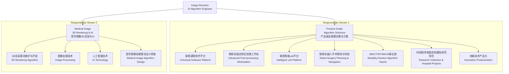
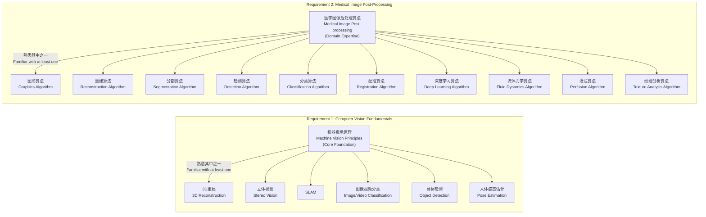
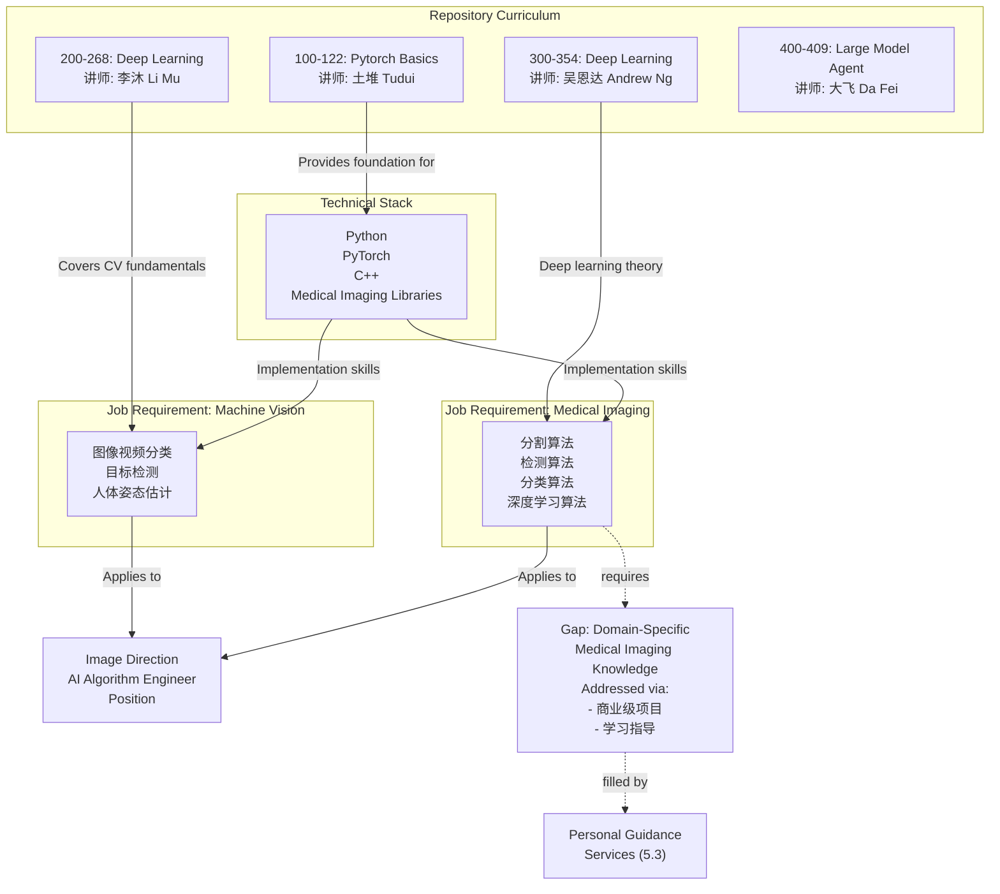
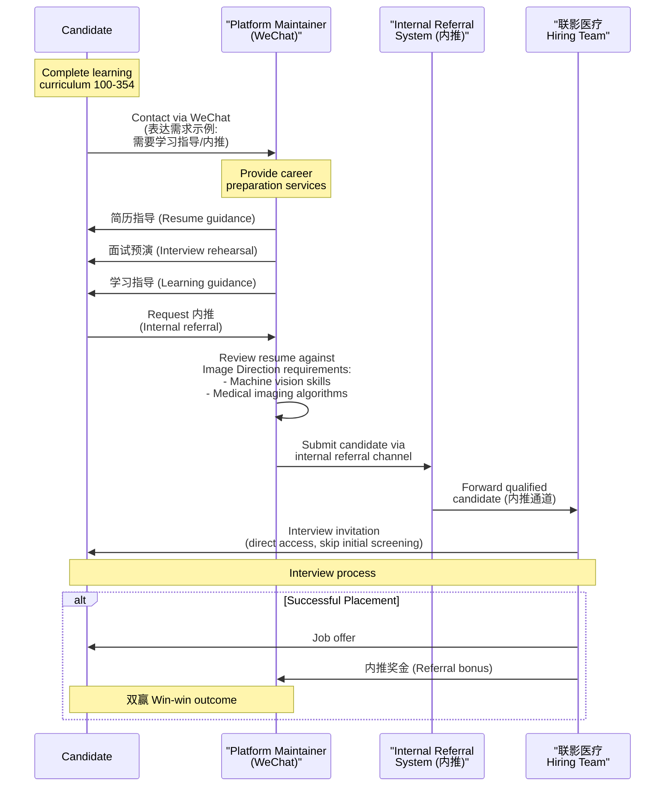
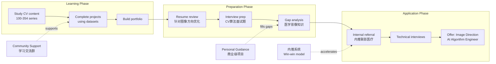

<!-- source: DeepWiki mcp.deepwiki.com · repo AccumulateMore/CV · extra page Image Direction AI Algorithm Engineer · fetched 2026-10-29 -->

# Image Direction AI Algorithm Engineer

<details>
<summary>Relevant source files</summary>

The following files were used as context for generating this wiki page:

- [README.md](README.md)

</details>


## Purpose and Scope

This document details the Image Direction AI Algorithm Engineer position at 联影医疗 (uCloudlink Medical), one of three AI algorithm tracks available through the platform's career services. This page specifically covers the responsibilities, technical requirements, and application process for the image/computer vision focused role. For other algorithm directions, see [Voice Direction AI Algorithm Engineer](#5.5.2) and [Large Model Direction AI Algorithm Engineer](#5.5.3). For general information about 联影医疗 opportunities, see [uCloudlink Medical Opportunities](#5.5).

This position represents a concrete career outcome available through the platform's internal referral system (内推), accessible after completing the learning curriculum and career preparation services documented in sections [5.1](#5.1) through [5.4](#5.4).

Sources: [README.md:83-100]()

## Position Overview

The Image Direction AI Algorithm Engineer role at 联影医疗 focuses on medical imaging AI and graphics algorithm development for the company's product portfolio. 联影医疗 is a publicly-listed company valued at hundreds of billions (上市千亿公司) specializing in high-end medical equipment development under China's national initiative for autonomous medical device research and development.

**Location Options**: Shanghai, Beijing, Shenzhen, Wuhan, Guangzhou, Chengdu, Xi'an, Shenyang, Sanya

**Company Context**: The position exists within China's strategic push for domestic medical equipment manufacturing, providing strong growth prospects and job security.

Sources: [README.md:83-88]()

## Core Responsibilities (岗位职责)

The position requires participation in AI algorithm development or graphics algorithm development for 联影集团 products, with responsibility for at least one of the following work streams:



### Responsibility Stream 1: Product-Grade Algorithm Solutions

Deliver production-level advanced algorithm solutions across multiple product lines:

| Product Area | Scope |
|-------------|-------|
| 联影通用软件平台 | Universal software platform serving as foundation for medical imaging applications |
| 联影高级应用后处理工作站 | Advanced post-processing workstation for medical image analysis |
| 联影智能uAI平台 | Intelligent uAI platform for AI-powered medical imaging |
| 联影机器人手术规划与导航 | Robotic surgery planning and navigation systems |
| MR/CT/RT/MI/US事业部 | Algorithm requirements for Magnetic Resonance, Computed Tomography, Radiation Therapy, Molecular Imaging, and Ultrasound divisions |
| 科研院所和医院前瞻性研究项目 | Forward-looking research projects with research institutions and hospitals |
| 创新技术产品化 | Participation in transforming innovative technologies into products |

### Responsibility Stream 2: Medical Image 3D Rendering and AI Development

Maintain and develop medical image 3D rendering algorithms and applications, utilizing image processing and artificial intelligence technology for medical image processing algorithm design and research.

Sources: [README.md:89-95]()

## Technical Requirements (任职要求)

The position has two primary technical requirement categories, with candidates expected to demonstrate proficiency in specific areas:



### Requirement 1: Machine Vision Principles Foundation

Candidates must be familiar with machine vision principles and have expertise in **at least one** of the following areas:

- **3D重建 (3D Reconstruction)**: Multi-view geometry, structure from motion, point cloud processing
- **立体视觉 (Stereo Vision)**: Binocular/multi-camera systems, depth estimation, disparity mapping
- **SLAM (Simultaneous Localization and Mapping)**: Real-time mapping and localization for navigation systems
- **图像视频分类 (Image/Video Classification)**: CNN-based classification architectures, temporal modeling
- **目标检测 (Object Detection)**: Region-based and single-shot detection methods (RCNN family, YOLO, etc.)
- **人体姿态估计 (Human Pose Estimation)**: Keypoint detection, skeleton tracking, multi-person pose

### Requirement 2: Medical Image Post-Processing Algorithms

Candidates must be familiar with **at least one** of the following medical image post-processing algorithms:

| Algorithm Category | Technical Details |
|-------------------|-------------------|
| 图形算法 (Graphics Algorithm) | Rendering, visualization, surface modeling |
| 重建算法 (Reconstruction Algorithm) | Image reconstruction from raw data (CT, MRI) |
| 分割算法 (Segmentation Algorithm) | Organ/tissue segmentation, semantic segmentation for medical images |
| 检测算法 (Detection Algorithm) | Lesion detection, anomaly detection in medical scans |
| 分类算法 (Classification Algorithm) | Disease classification, pathology classification |
| 配准算法 (Registration Algorithm) | Image alignment, multi-modal registration, deformable registration |
| 深度学习算法 (Deep Learning Algorithm) | CNN, U-Net, Transformer architectures for medical imaging |
| 流体力学算法 (Fluid Dynamics Algorithm) | Blood flow simulation, CFD for medical applications |
| 灌注算法 (Perfusion Algorithm) | Tissue perfusion analysis, contrast agent tracking |
| 纹理分析算法 (Texture Analysis Algorithm) | Radiomics, texture feature extraction |

Sources: [README.md:96-100]()

## Skill-to-Curriculum Mapping

The following diagram maps the position's technical requirements to the educational content available in the repository, showing how the platform's learning materials prepare candidates for this role:



**Curriculum Coverage**:
- **Pytorch fundamentals** [README.md:5-7](): Series 100-122 provides the technical foundation for implementing algorithms
- **Computer vision techniques** [README.md:9-11](): Series 200-268 covers deep learning approaches relevant to image classification and detection
- **Deep learning theory** [README.md:13-15](): Series 300-354 provides theoretical grounding for algorithm development

**Knowledge Gap Bridge**: The platform's personal guidance services [README.md:73-74]() fill domain-specific medical imaging knowledge through commercial-grade projects (商业级项目) and learning guidance (学习指导).

Sources: [README.md:5-24](), [README.md:73-74]()

## Programming and Technical Environment

While not explicitly stated in the job posting, standard technical requirements for this type of role include:

| Technical Component | Typical Requirements |
|-------------------|---------------------|
| **Programming Languages** | Python (algorithm prototyping, PyTorch), C++ (production deployment) |
| **Deep Learning Frameworks** | PyTorch (primary), TensorFlow (secondary), ONNX (deployment) |
| **Medical Imaging Libraries** | SimpleITK, pydicom, nibabel, 3D Slicer APIs |
| **3D Graphics** | VTK, OpenGL, CUDA (for GPU acceleration) |
| **Development Environment** | Linux servers, GPU clusters, Jupyter for experimentation |

The repository's Pytorch series [README.md:5-7]() and the technical setup documentation [README.md:34-39]() provide foundational knowledge for the development environment expected in this role.

Sources: [README.md:5-7](), [README.md:34-39]()

## Application Process via Internal Referral



### Application Steps

The internal referral process for the Image Direction role follows the standard career services pipeline:

1. **Initial Contact** [README.md:60-74](): 
   - Add maintainer via WeChat QR code in README
   - Express need: "需要学习指导" or "需要实习" or direct job referral

2. **Career Preparation** [README.md:148-160]():
   - Receive 简历指导 (resume guidance) following proven techniques
   - Participate in 面试预演 (interview rehearsal) for technical questions
   - Get 学习指导 (learning guidance) to fill any skill gaps specific to medical imaging

3. **Internal Referral Submission** [README.md:130]():
   - Request 内推 for 联影医疗 Image Direction role
   - Maintainer reviews fit against technical requirements
   - Resume submitted through internal channel (内推通道)

4. **Accelerated Interview Process**:
   - Skip initial HR screening through internal referral
   - Direct access to technical interview team
   - Faster hiring timeline compared to external applicants

5. **Win-Win Outcome** [README.md:130]():
   - Candidate: Successful employment at 联影医疗
   - Company: Pre-vetted qualified candidate + internal referral efficiency
   - Maintainer: 内推奖金 (referral bonus)

Sources: [README.md:60-74](), [README.md:130](), [README.md:148-160]()

## Resume Requirements Specific to Image Direction

Based on the platform's resume guidance methodology [README.md:148-160](), candidates applying for the Image Direction role should structure their resumes to highlight:

### Technical Skills Section

```
✓ 掌握 (Mastered Skills Only):
  - Python, C++ (OpenCV, PyTorch implementations)
  - PyTorch深度学习框架 (with medical imaging projects as evidence)
  - 图像处理算法: 目标检测, 图像分割 (cite specific projects)
  - 医学图像处理: CT/MRI图像预处理, DICOM格式处理
  
❌ 不要写 (Do Not Include):
  - Skills not yet mastered
  - Hardware knowledge (not relevant to algorithm role)
  - Generic organizational skills
```

### Evidence-Based Skill Demonstration

For each technical skill listed, provide concrete evidence:
- **3D Reconstruction**: "基于多视角几何的3D重建项目，实现点云配准算法"
- **Medical Image Segmentation**: "基于U-Net的肝脏CT图像分割，Dice系数达0.92"
- **Object Detection**: "改进YOLOv5用于医学影像病灶检测，mAP提升15%"

### Resume Formatting Rules [README.md:154-159]()

1. **Only list mastered skills** - No unmastered skills to avoid difficult interview questions
2. **Provide evidence** - Each skill must have supporting project or experience
3. **Algorithm-focused** - Organize from programming languages → frameworks → algorithms
4. **Job-matched** - Only include skills relevant to Image Direction requirements
5. **One line per category** - Consistent formatting for visual neatness
6. **10-second rule** - HR sees hundreds of resumes; make yours immediately clear

Sources: [README.md:148-160]()

## Position Context within Career Pipeline



This Image Direction position represents one of three algorithm specializations available through the platform [README.md:89-127](). The position fits into the broader career pipeline as:

- **Target outcome** for students completing the computer vision curriculum (series 100-354)
- **Proof point** of the platform's placement success (上千位同学 successfully placed) [README.md:165]()
- **Win-win model example** [README.md:130](): qualified candidates get jobs, companies get talent, maintainer receives referral bonuses

The role is specifically suitable for candidates who:
- Completed the deep learning curriculum focusing on CV topics
- Received personalized guidance to bridge into medical imaging domain
- Prepared resume and interview skills following platform methodology
- Ready for production-level algorithm development work

Sources: [README.md:89-127](), [README.md:165](), [README.md:130]()

## Related Resources

- **Other Algorithm Directions**: [Voice Direction AI Algorithm Engineer](#5.5.2), [Large Model Direction AI Algorithm Engineer](#5.5.3)
- **Company Overview**: [uCloudlink Medical Opportunities](#5.5) [README.md:83-88]()
- **Career Preparation Services**: [Resume Guidance](#5.1), [Interview Preparation](#5.2), [Learning Guidance](#5.3)
- **Internal Referral System**: [Internal Referral System](#5.4) [README.md:130]()
- **Success Metrics**: [Platform Outcomes and Success Stories](#6) [README.md:165-175]()
- **Relevant Learning Content**: [Curriculum Structure](#2.1), [Deep Learning Notes](#2.4)

Sources: [README.md:83-130](), [README.md:165-175]()

---

