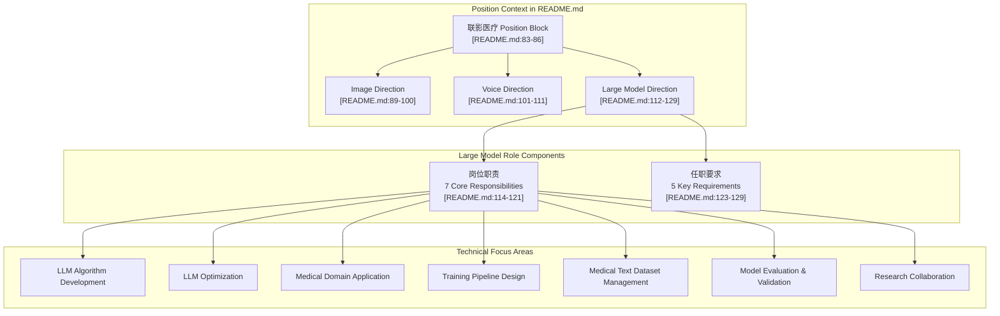
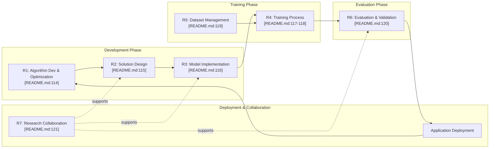
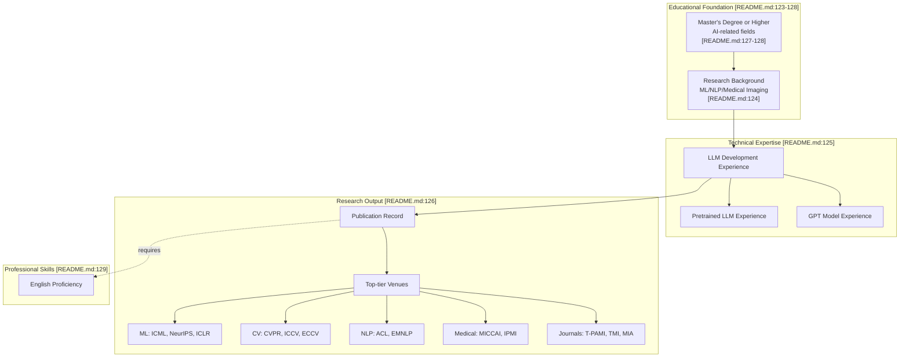
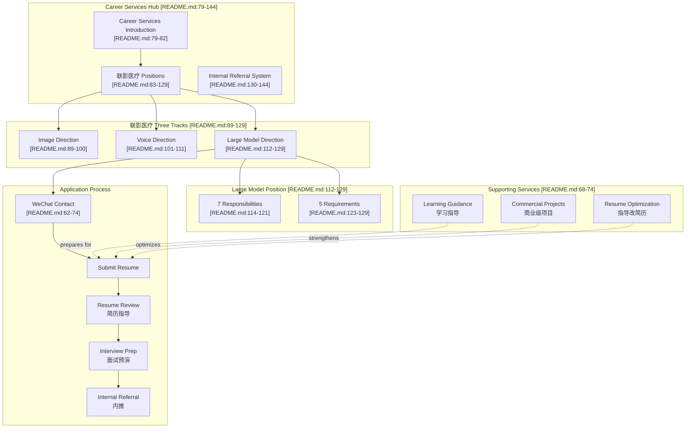
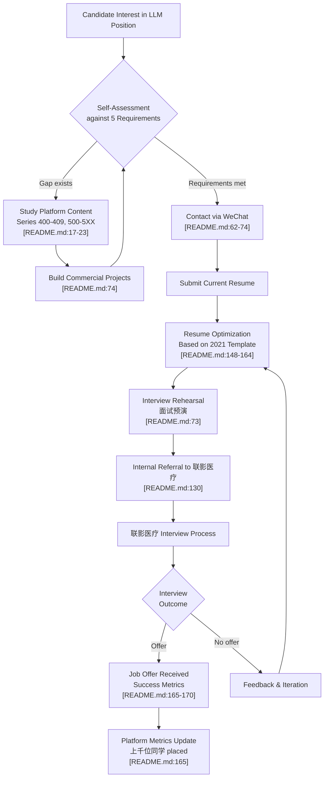

<!-- source: DeepWiki mcp.deepwiki.com · repo AccumulateMore/CV · extra page Large Model Direction AI Algorithm Engineer · fetched 2026-10-29 -->

# Large Model Direction AI Algorithm Engineer

Relevant source files

The following files were used as context for generating this wiki page:

- [README.md](README.md)

## Purpose and Scope

This document details the Large Model Direction AI Algorithm Engineer position at 联影医疗 (uCloudlink Medical), one of three AI algorithm engineering tracks offered through the platform's career services. This position focuses on large language model (LLM) development, optimization, and medical domain applications.

For information about other algorithm engineering directions at 联影医疗, see:
- Image Direction: [5.5.1](#5.5.1)
- Voice Direction: [5.5.2](#5.5.2)

For broader career services context, see [Career Services and Job Placement](#5) and [Internal Referral System](#5.4).

**Sources:** [README.md:112-129]()

---

## Position Overview

The Large Model Direction AI Algorithm Engineer role is part of 联影医疗's AI algorithm development team, focused on applying large language model technology to medical domain problems. The position is available across multiple locations: 上海 (Shanghai), 北京 (Beijing), 深圳 (Shenzhen), 武汉 (Wuhan), 广州 (Guangzhou), 成都 (Chengdu), 西安 (Xi'an), 沈阳 (Shenyang), and 三亚 (Sanya).

联影医疗 is described as a publicly-listed company valued at hundreds of billions (上市千亿公司), operating in China's strategic initiative for domestically-developed high-end medical equipment.

**Diagram: Large Model Position Structure in README.md**

**Sources:** [README.md:83-86](), [README.md:112-129]()

---

## Job Responsibilities (岗位职责)

The position encompasses seven primary responsibility areas, as specified in [README.md:114-121](). Each responsibility targets a different aspect of the LLM development and deployment lifecycle.

### Responsibility 1: Algorithm Development and Optimization

Primary focus: 负责大语言模型方面的算法开发、优化、应用落地 (Responsible for algorithm development, optimization, and application deployment of large language models)

This encompasses the complete development lifecycle from initial algorithm design through production deployment.

### Responsibility 2: Solution Design and Technical Research

Focus: 负责相应AI解决方案设计，参与关键技术研发，攻关技术难点 (Responsible for AI solution design, participating in key technology R&D, tackling technical challenges)

Involves system-level architecture and solving complex technical problems specific to medical domain LLM applications.

### Responsibility 3: Algorithm and Model Implementation

Core task: 负责设计和实现大语言模型相关的算法和模型实现，研究并设计新是算法和模型，解决大语言模型应用问题 (Responsible for designing and implementing LLM-related algorithms and models, researching and designing new algorithms and models, solving LLM application problems)

Note: There appears to be a typo in the original text ("新是算法" likely should be "新算法").

### Responsibility 4: Training Process Development

Detailed scope: 负责开发和优化大语言模型的训练过程，设计并实现大语言模型的训练算法和策略，配置和优化训练的超参数和计算资源，保证模型的训练效果和效率 (Responsible for developing and optimizing LLM training processes, designing and implementing training algorithms and strategies, configuring and optimizing training hyperparameters and computational resources, ensuring training effectiveness and efficiency)

This includes:
- Training algorithm design
- Training strategy implementation
- Hyperparameter tuning
- Computational resource optimization
- Quality and efficiency assurance

### Responsibility 5: Dataset Construction and Management

Task: 负责构建和管理大规模医疗文本数据集，用于模型预训练和微调，完成不用场景下的下游任务 (Responsible for constructing and managing large-scale medical text datasets for model pretraining and fine-tuning, completing downstream tasks in different scenarios)

Note: "不用场景" likely should be "不同场景" (different scenarios).

### Responsibility 6: Model Evaluation and Validation

Comprehensive evaluation responsibility: 负责进行大语言模型的评估和验证，设计评估指标和实验;设计和实施评估指标和实验，对训练好的大语言模型进行性能评估和分析。识别模型的弱点和改进空间，提出相应的改进策略和方法 (Responsible for LLM evaluation and validation, designing evaluation metrics and experiments; designing and implementing evaluation metrics and experiments, conducting performance evaluation and analysis of trained LLMs. Identifying model weaknesses and improvement opportunities, proposing corresponding improvement strategies and methods)

### Responsibility 7: Research Collaboration

Collaborative focus: 参与高校、科研、医疗机构科研合作，协助科研成果落地转化 (Participate in research collaboration with universities, research institutions, and medical organizations, assisting in the transformation and implementation of research outcomes)

**Diagram: Responsibility Workflow and Dependencies**

**Sources:** [README.md:114-121]()

---

## Job Requirements (任职要求)

The position specifies five key requirements documented in [README.md:123-129]().

### Requirement 1: Academic Background

Specification: 具有机器学习、自然语言处理、医学影像分析，或相关领域的学习和研究 (Must have study and research experience in machine learning, natural language processing, medical image analysis, or related fields)

Broad requirement encompassing multiple relevant technical domains.

### Requirement 2: LLM Development Experience

Core requirement: 有预训练大语言模型或GPT模型等相关研究开发经验 (Must have research and development experience with pretrained large language models or GPT models)

This is the primary technical requirement, focusing specifically on hands-on LLM experience.

### Requirement 3: Publication Record

Prestigious venues required: 在机器学习（ICML、NeurlPS、ICLR等），计算机视觉（CVPR、ICCV、ECCV等），自然语言处理（ACL、EMNLP等）和医疗影像分析（MICCAI、IPMI）等顶级会议，或者顶级期刊（IEEE T-PAMI、IEEE TMI、Medical lmage Analysis）发表过相关论文 (Must have published relevant papers at top-tier conferences in machine learning (ICML, NeurIPS, ICLR, etc.), computer vision (CVPR, ICCV, ECCV, etc.), natural language processing (ACL, EMNLP, etc.), and medical image analysis (MICCAI, IPMI), or top-tier journals (IEEE T-PAMI, IEEE TMI, Medical Image Analysis))

Note: "NeurlPS" appears to be a typo for "NeurIPS" and "Medical lmage Analysis" should be "Medical Image Analysis".

### Requirement 4: Educational Qualification

Degree requirement: 具有人工智能相关专业（计算机视觉、机器学习、医疗图像分析等）硕士及以上学位 (Must have a master's degree or higher in AI-related fields (computer vision, machine learning, medical image analysis, etc.))

### Requirement 5: Language Proficiency

Essential skill: 能熟练使用英语 (Must be proficient in English)

Critical for reading research papers, attending international conferences, and collaborating with global research communities.

**Diagram: Requirements Hierarchy and Dependencies**

**Sources:** [README.md:123-129]()

---

## Technical Skills Matrix

The following table synthesizes the technical competencies required based on the job responsibilities and requirements:

| Skill Category | Specific Technologies/Knowledge | Source in README.md | Requirement Level |
|----------------|--------------------------------|---------------------|-------------------|
| **Language Models** | Pretrained LLMs, GPT models | [README.md:125]() | Core (必须) |
| **Machine Learning** | Algorithm development, optimization | [README.md:114](), [README.md:124]() | Core (必须) |
| **Natural Language Processing** | NLP fundamentals, text processing | [README.md:124]() | Core (必须) |
| **Medical Domain** | Medical image analysis, medical text datasets | [README.md:119](), [README.md:124]() | Core (必须) |
| **Training Systems** | Training algorithms, hyperparameter tuning, resource optimization | [README.md:117-118]() | Core (必须) |
| **Evaluation** | Metrics design, experimental design, performance analysis | [README.md:120]() | Core (必须) |
| **Research** | Publication at top venues (ICML, NeurIPS, ACL, CVPR, etc.) | [README.md:126]() | Core (必须) |
| **Languages** | English proficiency | [README.md:129]() | Core (必须) |
| **Education** | Master's or higher in AI fields | [README.md:127-128]() | Core (必须) |
| **Collaboration** | Research partnerships, technology transfer | [README.md:121]() | Preferred |

**Sources:** [README.md:114-129]()

---

## Integration with Platform Career Services

The Large Model Direction position is part of the broader career services infrastructure detailed in [README.md:79-144](). This section shows how the position integrates with the platform's referral system.

**Diagram: Large Model Position in Career Services Ecosystem**

**Sources:** [README.md:79-144](), [README.md:68-74](), [README.md:62-74]()

---

## Application Process

### Step 1: Prepare with Platform Resources

Candidates can leverage the platform's educational content to build required skills:

- **Series 400-409**: Large Model Agent lectures by 大飞 (Da Fei) [README.md:17-19]()
- **Series 500-5XX**: Future large model content (planned) [README.md:21-23]()
- **Series 300-354**: Deep learning fundamentals by 吴恩达 (Andrew Ng) [README.md:13-15]()

### Step 2: Contact via WeChat

Use the WeChat contact method specified in [README.md:62-74](). Valid contact reasons include:

- 需要学习指导 (Need learning guidance)
- 指导改简历 (Resume guidance)
- 面试预演 (Interview rehearsal)
- 需要商业级项目 (Need commercial project experience)

### Step 3: Resume Optimization

Follow the resume guidance principles from [README.md:148-164]():

1. Only list mastered skills (技能只写掌握了XX，没掌握不要写)
2. Provide evidence for claimed skills (要论证自己真的掌握了)
3. Align with position requirements (围绕算法岗展开)
4. Include only relevant skills for the role (只写岗位需要的技能)
5. Maintain consistent formatting (掌握一种类别技能，只占一行)

### Step 4: Internal Referral

The platform operates a win-win internal referral model (双赢) described in [README.md:130](). The maintainer handles the referral process, which:

- Provides faster interview access for candidates
- Offers referral bonuses (内推奖金) to the platform
- Benefits 联影医疗 with pre-screened candidates

**Diagram: Complete Application Workflow with README.md Citations**

**Sources:** [README.md:17-23](), [README.md:62-74](), [README.md:148-164](), [README.md:130](), [README.md:165-170]()

---

## Alignment with Platform Success Metrics

The platform reports placing 上千位同学 (thousands of students) successfully [README.md:165]() and achieving 2024年度内推第一名 (2024 top internal referral provider) status [README.md:167]().

The Large Model Direction position contributes to this success through:

1. **Market Demand**: LLM skills are in high demand, matching the 400-409 and future 500-5XX series content
2. **Medical Domain**: 联影医疗's focus aligns with growing healthcare AI sector
3. **Location Flexibility**: Nine city options increase placement probability
4. **Research Focus**: Publication requirements match platform's academic support (论文辅导) [README.md:72]()

### Win-Win Model (双赢)

As stated in [README.md:130]():

- **Candidates**: Secured employment through internal referral advantages
- **联影医疗**: Access to pre-trained, platform-vetted candidates
- **Platform**: Referral bonuses (内推奖金) that sustain career services
- **Companies** (in broader network): Can provide positions and receive bonuses [README.md:130]()

**Sources:** [README.md:130](), [README.md:165-170](), [README.md:72]()

---

## Comparison with Other 联影医疗 Tracks

| Aspect | Image Direction [README.md:89-100]() | Voice Direction [README.md:101-111]() | **Large Model Direction [README.md:112-129]()** |
|--------|--------------------------------------|---------------------------------------|--------------------------------------------------|
| **Primary Domain** | Medical imaging, 3D rendering | Audio signal processing, ASR/TTS | Large language models, medical text |
| **Key Technologies** | Computer vision, image processing | Signal processing, neural networks | NLP, pretrained LLMs, GPT models |
| **Programming** | Python, C++, PyTorch | Matlab, C/C++ | Not explicitly specified (implied Python/ML stack) |
| **Research Areas** | 3D reconstruction, SLAM, detection | Echo cancellation, microphone arrays | Model training, evaluation, medical domain |
| **Publications** | Not explicitly required | Not explicitly required | **Required at top venues** |
| **Education** | Not explicitly specified | Not explicitly specified | **Master's or higher required** |
| **Language** | Not mentioned | Not mentioned | **English proficiency required** |
| **Number of Responsibilities** | 2 | 2 | **7 (most detailed)** |
| **Dataset Focus** | Medical images | Audio signals | Large-scale medical text datasets |

The Large Model Direction has the most comprehensive requirements and responsibilities, reflecting the complexity and research-intensive nature of LLM development.

**Sources:** [README.md:89-100](), [README.md:101-111](), [README.md:112-129]()

---

## Related Platform Resources

### Educational Foundation

- **Series 400-409**: Large Model Agent lectures [README.md:17-19]()
- **Series 500-5XX**: Future large model content [README.md:21-23]()
- **Datasets**: Baidu Netdisk with extraction code `ppmu` [README.md:27]()

### Career Support Services

- **Resume Guidance** (简历指导): [README.md:73]()
- **Interview Rehearsal** (面试预演): [README.md:73]()
- **Learning Guidance** (学习指导): [README.md:73]()
- **Commercial Projects** (商业级项目): [README.md:74]()

### Community Support

- **WeChat Groups**: Learning exchange groups [README.md:60-64]()
- **Direct Contact**: Personal WeChat for guidance [README.md:62-74]()

### Success Philosophy

The platform emphasizes avoiding detours (不走弯路错路) [README.md:73]() and states: "拿offer最快的方式，就是不走弯路，不走错路。方向错了，努力没有意义" (The fastest way to get an offer is to avoid detours and wrong paths. If the direction is wrong, effort is meaningless) [README.md:172]().

**Sources:** [README.md:17-23](), [README.md:27](), [README.md:60-74](), [README.md:172]()

---

