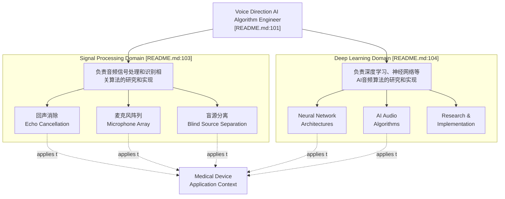
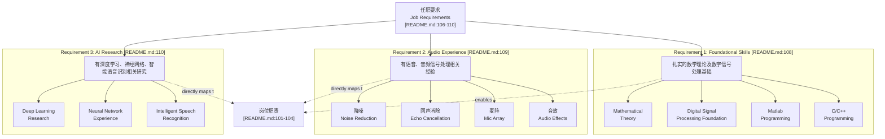
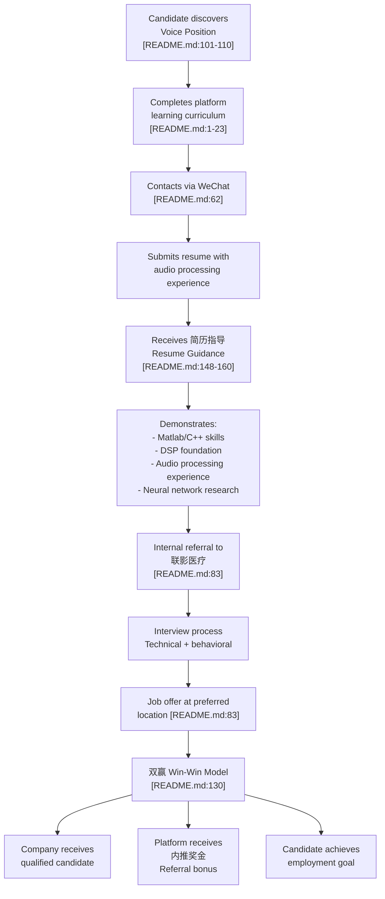
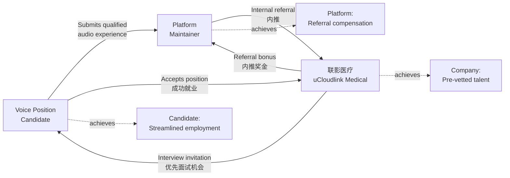

<!-- source: DeepWiki mcp.deepwiki.com · repo AccumulateMore/CV · extra page Voice Direction AI Algorithm Engineer · fetched 2026-10-29 -->

# Voice Direction AI Algorithm Engineer

Relevant source files

The following files were used as context for generating this wiki page:

- [README.md](README.md)

## Purpose and Scope

This page documents the Voice Direction AI Algorithm Engineer position at uCloudlink Medical (联影医疗), one of three specialized AI algorithm development tracks offered through the platform's career services. This position focuses on audio signal processing, speech recognition, and neural network-based audio algorithms for medical device applications.

For information about the other two tracks at uCloudlink Medical, see [Image Direction AI Algorithm Engineer](#5.5.1) and [Large Model Direction AI Algorithm Engineer](#5.5.3). For general career services information, see [Career Services and Job Placement](#5). For the internal referral system that facilitates this opportunity, see [Internal Referral System](#5.4).

Sources: [README.md:101-110]()

---

## Position Overview

The Voice Direction AI Algorithm Engineer role at 联影医疗 (uCloudlink Medical) represents one of three specialized algorithm development tracks available through the platform's direct job posting system. This position is strategically significant within the medical device sector as uCloudlink Medical is a publicly-traded company valued at billions (上市千亿公司) operating under China's national policy to develop self-reliant high-end medical equipment (在国家号召自主研发高端医疗器械背景下).

### Geographic Flexibility

The position offers multiple location options across major Chinese cities:
- Shanghai (上海)
- Beijing (北京)
- Shenzhen (深圳)
- Wuhan (武汉)
- Guangzhou (广州)
- Chengdu (成都)
- Xi'an (西安)
- Shenyang (沈阳)
- Sanya (三亚)

This geographic flexibility allows candidates to optimize for cost of living, proximity to family, or preferred urban environment while maintaining career trajectory.

Sources: [README.md:83-86]()

---

## Job Responsibilities Analysis

The Voice Direction position encompasses two primary responsibility domains defined in [README.md:101-104]():

### Diagram: Voice Algorithm Responsibility Breakdown

Sources: [README.md:101-104]()

### Responsibility 1: Audio Signal Processing and Recognition

**Core Focus**: Research and implementation of audio signal processing and recognition algorithms.

**Specific Technical Areas** (包含但不限于 - includes but not limited to):

| Technical Area | Chinese Term | Typical Application |
|---------------|--------------|---------------------|
| Echo Cancellation | 回声消除 | Real-time communication systems in medical devices |
| Microphone Array | 麦克风阵列 | Spatial audio capture for surgical environments |
| Blind Source Separation | 盲源分离 | Isolating individual audio sources in noisy clinical settings |

The phrase "包含但不限于" (includes but not limited to) indicates these are exemplary technologies, not an exhaustive list. Candidates may work on related audio processing techniques as medical device requirements evolve.

Sources: [README.md:103]()

### Responsibility 2: Deep Learning and Neural Network Audio Algorithms

**Core Focus**: Research and implementation of AI-powered audio algorithms using deep learning and neural network techniques.

This responsibility domain emphasizes:
- **Research Component**: Investigating state-of-the-art neural network architectures for audio processing
- **Implementation Component**: Converting research findings into production-ready algorithms
- **AI Integration**: Applying modern machine learning techniques to traditional audio processing challenges

The combination of signal processing expertise (Responsibility 1) with neural network capabilities (Responsibility 2) reflects the industry trend toward hybrid classical-AI approaches in medical audio applications.

Sources: [README.md:104]()

---

## Technical Requirements

The position specifies three core requirement categories defined in [README.md:106-110]():

### Diagram: Technical Requirements Hierarchy

Sources: [README.md:106-110]()

### Requirement 1: Mathematical and Signal Processing Foundation

**Exact Requirement**: "扎实的数学理论及数字信号处理基础，掌握Matlab及C/C++语言编程"

**Breakdown**:

1. **扎实的数学理论** (Solid mathematical theory)
   - Linear algebra for signal transformations
   - Fourier analysis for frequency domain processing
   - Probability theory for stochastic signal modeling
   - Optimization theory for algorithm parameter tuning

2. **数字信号处理基础** (Digital signal processing foundation)
   - Sampling theory and quantization
   - Filter design (FIR, IIR)
   - Time-frequency analysis
   - Spectral estimation

3. **掌握Matlab编程** (Master Matlab programming)
   - Signal processing toolbox proficiency
   - Algorithm prototyping and validation
   - Visualization of audio signal characteristics
   - Simulation of processing pipelines

4. **掌握C/C++语言编程** (Master C/C++ programming)
   - Real-time audio processing implementation
   - Performance optimization for embedded systems
   - Memory management for audio buffers
   - Integration with medical device firmware

The combination of Matlab (for research/prototyping) and C/C++ (for production deployment) reflects the dual-phase nature of algorithm development in medical devices.

Sources: [README.md:108]()

### Requirement 2: Audio Signal Processing Experience

**Exact Requirement**: "有语音、音频信号处理(降噪，回声消除、麦阵、音效等)相关经验"

**Specific Experience Areas**:

| Experience Domain | Chinese Term | Technical Scope |
|-------------------|--------------|-----------------|
| Noise Reduction | 降噪 | Spectral subtraction, Wiener filtering, neural network-based denoising |
| Echo Cancellation | 回声消除 | Adaptive filtering, NLMS/RLS algorithms, double-talk detection |
| Microphone Array | 麦阵 | Beamforming, spatial filtering, direction of arrival estimation |
| Audio Effects | 音效 | Equalization, dynamic range compression, spatial effects |

The phrase "等" (etc.) indicates additional related audio processing experience is valuable. This could include:
- Automatic Speech Recognition (ASR) pre-processing
- Voice activity detection (VAD)
- Acoustic modeling
- Audio codec optimization

Sources: [README.md:109]()

### Requirement 3: AI and Speech Recognition Research

**Exact Requirement**: "有深度学习、神经网络、智能语音识别相关研究"

**Research Areas**:

1. **深度学习** (Deep Learning)
   - End-to-end trainable audio processing models
   - Transfer learning for audio domain adaptation
   - Self-supervised learning on audio data

2. **神经网络** (Neural Networks)
   - Convolutional neural networks for spectral features
   - Recurrent neural networks for temporal modeling
   - Transformer architectures for sequence-to-sequence tasks

3. **智能语音识别** (Intelligent Speech Recognition)
   - ASR model architectures (CTC, attention-based)
   - Language modeling integration
   - Multi-lingual speech recognition
   - Medical terminology-specific recognition

The term "相关研究" (related research) indicates academic or industrial research experience is expected, potentially including publications, patents, or deployed systems.

Sources: [README.md:110]()

---

## Application Process Integration

### Diagram: Voice Position Application Flow

Sources: [README.md:62](), [README.md:83](), [README.md:101-110](), [README.md:130](), [README.md:148-160]()

### Contact Requirements

When contacting via WeChat [README.md:62](), candidates should explicitly state their interest in the Voice Direction position. The README emphasizes direct communication: "因为好友申请太多了，添加好友后，直接表达你的需求" (Because of many friend requests, after adding as friend, directly express your need).

**Valid Contact Reasons** for this position (from [README.md:70-74]()):

| Contact Purpose | Chinese Term | Relevance to Voice Position |
|----------------|--------------|----------------------------|
| Need learning guidance | 需要学习指导 | Planning audio processing learning path |
| Interview rehearsal | 面试预演 | Preparing for technical questions on DSP/audio |
| Resume guidance | 指导改简历 | Highlighting audio processing experience |
| Need internship | 需要实习 | Audio-related internship as pathway |
| Need commercial projects | 需要商业级项目 | Building audio algorithm portfolio |

Sources: [README.md:62](), [README.md:70-74]()

---

## Preparation Recommendations

### Skills Alignment with Platform Content

The platform's deep learning curriculum [README.md:1-23]() provides foundational knowledge that candidates should supplement with specialized audio processing skills:

**Platform Coverage**:
- **Pytorch Basics** [100-122]: Neural network fundamentals applicable to audio models
- **Deep Learning** [200-268, 300-354]: Architecture design for audio processing networks
- **Large Model Agent** [400-409]: Transfer learning approaches for audio domain

**Additional Self-Study Required**:
- Digital signal processing theory (not covered in platform curriculum)
- Matlab programming for audio algorithm prototyping
- Audio-specific neural network architectures (WaveNet, Tacotron, etc.)
- Real-time audio processing constraints and optimization

Sources: [README.md:1-23]()

### Resume Preparation Guidance

The platform provides specific resume guidance principles [README.md:148-160]() that apply to Voice Position candidates:

**Key Principles from 2021 Example**:

1. **技能只写掌握了XX** (Only list mastered skills)
   - List Matlab if proficient in Signal Processing Toolbox
   - List C/C++ with specific audio processing libraries (e.g., PortAudio, FFTW)
   - List neural network frameworks with audio model experience (PyTorch Audio, torchaudio)

2. **后面要论证自己真的掌握了** (Provide evidence of mastery)
   - Example: "Matlab - 使用MATLAB实现过回声消除算法并在实际设备上部署"
   - Example: "C++ - 开发过实时麦克风阵列处理系统，优化至20ms延迟"

3. **围绕算法岗展开技能阐述** (Focus skills on algorithm role)
   - Emphasize: DSP algorithms → Neural networks → Deployment
   - De-emphasize: Hardware design, circuit knowledge (unless device-relevant)

4. **只写岗位需要的技能** (Only list position-relevant skills)
   - Align with [README.md:108-110](): Math → DSP → Matlab/C++ → Audio experience → Deep learning

5. **掌握一种类别技能，只占一行** (One skill category per line)
   - Keep formatting consistent for visual clarity
   - HR reviews resumes in 10 seconds [README.md:161]()

Sources: [README.md:148-160]()

---

## Success Metrics and Track Record

The platform maintains a proven track record of successful placements. The maintainer has guided "上千位同学" (thousands of students) through the job search process [README.md:165]() and achieved "2024届年度内推第一名" (2024 annual top internal referral provider) [README.md:167]().

### Win-Win Model

The Voice Position follows the platform's 双赢 (win-win) referral model [README.md:130]():

Sources: [README.md:130](), [README.md:165-167]()

This three-party value exchange ensures:
- **Candidates** receive guided preparation and direct access to hiring managers
- **uCloudlink Medical** receives candidates pre-screened for audio processing skills
- **Platform** sustains operations through referral incentives

---

## Related Positions at uCloudlink Medical

The Voice Direction position is one of three parallel algorithm tracks [README.md:89-128]():

| Position | Focus Area | Line Reference |
|----------|-----------|----------------|
| Image Direction | Medical image processing, 3D reconstruction, segmentation | [README.md:89-99]() |
| **Voice Direction** | **Audio signal processing, speech recognition, neural audio** | **[README.md:101-110]()** |
| Large Model Direction | LLM optimization, medical domain NLP, model training | [README.md:112-128]() |

Candidates with interdisciplinary skills (e.g., audio-visual fusion, multimodal medical AI) may consider multiple tracks or discuss hybrid roles during the application process.

Sources: [README.md:89-128]()

---

## Key Takeaways

1. **Position Scope**: Audio signal processing and neural network-based audio algorithms for medical devices
2. **Core Requirements**: Matlab/C++ programming, DSP foundation, audio processing experience, deep learning research
3. **Geographic Flexibility**: Nine city options across China
4. **Application Process**: Contact via WeChat → Resume guidance → Internal referral → Interview
5. **Platform Support**: Resume guidance, interview preparation, learning path optimization
6. **Company Context**: Publicly-traded medical equipment manufacturer with strong national policy support
7. **Win-Win Model**: Three-party value exchange through internal referral system

Sources: [README.md:83](), [README.md:101-110]()

---

