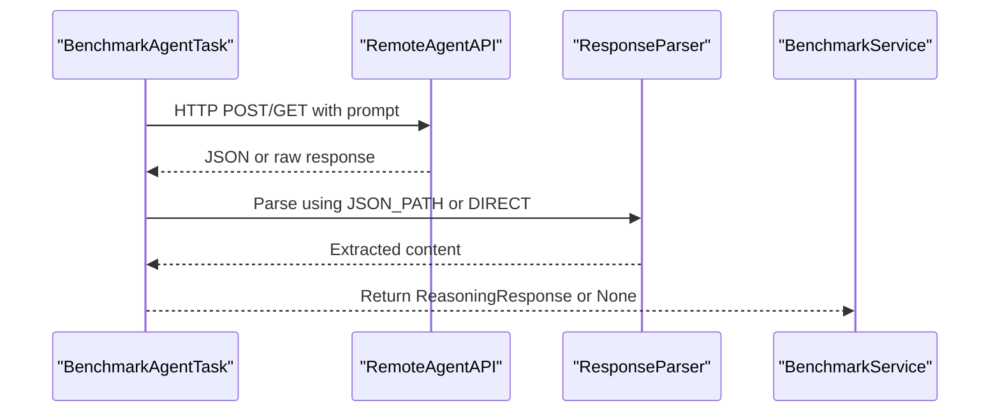

<!-- source: DeepWiki mcp.deepwiki.com · repo eosphoros-ai/DB-GPT · page 11.1 LLM & RAG Benchmarks · fetched 2026-11-09 -->

# LLM & RAG Benchmarks

<details>
<summary>Relevant source files</summary>

The following files were used as context for generating this wiki page:

- [assets/dbgpt.png](assets/dbgpt.png)
- [docs/docs/agents/modules/memory/hybrid_memory.md](docs/docs/agents/modules/memory/hybrid_memory.md)
- [docs/docs/agents/modules/memory/long_term_memory.md](docs/docs/agents/modules/memory/long_term_memory.md)
- [docs/docs/awel/cookbook/first_rag_with_awel.md](docs/docs/awel/cookbook/first_rag_with_awel.md)
- [docs/docs/awel/cookbook/write_your_chat_database.md](docs/docs/awel/cookbook/write_your_chat_database.md)
- [examples/awel/simple_nl_schema_sql_chart_example.py](examples/awel/simple_nl_schema_sql_chart_example.py)
- [examples/sdk/chat_data_with_awel.py](examples/sdk/chat_data_with_awel.py)
- [packages/dbgpt-app/src/dbgpt_app/knowledge/_cli/knowledge_client.py](packages/dbgpt-app/src/dbgpt_app/knowledge/_cli/knowledge_client.py)
- [packages/dbgpt-app/src/dbgpt_app/knowledge/api.py](packages/dbgpt-app/src/dbgpt_app/knowledge/api.py)
- [packages/dbgpt-app/src/dbgpt_app/tests/test_knowledge_space_scoping.py](packages/dbgpt-app/src/dbgpt_app/tests/test_knowledge_space_scoping.py)
- [packages/dbgpt-core/src/dbgpt/agent/resource/database.py](packages/dbgpt-core/src/dbgpt/agent/resource/database.py)
- [packages/dbgpt-core/src/dbgpt/rag/evaluation/retriever.py](packages/dbgpt-core/src/dbgpt/rag/evaluation/retriever.py)
- [packages/dbgpt-core/src/dbgpt/rag/retriever/embedding.py](packages/dbgpt-core/src/dbgpt/rag/retriever/embedding.py)
- [packages/dbgpt-core/src/dbgpt/util/benchmarks/StorageUtil.py](packages/dbgpt-core/src/dbgpt/util/benchmarks/StorageUtil.py)
- [packages/dbgpt-ext/src/dbgpt_ext/rag/retriever/db_schema.py](packages/dbgpt-ext/src/dbgpt_ext/rag/retriever/db_schema.py)
- [packages/dbgpt-ext/src/dbgpt_ext/rag/retriever/tests/test_db_struct.py](packages/dbgpt-ext/src/dbgpt_ext/rag/retriever/tests/test_db_struct.py)
- [packages/dbgpt-serve/src/dbgpt_serve/agent/evaluation/evaluation.py](packages/dbgpt-serve/src/dbgpt_serve/agent/evaluation/evaluation.py)
- [packages/dbgpt-serve/src/dbgpt_serve/evaluate/api/schemas.py](packages/dbgpt-serve/src/dbgpt_serve/evaluate/api/schemas.py)
- [packages/dbgpt-serve/src/dbgpt_serve/evaluate/service/benchmark/__init__.py](packages/dbgpt-serve/src/dbgpt_serve/evaluate/service/benchmark/__init__.py)
- [packages/dbgpt-serve/src/dbgpt_serve/evaluate/service/benchmark/benchmark_service.py](packages/dbgpt-serve/src/dbgpt_serve/evaluate/service/benchmark/benchmark_service.py)
- [packages/dbgpt-serve/src/dbgpt_serve/evaluate/service/benchmark/ext/__init__.py](packages/dbgpt-serve/src/dbgpt_serve/evaluate/service/benchmark/ext/__init__.py)
- [packages/dbgpt-serve/src/dbgpt_serve/evaluate/service/benchmark/ext/excel_file_parse.py](packages/dbgpt-serve/src/dbgpt_serve/evaluate/service/benchmark/ext/excel_file_parse.py)
- [packages/dbgpt-serve/src/dbgpt_serve/evaluate/service/benchmark/ext/falcon_file_parse.py](packages/dbgpt-serve/src/dbgpt_serve/evaluate/service/benchmark/ext/falcon_file_parse.py)
- [packages/dbgpt-serve/src/dbgpt_serve/evaluate/service/benchmark/file_parse_service.py](packages/dbgpt-serve/src/dbgpt_serve/evaluate/service/benchmark/file_parse_service.py)
- [packages/dbgpt-serve/src/dbgpt_serve/evaluate/service/benchmark/models.py](packages/dbgpt-serve/src/dbgpt_serve/evaluate/service/benchmark/models.py)
- [packages/dbgpt-serve/src/dbgpt_serve/evaluate/service/benchmark/sql_guard.py](packages/dbgpt-serve/src/dbgpt_serve/evaluate/service/benchmark/sql_guard.py)
- [packages/dbgpt-serve/src/dbgpt_serve/evaluate/service/benchmark/task/benchmark_agent_task.py](packages/dbgpt-serve/src/dbgpt_serve/evaluate/service/benchmark/task/benchmark_agent_task.py)
- [packages/dbgpt-serve/src/dbgpt_serve/evaluate/service/benchmark/user_input_execute_service.py](packages/dbgpt-serve/src/dbgpt_serve/evaluate/service/benchmark/user_input_execute_service.py)
- [packages/dbgpt-serve/src/dbgpt_serve/evaluate/service/fetchdata/benchmark_data_manager.py](packages/dbgpt-serve/src/dbgpt_serve/evaluate/service/fetchdata/benchmark_data_manager.py)
- [packages/dbgpt-serve/src/dbgpt_serve/evaluate/tests/__init__.py](packages/dbgpt-serve/src/dbgpt_serve/evaluate/tests/__init__.py)
- [packages/dbgpt-serve/src/dbgpt_serve/evaluate/tests/test_benchmark_output_path.py](packages/dbgpt-serve/src/dbgpt_serve/evaluate/tests/test_benchmark_output_path.py)
- [packages/dbgpt-serve/src/dbgpt_serve/evaluate/tests/test_post_sql_query_guard.py](packages/dbgpt-serve/src/dbgpt_serve/evaluate/tests/test_post_sql_query_guard.py)
- [packages/dbgpt-serve/src/dbgpt_serve/evaluate/tests/test_sql_guard.py](packages/dbgpt-serve/src/dbgpt_serve/evaluate/tests/test_sql_guard.py)
- [packages/dbgpt-serve/src/dbgpt_serve/rag/models/chunk_db.py](packages/dbgpt-serve/src/dbgpt_serve/rag/models/chunk_db.py)

</details>


## Purpose and Scope

The DB-GPT Evaluation and Benchmarking subsystem provides a robust framework for quantitatively assessing the performance of Large Language Models (LLMs) and Retrieval-Augmented Generation (RAG) components. It supports:

- LLM inference benchmarking by executing prompts and capturing outputs.
- RAG retriever evaluation using specialized metrics for assessing retrieval accuracy and relevance.
- Benchmark agent tasks that can invoke local or remote agent APIs for black-box evaluation.
- Automated loading and parsing of evaluation datasets from diverse sources like GitHub Falcon dataset and Excel benchmark files.
- Comparison of generated outputs against golden (standard) answers using configurable strategies.
- Exporting detailed benchmark results in Excel or JSON formats for reporting and analysis.

This page documents the technical implementation, data flow, core classes, and how to invoke and interpret results for the LLM & RAG benchmark framework within DB-GPT.

Sources: [packages/dbgpt-serve/src/dbgpt_serve/evaluate/service/benchmark/benchmark_service.py:13-110](), [packages/dbgpt-serve/src/dbgpt_serve/evaluate/service/fetchdata/benchmark_data_manager.py:1-218]()

---

## Architecture Overview

The benchmarking process is orchestrated by the `BenchmarkService` class, which coordinates dataset loading, task execution, and result comparison. It invokes LLM inference via `DefaultLLMClient` and agent calls via `BenchmarkAgentTask`. The `BenchmarkDataManager` handles fetching and caching benchmark datasets. The `UserInputExecuteService` parses input files and processes execution results.

The following diagram illustrates the high-level data flow and core code entities mapping to natural language concepts:

```mermaid
%% Diagram: Benchmark Task Execution Flow
graph TD
    "UI_Request"["User Request (EvaluateServeRequest)"] --> "BenchmarkSvc"["BenchmarkService\n(create_benchmark_task, run)"]
    "BenchmarkSvc" --> "DataMgr"["BenchmarkDataManager\n(load_data, get_connector)"]
    "DataMgr" --> "FileParsers"["FileParseService Subclasses\nFalconFileParseService, ExcelFileParseService"]
    "FileParsers" --> "InputSets"["BenchmarkDataSets (Parsed Input Data)"]
    "BenchmarkSvc" --> "TaskExec"["BenchmarkLLMTask / BenchmarkAgentTask (Executor)"]
    "TaskExec" --> "LLMClient"["DefaultLLMClient / agent invocation"]
    "LLMClient" --> "AnswerModel"["AnswerExecuteModel (Outputs)"]
    "AnswerModel" --> "CompareSvc"["DataCompareService (Compare gold vs prediction)"]
    "CompareSvc" --> "PersistDao"["ServeDao\n(Persist results to DB)"]
```

Sources: [packages/dbgpt-serve/src/dbgpt_serve/evaluate/service/benchmark/benchmark_service.py:121-180](), [packages/dbgpt-serve/src/dbgpt_serve/evaluate/service/fetchdata/benchmark_data_manager.py:133-218]()

---

## Key Components

### BenchmarkService

- **Location:** `packages/dbgpt-serve/src/dbgpt_serve/evaluate/service/benchmark/benchmark_service.py` [121-180]()
- **Role:** Core coordinator of benchmark tasks. Initializes dependent components like RAG service, prompt service, data comparison, and user input services. Provides the interface to create benchmark tasks, invoke local or remote executions, and handle parallelism.
- **LLM Client Integration:** Uses `DefaultLLMClient`, created from the system app's `WorkerManagerFactory` which manages multiple local or cluster workers.
- **Concurrency:** Uses a `ThreadPoolExecutor` internally to handle parallel task execution and file IO.
- **Key Methods:** 
  - `create_benchmark_task()` — Receives benchmark task config, input/output paths, and metadata, persists the task for execution.
  - `run_benchmark()` — Executes a benchmark by loading input data, invoking LLMs or agents, comparing outputs, and writing results.
- **Security:** Contains safe path generation for writing results avoiding path traversal vulnerabilities.

### BenchmarkDataManager

- **Location:** `packages/dbgpt-serve/src/dbgpt_serve/evaluate/service/fetchdata/benchmark_data_manager.py` [133-218]()
- **Role:** Retrieves and caches benchmark datasets. Supports loading from remote GitHub repositories (e.g. Falcon dataset), locally cached SQLite databases, and manages concurrent access.
- **Features:** 
  - Async HTTP session management for remote fetching.
  - SQLite connector initialization to support dataset ingestion.
  - Cache directory management and expiry.
  - Dataset parsing and indexing.
- **Configuration:** Specified by `BenchmarkDataConfig` which declares repo URLs, cache directories, and database schema paths.

### UserInputExecuteService

- **Location:** `packages/dbgpt-serve/src/dbgpt_serve/evaluate/service/benchmark/user_input_execute_service.py` [37-184]()
- **Role:** Reads benchmark input files, dispatches model execution requests, and compares results.
- **File Parsing:** Selects file parse service based on configured type (e.g. `FalconFileParseService` for GitHub JSONL, `ExcelFileParseService` for Excel files).
- **Post Dispatch:** Supports different benchmark modes:
  - `BUILD` mode for constructing the gold standard.
  - `EXECUTE` mode for running model inference and comparing with gold.
- **Comparison Logic:** Uses `DataCompareService` to compare model outputs using configured strategies, such as exact or fuzzy matching.

Sources: [packages/dbgpt-serve/src/dbgpt_serve/evaluate/service/benchmark/benchmark_service.py:121-180](), [packages/dbgpt-serve/src/dbgpt_serve/evaluate/service/fetchdata/benchmark_data_manager.py:133-204](), [packages/dbgpt-serve/src/dbgpt_serve/evaluate/service/benchmark/user_input_execute_service.py:37-134]()

---

## Data Parsing and Input Formats

The benchmarking system supports multiple input file formats through an extensible `FileParseService` interface.

| Format / Source | Parser Class | Description |
|-----------------|--------------|-------------|
| Falcon Dataset (GitHub JSONL) | `FalconFileParseService` | Parses Text-to-SQL benchmark datasets, containing DB schema, sample data, questions, SQL answers as JSON lines. Supports DEV and TEST environments with separate files. |
| Excel Benchmarks | `ExcelFileParseService` | Supports tabular spreadsheet benchmarks with detailed result comparison export, including standard answers in Excel and report generation. |

### Data Model Highlights

- `BaseInputModel`: Base data model representing one input row, including serial number and question text.
- `AnswerExecuteModel`: Model for LLM or agent output for an input, including output text, execution results, error messages, strategy configs, and execution costs.
- `BenchmarkDataSets`: Composite parsed dataset holding multiple `BaseInputModel` instances.

```mermaid
classDiagram
    class "FileParseService" {
        +parse_input_sets(input_path, env)
        +parse_standard_benchmark_sets(file_path, env)
        +write_data_compare_result()
    }
    class "FalconFileParseService" {
        +parse_input_sets()
        +_get_env_data()
    }
    class "ExcelFileParseService" {
        +parse_input_sets()
        +parse_standard_benchmark_sets()
        +write_data_compare_result()
    }
    "FileParseService" <|-- "FalconFileParseService"
    "FileParseService" <|-- "ExcelFileParseService"

    class "BaseInputModel" {
        +serial_no: int
        +question: str
    }
    class "AnswerExecuteModel" {
        +serialNo: int
        +llmOutput: str
        +executeResult: dict
        +errorMsg: str
    }

    "FalconFileParseService" ..> "BaseInputModel" : creates
    "ExcelFileParseService" ..> "AnswerExecuteModel" : parses
```

Sources: [packages/dbgpt-serve/src/dbgpt_serve/evaluate/service/benchmark/file_parse_service.py:20-47](), [packages/dbgpt-serve/src/dbgpt_serve/evaluate/service/benchmark/ext/falcon_file_parse.py:183-250](), [packages/dbgpt-serve/src/dbgpt_serve/evaluate/service/benchmark/ext/excel_file_parse.py:20-60](), [packages/dbgpt-serve/src/dbgpt_serve/evaluate/service/benchmark/models.py:40-121]()

---

## RAG Retriever Evaluation Metrics

DB-GPT provides RAG retrieval evaluation components to quantitatively measure retriever quality against labeled datasets.

- **DBSchemaRetriever**: Specialized retriever for database schema knowledge (tables and fields), supporting vector search with optional reranking.
- **RetrieverEvaluator**: Wraps retriever operators with evaluation metrics for scoring and comparison.
- **Key Metrics Implemented:**
  - `RetrieverHitRateMetric`: Measures proportion of queries retrieving relevant schema objects in top-k [examples/rag/retriever_evaluation_example.py:80-82]().
  - `RetrieverMRRMetric` (Mean Reciprocal Rank): Evaluates rank position of the first relevant item [examples/rag/retriever_evaluation_example.py:83]().
  - `RetrieverSimilarityMetric`: Computes semantic similarity between retrieved vectors and gold contexts [examples/rag/retriever_evaluation_example.py:84]().

These metrics assist in diagnosing retriever accuracy, crucial for downstream LLM tasks like Text2SQL or question answering.

Sources: [examples/rag/retriever_evaluation_example.py:70-84]()

---

## Benchmark Agent Task

The `BenchmarkAgentTask` class enables evaluation of remote agent microservices exposing an HTTP API endpoint for completion.

- **Configuration via `AgentApiConfig`** includes:
  - API URL, HTTP method (POST/GET), timeout, headers.
  - Response parsing strategy (`JSON_PATH`, `DIRECT`), with customizable JSON path extraction.
  - Retry policy and SSL verification.
- **Invocation Flow:**
  - Builds request payload using prompt and additional parameters.
  - Executes HTTP API call with retry and timeout.
  - Parses response using the configured strategy to extract usable answers (e.g., generated SQL).
  - Returns a `ReasoningResponse` object encapsulating results or None on failure.
- **Use Cases:** Enables black-box evaluation of real agent systems or third-party LLM APIs as part of the benchmark pipeline.



Sources: [packages/dbgpt-serve/src/dbgpt_serve/evaluate/service/benchmark/task/benchmark_agent_task.py:25-140](), [packages/dbgpt-serve/src/dbgpt_serve/evaluate/service/benchmark/models.py:189-228]()

---

## Evaluation Metrics & Result Comparison

The LLM and RAG benchmarking framework includes a comparison service to evaluate output correctness against golden references:

- `DataCompareService` provides mechanisms to compare model or agent outputs to ground truth answers.
- Supports comparison strategies defined in `DataCompareStrategyConfig`:
  - `EXACT_MATCH`: Strict string equality or JSON equality.
  - `CONTAIN_MATCH`: Partial or substring matches allowed.
  - SQL execution-based comparison to validate query result sets.
- Outcome states are enumerated by `DataCompareResultEnum`: `RIGHT`, `WRONG`, `FAILED`, `EXCEPTION`.
- Comparisons propagate detailed result objects with scores and messages for reporting.

This ensures rigorous verification of benchmark results beyond simple string matching.

Sources: [packages/dbgpt-serve/src/dbgpt_serve/evaluate/service/benchmark/models.py:23-40](), [packages/dbgpt-serve/src/dbgpt_serve/evaluate/service/benchmark/user_input_execute_service.py:120-184]()

---

## Running Benchmarks & Interpreting Results

### Configuring and Starting Benchmarks

- Benchmarks are configured using `BenchmarkExecuteConfig`, specifying:
  - Execution mode: `LLM` (direct inference) or `AGENT` (remote API).
  - Evaluation environment: `DEV` or `TEST`.
  - Input dataset file paths.
  - Output result export paths.
  - Model or agent lists to evaluate.
- Invoke via `BenchmarkService.create_benchmark_task()` or API endpoints with `EvaluateServeRequest` schemas [packages/dbgpt-serve/src/dbgpt_serve/evaluate/service/benchmark/benchmark_service.py:121-199]().

### Result Outputs

- Results are exported as Excel files or JSON summaries.
- Output formats include per-input prediction and reference answers with comparison results.
- Aggregate metrics are computed for overall benchmark performance.

### Interpreting Outputs

- Excel result sheets contain multiple rounds of benchmark outputs with pass/fail status.
- JSON comparison results facilitate automated metric extraction and visualization.
- Logs provide timing, errors, and retry details for diagnosing benchmarks.

```python
# Example snippet: Running a benchmark task
benchmark_service = system_app.get_component("dbgpt_serve_evaluate_benchmark_service")
benchmark_service.create_benchmark_task(
    config=benchmark_config,
    evaluate_code="my_eval_001",
    scene_key="Text2SQL",
    scene_value="Spider",
    input_file_path="data/spider_test.jsonl",
    output_file_path="/tmp/benchmark_output"
)
```

Sources: [packages/dbgpt-serve/src/dbgpt_serve/evaluate/service/benchmark/benchmark_service.py:121-199]()

---

# Summary Diagrams Bridging Natural Language Concepts to Code Entities

## Benchmark Components Mapping

```mermaid
graph LR
    "User"["User/Client Request"] --> "BenchmarkAPI"["API Layer\n(evaluate/api/schemas.py)"]
    "BenchmarkAPI" --> "BenchmarkService"["BenchmarkService\n(packages/dbgpt-serve)"]
    "BenchmarkService" --> "BenchmarkDataMgr"["BenchmarkDataManager\n(data fetching/cache)"]
    "BenchmarkDataMgr" --> "FalconParser"["FalconFileParseService\n(GitHub JSONL files)"]
    "BenchmarkDataMgr" --> "ExcelParser"["ExcelFileParseService\n(Spreadsheet files)"]
    "BenchmarkService" --> "LLMExecutor"["BenchmarkLLMTask\n(Local LLM Execution)"]
    "BenchmarkService" --> "AgentExecutor"["BenchmarkAgentTask\n(Remote Agent API)"]
    "LLMExecutor" --> "LLMClient"["DefaultLLMClient\n(LLM client)"]
    "AgentExecutor" --> "BenchmarkService"
    "LLMExecutor" --> "Datasource"["DataCompareService\n(Result Comparison)"]
    "AgentExecutor" --> "Datasource"
    "Datasource" --> "ResultDB"["ServeDao\n(Database persistence)"]
```

Sources: [packages/dbgpt-serve/src/dbgpt_serve/evaluate/service/benchmark/benchmark_service.py:121-180](), [packages/dbgpt-serve/src/dbgpt_serve/evaluate/service/fetchdata/benchmark_data_manager.py:133-218]()

## RAG Retriever Benchmarking in the System

```mermaid
graph TD
    "RetrieverEvaluator"["RetrieverEvaluator\n(Evaluator Operator)"] --> "EmbeddingRetriever"["EmbeddingRetrieverOperator"]
    "EmbeddingRetriever" --> "DBSchemaRetriever"["DBSchemaRetriever\n(packages/dbgpt-ext)"]
    "RetrieverEvaluator" --> "RetrieverMetrics"["Retriever Metrics\n(Hit Rate, MRR, Similarity)"]
    "RetrieverEvaluator" --> "BenchmarkDatasets"["BenchmarkDatasets"]
    "DBSchemaRetriever" --> "VectorStoreConnector"["VectorStoreConnector"]
    "VectorStoreConnector" --> "EmbeddingModel"["Embeddings"]
```

Sources: [examples/rag/retriever_evaluation_example.py:70-84]()

---

# References

- `BenchmarkService`: manages benchmark task lifecycle, concurrency, and integrates LLM and RAG components [packages/dbgpt-serve/src/dbgpt_serve/evaluate/service/benchmark/benchmark_service.py]()
- `BenchmarkDataManager`: handles data fetching, caching, SQLite connector [packages/dbgpt-serve/src/dbgpt_serve/evaluate/service/fetchdata/benchmark_data_manager.py]()
- `UserInputExecuteService`: dispatches executions and performs result comparison [packages/dbgpt-serve/src/dbgpt_serve/evaluate/service/benchmark/user_input_execute_service.py]()
- `FalconFileParseService` and `ExcelFileParseService`: parse benchmark input and output files [packages/dbgpt-serve/src/dbgpt_serve/evaluate/service/benchmark/ext/falcon_file_parse.py](), [packages/dbgpt-serve/src/dbgpt_serve/evaluate/service/benchmark/ext/excel_file_parse.py]()
- `BenchmarkAgentTask`: remote agent evaluation task processing [packages/dbgpt-serve/src/dbgpt_serve/evaluate/service/benchmark/task/benchmark_agent_task.py]()
- `DataCompareService` and models for result validation [packages/dbgpt-serve/src/dbgpt_serve/evaluate/service/benchmark/models.py]()

For full code details, see the cited source lines in the respective files.

---

