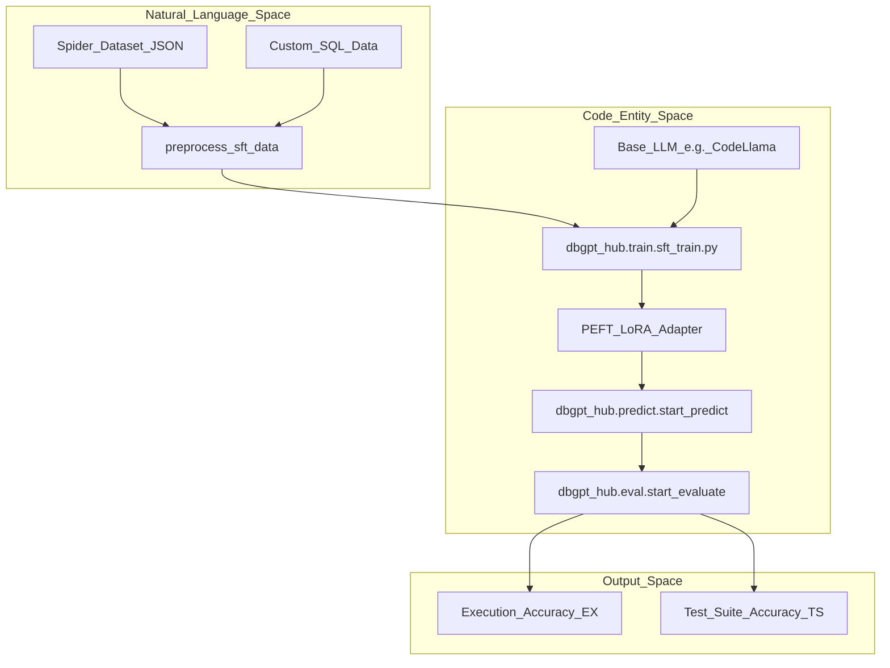
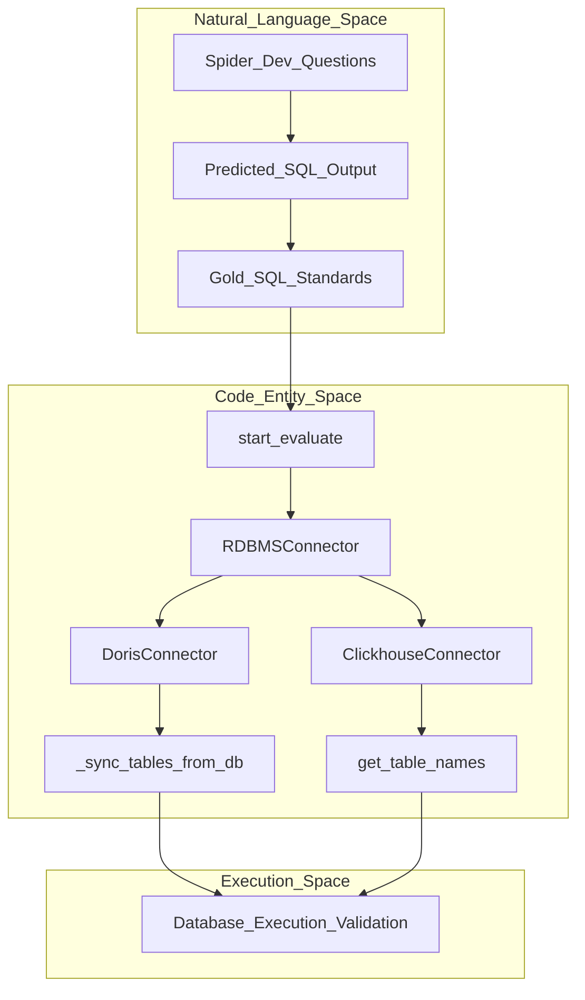

<!-- source: DeepWiki mcp.deepwiki.com · repo eosphoros-ai/DB-GPT · page 11.2 Fine-Tuning & Training (DB-GPT-Hub) · fetched 2026-11-09 -->

# Fine-Tuning & Training (DB-GPT-Hub)

Relevant source files

The following files were used as context for generating this wiki page:

- [docs/docs/application/advanced_tutorial/api.md](docs/docs/application/advanced_tutorial/api.md)
- [docs/docs/application/advanced_tutorial/cli.md](docs/docs/application/advanced_tutorial/cli.md)
- [docs/docs/application/fine_tuning_manual/dbgpt_hub.md](docs/docs/application/fine_tuning_manual/dbgpt_hub.md)
- [docs/docs/application/fine_tuning_manual/text_to_sql.md](docs/docs/application/fine_tuning_manual/text_to_sql.md)
- [docs/docs/installation/sourcecode.md](docs/docs/installation/sourcecode.md)
- [docs/docs/quickstart.md](docs/docs/quickstart.md)
- [docs/sidebars.js](docs/sidebars.js)
- [docs/static/img/ft/baseline.png](docs/static/img/ft/baseline.png)
- [packages/dbgpt-ext/src/dbgpt_ext/datasource/rdbms/conn_doris.py](packages/dbgpt-ext/src/dbgpt_ext/datasource/rdbms/conn_doris.py)
- [tests/intetration_tests/datasource/__init__.py](tests/intetration_tests/datasource/__init__.py)
- [tests/intetration_tests/datasource/test_conn_clickhouse.py](tests/intetration_tests/datasource/test_conn_clickhouse.py)
- [tests/intetration_tests/datasource/test_conn_doris.py](tests/intetration_tests/datasource/test_conn_doris.py)

The fine-tuning and training subsystem in DB-GPT is primarily centered around the **DB-GPT-Hub** external repository and the associated `dbgpt_hub` module. This specialized pipeline is designed for Text2SQL tasks, enabling developers to optimize Large Language Models (LLMs) for natural language to structured query language translation using the Spider dataset and various Parameter-Efficient Fine-Tuning (PEFT) techniques [docs/docs/application/fine_tuning_manual/text_to_sql.md:1-12]().

## 1. DB-GPT-Hub Architecture & Integration

DB-GPT-Hub is a lightweight, automated fine-tuning framework that streamlines the Text2SQL production line. It bridges the gap between raw datasets and optimized model weights by providing standardized modules for data processing, training, prediction, and evaluation [docs/docs/application/fine_tuning_manual/text_to_sql.md:4-12]().

### Fine-Tuning Pipeline Flow
The following diagram illustrates the data flow from raw data ingestion to the generation of a fine-tuned adapter, mapping natural language inputs to the code entities responsible for processing them.

**DB-GPT-Hub Fine-Tuning Data Flow**

Sources: [docs/docs/application/fine_tuning_manual/text_to_sql.md:4-12](), [docs/docs/application/fine_tuning_manual/dbgpt_hub.md:20-27]()

## 2. Implementation Details

The fine-tuning process is divided into distinct phases, each managed by specific modules within the `dbgpt_hub` ecosystem. This allows for high-performance Text-to-SQL workflows by applying Supervised Fine-Tuning (SFT) [docs/docs/application/fine_tuning_manual/text_to_sql.md:4-12]().

### 2.1 Data Processing & Information Matching

The core logic for data preparation involves an "Information Matching" method which combines table structures, column information, and foreign keys into the prompt to help the model understand relational schemas [docs/docs/application/fine_tuning_manual/text_to_sql.md:41-44]().

Key components include:

- **`ProcessSqlData`**: The main class for handling dataset transformations, defined in `dbgpt_hub/data_process/sql_data_process.py` [docs/docs/application/fine_tuning_manual/text_to_sql.md:64-65]().
- **`decode_json_file()`**: Function that parses Spider-format JSON and extracts database metadata into a prompt-friendly dictionary [docs/docs/application/fine_tuning_manual/text_to_sql.md:65-67]().
- **`INSTRUCTION_PROMPT`**: A prompt template that wraps database schema information and user queries into a format for supervised fine-tuning [docs/docs/application/fine_tuning_manual/text_to_sql.md:73-76]().

The utility function `preprocess_sft_data` encapsulates this logic and prepares the data into the fine-tuning format required by the training scripts [docs/docs/application/fine_tuning_manual/dbgpt_hub.md:30-50]().

Sources: [docs/docs/application/fine_tuning_manual/text_to_sql.md:41-76](), [docs/docs/application/fine_tuning_manual/dbgpt_hub.md:30-50]()

### 2.2 Model Training (SFT)

Training supports efficient Parameter-Efficient Fine-Tuning techniques such as LoRA and QLoRA to reduce hardware resource demands. It supports numerous LLMs like LLaMA, BLOOM, Falcon, Baichuan, and CodeLlama [docs/docs/application/fine_tuning_manual/dbgpt_hub.md:53-60](). Training is primarily executed by the function `train_sft` or `start_sft` in `dbgpt_hub.train.sft_train.py` which wraps HuggingFace Trainer utilities and LoRA modules.

Important training parameters include:

- `finetuning_type`: Typically set to `"lora"` for LoRA fine-tuning [docs/docs/application/fine_tuning_manual/text_to_sql.md:96-96]().
- `lora_target`: Specifies the parts of the model to apply LoRA adapters to, e.g., `"q_proj,v_proj"` [docs/docs/application/fine_tuning_manual/text_to_sql.md:97-97]().
- `template`: The prompt template used, e.g., `"llama2"` or others [docs/docs/application/fine_tuning_manual/text_to_sql.md:98-98]().

Sample fine-tuning command arguments include batch sizes, learning rate scheduler, gradient accumulation, epoch counts, and precision flags (e.g., `bf16`) to optimize training efficiency [docs/docs/application/fine_tuning_manual/text_to_sql.md:86-113]().

Sources: [docs/docs/application/fine_tuning_manual/text_to_sql.md:86-113](), [docs/docs/application/fine_tuning_manual/dbgpt_hub.md:53-60]()

### 2.3 Model Prediction

After training completes, `start_predict` from `dbgpt_hub.predict` can be invoked to generate SQL queries for evaluation or deployment. It loads the trained adapter weights and produces model output on held-out evaluation data [docs/docs/application/fine_tuning_manual/dbgpt_hub.md:83-96]().

Sources: [docs/docs/application/fine_tuning_manual/dbgpt_hub.md:83-96]()

### 2.4 Evaluation and Validation

Evaluation uses `start_evaluate` from `dbgpt_hub.eval` to compare predicted SQL statements against gold sets. It can execute generated SQL on real databases to verify execution correctness along with syntactic accuracy [docs/docs/application/fine_tuning_manual/dbgpt_hub.md:98-114]().

To integrate with real database backends, the DB-GPT extended datasource module includes specialized connectors such as `DorisConnector`, an implementation of `RDBMSConnector`. It handles connections to Apache Doris, a modern real-time data warehouse, with adaptations to avoid problematic metadata reflection calls common to Doris [packages/dbgpt-ext/src/dbgpt_ext/datasource/rdbms/conn_doris.py:50-102]().

**SQL Execution & Validation Bridge**

Sources: [packages/dbgpt-ext/src/dbgpt_ext/datasource/rdbms/conn_doris.py:50-102](), [docs/docs/application/fine_tuning_manual/dbgpt_hub.md:99-114](), [tests/intetration_tests/datasource/test_conn_clickhouse.py:23-23]()

## 3. Key Capabilities

| Capability              | Description                                                                                                   |
|-------------------------|---------------------------------------------------------------------------------------------------------------|
| **LoRA/PEFT Integration** | Supports efficient fine-tuning by updating a small subset of network parameters such as `q_proj` and `v_proj` [docs/docs/application/fine_tuning_manual/text_to_sql.md:87-99](). |
| **Spider Dataset Support** | Native pipeline for the challenging cross-domain Spider Text2SQL benchmark containing 10,181 question-SQL pairs [docs/docs/application/fine_tuning_manual/text_to_sql.md:37-39](). |
| **Doris Integration**    | Custom `DorisConnector` handles Apache Doris database for SQL execution during evaluation, circumventing reflection issues [packages/dbgpt-ext/src/dbgpt_ext/datasource/rdbms/conn_doris.py:21-26](). |
| **Multi-DB Support**     | Evaluation supports various connectors including Doris, ClickHouse, and MySQL to ensure comprehensive SQL validation [packages/dbgpt-ext/src/dbgpt_ext/datasource/rdbms/conn_doris.py:50-102](). |

Sources: [docs/docs/application/fine_tuning_manual/text_to_sql.md:1-12](), [packages/dbgpt-ext/src/dbgpt_ext/datasource/rdbms/conn_doris.py:50-102]()

## 4. External Repository: DB-GPT-Hub

While the core DB-GPT repository manages application logic and model serving, the specialized training logic is encapsulated in the separate **DB-GPT-Hub** repository and its Python package distribution.

- **Standalone Module**: DB-GPT-Hub delivers a focused, maintainable Text2SQL fine-tuning pipeline using Supervised Fine-Tuning (SFT), covering data preprocessing, training, prediction, and evaluation workflows [docs/docs/application/fine_tuning_manual/text_to_sql.md:1-2]().
- **Integration with DB-GPT**: Fine-tuned LoRA adapters produced by DB-GPT-Hub can be loaded into the DB-GPT SMMF (Service-Oriented Multi-Model Management Framework) for downstream inference and deployment, enabling smooth operational transitions [docs/docs/application/advanced_tutorial/api.md:9-10]().
- **Installation and Setup**: The recommended environment setup uses `conda` and `poetry` for dependency management, or the package can be conveniently installed via pip: `pip install dbgpt_hub` [docs/docs/application/fine_tuning_manual/dbgpt_hub.md:6-15](). 
- **Baseline Performance Visualization**: The package includes a baseline visualization helper allowing users to display benchmark scores quickly [docs/docs/application/fine_tuning_manual/dbgpt_hub.md:12-15]().

Sources: [docs/docs/application/fine_tuning_manual/text_to_sql.md:1-32](), [docs/docs/application/fine_tuning_manual/dbgpt_hub.md:1-15](), [docs/docs/quickstart.md:27-30]()

---

