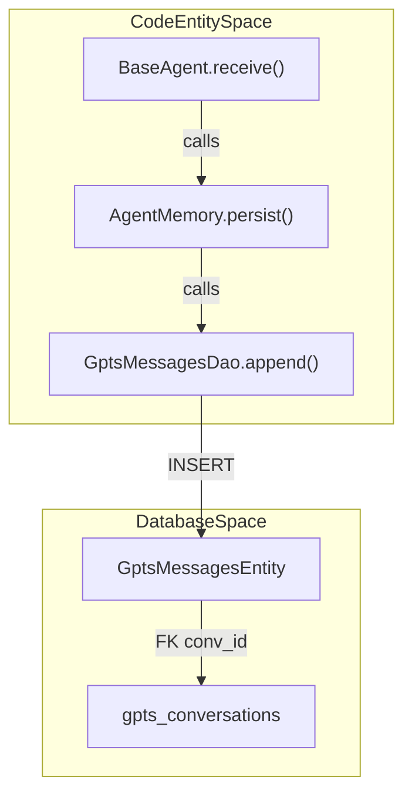
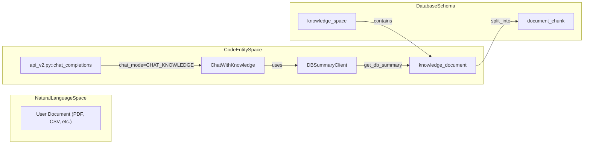
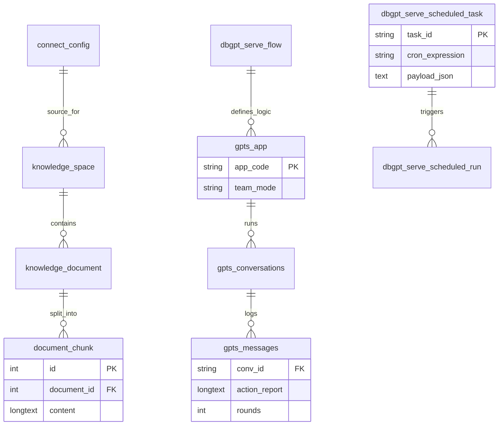
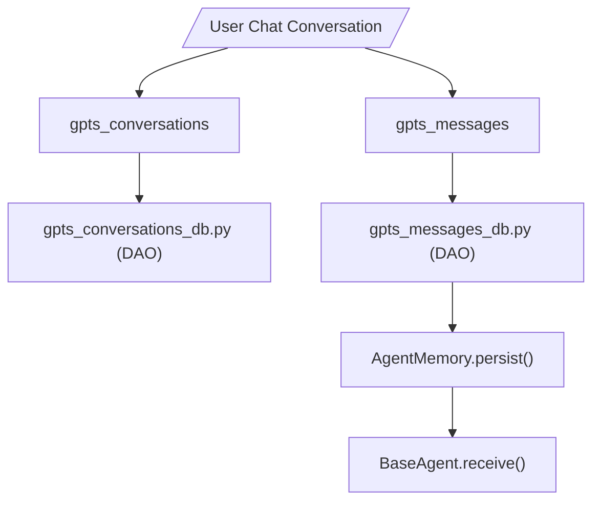
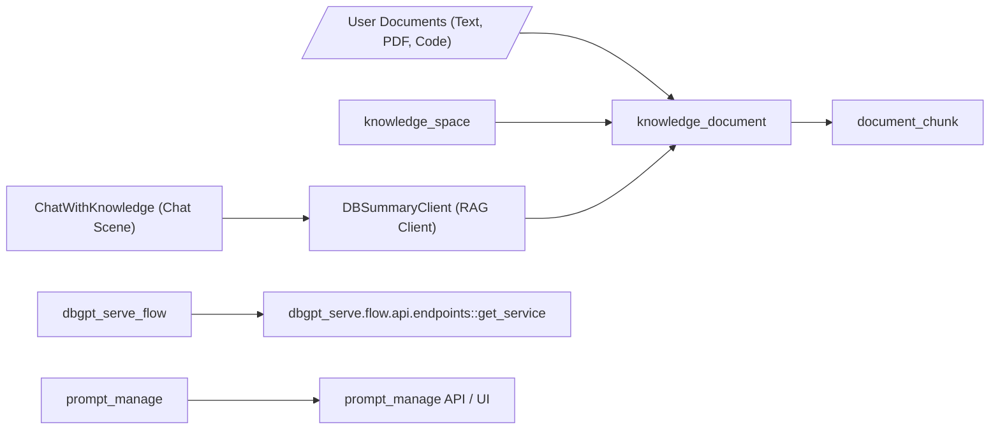

<!-- source: DeepWiki mcp.deepwiki.com · repo eosphoros-ai/DB-GPT · page 12.1 Core Schema Tables · fetched 2026-11-09 -->

# Core Schema Tables

Relevant source files

The following files were used as context for generating this wiki page:

- [assets/schema/dbgpt.sql](assets/schema/dbgpt.sql)
- [assets/schema/upgrade/v0_7_1/upgrade_to_v0.7.1.sql](assets/schema/upgrade/v0_7_1/upgrade_to_v0.7.1.sql)
- [assets/schema/upgrade/v0_7_1/v0.7.0.sql](assets/schema/upgrade/v0_7_1/v0.7.0.sql)
- [assets/schema/upgrade/v0_8_0/v0.8.0.sql](assets/schema/upgrade/v0_8_0/v0.8.0.sql)
- [assets/schema/upgrade/v0_8_1/upgrade_to_v0.8.1.sql](assets/schema/upgrade/v0_8_1/upgrade_to_v0.8.1.sql)
- [docs/blog/2025-04-29-db-gpt-qwen3-support.md](docs/blog/2025-04-29-db-gpt-qwen3-support.md)
- [install_help.py](install_help.py)
- [packages/dbgpt-app/src/dbgpt_app/openapi/api_v2.py](packages/dbgpt-app/src/dbgpt_app/openapi/api_v2.py)
- [packages/dbgpt-app/src/dbgpt_app/scene/chat_db/professional_qa/chat.py](packages/dbgpt-app/src/dbgpt_app/scene/chat_db/professional_qa/chat.py)
- [packages/dbgpt-client/src/dbgpt_client/schema.py](packages/dbgpt-client/src/dbgpt_client/schema.py)
- [packages/dbgpt-core/src/dbgpt/agent/core/agent_manage.py](packages/dbgpt-core/src/dbgpt/agent/core/agent_manage.py)
- [packages/dbgpt-core/src/dbgpt/core/interface/media.py](packages/dbgpt-core/src/dbgpt/core/interface/media.py)
- [packages/dbgpt-core/src/dbgpt/core/interface/message.py](packages/dbgpt-core/src/dbgpt/core/interface/message.py)
- [packages/dbgpt-serve/src/dbgpt_serve/agent/agents/db_gpts_memory.py](packages/dbgpt-serve/src/dbgpt_serve/agent/agents/db_gpts_memory.py)
- [packages/dbgpt-serve/src/dbgpt_serve/agent/chat/tests/test_gpts_messages_db.py](packages/dbgpt-serve/src/dbgpt_serve/agent/chat/tests/test_gpts_messages_db.py)
- [packages/dbgpt-serve/src/dbgpt_serve/agent/db/gpts_app.py](packages/dbgpt-serve/src/dbgpt_serve/agent/db/gpts_app.py)
- [packages/dbgpt-serve/src/dbgpt_serve/agent/db/gpts_conversations_db.py](packages/dbgpt-serve/src/dbgpt_serve/agent/db/gpts_conversations_db.py)
- [packages/dbgpt-serve/src/dbgpt_serve/agent/db/gpts_messages_db.py](packages/dbgpt-serve/src/dbgpt_serve/agent/db/gpts_messages_db.py)
- [packages/dbgpt-serve/src/dbgpt_serve/datasource/manages/connect_config_db.py](packages/dbgpt-serve/src/dbgpt_serve/datasource/manages/connect_config_db.py)
- [web/.env.template](web/.env.template)

This page provides a detailed technical overview of the primary database tables used by DB-GPT to manage application metadata, conversation state, knowledge bases, agent workflows, prompts, and scheduled tasks. DB-GPT supports both SQLite and MySQL as metadata backends, managed via SQLAlchemy models and Alembic migrations [assets/schema/dbgpt.sql:1-13]().

## 1. Application and Conversation Schema

The application schema manages custom GPT applications' lifecycle and their associated conversation histories. This system bridges high-level user interactions with persisted state.

### 1.1 `gpts_app`
The `gpts_app` table stores configuration and metadata for custom GPT applications. It defines the identity and execution parameters of an agentic application, including its team collaboration mode, model strategy, and associated resources.

- Represented by the `GptsApp` class [packages/dbgpt-serve/src/dbgpt_serve/agent/db/gpts_app.py:111-135]() which includes serialization helpers to convert between dicts and model instances.
- Key fields include `app_code` (unique string identifier), `app_name`, `app_describe` (description), `team_mode` (e.g., `AWEL_LAYOUT`, `NATIVE`), `language`, and conversation context retention settings (`keep_start_rounds`, `keep_end_rounds`).

| Column | Type | Description |
| :---   | :--- | :---        |
| `app_code` | `VARCHAR(255)` | Unique identifier for the GPT application [packages/dbgpt-serve/src/dbgpt_serve/agent/db/gpts_app.py:114]() |
| `app_name` | `VARCHAR(255)` | Human-readable app name [packages/dbgpt-serve/src/dbgpt_serve/agent/db/gpts_app.py:115]() |
| `app_describe` | `TEXT` | Textual description detailing application purpose [packages/dbgpt-serve/src/dbgpt_serve/agent/db/gpts_app.py:116]() |
| `team_mode` | `VARCHAR(255)` | Agent collaboration mode [packages/dbgpt-serve/src/dbgpt_serve/agent/db/gpts_app.py:117]() |
| `language` | `VARCHAR(100)` | Language locale of the GPT app [packages/dbgpt-serve/src/dbgpt_serve/agent/db/gpts_app.py:118]() |
| `keep_end_rounds` | `INT` | Number of recent conversation rounds to retain for context (default 2) [packages/dbgpt-serve/src/dbgpt_serve/agent/db/gpts_app.py:177]() |

Sources:  
[packages/dbgpt-serve/src/dbgpt_serve/agent/db/gpts_app.py:111-135]()

### 1.2 `gpts_conversations` & `gpts_messages`

- These tables handle the persistence of complex multi-agent conversations with rich metadata.
- `gpts_conversations` tracks session state, binding a unique `conv_uid` to an application (`app_code`), team collaboration mode, and includes a conversation summary [packages/dbgpt-serve/src/dbgpt_serve/agent/db/gpts_conversations_db.py:18-52]().
- `gpts_messages` stores individual message turns within conversations. It includes fields like `sender`, `receiver`, `rounds` (dialogue turn count), and `trace_id` for observability span correlation. The `content` and `action_report` columns use `LONGTEXT` on MySQL to store large outputs such as agent thoughts, tool calls, markdown, or charts [packages/dbgpt-serve/src/dbgpt_serve/agent/db/gpts_messages_db.py:29-92](), [assets/schema/upgrade/v0_8_1/upgrade_to_v0.8.1.sql:4-5]().

**Data Flow: Agent Message Persistence**

Sources:  
[packages/dbgpt-serve/src/dbgpt_serve/agent/db/gpts_messages_db.py:29-138](),  
[packages/dbgpt-serve/src/dbgpt_serve/agent/db/gpts_conversations_db.py:18-52](),  
[assets/schema/upgrade/v0_8_1/upgrade_to_v0.8.1.sql:4-5]().

---

## 2. Knowledge Management Schema

This schema manages the ingestion, splitting, embedding, and retrieval of unstructured and structured knowledge for RAG (Retrieval-Augmented Generation) applications.

### 2.1 `knowledge_space`
Defines logical containers for knowledge, representing domains or collections of documents with vector store characteristics.

- Includes fields such as `name`, `vector_type` (e.g., Chroma, Milvus), `domain_type`, `desc` (description), `owner`, and JSON `index_methods` specifying indexing strategies [assets/schema/dbgpt.sql:15-29]().

Sources:  
[assets/schema/dbgpt.sql:15-29]()

### 2.2 `knowledge_document` & `document_chunk`
- `knowledge_document` maintains metadata about ingested documents, including file paths, type, vector indexing sync status (`TODO`, `RUNNING`, `FAILED`, `FINISHED`), embedding sync results (`content`), and summaries [assets/schema/dbgpt.sql:31-50]().
- `document_chunk` stores atomic fragments of documents created by text splitters during ingestion. Each chunk links to a document via `document_id` and contains chunk text, metadata, and questions associated with the chunk [assets/schema/dbgpt.sql:52-65]().

**Technical Mapping: Natural Language Input to Knowledge Ingestion Code**

Sources:  
[assets/schema/dbgpt.sql:31-65](),  
[packages/dbgpt-app/src/dbgpt_app/openapi/api_v2.py:128-138](),  
[packages/dbgpt-app/src/dbgpt_app/scene/chat_db/professional_qa/chat.py:55-69]().

---

## 3. Workflow, Prompt, and Scheduled Task Schema

These tables encompass AWEL workflows, prompt template storage, and scheduled tasks execution.

### 3.1 `dbgpt_serve_flow`
Stores serialized Directed Acyclic Graphs (DAGs) representing AWEL workflows and agent teams for complex application logic orchestration.

- The `flow_data` column is a `LONGTEXT` JSON string containing nodes and edges [assets/schema/upgrade/v0_7_1/v0.7.0.sql:8-9]().

Sources:  
[assets/schema/upgrade/v0_7_1/v0.7.0.sql:8-9]()

### 3.2 `prompt_manage`
Central table managing saved prompt templates for flexible injection during chat or task execution.

| Column | Type | Description |
| :---   | :--- | :---        |
| `prompt_name` | `VARCHAR(100)` | Unique identifier for prompt templates [assets/schema/dbgpt.sql:142]() |
| `content`     | `LONGTEXT`      | Raw prompt template content with placeholders [assets/schema/dbgpt.sql:146]() |

Sources:  
[assets/schema/dbgpt.sql:139-160]()

### 3.3 `dbgpt_serve_scheduled_task` & `dbgpt_serve_scheduled_run`
Introduced in version 0.8.1 to support cron-based scheduled background tasks such as chat replay or report generation.

- `dbgpt_serve_scheduled_task` stores metadata about scheduled jobs, including cron expressions, payload snapshots (conversation states), and enable flags [assets/schema/upgrade/v0_8_1/upgrade_to_v0.8.1.sql:27-44]().
- `dbgpt_serve_scheduled_run` records execution history of scheduled tasks, logging start/finish times, status, error messages, and references output conversation UIDs [assets/schema/upgrade/v0_8_1/upgrade_to_v0.8.1.sql:47-61]().

Sources:  
[assets/schema/upgrade/v0_8_1/upgrade_to_v0.8.1.sql:26-61]()

---

## 4. Datasource and Connector Schema

The metadata layer storing connection configurations for relational databases, data warehouses, and MCP connector plugin instances supporting various chat and retrieval modes.

### 4.1 `connect_config`
Contains connection information such as database type, host, port, credentials, and extended JSON configs.

- Managed by `ConnectConfigDao` that supports add, update, and query operations [assets/schema/dbgpt.sql:67-88](), [packages/dbgpt-serve/src/dbgpt_serve/datasource/manages/connect_config_db.py:28-160]().

| Column     | Type          | Description                        |
|------------|---------------|----------------------------------|
| `db_name`  | `VARCHAR(255)`| Unique database or alias name [assets/schema/dbgpt.sql:72]() |
| `db_type`  | `VARCHAR(255)`| Database dialect (mysql, postgresql, tugraph, etc.) [assets/schema/dbgpt.sql:71]() |
| `ext_config` | `TEXT`       | Extended JSON configuration parameters [assets/schema/dbgpt.sql:84]() |

Sources:  
[assets/schema/dbgpt.sql:67-88](),  
[packages/dbgpt-serve/src/dbgpt_serve/datasource/manages/connect_config_db.py:28-160]()

### 4.2 `connector_instance`
Stores MCP connector instances with encrypted credentials, salt values, transport configs, and lifecycle status flags [assets/schema/upgrade/v0_8_1/upgrade_to_v0.8.1.sql:7-24]().

Sources:  
[assets/schema/upgrade/v0_8_1/upgrade_to_v0.8.1.sql:7-24]()

---

## 5. Relationship Overview

The following Entity Relationship Diagram (ERD) outlines foreign key relationships and logical connections between core tables managing applications, conversations, knowledge, workflows, and scheduled tasks:

This ERD emphasizes the layered architecture:  
- Applications launch conversations, which record messages.  
- Knowledge spaces own documents, split into chunks for embeddings.  
- Connectors configure data sources feeding knowledge spaces.  
- Workflows (`dbgpt_serve_flow`) define app logic.  
- Scheduled task tables manage asynchronous orchestration.

Sources:  
[assets/schema/dbgpt.sql:15-118](),  
[packages/dbgpt-serve/src/dbgpt_serve/agent/db/gpts_messages_db.py:29-83](),  
[assets/schema/upgrade/v0_8_1/upgrade_to_v0.8.1.sql:26-61](),  
[packages/dbgpt-serve/src/dbgpt_serve/agent/db/gpts_app.py:111-135]()

---

# Summary

This page covered the central schema tables critical to DB-GPT’s architecture:

- **Application and conversation tables** managing agentic apps and multi-agent dialogue storage.  
- **Knowledge schema** enabling advanced document ingestion and vector retrieval.  
- **Workflow and prompt management** supporting complex AWEL DAG execution and dynamic prompt templates.  
- **Datasource connection tables** maintaining the configuration of relational and MCP connectors.  
- **Scheduled tasks** infrastructure for cron-driven background processing.

These structured database models ensure flexible, extensible, and robust metadata management enabling DB-GPT’s core capabilities in multi-agent orchestration and RAG-driven knowledge retrieval.

---

# Appendix: Core Schema Naming & Code Entities Bridge

To help locate code entities managing these tables, below are two mermaid diagrams illustrating the mapping from natural language concepts to their concrete repository implementations.

## Natural Language > Database > Code Entity (Conversation Schema)

Sources:
[packages/dbgpt-serve/src/dbgpt_serve/agent/db/gpts_conversations_db.py:18-52](),
[packages/dbgpt-serve/src/dbgpt_serve/agent/db/gpts_messages_db.py:29-138]()

## Natural Language > Database > Code Entity (Knowledge & Workflow)

Sources:
[assets/schema/dbgpt.sql:15-65](),
[packages/dbgpt-app/src/dbgpt_app/openapi/api_v2.py:128-138]()

---

# End of Section 12.1 "Core Schema Tables"  

Sources:  
[assets/schema/dbgpt.sql](),  
[packages/dbgpt-serve/src/dbgpt_serve/agent/db/gpts_app.py:111-135](),  
[packages/dbgpt-serve/src/dbgpt_serve/agent/db/gpts_messages_db.py:29-172](),  
[packages/dbgpt-serve/src/dbgpt_serve/agent/db/gpts_conversations_db.py:18-52](),  
[assets/schema/upgrade/v0_8_1/upgrade_to_v0.8.1.sql:4-61](),  
[packages/dbgpt-serve/src/dbgpt_serve/datasource/manages/connect_config_db.py:28-160](),  
[packages/dbgpt-app/src/dbgpt_app/openapi/api_v2.py:72-154](),  
[packages/dbgpt-app/src/dbgpt_app/scene/chat_db/professional_qa/chat.py:50-85]()

---

