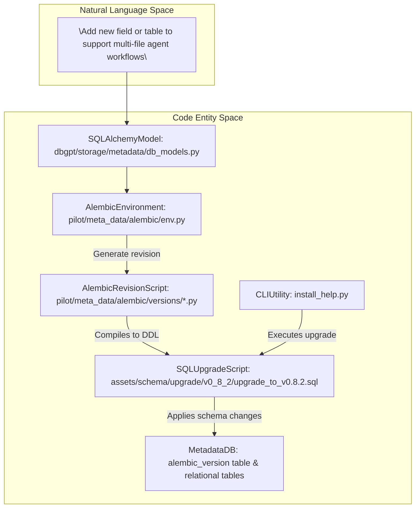
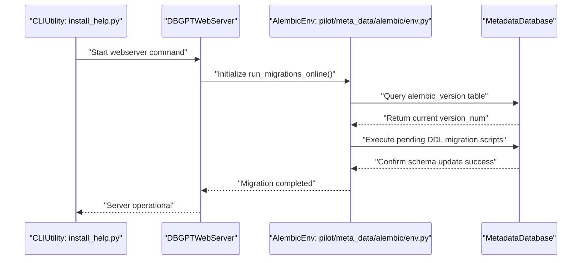
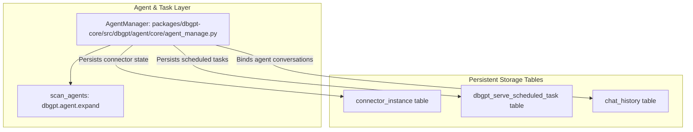

<!-- source: DeepWiki mcp.deepwiki.com · repo eosphoros-ai/DB-GPT · page 12.2 Schema Upgrades & Migration Guide · fetched 2026-11-09 -->

# Schema Upgrades & Migration Guide

Relevant source files

The following files were used as context for generating this wiki page:

- [assets/schema/dbgpt.sql](assets/schema/dbgpt.sql)
- [assets/schema/upgrade/v0_7_1/upgrade_to_v0.7.1.sql](assets/schema/upgrade/v0_7_1/upgrade_to_v0.7.1.sql)
- [assets/schema/upgrade/v0_7_1/v0.7.0.sql](assets/schema/upgrade/v0_7_1/v0.7.0.sql)
- [assets/schema/upgrade/v0_8_0/v0.8.0.sql](assets/schema/upgrade/v0_8_0/v0.8.0.sql)
- [assets/schema/upgrade/v0_8_1/upgrade_to_v0.8.1.sql](assets/schema/upgrade/v0_8_1/upgrade_to_v0.8.1.sql)
- [install_help.py](install_help.py)
- [packages/dbgpt-core/src/dbgpt/agent/core/agent_manage.py](packages/dbgpt-core/src/dbgpt/agent/core/agent_manage.py)
- [pilot/meta_data/alembic.ini](pilot/meta_data/alembic.ini)
- [pilot/meta_data/alembic/env.py](pilot/meta_data/alembic/env.py)
- [web/.env.template](web/.env.template)

DB-GPT relies on **Alembic** as its core database migration framework to systematically manage schema evolutions, ensure metadata consistency across relational backends (such as SQLite and MySQL), and support continuous feature expansion—including Knowledge Spaces, AWEL flows, multi-agent conversations, and external connectors. This guide outlines the migration workflow, version-specific SQL upgrade scripts, metadata table layout, and safe upgrade procedures.

---

## Migration Architecture

The migration framework bridges logical Python SQLAlchemy ORM data models with physical database schemas. When DB-GPT starts up, it reads the current schema revision from the `alembic_version` table [assets/schema/dbgpt.sql:9-13]() and executes any pending migration scripts sequentially. Configuration for Alembic is managed via `pilot/meta_data/alembic.ini` [pilot/meta_data/alembic.ini:1-81]() and environment bindings in `pilot/meta_data/alembic/env.py` [pilot/meta_data/alembic/env.py:1-75]().

### Technical Data Flow: Natural Language to Code Entity Space

This diagram maps user-level schema modification requests down to SQLAlchemy models, Alembic revision scripts, upgrade SQL scripts, and physical execution on the metadata database.

Sources: [pilot/meta_data/alembic/env.py:1-75](), [pilot/meta_data/alembic.ini:1-15](), [assets/schema/dbgpt.sql:9-13]()

---

## Version-Specific Upgrade Scripts

DB-GPT maintains structured SQL upgrade scripts under `assets/schema/upgrade/` corresponding to release milestones.

### v0.7.1 Migration Highlights
The v0.7.1 release refined column widths and table constraints for robust message logging and AWEL flow persistence:
- Upgraded `action_report` in `gpts_messages` to `LONGTEXT` for larger agent execution payloads [assets/schema/upgrade/v0_7_1/upgrade_to_v0.7.1.sql:5-6]().
- Upgraded `flow_data` in `dbgpt_serve_flow` to `LONGTEXT` [assets/schema/upgrade/v0_7_1/upgrade_to_v0.7.1.sql:8-9]().
- Ensured the `alembic_version` tracking table is present [assets/schema/upgrade/v0_7_1/v0.7.0.sql:8-12]().

Sources: [assets/schema/upgrade/v0_7_1/upgrade_to_v0.7.1.sql:1-9](), [assets/schema/upgrade/v0_7_1/v0.7.0.sql:8-12]()

### v0.8.0 Baseline Schema
The v0.8.0 baseline establishes core tables for knowledge management, chat histories, connection configs, and user feedback mechanisms [assets/schema/upgrade/v0_8_0/v0.8.0.sql:15-122]().

Sources: [assets/schema/upgrade/v0_8_0/v0.8.0.sql:1-122]()

### v0.8.1 Migration Details
The v0.8.1 update introduced new operational capabilities:
- `connector_instance`: Persists MCP connector instances, encrypted credentials, salt, lifecycle status, and config JSON [assets/schema/upgrade/v0_8_1/upgrade_to_v0.8.1.sql:7-24]().
- `dbgpt_serve_scheduled_task` and `dbgpt_serve_scheduled_run`: Support cron-based scheduled chat replay tasks and run execution history [assets/schema/upgrade/v0_8_1/upgrade_to_v0.8.1.sql:27-61]().

Sources: [assets/schema/upgrade/v0_8_1/upgrade_to_v0.8.1.sql:1-61]()

### v0.8.2 Migration Focus
The v0.8.2 update introduces enhancements for multi-file workflows and code graph RAG analysis:
- Adds `index_methods` JSON column to `knowledge_space` [assets/schema/dbgpt.sql:24-24]().
- Adds tables for session-scoped file storage and AST-extracted code graphs (`code_graph_vertex`, `code_graph_edge`) for code repository RAG.

Sources: [assets/schema/dbgpt.sql:9-28]()

---

## Key Managed Tables Overview

| Table Name | Description | Source File & Lines |
| :--- | :--- | :--- |
| `alembic_version` | Tracks current applied database revision version | [assets/schema/dbgpt.sql:9-13]() |
| `knowledge_space` | Metadata for knowledge spaces, vector types, and index methods | [assets/schema/dbgpt.sql:15-29]() |
| `connect_config` | Database connection profiles and RDBMS configuration credentials | [assets/schema/dbgpt.sql:68-88]() |
| `connector_instance` | MCP and third-party external connector instance records & credentials | [assets/schema/upgrade/v0_8_1/upgrade_to_v0.8.1.sql:7-24]() |
| `dbgpt_serve_scheduled_task` | Cron-based scheduled task definitions and frozen conversation payloads | [assets/schema/upgrade/v0_8_1/upgrade_to_v0.8.1.sql:27-44]() |
| `dbgpt_serve_scheduled_run` | Execution history logs and run status for scheduled tasks | [assets/schema/upgrade/v0_8_1/upgrade_to_v0.8.1.sql:47-61]() |

Sources: [assets/schema/dbgpt.sql:9-88](), [assets/schema/upgrade/v0_8_1/upgrade_to_v0.8.1.sql:7-61]()

---

## Upgrade Implementation & Safety

DB-GPT performs migration checks automatically upon server startup via CLI commands (such as `dbgpt start webserver`).

### Migration Execution Sequence

This sequence diagram illustrates how startup routines invoke Alembic to verify and apply pending database DDL migrations.

Sources: [pilot/meta_data/alembic/env.py:49-75](), [install_help.py:16-43]()

### Safe Upgrade Procedures
1. **Database Backup**: Back up your metadata database prior to applying upgrades (`mysqldump` for MySQL, file copy for SQLite).
2. **Environment Verification**: Ensure `LOCAL_DB_NAME` and connection parameters in `.env` or configuration files correctly point to your target instance [assets/schema/dbgpt.sql:1-2]().
3. **Incremental Application**: Apply version-specific upgrade scripts in chronological order (`v0_7_1` → `v0_8_1` → `v0_8_2`) if migrating manually.
4. **Dependency Consistency**: Use helper utilities like `install_help.py` to synchronize python package extras [install_help.py:40-75]().

Sources: [assets/schema/dbgpt.sql:1-6](), [install_help.py:40-75]()

---

## Agent & Metadata Management Integration

Database migrations work closely with application-layer managers like `AgentManager` defined in `packages/dbgpt-core/src/dbgpt/agent/core/agent_manage.py` [packages/dbgpt-core/src/dbgpt/agent/core/agent_manage.py:47-125](), which dynamically scans agent expansions (`scan_agents()`) [packages/dbgpt-core/src/dbgpt/agent/core/agent_manage.py:158-176]() and synchronizes them with persistent storage structures.

Sources: [packages/dbgpt-core/src/dbgpt/agent/core/agent_manage.py:47-176](), [assets/schema/upgrade/v0_8_1/upgrade_to_v0.8.1.sql:7-44]()

---

## Troubleshooting Common Issues

- **Version Drift**: Manual table alterations without Alembic tracking cause version mismatch exceptions. Always update `alembic_version` to match the target release hash if applying manual DDL.
- **Column Length Limits**: Ensure MySQL instances use `utf8mb4` encoding so that `LONGTEXT` column alterations succeed without index length overflow errors.
- **Connection Interruption**: Never interrupt active migration transactions; always restore from database backups if an upgrade fails midway.

Sources: [assets/schema/dbgpt.sql:9-13](), [assets/schema/upgrade/v0_8_1/upgrade_to_v0.8.1.sql:4-4]()

---

