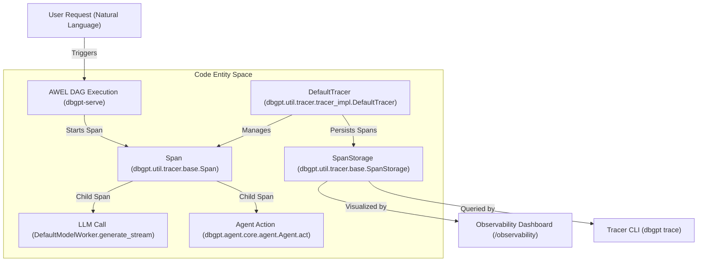

<!-- source: DeepWiki mcp.deepwiki.com · repo eosphoros-ai/DB-GPT · page 13 Observability & Tracing · fetched 2026-11-09 -->

# Observability & Tracing

<details>
<summary>Relevant source files</summary>

The following files were used as context for generating this wiki page:

- [docs/docs/modules/observability.md](docs/docs/modules/observability.md)
- [docs/i18n/zh-CN/docusaurus-plugin-content-docs/current/modules/observability.md](docs/i18n/zh-CN/docusaurus-plugin-content-docs/current/modules/observability.md)
- [packages/dbgpt-app/src/dbgpt_app/initialization/serve_initialization.py](packages/dbgpt-app/src/dbgpt_app/initialization/serve_initialization.py)
- [packages/dbgpt-core/src/dbgpt/agent/core/agent.py](packages/dbgpt-core/src/dbgpt/agent/core/agent.py)
- [packages/dbgpt-core/src/dbgpt/agent/expand/__init__.py](packages/dbgpt-core/src/dbgpt/agent/expand/__init__.py)
- [packages/dbgpt-core/src/dbgpt/agent/expand/tool_calling_agent.py](packages/dbgpt-core/src/dbgpt/agent/expand/tool_calling_agent.py)

</details>


DB-GPT provides a comprehensive observability suite designed to trace, measure, and monitor the execution of complex, asynchronous, and distributed AI workflows. This system enables detailed insight into the lifecycle of requests as they traverse AWEL operators, multi-agent orchestrations, and LLM inference calls.

At a high level, observability in DB-GPT combines structured distributed tracing, detailed logging, and performance metrics to ensure every phase—from natural language input to final output—is transparent and measurable.

For details on tracing internals, span models, storage backends, and the tracer CLI, see [Tracing Internals & Tracer CLI](#13.1). For structured JSON logging, metrics, and external monitoring integrations, see [Logging & Metrics](#13.2).

---

### System Overview & Tracing Architecture

The core concept of the tracing system is the `Span`, which represents a single unit of work within the system. Spans record metadata such as trace IDs, parent-child relationships, timestamps, and contextual tags. They are managed by a `Tracer` implementation that maintains execution context and orchestrates span lifecycle.

A `SpanStorage` backend persists these spans and enables further analysis and visualization.

#### Mapping Natural Language Inputs to Trace Entities


Sources: [packages/dbgpt-core/src/dbgpt/util/tracer/tracer_impl.py:28-85](), [packages/dbgpt-core/src/dbgpt/model/cluster/worker/default_worker.py:158-161]()

---

### Logging & Metrics Integration

Complementing tracing, DB-GPT’s observability system collects detailed metrics and structured logs across model inference and application layers.

| Feature               | Description                                                     | Key Code Entity(s)                                                                |
|-----------------------|-----------------------------------------------------------------|-----------------------------------------------------------------------------------|
| **Inference Metrics**  | Captures token counts, latency (e.g., first token latency), and throughput (prefill & decode speeds). | `ModelInferenceMetrics` [packages/dbgpt-core/src/dbgpt/core/interface/llm.py:34-82]()                    |
| **Performance Monitor**| Real-time measurement of LLM streaming performance including phase timings and tokens per second. | `LLMPerformanceMonitor` [packages/dbgpt-core/src/dbgpt/model/utils/llm_metrics.py:63-170]()             |
| **Streaming Token Usage** | Updates usage metrics continuously during generation streaming, enables precise performance logging. | `PerformanceMonitoringStreamer` [packages/dbgpt-core/src/dbgpt/model/utils/hf_stream_utils.py:10-70]()  |
| **Model Output Usage** | Standardized output structure for prompt/completion token counts, integrated into LLM results. | `ModelOutput.usage` [packages/dbgpt-core/src/dbgpt/model/llm/llm_out/hf_chat_llm.py:141-155]()           |

For details of logging, JSON format handlers, LLM specific metric collection, and integration with external monitoring stacks, see **[Logging & Metrics](#13.2)**.

Sources:  
- [packages/dbgpt-core/src/dbgpt/core/interface/llm.py:34-82]()  
- [packages/dbgpt-core/src/dbgpt/model/cluster/worker/default_worker.py:158-175]()  
- [packages/dbgpt-core/src/dbgpt/model/llm/llm_out/hf_chat_llm.py:141-155]()  
- [packages/dbgpt-core/src/dbgpt/model/utils/llm_metrics.py:63-170]()  
- [packages/dbgpt-core/src/dbgpt/model/utils/hf_stream_utils.py:10-70]()

---

### Observability in Production Deployment

In production scenarios, observability delivers actionable insights through dashboards and tracing tools integrated within DB-GPT.

```mermaid
graph LR
    subgraph "Execution Layer"
        Agent["Agent (dbgpt.agent.core.agent.Agent)"]
        Worker["ModelWorker (dbgpt.model.cluster.worker_base.ModelWorker)"]
    end

    subgraph "Tracing Core"
        Tracer["root_tracer (dbgpt.util.tracer.tracer_impl.TracerManager)"]
        Storage["MemorySpanStorage / SQLite / Custom Backend"]
    end

    Agent -->|start_span()| Tracer
    Worker -->|start_span()| Tracer
    Tracer -->|append_span()| Storage

    subgraph "Observability UIs"
        Dash["Overview Dashboard (/observability)"]
        TraceList["Trace List (/observability/traces)"]
        TraceTree["Span Tree Viewer"]
    end

    Storage --> Dash
    Storage --> TraceList
    TraceList --> TraceTree
```
Sources:  
- [packages/dbgpt-core/src/dbgpt/util/tracer/tracer_impl.py:204]()  
- [packages/dbgpt-core/src/dbgpt/model/cluster/worker/default_worker.py:117-119]()

For more details on span models, storage backends, and UI pages, see **[Tracing Internals & Tracer CLI](#13.1)**.

---

### Summary and Next Steps

Observability and tracing form a foundational pillar supporting the reliability and maintainability of DB-GPT’s complex workflows. For further technical details, explore the child pages:
- **[Tracing Internals & Tracer CLI](#13.1)** — Span model, span storage backends, TracerImpl and context propagation, dbgpt trace CLI, observability UI pages.
- **[Logging & Metrics](#13.2)** — Structured JSON logging, log handlers, LLM metrics collection, integration with external monitoring stacks.

---

