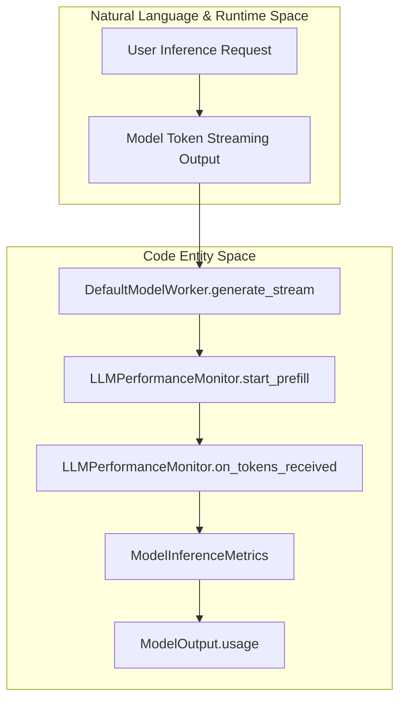
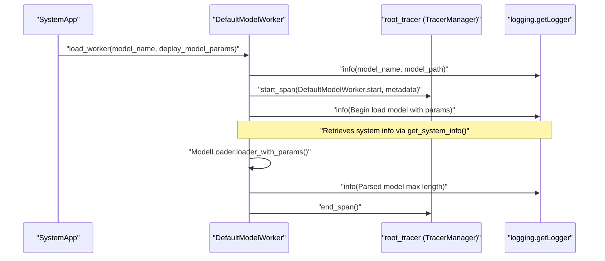
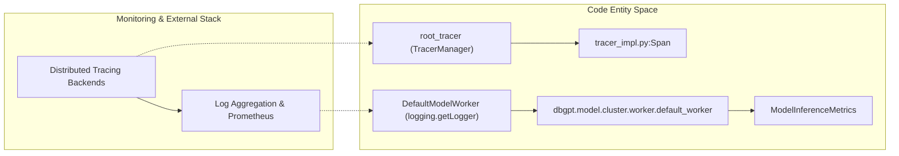

<!-- source: DeepWiki mcp.deepwiki.com · repo eosphoros-ai/DB-GPT · page 13.2 Logging & Metrics · fetched 2026-11-09 -->

# Logging & Metrics

Relevant source files

The following files were used as context for generating this wiki page:

- [docker/base/run_sqlite.sh](docker/base/run_sqlite.sh)
- [docker/compose_examples/cluster-docker-compose.yml](docker/compose_examples/cluster-docker-compose.yml)
- [docs/docs/installation/advanced_usage/OpenAI_SDK_call.md](docs/docs/installation/advanced_usage/OpenAI_SDK_call.md)
- [docs/docs/installation/advanced_usage/vLLM_inference.md](docs/docs/installation/advanced_usage/vLLM_inference.md)
- [docs/docs/installation/model_service/cluster.md](docs/docs/installation/model_service/cluster.md)
- [docs/docs/installation/model_service/stand_alone.md](docs/docs/installation/model_service/stand_alone.md)
- [docs/docs/modules/observability.md](docs/docs/modules/observability.md)
- [docs/i18n/zh-CN/docusaurus-plugin-content-docs/current/modules/observability.md](docs/i18n/zh-CN/docusaurus-plugin-content-docs/current/modules/observability.md)
- [packages/dbgpt-app/src/dbgpt_app/initialization/serve_initialization.py](packages/dbgpt-app/src/dbgpt_app/initialization/serve_initialization.py)
- [packages/dbgpt-core/src/dbgpt/agent/core/agent.py](packages/dbgpt-core/src/dbgpt/agent/core/agent.py)
- [packages/dbgpt-core/src/dbgpt/agent/expand/__init__.py](packages/dbgpt-core/src/dbgpt/agent/expand/__init__.py)
- [packages/dbgpt-core/src/dbgpt/agent/expand/tool_calling_agent.py](packages/dbgpt-core/src/dbgpt/agent/expand/tool_calling_agent.py)

This leaf page details the observability infrastructure of DB-GPT, focusing on structured JSON logging, log handlers, LLM metrics collection, and integration with external monitoring stacks. It covers how performance metrics for LLM inference are collected and exposed, how logging is implemented consistently across key model components (`DefaultModelWorker`, `LLMPerformanceMonitor`, etc.), and how these observability signals are made available for monitoring and debugging.

Sources:
[packages/dbgpt-core/src/dbgpt/core/interface/llm.py:34-82](),
[packages/dbgpt-core/src/dbgpt/model/utils/llm_metrics.py:10-137](),
[packages/dbgpt-core/src/dbgpt/model/cluster/worker/default_worker.py:29-176](),
[packages/dbgpt-core/src/dbgpt/model/utils/hf_stream_utils.py:10-59]()

---

## 13.2.1 LLM Performance Metrics

DB-GPT implements a detailed metrics subsystem to capture LLM inference performance, distinguishing key phases of token generation and measuring token throughput and latency [packages/dbgpt-core/src/dbgpt/core/interface/llm.py:34-82]().

### Data Models for Metrics

- **`ModelInferenceMetrics`** (defined in `packages/dbgpt-core/src/dbgpt/core/interface/llm.py`) is a dataclass for measuring latency and throughput of inference in a structured way [packages/dbgpt-core/src/dbgpt/core/interface/llm.py:34-82](). It tracks timestamps, token counts, speeds, and GPU memory usage [packages/dbgpt-core/src/dbgpt/core/interface/llm.py:45-82]().  
- **`LLMPerformanceMetrics`** and **`LLMPerformanceMonitor`** (in `packages/dbgpt-core/src/dbgpt/model/utils/llm_metrics.py`) provide nanosecond precision timing and perform ongoing tracking of phases with methods to start prefill, update on tokens received, and end generation [packages/dbgpt-core/src/dbgpt/model/utils/llm_metrics.py:10-137]().

| Metric Name             | Description                                                                                                | Code/Location                                  |
|------------------------|------------------------------------------------------------------------------------------------------------|------------------------------------------------|
| First Token Latency     | Time from start until the first token is generated (ms).                                                  | `ModelInferenceMetrics.first_token_time_ms` [packages/dbgpt-core/src/dbgpt/core/interface/llm.py:49-50]() |
| Prefill Speed          | Speed of initial prompt processing (tokens/sec).                                                         | `ModelInferenceMetrics.prefill_tokens_per_second` [packages/dbgpt-core/src/dbgpt/core/interface/llm.py:71-72]() |
| Decode Speed           | Speed during token decoding/generation (tokens/sec).                                                     | `ModelInferenceMetrics.decode_tokens_per_second` [packages/dbgpt-core/src/dbgpt/core/interface/llm.py:74-75]() |
| Token Counts           | Counts for prompt tokens, generated completion tokens, and total tokens.                                  | `ModelInferenceMetrics.prompt_tokens`, etc. [packages/dbgpt-core/src/dbgpt/core/interface/llm.py:58-62]()  |
| GPU Info               | Snapshots and averages of GPU metrics during inference.                                                  | `ModelInferenceMetrics.current_gpu_infos` [packages/dbgpt-core/src/dbgpt/core/interface/llm.py:77-81]()    |

### Metrics Collection Workflow

Metric tracking begins with the creation of a `ModelInferenceMetrics` instance and a corresponding `LLMPerformanceMonitor` instance [packages/dbgpt-core/src/dbgpt/model/utils/llm_metrics.py:63-95](). The monitor receives lifecycle events via `start_prefill()` and `on_tokens_received()` to compute throughput rates and latencies [packages/dbgpt-core/src/dbgpt/model/utils/llm_metrics.py:75-137]().

**Metrics Data Flow: Natural Language to Code Entity Space**

Sources:
[packages/dbgpt-core/src/dbgpt/core/interface/llm.py:34-82](),
[packages/dbgpt-core/src/dbgpt/model/utils/llm_metrics.py:10-137](),
[packages/dbgpt-core/src/dbgpt/model/utils/hf_stream_utils.py:10-59](),
[packages/dbgpt-core/src/dbgpt/model/llm/llm_out/vllm_llm.py:20-152](),
[packages/dbgpt-core/src/dbgpt/model/llm/llm_out/hf_chat_llm.py:20-156]()

---

## 13.2.2 Implementation Details

### The `LLMPerformanceMonitor` Class

- Initializes input token counts and tracks nanosecond-precision timestamps using `time.time_ns()` [packages/dbgpt-core/src/dbgpt/model/utils/llm_metrics.py:63-74]().
- Separates inference phases into **prefill** and **decode** [packages/dbgpt-core/src/dbgpt/model/utils/llm_metrics.py:75-137]().
- Automatically detects phase transitions and calculates token speeds [packages/dbgpt-core/src/dbgpt/model/utils/llm_metrics.py:82-137]().

Key methods:
- `start_prefill()`: marks the start of prompt evaluation [packages/dbgpt-core/src/dbgpt/model/utils/llm_metrics.py:75-80]().
- `on_tokens_received(current_token_count)`: updates runtime metrics as tokens stream in [packages/dbgpt-core/src/dbgpt/model/utils/llm_metrics.py:82-137]().
- `end_generation()`: finalizes metrics computation [packages/dbgpt-core/src/dbgpt/model/utils/llm_metrics.py:162-170]().

### Integration in Model Workers

- `DefaultModelWorker` integrates metrics collection inside `generate_stream()` [packages/dbgpt-core/src/dbgpt/model/cluster/worker/default_worker.py:158-176]().
- HuggingFace adapters use `PerformanceMonitoringStreamer` to hook into generation callbacks [packages/dbgpt-core/src/dbgpt/model/utils/hf_stream_utils.py:10-59]().
- vLLM backends wrap async generators to invoke `LLMPerformanceMonitor.on_tokens_received()` [packages/dbgpt-core/src/dbgpt/model/llm/llm_out/vllm_llm.py:20-152]().

### Structured Logging in Model Workers

`DefaultModelWorker` logs lifecycle events, model loading parameters, and execution metadata using centralized tracers (`root_tracer`) and Python loggers [packages/dbgpt-core/src/dbgpt/model/cluster/worker/default_worker.py:51-119]().

**DefaultModelWorker Lifecycle & Logging Architecture**

Sources:
[packages/dbgpt-core/src/dbgpt/model/cluster/worker/default_worker.py:29-176](),
[packages/dbgpt-core/src/dbgpt/model/utils/llm_metrics.py:75-170](),
[packages/dbgpt-core/src/dbgpt/model/utils/hf_stream_utils.py:10-59]()

---

## 13.2.3 Structured Logging & Log Handlers

- DB-GPT relies on the Python standard `logging` library configured to emit structured log records [packages/dbgpt-core/src/dbgpt/model/cluster/worker/default_worker.py:1-30]().
- Log levels are configured dynamically via the `DBGPT_LOG_LEVEL` environment variable [docker/compose_examples/cluster-docker-compose.yml:24-24]().
- Core components such as `DefaultModelWorker`, model controllers, and application services attach context attributes (model parameters, device configurations, request identifiers) directly to log records [packages/dbgpt-core/src/dbgpt/model/cluster/worker/default_worker.py:51-119]().
- Logs are directed to console handlers or integrated file handlers depending on the deployment profile.

Sources:
[packages/dbgpt-core/src/dbgpt/model/cluster/worker/default_worker.py:1-30]()

---

## 13.2.4 Integration with External Monitoring Stacks

- LLM metrics populate the `ModelOutput.usage` dictionary, exposing inference stats through FastAPI endpoints and the `dbgpt-client` SDK [packages/dbgpt-core/src/dbgpt/core/interface/llm.py:142-185]().
- Distributed tracing uses `root_tracer` (managed by `TracerManager`) to create `Span` hierarchies for asynchronous and synchronous workflows [packages/dbgpt-core/src/dbgpt/util/tracer/tracer_impl.py:28-204]().
- Spans capture metadata such as execution phase, model parameters, and resource consumption [packages/dbgpt-core/src/dbgpt/model/cluster/worker/default_worker.py:108-119]().
- Tracing context propagation supports export to OpenTelemetry and compatible monitoring backends [packages/dbgpt-core/src/dbgpt/util/tracer/tracer_impl.py:28-100]().
- Printable formatting helpers (`ModelInferenceMetrics.to_printable_string()`) generate human-readable summaries for CLI tools [packages/dbgpt-core/src/dbgpt/core/interface/llm.py:142-185]().

**Observability Integration: Natural Language to Code Entity Space**

Sources:
[packages/dbgpt-core/src/dbgpt/util/tracer/tracer_impl.py:28-204](),
[packages/dbgpt-core/src/dbgpt/core/interface/llm.py:142-185]()

---

## 13.2.5 Summary of Key Classes and Files

| Class / Entity                | Role                                                    | File Path/Lines                           |
|------------------------------|---------------------------------------------------------|------------------------------------------|
| `ModelInferenceMetrics`      | Dataclass for public-facing LLM inference metrics       | `packages/dbgpt-core/src/dbgpt/core/interface/llm.py:34-137`     |
| `LLMPerformanceMetrics`       | Internal nanosecond-precision metrics data container    | `packages/dbgpt-core/src/dbgpt/model/utils/llm_metrics.py:10-60`|
| `LLMPerformanceMonitor`       | Logic tracking prefill and decode performance phases    | `packages/dbgpt-core/src/dbgpt/model/utils/llm_metrics.py:63-137`|
| `DefaultModelWorker`          | Model worker that logs lifecycle and integrates metrics | `packages/dbgpt-core/src/dbgpt/model/cluster/worker/default_worker.py:29-176` |
| `PerformanceMonitoringStreamer` | Streaming wrapper for HuggingFace LLM with metric hooks | `packages/dbgpt-core/src/dbgpt/model/utils/hf_stream_utils.py:10-59` |
| `root_tracer`                 | Global tracer manager for distributed spans             | `packages/dbgpt-core/src/dbgpt/util/tracer/tracer_impl.py:28-204` |

Sources:
[packages/dbgpt-core/src/dbgpt/core/interface/llm.py:34-185](),
[packages/dbgpt-core/src/dbgpt/model/utils/llm_metrics.py:10-170](),
[packages/dbgpt-core/src/dbgpt/model/cluster/worker/default_worker.py:29-176](),
[packages/dbgpt-core/src/dbgpt/model/utils/hf_stream_utils.py:10-59](),
[packages/dbgpt-core/src/dbgpt/util/tracer/tracer_impl.py:28-204]()

---

