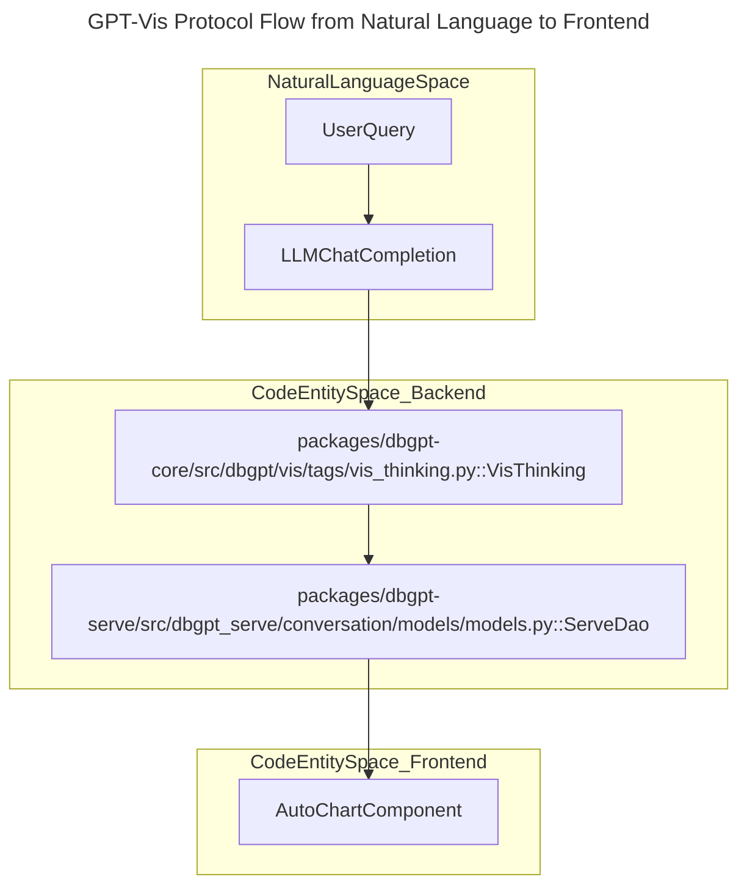
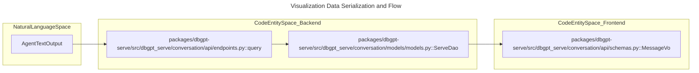

<!-- source: DeepWiki mcp.deepwiki.com · repo eosphoros-ai/DB-GPT · page 14 GPT-Vis Visualization Protocol · fetched 2026-11-09 -->

# GPT-Vis Visualization Protocol

Relevant source files

The following files were used as context for generating this wiki page:

- [packages/dbgpt-core/src/dbgpt/vis/tags/vis_thinking.py](packages/dbgpt-core/src/dbgpt/vis/tags/vis_thinking.py)
- [packages/dbgpt-serve/src/dbgpt_serve/conversation/api/endpoints.py](packages/dbgpt-serve/src/dbgpt_serve/conversation/api/endpoints.py)
- [packages/dbgpt-serve/src/dbgpt_serve/conversation/api/schemas.py](packages/dbgpt-serve/src/dbgpt_serve/conversation/api/schemas.py)
- [packages/dbgpt-serve/src/dbgpt_serve/conversation/models/models.py](packages/dbgpt-serve/src/dbgpt_serve/conversation/models/models.py)

## Purpose and Scope

The **GPT-Vis Visualization Protocol** defines a standardized communication framework bridging DB-GPT agents (*Natural Language Space*) and the web frontend (*Code Entity Space*). By emitting specialized markdown-wrapped JSON and XML-like tags (known as `vis` tags such as `vis-chart`, `vis-dashboard`, and `vis-thinking`), LLMs and backend agents can pass rich, structured visualization payloads that the frontend intercepts and renders as interactive UI components [packages/dbgpt-core/src/dbgpt/vis/tags/vis_thinking.py:4-24]().

As a PARENT page, this document provides a high-level architectural overview of the GPT-Vis protocol, its core workflows, and the mapping between system components and code entities. For detailed descriptions, usage, and internals of vis tags and rendering pipelines, see the dedicated child pages:
- [Vis Tags & VisClient](#14.1) — Catalog of vis tags, VisClient mechanics, and serialization of agent outputs.
- [Chart & Dashboard Rendering](#14.2) — AutoChart component, chart advisor pipeline, rendering types, and dashboard data flow.

Sources: [packages/dbgpt-core/src/dbgpt/vis/tags/vis_thinking.py:4-24]()

---

## Protocol Architecture & Overview

The GPT-Vis protocol translates text-based model outputs into structured visual components via tags embedded in generated content. These tags enclose payloads parsed by frontend renderers and specialized visualization handlers.

### Diagram: Natural Language Space to Code Entity Space

**Explanation:**
- User queries initiate chat completions within the LLM layer.
- Backend components such as `VisThinking` (`packages/dbgpt-core/src/dbgpt/vis/tags/vis_thinking.py`) format structured visualization text blocks [packages/dbgpt-core/src/dbgpt/vis/tags/vis_thinking.py:4-16]().
- Conversation storage and response mapping are handled via DAOs like `ServeDao` (`packages/dbgpt-serve/src/dbgpt_serve/conversation/models/models.py`) before reaching frontend visualization bindings [packages/dbgpt-serve/src/dbgpt_serve/conversation/models/models.py:18-83]().

Sources: [packages/dbgpt-core/src/dbgpt/vis/tags/vis_thinking.py:4-24](), [packages/dbgpt-serve/src/dbgpt_serve/conversation/models/models.py:18-83]()

---

## Visualization Tags (Vis Tags) Overview

Vis tags act as the transport mechanism for tabular, graphical, and auxiliary data structures. The backend and frontend coordinate via custom markdown code blocks mapped to specific parser classes.

| Tag Type       | Component Reference / File                                      | Purpose                                                        |
|----------------|-----------------------------------------------------------------|----------------------------------------------------------------|
| `vis-chart`    | `packages/dbgpt-core/src/dbgpt/vis/tags/vis_thinking.py` (Base) | Single analytical chart rendering from SQL or data results     |
| `vis-dashboard`| `packages/dbgpt-serve/src/dbgpt_serve/conversation/api/schemas.py`| Multi-chart dashboard and report layout schemas                |
| `vis-thinking` | `packages/dbgpt-core/src/dbgpt/vis/tags/vis_thinking.py::VisThinking` | Chain-of-thought or intermediate reasoning visualization   |

For a comprehensive catalog and serialization guidelines, refer to [Vis Tags & VisClient](#14.1).

Sources: [packages/dbgpt-core/src/dbgpt/vis/tags/vis_thinking.py:4-24](), [packages/dbgpt-serve/src/dbgpt_serve/conversation/api/schemas.py:1-48]()

---

## Chart & Dashboard Pipeline Overview

Charts and dashboards transform structured database or dataframe query outputs into visual widgets through managed API endpoints and response schemas.

### Diagram: Visualization Data Serialization and Flow

**Notes:**
- Workflow endpoints such as `query` (`packages/dbgpt-serve/src/dbgpt_serve/conversation/api/endpoints.py`) process conversation requests [packages/dbgpt-serve/src/dbgpt_serve/conversation/api/endpoints.py:110-122]().
- Data models like `MessageVo` (`packages/dbgpt-serve/src/dbgpt_serve/conversation/api/schemas.py`) structure conversation messages for client consumption [packages/dbgpt-serve/src/dbgpt_serve/conversation/api/schemas.py:132-183]().

For detailed mechanics on chart advisor pipelines, multi-measure chart types, and dashboard rendering flows, see [Chart & Dashboard Rendering](#14.2).

Sources: [packages/dbgpt-serve/src/dbgpt_serve/conversation/api/endpoints.py:110-122](), [packages/dbgpt-serve/src/dbgpt_serve/conversation/api/schemas.py:132-183]()

---

## Frontend Component Registry & Processing

The frontend relies on markdown processors and custom language renderers to transform text representations of `vis` tags into active UI components. It performs tag interception, payload deserialization, and dynamic widget injection.

For full implementation details, see the child pages.

Sources: [packages/dbgpt-core/src/dbgpt/vis/tags/vis_thinking.py:4-24]()

---

# Navigation Links to Child Pages

- [Vis Tags & VisClient](#14.1) — Detailed catalog of vis tag types, the VisClient implementation, and output serialization.
- [Chart & Dashboard Rendering](#14.2) — Explanation of the autoChart component, chart advisor logic, and dashboard data flows from SQL queries to final views.

---

