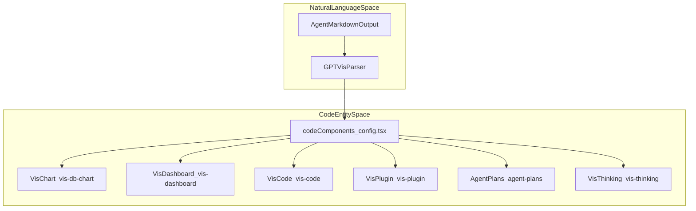
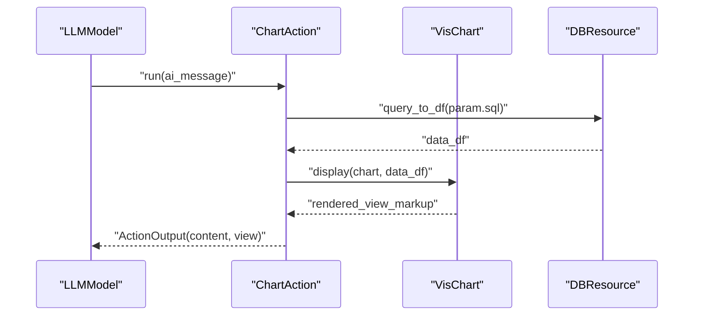
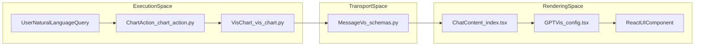

<!-- source: DeepWiki mcp.deepwiki.com · repo eosphoros-ai/DB-GPT · page 14.1 Vis Tags & VisClient · fetched 2026-11-09 -->

# Vis Tags & VisClient

<details>
<summary>Relevant source files</summary>

The following files were used as context for generating this wiki page:

- [packages/dbgpt-core/src/dbgpt/agent/expand/actions/chart_action.py](packages/dbgpt-core/src/dbgpt/agent/expand/actions/chart_action.py)
- [packages/dbgpt-core/src/dbgpt/vis/tags/vis_thinking.py](packages/dbgpt-core/src/dbgpt/vis/tags/vis_thinking.py)
- [packages/dbgpt-serve/src/dbgpt_serve/conversation/api/endpoints.py](packages/dbgpt-serve/src/dbgpt_serve/conversation/api/endpoints.py)
- [packages/dbgpt-serve/src/dbgpt_serve/conversation/api/schemas.py](packages/dbgpt-serve/src/dbgpt_serve/conversation/api/schemas.py)
- [packages/dbgpt-serve/src/dbgpt_serve/conversation/models/models.py](packages/dbgpt-serve/src/dbgpt_serve/conversation/models/models.py)
- [web/components/chat/agent-content.tsx](web/components/chat/agent-content.tsx)
- [web/components/chat/chat-content/VisResponse.tsx](web/components/chat/chat-content/VisResponse.tsx)
- [web/components/chat/chat-content/agent-messages.tsx](web/components/chat/chat-content/agent-messages.tsx)
- [web/components/chat/chat-content/agent-plans.tsx](web/components/chat/chat-content/agent-plans.tsx)
- [web/components/chat/chat-content/config.tsx](web/components/chat/chat-content/config.tsx)
- [web/components/chat/chat-content/index.tsx](web/components/chat/chat-content/index.tsx)
- [web/components/chat/chat-content/vis-code.tsx](web/components/chat/chat-content/vis-code.tsx)
- [web/components/chat/chat-content/vis-plugin.tsx](web/components/chat/chat-content/vis-plugin.tsx)
- [web/new-components/chat/content/ChatContent.tsx](web/new-components/chat/content/ChatContent.tsx)
- [web/new-components/common/MarkdownContext.tsx](web/new-components/common/MarkdownContext.tsx)

</details>


This page details the visualization (Vis) tags used in DB-GPT chat agents to embed structured interactive content, the backend serialization mechanism, and the `VisClient` or action render protocols (`VisChart`, `VisThinking`, etc.) that convert agent data into markdown-compatible tag structures. It catalogs all supported Vis tags (`vis_chart`, `vis_dashboard`, `vis_code`, `vis_plugin`, `vis_agent_plans`, `vis_thinking`), describes frontend parsing via `GPTVis`, and outlines end-to-end data flows from natural language to code entities and UI rendering.

---

## 1. Vis Tags Overview

Vis tags are specialized markdown code blocks emitted by backend components and agents (such as `ChartAction`) to encapsulate structured visual content. Instead of plain text, agents output serialized payloads wrapped in custom tag identifiers. 

At runtime, the frontend React application processes these blocks using the `GPTVis` component from `@antv/gpt-vis` [web/components/chat/chat-content/config.tsx:5-5](), [web/components/chat/chat-content/index.tsx:12-12](). The base class for all visualization handlers in python is `Vis` (found in `dbgpt.core.vis.base`), which subclasses extend to implement tag-specific formatting methods like `vis_tag()`, `build_message()`, and `sync_display()` [packages/dbgpt-core/src/dbgpt/vis/tags/vis_thinking.py:4-24]().

Sources: [web/components/chat/chat-content/config.tsx:1-27](), [web/components/chat/chat-content/index.tsx:1-189](), [packages/dbgpt-core/src/dbgpt/vis/tags/vis_thinking.py:1-24]()

---

## 2. Catalog of Vis Tags

The following table catalogs the core Vis tags supported across the backend and frontend:

| Vis Tag            | Description                                           | Backend Class (Python)                          | Frontend Component (React)                     |
|--------------------|-------------------------------------------------------|-----------------------------------------------|------------------------------------------------|
| `vis-chart`        | Chart visualizations (bar, line, etc.)                 | `VisChart`                                    | `VisChart` [web/components/chat/chat-content/config.tsx:143-152]()           |
| `vis-dashboard`    | Multi-chart dashboards                                | `VisDashboard`                                | `VisDashboard` [web/components/chat/chat-content/config.tsx:133-142]()       |
| `vis-code`         | Syntax-highlighted code snippets and terminal logs    | `VisCode`                                     | `VisCode` [web/components/chat/chat-content/config.tsx:163-171]()            |
| `vis-plugin`       | Plugin execution state and results                    | `VisPlugin`                                   | `VisPlugin` [web/components/chat/chat-content/index.tsx:41-58]()             |
| `vis-agent-plans`  | Agent execution steps and plans                       | `AgentPlans` (custom block)                   | `AgentPlans` [web/components/chat/chat-content/config.tsx:98-112]()          |
| `vis-thinking`     | Internal agent reasoning and thought process          | `VisThinking` [packages/dbgpt-core/src/dbgpt/vis/tags/vis_thinking.py:4-24](). | `VisThinking` [web/components/chat/chat-content/config.tsx:26-26]()          |

### 2.1 `vis-chart` (`VisChart`)
Emitted by chart actions like `ChartAction` [packages/dbgpt-core/src/dbgpt/agent/expand/actions/chart_action.py:31-38]() to render SQL query results as interactive charts using Ant Design Charts / `AutoChart`.

### 2.2 `vis-dashboard` (`VisDashboard`)
Bundles multiple chart panels into a cohesive dashboard view [web/components/chat/chat-content/config.tsx:133-142]().

### 2.3 `vis-code` (`VisCode`)
Renders multi-file code execution snippets along with terminal output logs and success indicators [web/components/chat/chat-content/vis-code.tsx:12-74]().

### 2.4 `vis-plugin` (`VisPlugin`)
Displays tool/plugin execution steps mapped through `pluginViewStatusMapper` for statuses (`todo`, `runing`, `failed`, `completed`) [web/components/chat/chat-content/index.tsx:41-58]().

### 2.5 `vis-agent-plans` (`AgentPlans`)
Visualizes hierarchical agent task planning and execution state via an Ant Design `Collapse` component [web/components/chat/chat-content/agent-plans.tsx:21-48]().

### 2.6 `vis-thinking` (`VisThinking`)
Represents internal LLM chain-of-thought blocks [packages/dbgpt-core/src/dbgpt/vis/tags/vis_thinking.py:4-24](). Example structure:
```markdown
``````vis-thinking
Executing SQL query on target database...
``````
```

Sources: [web/components/chat/chat-content/config.tsx:1-171](), [packages/dbgpt-core/src/dbgpt/agent/expand/actions/chart_action.py:31-38](), [packages/dbgpt-core/src/dbgpt/vis/tags/vis_thinking.py:4-24](), [web/components/chat/chat-content/vis-code.tsx:12-74](), [web/components/chat/chat-content/agent-plans.tsx:21-48]()

---

## 3. Frontend Rendering Pipeline & Component Mapping

The frontend routing of Vis tags is coordinated by `GPTVis` [web/components/chat/chat-content/index.tsx:12-12]() combined with custom language renderers defined in `codeComponents` [web/components/chat/chat-content/config.tsx:90-171]().

### Diagram: Natural Language & Agent Output to Code Entity Mapping

Sources: [web/components/chat/chat-content/config.tsx:90-171](), [web/components/chat/chat-content/index.tsx:12-12]()

### Preprocessing Utilities
Before rendering, raw markdown undergoes preprocessing via `preprocessLaTeX()` to normalize LaTeX block/inline delimiters for KaTeX [web/components/chat/chat-content/config.tsx:49-83](), and custom HTML tags like `<dbgpt-view>` are transformed into `<custom-view>` components [web/components/chat/chat-content/index.tsx:87-104]().

Sources: [web/components/chat/chat-content/config.tsx:49-83](), [web/components/chat/chat-content/index.tsx:87-104]()

---

## 4. Backend Serialization: Actions & Vis Protocols

Backend actions construct vis-tagged responses by invoking render protocol instances. For instance, `ChartAction` instantiates `VisChart` [packages/dbgpt-core/src/dbgpt/agent/expand/actions/chart_action.py:37-37](), queries the database [packages/dbgpt-core/src/dbgpt/agent/expand/actions/chart_action.py:83-83](), and calls `render_protocol.display()` to generate the view payload [packages/dbgpt-core/src/dbgpt/agent/expand/actions/chart_action.py:84-86]().

### Diagram: Backend Serialization Sequence

Sources: [packages/dbgpt-core/src/dbgpt/agent/expand/actions/chart_action.py:31-115]()

---

## 5. End-to-End Data Flow

### Diagram: End-to-End Vis Pipeline

Sources: [packages/dbgpt-core/src/dbgpt/agent/expand/actions/chart_action.py:31-115](), [packages/dbgpt-serve/src/dbgpt_serve/conversation/api/schemas.py:132-183](), [web/components/chat/chat-content/config.tsx:1-171](), [web/components/chat/chat-content/index.tsx:1-189]()

---

## 6. Summary

- Vis tags bridge backend structured agent outputs and frontend React components via markdown-style custom code fences.
- Specialized Python classes (`VisChart`, `VisThinking`, etc.) format data payloads into tag structures.
- The frontend uses `GPTVis` [web/components/chat/chat-content/index.tsx:12-12]() and `codeComponents` mappings [web/components/chat/chat-content/config.tsx:90-171]() to hydrate visual components.

Sources: [web/components/chat/chat-content/config.tsx:1-171](), [web/components/chat/chat-content/index.tsx:1-189](), [packages/dbgpt-core/src/dbgpt/vis/tags/vis_thinking.py:1-24]()

---

