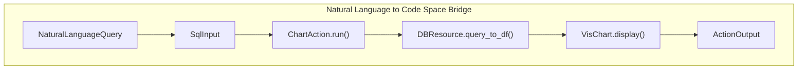
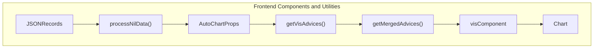

<!-- source: DeepWiki mcp.deepwiki.com · repo eosphoros-ai/DB-GPT · page 14.2 Chart & Dashboard Rendering · fetched 2026-11-09 -->

# Chart & Dashboard Rendering

<details>
<summary>Relevant source files</summary>

The following files were used as context for generating this wiki page:

- [packages/dbgpt-app/src/dbgpt_app/operators/datasource.py](packages/dbgpt-app/src/dbgpt_app/operators/datasource.py)
- [packages/dbgpt-app/src/dbgpt_app/operators/rag.py](packages/dbgpt-app/src/dbgpt_app/operators/rag.py)
- [packages/dbgpt-core/src/dbgpt/core/awel/flow/base.py](packages/dbgpt-core/src/dbgpt/core/awel/flow/base.py)
- [packages/dbgpt-core/src/dbgpt/core/awel/flow/compat.py](packages/dbgpt-core/src/dbgpt/core/awel/flow/compat.py)
- [packages/dbgpt-core/src/dbgpt/core/awel/flow/flow_factory.py](packages/dbgpt-core/src/dbgpt/core/awel/flow/flow_factory.py)
- [packages/dbgpt-core/src/dbgpt/util/cli/flow_compat.py](packages/dbgpt-core/src/dbgpt/util/cli/flow_compat.py)
- [packages/dbgpt-core/src/dbgpt/vis/tags/vis_chart.py](packages/dbgpt-core/src/dbgpt/vis/tags/vis_chart.py)
- [packages/dbgpt-core/src/dbgpt/vis/tags/vis_dashboard.py](packages/dbgpt-core/src/dbgpt/vis/tags/vis_dashboard.py)
- [packages/dbgpt-serve/src/dbgpt_serve/flow/compat/0.7.0_compat_flow.json](packages/dbgpt-serve/src/dbgpt_serve/flow/compat/0.7.0_compat_flow.json)
- [packages/dbgpt-serve/src/dbgpt_serve/flow/service/service.py](packages/dbgpt-serve/src/dbgpt_serve/flow/service/service.py)
- [web/app/i18n.ts](web/app/i18n.ts)
- [web/components/chart/autoChart/advisor/pipeline.ts](web/components/chart/autoChart/advisor/pipeline.ts)
- [web/components/chart/autoChart/charts/multi-line-chart.ts](web/components/chart/autoChart/charts/multi-line-chart.ts)
- [web/components/chart/autoChart/charts/multi-measure-line-chart.ts](web/components/chart/autoChart/charts/multi-measure-line-chart.ts)
- [web/components/chart/autoChart/charts/util.ts](web/components/chart/autoChart/charts/util.ts)
- [web/components/chart/autoChart/index.tsx](web/components/chart/autoChart/index.tsx)
- [web/components/chart/helpers/downloadChartImage.ts](web/components/chart/helpers/downloadChartImage.ts)

</details>


The Chart and Dashboard rendering subsystem in DB-GPT transforms raw structured data (typically SQL query results) into interactive visual representations. It utilizes the **GPT-Vis** protocol to bridge LLM-generated structured content with frontend visualization components. The core of this system is the `AutoChart` component, which leverages an intelligent chart advisor pipeline to recommend and render the most appropriate visualizations.

---

## Backend Chart Generation & Action

Before rendering occurs on the frontend, the backend handles the execution of generated SQL and the preparation of the visualization protocol through specialized agent actions.

### ChartAction

The `ChartAction` class is the primary backend controller for individual chart generation within the agent framework. It is defined at `packages/dbgpt-core/src/dbgpt/agent/expand/actions/chart_action.py`.

- **Input Model**: Uses `SqlInput` which contains `display_type`, `sql`, and `thought` (`packages/dbgpt-core/src/dbgpt/agent/expand/actions/chart_action.py:17-28`()).
- **Resource Requirement**: Requires a database resource (`ResourceType.DB`) to run SQL queries (`packages/dbgpt-core/src/dbgpt/agent/expand/actions/chart_action.py:40-42`()).
- **Execution Flow**:
  1. Converts the AI message string to the `SqlInput` model (`packages/dbgpt-core/src/dbgpt/agent/expand/actions/chart_action.py:63-70`()).
  2. Validates resource and render protocol presence (`packages/dbgpt-core/src/dbgpt/agent/expand/actions/chart_action.py:72-76`()).
  3. Extracts the database resource and runs the SQL query asynchronously to get a DataFrame (`packages/dbgpt-core/src/dbgpt/agent/expand/actions/chart_action.py:78-83`()).
  4. Uses the `VisChart` protocol to generate a visualization view (`packages/dbgpt-core/src/dbgpt/agent/expand/actions/chart_action.py:84-86`()).
  5. Serializes the DataFrame into JSON and packages it with metadata (`packages/dbgpt-core/src/dbgpt/agent/expand/actions/chart_action.py:88-101`()).
  6. Returns an `ActionOutput` (`packages/dbgpt-core/src/dbgpt/agent/expand/actions/chart_action.py:103-109`()).


Sources: [packages/dbgpt-core/src/dbgpt/agent/expand/actions/chart_action.py:17-115]()

---

## AutoChart Component

The `AutoChart` component is the primary React frontend component for rendering individual visualizations [web/components/chart/autoChart/index.tsx:17-170]().

### Key Responsibilities

- **Data Cleaning**: Transforms backend-returned empty strings like `'-'` into `null` values using `processNilData` [web/components/chart/autoChart/index.tsx:19-20](), [web/components/chart/autoChart/charts/util.ts:77-84]().
- **Advisor Initialization**: Initializes a chart `Advisor` instance by customizing AntV AVA with `customCharts` [web/components/chart/autoChart/index.tsx:28-39]().
- **Recommendation Merging**: Combines AVA's recommendations via `getVisAdvices()` with explicit model chart types [web/components/chart/autoChart/index.tsx:41-75]().
- **Chart Rendering**: Renders charts using `@berryv/g2-react` with proper sorting and tooltip configuration [web/components/chart/autoChart/index.tsx:90-125]().
- **User Interaction**: Provides chart type switching and image downloading [web/components/chart/autoChart/index.tsx:127-166]().


Sources: [web/components/chart/autoChart/index.tsx:17-170](), [web/components/chart/autoChart/charts/util.ts:77-84]()

---

## Chart Advisor Pipeline

DB-GPT employs the AntV AVA chart advisor engine to analyze data schemas and generate visualization recommendations.

### Custom Advisor Configuration

- The `customizeAdvisor` function configures inclusion/exclusion of charts via `scopeOfCharts` and builds a customized `Advisor` instance [web/components/chart/autoChart/advisor/pipeline.ts:11-65]().
- Decorates chart `toSpec()` functions to ensure `dataProps` are included in the generated `Specification` [web/components/chart/autoChart/advisor/pipeline.ts:11-31]().

Sources: [web/components/chart/autoChart/advisor/pipeline.ts:11-105]()

---

## Specialized Chart Types

DB-GPT extends standard AVA chart types with custom multi-line and multi-measure charts.

### Multi-Line Chart

- Identified by `multi_line_chart` [web/components/chart/autoChart/charts/multi-line-chart.ts:6-46]().
- Plots multiple lines representing different measures over a single ordinal or time dimension.
- Encodes color by a nominal dimension [web/components/chart/autoChart/charts/multi-line-chart.ts:6-45]().

### Multi-Measure Line Chart

- Identified by `multi_measure_line_chart` [web/components/chart/autoChart/charts/multi-measure-line-chart.ts:6-39]().
- Plots multiple numeric measures on the same chart with a single nominal/time dimension as the X-axis.

### Chart Data Utilities

- `processDateEncode`, `sortData`, `processNilData`, and `getLineSize` handle data preprocessing for proper rendering [web/components/chart/autoChart/charts/util.ts:1-84]().

Sources: [web/components/chart/autoChart/charts/multi-line-chart.ts:1-67](), [web/components/chart/autoChart/charts/multi-measure-line-chart.ts:1-63](), [web/components/chart/autoChart/charts/util.ts:1-84]()

---

## Image Export & Download

The `downloadImage` helper supports exporting the current visible chart as a PNG image by extracting the canvas data URL [web/components/chart/helpers/downloadChartImage.ts:1-40]().

Sources: [web/components/chart/helpers/downloadChartImage.ts:1-40]()

---

## System Entity Mapping

```mermaid
classDiagram
    class ChartAction {
        +run(ai_message)
        +resource_need: ResourceType
    }
    class AutoChart {
        +renderChartType: ChartType
        +advices: Advice[]
        +getMergedAdvices()
    }
    class AdvisorPipeline {
        +customizeAdvisor()
        +getVisAdvices()
    }
    class CustomCharts {
        +multi_line_chart
        +multi_measure_line_chart
    }
    class ChartUtils {
        +sortData()
        +processNilData()
    }

    ChartAction --> AutoChart : "provides query result data"
    AutoChart --> AdvisorPipeline : "performs chart type recommendation"
    AdvisorPipeline --> CustomCharts : "registers specialized charts"
    AutoChart --> ChartUtils : "cleans and sorts data"

    subgraph "System Entity Mapping Space"
        ChartAction
        AutoChart
        AdvisorPipeline
        CustomCharts
        ChartUtils
    end
```
Sources: [packages/dbgpt-core/src/dbgpt/agent/expand/actions/chart_action.py:31-115](), [web/components/chart/autoChart/index.tsx:17-170](), [web/components/chart/autoChart/advisor/pipeline.ts:11-65]()

---

