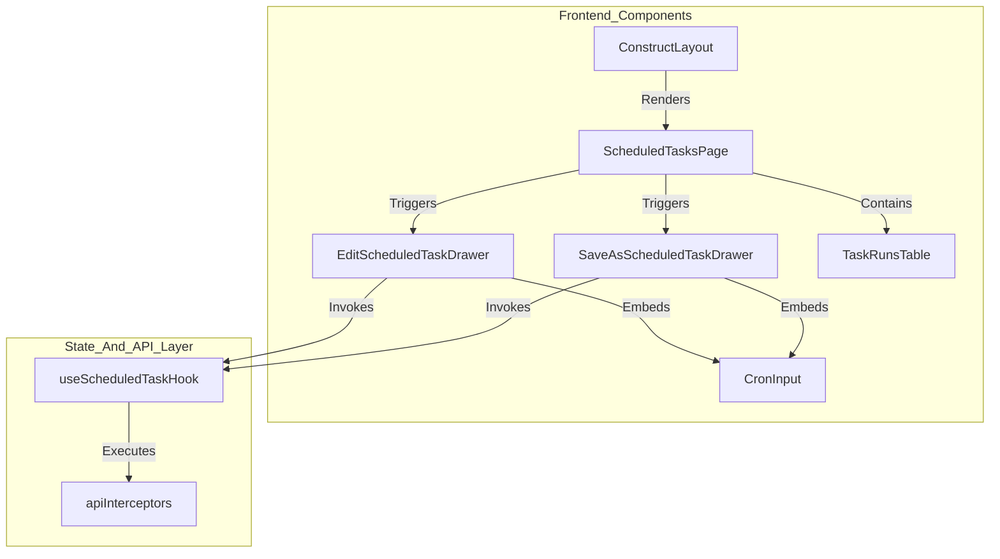
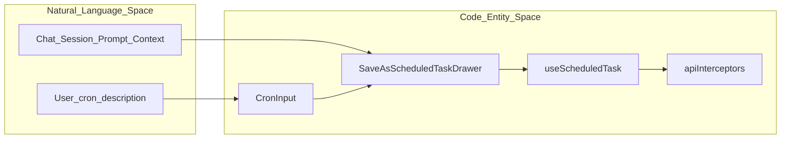
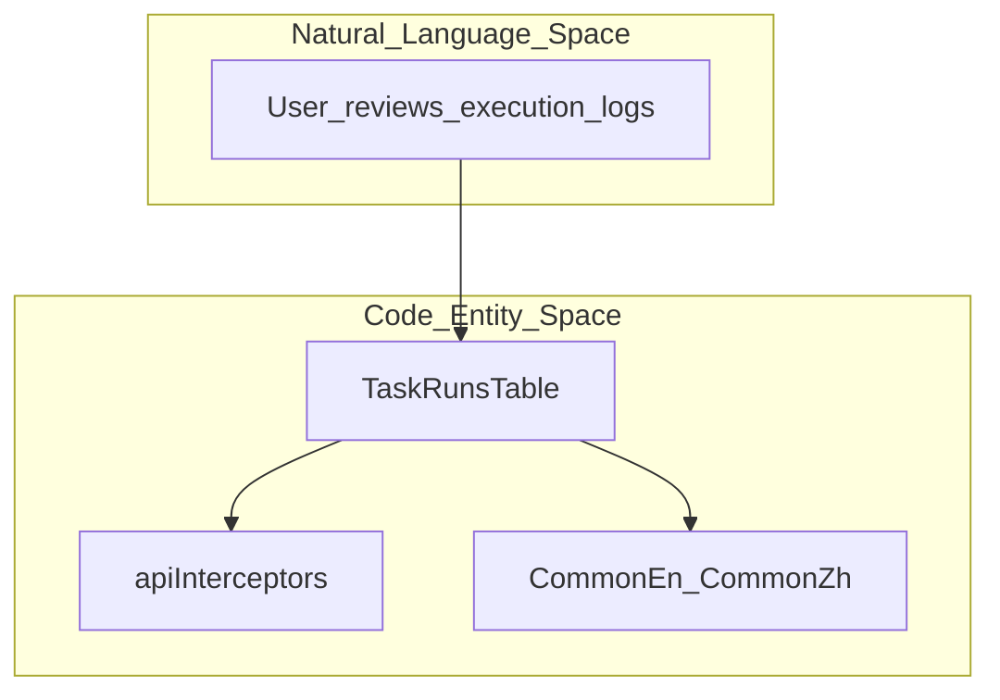

<!-- source: DeepWiki mcp.deepwiki.com · repo eosphoros-ai/DB-GPT · page 15.2 Scheduled Tasks UI · fetched 2026-11-09 -->

# Scheduled Tasks UI

Relevant source files

The following files were used as context for generating this wiki page:

- [web/app/chat-context.tsx](web/app/chat-context.tsx)
- [web/client/api/knowledge/index.ts](web/client/api/knowledge/index.ts)
- [web/client/api/request.ts](web/client/api/request.ts)
- [web/components/knowledge/doc-panel.tsx](web/components/knowledge/doc-panel.tsx)
- [web/components/knowledge/embedded-chat.tsx](web/components/knowledge/embedded-chat.tsx)
- [web/components/knowledge/space-form.tsx](web/components/knowledge/space-form.tsx)
- [web/components/layout/side-bar.tsx](web/components/layout/side-bar.tsx)
- [web/locales/en/common.ts](web/locales/en/common.ts)
- [web/locales/zh/common.ts](web/locales/zh/common.ts)
- [web/new-components/chat/content/OpenCodeSessionTurn.tsx](web/new-components/chat/content/OpenCodeSessionTurn.tsx)
- [web/new-components/chat/icons/ToolIcon.tsx](web/new-components/chat/icons/ToolIcon.tsx)
- [web/new-components/common/blurredCard/index.tsx](web/new-components/common/blurredCard/index.tsx)
- [web/new-components/layout/Construct.tsx](web/new-components/layout/Construct.tsx)
- [web/next.config.js](web/next.config.js)
- [web/pages/construct/knowledge/detail.tsx](web/pages/construct/knowledge/detail.tsx)
- [web/utils/react-sse-parser.ts](web/utils/react-sse-parser.ts)

## Purpose and Scope

The Scheduled Tasks UI provides the frontend management interface for recurring AI-driven tasks within DB-GPT. Located under construction views and integrated via `[web/new-components/layout/Construct.tsx:77-81]()`, it enables users to construct, edit, execute, and monitor cron-based scheduled jobs. This subsystem bridges user scheduling intents with backend API endpoints defined via `[web/client/api/request.ts:1-20]()`.

Sources: [web/new-components/layout/Construct.tsx:77-81](), [web/client/api/request.ts:1-20]()

---

## Core Component Architecture

The Scheduled Tasks UI relies on modular React components and custom hooks to encapsulate form handling, cron expression parsing, and execution history tracking.

- **`CronInput`**: A specialized input control for formulating and validating cron schedule expressions with preset dropdowns.
- **`EditScheduledTaskDrawer`**: A slide-out drawer component enabling modification of existing task configurations, including schedule expressions, target prompts, and execution parameters.
- **`SaveAsScheduledTaskDrawer`**: A drawer designed to capture active chat session contexts—such as conversation UID, model parameters, and prompt configurations—and persist them as recurring tasks.
- **`TaskRunsTable`**: A structured table component displaying historical execution runs, including timestamps, run durations, and status badges.
- **`useScheduledTask`**: Encapsulates all data mutation, retrieval, and state lifecycle logic interacting with backend REST APIs via `[web/client/api/request.ts:1-20]()`.

Title: "Scheduled Tasks Component Architecture"

Sources: [web/new-components/layout/Construct.tsx:77-81](), [web/client/api/request.ts:1-20]()

---

## Data Flow and Execution Tracking

The interaction loop between the frontend drawers, hooks, and API layer follows a standardized CRUD lifecycle:

1. **Initialization & Fetching**: `useScheduledTask` fetches existing scheduled tasks upon mounting the `ScheduledTasksPage`.
2. **Mutation & Creation**: When saving a new task via `SaveAsScheduledTaskDrawer` or updating via `EditScheduledTaskDrawer`, form payloads containing cron expressions and parameters are validated and sent through `apiInterceptors` [web/client/api/request.ts:1-20]().
3. **Run History Monitoring**: `TaskRunsTable` polls or retrieves execution logs, mapping raw status strings to localized UI tags.

### Status Mapping Table

| Backend Status | UI Status Tag | Color Code / Style |
| :--- | :--- | :--- |
| `FINISHED` / `SUCCESS` | `cyan` / `success` | Completed successfully |
| `RUNNING` | `blue` / `processing` | Active execution |
| `FAILED` | `red` / `error` | Execution failure |
| `TODO` / `PENDING` | `gold` / `warning` | Queued or pending |

Sources: [web/locales/en/common.ts:47-52](), [web/locales/zh/common.ts:177-195]()

---

## Natural Language Space to Code Entity Space Bridge

### Bridge Diagram 1: Schedule Creation Flow

Title: "Natural Language to Code Bridge: Schedule Creation"

Sources: [web/new-components/layout/Construct.tsx:77-81](), [web/client/api/request.ts:1-20]()

### Bridge Diagram 2: Execution Monitoring Flow

Title: "Natural Language to Code Bridge: Execution Monitoring"

Sources: [web/locales/en/common.ts:1-50](), [web/client/api/request.ts:1-20]()

---

## Localization and Internationalization

The Scheduled Tasks UI integrates with DB-GPT's i18n translation framework, supporting keys across English and Chinese localization catalogs [web/locales/en/common.ts:1-170](), [web/locales/zh/common.ts:1-212](). This ensures status indicators, form labels, and drawer headers render correctly based on user preferences.

Sources: [web/locales/en/common.ts:1-170](), [web/locales/zh/common.ts:1-212]()

---

