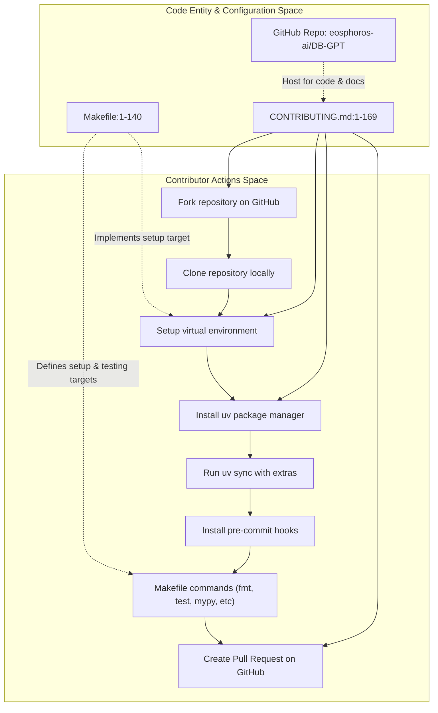
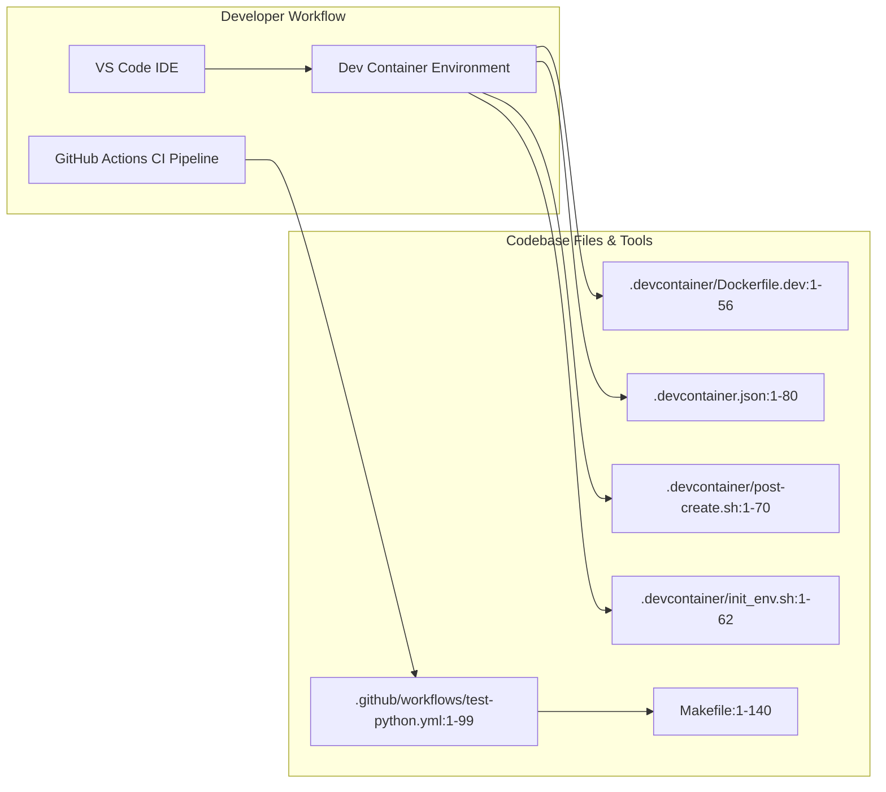

<!-- source: DeepWiki mcp.deepwiki.com · repo eosphoros-ai/DB-GPT · page 16.2 Contributing, Testing & Tooling · fetched 2026-11-09 -->

# Contributing, Testing & Tooling

<details>
<summary>Relevant source files</summary>

The following files were used as context for generating this wiki page:

- [.devcontainer.json](.devcontainer.json)
- [.devcontainer/Dockerfile.dev](.devcontainer/Dockerfile.dev)
- [.devcontainer/README.md](.devcontainer/README.md)
- [.devcontainer/init_env.sh](.devcontainer/init_env.sh)
- [.devcontainer/post-create.sh](.devcontainer/post-create.sh)
- [.github/ISSUE_TEMPLATE/bug-report.yml](.github/ISSUE_TEMPLATE/bug-report.yml)
- [.github/ISSUE_TEMPLATE/documentation-related.yml](.github/ISSUE_TEMPLATE/documentation-related.yml)
- [.github/ISSUE_TEMPLATE/feature-request.yml](.github/ISSUE_TEMPLATE/feature-request.yml)
- [.github/release-drafter.yml](.github/release-drafter.yml)
- [.github/workflows/pr-labeler.yml](.github/workflows/pr-labeler.yml)
- [.github/workflows/release-drafter.yml](.github/workflows/release-drafter.yml)
- [.github/workflows/test-python.yml](.github/workflows/test-python.yml)
- [.mypy.ini](.mypy.ini)
- [CONTRIBUTING.md](CONTRIBUTING.md)
- [Makefile](Makefile)
- [packages/dbgpt-ext/src/dbgpt_ext/rag/knowledge/__init__.py](packages/dbgpt-ext/src/dbgpt_ext/rag/knowledge/__init__.py)
- [requirements/dev-requirements.txt](requirements/dev-requirements.txt)
- [tests/intetration_tests/kbqa/__init__.py](tests/intetration_tests/kbqa/__init__.py)
- [tests/intetration_tests/vector_store/__init__.py](tests/intetration_tests/vector_store/__init__.py)
- [tests/unit_tests/embedding_engine/document_test.py](tests/unit_tests/embedding_engine/document_test.py)
- [tests/unit_tests/embedding_engine/url_test.py](tests/unit_tests/embedding_engine/url_test.py)
- [tests/unit_tests/test_plugins.py](tests/unit_tests/test_plugins.py)
- [tests/unit_tests/vector_store/test_pgvector.py](tests/unit_tests/vector_store/test_pgvector.py)

</details>


This page details the developer workflow, testing procedures, and tooling setup used in the DB-GPT project. It covers the recommended contribution workflow, the VS Code dev container, the Makefile targets for development, configuration of code quality tools (`ruff`, `mypy`), the GitHub Actions continuous integration pipeline for testing, and the organization of the `tests/` directory containing both unit and integration tests.

---

## 1. Contributing Workflow

### Fork, Clone & Setup Development Environment

Contributors begin by forking the repository and cloning their fork locally [CONTRIBUTING.md:8-16]():

```bash
git clone https://github.com/<YOUR-GITHUB-USERNAME>/DB-GPT
```

They create and activate a Python virtual environment (recommended Python ≥ 3.10) [CONTRIBUTING.md:20-27]():

```bash
conda create -n dbgpt_env python=3.10
conda activate dbgpt_env
```

Then install the `uv` package manager, which manages the complete DB-GPT workspace dependencies [CONTRIBUTING.md:34-54]():

- Recommended installation using `pipx` [CONTRIBUTING.md:38-44]()
- Alternative via `curl` install script for macOS/Linux [CONTRIBUTING.md:46-49]()

With `uv` installed, install all packages including development dependencies [CONTRIBUTING.md:56-66]():

```bash
uv sync --all-packages --extra "base" --extra "proxy_openai" --extra "rag" --extra "storage_chromadb" --extra "dbgpts"
```

For users in China, alternate PyPI mirror configurations can be applied to speed up installations [CONTRIBUTING.md:68-81]().

Finally, install git pre-commit hooks to enforce code quality checks before commits [CONTRIBUTING.md:83-86]():

```bash
uv run pre-commit install
```

All development commands should be executed inside the `uv` managed environment, either by prefixing with `uv run` or by activating `.venv/bin/activate` directly [CONTRIBUTING.md:88-94]().

### Making Changes & Running Checks

1. Create a new feature branch [CONTRIBUTING.md:100-105]():

```bash
git checkout -b <branch-name>
```

2. Make your code and documentation changes [CONTRIBUTING.md:108]().

3. Add relevant tests if needed [CONTRIBUTING.md:110]().

4. Format your code using the Makefile command [CONTRIBUTING.md:112-115]():

```bash
make fmt
```

5. Run automated tests [CONTRIBUTING.md:117-120]():

```bash
make test
```

6. Perform static type checks [CONTRIBUTING.md:122-125]():

```bash
make mypy
```

7. Check lint and formatting without fixes [CONTRIBUTING.md:127-130]():

```bash
make fmt-check
```

8. Commit your changes following the typical git add/commit/push workflow [CONTRIBUTING.md:132-151]():

```bash
git add <files>
git commit -m "Meaningful commit message"
git push origin <branch-name>
```

9. Open a Pull Request on GitHub targeting the main repository [CONTRIBUTING.md:153-161]().

Sources:
- `CONTRIBUTING.md:1-169`

---

## 2. Development Container (VS Code Devcontainer)

For seamless local development, DB-GPT provides a ready-to-use VS Code dev container [.devcontainer/README.md]() configured with the following key components:

- Based on image `eosphorosai/dbgpt-full:latest`, including Python 3.11 and core dependencies [.devcontainer/Dockerfile.dev:1-56]()
- Installs `uv`, development tools, Zsh shell, `autojump`, `Oh My Zsh` plugins and Powerlevel10k theme with mirror fallback support [.devcontainer/post-create.sh:1-70]()
- Local user UID/GID matching inside the container set up to avoid permission issues [.devcontainer/Dockerfile.dev:10-17](), [.devcontainer/init_env.sh:1-19]()
- Configured locales support UTF-8 Chinese with appropriate fonts
- The `.devcontainer.json` file mounts the project and model cache directories to maintain live sync between host and container [.devcontainer.json:1-80]()
- Default shell is Zsh with plugins enabled and environment variables loaded on shell startup [.devcontainer/post-create.sh:37-69]()

Sources:
- `.devcontainer/Dockerfile.dev:1-56`
- `.devcontainer/post-create.sh:1-70`
- `.devcontainer/init_env.sh:1-19`
- `.devcontainer.json:1-80`

---

## 3. Makefile Targets

The `Makefile` provides a comprehensive set of commands to support environment setup, code formatting, linting, testing, and packaging across platforms. Important targets include:

| Target         | Description                                               | Citation           |
|----------------|-----------------------------------------------------------|--------------------|
| `setup`        | Create Python virtual environment and install dependencies using `uv` | [Makefile:13-23]() |
| `testenv`      | Setup environment with all required packages installed    | [Makefile:25-48]() |
| `fmt`          | Format Python code using `ruff`, including import sorting | [Makefile:50-69]() |
| `fmt-check`    | Check formatting and imports without making changes       | [Makefile:73-83]() |
| `pre-commit`   | Run formatting, linting, tests and type checks (used before commit) | [Makefile:85-86]() |
| `test`         | Run all unit tests with `pytest`                           | [Makefile:88-89]() |
| `test-doc`     | Run doctests                                                | [Makefile:91-94]() |
| `mypy`         | Run static type checking with `mypy`                       | [Makefile:96-104]()|
| `coverage`     | Run tests and produce coverage reports                      | [Makefile:106-108]()|
| `clean`        | Remove virtual environment and Python cache files          | [Makefile:110-117]()|
| `clean-dist`   | Remove build distributions                                  | [Makefile:118-121]()|
| `build`        | Compile and package the project                             | [Makefile:122-124]()|
| `publish`      | Upload package to PyPI                                      | [Makefile:126-128]()|
| `publish-test` | Upload package to Test PyPI                                 | [Makefile:130-132]()|
| `help`         | Display all available commands                              | [Makefile:134-137]()|

Sources:
- `Makefile:1-137`

---

## 4. Ruff and Mypy Configuration

### Ruff

`ruff` is the main tool for linting and formatting Python code, enforced through Makefile targets:

- Code formatting (`make fmt`) runs `ruff format` and sorts imports
- Style checking (`make fmt-check`) runs `ruff` in check mode without fixing
- Operates on `packages/`, `examples/` (excluding notebooks), and scripts
- Ignores certain errors in `dbgpt-serve` subpackages for flexibility

### Mypy

Static type checking is configured via `.mypy.ini`, which has tailored settings:

- Excludes all `tests/` from type checking
- Skips or ignores missing imports for many third-party dependencies (e.g., `sentence_transformers`, `llama_index`, `langchain`)
- Enables strict optional checks selectively disabled for `dbgpt.rag.*`
- Primarily focuses on core packages for type safety enforcement

Example snippet from `.mypy.ini`:

```ini
[mypy]
exclude = /tests/
[mypy-dbgpt.rag.*]
strict_optional = False
ignore_missing_imports = True
follow_imports = skip
```

Sources:
- `.mypy.ini:1-130`
- `Makefile:50-104`

---

## 5. GitHub Actions: Test Pipeline

The continuous integration pipeline automatically runs tests and coverage on the main branch for all pull requests and pushes:

- Defined in `.github/workflows/test-python.yml`
- Runs on Ubuntu and macOS platforms
- Tests Python versions 3.10 and 3.11 for compatibility
- Steps performed:
  1. Checkout repository [`actions/checkout@v4`]
  2. Setup Python environment [`actions/setup-python@v4`]
  3. Install project editable with `[openai]` extra plus dev dependencies from `requirements/dev-requirements.txt`
  4. Run `pytest` on `dbgpt` package with coverage measurement, and produce XML/HTML reports
  5. Summarize coverage and test results logging key metrics
  6. Upload artifacts including coverage reports and junit test summaries

Sources:
- `.github/workflows/test-python.yml:1-99`
- `requirements/dev-requirements.txt:1-18`

---

## 6. Tests Suite Organization

DB-GPT uses `pytest` with various plugins (asyncio, mock, benchmark, etc.) specified in `requirements/dev-requirements.txt`.

The `tests/` directory is organized as follows:

- **Unit Tests:**
  - Located in `tests/unit_tests/`
  - Tests individual modules and functions for isolated correctness
  - Example: `tests/unit_tests/embedding_engine/url_test.py` tests embedding integration of URL knowledge sources using the `EmbeddingEngine` class and `KnowledgeType` enum [tests/unit_tests/embedding_engine/url_test.py:1-20]()

- **Integration Tests:**
  - Located in `tests/intetration_tests/`
  - Tests full component workflows such as vector stores, knowledge base QA, or multi-module interactions.

Sources:
- `requirements/dev-requirements.txt:1-18`
- `tests/unit_tests/embedding_engine/url_test.py:1-21`

---

## 7. Natural Language to Code Entity Mapping Diagrams

### Diagram 1: Contribution Workflow to Key Code Entities



Sources:
- `CONTRIBUTING.md:1-169`
- `Makefile:1-140`

### Diagram 2: Tooling - Dev Container and CI Pipeline to Code Entities



Sources:
- `.devcontainer/Dockerfile.dev:1-56`
- `.devcontainer.json:1-80`
- `.devcontainer/post-create.sh:1-70`
- `.devcontainer/init_env.sh:1-62`
- `.github/workflows/test-python.yml:1-99`
- `Makefile:1-140`

---

Sources:
- `CONTRIBUTING.md:1-169`
- `Makefile:1-137`
- `.mypy.ini:1-130`
- `.devcontainer/Dockerfile.dev:1-56`
- `.devcontainer.json:1-80`
- `.devcontainer/post-create.sh:1-70`
- `.devcontainer/init_env.sh:1-62`
- `.github/workflows/test-python.yml:1-99`
- `requirements/dev-requirements.txt:1-18`
- `tests/unit_tests/embedding_engine/url_test.py:1-21`

---

