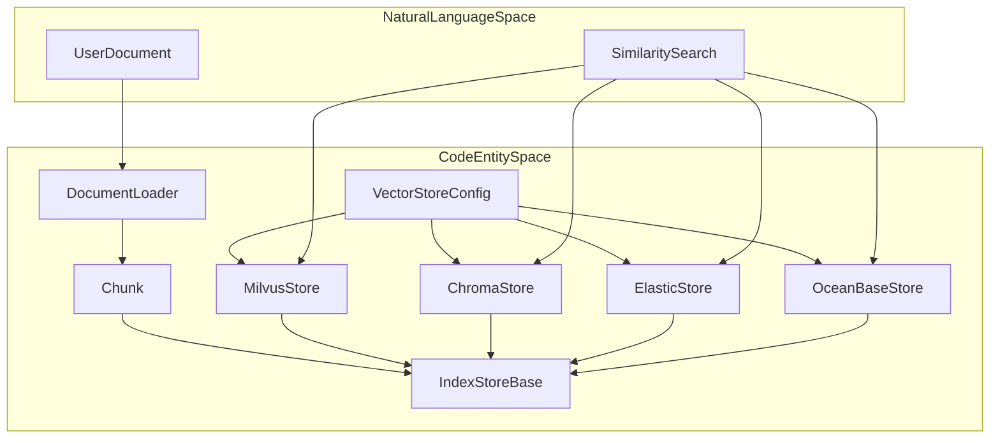
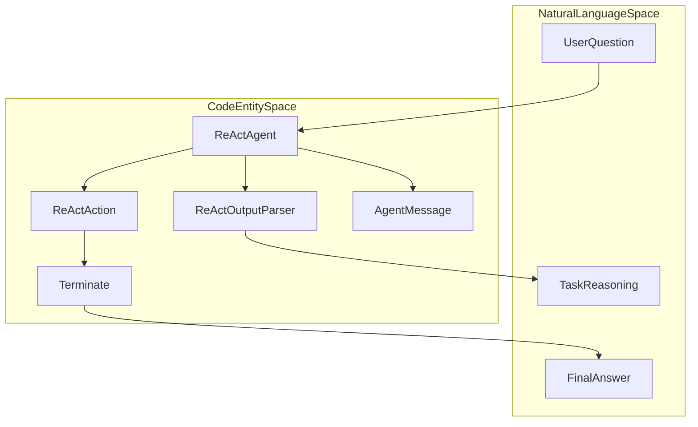

<!-- source: DeepWiki mcp.deepwiki.com · repo eosphoros-ai/DB-GPT · page 17 Glossary · fetched 2026-11-09 -->

# Glossary

Relevant source files

The following files were used as context for generating this wiki page:

- [README.hi.md](README.hi.md)
- [README.ja.md](README.ja.md)
- [README.ma.md](README.ma.md)
- [README.md](README.md)
- [README.ta.md](README.ta.md)
- [README.zh.md](README.zh.md)
- [assets/ding.jpg](assets/ding.jpg)
- [assets/wechat.jpg](assets/wechat.jpg)
- [docs/docs/application/advanced_tutorial/api.md](docs/docs/application/advanced_tutorial/api.md)
- [docs/docs/application/advanced_tutorial/cli.md](docs/docs/application/advanced_tutorial/cli.md)
- [docs/docs/application/fine_tuning_manual/text_to_sql.md](docs/docs/application/fine_tuning_manual/text_to_sql.md)
- [docs/docs/installation/sourcecode.md](docs/docs/installation/sourcecode.md)
- [docs/docs/quickstart.md](docs/docs/quickstart.md)
- [docs/sidebars.js](docs/sidebars.js)
- [docs/static/img/agentic-multi-file/file-preview-zh.jpg](docs/static/img/agentic-multi-file/file-preview-zh.jpg)
- [docs/static/img/knowledge/knowledge_reference_chat_zh.jpg](docs/static/img/knowledge/knowledge_reference_chat_zh.jpg)
- [examples/rag/retriever_evaluation_example.py](examples/rag/retriever_evaluation_example.py)
- [packages/dbgpt-core/src/dbgpt/storage/metadata/db_storage.py](packages/dbgpt-core/src/dbgpt/storage/metadata/db_storage.py)
- [scripts/install/install.sh](scripts/install/install.sh)
- [scripts/install/lib/common.sh](scripts/install/lib/common.sh)

This page provides a comprehensive reference for technical terms, architectural components, abbreviations, and domain-specific concepts used throughout the DB-GPT codebase. It is intended to help onboarding engineers navigate the "Natural Language Space" of documentation and map it to the corresponding "Code Entity Space" of implementation.

Sources: [README.md:57-70](), [README.zh.md:55-68]()

## Core Architectural Frameworks

### AWEL (Agentic Workflow Expression Language)
AWEL is a domain-specific language and engine designed for orchestrating agentic workflows. It allows developers to define Directed Acyclic Graphs (DAGs) where nodes represent operators (LLM calls, data processing, tool invocation) and edges represent data flow.

- **Implementation**: Defined in core packages [README.ja.md:56-58]().
- **Key Class**: `dbgpt.core.awel.dag.DAG`.

Sources: [README.ja.md:56-58]()

### SMMF (Service-oriented Multi-Model Management Framework)
A modular framework managing multiple Large Language Models (LLMs) lifecycles including deployment, scaling, loading, and API serving.

- Supports local models (backed by vLLM, llama.cpp, MLX) and cloud/proxy models (OpenAI, DeepSeek, Kimi, MiniMax, etc.).
- **Key Components**: `WorkerManager`, `ModelController`.
- Enables uniform API access and load balancing of LLMs.

Sources: [README.md:69-70](), [README.ja.md:58-60]()

## Agent & Execution Concepts

### Agent
Autonomous entities capable of conversational interaction, multi-step planning, tool invocation, and workflow execution.

- **Base Class**: `dbgpt.agent.core.base_agent.ConversableAgent` — provides core agent interface and conversation machinery [packages/dbgpt-core/src/dbgpt/agent/core/base_agent.py:39-40]().
- **Role & Action Model**: Agents embody a `Role` and execute predefined `Action`s to fulfill tasks [packages/dbgpt-core/src/dbgpt/agent/core/base_agent.py:66-70](), [packages/dbgpt-core/src/dbgpt/agent/expand/react_agent.py:96-126]().
- **ConversableAgent**: Supports multi-turn conversations with memory, context management, and resource integration [packages/dbgpt-core/src/dbgpt/agent/core/base_agent.py:71-113]().

Sources: [README.md:59-69](), [README.zh.md:57-67](), [packages/dbgpt-core/src/dbgpt/agent/expand/react_agent.py:96-126](), [packages/dbgpt-core/src/dbgpt/agent/core/base_agent.py:39-40]()

### ReAct (Reasoning and Acting) Paradigm
An interaction paradigm where agents interleave reasoning (thoughts) and actions in their responses, enabling stepwise problem-solving.

- **Implementation**: `ReActAgent` extends `ConversableAgent`, using `ReActAction` and `Terminate` actions to control workflow [packages/dbgpt-core/src/dbgpt/agent/expand/react_agent.py:96-126]().
- **Parsing**: Uses `ReActOutputParser` to extract agent intents, actions, and inputs from generated text [packages/dbgpt-core/src/dbgpt/agent/expand/react_agent.py:27-78]().

Sources: [packages/dbgpt-core/src/dbgpt/agent/expand/react_agent.py:27-78](), [packages/dbgpt-core/src/dbgpt/agent/expand/react_agent.py:96-126]()

### Sandbox
An isolated environment designed for safely executing code and tools called by agents to avoid security risks or side effects.

- **Package**: `dbgpt-sandbox` handles runtime isolation for Python and code execution [README.md:96-98]().
- Provides secure runtime for skills, code execution steps, and external tool invocations.

Sources: [README.md:96-98](), [README.zh.md:89-91]()

### Skill
Reusable, packaged domain knowledge or analysis workflows that agents can load and execute.

- Encapsulates domain-specific analysis methods or actions for reuse across tasks.
- Skills are loaded and executed via agent resource mechanisms [packages/dbgpt-core/src/dbgpt/agent/expand/react_agent.py:142-157]().

Sources: [README.md:65-65](), [packages/dbgpt-core/src/dbgpt/agent/expand/react_agent.py:142-157]()

## Data & RAG (Retrieval Augmented Generation)

### Knowledge Space
Logical container grouping knowledge documents and their corresponding vector embeddings.

- Supports querying and retrieval for knowledge-driven applications.
- Connects structured and unstructured data sources to agent workflows.

Sources: [README.md:62-63](), [README.ja.md:71-72]()

### Vector Store
A specialized datastore to index, store, and perform similarity search on high-dimensional vector embeddings for unstructured data retrieval.

- **Base interface**: `VectorStoreBase`.
- **Implementations**:
  - `MilvusStore` utilizing Milvus client integration.
  - `ChromaStore` backed by persistent local storage [examples/rag/retriever_evaluation_example.py:32-40]().
  - `ElasticStore` for Elasticsearch-based vector storage.
  - `OceanBaseStore` vector functionality in OceanBase DB.

Sources: [README.md:60-63](), [examples/rag/retriever_evaluation_example.py:32-40]()

### Chunk
Basic unit of textual content in the RAG pipeline, typically a fragment derived from documents along with contextual metadata.

- Used in document ingestion to load data into indexing and vector storage layers [examples/rag/retriever_evaluation_example.py:48-55]().

Sources: [README.md:62-63](), [examples/rag/retriever_evaluation_example.py:48-55]()

### Connector Manager
Manages lifecycle, caching, and connection pooling of datasource drivers, especially for relational databases.

- Handles datasource connections and caching mechanisms.

Sources: [README.md:62-63]()

## Code Entity Mapping Diagrams

### Diagram: RAG Data Ingestion Flow (Natural Language to Code Entity Space)
This diagram bridges the conceptual process of ingesting user documents into vector storage with key code entities responsible for loading, chunking, and storing in vector databases.

Sources: [README.md:60-65](), [examples/rag/retriever_evaluation_example.py:32-40]()

### Diagram: Agent ReAct Workflow (Natural Language to Code Entity Space)
This diagram illustrates the flow of user queries through the ReAct agent model, highlighting key classes and how the agent produces iterative reasoning and actions toward the final answer.

Sources: [packages/dbgpt-core/src/dbgpt/agent/expand/react_agent.py:96-126](), [packages/dbgpt-core/src/dbgpt/agent/expand/react_agent.py:135-168]()

## Package & Workspace Terms

| Term | Definition | Code Pointer |
| :--- | :--- | :--- |
| **uv workspace** | Monorepo management system used for coordinating multiple packages and dependencies in DB-GPT. Enables consistent environment setup. | [README.ja.md:125-130]() |
| **dbgpt-core** | The foundational package containing the core framework: AWEL flow engine, Agent interface, Role and Action models, Prompt and Embedding interfaces, and storage abstractions. | [README.ja.md:125-125]() |
| **dbgpt-serve** | Packages standardized service implementations for domain modules like RAG, Datasource connectors, and Evaluation tooling. | [README.ja.md:126-126]() |
| **dbgpt-ext** | Repository of third-party extensions such as vector stores, datasource connectors, and other plugins. | [README.ja.md:129-129]() |
| **dbgpt-client** | Python SDK package for programmatic interaction with the DB-GPT service API. | [README.ja.md:127-127]() |
| **dbgpt-app** | The main application integrating core, serve, and extensions providing the Web UI, API server, and the orchestration of agent workflows. | [README.ja.md:124-124]() |

Sources: [README.ja.md:124-130]()

---

This Glossary should be used alongside the full documentation and codebase to understand the mapping between user-facing concepts and the underlying implementation, enabling efficient onboarding and contribution to DB-GPT.