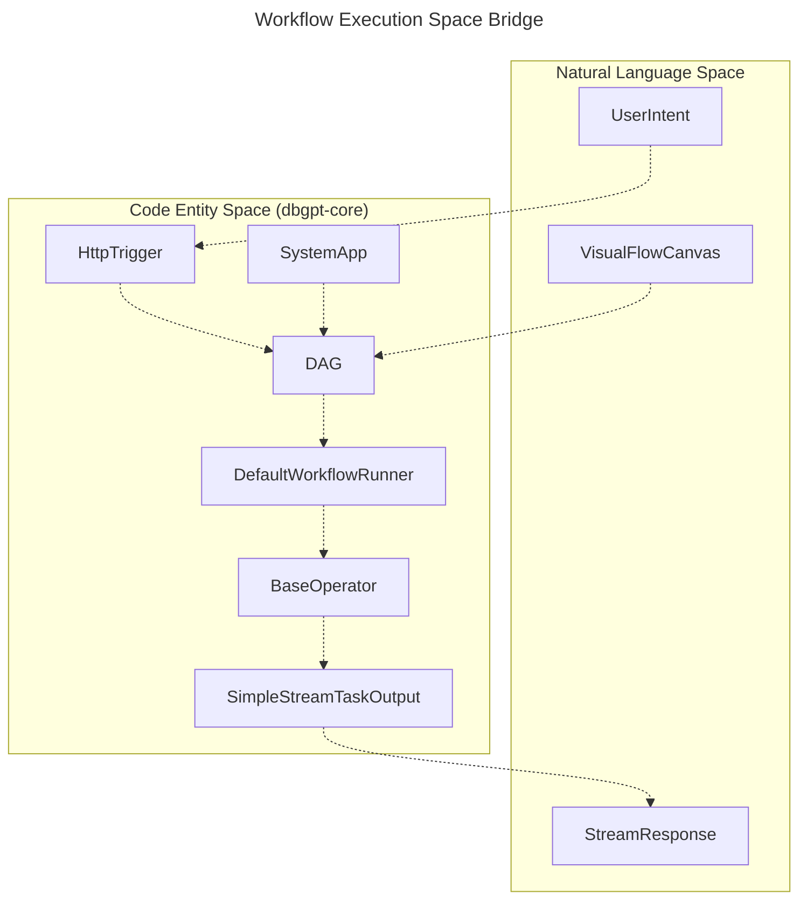
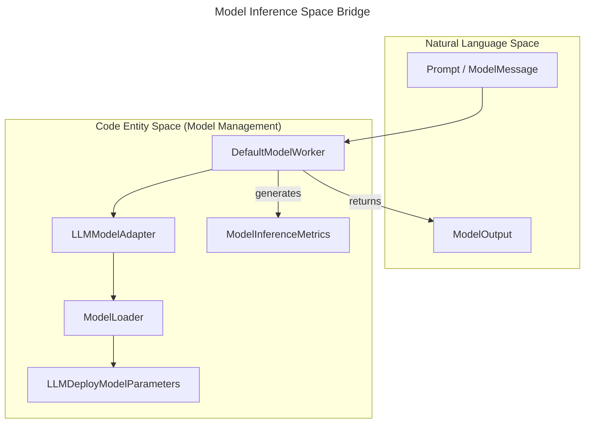

<!-- source: DeepWiki mcp.deepwiki.com · repo eosphoros-ai/DB-GPT · page 2 Core Framework (dbgpt-core) · fetched 2026-11-09 -->

# Core Framework (dbgpt-core)

Relevant source files

The following files were used as context for generating this wiki page:

- [packages/dbgpt-core/src/dbgpt/core/interface/llm.py](packages/dbgpt-core/src/dbgpt/core/interface/llm.py)
- [packages/dbgpt-core/src/dbgpt/model/adapter/loader.py](packages/dbgpt-core/src/dbgpt/model/adapter/loader.py)
- [packages/dbgpt-core/src/dbgpt/model/cluster/worker/default_worker.py](packages/dbgpt-core/src/dbgpt/model/cluster/worker/default_worker.py)
- [packages/dbgpt-core/src/dbgpt/model/llm/llm_out/hf_chat_llm.py](packages/dbgpt-core/src/dbgpt/model/llm/llm_out/hf_chat_llm.py)
- [packages/dbgpt-core/src/dbgpt/model/llm/llm_out/vllm_llm.py](packages/dbgpt-core/src/dbgpt/model/llm/llm_out/vllm_llm.py)
- [packages/dbgpt-core/src/dbgpt/model/llm/monkey_patch.py](packages/dbgpt-core/src/dbgpt/model/llm/monkey_patch.py)
- [packages/dbgpt-core/src/dbgpt/model/utils/hf_stream_utils.py](packages/dbgpt-core/src/dbgpt/model/utils/hf_stream_utils.py)
- [packages/dbgpt-core/src/dbgpt/model/utils/llm_metrics.py](packages/dbgpt-core/src/dbgpt/model/utils/llm_metrics.py)
- [packages/dbgpt-core/src/dbgpt/util/tracer/tracer_impl.py](packages/dbgpt-core/src/dbgpt/util/tracer/tracer_impl.py)

The `dbgpt-core` package serves as the foundational layer of the DB-GPT ecosystem. It provides essential abstractions, engine runtimes, core interfaces, the AWEL (Agentic Workflow Expression Language) engine for workflow orchestration, a component and dependency injection system, and numerous shared utilities. By decoupling core logic from specific implementations, `dbgpt-core` ensures modularity and extensibility, enabling seamless integration of various LLM providers, storage backends, and workflow mechanisms.

---

## Architecture Overview

The core framework functions as the bridge connecting **Natural Language Space**—which includes user intents, prompts, and chat messages—to **Code Entity Space**, represented by operators, DAGs, and components within the runtime. This layered architecture allows consistent interaction with diverse AI models and data sources by standardizing protocols and interfaces across subsystems.

### Natural Language to Code Entity Mapping (Workflows)

Sources:  
- [packages/dbgpt-core/src/dbgpt/core/awel/runner/local_runner.py:24-50]()  

---

## AWEL — Agentic Workflow Expression Language

AWEL is the core execution engine enabling declarative and agentic workflows expressed as Directed Acyclic Graphs (DAGs). It facilitates complex orchestration of AI workflows involving prompt chaining, branching logic, event triggers, and asynchronous streaming.

Key components include:

- **DAG & DAGContext**: Maintain shared execution context and variables for operators during runtime [packages/dbgpt-core/src/dbgpt/core/awel/runner/local_runner.py:43-90]().  
- **Operators**: Flexible workflow building blocks such as `MapOperator`, `ReduceStreamOperator`, `JoinOperator`, and branch operators.  
- **WorkflowRunner**: The orchestrator managing workflow scheduling and execution (e.g., `DefaultWorkflowRunner`) [packages/dbgpt-core/src/dbgpt/core/awel/runner/local_runner.py:24-50]().  
- **Triggers**: Event-driven inputs like `HttpTrigger` that invoke workflows based on incoming HTTP requests.

For detailed technical documentation of AWEL, see [AWEL — Agentic Workflow Expression Language](#2.1).

Sources:  
- [packages/dbgpt-core/src/dbgpt/core/awel/runner/local_runner.py:24-123]()  

---

## Core Interfaces & Data Models

To provide a vendor-neutral and uniform architecture, `dbgpt-core` defines foundational interfaces and data models that abstract key AI concepts such as LLM inference, messages, prompts, embeddings, knowledge, storage, and caching.

### Natural Language to Code Entity Mapping (Model Inference)

### Key Interfaces and Implementations

| Interface Category         | Representative Classes / Types                          | Description                                                                  |
|---------------------------|---------------------------------------------------------|------------------------------------------------------------------------------|
| **LLM Inference**         | `ModelOutput`, `ModelInferenceMetrics`                  | Encapsulate LLM response data and detailed inference metrics [packages/dbgpt-core/src/dbgpt/core/interface/llm.py:34-136]() |
| **Model Adapters**         | `LLMModelAdapter`, `HFLLMDeployModelParameters`         | Adapt and configure backend LLM providers [packages/dbgpt-core/src/dbgpt/model/adapter/loader.py:57-70]() |
| **Model Workers & Loaders** | `DefaultModelWorker`, `ModelLoader`                    | Load models, parse parameters, and execute inference; support streaming [packages/dbgpt-core/src/dbgpt/model/cluster/worker/default_worker.py:35-147]() |

For a comprehensive reference on core interfaces, see [Core Interfaces & Data Models](#2.2).

Sources:  
- [packages/dbgpt-core/src/dbgpt/core/interface/llm.py:34-136]()  
- [packages/dbgpt-core/src/dbgpt/model/cluster/worker/default_worker.py:35-147]()  
- [packages/dbgpt-core/src/dbgpt/model/adapter/loader.py:57-70]()

---

## Component & Dependency Injection System

`dbgpt-core` implements a component-based dependency injection system and lifecycle management framework that enables modular, loosely coupled service composition. This system underpins the runtime wiring of core subsystems and facilitates extensibility.

Core aspects include:
- **SystemApp Component Registry**: A centralized component registry that manages service registration, retrieval, and lifecycle events [packages/dbgpt-core/src/dbgpt/util/tracer/tracer_impl.py:28-42]().  
- **Service Registration & Initialization**: Core services declare themselves for auto-wiring and dependency injection.  
- **Configuration Injection**: Components receive strongly-typed configuration data sourced from environment variables and user profiles.

For full architectural and usage details, see [Component & Dependency Injection System](#2.3).

Sources:  
- [packages/dbgpt-core/src/dbgpt/util/tracer/tracer_impl.py:28-42]()

---

## Common Utilities & Support

`dbgpt-core` includes various utilities supporting efficient development, runtime operations, and observability:

- **Performance Monitoring**: The `PerformanceMonitoringStreamer` extends HuggingFace streaming to measure token-level inference metrics via `LLMPerformanceMonitor` [packages/dbgpt-core/src/dbgpt/model/llm/llm_out/hf_chat_llm.py:71-115](), [packages/dbgpt-core/src/dbgpt/model/utils/llm_metrics.py:63-138]().  
- **Model Loading & Adaptation**: `ModelLoader` and `LLMModelAdapter` provide unified logic for loading and preparing backend models [packages/dbgpt-core/src/dbgpt/model/adapter/loader.py:57-70]().  
- **Runtime Monkey Patching**: Includes patches such as replacing in-place attention operations in transformers for compatibility with Apple MPS hardware [packages/dbgpt-core/src/dbgpt/model/llm/monkey_patch.py:120-122]().  
- **Distributed Tracing**: The global `TracerManager` (`root_tracer`) and `Span` abstractions enable end-to-end tracing [packages/dbgpt-core/src/dbgpt/util/tracer/tracer_impl.py:204-204]().

Sources:  
- [packages/dbgpt-core/src/dbgpt/model/llm/llm_out/hf_chat_llm.py:71-115]()  
- [packages/dbgpt-core/src/dbgpt/model/utils/llm_metrics.py:63-138]()  
- [packages/dbgpt-core/src/dbgpt/model/adapter/loader.py:57-70]()  
- [packages/dbgpt-core/src/dbgpt/model/llm/monkey_patch.py:120-122]()  
- [packages/dbgpt-core/src/dbgpt/util/tracer/tracer_impl.py:204-204]()

---

This page provides a high-level overview of the `dbgpt-core` foundation. Detailed documentation of each primary subsystem is available on the respective child pages:

- [AWEL — Agentic Workflow Expression Language](#2.1)  
- [Core Interfaces & Data Models](#2.2)  
- [Component & Dependency Injection System](#2.3)

---

