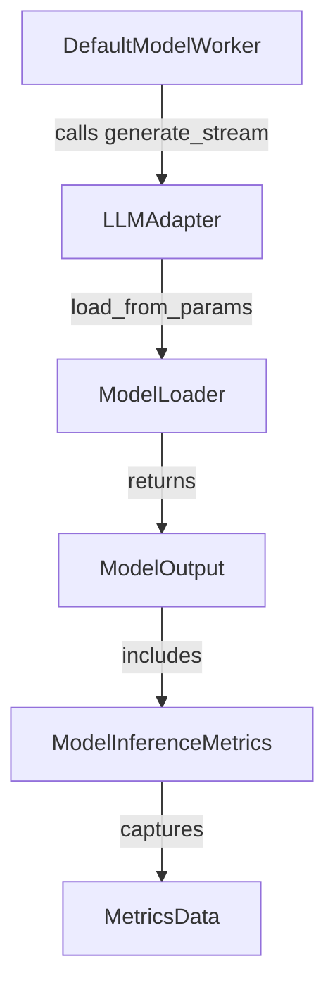
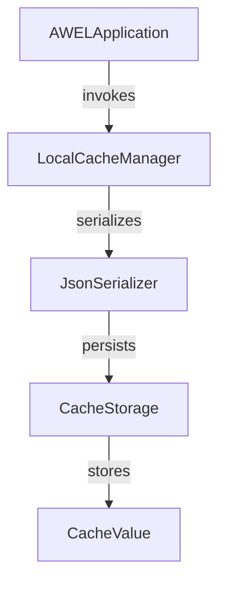
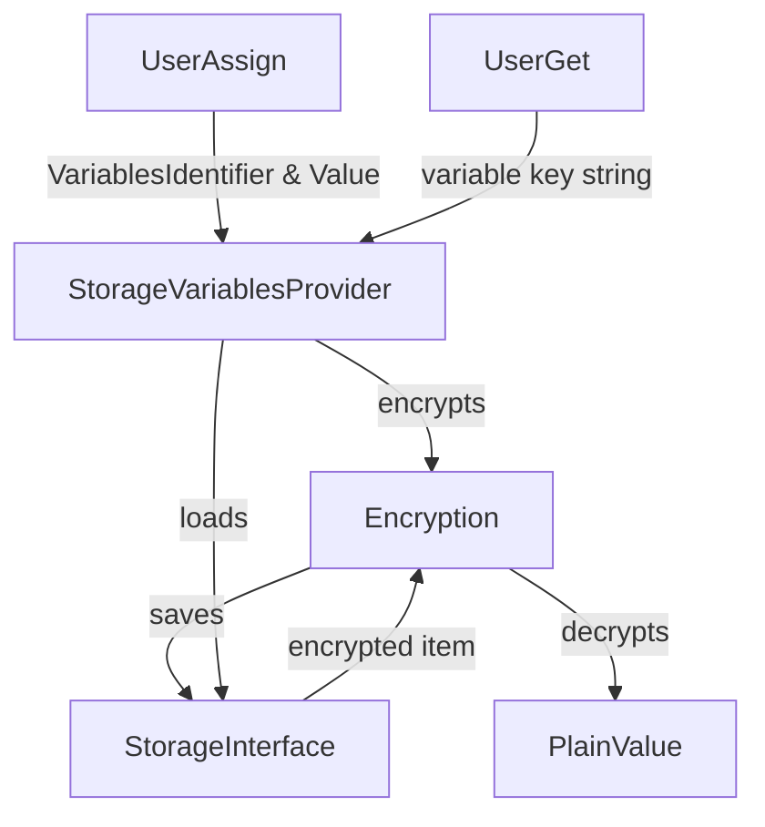
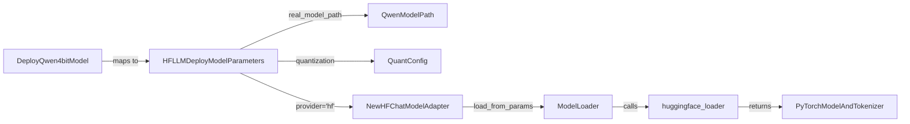

<!-- source: DeepWiki mcp.deepwiki.com · repo eosphoros-ai/DB-GPT · page 2.2 Core Interfaces & Data Models · fetched 2026-11-09 -->

# Core Interfaces & Data Models

Relevant source files

The following files were used as context for generating this wiki page:

- [docs/docs/installation/advanced_usage/multimodal.md](docs/docs/installation/advanced_usage/multimodal.md)
- [docs/static/img/installation/advanced_usage/dbgpt-multimodal-local.jpg](docs/static/img/installation/advanced_usage/dbgpt-multimodal-local.jpg)
- [docs/static/img/installation/advanced_usage/dbgpt-multimodal-proxy.jpg](docs/static/img/installation/advanced_usage/dbgpt-multimodal-proxy.jpg)
- [packages/dbgpt-core/src/dbgpt/core/interface/file.py](packages/dbgpt-core/src/dbgpt/core/interface/file.py)
- [packages/dbgpt-core/src/dbgpt/core/interface/llm.py](packages/dbgpt-core/src/dbgpt/core/interface/llm.py)
- [packages/dbgpt-core/src/dbgpt/core/interface/output_parser.py](packages/dbgpt-core/src/dbgpt/core/interface/output_parser.py)
- [packages/dbgpt-core/src/dbgpt/core/interface/tests/test_file.py](packages/dbgpt-core/src/dbgpt/core/interface/tests/test_file.py)
- [packages/dbgpt-core/src/dbgpt/core/interface/tests/test_output_parser.py](packages/dbgpt-core/src/dbgpt/core/interface/tests/test_output_parser.py)
- [packages/dbgpt-core/src/dbgpt/core/interface/tests/test_variables.py](packages/dbgpt-core/src/dbgpt/core/interface/tests/test_variables.py)
- [packages/dbgpt-core/src/dbgpt/core/interface/variables.py](packages/dbgpt-core/src/dbgpt/core/interface/variables.py)
- [packages/dbgpt-core/src/dbgpt/model/adapter/loader.py](packages/dbgpt-core/src/dbgpt/model/adapter/loader.py)
- [packages/dbgpt-core/src/dbgpt/model/cluster/worker/default_worker.py](packages/dbgpt-core/src/dbgpt/model/cluster/worker/default_worker.py)
- [packages/dbgpt-core/src/dbgpt/model/llm/llm_out/hf_chat_llm.py](packages/dbgpt-core/src/dbgpt/model/llm/llm_out/hf_chat_llm.py)
- [packages/dbgpt-core/src/dbgpt/model/llm/llm_out/vllm_llm.py](packages/dbgpt-core/src/dbgpt/model/llm/llm_out/vllm_llm.py)
- [packages/dbgpt-core/src/dbgpt/model/llm/monkey_patch.py](packages/dbgpt-core/src/dbgpt/model/llm/monkey_patch.py)
- [packages/dbgpt-core/src/dbgpt/model/utils/hf_stream_utils.py](packages/dbgpt-core/src/dbgpt/model/utils/hf_stream_utils.py)
- [packages/dbgpt-core/src/dbgpt/model/utils/llm_metrics.py](packages/dbgpt-core/src/dbgpt/model/utils/llm_metrics.py)
- [packages/dbgpt-core/src/dbgpt/util/tracer/tracer_impl.py](packages/dbgpt-core/src/dbgpt/util/tracer/tracer_impl.py)
- [packages/dbgpt-ext/src/dbgpt_ext/storage/file/oss/oss_storage.py](packages/dbgpt-ext/src/dbgpt_ext/storage/file/oss/oss_storage.py)
- [packages/dbgpt-ext/src/dbgpt_ext/storage/file/s3/s3_storage.py](packages/dbgpt-ext/src/dbgpt_ext/storage/file/s3/s3_storage.py)
- [packages/dbgpt-serve/src/dbgpt_serve/file/serve.py](packages/dbgpt-serve/src/dbgpt_serve/file/serve.py)

## Purpose and Scope

This page documents the foundational interfaces, data models, and contracts primarily located in the `dbgpt-core` package under `dbgpt/core/interface` and associated storage and utility modules (`[packages/dbgpt-core/src/dbgpt/core/interface/llm.py:1-35]()`, `[packages/dbgpt-core/src/dbgpt/core/interface/variables.py:1-40]()`, `[packages/dbgpt-core/src/dbgpt/core/interface/file.py:1-35]()`). These components define unified abstractions and data schemas crucial for DB-GPT's core functionality: LLM inference, messaging, prompts, embeddings, knowledge structures, storage backends, caching layers, file management, variables & secrets, and object serialization. Understanding these interfaces and their implementations is essential when extending or integrating with the DB-GPT framework.

Sources:  
`packages/dbgpt-core/src/dbgpt/core/interface/llm.py:1-35`(),  
`packages/dbgpt-core/src/dbgpt/core/interface/variables.py:1-40`(),  
`packages/dbgpt-core/src/dbgpt/core/interface/file.py:1-35`()

---

## LLM & Inference Interfaces

The LLM subsystem provides the abstract contracts and data models essential to invoke, stream, and monitor large language models asynchronously or synchronously.

### The `LLM` Interface & `ModelInferenceMetrics`

- **Interface Overview**: The base LLM interface (defined in `[packages/dbgpt-core/src/dbgpt/core/interface/llm.py:1-35]()`) specifies how model calls are made, including prompt input, streaming token generation, and obtaining outputs. Implementation classes typically derive from this interface to standardize interaction regardless of backend framework or model type.
- **Performance Metrics Tracking**: `ModelInferenceMetrics` (`[packages/dbgpt-core/src/dbgpt/core/interface/llm.py:32-140]()`) captures runtime data including timestamps (start, first token, first completion, end), token counts (prompt, completion, total), throughput (tokens/s), and GPU memory usage snapshots. These metrics enable detailed analysis of latency, throughput, and resource efficiency for each inference request.

#### Data Flow Diagram: LLM Invocation and Metrics Data Flow

Sources:  
`packages/dbgpt-core/src/dbgpt/core/interface/llm.py:7-185`(),  
`packages/dbgpt-core/src/dbgpt/model/cluster/worker/default_worker.py:35-157`()

---

## Message & Media Models

DB-GPT utilizes a rich set of message abstractions that support multi-turn dialogues, role identification, tool invocation metadata, and multi-modal content like images, audio, and video.

### Core Message Classes

- `BaseMessage`: The fundamental class encapsulating turn index, textual content, role, and other metadata.
- `HumanMessage`, `AIMessage`, `SystemMessage`, `ViewMessage`: Role-specific message subclasses denoting origins such as user, AI, or system processes.
- `ModelMessage`: Designed for LLM server communication, it structures message roles as OpenAI-compatible enums (`"human"`, `"assistant"`, `"system"`), layered content blocks, and tool call metadata.
- Media content classes (`MediaContent`, `MediaObject`) manage multi-modal attachments either as URLs, base64 blobs, or raw bytes.

Sources:  
`packages/dbgpt-core/src/dbgpt/core/interface/llm.py:23-24`(),  
`packages/dbgpt-core/src/dbgpt/model/cluster/worker/default_worker.py:8-13`()

---

## Prompt & Embeddings Interfaces

- **Prompt Interface**: Manages the formatting, templating, and compilation of prompt strings injected into LLM requests, supporting variable substitution and message history reconstruction.
- **Embeddings Interface**: Defines the abstraction for vector embedding generation (`Embeddings`), mapping text documents or queries to dense vector representations consumed by vector stores and RAG retrieval pipelines.

Sources:  
`packages/dbgpt-core/src/dbgpt/core/interface/llm.py:1-30`()

---

## Knowledge & Storage Interfaces

- **Knowledge Interface**: Establishes models for knowledge documents, chunks, and spaces (`Knowledge`, `Document`, `Chunk`), facilitating ingestion, splitting, and vector synchronization.
- **Storage Interfaces**: `StorageInterface` and related specs (`QuerySpec`, `ResourceIdentifier`, `StorageItem`) define CRUD operations and key-value or relational access patterns used across metadata and caching stores (`[packages/dbgpt-core/src/dbgpt/core/interface/file.py:20-27]()`, `[packages/dbgpt-core/src/dbgpt/core/interface/variables.py:18-24]()`).

Sources:  
`packages/dbgpt-core/src/dbgpt/core/interface/file.py:20-27`(),  
`packages/dbgpt-core/src/dbgpt/core/interface/variables.py:18-24`()

---

## OutputParser Interface

The `BaseOutputParser` extends AWEL's `MapOperator`, enabling structured post-processing of LLM outputs (`[packages/dbgpt-core/src/dbgpt/core/interface/output_parser.py:31-62]()`).

Key features include:
- Streaming-aware parsing that removes prompt echoes and trims extraneous tokens (`[packages/dbgpt-core/src/dbgpt/core/interface/output_parser.py:87-121]()`).
- Extraction of embedded JSON code blocks from markdown fences (e.g., triple backticks enclosing JSON) (`[packages/dbgpt-core/src/dbgpt/core/interface/output_parser.py:153-201]()`).
- Flexible parsing both in streaming response mode (`parse_model_stream_resp_ex`) and non-streaming immediate responses (`parse_model_nostream_resp`), raising errors on failure (`[packages/dbgpt-core/src/dbgpt/core/interface/output_parser.py:122-142]()`).
- Built-in code cleanup heuristics to handle common malformed JSON output from LLMs (`[packages/dbgpt-core/src/dbgpt/core/interface/output_parser.py:143-151]()`).

Sources:  
`packages/dbgpt-core/src/dbgpt/core/interface/output_parser.py:31-201`()

---

## File Management System

DB-GPT supports abstracted, pluggable file and storage backends with unified metadata and URI schemes to facilitate persistence, retrieval, and deletion of data files (`[packages/dbgpt-core/src/dbgpt/core/interface/file.py:1-35]()`).

### Key Classes and Concepts

- **`StorageBackend`**: Abstract base for backend implementations with core methods: `save()`, `load()`, `delete()`, `list_files()` (`[packages/dbgpt-core/src/dbgpt/core/interface/file.py:186-219]()`).
- **`FileMetadata`**: Metadata model including file ID, bucket, filename, size, storage type, path, URI, file hash, and extended metadata (`[packages/dbgpt-core/src/dbgpt/core/interface/file.py:55-119]()`).
- **`FileStorageURI`**: Implements the `dbgpt-fs://` URI scheme parsing and serialization (`[packages/dbgpt-core/src/dbgpt/core/interface/file.py:132-184]()`). This encapsulates storage type (e.g., local, OSS, S3), bucket, file ID, optional version, and custom parameters.

Sources:  
`packages/dbgpt-core/src/dbgpt/core/interface/file.py:33-219`()

---

## Cache System

The cache subsystem manages temporary storage of query results, intermediate model outputs, and other ephemeral data to enhance performance.

- `CacheManager` (abstract) defines asynchronous methods: `set()`, `get()` for storing and retrieving cached values keyed by typed cache keys.
- `LocalCacheManager` is a concrete implementation utilizing specified cache storage backends and serializers (e.g., `JsonSerializer`) to serialize cache entries safely.

#### Cache Manager Data Flow Diagram

Sources:  
`packages/dbgpt-core/src/dbgpt/core/interface/file.py:16-27`()

---

## Variables & Secrets Management

DB-GPT offers a secure, flexible variable storage interface with encryption support and scoped variable resolution (`[packages/dbgpt-core/src/dbgpt/core/interface/variables.py:1-40]()`).

### Encryption Abstraction

- `Encryption` (abstract) defines `encrypt(data:str, salt:str) -> str` and `decrypt(encrypted_data:str, salt:str) -> str` (`[packages/dbgpt-core/src/dbgpt/core/interface/variables.py:41-54]()`).
- Implementations:
  - `FernetEncryption`: AES-GCM symmetric encryption using the `cryptography` package (`[packages/dbgpt-core/src/dbgpt/core/interface/variables.py:75-131]()`).
  - `SimpleEncryption`: Lightweight XOR-based encryption for less stringent use cases (`[packages/dbgpt-core/src/dbgpt/core/interface/variables.py:133-166]()`).

### VariablesIdentifier & StorageVariables

- `VariablesIdentifier` parses and constructs string identifiers in the format `${key:name@scope:scope_key#sys_code%user_name}` (`[packages/dbgpt-core/src/dbgpt/core/interface/variables.py:169-198]()`).
- `StorageVariables` encapsulates variable data, type, label, and metadata.
- `StorageVariablesProvider` manages persistence and retrieval, transparently encrypting secrets before storage and decrypting upon retrieval.

#### Variables Encryption Flow Diagram

Sources:  
`packages/dbgpt-core/src/dbgpt/core/interface/variables.py:41-198`()

---

## Serialization Framework

DB-GPT provides robust serialization utilities (such as `JsonSerializer`) to convert complex data structures, interface models, and storage items into storable or transmissible payloads without data loss. These serializers are integrated into storage backends, caching mechanisms, and state persistence pipelines.

Sources:  
`packages/dbgpt-core/src/dbgpt/core/interface/file.py:1-35`()

---

## Natural Language Space ⇔ Code Entity Space Mapping

This section illustrates how key natural language concepts and configuration ideas correspond to implemented code entities within DB-GPT.

### Example 1: Model Deployment & Quantization Support

Sources:  
`packages/dbgpt-core/src/dbgpt/model/adapter/loader.py:57-70`(),  
`packages/dbgpt-core/src/dbgpt/model/cluster/worker/default_worker.py:35-157`()

---

### Example 2: Cache Initialization & Storage Resolution

Sources:  
`packages/dbgpt-core/src/dbgpt/core/interface/file.py:1-25`()

---

