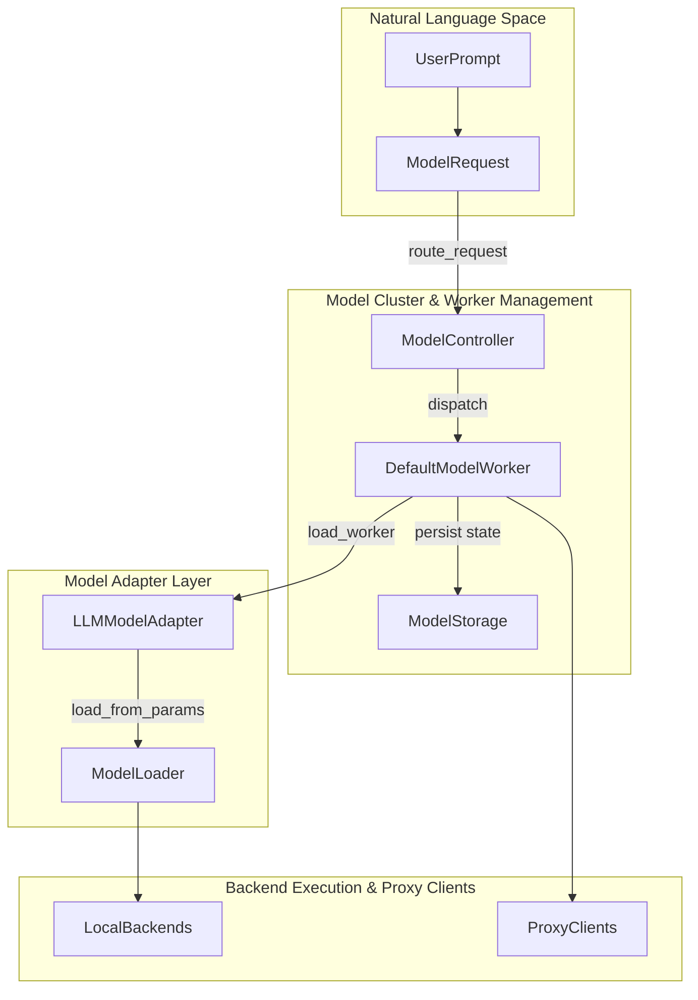
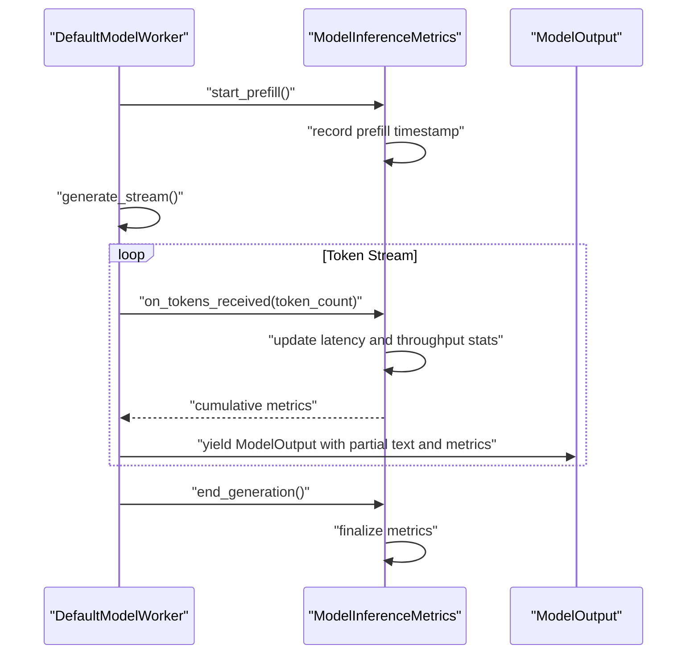

<!-- source: DeepWiki mcp.deepwiki.com · repo eosphoros-ai/DB-GPT · page 3 LLM & Model Management (SMMF) · fetched 2026-11-09 -->

# LLM & Model Management (SMMF)

Relevant source files

The following files were used as context for generating this wiki page:

- [configs/dbgpt-local-mlx.toml](configs/dbgpt-local-mlx.toml)
- [docs/docs/installation/advanced_usage/mlx_inference.md](docs/docs/installation/advanced_usage/mlx_inference.md)
- [docs/yarn.lock](docs/yarn.lock)
- [packages/dbgpt-core/src/dbgpt/model/__init__.py](packages/dbgpt-core/src/dbgpt/model/__init__.py)
- [packages/dbgpt-core/src/dbgpt/model/adapter/base.py](packages/dbgpt-core/src/dbgpt/model/adapter/base.py)
- [packages/dbgpt-core/src/dbgpt/model/adapter/hf_adapter.py](packages/dbgpt-core/src/dbgpt/model/adapter/hf_adapter.py)
- [packages/dbgpt-core/src/dbgpt/model/adapter/mlx_adapter.py](packages/dbgpt-core/src/dbgpt/model/adapter/mlx_adapter.py)
- [packages/dbgpt-core/src/dbgpt/model/adapter/vllm_adapter.py](packages/dbgpt-core/src/dbgpt/model/adapter/vllm_adapter.py)
- [packages/dbgpt-core/src/dbgpt/model/base.py](packages/dbgpt-core/src/dbgpt/model/base.py)
- [packages/dbgpt-core/src/dbgpt/model/llm/llm_out/mlx_llm.py](packages/dbgpt-core/src/dbgpt/model/llm/llm_out/mlx_llm.py)

The **Service-Oriented Multi-Model Management Framework (SMMF)** is the core infrastructure within DB-GPT responsible for orchestrating the lifecycle, management, and serving of large language models (LLMs). It provides a unified, service-oriented architecture that integrates multiple model providers, deployment modes, and runtime environments. The framework supports both local execution and distributed clusters, bridging native backends and proxy cloud LLM providers for flexible usage scenarios.

Sources:  
[packages/dbgpt-core/src/dbgpt/model/proxy/__init__.py:34-72]()

---

## Overview

SMMF is designed to:

- Register and manage multiple LLMs from various providers and deployment contexts via a consistent interface.
- Dynamically load models with configurable device placement, memory usage, quantization, and runtime performance optimizations.
- Serve inference requests through workers supervised by a controller, enabling efficient request routing and concurrency management.
- Support extensive local backends such as vLLM, llama.cpp, HuggingFace Transformers, and MLX, alongside cloud and proxy LLM providers including OpenAI, DeepSeek, Zhipu, Tongyi, MiniMax, LiteLLM, OrcaRouter, SynthorAI, AIMLAPI, BurnCloud, Ollama, among others.
- Provide an OpenAI-compatible REST API server to facilitate client integrations using standardized protocols.

The framework is modular, with adapters encapsulating model-specific inference logic and worker abstractions managing execution lifecycles.

Sources:  
[packages/dbgpt-core/src/dbgpt/model/proxy/__init__.py:34-72]()

---

## Conceptual Architecture

This diagram bridges the natural language abstraction of user prompts with internal code entities managing model loading, execution, and response delivery:

- **UserPrompt & ModelRequest:** Capture and normalize user inputs into requests for inference [packages/dbgpt-core/src/dbgpt/model/proxy/llms/proxy_model.py:1-45]().
- **ModelController & DefaultModelWorker:** Oversee request routing and model execution lifecycle control [packages/dbgpt-core/src/dbgpt/model/cluster/worker/default_worker.py:35-94]().
- **ModelStorage:** Maintains state persistence ensuring robustness and recovery [packages/dbgpt-core/src/dbgpt/model/cluster/storage.py:186-199]().
- **LLMModelAdapter & ModelLoader:** Abstract across diverse model formats and loading parameters including devices and quantization [packages/dbgpt-core/src/dbgpt/model/adapter/base.py:121-202](), [packages/dbgpt-core/src/dbgpt/model/adapter/loader.py:10-70]().
- **Local Backends:** Support various optimized local runtimes including vLLM, llama.cpp, MLX, and HF [packages/dbgpt-core/src/dbgpt/model/adapter/hf_adapter.py:24-113](), [packages/dbgpt-core/src/dbgpt/model/adapter/vllm_adapter.py:20-58](), [packages/dbgpt-core/src/dbgpt/model/adapter/mlx_adapter.py:17-55]().
- **Proxy Clients:** Integrate third-party cloud or vendor LLM endpoints through specialized clients supporting advanced routing [packages/dbgpt-core/src/dbgpt/model/proxy/llms/orcarouter.py:70-149](), [packages/dbgpt-core/src/dbgpt/model/proxy/llms/synthorai.py:70-135]().

Sources:  
[packages/dbgpt-core/src/dbgpt/model/proxy/llms/proxy_model.py:1-45]()  
[packages/dbgpt-core/src/dbgpt/model/cluster/worker/default_worker.py:35-94]()  
[packages/dbgpt-core/src/dbgpt/model/cluster/storage.py:186-199]()  
[packages/dbgpt-core/src/dbgpt/model/adapter/base.py:121-202]()  
[packages/dbgpt-core/src/dbgpt/model/adapter/loader.py:10-70]()  
[packages/dbgpt-core/src/dbgpt/model/adapter/hf_adapter.py:24-113]()  
[packages/dbgpt-core/src/dbgpt/model/adapter/vllm_adapter.py:20-58]()  
[packages/dbgpt-core/src/dbgpt/model/adapter/mlx_adapter.py:17-55]()  
[packages/dbgpt-core/src/dbgpt/model/proxy/llms/orcarouter.py:70-149]()  
[packages/dbgpt-core/src/dbgpt/model/proxy/llms/synthorai.py:70-135]()

---

## Key Features

- **Unified Multi-Model Management**  
  Supports a broad spectrum of inference providers and deployment targets:  
  - Local backends such as vLLM, llama.cpp, HuggingFace Transformers (including chat-optimized variants), and MLX [packages/dbgpt-core/src/dbgpt/model/base.py:12-23]().  
  - Proxy backends including OpenAI API, DeepSeek, Zhipu, Tongyi, MiniMax, LiteLLM, OrcaRouter, SynthorAI, AIMLAPI, BurnCloud, Ollama, etc. [packages/dbgpt-core/src/dbgpt/model/proxy/__init__.py:34-72]().  

- **Flexible Model Loading & Device Configuration**  
  Enables models to be loaded with parameters controlling device (CPU, GPU), quantization mode (4-bit, 8-bit), number of GPUs, memory restrictions, trust flags, and tokenizer options. Parameters are encapsulated in classes like `HFLLMDeployModelParameters` and `VLLMDeployModelParameters` [packages/dbgpt-core/src/dbgpt/model/adapter/hf_adapter.py:20-113](), [packages/dbgpt-core/src/dbgpt/model/adapter/vllm_adapter.py:16-147]().

- **Rich Performance Metrics & Monitoring**  
  `ModelInferenceMetrics` collects detailed latencies (prefill, decode start, decode end), token counts, decoding throughputs, and other timing data for inference requests [packages/dbgpt-core/src/dbgpt/core/interface/llm.py:34-82]().

- **Service-Oriented & Pluggable Architecture**  
  Model adapters, workers, and proxy clients register themselves dynamically into the framework's service registry for discovery and use during runtime workflows [packages/dbgpt-core/src/dbgpt/model/proxy/llms/orcarouter.py:36-43](), [packages/dbgpt-core/src/dbgpt/model/proxy/llms/synthorai.py:36-43]().

- **OpenAI-Compatible API Server**  
  SMMF supports a robust API server compatible with OpenAI's endpoint schema, lowering integration barriers for external clients and SDKs.

Sources:  
[packages/dbgpt-core/src/dbgpt/model/base.py:12-138]()  
[packages/dbgpt-core/src/dbgpt/core/interface/llm.py:34-82]()  
[packages/dbgpt-core/src/dbgpt/model/proxy/__init__.py:34-72]()  
[packages/dbgpt-core/src/dbgpt/model/proxy/llms/orcarouter.py:36-43]()  
[packages/dbgpt-core/src/dbgpt/model/proxy/llms/synthorai.py:36-43]()

---

## Core Subsystems

### 3.1 Local Model Adapters & Workers

This subsystem manages local model inference using adapters for HuggingFace Transformers (including chat models), vLLM, llama.cpp, and MLX. It uses worker classes like `DefaultWorker` and `EmbeddingWorker` that handle model execution lifecycle, loading, quantization, and monkey-patching.

For detailed exploration, see [Local Model Adapters & Workers](#3.1).

Sources:  
[packages/dbgpt-core/src/dbgpt/model/cluster/worker/default_worker.py:35-158]()  
[packages/dbgpt-core/src/dbgpt/model/adapter/loader.py:10-70]()  
[packages/dbgpt-core/src/dbgpt/model/adapter/hf_adapter.py:1-203]()  
[packages/dbgpt-core/src/dbgpt/model/adapter/vllm_adapter.py:1-184]()  
[packages/dbgpt-core/src/dbgpt/model/adapter/mlx_adapter.py:1-126]()

---

### 3.2 Proxy LLM Integrations

This layer handles cloud or remote LLM backends via proxy clients implementing OpenAI-compatible APIs across providers like OpenAI, DeepSeek, Zhipu, Tongyi, MiniMax, LiteLLM, OrcaRouter, SynthorAI, AIMLAPI, BurnCloud, and Ollama.

Key aspects:
- **Dynamic Proxy Registry:** Maintains references to proxy clients loaded at runtime.
- **Routing and Gateway Clients:** Specialized clients such as `OrcaRouterLLMClient` and `SynthoraiLLMClient` route requests to appropriate vendor models [packages/dbgpt-core/src/dbgpt/model/proxy/llms/orcarouter.py:70-149](), [packages/dbgpt-core/src/dbgpt/model/proxy/llms/synthorai.py:70-135]().

For full details, see [Proxy LLM Integrations](#3.2).

Sources:  
[packages/dbgpt-core/src/dbgpt/model/proxy/__init__.py:34-72]()  
[packages/dbgpt-core/src/dbgpt/model/proxy/llms/orcarouter.py:70-149]()  
[packages/dbgpt-core/src/dbgpt/model/proxy/llms/synthorai.py:70-135]()

---

### 3.3 Model Cluster & API Server

SMMF supports distributed, scalable model deployment with components including:
- Controller managing worker orchestration and request routing.
- Worker manager launching and supervising remote worker instances.
- Remote workers performing inference in isolated environments.
- Model registry tracking model availability and health.
- OpenAI-compatible REST API server exposing services externally.
- High-Availability deployment mode with fault tolerance.

See more in [Model Cluster & API Server](#3.3).

Sources:  
[packages/dbgpt-core/src/dbgpt/model/cluster/storage.py:71-199]()

---

## Inference Metrics & Monitoring

The following sequence illustrates how inference metrics are tracked from worker execution through to output monitoring during token streaming:

This structure provides visibility on latency, token counts, throughput, and resource consumption critical for tuning.

Sources:  
[packages/dbgpt-core/src/dbgpt/core/interface/llm.py:34-82]()  
[packages/dbgpt-core/src/dbgpt/model/cluster/worker/default_worker.py:158-188]()

---

## Summary Table of Key Code Entities

| SMMF Component              | Code Path                                            | Description                                                                                      |
|----------------------------|-----------------------------------------------------|--------------------------------------------------------------------------------------------------|
| `ModelInferenceMetrics`    | `dbgpt/core/interface/llm.py`                        | Tracks detailed LLM inference metrics: latencies, token counts, decoding throughput [lines 34-82]() |
| `ModelLoader`               | `dbgpt/model/adapter/loader.py`                      | Responsible for loading models with device, quantization, and environment setup [lines 10-70]()     |
| `DefaultModelWorker`        | `dbgpt/model/cluster/worker/default_worker.py`      | Manages model lifecycle and streaming generation, handles request execution [lines 35-158]()        |
| `ModelStorage`              | `dbgpt/model/cluster/storage.py`                     | Persists startup requests and configuration for worker recovery and synchronization [lines 186-199]() |
| `OrcaRouterLLMClient`       | `dbgpt/model/proxy/llms/orcarouter.py`               | Multi-model routing proxy client supporting hundreds of models under single API gateway [lines 70-149]() |
| `SynthoraiLLMClient`        | `dbgpt/model/proxy/llms/synthorai.py`                | Unified gateway proxy client using simplified model IDs [lines 70-135]()                           |

Sources:  
[packages/dbgpt-core/src/dbgpt/core/interface/llm.py:34-82]()  
[packages/dbgpt-core/src/dbgpt/model/adapter/loader.py:10-70]()  
[packages/dbgpt-core/src/dbgpt/model/cluster/worker/default_worker.py:35-158]()  
[packages/dbgpt-core/src/dbgpt/model/cluster/storage.py:186-199]()  
[packages/dbgpt-core/src/dbgpt/model/proxy/llms/orcarouter.py:70-149]()  
[packages/dbgpt-core/src/dbgpt/model/proxy/llms/synthorai.py:70-135]()

---

## Related Child Pages

- [Local Model Adapters & Workers](#3.1) — Detailed coverage of local adapters for HuggingFace, vLLM, llama.cpp, MLX; worker types; loading, quantization, and patching techniques.
- [Proxy LLM Integrations](#3.2) — Comprehensive guides on cloud and proxy LLM backends; configuration; extension; client implementations.
- [Model Cluster & API Server](#3.3) — Distributed model cluster internals: controller, worker management, remote workers, model registry, OpenAI-compatible server, HA deployments.

Sources:  
[packages/dbgpt-core/src/dbgpt/model/proxy/__init__.py:34-72]()  
[packages/dbgpt-core/src/dbgpt/model/cluster/worker/default_worker.py:35-158]()  
[packages/dbgpt-core/src/dbgpt/model/adapter/loader.py:10-70]()  
[packages/dbgpt-core/src/dbgpt/model/proxy/llms/orcarouter.py:70-149]()  
[packages/dbgpt-core/src/dbgpt/model/proxy/llms/synthorai.py:70-135]()

---

