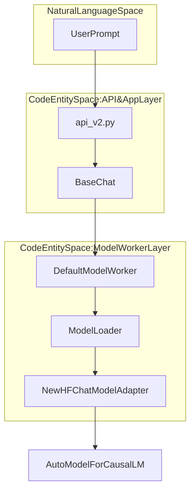
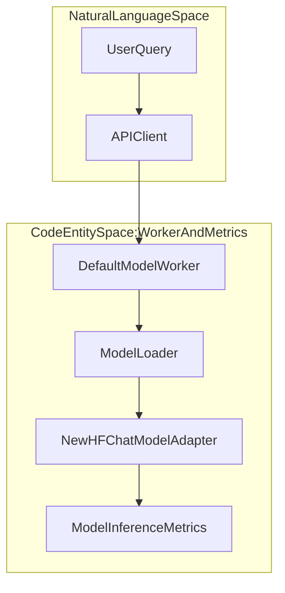
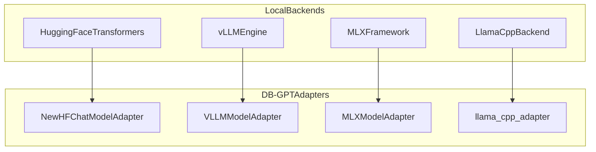

<!-- source: DeepWiki mcp.deepwiki.com · repo eosphoros-ai/DB-GPT · page 3.1 Local Model Adapters & Workers · fetched 2026-11-09 -->

# Local Model Adapters & Workers

Relevant source files

The following files were used as context for generating this wiki page:

- [configs/dbgpt-local-mlx.toml](configs/dbgpt-local-mlx.toml)
- [configs/dbgpt-proxy-burncloud.toml](configs/dbgpt-proxy-burncloud.toml)
- [docs/docs/installation/advanced_usage/mlx_inference.md](docs/docs/installation/advanced_usage/mlx_inference.md)
- [docs/yarn.lock](docs/yarn.lock)
- [packages/dbgpt-core/src/dbgpt/cli/cli_scripts.py](packages/dbgpt-core/src/dbgpt/cli/cli_scripts.py)
- [packages/dbgpt-core/src/dbgpt/configs/model_config.py](packages/dbgpt-core/src/dbgpt/configs/model_config.py)
- [packages/dbgpt-core/src/dbgpt/core/interface/llm.py](packages/dbgpt-core/src/dbgpt/core/interface/llm.py)
- [packages/dbgpt-core/src/dbgpt/model/__init__.py](packages/dbgpt-core/src/dbgpt/model/__init__.py)
- [packages/dbgpt-core/src/dbgpt/model/adapter/base.py](packages/dbgpt-core/src/dbgpt/model/adapter/base.py)
- [packages/dbgpt-core/src/dbgpt/model/adapter/hf_adapter.py](packages/dbgpt-core/src/dbgpt/model/adapter/hf_adapter.py)
- [packages/dbgpt-core/src/dbgpt/model/adapter/loader.py](packages/dbgpt-core/src/dbgpt/model/adapter/loader.py)
- [packages/dbgpt-core/src/dbgpt/model/adapter/mlx_adapter.py](packages/dbgpt-core/src/dbgpt/model/adapter/mlx_adapter.py)
- [packages/dbgpt-core/src/dbgpt/model/adapter/vllm_adapter.py](packages/dbgpt-core/src/dbgpt/model/adapter/vllm_adapter.py)
- [packages/dbgpt-core/src/dbgpt/model/base.py](packages/dbgpt-core/src/dbgpt/model/base.py)
- [packages/dbgpt-core/src/dbgpt/model/cluster/worker/default_worker.py](packages/dbgpt-core/src/dbgpt/model/cluster/worker/default_worker.py)
- [packages/dbgpt-core/src/dbgpt/model/llm/llama_cpp/llama_cpp.py](packages/dbgpt-core/src/dbgpt/model/llm/llama_cpp/llama_cpp.py)
- [packages/dbgpt-core/src/dbgpt/model/llm/llama_cpp/llama_cpp_server.py](packages/dbgpt-core/src/dbgpt/model/llm/llama_cpp/llama_cpp_server.py)
- [packages/dbgpt-core/src/dbgpt/model/llm/llm_out/hf_chat_llm.py](packages/dbgpt-core/src/dbgpt/model/llm/llm_out/hf_chat_llm.py)
- [packages/dbgpt-core/src/dbgpt/model/llm/llm_out/mlx_llm.py](packages/dbgpt-core/src/dbgpt/model/llm/llm_out/mlx_llm.py)
- [packages/dbgpt-core/src/dbgpt/model/llm/llm_out/vllm_llm.py](packages/dbgpt-core/src/dbgpt/model/llm/llm_out/vllm_llm.py)
- [packages/dbgpt-core/src/dbgpt/model/llm/monkey_patch.py](packages/dbgpt-core/src/dbgpt/model/llm/monkey_patch.py)
- [packages/dbgpt-core/src/dbgpt/model/proxy/llms/burncloud.py](packages/dbgpt-core/src/dbgpt/model/proxy/llms/burncloud.py)
- [packages/dbgpt-core/src/dbgpt/model/utils/hf_stream_utils.py](packages/dbgpt-core/src/dbgpt/model/utils/hf_stream_utils.py)
- [packages/dbgpt-core/src/dbgpt/model/utils/llm_metrics.py](packages/dbgpt-core/src/dbgpt/model/utils/llm_metrics.py)
- [packages/dbgpt-core/src/dbgpt/util/dbgpts/cli.py](packages/dbgpt-core/src/dbgpt/util/dbgpts/cli.py)
- [packages/dbgpt-core/src/dbgpt/util/tracer/tracer_impl.py](packages/dbgpt-core/src/dbgpt/util/tracer/tracer_impl.py)

## Purpose and Scope
Local Model Adapters and Workers form a core subsystem within DB-GPT’s **Service-Oriented Multi-Model Management Framework (SMMF)**. They encapsulate local model inference backends such as HuggingFace Transformers, vLLM, llama.cpp, and MLX, providing standardized interfaces for model loading, quantization, inference, and streaming output.

Sources: 
[packages/dbgpt-core/src/dbgpt/model/cluster/worker/default_worker.py:35-176]()  
[packages/dbgpt-core/src/dbgpt/model/adapter/base.py:28-121]()

---

## Architecture Overview

DB-GPT adopts a **worker-adapter pattern** separating model runtime from backend specifics:

- `ModelWorker` instances manage the full lifecycle of a model runtime on local devices, handling loading, device assignment, caching, and streaming inference requests [packages/dbgpt-core/src/dbgpt/model/cluster/worker/default_worker.py:35-176]().
- `LLMModelAdapter` and `EmbeddingModelAdapter` abstract backend specifics for model loading, prompt conversion, quantization, and inference APIs [packages/dbgpt-core/src/dbgpt/model/adapter/base.py:28-121]().

### Data Flow: Request to Local Model Inference

*Figure 1: Request flow from Natural Language prompt through API and model workers to local HuggingFace inference.*

Sources:  
[packages/dbgpt-core/src/dbgpt/model/cluster/worker/default_worker.py:35-176]()  
[packages/dbgpt-core/src/dbgpt/model/adapter/loader.py:57-71]()  
[packages/dbgpt-core/src/dbgpt/model/adapter/hf_adapter.py:115-203]()

---

## Model Adapters

Model Adapters provide uniform access to different local LLM and embedding inference engines by implementing loading, quantization, message templating, and runtime interaction.

### HuggingFace Adapter

`NewHFChatModelAdapter` is the primary adapter for HuggingFace Transformers-based chat models [packages/dbgpt-core/src/dbgpt/model/adapter/hf_adapter.py:115-122](). Key aspects include:

- **Model Parameters (`HFLLMDeployModelParameters`)**: Extends `LLMDeployModelParameters` with fields such as `path`, `device`, `trust_remote_code`, `quantization`, `torch_dtype`, `low_cpu_mem_usage`, `num_gpus`, `max_gpu_memory`, and `attn_implementation` [packages/dbgpt-core/src/dbgpt/model/adapter/hf_adapter.py:24-100]().
- **Model Matching**: `match()` confirms provider type is `"hf"` and calls `do_match()` with normalized model name or path [packages/dbgpt-core/src/dbgpt/model/adapter/hf_adapter.py:126-138]().
- **Dependency Validation**: Ensures `transformers` library is installed and its version is at least `4.34.0` [packages/dbgpt-core/src/dbgpt/model/adapter/hf_adapter.py:149-169]().
- **Model Loading**: Uses `transformers.AutoModelForCausalLM.from_pretrained()` with configured parameters [packages/dbgpt-core/src/dbgpt/model/adapter/hf_adapter.py:171-203]().

Sources:  
[packages/dbgpt-core/src/dbgpt/model/adapter/hf_adapter.py:1-203]()

### Supported Local Backend Adapters

| Backend         | Description                            | Adapter Class & File                                                        |
|-----------------|------------------------------------|----------------------------------------------------------------------------|
| HuggingFace HF  | HuggingFace Transformers-based chat model wrapper | `NewHFChatModelAdapter` in `packages/dbgpt-core/src/dbgpt/model/adapter/hf_adapter.py` [115-122]() |
| vLLM            | High-throughput async LLM inference engine           | `VLLMModelAdapter` in `packages/dbgpt-core/src/dbgpt/model/adapter/vllm_adapter.py` [20-58]()         |
| MLX             | Apple Silicon-optimized model inference               | `MLXModelAdapter` in `packages/dbgpt-core/src/dbgpt/model/adapter/mlx_adapter.py` [57-123]()          |
| llama.cpp       | Local C++ backend for LLaMA-family models             | Custom adapters/workers under `packages/dbgpt-core/src/dbgpt/model/llm/llama_cpp/`                    |

Sources:  
[packages/dbgpt-core/src/dbgpt/model/adapter/hf_adapter.py:115-122]()  
[packages/dbgpt-core/src/dbgpt/model/adapter/vllm_adapter.py:20-58]()  
[packages/dbgpt-core/src/dbgpt/model/adapter/mlx_adapter.py:57-123]()

### Embedding & Reranker Adapters

- `EmbeddingModelAdapter` is an abstract base class defining interfaces for loading embedding or reranker models that produce vector embeddings or relevance scores [packages/dbgpt-core/src/dbgpt/model/adapter/base.py:28-115]().

Sources:  
[packages/dbgpt-core/src/dbgpt/model/adapter/base.py:28-115]()

---

## Model Workers

Model Workers are dedicated asynchronous runtimes managing the entire lifecycle and inference process of local models.

### DefaultModelWorker

`DefaultModelWorker` is the primary local worker implementing in-process inference management for models loaded with adapters [packages/dbgpt-core/src/dbgpt/model/cluster/worker/default_worker.py:35-176]().

- **Initialization**: Sets `model_name`, `model_path`, `device`, tokenizer with fallback to `TiktokenProxyTokenizer`, and `context_len` [packages/dbgpt-core/src/dbgpt/model/cluster/worker/default_worker.py:36-50]().
- **Loading**: `load_worker()` verifies model parameters, determines real device and paths, and acquires the `LLMModelAdapter` [packages/dbgpt-core/src/dbgpt/model/cluster/worker/default_worker.py:51-83]().
- **Starting**: Invokes `ModelLoader.loader_with_params()` wrapped in distributed tracing spans [packages/dbgpt-core/src/dbgpt/model/cluster/worker/default_worker.py:104-147]().
- **Stopping**: Releases model references and clears GPU cache via `_clear_model_cache()` [packages/dbgpt-core/src/dbgpt/model/cluster/worker/default_worker.py:148-157]().
- **Streaming Generation**: `generate_stream()` yields incremental `ModelOutput` objects and tracks latency and throughput via `ModelInferenceMetrics` [packages/dbgpt-core/src/dbgpt/model/cluster/worker/default_worker.py:158-176]().

Sources:  
[packages/dbgpt-core/src/dbgpt/model/cluster/worker/default_worker.py:35-176]()  
[packages/dbgpt-core/src/dbgpt/core/interface/llm.py:34-136]()

### ModelLoader & Quantization Handling

`ModelLoader` handles low-level model loading details, device detection, and quantization [packages/dbgpt-core/src/dbgpt/model/adapter/loader.py:57-71]().

- **Device Setup**: Detects device (CPU, CUDA, MPS) and configures multi-GPU allocation [packages/dbgpt-core/src/dbgpt/model/adapter/loader.py:67-122]().
- **Monkey-Patching for MPS**: On MPS devices with older `transformers` versions (<4.35.0), applies `replace_llama_attn_with_non_inplace_operations()` [packages/dbgpt-core/src/dbgpt/model/adapter/loader.py:123-136]().
- **Quantization Handling**: Checks and loads 4-bit or 8-bit quantized weights on CUDA [packages/dbgpt-core/src/dbgpt/model/adapter/loader.py:23-40, 163-179]().

Sources:  
[packages/dbgpt-core/src/dbgpt/model/adapter/loader.py:23-40, 57-190]()

---

## Inference & Metrics Mapping

*Figure 2: Mapping from user query to worker inference execution and performance metrics collection.*

Sources:  
[packages/dbgpt-core/src/dbgpt/model/cluster/worker/default_worker.py:35-176]()  
[packages/dbgpt-core/src/dbgpt/model/adapter/loader.py:57-71]()  
[packages/dbgpt-core/src/dbgpt/core/interface/llm.py:34-136]()

---

## Model Adapters Mapping

*Figure 3: Mapping from local inference backends to DB-GPT adapter classes.*

Sources:  
[packages/dbgpt-core/src/dbgpt/model/adapter/hf_adapter.py:115-122]()  
[packages/dbgpt-core/src/dbgpt/model/adapter/vllm_adapter.py:20-58]()  
[packages/dbgpt-core/src/dbgpt/model/adapter/mlx_adapter.py:57-123]()

---

## Message & Content Abstractions

DB-GPT defines uniform message models bridging user frontends, API routers, workers, and model adapters:

- `ModelMessage` defines standard message structures passed between servers and LLM workers with roles like `system`, `human`, `ai`, `view`, and `tool` [packages/dbgpt-core/src/dbgpt/core/interface/message.py]().

Sources:  
[packages/dbgpt-core/src/dbgpt/core/interface/message.py]()

---

