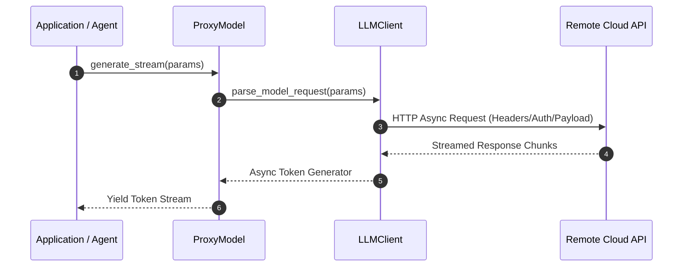

<!-- source: DeepWiki mcp.deepwiki.com · repo eosphoros-ai/DB-GPT · page 3.2 Proxy LLM Integrations · fetched 2026-11-09 -->

# Proxy LLM Integrations

<details>
<summary>Relevant source files</summary>

The following files were used as context for generating this wiki page:

- [configs/dbgpt-local-qwen3.example.toml](configs/dbgpt-local-qwen3.example.toml)
- [configs/dbgpt-proxy-infiniai.toml](configs/dbgpt-proxy-infiniai.toml)
- [configs/dbgpt-proxy-litellm.toml](configs/dbgpt-proxy-litellm.toml)
- [configs/dbgpt-proxy-orcarouter.toml](configs/dbgpt-proxy-orcarouter.toml)
- [configs/dbgpt-proxy-synthorai.toml](configs/dbgpt-proxy-synthorai.toml)
- [docs/docs/installation/integrations/orcarouter_llm_install.md](docs/docs/installation/integrations/orcarouter_llm_install.md)
- [docs/docs/installation/integrations/synthorai_llm_install.md](docs/docs/installation/integrations/synthorai_llm_install.md)
- [packages/dbgpt-core/src/dbgpt/model/adapter/embed_metadata.py](packages/dbgpt-core/src/dbgpt/model/adapter/embed_metadata.py)
- [packages/dbgpt-core/src/dbgpt/model/proxy/__init__.py](packages/dbgpt-core/src/dbgpt/model/proxy/__init__.py)
- [packages/dbgpt-core/src/dbgpt/model/proxy/llms/infiniai.py](packages/dbgpt-core/src/dbgpt/model/proxy/llms/infiniai.py)
- [packages/dbgpt-core/src/dbgpt/model/proxy/llms/litellm.py](packages/dbgpt-core/src/dbgpt/model/proxy/llms/litellm.py)
- [packages/dbgpt-core/src/dbgpt/model/proxy/llms/minimax.py](packages/dbgpt-core/src/dbgpt/model/proxy/llms/minimax.py)
- [packages/dbgpt-core/src/dbgpt/model/proxy/llms/orcarouter.py](packages/dbgpt-core/src/dbgpt/model/proxy/llms/orcarouter.py)
- [packages/dbgpt-core/src/dbgpt/model/proxy/llms/synthorai.py](packages/dbgpt-core/src/dbgpt/model/proxy/llms/synthorai.py)
- [packages/dbgpt-core/src/dbgpt/model/proxy/tests/__init__.py](packages/dbgpt-core/src/dbgpt/model/proxy/tests/__init__.py)
- [packages/dbgpt-core/src/dbgpt/model/proxy/tests/test_litellm.py](packages/dbgpt-core/src/dbgpt/model/proxy/tests/test_litellm.py)
- [packages/dbgpt-core/src/dbgpt/model/proxy/tests/test_minimax.py](packages/dbgpt-core/src/dbgpt/model/proxy/tests/test_minimax.py)
- [packages/dbgpt-core/src/dbgpt/rag/embedding/__init__.py](packages/dbgpt-core/src/dbgpt/rag/embedding/__init__.py)
- [packages/dbgpt-core/src/dbgpt/rag/embedding/embeddings.py](packages/dbgpt-core/src/dbgpt/rag/embedding/embeddings.py)
- [packages/dbgpt-core/src/dbgpt/rag/embedding/rerank.py](packages/dbgpt-core/src/dbgpt/rag/embedding/rerank.py)
- [tests/intetration_tests/datasource/test_conn_starrocks.py](tests/intetration_tests/datasource/test_conn_starrocks.py)

</details>


The Proxy LLM Integration layer in DB-GPT enables connecting to cloud-based and gateway-managed Large Language Model (LLM) backends — including OpenAI, DeepSeek, Claude, MiniMax, Gemini, Moonshot, Tongyi, Wenxin, SiliconFlow, SynthorAI, OrcaRouter, LiteLLM, Ollama, AIMLAPI, BurnCloud, and others — without requiring local GPU hardware. The subsystem abstracts diverse proprietary APIs behind a unified adapter interface, standardizing configuration, authentication, request serialization, and async streaming.

Sources: [`packages/dbgpt-core/src/dbgpt/model/proxy/__init__.py:1-102`](), [`packages/dbgpt-core/src/dbgpt/model/proxy/llms/minimax.py:1-197`](), [`packages/dbgpt-core/src/dbgpt/model/proxy/llms/litellm.py:1-183`]()

## Architecture and Data Flow

### Overview

Proxy models operate as part of the Service-Oriented Multi-Model Management Framework (SMMF). Unlike local inference workers (e.g., `DefaultWorker`), proxy models delegate execution to remote cloud endpoints via specialized client wrappers.

At runtime, `ProxyModel` acts as the facade. It processes incoming generation requests and routes them to a specific `LLMClient` implementation. Each client manages provider-specific concerns:
- Base URL resolution and API versioning
- Authentication headers and keys
- Request payload construction and parameter clamping (e.g., temperature bounds)
- Asynchronous response streaming (`generate_stream`)

Most third-party clients inherit from `OpenAILLMClient` when exposing OpenAI-compatible REST endpoints.

### Key Classes and Functions

- `ProxyModel` (`dbgpt.model.proxy.llms.proxy_model.ProxyModel`) — Orchestrates proxy request execution and client delegation.
- `OpenAILLMClient` (`dbgpt.model.proxy.llms.chatgpt.OpenAILLMClient`) — Base class for OpenAI-compatible proxy clients.
- `MiniMaxLLMClient` (`dbgpt.model.proxy.llms.minimax.MiniMaxLLMClient`) — MiniMax proxy client with custom temperature clamping [`packages/dbgpt-core/src/dbgpt/model/proxy/llms/minimax.py:69-118`]().
- `OrcaRouterLLMClient` (`dbgpt.model.proxy.llms.orcarouter.OrcaRouterLLMClient`) — Multi-model gateway client supporting 150+ models [`packages/dbgpt-core/src/dbgpt/model/proxy/llms/orcarouter.py:70-132`]().
- `SynthoraiLLMClient` (`dbgpt.model.proxy.llms.synthorai.SynthoraiLLMClient`) — Synthorai gateway client using bare model IDs [`packages/dbgpt-core/src/dbgpt/model/proxy/llms/synthorai.py:70-128`]().
- `LiteLLMClient` (`dbgpt.model.proxy.llms.litellm.LiteLLMClient`) — Embedded LiteLLM gateway client.
- `parse_model_request` — Normalizes parameters into `ModelRequest` objects [`packages/dbgpt-core/src/dbgpt/model/proxy/llms/minimax.py:60-66`]().

### Data Flow Diagram: User Request to Proxy LLM

```mermaid
flowchart TD
    UserRequest[""User Request: Generate Text""]
    ProxyModel[""ProxyModel [dbgpt.model.proxy.llms.proxy_model.ProxyModel]""]
    LLMClient[""LLMClient [dbgpt.model.proxy.llms.base.LLMClient]""]
    RemoteAPI[""Third-party LLM API Endpoint""]
    StreamOutput[""Streaming Output""]
    ResponseApp[""Application Receives Response""]

    UserRequest --> ProxyModel
    ProxyModel --> LLMClient
    LLMClient --> RemoteAPI
    RemoteAPI --> StreamOutput
    StreamOutput --> ProxyModel
    ProxyModel --> ResponseApp
```

Sources: [`packages/dbgpt-core/src/dbgpt/model/proxy/llms/minimax.py:60-66`](), [`packages/dbgpt-core/src/dbgpt/model/proxy/llms/litellm.py:87-94`]()

## Bridge Diagram: Natural Language Intent to Code Entities and Configuration Files

This diagram maps natural language configuration intent to implementing client classes, proxy models, and TOML configuration files.

```mermaid
graph TD
    subgraph "NaturalLanguageSpace"
        MiniMax[""Use MiniMax M3""]
        DeepSeek[""Configure DeepSeek""]
        Ollama[""Deploy Ollama Llama3""]
        Tongyi[""Use Tongyi Qwen""]
        LiteLLM[""Route through LiteLLM""]
        OrcaRouter[""Use OrcaRouter""]
        SynthorAI[""Use Synthorai""]
    end

    subgraph "CodeEntitySpace"
        MiniMaxClient[""MiniMaxLLMClient [dbgpt.model.proxy.llms.minimax.MiniMaxLLMClient]""]
        DeepSeekClient[""DeepseekLLMClient [dbgpt.model.proxy.llms.deepseek.DeepseekLLMClient]""]
        OllamaClient[""OllamaLLMClient [dbgpt.model.proxy.llms.ollama.OllamaLLMClient]""]
        ProxyModel[""ProxyModel [dbgpt.model.proxy.llms.proxy_model.ProxyModel]""]
        TongyiClient[""TongyiLLMClient [dbgpt.model.proxy.llms.tongyi.TongyiLLMClient]""]
        LiteLLMClient[""LiteLLMClient [dbgpt.model.proxy.llms.litellm.LiteLLMClient]""]
        OrcaRouterClient[""OrcaRouterLLMClient [dbgpt.model.proxy.llms.orcarouter.OrcaRouterLLMClient]""]
        SynthorAIClient[""SynthoraiLLMClient [dbgpt.model.proxy.llms.synthorai.SynthoraiLLMClient]""]
    end

    subgraph "ConfigurationSpace"
        ConfMiniMax[""dbgpt-proxy-minimax.toml""]
        ConfDeepSeek[""dbgpt-proxy-deepseek.toml""]
        ConfOllama[""dbgpt-proxy-ollama.toml""]
        ConfTongyi[""dbgpt-proxy-tongyi.toml""]
        ConfLiteLLM[""dbgpt-proxy-litellm.toml""]
        ConfOrcaRouter[""dbgpt-proxy-orcarouter.toml""]
        ConfSynthorAI[""dbgpt-proxy-synthorai.toml""]
    end

    MiniMax --> MiniMaxClient
    DeepSeek --> DeepSeekClient
    Ollama --> OllamaClient
    Tongyi --> TongyiClient
    LiteLLM --> LiteLLMClient
    OrcaRouter --> OrcaRouterClient
    SynthorAI --> SynthorAIClient

    MiniMaxClient --> ProxyModel
    DeepSeekClient --> ProxyModel
    OllamaClient --> ProxyModel
    TongyiClient --> ProxyModel
    LiteLLMClient --> ProxyModel
    OrcaRouterClient --> ProxyModel
    SynthorAIClient --> ProxyModel

    ConfMiniMax -.-> MiniMaxClient
    ConfDeepSeek -.-> DeepSeekClient
    ConfOllama -.-> OllamaClient
    ConfTongyi -.-> TongyiClient
    ConfLiteLLM -.-> LiteLLMClient
    ConfOrcaRouter -.-> OrcaRouterClient
    ConfSynthorAI -.-> SynthorAIClient
```

Sources: [`packages/dbgpt-core/src/dbgpt/model/proxy/__init__.py:34-72`](), [`packages/dbgpt-core/src/dbgpt/model/proxy/llms/minimax.py:30-69`](), [`configs/dbgpt-proxy-orcarouter.toml:1-24`](), [`configs/dbgpt-proxy-synthorai.toml:1-24`]()

## Supported Proxy LLM Providers and Configuration Reference

Proxy clients are dynamically loaded via lazy importing in `dbgpt.model.proxy.__init__.py` [`packages/dbgpt-core/src/dbgpt/model/proxy/__init__.py:34-72`]. Below is the registry of supported proxy providers:

| Provider | Client Class | Deploy Parameter Class | Key Notes |
|---|---|---|---|
| **OpenAI** | `OpenAILLMClient` | `OpenAICompatibleDeployModelParameters` | Baseline OpenAI-compatible client. |
| **DeepSeek** | `DeepseekLLMClient` | `DeepSeekDeployModelParameters` | Supports reasoning and thinking modes via custom headers. |
| **Claude** | `ClaudeLLMClient` | `ClaudeDeployModelParameters` | Anthropic Claude models. |
| **Gemini** | `GeminiLLMClient` | `GeminiDeployModelParameters` | Google Gemini API integration. |
| **MiniMax** | `MiniMaxLLMClient` | `MiniMaxDeployModelParameters` | Clamps temperature to `(0.0, 1.0]` [`packages/dbgpt-core/src/dbgpt/model/proxy/llms/minimax.py:134-145`()]. |
| **LiteLLM** | `LiteLLMClient` | `LiteLLMDeployModelParameters` | Multi-provider router using `litellm.acompletion`. |
| **OrcaRouter** | `OrcaRouterLLMClient` | `OrcaRouterDeployModelParameters` | Gateway supporting 150+ models with vendor prefixes [`packages/dbgpt-core/src/dbgpt/model/proxy/llms/orcarouter.py:70-78`()]. |
| **SynthorAI** | `SynthoraiLLMClient` | `SynthoraiDeployModelParameters` | Unified gateway using bare model IDs (`claude-opus-5`) [`packages/dbgpt-core/src/dbgpt/model/proxy/llms/synthorai.py:70-79`()]. |
| **Ollama** | `OllamaLLMClient` | `OllamaDeployModelParameters` | Local Ollama container proxy. |
| **Zhipu** | `ZhipuLLMClient` | `ZhipuDeployModelParameters` | Zhipu GLM integration. |
| **Tongyi** | `TongyiLLMClient` | `TongyiDeployModelParameters` | Aliyun Qwen models. |
| **AIMLAPI** | `AimlapiLLMClient` | `AimlapiDeployModelParameters` | Multi-model cloud API provider. |
| **BurnCloud** | `BurnCloudLLMClient` | `BurnCloudDeployModelParameters` | Cloud proxy backend. |

Sources: [`packages/dbgpt-core/src/dbgpt/model/proxy/__init__.py:34-72`](), [`packages/dbgpt-core/src/dbgpt/model/proxy/llms/minimax.py:30-58`](), [`packages/dbgpt-core/src/dbgpt/model/proxy/llms/litellm.py:41-84`]()

## Selected Client Implementations and Highlights

### MiniMax LLM Client
- Inherits from `OpenAILLMClient` [`packages/dbgpt-core/src/dbgpt/model/proxy/llms/minimax.py:69-75`()].
- Enforces temperature parameter clamping to ensure values fall within `(0.0, 1.0]` (disallowing `0`) [`packages/dbgpt-core/src/dbgpt/model/proxy/llms/minimax.py:134-145`()].
- Registers `"MiniMax-M3"`, `"MiniMax-M2.7"`, and `"MiniMax-M2.7-highspeed"` with 204800 context lengths [`packages/dbgpt-core/src/dbgpt/model/proxy/llms/minimax.py:160-197`()].

### LiteLLM Client
- Routes generation calls directly through `litellm.acompletion`.
- Automatically handles fallback credentials from environment variables and supports parameter filtering.

### OrcaRouter & Synthorai Gateways
- **OrcaRouterLLMClient**: Sends `"X-Title": "DB GPT"` headers and routes 150+ models retaining vendor prefixes (`openai/gpt-4o`, `deepseek/deepseek-chat`) [`packages/dbgpt-core/src/dbgpt/model/proxy/llms/orcarouter.py:21-78`]().
- **SynthoraiLLMClient**: Integrates multi-vendor models using bare model IDs (e.g. `claude-opus-5`, `deepseek-v4-pro`) with specialized parameter pass-through in `new_client` [`packages/dbgpt-core/src/dbgpt/model/proxy/llms/synthorai.py:70-161`()].

Sources: [`packages/dbgpt-core/src/dbgpt/model/proxy/llms/minimax.py:69-145`](), [`packages/dbgpt-core/src/dbgpt/model/proxy/llms/litellm.py:96-156`](), [`packages/dbgpt-core/src/dbgpt/model/proxy/llms/orcarouter.py:21-78`](), [`packages/dbgpt-core/src/dbgpt/model/proxy/llms/synthorai.py:70-161`]()

## Request Handling Lifecycle



Sources: [`packages/dbgpt-core/src/dbgpt/model/proxy/llms/minimax.py:60-67`](), [`packages/dbgpt-core/src/dbgpt/model/proxy/llms/litellm.py:87-94`]()

## Extending Proxy LLM Backends

To add a new proxy LLM provider:
1. **Define Deploy Parameters:** Create a dataclass inheriting from `OpenAICompatibleDeployModelParameters` and decorate with `@auto_register_resource` [`packages/dbgpt-core/src/dbgpt/model/proxy/llms/minimax.py:30-38`].
2. **Implement Client Class:** Subclass `OpenAILLMClient` or `ProxyLLMClient`, overriding request formatting or stream generation if needed [`packages/dbgpt-core/src/dbgpt/model/proxy/llms/minimax.py:69-118`].
3. **Register Metadata:** Use `register_proxy_model_adapter` to link the client to supported model definitions and context windows [`packages/dbgpt-core/src/dbgpt/model/proxy/llms/minimax.py:160-197`].
4. **Register Lazy Import:** Expose the client in `dbgpt.model.proxy.__init__.py` [`packages/dbgpt-core/src/dbgpt/model/proxy/__init__.py:34-72`].

Sources: [`packages/dbgpt-core/src/dbgpt/model/proxy/__init__.py:34-72`](), [`packages/dbgpt-core/src/dbgpt/model/proxy/llms/minimax.py:30-197`]()

## References and Source Files

- Proxy module lazy loading: [`packages/dbgpt-core/src/dbgpt/model/proxy/__init__.py:1-102`]()
- MiniMax client implementation: [`packages/dbgpt-core/src/dbgpt/model/proxy/llms/minimax.py:1-197`]()
- LiteLLM client implementation: [`packages/dbgpt-core/src/dbgpt/model/proxy/llms/litellm.py:1-183`]()
- OrcaRouter client implementation: [`packages/dbgpt-core/src/dbgpt/model/proxy/llms/orcarouter.py:20-150`]()
- Synthorai client implementation: [`packages/dbgpt-core/src/dbgpt/model/proxy/llms/synthorai.py:21-172`]()
- Configuration templates: [`configs/dbgpt-proxy-orcarouter.toml:1-24`](), [`configs/dbgpt-proxy-synthorai.toml:1-24`]()

---

