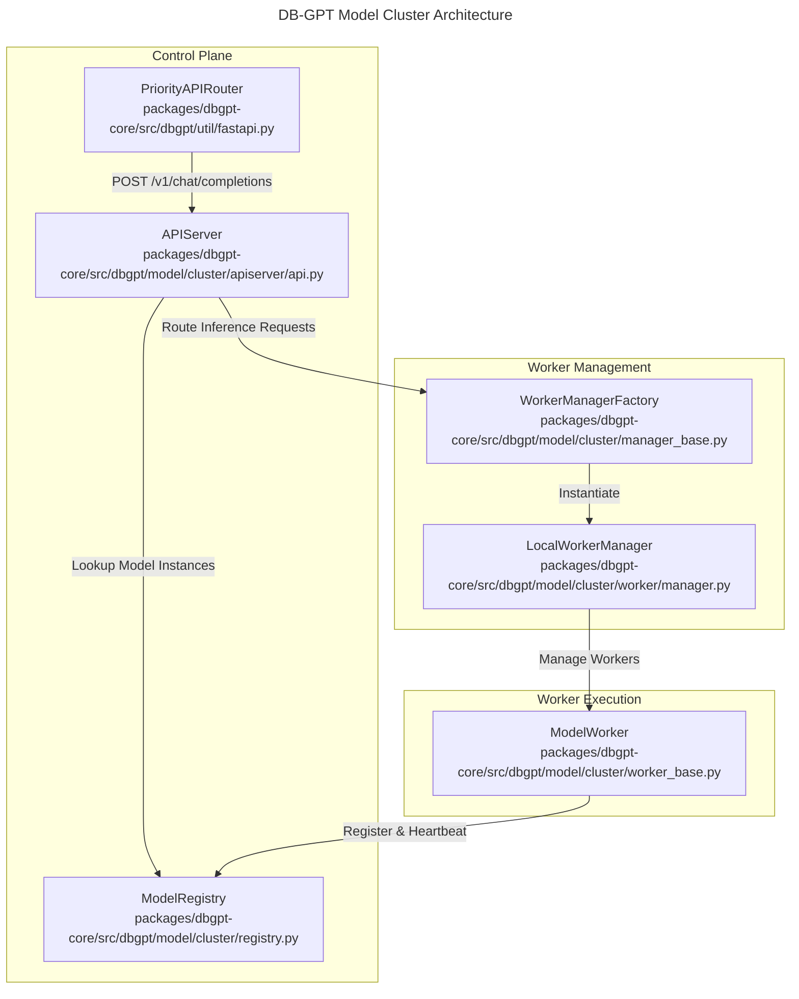
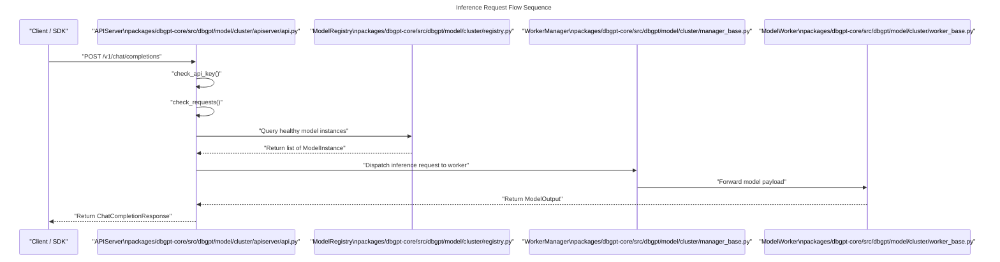
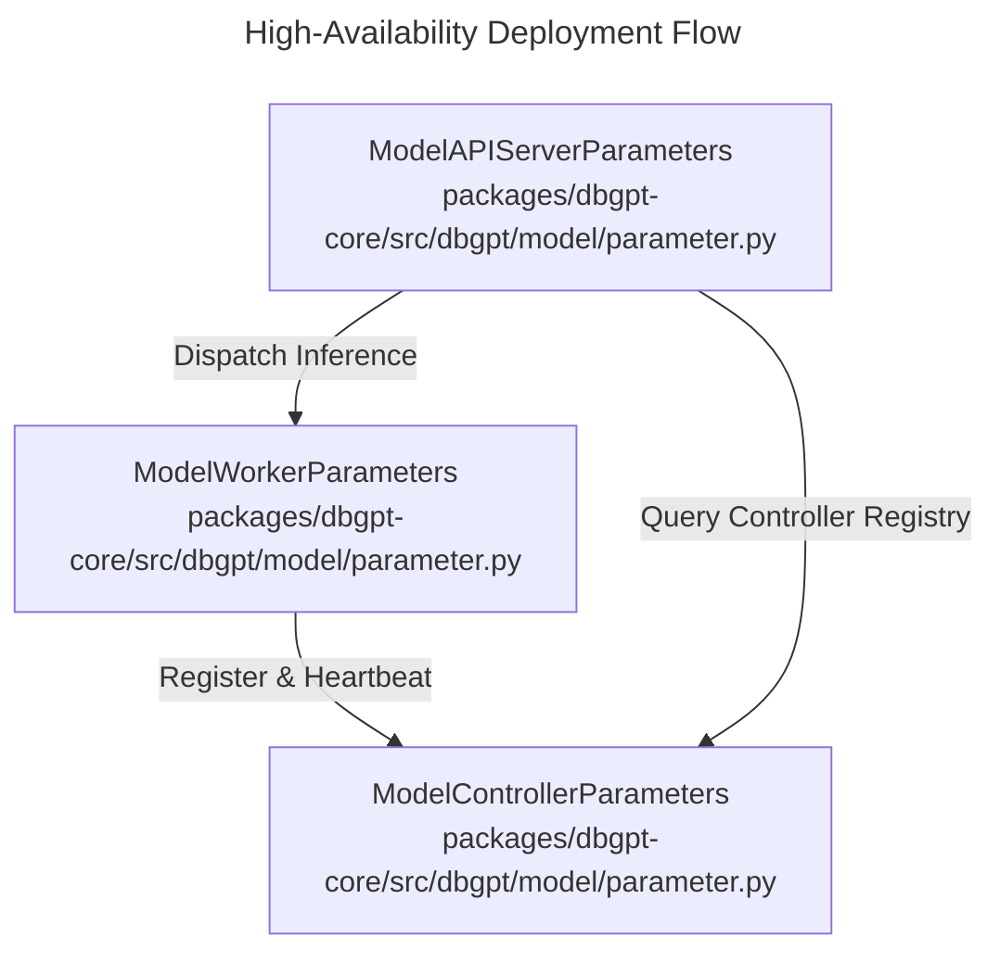
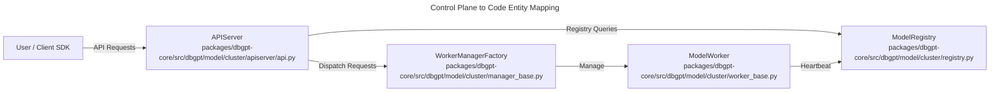
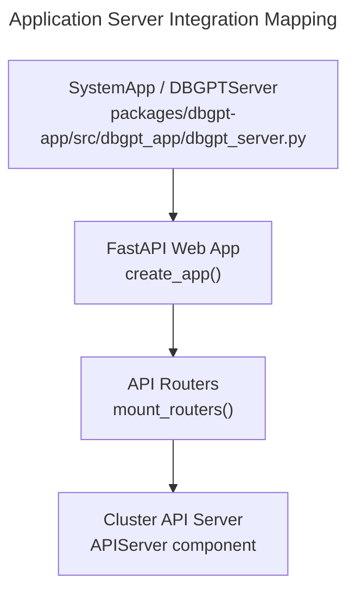

<!-- source: DeepWiki mcp.deepwiki.com · repo eosphoros-ai/DB-GPT · page 3.3 Model Cluster & API Server · fetched 2026-11-09 -->

# Model Cluster & API Server

Relevant source files

The following files were used as context for generating this wiki page:

- [configs/dbgpt-app-config.example.toml](configs/dbgpt-app-config.example.toml)
- [configs/dbgpt-proxy-openai.toml](configs/dbgpt-proxy-openai.toml)
- [configs/dbgpt-proxy-siliconflow-mysql.toml](configs/dbgpt-proxy-siliconflow-mysql.toml)
- [configs/dbgpt-proxy-siliconflow.toml](configs/dbgpt-proxy-siliconflow.toml)
- [configs/dbgpt-proxy-tongyi.toml](configs/dbgpt-proxy-tongyi.toml)
- [docker/base/run_sqlite.sh](docker/base/run_sqlite.sh)
- [docker/compose_examples/cluster-docker-compose.yml](docker/compose_examples/cluster-docker-compose.yml)
- [docs/docs/installation/advanced_usage/OpenAI_SDK_call.md](docs/docs/installation/advanced_usage/OpenAI_SDK_call.md)
- [docs/docs/installation/advanced_usage/vLLM_inference.md](docs/docs/installation/advanced_usage/vLLM_inference.md)
- [docs/docs/installation/model_service/cluster.md](docs/docs/installation/model_service/cluster.md)
- [docs/docs/installation/model_service/stand_alone.md](docs/docs/installation/model_service/stand_alone.md)
- [packages/dbgpt-app/src/dbgpt_app/config.py](packages/dbgpt-app/src/dbgpt_app/config.py)
- [packages/dbgpt-app/src/dbgpt_app/dbgpt_server.py](packages/dbgpt-app/src/dbgpt_app/dbgpt_server.py)
- [packages/dbgpt-app/src/dbgpt_app/initialization/app_initialization.py](packages/dbgpt-app/src/dbgpt_app/initialization/app_initialization.py)
- [packages/dbgpt-app/src/dbgpt_app/scene/__init__.py](packages/dbgpt-app/src/dbgpt_app/scene/__init__.py)
- [packages/dbgpt-app/src/dbgpt_app/scene/base.py](packages/dbgpt-app/src/dbgpt_app/scene/base.py)
- [packages/dbgpt-app/src/dbgpt_app/scene/base_chat.py](packages/dbgpt-app/src/dbgpt_app/scene/base_chat.py)
- [packages/dbgpt-app/src/dbgpt_app/scene/chat_dashboard/chat.py](packages/dbgpt-app/src/dbgpt_app/scene/chat_dashboard/chat.py)
- [packages/dbgpt-core/src/dbgpt/agent/resource/tool/autogpt/plugins_util.py](packages/dbgpt-core/src/dbgpt/agent/resource/tool/autogpt/plugins_util.py)
- [packages/dbgpt-core/src/dbgpt/core/awel/dag/base.py](packages/dbgpt-core/src/dbgpt/core/awel/dag/base.py)
- [packages/dbgpt-core/src/dbgpt/model/cluster/apiserver/api.py](packages/dbgpt-core/src/dbgpt/model/cluster/apiserver/api.py)
- [packages/dbgpt-core/src/dbgpt/model/cluster/worker/manager.py](packages/dbgpt-core/src/dbgpt/model/cluster/worker/manager.py)
- [packages/dbgpt-core/src/dbgpt/model/parameter.py](packages/dbgpt-core/src/dbgpt/model/parameter.py)
- [packages/dbgpt-core/src/dbgpt/model/proxy/base.py](packages/dbgpt-core/src/dbgpt/model/proxy/base.py)
- [packages/dbgpt-core/src/dbgpt/model/utils/token_utils.py](packages/dbgpt-core/src/dbgpt/model/utils/token_utils.py)
- [packages/dbgpt-core/src/dbgpt/util/fastapi.py](packages/dbgpt-core/src/dbgpt/util/fastapi.py)
- [packages/dbgpt-core/src/dbgpt/util/model_utils.py](packages/dbgpt-core/src/dbgpt/util/model_utils.py)
- [packages/dbgpt-core/src/dbgpt/util/speech/eleven_labs.py](packages/dbgpt-core/src/dbgpt/util/speech/eleven_labs.py)
- [packages/dbgpt-core/src/dbgpt/util/tests/test_fastapi.py](packages/dbgpt-core/src/dbgpt/util/tests/test_fastapi.py)
- [packages/dbgpt-serve/src/dbgpt_serve/prompt/models/models.py](packages/dbgpt-serve/src/dbgpt_serve/prompt/models/models.py)

## Purpose & Scope
This page documents the distributed model cluster and OpenAI-compatible API server subsystem in DB-GPT. It covers the central controller, model registry, worker management architecture, remote model workers, inference routing, FastAPI integration, and high-availability (HA) deployment configurations.

---

## Architecture Overview

DB-GPT’s Model Cluster features a hub-and-spoke architecture comprising:

- A **Controller** for central coordination and registry [packages/dbgpt-core/src/dbgpt/model/cluster/registry.py:1-50]().
- **Worker Managers** for handling worker lifecycle and routing [packages/dbgpt-core/src/dbgpt/model/cluster/manager_base.py:30-50]().
- **Remote Workers** that host various model backends and execute inference [packages/dbgpt-core/src/dbgpt/model/cluster/worker_base.py:1-80]().
- An **OpenAI-compatible API Server** exposing RESTful endpoints [packages/dbgpt-core/src/dbgpt/model/cluster/apiserver/api.py:1-48]().

These components work collectively to achieve load balancing, service discovery, and fault tolerance.

- The `APIServer` implements OpenAI-compatible API endpoints to serve inference requests [packages/dbgpt-core/src/dbgpt/model/cluster/apiserver/api.py:1-48]().
- The `ModelRegistry` tracks registered models, worker statuses, and metadata [packages/dbgpt-core/src/dbgpt/model/cluster/registry.py:1-50]().
- The `WorkerManager` routes requests to appropriate workers [packages/dbgpt-core/src/dbgpt/model/cluster/manager_base.py:30-50]().
- The `ModelWorker` instances perform actual model inference and report heartbeats to the controller [packages/dbgpt-core/src/dbgpt/model/cluster/worker_base.py:1-80]().

Sources:  
- [packages/dbgpt-core/src/dbgpt/model/cluster/apiserver/api.py:1-48]()  
- [packages/dbgpt-core/src/dbgpt/model/cluster/manager_base.py:30-50]()  
- [packages/dbgpt-core/src/dbgpt/model/cluster/worker/manager.py:60-90]()  
- [packages/dbgpt-core/src/dbgpt/model/parameter.py:19-68]()  
- [packages/dbgpt-core/src/dbgpt/util/fastapi.py:10-50]()

---

## Distributed Model Controller & Registry

The `ModelRegistry` acts as the control plane’s cornerstone, responsible for:

- **Worker Registration:** Models and workers register themselves with metadata such as `worker_type` (e.g., `llm`, `text2vec`, `reranker`), model name, and network address. Workers receive unique identifiers via `WorkerType.to_worker_key()` [packages/dbgpt-core/src/dbgpt/model/parameter.py:19-44]().
- **Heartbeat Monitoring:** Workers send periodic heartbeats using asynchronous heartbeat tasks (`_async_heartbeat_sender()`) to confirm liveness. Heartbeat intervals and timeouts are configurable (`heartbeat_interval_secs` default 20s; `heartbeat_timeout_secs` default 60s) [packages/dbgpt-core/src/dbgpt/model/cluster/worker/manager.py:74-86](), [packages/dbgpt-core/src/dbgpt/model/parameter.py:112-124]().
- **Model Discovery:** The API Server queries the registry to obtain healthy model instances matching the requested model and worker type for request routing [packages/dbgpt-core/src/dbgpt/model/cluster/apiserver/api.py:1-48]().
- **Persistence:** Optionally, the registry can persist its state in a backend database configured via `DBModelRegistryParameters`, enabling durability across restarts [packages/dbgpt-core/src/dbgpt/model/parameter.py:91-98]().

Sources:  
- [packages/dbgpt-core/src/dbgpt/model/cluster/registry.py:1-105]()  
- [packages/dbgpt-core/src/dbgpt/model/cluster/worker/manager.py:74-86]()  
- [packages/dbgpt-core/src/dbgpt/model/parameter.py:19-124]()

---

## OpenAI-Compatible API Server

The `APIServer` provides a RESTful interface compatible with OpenAI API specifications, facilitating client integration with DB-GPT hosted models.

### Features & Implementation

- **Endpoints Supported:**  
  - Chat completions  
  - Embeddings generation  
  - Relevance (reranking) scoring  
  These use Pydantic request/response schemas defined under `dbgpt.core.schema.api` [packages/dbgpt-core/src/dbgpt/model/cluster/apiserver/api.py:24-48]().
  
- **API Key Authentication:**  
  Incoming requests are validated using bearer token authorization via `check_api_key()`. Configured API keys are stored in `api_settings.api_keys` [packages/dbgpt-core/src/dbgpt/model/cluster/apiserver/api.py:124-144]().
  
- **Request Validation:**  
  The server validates parameters (`max_tokens`, `n`, `temperature`, `top_p`, `top_k`) and returns structured JSON error responses if any parameters fall outside allowed ranges, using `check_requests()` [packages/dbgpt-core/src/dbgpt/model/cluster/apiserver/api.py:156-202]().
  
- **CORS Handling:**  
  CORS policies are set using `build_cors_config()` to accommodate browser-based clients [packages/dbgpt-core/src/dbgpt/util/fastapi.py:133-165]().
  
- **Tracing & Observability:**  
  Metadata such as token usage and call status are aggregated in `_llm_span_metadata()` to enrich tracing spans for performance monitoring [packages/dbgpt-core/src/dbgpt/model/cluster/apiserver/api.py:65-94]().

Sources:  
- [packages/dbgpt-core/src/dbgpt/model/cluster/apiserver/api.py:1-220]()  
- [packages/dbgpt-core/src/dbgpt/util/fastapi.py:130-165]()

---

## Inference Request Flow

The following sequence diagram describes the typical flow of a chat completion inference request via the API Server:

Sources:  
- [packages/dbgpt-core/src/dbgpt/model/cluster/apiserver/api.py:1-220]()  
- [packages/dbgpt-core/src/dbgpt/model/cluster/manager_base.py:30-50]()

---

## High-Availability Deployment Patterns

DB-GPT supports highly available, scalable deployments by decoupling the controller, API server, and workers, often deployed as separate services communicating over HTTP.

- **Controller Addressing:**  
  Workers and API servers locate the controller via the `--controller_addr` CLI parameter or configuration [packages/dbgpt-core/src/dbgpt/model/parameter.py:132-202]().
  
- **Standalone Workers:**  
  Workers may embed a local controller by setting `standalone=True` to operate without a separate controller service [packages/dbgpt-core/src/dbgpt/model/parameter.py:175-178]().

Sources:  
- [packages/dbgpt-core/src/dbgpt/model/parameter.py:101-202]()

---

## Natural Language Space to Code Entity Space Mappings

The following diagrams map abstract user-facing/system roles directly to their corresponding code entities in the monorepo.

### Diagram 1: Control Plane & Worker Entity Flow

Sources:  
- [packages/dbgpt-core/src/dbgpt/model/cluster/apiserver/api.py:1-48]()  
- [packages/dbgpt-core/src/dbgpt/model/cluster/registry.py:1-50]()  
- [packages/dbgpt-core/src/dbgpt/model/cluster/manager_base.py:20-70]()  
- [packages/dbgpt-core/src/dbgpt/model/cluster/worker_base.py:1-80]()

### Diagram 2: Application Server Integration

Sources:  
- [packages/dbgpt-app/src/dbgpt_app/dbgpt_server.py:30-180]()

---

## Summary of Key Components

| Component           | Function                                     | Main Code Location                                   |
|---------------------|----------------------------------------------|-----------------------------------------------------|
| Controller          | Central registry, model & worker lifecycle   | `ModelRegistry` (`packages/dbgpt-core/src/dbgpt/model/cluster/registry.py`)                     |
| API Server          | OpenAI-compatible REST API surface            | `APIServer` (`packages/dbgpt-core/src/dbgpt/model/cluster/apiserver/api.py`)                     |
| Worker Manager      | Worker lifecycle management & request routing| `WorkerManagerFactory` (`packages/dbgpt-core/src/dbgpt/model/cluster/manager_base.py`)          |
| Model Worker        | Model inference execution                     | `ModelWorker` (`packages/dbgpt-core/src/dbgpt/model/cluster/worker_base.py`)                      |
| API Router          | FastAPI router with priority support          | `PriorityAPIRouter` (`packages/dbgpt-core/src/dbgpt/util/fastapi.py`)             |

Sources:  
- [packages/dbgpt-core/src/dbgpt/model/cluster/registry.py:1-105]()  
- [packages/dbgpt-core/src/dbgpt/model/cluster/apiserver/api.py:1-220]()  
- [packages/dbgpt-core/src/dbgpt/model/cluster/manager_base.py:20-70]()  
- [packages/dbgpt-core/src/dbgpt/model/cluster/worker_base.py:1-80]()  
- [packages/dbgpt-core/src/dbgpt/util/fastapi.py:10-50]()

---

