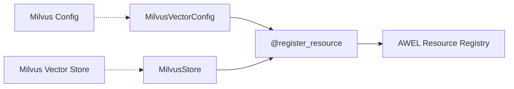
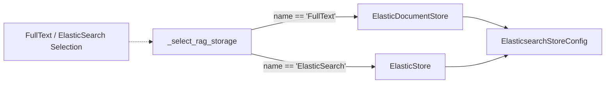
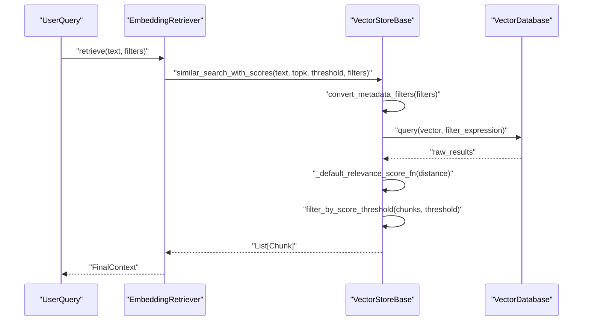

<!-- source: DeepWiki mcp.deepwiki.com · repo eosphoros-ai/DB-GPT · page 4.2 Vector Stores & Storage Backends · fetched 2026-11-09 -->

# Vector Stores & Storage Backends

Relevant source files

The following files were used as context for generating this wiki page:

- [docker/compose_examples/dbgpt-oceanbase-docker-compose.yml](docker/compose_examples/dbgpt-oceanbase-docker-compose.yml)
- [docs/docs/application/advanced_tutorial/rag.md](docs/docs/application/advanced_tutorial/rag.md)
- [docs/docs/config-reference/app/config_storageconfig_028579.mdx](docs/docs/config-reference/app/config_storageconfig_028579.mdx)
- [docs/docs/config-reference/overview.mdx](docs/docs/config-reference/overview.mdx)
- [docs/docs/config-reference/utils/manager_modelcacheparameters_152367.mdx](docs/docs/config-reference/utils/manager_modelcacheparameters_152367.mdx)
- [docs/docs/config-reference/vector_store/index.mdx](docs/docs/config-reference/vector_store/index.mdx)
- [docs/docs/config-reference/vector_store/valkey_store_valkeyvectorconfig_a0fffb.mdx](docs/docs/config-reference/vector_store/valkey_store_valkeyvectorconfig_a0fffb.mdx)
- [docs/docs/faq/kbqa.md](docs/docs/faq/kbqa.md)
- [docs/docs/getting-started/cli-quickstart.md](docs/docs/getting-started/cli-quickstart.md)
- [docs/docs/installation/build_image.md](docs/docs/installation/build_image.md)
- [docs/docs/modules/rag.md](docs/docs/modules/rag.md)
- [docs/i18n/zh-CN/docusaurus-plugin-content-docs/current/config-reference/utils/manager_modelcacheparameters_152367.mdx](docs/i18n/zh-CN/docusaurus-plugin-content-docs/current/config-reference/utils/manager_modelcacheparameters_152367.mdx)
- [i18n/locales/zh_CN/LC_MESSAGES/dbgpt_storage.po](i18n/locales/zh_CN/LC_MESSAGES/dbgpt_storage.po)
- [packages/dbgpt-core/src/dbgpt/storage/base.py](packages/dbgpt-core/src/dbgpt/storage/base.py)
- [packages/dbgpt-core/src/dbgpt/storage/cache/manager.py](packages/dbgpt-core/src/dbgpt/storage/cache/manager.py)
- [packages/dbgpt-core/src/dbgpt/storage/full_text/base.py](packages/dbgpt-core/src/dbgpt/storage/full_text/base.py)
- [packages/dbgpt-core/src/dbgpt/storage/vector_store/base.py](packages/dbgpt-core/src/dbgpt/storage/vector_store/base.py)
- [packages/dbgpt-ext/src/dbgpt_ext/rag/assembler/db_schema.py](packages/dbgpt-ext/src/dbgpt_ext/rag/assembler/db_schema.py)
- [packages/dbgpt-ext/src/dbgpt_ext/rag/assembler/embedding.py](packages/dbgpt-ext/src/dbgpt_ext/rag/assembler/embedding.py)
- [packages/dbgpt-ext/src/dbgpt_ext/rag/assembler/summary.py](packages/dbgpt-ext/src/dbgpt_ext/rag/assembler/summary.py)
- [packages/dbgpt-ext/src/dbgpt_ext/rag/operators/db_schema.py](packages/dbgpt-ext/src/dbgpt_ext/rag/operators/db_schema.py)
- [packages/dbgpt-ext/src/dbgpt_ext/storage/__init__.py](packages/dbgpt-ext/src/dbgpt_ext/storage/__init__.py)
- [packages/dbgpt-ext/src/dbgpt_ext/storage/cache/__init__.py](packages/dbgpt-ext/src/dbgpt_ext/storage/cache/__init__.py)
- [packages/dbgpt-ext/src/dbgpt_ext/storage/cache/tests/__init__.py](packages/dbgpt-ext/src/dbgpt_ext/storage/cache/tests/__init__.py)
- [packages/dbgpt-ext/src/dbgpt_ext/storage/cache/tests/test_valkey_cache.py](packages/dbgpt-ext/src/dbgpt_ext/storage/cache/tests/test_valkey_cache.py)
- [packages/dbgpt-ext/src/dbgpt_ext/storage/cache/tests/test_valkey_cache_integration.py](packages/dbgpt-ext/src/dbgpt_ext/storage/cache/tests/test_valkey_cache_integration.py)
- [packages/dbgpt-ext/src/dbgpt_ext/storage/cache/valkey_cache.py](packages/dbgpt-ext/src/dbgpt_ext/storage/cache/valkey_cache.py)
- [packages/dbgpt-ext/src/dbgpt_ext/storage/full_text/elasticsearch.py](packages/dbgpt-ext/src/dbgpt_ext/storage/full_text/elasticsearch.py)
- [packages/dbgpt-ext/src/dbgpt_ext/storage/full_text/opensearch.py](packages/dbgpt-ext/src/dbgpt_ext/storage/full_text/opensearch.py)
- [packages/dbgpt-ext/src/dbgpt_ext/storage/vector_store/chroma_store.py](packages/dbgpt-ext/src/dbgpt_ext/storage/vector_store/chroma_store.py)
- [packages/dbgpt-ext/src/dbgpt_ext/storage/vector_store/elastic_store.py](packages/dbgpt-ext/src/dbgpt_ext/storage/vector_store/elastic_store.py)
- [packages/dbgpt-ext/src/dbgpt_ext/storage/vector_store/milvus_store.py](packages/dbgpt-ext/src/dbgpt_ext/storage/vector_store/milvus_store.py)
- [packages/dbgpt-ext/src/dbgpt_ext/storage/vector_store/oceanbase_store.py](packages/dbgpt-ext/src/dbgpt_ext/storage/vector_store/oceanbase_store.py)
- [packages/dbgpt-ext/src/dbgpt_ext/storage/vector_store/pgvector_store.py](packages/dbgpt-ext/src/dbgpt_ext/storage/vector_store/pgvector_store.py)
- [packages/dbgpt-ext/src/dbgpt_ext/storage/vector_store/qdrant_store.py](packages/dbgpt-ext/src/dbgpt_ext/storage/vector_store/qdrant_store.py)
- [packages/dbgpt-ext/src/dbgpt_ext/storage/vector_store/tests/__init__.py](packages/dbgpt-ext/src/dbgpt_ext/storage/vector_store/tests/__init__.py)
- [packages/dbgpt-ext/src/dbgpt_ext/storage/vector_store/valkey_store.py](packages/dbgpt-ext/src/dbgpt_ext/storage/vector_store/valkey_store.py)
- [packages/dbgpt-ext/src/dbgpt_ext/storage/vector_store/weaviate_store.py](packages/dbgpt-ext/src/dbgpt_ext/storage/vector_store/weaviate_store.py)
- [packages/dbgpt-serve/src/dbgpt_serve/datasource/service/db_summary_client.py](packages/dbgpt-serve/src/dbgpt_serve/datasource/service/db_summary_client.py)

The Vector Stores and Storage Backends subsystem in DB-GPT provides essential persistence infrastructure for Retrieval-Augmented Generation (RAG). It abstracts interactions with vector databases, knowledge graphs, and full-text search engines under unified interfaces, supporting semantically enriched document chunk storage and retrieval with advanced metadata filtering, scalability, and concurrency controls.

---

## Architecture & Core Abstractions

DB-GPT’s storage architecture defines a clear inheritance hierarchy enabling flexible integration of numerous backend types:

- **`IndexStoreBase`**: The foundational abstract base class for any document index backend [packages/dbgpt-core/src/dbgpt/storage/base.py:28-29](). It defines synchronous (`load_document`) and asynchronous (`aload_document`) document loading methods [packages/dbgpt-core/src/dbgpt/storage/base.py:47-69](), supports batch loading with fault tolerance (`load_document_with_limit` uses `_safe_load_group` to isolate partial failures) [packages/dbgpt-core/src/dbgpt/storage/base.py:115-188](), and declares similarity search interfaces with score filtering [packages/dbgpt-core/src/dbgpt/storage/base.py:72-89]().
- **`VectorStoreBase`**: Extends `IndexStoreBase` for vector database implementations specializing in similarity search using embeddings, introducing score threshold filtering, metadata filter translation, and default relevance scoring logic [packages/dbgpt-core/src/dbgpt/storage/vector_store/base.py:69-201]().
- **`VectorStoreConfig`**: A configuration dataclass containing connection parameters (URIs, authentication keys) and performance tunables (`max_chunks_once_load`, `max_threads`).

Storage backend classes and their config dataclasses are decorated with `@register_resource` from AWEL's resource registry system, providing automatic registration and configuration metadata. The function `scan_storage_configs` in `dbgpt_ext.storage` dynamically loads all known storage configs for runtime use [packages/dbgpt-ext/src/dbgpt_ext/storage/__init__.py:141-164]().

### Diagram: Natural Language Configuration to Code Entities (Milvus)

Sources:
- packages/dbgpt-ext/src/dbgpt_ext/storage/vector_store/milvus_store.py:28-194
- packages/dbgpt-ext/src/dbgpt_ext/storage/__init__.py:141-164

---

## Supported Vector Store Implementations

DB-GPT supports a wide range of vector store backends in `dbgpt-ext`, each implementing `VectorStoreBase` and paired with a corresponding `VectorStoreConfig`:

| Backend           | Store Class          | Config Class          | Key Implementation Notes                                                                                 |
|-------------------|----------------------|-----------------------|----------------------------------------------------------------------------------------------------------|
| **Chroma**        | `ChromaStore`        | `ChromaVectorConfig`  | Local persistent vector DB using `PersistentClient`. Collection names sanitized to SHA-256 hex strings.  [packages/dbgpt-ext/src/dbgpt_ext/storage/vector_store/chroma_store.py:43-145]() |
| **Milvus**        | `MilvusStore`        | `MilvusVectorConfig`  | Distributed vector DB with flexible field mappings; direct `pymilvus` client integration.                 [packages/dbgpt-ext/src/dbgpt_ext/storage/vector_store/milvus_store.py:28-194]() |
| **PGVector**      | `PGVectorStore`      | `PGVectorConfig`      | Postgres vector extension; uses LangChain API for embedding-based search.                                [packages/dbgpt-ext/src/dbgpt_ext/storage/vector_store/pgvector_store.py:42-114]() |
| **OceanBase**     | `OceanBaseStore`     | `OceanBaseConfig`     | Enterprise RDBMS with HNSW vector search support; SQL-like metadata filters parsed.                      [packages/dbgpt-ext/src/dbgpt_ext/storage/vector_store/oceanbase_store.py:126-212]() |
| **ElasticSearch** | `ElasticStore`       | `ElasticsearchStoreConfig` | Hybrid full-text and vector storage; index names normalized to hexadecimal.                          [packages/dbgpt-ext/src/dbgpt_ext/storage/vector_store/elastic_store.py:77-200]() |
| **Qdrant**        | `QdrantStore`        | `QdrantVectorConfig`  | Cloud-native vector DB; converts chunk IDs to UUIDs for point IDs compliance.                           [packages/dbgpt-ext/src/dbgpt_ext/storage/vector_store/qdrant_store.py:32-37,108-207]() |
| **Weaviate**      | `WeaviateStore`      | `WeaviateVectorConfig`| Semantic graph-enabled vector DB with schema-driven metadata and content classes.                       [packages/dbgpt-ext/src/dbgpt_ext/storage/vector_store/weaviate_store.py:91-180]() |
| **Valkey**        | `ValkeyStore`        | `ValkeyVectorConfig`  | Redis-compatible vector store with HNSW/FLAT indices; advanced text-based metadata filtering DSL.        [packages/dbgpt-ext/src/dbgpt_ext/storage/vector_store/valkey_store.py:110-215]() |

Sources:
- packages/dbgpt-ext/src/dbgpt_ext/storage/vector_store/chroma_store.py:43-145
- packages/dbgpt-ext/src/dbgpt_ext/storage/vector_store/milvus_store.py:28-194
- packages/dbgpt-ext/src/dbgpt_ext/storage/vector_store/pgvector_store.py:42-114
- packages/dbgpt-ext/src/dbgpt_ext/storage/vector_store/oceanbase_store.py:126-212
- packages/dbgpt-ext/src/dbgpt_ext/storage/vector_store/elastic_store.py:77-200
- packages/dbgpt-ext/src/dbgpt_ext/storage/vector_store/qdrant_store.py:32-37,108-207
- packages/dbgpt-ext/src/dbgpt_ext/storage/vector_store/weaviate_store.py:91-180
- packages/dbgpt-ext/src/dbgpt_ext/storage/vector_store/valkey_store.py:110-215

---

## Full-Text Stores & Storage Selection

In addition to vector-based storage backends, DB-GPT supports full-text search engines via `FullTextStoreBase`, such as `ElasticDocumentStore` backed by Elasticsearch [packages/dbgpt-ext/src/dbgpt_ext/storage/full_text/elasticsearch.py:21-22](). 

The `_select_rag_storage` factory function in `dbgpt_ext.storage` dynamically resolves storage classes and configurations based on string identifiers like `"Chroma"`, `"Milvus"`, `"ElasticSearch"`, or `"FullText"` [packages/dbgpt-ext/src/dbgpt_ext/storage/__init__.py:109-136]().

### Diagram: Natural Language Storage Selection to Code Entities

Sources:
- packages/dbgpt-ext/src/dbgpt_ext/storage/__init__.py:109-136
- packages/dbgpt-ext/src/dbgpt_ext/storage/full_text/elasticsearch.py:21-22
- packages/dbgpt-ext/src/dbgpt_ext/storage/vector_store/elastic_store.py:77-132

---

## Data Flow & Retrieval Logic

The storage subsystem manages document storage and retrieval with concurrency and partial failure handling:

1. **Document Loading and Batching**:
   - Documents are split into smaller groups limited by `max_chunks_once_load` for efficient insertion calls.
   - The method `_safe_load_group` attempts to load the entire batch, falling back to individual chunk retries on failure to isolate problematic chunks and maximize data integrity [packages/dbgpt-core/src/dbgpt/storage/base.py:115-188]().
2. **Similarity Search**:
   - User query text is embedded and queried via `similar_search_with_scores` provided by `VectorStoreBase` implementations [packages/dbgpt-core/src/dbgpt/storage/base.py:72-89]().
3. **Score Threshold Filtering**:
   - Retrieved results are pruned using score thresholds to exclude chunks below the specified relevance criteria [packages/dbgpt-core/src/dbgpt/storage/vector_store/base.py]().

### Diagram: Retrieval Data Flow

Sources:
- packages/dbgpt-core/src/dbgpt/storage/base.py:72-89
- packages/dbgpt-core/src/dbgpt/storage/vector_store/base.py:1-201

---

## Metadata Filtering Implementation

Metadata filters translate generic specifications into backend-specific query expressions:
- **Milvus**: Translates filters into SQL-like WHERE clauses utilizing `FilterOperator` and `MetadataFilters` [packages/dbgpt-ext/src/dbgpt_ext/storage/vector_store/milvus_store.py:20]().
- **OceanBase**: Uses specialized SQL filter string parsing supporting exact matches, lists, and text pattern matching via `_parse_filter_value` [packages/dbgpt-ext/src/dbgpt_ext/storage/vector_store/oceanbase_store.py:44-60]().
- **Qdrant**: Converts metadata filters to Qdrant client Boolean filter models (`must`, `should`, `must_not`) [packages/dbgpt-ext/src/dbgpt_ext/storage/vector_store/qdrant_store.py:22-26]().
- **Valkey**: Accepts query DSL compliant with RediSearch query formats for nested boolean logic [packages/dbgpt-ext/src/dbgpt_ext/storage/vector_store/valkey_store.py:28-32]().

Sources:
- packages/dbgpt-ext/src/dbgpt_ext/storage/vector_store/milvus_store.py:20
- packages/dbgpt-ext/src/dbgpt_ext/storage/vector_store/oceanbase_store.py:44-60
- packages/dbgpt-ext/src/dbgpt_ext/storage/vector_store/qdrant_store.py:22-26
- packages/dbgpt-ext/src/dbgpt_ext/storage/vector_store/valkey_store.py:28-32

---

## Configuration & Environment

Vector store configurations can be managed and injected via environment variables and TOML configuration files:
- Use environment variables such as `VECTOR_STORE_TYPE` to select the active vector storage backend.
- Specific connection credentials are exposed via `VectorStoreConfig` subclasses, integrating with AWEL's resource registration framework [packages/dbgpt-ext/src/dbgpt_ext/storage/vector_store/milvus_store.py:28-101]().

Sources:
- packages/dbgpt-ext/src/dbgpt_ext/storage/vector_store/milvus_store.py:28-101

---

# References

- `VectorStoreBase` and `VectorStoreConfig` base abstractions: [packages/dbgpt-core/src/dbgpt/storage/vector_store/base.py:69-201]()
- `IndexStoreBase` general base class: [packages/dbgpt-core/src/dbgpt/storage/base.py:28-188]()
- Backend implementations:
  - Milvus: [packages/dbgpt-ext/src/dbgpt_ext/storage/vector_store/milvus_store.py:28-194]()
  - Chroma: [packages/dbgpt-ext/src/dbgpt_ext/storage/vector_store/chroma_store.py:43-145]()
  - PGVector: [packages/dbgpt-ext/src/dbgpt_ext/storage/vector_store/pgvector_store.py:42-114]()
  - OceanBase: [packages/dbgpt-ext/src/dbgpt_ext/storage/vector_store/oceanbase_store.py:126-212]()
  - ElasticSearch: [packages/dbgpt-ext/src/dbgpt_ext/storage/vector_store/elastic_store.py:77-200]()
  - Qdrant: [packages/dbgpt-ext/src/dbgpt_ext/storage/vector_store/qdrant_store.py:32-37,108-207]()
  - Weaviate: [packages/dbgpt-ext/src/dbgpt_ext/storage/vector_store/weaviate_store.py:91-180]()
  - Valkey: [packages/dbgpt-ext/src/dbgpt_ext/storage/vector_store/valkey_store.py:110-215]()
- Storage config scanning and registry: [packages/dbgpt-ext/src/dbgpt_ext/storage/__init__.py:109-164]()

---

