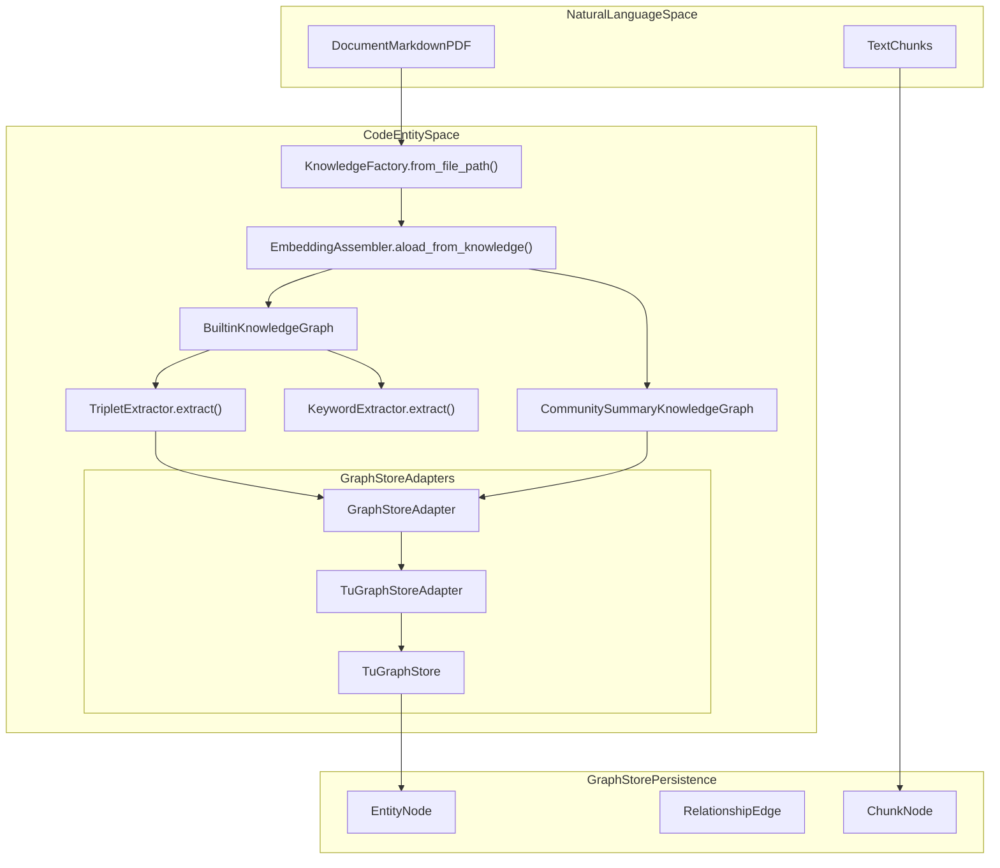
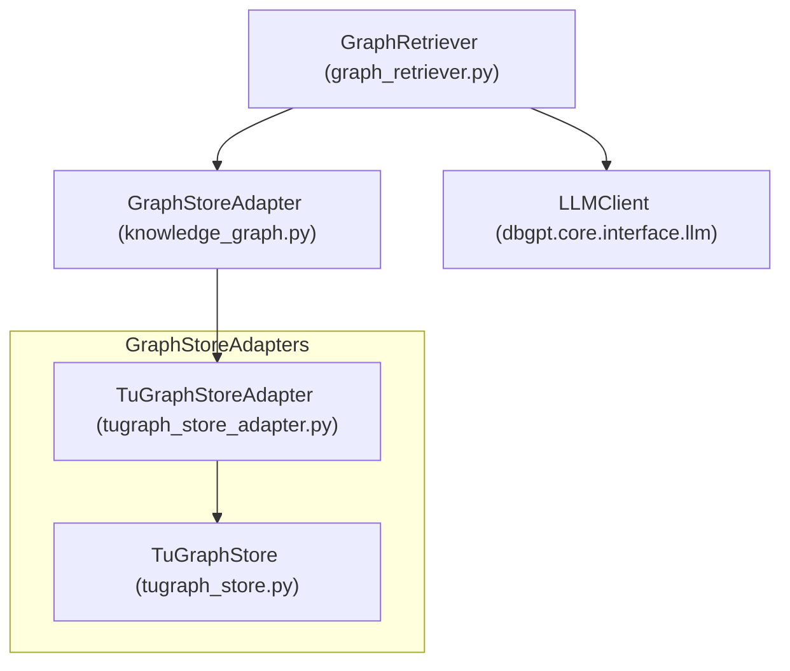
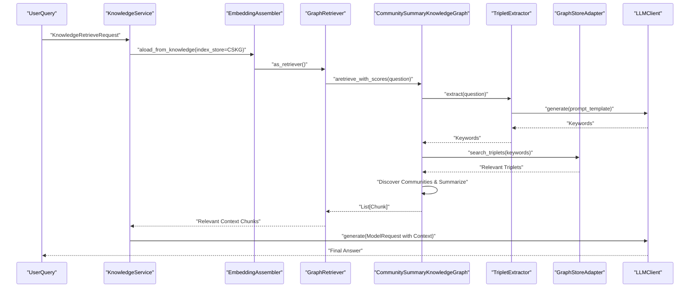
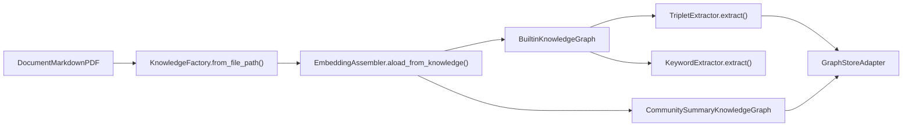

<!-- source: DeepWiki mcp.deepwiki.com · repo eosphoros-ai/DB-GPT · page 4.3 Knowledge Graph & GraphRAG · fetched 2026-11-09 -->

# Knowledge Graph & GraphRAG

Relevant source files

The following files were used as context for generating this wiki page:

- [configs/dbgpt-bm25-rag.toml](configs/dbgpt-bm25-rag.toml)
- [docs/docs/cookbook/rag/graph_rag_app_develop.md](docs/docs/cookbook/rag/graph_rag_app_develop.md)
- [examples/rag/graph_rag_example.py](examples/rag/graph_rag_example.py)
- [packages/dbgpt-app/src/dbgpt_app/knowledge/service.py](packages/dbgpt-app/src/dbgpt_app/knowledge/service.py)
- [packages/dbgpt-core/src/dbgpt/rag/transformer/llm_extractor.py](packages/dbgpt-core/src/dbgpt/rag/transformer/llm_extractor.py)
- [packages/dbgpt-ext/src/dbgpt_ext/rag/retriever/graph_retriever/graph_retriever.py](packages/dbgpt-ext/src/dbgpt_ext/rag/retriever/graph_retriever/graph_retriever.py)
- [packages/dbgpt-ext/src/dbgpt_ext/rag/retriever/graph_retriever/text_based_graph_retriever.py](packages/dbgpt-ext/src/dbgpt_ext/rag/retriever/graph_retriever/text_based_graph_retriever.py)
- [packages/dbgpt-ext/src/dbgpt_ext/rag/transformer/graph_extractor.py](packages/dbgpt-ext/src/dbgpt_ext/rag/transformer/graph_extractor.py)
- [packages/dbgpt-ext/src/dbgpt_ext/rag/transformer/local_text2gql.py](packages/dbgpt-ext/src/dbgpt_ext/rag/transformer/local_text2gql.py)
- [packages/dbgpt-ext/src/dbgpt_ext/storage/graph_store/tugraph_store.py](packages/dbgpt-ext/src/dbgpt_ext/storage/graph_store/tugraph_store.py)
- [packages/dbgpt-ext/src/dbgpt_ext/storage/knowledge_graph/community_summary.py](packages/dbgpt-ext/src/dbgpt_ext/storage/knowledge_graph/community_summary.py)
- [packages/dbgpt-ext/src/dbgpt_ext/storage/knowledge_graph/knowledge_graph.py](packages/dbgpt-ext/src/dbgpt_ext/storage/knowledge_graph/knowledge_graph.py)
- [packages/dbgpt-serve/src/dbgpt_serve/rag/connector.py](packages/dbgpt-serve/src/dbgpt_serve/rag/connector.py)
- [tests/intetration_tests/graph_store/test_tugraph_store.py](tests/intetration_tests/graph_store/test_tugraph_store.py)
- [tests/unit_tests/graph/test_graph.py](tests/unit_tests/graph/test_graph.py)

The purpose of this page is to document the Knowledge Graph (KG) and GraphRAG subsystems in DB-GPT. This includes implementation details for TuGraph and Neo4j storage adapters, LLM-driven triplet and keyword extraction (`LLMExtractor`, `KeywordExtractor`), community detection and summarization (`CommunitySummaryKnowledgeGraph`), hybrid retrieval architectures (`GraphRetriever`), and GraphRAG configuration parameters.

Sources: 
[docs/docs/cookbook/rag/graph_rag_app_develop.md:1-6]()

---

## System Architecture & Data Flow

The Knowledge Graph subsystem processes unstructured documents into structured graph representations via a multi-stage pipeline:

1. **Ingestion & Parsing**: Documents are loaded via `KnowledgeFactory` and chunked into paragraph or header-based text segments [docs/docs/cookbook/rag/graph_rag_app_develop.md:178-180]().
2. **Assembler Initialization**: `EmbeddingAssembler` binds the knowledge source to an index store (graph or vector store) [docs/docs/cookbook/rag/graph_rag_app_develop.md:183-188]().
3. **Extraction & Transformation**: `BuiltinKnowledgeGraph` or `CommunitySummaryKnowledgeGraph` delegates extraction to `TripletExtractor` and `KeywordExtractor` using an underlying `LLMClient` [packages/dbgpt-ext/src/dbgpt_ext/storage/knowledge_graph/knowledge_graph.py:171-172]().
4. **Graph Persistence**: Extracted entities, relationships, documents, and chunks are persisted via `GraphStoreAdapter` implementations into graph storage backends like TuGraph [packages/dbgpt-ext/src/dbgpt_ext/storage/graph_store/tugraph_store.py:145-174]().

Diagram: "GraphRAG Natural Language to Code Entity Space Data Flow"

Sources:
[docs/docs/cookbook/rag/graph_rag_app_develop.md:176-189](),
[packages/dbgpt-ext/src/dbgpt_ext/storage/knowledge_graph/knowledge_graph.py:152-184](),
[packages/dbgpt-ext/src/dbgpt_ext/storage/graph_store/tugraph_store.py:145-174]()

---

## Storage Adapters

DB-GPT abstracts graph databases behind the `GraphStoreBase` [packages/dbgpt-ext/src/dbgpt_ext/storage/graph_store/tugraph_store.py:145-145]() and `GraphStoreAdapter` [packages/dbgpt-ext/src/dbgpt_ext/storage/knowledge_graph/community/base.py:1-1]() interfaces.

### 1. TuGraph Adapter
- **`TuGraphStoreConfig`**: Defines connection properties including `host`, `port`, `username`, `password`, graph element type mappings, and plugin names (e.g. `leiden`) [packages/dbgpt-ext/src/dbgpt_ext/storage/graph_store/tugraph_store.py:60-130]().
- **`TuGraphStore`**: Manages the underlying `TuGraphConnector`, checks database existence, and uploads missing C++ plugins (such as Leiden community detection algorithms) [packages/dbgpt-ext/src/dbgpt_ext/storage/graph_store/tugraph_store.py:145-211]().
- **`TuGraphStoreAdapter`**: Implements graph traversal, triplet insertion, deletion, and Cypher query execution [tests/intetration_tests/graph_store/test_tugraph_store.py:25-71]().

### 2. Neo4j & Other Backends
- Integrated similarly through the `GraphStoreFactory` dispatch mechanism, mapping generic storage requests to vendor-specific Bolt/Cypher drivers.

Diagram: "Graph Store Adapters and Retrieval Flow"

Sources:
[packages/dbgpt-ext/src/dbgpt_ext/storage/graph_store/tugraph_store.py:60-211](),
[packages/dbgpt-ext/src/dbgpt_ext/storage/knowledge_graph/knowledge_graph.py:170-185](),
[tests/intetration_tests/graph_store/test_tugraph_store.py:25-71]()

---

## GraphRAG Implementation

GraphRAG combines vector similarity search with structured graph traversal and LLM-synthesized community summaries.

### Triplet & Keyword Extraction
- **`LLMExtractor` / `TripletExtractor`**: Subclasses of `ExtractorBase` that format prompt templates (`GRAPH_EXTRACT_PT_CN`), invoke `LLMClient.generate()`, and parse responses into `Vertex` and `Edge` objects [packages/dbgpt-core/src/dbgpt/rag/transformer/llm_extractor.py:14-100](), [packages/dbgpt-ext/src/dbgpt_ext/storage/knowledge_graph/knowledge_graph.py:171-171](). Supports `batch_extract()` with configurable batch sizes (`KNOWLEDGE_GRAPH_EXTRACTION_BATCH_SIZE`) [packages/dbgpt-core/src/dbgpt/rag/transformer/llm_extractor.py:27-51]().
- **`KeywordExtractor`**: Extracts keywords from user queries to seed graph traversal [packages/dbgpt-ext/src/dbgpt_ext/rag/retriever/graph_retriever/graph_retriever.py:115-116]().

### Community Summary Generation
- **`CommunitySummaryKnowledgeGraph`**: Extends `BuiltinKnowledgeGraph` to execute community detection algorithms (e.g., Leiden) over the graph store and generate hierarchical community summaries via `CommunitySummarizer` [packages/dbgpt-ext/src/dbgpt_ext/storage/knowledge_graph/community_summary.py:177-191]().

### Hybrid Retrieval Flow
`GraphRetriever` orchestrates multiple sub-retrievers (`KeywordBasedGraphRetriever`, `VectorBasedGraphRetriever`, `TextBasedGraphRetriever`, and `DocumentGraphRetriever`) to fetch relevant subgraphs and document chunks [packages/dbgpt-ext/src/dbgpt_ext/rag/retriever/graph_retriever/graph_retriever.py:32-144]().

Diagram: "GraphRAG Hybrid Retrieval Sequence"

Sources:
[packages/dbgpt-core/src/dbgpt/rag/transformer/llm_extractor.py:14-100](),
[packages/dbgpt-ext/src/dbgpt_ext/storage/knowledge_graph/community_summary.py:177-191](),
[packages/dbgpt-ext/src/dbgpt_ext/rag/retriever/graph_retriever/graph_retriever.py:32-144]()

---

## Configuration Reference

GraphRAG behavior and database connection parameters are controlled via environment variables or configuration files:

| Parameter | Description | Default | Source |
|---|---|---|---|
| `GRAPH_STORE_TYPE` | Graph database type backend | TuGraph | [docs/docs/cookbook/rag/graph_rag_app_develop.md:109-109]() |
| `TUGRAPH_HOST` | TuGraph host IP address | 127.0.0.1 | [docs/docs/cookbook/rag/graph_rag_app_develop.md:110-110]() |
| `TUGRAPH_PORT` | TuGraph Bolt port | 7687 | [docs/docs/cookbook/rag/graph_rag_app_develop.md:111-111]() |
| `GRAPH_COMMUNITY_SUMMARY_ENABLED` | Enable graph community summary feature | True | [docs/docs/cookbook/rag/graph_rag_app_develop.md:114-114]() |
| `TRIPLET_GRAPH_ENABLED` | Enable graph search for triplets | True | [docs/docs/cookbook/rag/graph_rag_app_develop.md:115-115]() |
| `DOCUMENT_GRAPH_ENABLED` | Enable graph search for documents and chunks | True | [docs/docs/cookbook/rag/graph_rag_app_develop.md:116-116]() |
| `KNOWLEDGE_GRAPH_CHUNK_SEARCH_TOP_SIZE` | Top size of knowledge graph chunk search | 5 | [docs/docs/cookbook/rag/graph_rag_app_develop.md:117-117]() |
| `KNOWLEDGE_GRAPH_EXTRACTION_BATCH_SIZE` | Batch size for triplet extraction from text | 20 | [docs/docs/cookbook/rag/graph_rag_app_develop.md:118-118]() |
| `COMMUNITY_SUMMARY_BATCH_SIZE` | Batch size for parallel community building process | 20 | [docs/docs/cookbook/rag/graph_rag_app_develop.md:119-119]() |

Sources:
[docs/docs/cookbook/rag/graph_rag_app_develop.md:108-120]()

---

## Key Classes and Roles

| Component Name | Description & Responsibilities | File Location |
|---|---|---|
| `BuiltinKnowledgeGraph` | Core knowledge graph connector managing triplet extraction, graph store initialization, and document loading | `packages/dbgpt-ext/src/dbgpt_ext/storage/knowledge_graph/knowledge_graph.py` |
| `CommunitySummaryKnowledgeGraph` | Enhanced knowledge graph supporting Leiden community detection and LLM-based community summarization | `packages/dbgpt-ext/src/dbgpt_ext/storage/knowledge_graph/community_summary.py` |
| `TuGraphStore` | TuGraph backend implementation managing connection pooling, plugin uploads, and Cypher execution | `packages/dbgpt-ext/src/dbgpt_ext/storage/graph_store/tugraph_store.py` |
| `TuGraphStoreAdapter` | Adapter layer for TuGraph supporting community discovery and subgraph traversal operations | `packages/dbgpt-ext/src/dbgpt_ext/storage/knowledge_graph/community/tugraph_store_adapter.py` |
| `LLMExtractor` / `TripletExtractor` | Abstract and concrete LLM text transformers parsing subject-predicate-object triplets from raw text chunks | `packages/dbgpt-core/src/dbgpt/rag/transformer/llm_extractor.py` |
| `KeywordExtractor` | LLM-based transformer extracting salient keywords for graph query expansion | `packages/dbgpt-ext/src/dbgpt_ext/rag/retriever/graph_retriever/graph_retriever.py` |
| `GraphRetriever` | Hybrid retrieval orchestrator combining keyword, vector, text, and document graph recall strategies | `packages/dbgpt-ext/src/dbgpt_ext/rag/retriever/graph_retriever/graph_retriever.py` |

Sources:
[packages/dbgpt-ext/src/dbgpt_ext/storage/knowledge_graph/knowledge_graph.py:152-184](),
[packages/dbgpt-ext/src/dbgpt_ext/storage/knowledge_graph/community_summary.py:177-191](),
[packages/dbgpt-ext/src/dbgpt_ext/storage/graph_store/tugraph_store.py:145-174](),
[packages/dbgpt-core/src/dbgpt/rag/transformer/llm_extractor.py:14-100](),
[packages/dbgpt-ext/src/dbgpt_ext/rag/retriever/graph_retriever/graph_retriever.py:32-60]()

---

## Natural Language Space to Code Entities Mapping

Diagram: "Natural Language Space to Code Entities Mapping"

Sources:
[docs/docs/cookbook/rag/graph_rag_app_develop.md:125-150](),
[packages/dbgpt-ext/src/dbgpt_ext/storage/knowledge_graph/knowledge_graph.py:152-174]()

---

