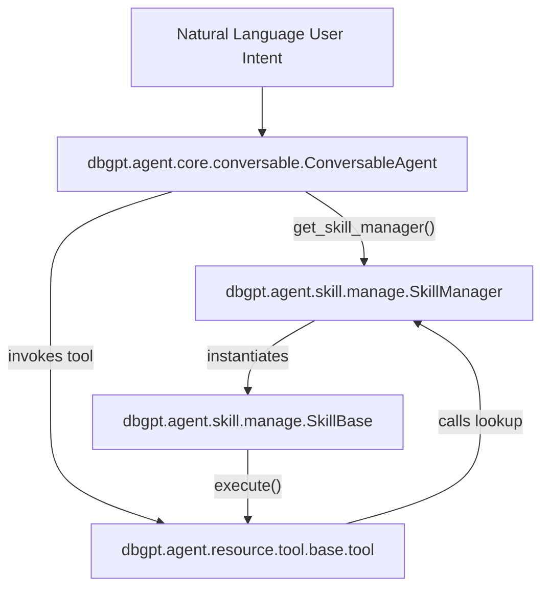
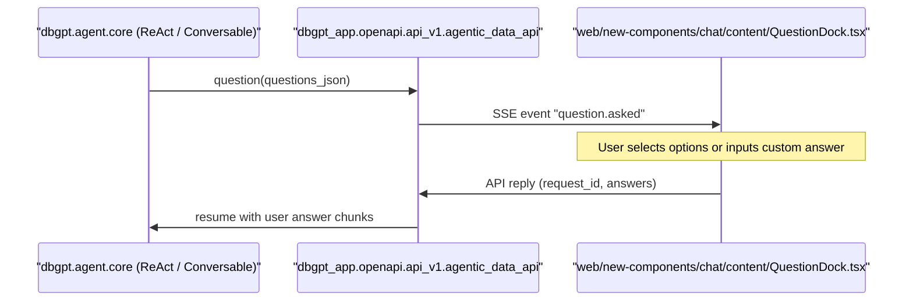
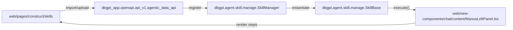

<!-- source: DeepWiki mcp.deepwiki.com · repo eosphoros-ai/DB-GPT · page 5.4 Skills System · fetched 2026-11-09 -->

# Skills System

Relevant source files

The following files were used as context for generating this wiki page:

- [packages/dbgpt-app/src/dbgpt_app/openapi/api_v1/agentic_data_api.py](packages/dbgpt-app/src/dbgpt_app/openapi/api_v1/agentic_data_api.py)
- [packages/dbgpt-app/src/dbgpt_app/tests/test_skill_upload_api.py](packages/dbgpt-app/src/dbgpt_app/tests/test_skill_upload_api.py)
- [packages/dbgpt-core/src/dbgpt/agent/skill/manage.py](packages/dbgpt-core/src/dbgpt/agent/skill/manage.py)
- [packages/dbgpt-core/src/dbgpt/agent/skill/tests/test_manage.py](packages/dbgpt-core/src/dbgpt/agent/skill/tests/test_manage.py)
- [web/components/chat/opencode-agent-chat-container.tsx](web/components/chat/opencode-agent-chat-container.tsx)
- [web/hooks/use-chat.ts](web/hooks/use-chat.ts)
- [web/hooks/use-react-agent-chat.ts](web/hooks/use-react-agent-chat.ts)
- [web/hooks/use-react-agent.ts](web/hooks/use-react-agent.ts)
- [web/locales/en/chat.ts](web/locales/en/chat.ts)
- [web/locales/zh/chat.ts](web/locales/zh/chat.ts)
- [web/new-components/chat/content/ManusLeftPanel.tsx](web/new-components/chat/content/ManusLeftPanel.tsx)
- [web/new-components/chat/content/ManusRightPanel.tsx](web/new-components/chat/content/ManusRightPanel.tsx)
- [web/new-components/chat/content/OpenCodeChatCompletion.tsx](web/new-components/chat/content/OpenCodeChatCompletion.tsx)
- [web/new-components/chat/content/QuestionDock.tsx](web/new-components/chat/content/QuestionDock.tsx)
- [web/new-components/chat/content/SessionTurn.tsx](web/new-components/chat/content/SessionTurn.tsx)
- [web/pages/chat/index.tsx](web/pages/chat/index.tsx)
- [web/pages/index.tsx](web/pages/index.tsx)

The Skills System in DB-GPT provides a modular and extensible framework to package, register, load, and manage reusable capabilities as **skills**. It enables agent workflows to leverage diverse skill types—ranging from coding interpreters and data analysis tools to knowledge Q&A and financial report analyzers—within a unified architecture that tightly integrates with agent reasoning, planning, and execution.

This page describes the key components of canyons of the Skills System, the workflow of skill lifecycle management, typical skill types with example skills from the `skills/` directory, the human-in-the-loop question tool, and the Skills UI page integration.

---

## 5.4.1 Core Architecture

### Key Components

- **SkillBase**:  
  An abstract base class that encapsulates the common interface and metadata that all skills must implement. It defines the execution API and core attributes to categorize skills by type and version. Every skill inherits from `SkillBase` to ensure a standard contract for invocation within the agent framework.  
  *(Defined in: `packages/dbgpt-core/src/dbgpt/agent/skill/manage.py:1-50`)* [packages/dbgpt-core/src/dbgpt/agent/skill/manage.py:1-50]()

- **RegisterSkill**:  
  A lightweight wrapper holding references to the skill class or instance along with its metadata (e.g., name, version, description). Used internally by the `SkillManager` for registration and lookups.  
  *(Defined in: `packages/dbgpt-core/src/dbgpt/agent/skill/manage.py:15-51`)* [packages/dbgpt-core/src/dbgpt/agent/skill/manage.py:15-51]()

- **SkillManager**:  
  The central orchestrator component responsible for managing the skill lifecycle. It registers skills, organizes them by type, performs lookups by name or type, and instantiates skill objects lazily or eagerly. It maintains internal registries keyed by skill identifiers for efficient management.  
  *(Defined in: `packages/dbgpt-core/src/dbgpt/agent/skill/manage.py:57-234`)* [packages/dbgpt-core/src/dbgpt/agent/skill/manage.py:57-234]()

- **SkillBuilder**:  
  A helper utility class that creates skill instances dynamically based on parameter maps or configurations, assisting with fluent skill instantiation especially during skill loading and registration phases.  
  *(Defined in: `packages/dbgpt-core/src/dbgpt/agent/skill/manage.py:237-270`)* [packages/dbgpt-core/src/dbgpt/agent/skill/manage.py:237-270]()

- **SkillLoader**:  
  This component or utility is responsible for discovering and loading skills from local file system paths, particularly the global `skills/` directory configured via the environment variable `SKILLS_DIR`, or from remote sources. It parses skill metadata and dynamically imports skill implementations for registration with the `SkillManager`.  
  *(Referenced in: `packages/dbgpt-app/src/dbgpt_app/openapi/api_v1/agentic_data_api.py:32-34`)* [packages/dbgpt-app/src/dbgpt_app/openapi/api_v1/agentic_data_api.py:32-34]()

### Class Responsibilities Summary

| Class           | Responsibility                                  | Source Location                                        |
|-----------------|------------------------------------------------|--------------------------------------------------------|
| `SkillBase`     | Base skill interface and metadata abstraction   | `packages/dbgpt-core/src/dbgpt/agent/skill/manage.py:11-30` [packages/dbgpt-core/src/dbgpt/agent/skill/manage.py:11-30]() |
| `RegisterSkill` | Wrapper for skill class/instance + metadata     | `packages/dbgpt-core/src/dbgpt/agent/skill/manage.py:15-51` [packages/dbgpt-core/src/dbgpt/agent/skill/manage.py:15-51]() |
| `SkillManager`  | Manages skill registration, lookup, lifecycle   | `packages/dbgpt-core/src/dbgpt/agent/skill/manage.py:57-234` [packages/dbgpt-core/src/dbgpt/agent/skill/manage.py:57-234]() |
| `SkillBuilder`  | Builds skill instances from parameters/config   | `packages/dbgpt-core/src/dbgpt/agent/skill/manage.py:237-270` [packages/dbgpt-core/src/dbgpt/agent/skill/manage.py:237-270]() |

### Architecture Diagram: Natural Language to Code Entity Mapping in Skills System

This diagram maps the natural language space to the concrete code entities involved in resolving and invoking skills.

Sources:  
- `packages/dbgpt-core/src/dbgpt/agent/skill/manage.py:11-270` [packages/dbgpt-core/src/dbgpt/agent/skill/manage.py:11-270]()  
- `packages/dbgpt-app/src/dbgpt_app/openapi/api_v1/agentic_data_api.py:32-34` [packages/dbgpt-app/src/dbgpt_app/openapi/api_v1/agentic_data_api.py:32-34]()  

---

## 5.4.2 Human-in-the-Loop: The Question Tool

A specialized interactive skill within the Skills System is the **human-in-the-loop question tool**. It allows the agent to pause execution and seek user input for clarifications or confirmations.

### Backend Workflow

- The question tool creates a unique request ID and emits the `question.asked` event over Server-Sent Events (SSE).
- Agent execution is suspended asynchronously until a response is received.
- The user's answer is awaited via an `asyncio.Event` in the question manager, with a timeout to avoid indefinite blocking.
- Upon receiving a reply or rejection via API, the tool resumes agent execution with the user's input.  
*(Code location: `packages/dbgpt-app/src/dbgpt_app/openapi/api_v1/agentic_data_api.py:1-60`)* [packages/dbgpt-app/src/dbgpt_app/openapi/api_v1/agentic_data_api.py:1-60]()

### Frontend Components & Interaction

- The `QuestionDock` React component renders the question UI (`web/new-components/chat/content/QuestionDock.tsx:27-106`) [web/new-components/chat/content/QuestionDock.tsx:27-106](), showing single or multiple choice questions and optional custom input fields.
- The user selects answers or inputs a custom reply, which triggers API calls to submit responses.
- The frontend listens to question-related SSE events (`question.asked`, `question.replied`, `question.rejected`) via hooks `useChat` (`web/hooks/use-chat.ts:155-163`) [web/hooks/use-chat.ts:155-163]() to update UI state accordingly.  

### Data Flow Diagram: Natural Language Space to Code Entity Space (Question Tool)

Sources:  
- `packages/dbgpt-app/src/dbgpt_app/openapi/api_v1/agentic_data_api.py:1-60` [packages/dbgpt-app/src/dbgpt_app/openapi/api_v1/agentic_data_api.py:1-60]()  
- `web/new-components/chat/content/QuestionDock.tsx:27-106` [web/new-components/chat/content/QuestionDock.tsx:27-106]()  
- `web/hooks/use-chat.ts:155-163` [web/hooks/use-chat.ts:155-163]()  

---

## 5.4.3 Typical Skill Types and Sample Skills in `skills/` Directory

Skills in DB-GPT are categorized by their types via skill metadata. Common skill types include:

- **Coding Skills**: Interpreters or code manipulators (e.g., HTML/Python execution tools).
- **Data Analysis Skills**: Automate exploration, profiling, visualization of datasets and reports.
- **Web Search Skills**: Connect to web or external APIs as skill capabilities.
- **Knowledge QA Skills**: Integrate knowledge bases for question answering.

### Representative Example Skills Provided

- **csv-data-analysis**:  
  Automates exploratory data analysis workflows on CSV uploads.

- **financial-report-analyzer**:  
  Analyzes complex financial reports such as annual corporate statements, generating insights and visualizations.  
  *(Described in UI example: `web/locales/en/chat.ts:43-46`)* [web/locales/en/chat.ts:43-46]()

- **walmart-sales-analyzer**:  
  Performs retail sales analytics including trends, holiday effects, and economic factor correlations, outputting interactive web reports.  
  *(Described in UI example: `web/locales/en/chat.ts:35-38`)* [web/locales/en/chat.ts:35-38]()

- **skill-creator**:  
  An agent-based skill for programmatically generating and managing new SQL analysis skills.  
  *(Described in UI example: `web/locales/en/chat.ts:47-50`)* [web/locales/en/chat.ts:47-50]()

Sources:  
- `web/locales/en/chat.ts:35-60` [web/locales/en/chat.ts:35-60]()  

---

## 5.4.4 Skill Lifecycle Management and UI Integration

### Backend Skill Management

- The `SkillManager` (`packages/dbgpt-core/src/dbgpt/agent/skill/manage.py:57-234`) [packages/dbgpt-core/src/dbgpt/agent/skill/manage.py:57-234]() maintains a registry of all available skills, supporting registration by class or instance, retrieval by type or name, and managing metadata.  
- `SkillBuilder` (`packages/dbgpt-core/src/dbgpt/agent/skill/manage.py:237-270`) [packages/dbgpt-core/src/dbgpt/agent/skill/manage.py:237-270]() assists with instantiating skills dynamically from configuration or parameters.  
- `SkillLoader` discovers and dynamically imports skill modules from the configured `skills/` directory, utilizing environment variable `SKILLS_DIR` and integration points in `agentic_data_api.py` routes.

### Skills API and Import

- The backend provides APIs through `agentic_data_api.py` for uploading or registering new skills, including unpacking ZIP skill packages and mapping to user namespaces.  
- Validations protect against path traversal and unsupported filenames when uploading skill files (`packages/dbgpt-app/src/dbgpt_app/tests/test_skill_upload_api.py:40-192`) [packages/dbgpt-app/src/dbgpt_app/tests/test_skill_upload_api.py:40-192]().

### Frontend Skills UI Page

- The Next.js frontend exposes a Skills page to browse existing skills, import new ones, and manage skill lifecycles.
- Users can select skills to bind and activate them within chat sessions or workflows.
- Localization keys such as `use_skill` appear in the chat UI for skill selection (`web/locales/en/chat.ts:52`) [web/locales/en/chat.ts:52]().

### Skill Execution Interaction and Monitoring

- The `ManusLeftPanel` React component (`web/new-components/chat/content/ManusLeftPanel.tsx:60-191`) [web/new-components/chat/content/ManusLeftPanel.tsx:60-191]() visualizes skill invocation as discrete execution steps within the agent’s reasoning timeline.
- Steps display skill loading, execution phases, statuses, and outputs as part of an interactive user panel.

### Skills System Integration Diagram: Frontend & Backend

Sources:  
- `packages/dbgpt-app/src/dbgpt_app/openapi/api_v1/agentic_data_api.py:1-40` [packages/dbgpt-app/src/dbgpt_app/openapi/api_v1/agentic_data_api.py:1-40]()  
- `packages/dbgpt-app/src/dbgpt_app/tests/test_skill_upload_api.py:40-192` [packages/dbgpt-app/src/dbgpt_app/tests/test_skill_upload_api.py:40-192]()  
- `web/new-components/chat/content/ManusLeftPanel.tsx:60-191` [web/new-components/chat/content/ManusLeftPanel.tsx:60-191]()  
- `packages/dbgpt-core/src/dbgpt/agent/skill/manage.py:57-270` [packages/dbgpt-core/src/dbgpt/agent/skill/manage.py:57-270]()  

---

# Summary

DB-GPT’s Skills System offers a robust, extensible backend framework around `SkillBase`, `SkillManager`, and `SkillBuilder` for modular skill development and management. Skills can be dynamically loaded from the `skills/` directory or uploaded via APIs, enabling rich agent functionalities such as data analysis, financial reporting, coding, and human-interactive questioning.

The human-in-the-loop question tool showcases synchronous user interaction by halting agent execution to collect user feedback. On the frontend, the Skills UI page allows exploration and import of new skills, while the Manus panels visualize skill execution steps, providing transparent insight into agent reasoning and skill activity.

---

# References to Key Source Files

- Skill core classes and management: `packages/dbgpt-core/src/dbgpt/agent/skill/manage.py:11-270` [packages/dbgpt-core/src/dbgpt/agent/skill/manage.py:11-270]()
- Skills API import and management: `packages/dbgpt-app/src/dbgpt_app/openapi/api_v1/agentic_data_api.py:1-40` [packages/dbgpt-app/src/dbgpt_app/openapi/api_v1/agentic_data_api.py:1-40]()
- Skill upload tests and path traversal protection: `packages/dbgpt-app/src/dbgpt_app/tests/test_skill_upload_api.py:40-192` [packages/dbgpt-app/src/dbgpt_app/tests/test_skill_upload_api.py:40-192]()
- Frontend skill execution UI: `web/new-components/chat/content/ManusLeftPanel.tsx:60-191` [web/new-components/chat/content/ManusLeftPanel.tsx:60-191]()
- Frontend human question UI: `web/new-components/chat/content/QuestionDock.tsx:27-106` [web/new-components/chat/content/QuestionDock.tsx:27-106]()
- Frontend chat skill integration & localization: `web/locales/en/chat.ts:35-60` [web/locales/en/chat.ts:35-60]()

---

