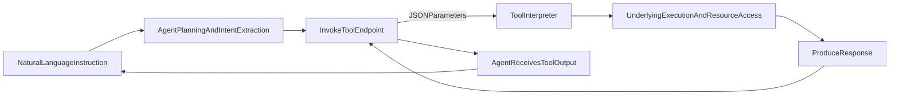
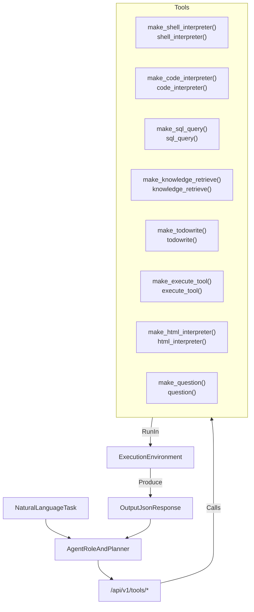
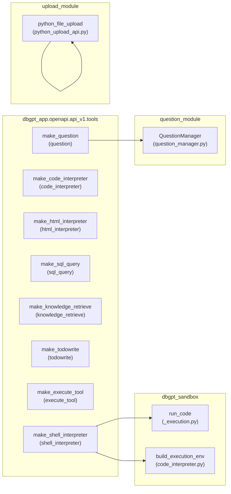

<!-- source: DeepWiki mcp.deepwiki.com · repo eosphoros-ai/DB-GPT · page 5.6 Agent Tool Endpoints & Interpreters · fetched 2026-11-09 -->

# Agent Tool Endpoints & Interpreters

Relevant source files

The following files were used as context for generating this wiki page:

- [docs/docs/sandbox/index.md](docs/docs/sandbox/index.md)
- [docs/docs/sandbox/runtime.md](docs/docs/sandbox/runtime.md)
- [docs/i18n/zh-CN/docusaurus-plugin-content-docs/current/sandbox/index.md](docs/i18n/zh-CN/docusaurus-plugin-content-docs/current/sandbox/index.md)
- [docs/i18n/zh-CN/docusaurus-plugin-content-docs/current/sandbox/runtime.md](docs/i18n/zh-CN/docusaurus-plugin-content-docs/current/sandbox/runtime.md)
- [packages/dbgpt-app/src/dbgpt_app/openapi/api_v1/python_upload_api.py](packages/dbgpt-app/src/dbgpt_app/openapi/api_v1/python_upload_api.py)
- [packages/dbgpt-app/src/dbgpt_app/openapi/api_v1/subagent/react_tools.py](packages/dbgpt-app/src/dbgpt_app/openapi/api_v1/subagent/react_tools.py)
- [packages/dbgpt-app/src/dbgpt_app/openapi/api_v1/tools/__init__.py](packages/dbgpt-app/src/dbgpt_app/openapi/api_v1/tools/__init__.py)
- [packages/dbgpt-app/src/dbgpt_app/openapi/api_v1/tools/_execution.py](packages/dbgpt-app/src/dbgpt_app/openapi/api_v1/tools/_execution.py)
- [packages/dbgpt-app/src/dbgpt_app/openapi/api_v1/tools/_helpers.py](packages/dbgpt-app/src/dbgpt_app/openapi/api_v1/tools/_helpers.py)
- [packages/dbgpt-app/src/dbgpt_app/openapi/api_v1/tools/code_interpreter.py](packages/dbgpt-app/src/dbgpt_app/openapi/api_v1/tools/code_interpreter.py)
- [packages/dbgpt-app/src/dbgpt_app/openapi/api_v1/tools/execute_analysis.py](packages/dbgpt-app/src/dbgpt_app/openapi/api_v1/tools/execute_analysis.py)
- [packages/dbgpt-app/src/dbgpt_app/openapi/api_v1/tools/execute_tool.py](packages/dbgpt-app/src/dbgpt_app/openapi/api_v1/tools/execute_tool.py)
- [packages/dbgpt-app/src/dbgpt_app/openapi/api_v1/tools/html_interpreter.py](packages/dbgpt-app/src/dbgpt_app/openapi/api_v1/tools/html_interpreter.py)
- [packages/dbgpt-app/src/dbgpt_app/openapi/api_v1/tools/knowledge_retrieve.py](packages/dbgpt-app/src/dbgpt_app/openapi/api_v1/tools/knowledge_retrieve.py)
- [packages/dbgpt-app/src/dbgpt_app/openapi/api_v1/tools/load_file.py](packages/dbgpt-app/src/dbgpt_app/openapi/api_v1/tools/load_file.py)
- [packages/dbgpt-app/src/dbgpt_app/openapi/api_v1/tools/load_tools.py](packages/dbgpt-app/src/dbgpt_app/openapi/api_v1/tools/load_tools.py)
- [packages/dbgpt-app/src/dbgpt_app/openapi/api_v1/tools/question.py](packages/dbgpt-app/src/dbgpt_app/openapi/api_v1/tools/question.py)
- [packages/dbgpt-app/src/dbgpt_app/openapi/api_v1/tools/question_manager.py](packages/dbgpt-app/src/dbgpt_app/openapi/api_v1/tools/question_manager.py)
- [packages/dbgpt-app/src/dbgpt_app/openapi/api_v1/tools/shell_interpreter.py](packages/dbgpt-app/src/dbgpt_app/openapi/api_v1/tools/shell_interpreter.py)
- [packages/dbgpt-app/src/dbgpt_app/openapi/api_v1/tools/skill_tools.py](packages/dbgpt-app/src/dbgpt_app/openapi/api_v1/tools/skill_tools.py)
- [packages/dbgpt-app/src/dbgpt_app/openapi/api_v1/tools/sql_query.py](packages/dbgpt-app/src/dbgpt_app/openapi/api_v1/tools/sql_query.py)
- [packages/dbgpt-app/src/dbgpt_app/openapi/api_v1/tools/tests/test_execution_docker_integration.py](packages/dbgpt-app/src/dbgpt_app/openapi/api_v1/tools/tests/test_execution_docker_integration.py)
- [packages/dbgpt-app/src/dbgpt_app/openapi/api_v1/tools/tests/test_execution_runtime.py](packages/dbgpt-app/src/dbgpt_app/openapi/api_v1/tools/tests/test_execution_runtime.py)
- [packages/dbgpt-app/src/dbgpt_app/openapi/api_v1/tools/todowrite.py](packages/dbgpt-app/src/dbgpt_app/openapi/api_v1/tools/todowrite.py)
- [packages/dbgpt-app/src/dbgpt_app/tests/test_python_upload_api.py](packages/dbgpt-app/src/dbgpt_app/tests/test_python_upload_api.py)

This section documents the core toolbox of API endpoints exposed under the `api_v1/tools/*` path in the `dbgpt-app` package. These tools form the essential interface agents use to perform external actions, evaluate code, query databases, retrieve knowledge, ask users clarifying questions, and manage state during execution.

---

## Purpose and Scope

The tools under `packages/dbgpt-app/src/dbgpt_app/openapi/api_v1/tools/` are implemented as asynchronous function tools (decorated with `@tool`) designed to be consumed by agents in the multi-agent framework. Each tool abstracts a domain-specific interpreter or endpoint such as a shell runner, Python code executor, SQL query engine, knowledge base retriever, or human-in-the-loop question manager.

Agents invoke these endpoints programmatically, passing structured JSON parameters and receiving rich multi-part JSON outputs containing textual, markdown, code, or image references. The architecture emphasizes safe execution boundaries, rate limits, interaction blocking, and output truncation with external persistence.

Sources:
- `packages/dbgpt-app/src/dbgpt_app/openapi/api_v1/tools/__init__.py:1-36`()

---

## Implementations Overview

The key tools and interpreters currently implemented include:

- **Shell Interpreter (`shell_interpreter`)**: Executes bash shell commands in a sandboxed environment with resource constraints. It is implemented as a factory function `make_shell_interpreter(react_state)` that returns an async tool function executing shell commands in isolated per-session directories with a 30-second timeout. It also performs output truncation and post-processes skill scripts to extract images and chart data for UI integration [packages/dbgpt-app/src/dbgpt_app/openapi/api_v1/tools/shell_interpreter.py:18-180]().

- **Python Code Interpreter (`code_interpreter`)**: Runs Python code snippets asynchronously in subprocesses using a temporary file in an isolated working directory. Each invocation is stateless and must contain all necessary imports and code. It sets environment variables like `PLOT_DIR`, `FILE_PATH`, and `FILES_JSON` to control execution context. Errors such as syntax errors and output truncation are handled gracefully [packages/dbgpt-app/src/dbgpt_app/openapi/api_v1/tools/code_interpreter.py:25-190]().

- **HTML Interpreter (`html_interpreter`)**: Renders interactive HTML reports from raw HTML strings, skill template files, or direct file paths. Provides placeholder replacement templating merging `react_state` values for charts and images. Protects against path traversal attacks by restricting template and file paths to under the skills directory or designated safe paths [packages/dbgpt-app/src/dbgpt_app/openapi/api_v1/tools/html_interpreter.py:15-178]().

- **SQL Query Executor (`sql_query`)**: Executes read-only SQL `SELECT` queries on the selected database connector. Validates that no mutation statements (INSERT, UPDATE, DELETE, DROP, etc.) are executed for safety. Returns tabular results formatted in Markdown, truncating after 50 rows or 20,000 characters to protect the LLM context. Uses the `database_connector.run()` API [packages/dbgpt-app/src/dbgpt_app/openapi/api_v1/tools/sql_query.py:9-112]().

- **Knowledge Retriever (`knowledge_retrieve`)**: Queries knowledge base resources asynchronously to retrieve relevant knowledge chunks. If no knowledge resources are available, returns a suitable message. Caps output sizes per chunk and in total, providing inline citations metadata for each chunk. The knowledge resources are expected to implement a `retrieve(query)` coroutine returning chunks [packages/dbgpt-app/src/dbgpt_app/openapi/api_v1/tools/knowledge_retrieve.py:10-136]().

- **Question Manager (`question`)**: Enables blocking human-in-the-loop interactions by sending structured questions to the frontend and awaiting user responses or rejection asynchronously. Internally uses a singleton `QuestionManager` that manages pending questions with `asyncio.Event`s. Communications occur via server-sent events (`question.asked`, `question.rejected`) [packages/dbgpt-app/src/dbgpt_app/openapi/api_v1/tools/question.py:40-156](), [packages/dbgpt-app/src/dbgpt_app/openapi/api_v1/tools/question_manager.py:1-110]().

- **Task List Manager (`todowrite`)**: Maintains a structured todo task list per session. Accepts full replacement of the todo list with items containing `content`, `status`, and `priority`. Enforces rules like only one task `in_progress` at a time [packages/dbgpt-app/src/dbgpt_app/openapi/api_v1/tools/todowrite.py:9-77]().

- **Tool Executor (`execute_tool`)**: Executes a registered tool by name with JSON arguments. Supports optional user confirmation interception for sensitive operations with timeouts. Implements fallbacks to connector manager active packs for execution of connector-provided tools [packages/dbgpt-app/src/dbgpt_app/openapi/api_v1/tools/execute_tool.py:12-163]().

- **File Upload & Load (`python_upload_api.py`, `load_file`)**: Provides secure file upload endpoints that restrict path traversal, symlink escapes, and require safe, alphanumeric owner user IDs. Files are stored under owner-specific directories, ensuring isolation and security [packages/dbgpt-app/src/dbgpt_app/openapi/api_v1/python_upload_api.py:20-106]().

Each tool is implemented as a factory function accepting the contextual `react_state` dictionary and resource handles, returning an async decorated callable function. This design facilitates session state sharing and dependency injection per agent session.

Sources:
- `packages/dbgpt-app/src/dbgpt_app/openapi/api_v1/tools/shell_interpreter.py:18-181`()
- `packages/dbgpt-app/src/dbgpt_app/openapi/api_v1/tools/code_interpreter.py:25-190`()
- `packages/dbgpt-app/src/dbgpt_app/openapi/api_v1/tools/html_interpreter.py:15-178`()
- `packages/dbgpt-app/src/dbgpt_app/openapi/api_v1/tools/sql_query.py:9-112`()
- `packages/dbgpt-app/src/dbgpt_app/openapi/api_v1/tools/knowledge_retrieve.py:10-136`()
- `packages/dbgpt-app/src/dbgpt_app/openapi/api_v1/tools/question.py:40-156`()
- `packages/dbgpt-app/src/dbgpt_app/openapi/api_v1/tools/question_manager.py:1-110`()
- `packages/dbgpt-app/src/dbgpt_app/openapi/api_v1/tools/todowrite.py:9-77`()
- `packages/dbgpt-app/src/dbgpt_app/openapi/api_v1/tools/execute_tool.py:12-163`()
- `packages/dbgpt-app/src/dbgpt_app/openapi/api_v1/python_upload_api.py:20-106`()

---

## Conceptual Data Flow

Title: Tool Execution Data Flow Architecture

Sources:
- `packages/dbgpt-app/src/dbgpt_app/openapi/api_v1/tools/__init__.py:1-36`()

---

## Detailed Tool Descriptions and Code Entities

### 1. Shell Interpreter

**Description:** Executes bash shell commands within a sandbox environment. Supports typical CLI tools and scripts, returning command output.

**Implementation Details:**

- `make_shell_interpreter(react_state: Dict[str, Any])` returns the async method `shell_interpreter(code: str) -> str` decorated as a tool [packages/dbgpt-app/src/dbgpt_app/openapi/api_v1/tools/shell_interpreter.py:18-29]().
- Commands run with resource constraints including timeouts [packages/dbgpt-app/src/dbgpt_app/openapi/api_v1/tools/shell_interpreter.py:54]().
- Execution occurs in a per-conversation temporary directory (`PILOT_PATH/tmp/{conv_id}`) [packages/dbgpt-app/src/dbgpt_app/openapi/api_v1/tools/shell_interpreter.py:39-41]().
- Outputs are captured and truncated at 50,000 characters to protect LLM context [packages/dbgpt-app/src/dbgpt_app/openapi/api_v1/tools/shell_interpreter.py:75-80]().
- Special post-processing recognizes skill scripts and chart generation commands, copying output images to static paths and injecting URLs into `react_state` [packages/dbgpt-app/src/dbgpt_app/openapi/api_v1/tools/shell_interpreter.py:90-152]().

**Key functions/classes:**

- `run_code` — executes shell/bash code via sandbox [packages/dbgpt-app/src/dbgpt_app/openapi/api_v1/tools/shell_interpreter.py:45-59]() (wrapped via `_execution.py`).
- `build_execution_env` — constructs sandbox environment variables for tooling context [packages/dbgpt-app/src/dbgpt_app/openapi/api_v1/tools/shell_interpreter.py:49-53]() (imported from `code_interpreter.py`).

Sources:
- `packages/dbgpt-app/src/dbgpt_app/openapi/api_v1/tools/shell_interpreter.py:18-181`()

---

### 2. Python Code Interpreter

**Description:** Executes Python code asynchronously in isolated, ephemeral subprocesses. Intended for data analysis and computation including pandas, numpy, matplotlib.

**Implementation Details:**

- `make_code_interpreter(react_state: Dict[str, Any])` returns `code_interpreter(code: str) -> str` [packages/dbgpt-app/src/dbgpt_app/openapi/api_v1/tools/code_interpreter.py:102-112]().
- Each call is isolated and stateless, delivering a full Python script including necessary imports [packages/dbgpt-app/src/dbgpt_app/openapi/api_v1/tools/code_interpreter.py:115-117]().
- Subprocess environment variables provided via `build_execution_env`:  
  - `PLOT_DIR`: output directory for generated plots/images [packages/dbgpt-app/src/dbgpt_app/openapi/api_v1/tools/code_interpreter.py:64]()  
  - `FILE_PATH`, `FILES_JSON`: paths to context files [packages/dbgpt-app/src/dbgpt_app/openapi/api_v1/tools/code_interpreter.py:65-68]()
- Uses temporary files in per-conversation working dirs under `PILOT_PATH/tmp/{conv_id}` [packages/dbgpt-app/src/dbgpt_app/openapi/api_v1/tools/code_interpreter.py:127-129]().
- Supports automatic repair attempts for truncated code snippets detected by syntax errors [packages/dbgpt-app/src/dbgpt_app/openapi/api_v1/tools/code_interpreter.py:75-99]().

Sources:
- `packages/dbgpt-app/src/dbgpt_app/openapi/api_v1/tools/code_interpreter.py:25-190`()

---

### 3. HTML Interpreter

**Description:** Renders complete HTML reports interactively. Supports raw HTML code, template-based rendering using skill templates plus data replacements, or reading from static files.

**Implementation Details:**

- Created by `make_html_interpreter(react_state: Dict[str, Any], skills_dir: str)` [packages/dbgpt-app/src/dbgpt_app/openapi/api_v1/tools/html_interpreter.py:15]().
- Three usage modes supported:  
  1. **Raw HTML:** Pass full HTML string plus optional title directly.  
  2. **Template mode:** Specify `template_path` and JSON `data` for key-based placeholder replacement (`{{KEY}}`). Templates constrained within the resolved skills directory for security [packages/dbgpt-app/src/dbgpt_app/openapi/api_v1/tools/html_interpreter.py:51-136]().  
  3. **File mode:** Load HTML content from local file path; supports fallback paths within conversation data dirs [packages/dbgpt-app/src/dbgpt_app/openapi/api_v1/tools/html_interpreter.py:140-166]().
- Performs path resolution checks to prevent directory traversal attacks [packages/dbgpt-app/src/dbgpt_app/openapi/api_v1/tools/html_interpreter.py:55-57]().
- Merges data from `react_state` keys such as `auto_data`, `ratio_data`, and `image_url_map` into template replacements [packages/dbgpt-app/src/dbgpt_app/openapi/api_v1/tools/html_interpreter.py:117-131]().

Sources:
- `packages/dbgpt-app/src/dbgpt_app/openapi/api_v1/tools/html_interpreter.py:15-178`()

---

### 4. SQL Query Tool

**Description:** Provides a read-only SQL query interface against the currently selected database connector; only supports `SELECT` statements for safety.

**Implementation Details:**

- Factory `make_sql_query(react_state, database_connector)` yields `sql_query(sql: str)` [packages/dbgpt-app/src/dbgpt_app/openapi/api_v1/tools/sql_query.py:9-16]().
- Validates the SQL string to prohibit mutation or DDL commands such as INSERT, UPDATE, DROP, ALTER, REVOKE, etc [packages/dbgpt-app/src/dbgpt_app/openapi/api_v1/tools/sql_query.py:31-57]().
- Executes trimmed SQL via `database_connector.run(sql)` [packages/dbgpt-app/src/dbgpt_app/openapi/api_v1/tools/sql_query.py:60]().
- Formats query results as a Markdown table, showing up to 50 rows [packages/dbgpt-app/src/dbgpt_app/openapi/api_v1/tools/sql_query.py:75-83]().
- Caps total output to 20,000 characters for LLM context preservation [packages/dbgpt-app/src/dbgpt_app/openapi/api_v1/tools/sql_query.py:87-93]().

Sources:
- `packages/dbgpt-app/src/dbgpt_app/openapi/api_v1/tools/sql_query.py:9-112`()

---

### 5. Knowledge Retrieve Tool

**Description:** Retrieves relevant documents and chunks from the integrated knowledge bases in response to search queries.

**Implementation Details:**

- `make_knowledge_retrieve(react_state, knowledge_resources)` returns async `knowledge_retrieve(query)` [packages/dbgpt-app/src/dbgpt_app/openapi/api_v1/tools/knowledge_retrieve.py:10-18]().
- If no knowledge resources are configured, returns a clear message [packages/dbgpt-app/src/dbgpt_app/openapi/api_v1/tools/knowledge_retrieve.py:19-31]().
- Retrieves chunks from the first knowledge resource asynchronously [packages/dbgpt-app/src/dbgpt_app/openapi/api_v1/tools/knowledge_retrieve.py:33-35]().
- Caps individual chunk content at 4000 characters and total combined content at 20,000 characters [packages/dbgpt-app/src/dbgpt_app/openapi/api_v1/tools/knowledge_retrieve.py:40-56]().
- Assembles references and citation metadata per chunk for traceability [packages/dbgpt-app/src/dbgpt_app/openapi/api_v1/tools/knowledge_retrieve.py:57-91]().

Sources:
- `packages/dbgpt-app/src/dbgpt_app/openapi/api_v1/tools/knowledge_retrieve.py:10-136`()

---

### 6. Question Manager

**Description:** Enables agents to ask the user questions interactively and block execution until answers are received or timeout occurs.

**Implementation Details:**

- Factory `make_question(react_state, stream_callback)` returns async `question(questions)` [packages/dbgpt-app/src/dbgpt_app/openapi/api_v1/tools/question.py:40-44]().
- Registers a `PendingQuestion` in `question_manager` with a unique request ID and `asyncio.Event` [packages/dbgpt-app/src/dbgpt_app/openapi/api_v1/tools/question.py:76-77](), [packages/dbgpt-app/src/dbgpt_app/openapi/api_v1/tools/question_manager.py:62-72]().
- Sends `question.asked` SSE event to frontend via `stream_callback`, carrying question payload [packages/dbgpt-app/src/dbgpt_app/openapi/api_v1/tools/question.py:80-87]().
- The coroutine waits asynchronously for the `event` to be set when user answers or rejects [packages/dbgpt-app/src/dbgpt_app/openapi/api_v1/tools/question.py:93-94]().
- Supports timeout of 300 seconds, after which execution proceeds without answers [packages/dbgpt-app/src/dbgpt_app/openapi/api_v1/tools/question.py:94-113]().

Sources:
- `packages/dbgpt-app/src/dbgpt_app/openapi/api_v1/tools/question.py:40-156`()
- `packages/dbgpt-app/src/dbgpt_app/openapi/api_v1/tools/question_manager.py:1-110`()

---

### 7. Task List Manager (todowrite)

**Description:** Maintains and updates a structured in-memory todo list tracked per session. Useful for planning and progress tracking of multi-step tasks.

**Implementation Details:**

- Factory `make_todowrite(todo_list, stream_callback)` returns sync tool `todowrite(todos)` [packages/dbgpt-app/src/dbgpt_app/openapi/api_v1/tools/todowrite.py:9-31]().
- Parses and validates JSON input for todo items with properties `content`, `status`, `priority` [packages/dbgpt-app/src/dbgpt_app/openapi/api_v1/tools/todowrite.py:33-46]().
- Updates the shared `todo_list` in-place [packages/dbgpt-app/src/dbgpt_app/openapi/api_v1/tools/todowrite.py:59-60]().
- Returns JSON with an aggregated status summary and the full todo list [packages/dbgpt-app/src/dbgpt_app/openapi/api_v1/tools/todowrite.py:64-75]().

Sources:
- `packages/dbgpt-app/src/dbgpt_app/openapi/api_v1/tools/todowrite.py:9-77`()

---

### 8. Tool Executor

**Description:** Generic dispatcher tool that runs any registered tool by name with arbitrary JSON arguments. Supports confirmation interception for sensitive operations.

**Implementation Details:**

- Factory `make_execute_tool(react_state)` returns async tool `execute_tool(tool_name, args)` [packages/dbgpt-app/src/dbgpt_app/openapi/api_v1/tools/execute_tool.py:12-14]().
- Attempts to intercept confirmations through `ConnectorManager` to require user approval for dangerous commands [packages/dbgpt-app/src/dbgpt_app/openapi/api_v1/tools/execute_tool.py:22-55]().
- Uses `ToolPack` to execute the target tool asynchronously [packages/dbgpt-app/src/dbgpt_app/openapi/api_v1/tools/execute_tool.py:73-80]().
- As fallback, routes execution via active connector packs if direct tool execution fails [packages/dbgpt-app/src/dbgpt_app/openapi/api_v1/tools/execute_tool.py:94-130]().

Sources:
- `packages/dbgpt-app/src/dbgpt_app/openapi/api_v1/tools/execute_tool.py:12-163`()

---

### 9. File Upload & Load

**Description:** Safely receives files uploaded via HTTP multipart/form-data uploads into per-user controlled directories, protecting against path traversal and symlink attacks.

**Implementation Details:**

- Validates `user_id` tokens to allow only alphanumeric, underscore, and hyphen characters [packages/dbgpt-app/src/dbgpt_app/openapi/api_v1/python_upload_api.py:19-39]().
- Resolves an isolated upload root directory under `python_uploads/{user_id}`, disallowing escapes beyond this root [packages/dbgpt-app/src/dbgpt_app/openapi/api_v1/python_upload_api.py:42-71]().
- Validates file paths for invalid characters, absolute paths, or symlink traversals before writing [packages/dbgpt-app/src/dbgpt_app/openapi/api_v1/python_upload_api.py:81-106]().
- Streams upload content in chunks to file with `os.open` syscall flags disabling symlink following [packages/dbgpt-app/src/dbgpt_app/openapi/api_v1/python_upload_api.py:149-166]().

Sources:
- `packages/dbgpt-app/src/dbgpt_app/openapi/api_v1/python_upload_api.py:1-184`()
- `packages/dbgpt-app/src/dbgpt_app/openapi/api_v1/tests/test_python_upload_api.py:1-206`()

---

## Summary Table of Tools, Primary Factories, and Key Responsibilities

| Tool Name          | Factory Function                   | Key Responsibilities                                                                                     | File Path & Lines                     |
|--------------------|----------------------------------|----------------------------------------------------------------------------------------------------------|-------------------------------------|
| Shell Interpreter  | `make_shell_interpreter`          | Run sandboxed bash commands with resource constraints and output post-processing                         | `packages/dbgpt-app/src/dbgpt_app/openapi/api_v1/tools/shell_interpreter.py:18-181` |
| Python Code Runner  | `make_code_interpreter`           | Execute isolated Python snippets asynchronously with captured outputs and environment variables           | `packages/dbgpt-app/src/dbgpt_app/openapi/api_v1/tools/code_interpreter.py:25-190`  |
| HTML Interpreter    | `make_html_interpreter`           | Render full HTML report from raw string, template, or file, injecting dynamic placeholders               | `packages/dbgpt-app/src/dbgpt_app/openapi/api_v1/tools/html_interpreter.py:15-178`  |
| SQL Query          | `make_sql_query`                  | Execute safe read-only SELECT queries on the active DB connector with result formatting                  | `packages/dbgpt-app/src/dbgpt_app/openapi/api_v1/tools/sql_query.py:9-112`           |
| Knowledge Retrieve  | `make_knowledge_retrieve`         | Search and return relevant documents from knowledge bases, manage output size and citations             | `packages/dbgpt-app/src/dbgpt_app/openapi/api_v1/tools/knowledge_retrieve.py:10-136`|
| Question Manager   | `make_question`                   | Block and wait for human user answers via SSE events, manage pending question state                      | `packages/dbgpt-app/src/dbgpt_app/openapi/api_v1/tools/question.py:40-156`           |
| Todo Write         | `make_todowrite`                  | Manage session-level structured todo lists with status & priority                                       | `packages/dbgpt-app/src/dbgpt_app/openapi/api_v1/tools/todowrite.py:9-77`            |
| Execute Tool       | `make_execute_tool`               | Generic tool dispatcher with user confirmation and fallbacks                                            | `packages/dbgpt-app/src/dbgpt_app/openapi/api_v1/tools/execute_tool.py:12-163`       |
| File Upload        | N/A (Direct API)                  | Secure file upload with path and symlink traversal protections                                          | `packages/dbgpt-app/src/dbgpt_app/openapi/api_v1/python_upload_api.py:1-184`         |

Sources:
- `packages/dbgpt-app/src/dbgpt_app/openapi/api_v1/tools/__init__.py:1-36`()

---

## Bridging Natural Language Requests to Code Entities

Title: Natural Language Instruction to Code Entities for Tool Execution Flow

Sources:
- `packages/dbgpt-app/src/dbgpt_app/openapi/api_v1/tools/__init__.py:1-36`()

---

Title: Tool Factories to Core Classes and Modules

Sources:
- `packages/dbgpt-app/src/dbgpt_app/openapi/api_v1/tools/shell_interpreter.py:18-59`()
- `packages/dbgpt-app/src/dbgpt_app/openapi/api_v1/tools/question.py:40-44`()
- `packages/dbgpt-app/src/dbgpt_app/openapi/api_v1/tools/question_manager.py:1-110`()
- `packages/dbgpt-app/src/dbgpt_app/openapi/api_v1/python_upload_api.py:109-178`()

---

## Implementation Notes and Best Practices

- **Truncation & Persistence:**  
  Each tool caps output size to prevent LLM context window exhaustion. Larger outputs overflow to `ToolResultStorage` persistence on disk, managing per-turn and per-tool output budget gracefully [packages/dbgpt-app/src/dbgpt_app/openapi/api_v1/tools/shell_interpreter.py:72-80](), [packages/dbgpt-app/src/dbgpt_app/openapi/api_v1/tools/sql_query.py:84-93]().  

- **Security & Isolation:**  
  Shell and Python interpreters leverage sandbox runtimes with strict per-session execution directories, timeouts, and memory limits. File upload APIs enforce thorough path traversal and symlink protections, rejecting suspicious paths and disallowing invalid user IDs [packages/dbgpt-app/src/dbgpt_app/openapi/api_v1/python_upload_api.py:20-106](), [packages/dbgpt-app/src/dbgpt_app/openapi/api_v1/tools/shell_interpreter.py:24-28]().

- **Conversation Context:**  
  Tools receive `react_state` dict parameters, enabling persistent session integration, shared data injections (e.g. charts, ratio data), and UX coordination such as UI event triggers [packages/dbgpt-app/src/dbgpt_app/openapi/api_v1/tools/shell_interpreter.py:18-39]().

- **Human Interaction:**  
  The question tool manages blocking user input asynchronously via SSE events and `asyncio.Event`, enabling constrained multi-turn decision making inside an agent execution loop [packages/dbgpt-app/src/dbgpt_app/openapi/api_v1/tools/question.py:44-94]().

Sources:
- `packages/dbgpt-app/src/dbgpt_app/openapi/api_v1/python_upload_api.py:20-106`()
- `packages/dbgpt-app/src/dbgpt_app/openapi/api_v1/tools/shell_interpreter.py:18-80`()
- `packages/dbgpt-app/src/dbgpt_app/openapi/api_v1/tools/question.py:40-156`()

---

