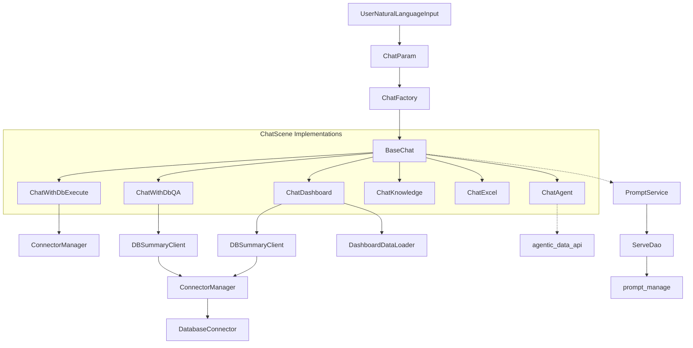
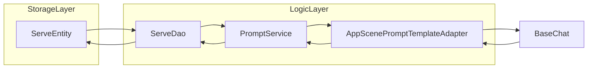
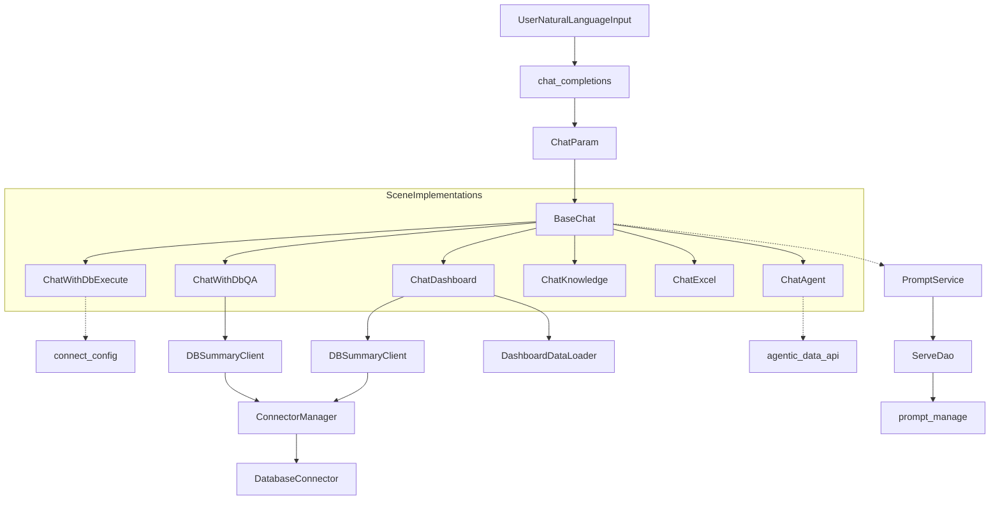

<!-- source: DeepWiki mcp.deepwiki.com · repo eosphoros-ai/DB-GPT · page 6 Application Scenes & Chat Modes · fetched 2026-11-09 -->

# Application Scenes & Chat Modes

Relevant source files

The following files were used as context for generating this wiki page:

- [packages/dbgpt-app/src/dbgpt_app/initialization/app_initialization.py](packages/dbgpt-app/src/dbgpt_app/initialization/app_initialization.py)
- [packages/dbgpt-app/src/dbgpt_app/scene/__init__.py](packages/dbgpt-app/src/dbgpt_app/scene/__init__.py)
- [packages/dbgpt-app/src/dbgpt_app/scene/base.py](packages/dbgpt-app/src/dbgpt_app/scene/base.py)
- [packages/dbgpt-app/src/dbgpt_app/scene/base_chat.py](packages/dbgpt-app/src/dbgpt_app/scene/base_chat.py)
- [packages/dbgpt-app/src/dbgpt_app/scene/chat_dashboard/chat.py](packages/dbgpt-app/src/dbgpt_app/scene/chat_dashboard/chat.py)
- [packages/dbgpt-core/src/dbgpt/agent/resource/tool/autogpt/plugins_util.py](packages/dbgpt-core/src/dbgpt/agent/resource/tool/autogpt/plugins_util.py)
- [packages/dbgpt-core/src/dbgpt/core/awel/dag/base.py](packages/dbgpt-core/src/dbgpt/core/awel/dag/base.py)
- [packages/dbgpt-core/src/dbgpt/model/cluster/worker/manager.py](packages/dbgpt-core/src/dbgpt/model/cluster/worker/manager.py)
- [packages/dbgpt-core/src/dbgpt/model/proxy/base.py](packages/dbgpt-core/src/dbgpt/model/proxy/base.py)
- [packages/dbgpt-core/src/dbgpt/model/utils/token_utils.py](packages/dbgpt-core/src/dbgpt/model/utils/token_utils.py)
- [packages/dbgpt-core/src/dbgpt/util/model_utils.py](packages/dbgpt-core/src/dbgpt/util/model_utils.py)
- [packages/dbgpt-core/src/dbgpt/util/speech/eleven_labs.py](packages/dbgpt-core/src/dbgpt/util/speech/eleven_labs.py)
- [packages/dbgpt-serve/src/dbgpt_serve/prompt/models/models.py](packages/dbgpt-serve/src/dbgpt_serve/prompt/models/models.py)

## Purpose & Scope
DB-GPT adopts a **scene-based chat architecture** that enables specialized conversations tailored to specific application domains or data types. Each **Chat Scene** serves as a distinct operational mode coordinating scene-specific logic, prompt templates, and integrations, such as natural language-to-SQL (NL2SQL) conversion with auto-execution, professional database question answering (QA), knowledge-base document retrieval and discussion, or dashboard/chart generation from data queries.

This page provides a high-level overview of this architecture and the main built-in application scenes. For detailed technical workflows, configuration, and API interfaces, consult the linked child pages.

Sources: [packages/dbgpt-app/src/dbgpt_app/scene/base.py:29-150](), [packages/dbgpt-app/src/dbgpt_app/scene/base_chat.py:113-195]()

---

## Scene-Based Chat Architecture

### Core Abstractions
The core architecture for scene-based chats revolves around the following components:

- **`ChatScene` enum**: Enumerates supported chat modes/scenes like `ChatWithDbExecute` (NL2SQL + auto-execute), `ChatWithDbQA` (pro database QA), `ChatDashboard` (visualizations), `ChatKnowledge` (RAG QA on documents), and `ChatExcel` (Excel file chat). Each scene also defines expected parameter types such as selected database, knowledge space, or file [packages/dbgpt-app/src/dbgpt_app/scene/base.py:29-150]().
- **`BaseChat` Abstract Class**: Serves as the base interface for all chat mode implementations (`packages/dbgpt-app/src/dbgpt_app/scene/base_chat.py:113-195]`). It initializes the chat session context, loads scene-specific prompt templates (via `AppScenePromptTemplateAdapter`), manages the selected language model (LLM), and provides streaming/non-streaming response APIs [packages/dbgpt-app/src/dbgpt_app/scene/base_chat.py:113-195]().
- **`ChatParam`**: Encapsulates input parameters for a chat session including session ID, current user prompt, LLM model name, active chat scene (mode), and any scene-specific option (e.g., database name or knowledge space) [packages/dbgpt-app/src/dbgpt_app/scene/base_chat.py:57-86]().
- **`StorageConversation`**: A persistence layer that stores chat history enriched with metadata about the active scene, parameters, and the user [packages/dbgpt-app/src/dbgpt_app/scene/base_chat.py:87-110]().

Sources: [packages/dbgpt-app/src/dbgpt_app/scene/base.py:29-150](), [packages/dbgpt-app/src/dbgpt_app/scene/base_chat.py:57-195]()

### High-Level Flow
User input in natural language is first wrapped as a `ChatParam` object capturing the context and selected scene. The DB-GPT `ChatFactory` dispatches this to a concrete `BaseChat` subclass corresponding to the chosen `ChatScene`. This chat scene instance executes:

1. Loading the appropriate **prompt template** for the scene and optionally a prompt code [packages/dbgpt-app/src/dbgpt_app/scene/base_chat.py:160-184]().
2. Preprocessing user input and scene parameters [packages/dbgpt-app/src/dbgpt_app/scene/base_chat.py:145-159]().
3. Interaction with external systems such as database connectors (`ConnectorManager`), knowledge retrievers, or file processors [packages/dbgpt-app/src/dbgpt_app/scene/chat_dashboard/chat.py:47-48]().
4. Calling the LLM backend (via `WorkerManager`/`LLMClient`) to generate answers [packages/dbgpt-app/src/dbgpt_app/scene/base_chat.py:154-156]().
5. Handling streaming or batch responses with structured output formats.
6. Persisting conversation history with full metadata [packages/dbgpt-app/src/dbgpt_app/scene/base_chat.py:87-110]().

Sources: [packages/dbgpt-app/src/dbgpt_app/scene/base.py:29-150](), [packages/dbgpt-app/src/dbgpt_app/scene/base_chat.py:57-195](), [packages/dbgpt-app/src/dbgpt_app/scene/chat_dashboard/chat.py:47-48]()

### Diagram: Scene Routing & Execution Flow

Sources: [packages/dbgpt-app/src/dbgpt_app/scene/base.py:29-150](), [packages/dbgpt-app/src/dbgpt_app/scene/base_chat.py:113-195](), [packages/dbgpt-app/src/dbgpt_app/scene/chat_dashboard/chat.py:23-128](), [packages/dbgpt-serve/src/dbgpt_serve/prompt/models/models.py:17-151]()

---

## Built-in Application Scenes

DB-GPT currently includes several preconfigured chat scenes, each optimized for specific workflows:

### 1. Chat Database (Text2SQL & Auto-Execute)
This scene enables users to query relational databases using natural language. It translates NL questions into SQL queries, executes them automatically against the selected datasource, and returns structured results. 

For comprehensive details on Text2SQL conversion, query auto-execution, mode toggles, and schema summarization, see the child page:  
**[Chat Database (Text2SQL & Auto-Execute)](#6.1)**

Sources: [packages/dbgpt-app/src/dbgpt_app/scene/base.py:30-55](), [packages/dbgpt-app/src/dbgpt_app/scene/base_chat.py:113-195]()

### 2. Chat Dashboard & Data Visualization
The dashboard scene builds upon database querying by generating visualization charts and reports from retrieved data using `DBSummaryClient`, `ConnectorManager`, and `DashboardDataLoader` [packages/dbgpt-app/src/dbgpt_app/scene/chat_dashboard/chat.py:47-108](). It integrates the GPT-Vis rendering protocol, enabling the frontend's `autoChart` component to display generated visualizations interactively.

For full architecture, report schema structures, chart generation, and frontend integration, consult:  
**[Chat Dashboard & Data Visualization](#6.2)**

Sources: [packages/dbgpt-app/src/dbgpt_app/scene/chat_dashboard/chat.py:23-128]()

### 3. Chat Knowledge & Chat Excel
- **ChatKnowledge:** RAG-based QA over private knowledge bases and document stores.
- **ChatExcel:** Specialized chat interface for Excel file analysis, learning, and structured data interaction.

For implementation details, pipeline workflows, and APIs, see:  
**[Chat Knowledge & Chat Excel](#6.3)**

Sources: [packages/dbgpt-app/src/dbgpt_app/scene/base.py:36-95]()

### 4. Agentic Data Assistant (ReAct Chat)
A multi-agent, skill-driven chat mode supporting complex goal-directed interactions via ReAct-style reasoning. It dynamically selects skills, connectors, and subagents, supports human-in-the-loop clarifications, and exposes an asynchronous streaming endpoint `agentic_data_api`.

For a full walkthrough, see:  
**[Agentic Data Assistant (ReAct Chat)](#6.4)**

Sources: [packages/dbgpt-app/src/dbgpt_app/scene/base.py:63-68]()

---

## Prompt & Template Management

Chat scene behavior depends heavily on dynamically loaded prompt templates stored in the backend `prompt_manage` table [packages/dbgpt-serve/src/dbgpt_serve/prompt/models/models.py:18](). The template system supports scene-specific, model-specific, and language-specific prompt variations [packages/dbgpt-serve/src/dbgpt_serve/prompt/models/models.py:30-47]().

- `BaseChat` initializes a scene's prompt template using the `AppScenePromptTemplateAdapter` by querying the `PromptService` [packages/dbgpt-app/src/dbgpt_app/scene/base_chat.py:160-169]().
- `PromptService` interacts with `ServeDao` to load prompt entities from the database [packages/dbgpt-serve/src/dbgpt_serve/prompt/models/models.py:73]().

Sources: [packages/dbgpt-app/src/dbgpt_app/scene/base_chat.py:160-184](), [packages/dbgpt-serve/src/dbgpt_serve/prompt/models/models.py:17-151]()

### Diagram: Prompt Template Retrieval Flow

Sources: [packages/dbgpt-serve/src/dbgpt_serve/prompt/models/models.py:17-151](), [packages/dbgpt-app/src/dbgpt_app/scene/base_chat.py:160-195]()

---

## Child Pages

For in-depth technical coverage of each primary chat scene, refer to:

| Page | Description |
| --- | --- |
| **[Chat Database (Text2SQL & Auto-Execute)](#6.1)** | Natural language to SQL conversion, auto-execution, pro QA mode, DB schema summarization, and SQL editor APIs. |
| **[Chat Dashboard & Data Visualization](#6.2)** | Report schema design, chart generation logic, GPT-Vis protocol integration, and frontend visualization components. |
| **[Chat Knowledge & Chat Excel](#6.3)** | RAG-based knowledge QA and Excel file interactive chat with structured data analysis workflows. |
| **[Agentic Data Assistant (ReAct Chat)](#6.4)** | Multi-skill agent chat flow with streaming API, skill selection, connector integrations, subagents, and human-in-the-loop orchestration. |

Sources: [packages/dbgpt-app/src/dbgpt_app/scene/base.py:29-150]()

---

## Summary Diagram: Mapping Natural Language Inputs to Code Entities

Sources: [packages/dbgpt-app/src/dbgpt_app/scene/base.py:29-150](), [packages/dbgpt-app/src/dbgpt_app/scene/base_chat.py:57-195](), [packages/dbgpt-app/src/dbgpt_app/scene/chat_dashboard/chat.py:23-128](), [packages/dbgpt-serve/src/dbgpt_serve/prompt/models/models.py:17-151]()

---

