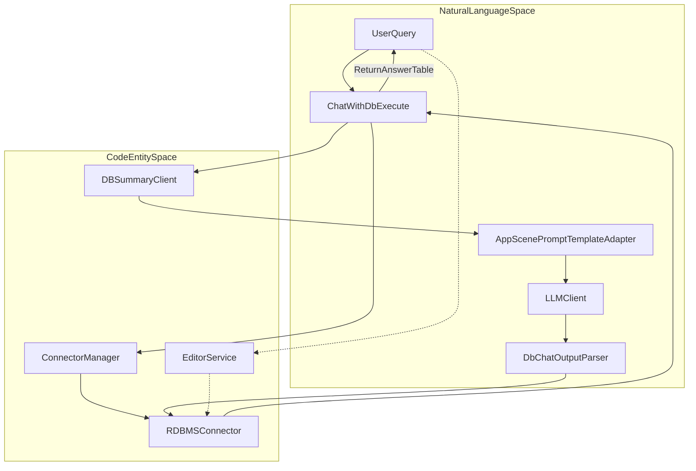
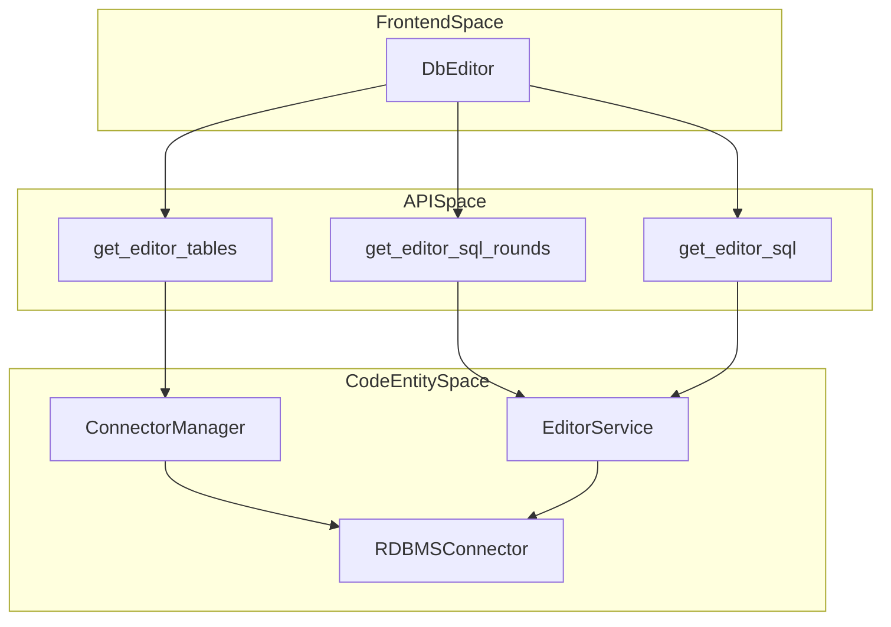

<!-- source: DeepWiki mcp.deepwiki.com · repo eosphoros-ai/DB-GPT · page 6.1 Chat Database (Text2SQL & Auto-Execute) · fetched 2026-11-09 -->

# Chat Database (Text2SQL & Auto-Execute)

Relevant source files

The following files were used as context for generating this wiki page:

- [packages/dbgpt-app/src/dbgpt_app/openapi/api_v1/editor/_chat_history/meta_db_history.py](packages/dbgpt-app/src/dbgpt_app/openapi/api_v1/editor/_chat_history/meta_db_history.py)
- [packages/dbgpt-app/src/dbgpt_app/openapi/api_v1/editor/api_editor_v1.py](packages/dbgpt-app/src/dbgpt_app/openapi/api_v1/editor/api_editor_v1.py)
- [packages/dbgpt-app/src/dbgpt_app/openapi/api_v1/editor/service.py](packages/dbgpt-app/src/dbgpt_app/openapi/api_v1/editor/service.py)
- [packages/dbgpt-app/src/dbgpt_app/openapi/api_v1/editor/tests/__init__.py](packages/dbgpt-app/src/dbgpt_app/openapi/api_v1/editor/tests/__init__.py)
- [packages/dbgpt-app/src/dbgpt_app/openapi/api_v1/editor/tests/test_chart_run.py](packages/dbgpt-app/src/dbgpt_app/openapi/api_v1/editor/tests/test_chart_run.py)
- [packages/dbgpt-app/src/dbgpt_app/scene/chat_dashboard/prompt.py](packages/dbgpt-app/src/dbgpt_app/scene/chat_dashboard/prompt.py)
- [packages/dbgpt-app/src/dbgpt_app/scene/chat_data/chat_excel/excel_analyze/chat.py](packages/dbgpt-app/src/dbgpt_app/scene/chat_data/chat_excel/excel_analyze/chat.py)
- [packages/dbgpt-app/src/dbgpt_app/scene/chat_data/chat_excel/excel_analyze/prompt.py](packages/dbgpt-app/src/dbgpt_app/scene/chat_data/chat_excel/excel_analyze/prompt.py)
- [packages/dbgpt-app/src/dbgpt_app/scene/chat_db/auto_execute/chat.py](packages/dbgpt-app/src/dbgpt_app/scene/chat_db/auto_execute/chat.py)
- [packages/dbgpt-app/src/dbgpt_app/scene/chat_db/auto_execute/prompt.py](packages/dbgpt-app/src/dbgpt_app/scene/chat_db/auto_execute/prompt.py)
- [packages/dbgpt-core/src/dbgpt/agent/util/api_call.py](packages/dbgpt-core/src/dbgpt/agent/util/api_call.py)
- [packages/dbgpt-core/src/dbgpt/util/__init__.py](packages/dbgpt-core/src/dbgpt/util/__init__.py)
- [packages/dbgpt-core/src/dbgpt/util/sql_utils.py](packages/dbgpt-core/src/dbgpt/util/sql_utils.py)
- [packages/dbgpt-core/src/dbgpt/util/tests/test_sql_utils.py](packages/dbgpt-core/src/dbgpt/util/tests/test_sql_utils.py)
- [web/components/chat/db-editor.tsx](web/components/chat/db-editor.tsx)
- [web/components/chat/monaco-editor.tsx](web/components/chat/monaco-editor.tsx)
- [web/components/chat/ob-editor/ob-plugin.ts](web/components/chat/ob-editor/ob-plugin.ts)
- [web/components/chat/ob-editor/service.ts](web/components/chat/ob-editor/service.ts)
- [web/components/chat/ob-editor/theme.ts](web/components/chat/ob-editor/theme.ts)

## Purpose and Scope

The **Chat Database (ChatDB)** scene in DB-GPT facilitates interactive natural language (NL) to SQL conversion, automatic SQL execution on live databases, professional question answering (QA) over databases, database schema summarization, and an integrated SQL editor API. This module tightly integrates conversational AI with relational databases via database connectors managed by `ConnectorManager`. It serves as the core bridge between natural language queries and structured SQL code execution in DB-GPT.

Sources:
- `packages/dbgpt-app/src/dbgpt_app/scene/base_chat.py:56-110`
- `packages/dbgpt-app/src/dbgpt_app/scene/chat_db/auto_execute/prompt.py:16-128`

---

## Overview and Core Workflow

In the ChatDB scene, user queries expressed in natural language are parsed and converted into SQL statements using large language models (LLMs), optionally augmented by summarized database schema knowledge. Generated SQL can be auto-executed on connected databases, with results formatted and rendered back to users as tables or charts. The system also provides tooling for expert SQL editing and historical query rounds inspection.

### Data Flow: NL-to-SQL Generation & Auto-Execution

This architecture enables bidirectional interaction:

- From **Natural Language Queries** to **SQL Generation** by the LLM, enriched by database schema summarization.
- Then **Auto-Execution** of the generated SQL using database connectors.
- Finally, **Result Rendering** back in conversational form.

The `EditorService` manages conversation data and SQL editing workflows independently but interacts with the same database connectors.

Sources:
- `packages/dbgpt-app/src/dbgpt_app/scene/base_chat.py:56-110`
- `packages/dbgpt-app/src/dbgpt_app/scene/chat_db/auto_execute/prompt.py:108-128`
- `packages/dbgpt-app/src/dbgpt_app/openapi/api_v1/editor/service.py:40-103`

---

## Key Components & Implementation Details

### 1. ChatWithDbExecute Scene & Professional QA Mode

This is the core chat scene implementation responsible for the NL-to-SQL workflow, automatic query execution, and assembling the final response. It configures an LLM prompt template augmented with:

- Database dialect info and schema summaries retrieved via `DBSummaryClient` (`[packages/dbgpt-app/src/dbgpt_app/scene/chat_db/professional_qa/chat.py:53-85]()`).
- Execution parameters like row limits and filter templates.
- A structured JSON output parser (`DbChatOutputParser`) that extracts the SQL, execution instructions, and display metadata from the LLM response.

The prompt templates also handle "professional QA mode" (`ChatWithDbQA`) for concise, expert answers along with SQL generation and fallback schema exploration when dynamic summary retrieval fails (`[packages/dbgpt-app/src/dbgpt_app/scene/chat_db/professional_qa/chat.py:61-80]()`).

Sources:
- `packages/dbgpt-app/src/dbgpt_app/scene/chat_db/auto_execute/prompt.py:16-128`
- `packages/dbgpt-app/src/dbgpt_app/scene/chat_db/professional_qa/chat.py:12-85`

### 2. SQL Editor API & SQL Sanitization

The REST API endpoints under `/v1/editor/` expose SQL editing features for the frontend:

- `/db/tables`: Returns hierarchical database schema (database, tables, fields) as a tree for schema exploration (`[packages/dbgpt-app/src/dbgpt_app/openapi/api_v1/editor/api_editor_v1.py:77-101]()`).
- `/sql/rounds`: Retrieves rounds of conversation SQL history per conversation ID (`[packages/dbgpt-app/src/dbgpt_app/openapi/api_v1/editor/api_editor_v1.py:104-114]()`).
- `/sql`: Fetches specific SQL content by conversation ID and round (`[packages/dbgpt-app/src/dbgpt_app/openapi/api_v1/editor/api_editor_v1.py:117-125]()`).

These APIs use the `EditorService` class to query conversation storage and manage updates (`[packages/dbgpt-app/src/dbgpt_app/openapi/api_v1/editor/service.py:40-103]()`).

Before execution, SQL statements are sanitized by `sanitize_sql` (`[packages/dbgpt-app/src/dbgpt_app/openapi/api_v1/editor/api_editor_v1.py:128-189]()`), which removes comments, prevents multi-statement injections, blocks dangerous commands (`DROP DATABASE`, `EXEC`, `LOAD DATA`, etc.), and allows only a whitelist of operations: `SELECT`, `CREATE TABLE`, `INSERT INTO`, `UPDATE`, `DELETE FROM`, `ALTER TABLE`.

Sources:
- `packages/dbgpt-app/src/dbgpt_app/openapi/api_v1/editor/api_editor_v1.py:77-189`
- `packages/dbgpt-app/src/dbgpt_app/openapi/api_v1/editor/service.py:40-103`

### 3. Editor Frontend Component (`DbEditor`)

`DbEditor` is the React component rendering the SQL editor interface in the frontend (`[web/components/chat/db-editor.tsx:153-185]()`). 

Key features:

- Uses Monaco Editor with a schema-aware session providing table and column autocomplete from loaded schema data (`[web/components/chat/db-editor.tsx:96-122]()`).
- Displays live SQL text and allows user edits (`[web/components/chat/db-editor.tsx:131-138]()`).
- Shows query result tables and charts based on executed SQL (`[web/components/chat/db-editor.tsx:139-148]()`).
- Supports layout switch between top-bottom and left-right views (`[web/components/chat/db-editor.tsx:124-128]()`).
- Loads historical SQL rounds for the conversation and allows round switching.
- Performs schema tree fetching via API and renders database/table/fields hierarchy for user exploration.

Sources:
- `web/components/chat/db-editor.tsx:64-185`

---

## REST API SQL Editor Endpoints Summary

| Endpoint | Functionality | Key Code Location |
|---|---|---|
| `/v1/editor/db/tables` | Fetch database schema tree: db -> tables -> fields | `[packages/dbgpt-app/src/dbgpt_app/openapi/api_v1/editor/api_editor_v1.py:77-101]()` |
| `/v1/editor/sql/rounds` | List all SQL rounds (conversation query history) by conv | `[packages/dbgpt-app/src/dbgpt_app/openapi/api_v1/editor/api_editor_v1.py:104-114]()` |
| `/v1/editor/sql` | Get SQL text for a specific conversation & round | `[packages/dbgpt-app/src/dbgpt_app/openapi/api_v1/editor/api_editor_v1.py:117-125]()` |

These endpoints use the `EditorService` component for operation logic, which maps conversation rounds and messages to UI-friendly data.

Sources:
- `packages/dbgpt-app/src/dbgpt_app/openapi/api_v1/editor/api_editor_v1.py:77-126`
- `packages/dbgpt-app/src/dbgpt_app/openapi/api_v1/editor/service.py:40-103`

---

## Detailed Data Flow Diagram

### SQL Editor REST API Flow (Frontend to Code Entities)

This diagram shows the journey from the frontend SQL editor React component querying REST APIs to the editor service component which manages conversations, and finally to the database connectors executing SQL or retrieving schema.

Sources:
- `packages/dbgpt-app/src/dbgpt_app/openapi/api_v1/editor/api_editor_v1.py:77-126`
- `packages/dbgpt-app/src/dbgpt_app/openapi/api_v1/editor/service.py:40-103`
- `web/components/chat/db-editor.tsx:64-185`

---

## Class and Function Summary

| Class / Function | Location | Role / Description |
|---|---|---|
| `ChatWithDbExecute` | `packages/dbgpt-app/src/dbgpt_app/scene/chat_db/auto_execute/chat.py` | Main chat scene coordinating NL-to-SQL, execution, and reply. |
| `ChatWithDbQA` | `packages/dbgpt-app/src/dbgpt_app/scene/chat_db/professional_qa/chat.py` | Professional QA mode utilizing schema summarization and database connections. |
| `DbChatOutputParser` | `packages/dbgpt-app/src/dbgpt_app/scene/chat_db/auto_execute/out_parser.py` | Parses LLM JSON output extracting SQL and display info. |
| `EditorService` | `packages/dbgpt-app/src/dbgpt_app/openapi/api_v1/editor/service.py` | Manages conversation historic SQL rounds, message updates. |
| `sanitize_sql` | `packages/dbgpt-app/src/dbgpt_app/openapi/api_v1/editor/api_editor_v1.py` | Validates and sanitizes SQL statements before execution. |
| `resolve_editor_db_name` | `packages/dbgpt-app/src/dbgpt_app/openapi/api_v1/editor/api_editor_v1.py` | Extracts db_name from request or conversation context. |
| `DbEditor` | `web/components/chat/db-editor.tsx` | Frontend SQL editor UI with schema and query result support. |

Sources:
- `packages/dbgpt-app/src/dbgpt_app/openapi/api_v1/editor/api_editor_v1.py:47-189`
- `packages/dbgpt-app/src/dbgpt_app/openapi/api_v1/editor/service.py:40-136`
- `packages/dbgpt-app/src/dbgpt_app/scene/chat_db/professional_qa/chat.py:12-85`
- `web/components/chat/db-editor.tsx:64-185`

---

