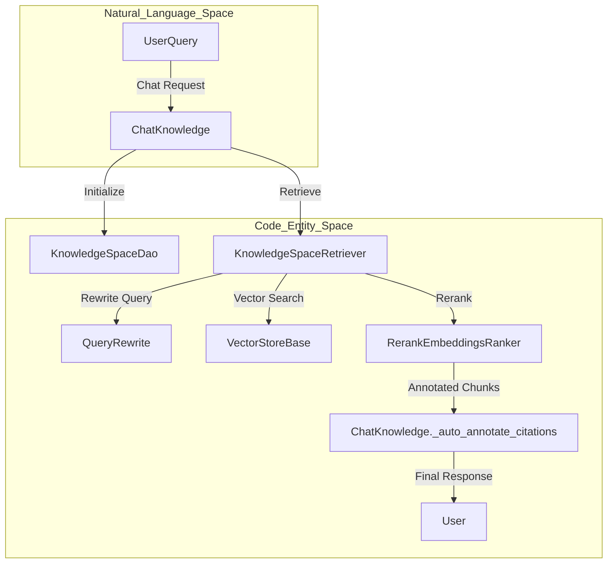
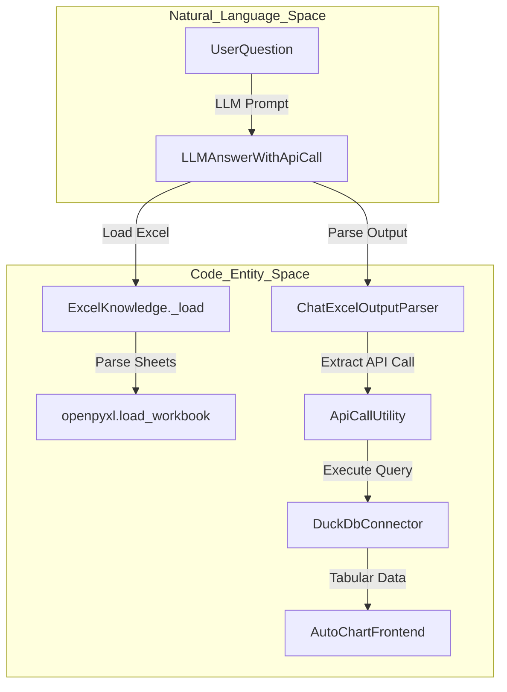

<!-- source: DeepWiki mcp.deepwiki.com · repo eosphoros-ai/DB-GPT · page 6.3 Chat Knowledge & Chat Excel · fetched 2026-11-09 -->

# Chat Knowledge & Chat Excel

Relevant source files

The following files were used as context for generating this wiki page:

- [examples/rag/doc_tree_retriever_example.py](examples/rag/doc_tree_retriever_example.py)
- [packages/dbgpt-app/src/dbgpt_app/scene/chat_dashboard/prompt.py](packages/dbgpt-app/src/dbgpt_app/scene/chat_dashboard/prompt.py)
- [packages/dbgpt-app/src/dbgpt_app/scene/chat_data/chat_excel/excel_analyze/chat.py](packages/dbgpt-app/src/dbgpt_app/scene/chat_data/chat_excel/excel_analyze/chat.py)
- [packages/dbgpt-app/src/dbgpt_app/scene/chat_data/chat_excel/excel_analyze/prompt.py](packages/dbgpt-app/src/dbgpt_app/scene/chat_data/chat_excel/excel_analyze/prompt.py)
- [packages/dbgpt-app/src/dbgpt_app/scene/chat_db/auto_execute/chat.py](packages/dbgpt-app/src/dbgpt_app/scene/chat_db/auto_execute/chat.py)
- [packages/dbgpt-app/src/dbgpt_app/scene/chat_db/auto_execute/prompt.py](packages/dbgpt-app/src/dbgpt_app/scene/chat_db/auto_execute/prompt.py)
- [packages/dbgpt-app/src/dbgpt_app/scene/chat_knowledge/v1/chat.py](packages/dbgpt-app/src/dbgpt_app/scene/chat_knowledge/v1/chat.py)
- [packages/dbgpt-app/src/dbgpt_app/scene/chat_knowledge/v1/prompt.py](packages/dbgpt-app/src/dbgpt_app/scene/chat_knowledge/v1/prompt.py)
- [packages/dbgpt-core/src/dbgpt/agent/util/api_call.py](packages/dbgpt-core/src/dbgpt/agent/util/api_call.py)
- [packages/dbgpt-core/src/dbgpt/core/interface/knowledge.py](packages/dbgpt-core/src/dbgpt/core/interface/knowledge.py)
- [packages/dbgpt-core/src/dbgpt/rag/knowledge/base.py](packages/dbgpt-core/src/dbgpt/rag/knowledge/base.py)
- [packages/dbgpt-core/src/dbgpt/util/__init__.py](packages/dbgpt-core/src/dbgpt/util/__init__.py)
- [packages/dbgpt-core/src/dbgpt/util/sql_utils.py](packages/dbgpt-core/src/dbgpt/util/sql_utils.py)
- [packages/dbgpt-core/src/dbgpt/util/tests/test_sql_utils.py](packages/dbgpt-core/src/dbgpt/util/tests/test_sql_utils.py)
- [packages/dbgpt-ext/src/dbgpt_ext/rag/graph_builder/repo_graph_builder.py](packages/dbgpt-ext/src/dbgpt_ext/rag/graph_builder/repo_graph_builder.py)
- [packages/dbgpt-ext/src/dbgpt_ext/rag/knowledge/excel.py](packages/dbgpt-ext/src/dbgpt_ext/rag/knowledge/excel.py)
- [packages/dbgpt-ext/src/dbgpt_ext/rag/knowledge/markdown.py](packages/dbgpt-ext/src/dbgpt_ext/rag/knowledge/markdown.py)
- [packages/dbgpt-ext/src/dbgpt_ext/rag/knowledge/tests/test_excel.py](packages/dbgpt-ext/src/dbgpt_ext/rag/knowledge/tests/test_excel.py)
- [packages/dbgpt-serve/src/dbgpt_serve/rag/api/git_repo_endpoints.py](packages/dbgpt-serve/src/dbgpt_serve/rag/api/git_repo_endpoints.py)
- [packages/dbgpt-serve/src/dbgpt_serve/rag/service/codegraph_build_service.py](packages/dbgpt-serve/src/dbgpt_serve/rag/service/codegraph_build_service.py)
- [packages/dbgpt-serve/src/dbgpt_serve/rag/storage_manager.py](packages/dbgpt-serve/src/dbgpt_serve/rag/storage_manager.py)
- [web/components/chat/chat-content/ReferencesContent.tsx](web/components/chat/chat-content/ReferencesContent.tsx)

The Chat Knowledge and Chat Excel scenes provide specialized chat modes within DB-GPT designed respectively for advanced question answering over diverse knowledge spaces (RAG-based QA) and for interactive analysis and learning over Excel and structured tabular data using DuckDB-powered SQL queries. These scenes leverage core DB-GPT components such as configurable prompt templates, custom retrievers, and output parsers to bridge natural language input to effective knowledge retrieval or data analysis operations.

---

## 1. Chat Knowledge (RAG-based QA over Knowledge Spaces)

The Chat Knowledge scene (`ChatScene.ChatKnowledge`) enables users to ask natural language questions over indexed knowledge spaces that can contain documents, code, or knowledge graphs. It builds on the Retrieval-Augmented Generation (RAG) approach by retrieving relevant documents or structured knowledge fragments, optionally rewriting queries, reranking results, and integrating the retrieved evidence into the LLM response.

### Implementation and Data Flow

- **ChatKnowledge Scene Class**  
  Defined in `[packages/dbgpt-app/src/dbgpt_app/scene/chat_knowledge/v1/chat.py:30-171]()`, the `ChatKnowledge` class is a subclass of `BaseChat` specialized for KBQA. It is automatically selected by the chat endpoint when the scene type `ChatScene.ChatKnowledge` is detected.

- **Knowledge Space Resolution**  
  Upon initialization, `ChatKnowledge` fetches the knowledge space configuration using the space name or ID passed in `chat_param.select_param`. It uses `KnowledgeSpaceDao` to retrieve metadata for that space, throwing an exception if not found `[packages/dbgpt-app/src/dbgpt_app/scene/chat_knowledge/v1/chat.py:53-62]()`. This unlocks access to documents and chunks stored in the knowledge repository.

- **Retriever Setup**  
  It creates a `KnowledgeSpaceRetriever` instance configured with:
  - An embedding model for vector search.
  - Top-K retrieval size based on configuration or space-specific overrides.
  - Optional query rewriting via the `QueryRewrite` class if enabled in RAG config.
  - Optional reranking of retrieval results using `RerankEmbeddingsRanker` if the reranker plugin is available, with top_k values adjusted accordingly.  
  This setup is managed inside the constructor `[packages/dbgpt-app/src/dbgpt_app/scene/chat_knowledge/v1/chat.py:69-100]()`, balancing quality and relevance of retrieval.

- **Answer Citation and Postprocessing**  
  To enhance traceability, `ChatKnowledge` post-processes LLM responses to insert inline reference markers (`[n]`) indicating which retrieved knowledge chunks support each segment of the answer. This uses the `_auto_annotate_citations()` method that heuristically finds longest common substrings from chunks to answer text for citation placement, ensuring every cited chunk appears inline `[packages/dbgpt-app/src/dbgpt_app/scene/chat_knowledge/v1/chat.py:132-171]()`.

- **Knowledge Graph Building**  
  For code- or markdown-based knowledge spaces (e.g., git repo syncs), the system can rebuild a structural knowledge graph by reconstructing files from stored document chunks and analyzing their content for code structure or markdown heading hierarchies. This graph building is triggered through API endpoints invoking the async function `build_code_graph_from_knowledge_space` `[packages/dbgpt-serve/src/dbgpt_serve/rag/service/codegraph_build_service.py:88-148]()`. The graph builder orchestrates vertex/edge extraction by the `RepoGraphBuilder` class `[packages/dbgpt-ext/src/dbgpt_ext/rag/graph_builder/repo_graph_builder.py:41-192]()`.

### Key Classes and Utilities

| Name | Responsibility | Source |
|------|----------------|--------|
| `ChatKnowledge` | RAG KBQA chat scene logic managing retrieval, query rewrite, rerank, and answer citation | `[packages/dbgpt-app/src/dbgpt_app/scene/chat_knowledge/v1/chat.py:30-171]()` |
| `KnowledgeSpaceRetriever` | Retriever integrating vector search, query rewrite, and reranking | `[packages/dbgpt-app/src/dbgpt_app/scene/chat_knowledge/v1/chat.py:92-100]()` |
| `QueryRewrite` | Optionally rewrites user natural language queries | `[packages/dbgpt-app/src/dbgpt_app/scene/chat_knowledge/v1/chat.py:71-77]()` |
| `RerankEmbeddingsRanker` | Reranks retrieved documents based on embedding similarity | `[packages/dbgpt-app/src/dbgpt_app/scene/chat_knowledge/v1/chat.py:79-91]()` |
| `GitRepoSyncService` | Syncs git repositories as knowledge spaces and triggers indexing | `[packages/dbgpt-serve/src/dbgpt_serve/rag/api/git_repo_endpoints.py:34-39]()` |
| `build_code_graph_from_knowledge_space` | Rebuilds source files from indexed chunks and constructs code graphs | `[packages/dbgpt-serve/src/dbgpt_serve/rag/service/codegraph_build_service.py:88-148]()` |
| `RepoGraphBuilder` | Builds AST and markdown heading graphs from source text/files | `[packages/dbgpt-ext/src/dbgpt_ext/rag/graph_builder/repo_graph_builder.py:41-192]()` |

### Chat Knowledge Execution Flow (Natural Language to Code Entity Space)

Sources:  
`[packages/dbgpt-app/src/dbgpt_app/scene/chat_knowledge/v1/chat.py:30-171]()`,  
`[packages/dbgpt-serve/src/dbgpt_serve/rag/service/codegraph_build_service.py:88-148]()`,  
`[packages/dbgpt-ext/src/dbgpt_ext/rag/graph_builder/repo_graph_builder.py:41-192]()`,  
`[packages/dbgpt-serve/src/dbgpt_serve/rag/api/git_repo_endpoints.py:42-120]()`

---

## 2. Chat Excel (Excel Analysis & Structured Data Chat)

The Chat Excel scene (`ChatScene.ChatExcel`) provides a powerful interface for analyzing tabular data from Excel files by interacting with an ephemeral DuckDB database. This enables precise, scalable SQL-based data analysis driven by natural language inputs, avoiding reliance on the LLM's internal reasoning and improving fidelity for data exploration and report generation.

### Implementation and Data Flow

- **Excel Knowledge Ingestion & Header Detection**  
  Excel files are processed via `ExcelKnowledge` (`[packages/dbgpt-ext/src/dbgpt_ext/rag/knowledge/excel.py:17-196]()`) which utilizes `openpyxl` with `data_only=True` to read cached formula results rather than raw formulas. It features intelligent header detection (`_find_header_row`) and merged cell unmerging to map sheets into tabular structures suitable for querying via DuckDB.

- **ChatExcel Scene Components**  
  The interaction logic for Chat Excel resides in the scene implementation which:
  - Parses Excel data structures.
  - Constructs DuckDB SQL schemas reflecting the Excel table columns `[packages/dbgpt-app/src/dbgpt_app/scene/chat_data/chat_excel/excel_analyze/prompt.py:17-37]()`.
  - Prepares prompt templates injecting sample rows and schema definitions to guide the LLM in SQL generation `[packages/dbgpt-app/src/dbgpt_app/scene/chat_data/chat_excel/excel_analyze/prompt.py:17-108]()`.
  - Parses LLM outputs that embed `<api-call>` XML-like tags encapsulating executable SQL statements and display options `[packages/dbgpt-app/src/dbgpt_app/scene/chat_data/chat_excel/excel_analyze/prompt.py:55-58]()`.
  - Executes the generated SQL against the DuckDB connector and returns formatted results to the frontend.

### Chat Excel Execution Flow (Natural Language to Code Entity Space)

Sources:  
`[packages/dbgpt-ext/src/dbgpt_ext/rag/knowledge/excel.py:17-196]()`,  
`[packages/dbgpt-app/src/dbgpt_app/scene/chat_data/chat_excel/excel_analyze/prompt.py:17-108]()`

---

## 3. Output Parsing & Structured API Call Handling

Both Chat Knowledge and Chat Excel scenes rely on structured output parsing mechanisms to decode LLM responses and safely extract commands or SQL queries.

- **`ApiCall` Class**  
  This utility parses custom XML-like tags (`<api-call>`, `<name>`, `<args>`) embedded in LLM text outputs `[packages/dbgpt-core/src/dbgpt/agent/util/api_call.py]()`. It extracts parameters such as SQL statements or display methods, enabling a structured programming interface from natural language responses.

- **ChatExcel Output Parser**  
  Specialized for Chat Excel to extract DuckDB SQL queries and display options from the parsed `ApiCall` object, allowing the chat backend to execute the requested query and return results formatted as tables or charts.

- **Annotation and Citation Handling**  
  In Chat Knowledge, the inline citation inserter `_auto_annotate_citations()` matches answer fragments to retrieved chunks and adds `[n]` markers for traceability, ensuring answers cite their sources as mandated by knowledge QA constraints `[packages/dbgpt-app/src/dbgpt_app/scene/chat_knowledge/v1/chat.py:132-171]()`. On the frontend, `ReferencesContent` and `ReferencesContentView` render these references in an interactive tabbed drawer component (`[web/components/chat/chat-content/ReferencesContent.tsx:8-82]()`).

Sources:  
`[packages/dbgpt-core/src/dbgpt/agent/util/api_call.py]()`,  
`[packages/dbgpt-app/src/dbgpt_app/scene/chat_knowledge/v1/chat.py:132-171]()`,  
`[web/components/chat/chat-content/ReferencesContent.tsx:8-82]()`

---

## 4. Knowledge Management & Git Repo Sync API

DB-GPT supports maintaining knowledge spaces sourced from git repositories, enabling continuous retrieval augmentation from code and documentation.

- **API Endpoints**  
  The REST API router defined in `[packages/dbgpt-serve/src/dbgpt_serve/rag/api/git_repo_endpoints.py:42-120]()` exposes endpoints to:
  - Start a full git repository sync into a knowledge space (`POST /{space_id}/git/sync`).
  - Perform incremental updates to existing synced knowledge (`POST /{space_id}/git/incremental-sync`).
  - Retrieve sync indexing progress (`GET /{space_id}/git/sync-status`).
  - Build a knowledge graph from indexed files (`POST /{space_id}/build-graph`).

- **Code Graph Building from Chunks**  
  The service functions asynchronously reconstruct documents from chunk DB entries and use the `RepoGraphBuilder` class to create semantic code structure graphs including AST nodes and markdown header hierarchies `[packages/dbgpt-serve/src/dbgpt_serve/rag/service/codegraph_build_service.py:88-148]()`, `[packages/dbgpt-ext/src/dbgpt_ext/rag/graph_builder/repo_graph_builder.py:41-192]()`. Storage components like `StorageManager` coordinate vector, full-text, and graph stores (`[packages/dbgpt-serve/src/dbgpt_serve/rag/storage_manager.py:18-108]()`).

Sources:  
`[packages/dbgpt-serve/src/dbgpt_serve/rag/api/git_repo_endpoints.py:42-120]()`,  
`[packages/dbgpt-serve/src/dbgpt_serve/rag/service/codegraph_build_service.py:88-148]()`,  
`[packages/dbgpt-ext/src/dbgpt_ext/rag/graph_builder/repo_graph_builder.py:41-192]()`,  
`[packages/dbgpt-serve/src/dbgpt_serve/rag/storage_manager.py:18-108]()`

---

