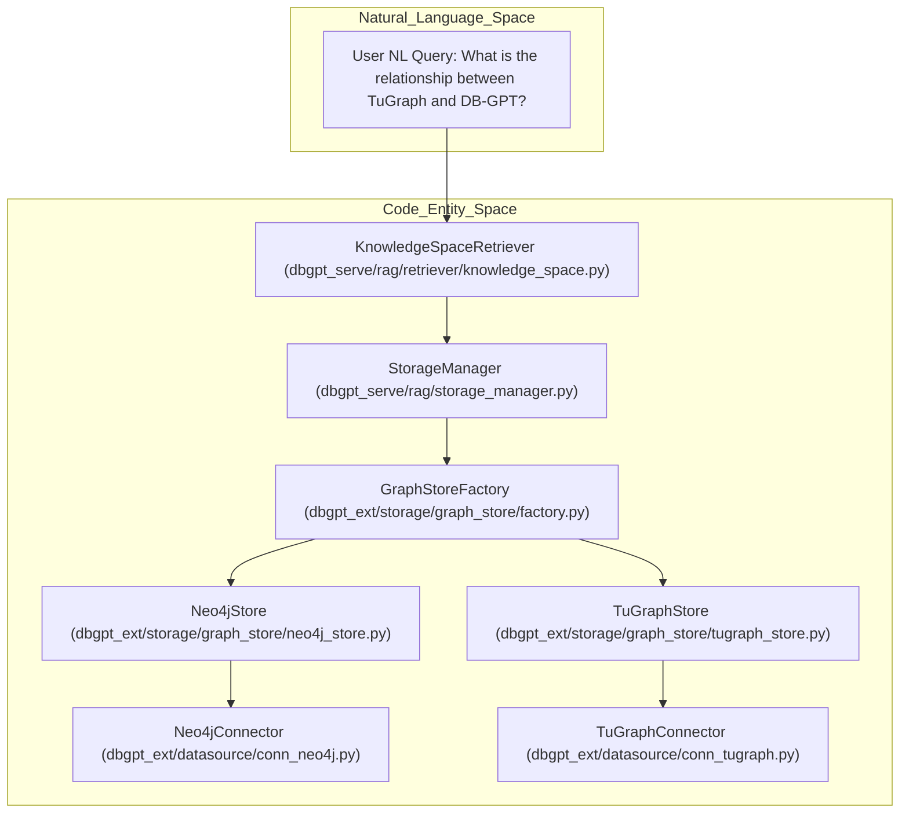
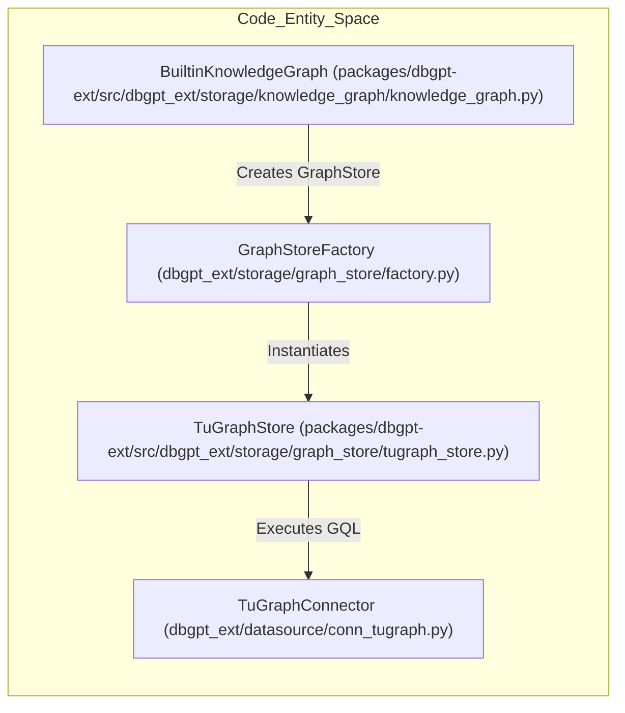
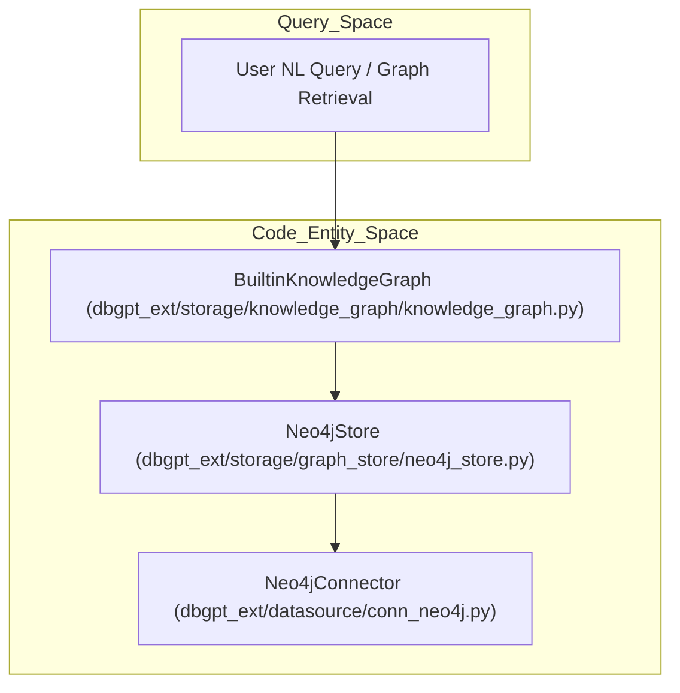
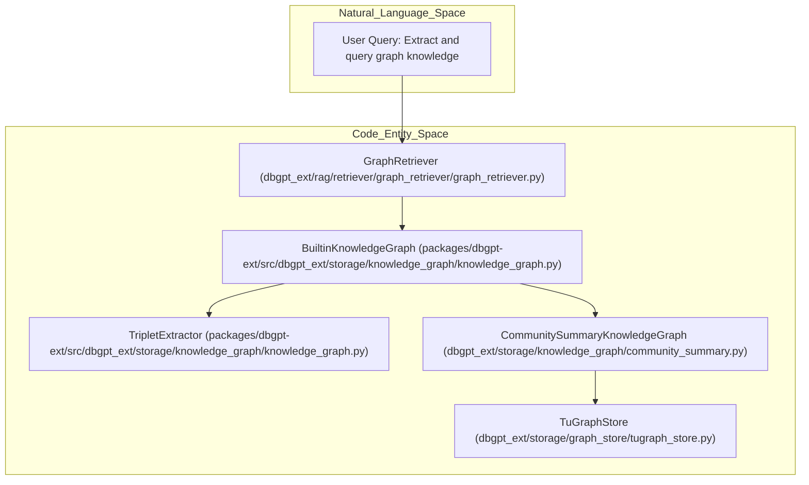

<!-- source: DeepWiki mcp.deepwiki.com · repo eosphoros-ai/DB-GPT · page 7.2 Non-Relational & Graph Datasources · fetched 2026-11-09 -->

# Non-Relational & Graph Datasources

Relevant source files

The following files were used as context for generating this wiki page:

- [configs/dbgpt-bm25-rag.toml](configs/dbgpt-bm25-rag.toml)
- [packages/dbgpt-app/src/dbgpt_app/knowledge/service.py](packages/dbgpt-app/src/dbgpt_app/knowledge/service.py)
- [packages/dbgpt-core/src/dbgpt/rag/transformer/llm_extractor.py](packages/dbgpt-core/src/dbgpt/rag/transformer/llm_extractor.py)
- [packages/dbgpt-ext/src/dbgpt_ext/datasource/conn_neo4j.py](packages/dbgpt-ext/src/dbgpt_ext/datasource/conn_neo4j.py)
- [packages/dbgpt-ext/src/dbgpt_ext/rag/retriever/graph_retriever/graph_retriever.py](packages/dbgpt-ext/src/dbgpt_ext/rag/retriever/graph_retriever/graph_retriever.py)
- [packages/dbgpt-ext/src/dbgpt_ext/rag/retriever/graph_retriever/text_based_graph_retriever.py](packages/dbgpt-ext/src/dbgpt_ext/rag/retriever/graph_retriever/text_based_graph_retriever.py)
- [packages/dbgpt-ext/src/dbgpt_ext/rag/transformer/graph_extractor.py](packages/dbgpt-ext/src/dbgpt_ext/rag/transformer/graph_extractor.py)
- [packages/dbgpt-ext/src/dbgpt_ext/rag/transformer/local_text2gql.py](packages/dbgpt-ext/src/dbgpt_ext/rag/transformer/local_text2gql.py)
- [packages/dbgpt-ext/src/dbgpt_ext/storage/graph_store/neo4j_store.py](packages/dbgpt-ext/src/dbgpt_ext/storage/graph_store/neo4j_store.py)
- [packages/dbgpt-ext/src/dbgpt_ext/storage/graph_store/tugraph_store.py](packages/dbgpt-ext/src/dbgpt_ext/storage/graph_store/tugraph_store.py)
- [packages/dbgpt-ext/src/dbgpt_ext/storage/knowledge_graph/community/factory.py](packages/dbgpt-ext/src/dbgpt_ext/storage/knowledge_graph/community/factory.py)
- [packages/dbgpt-ext/src/dbgpt_ext/storage/knowledge_graph/community_summary.py](packages/dbgpt-ext/src/dbgpt_ext/storage/knowledge_graph/community_summary.py)
- [packages/dbgpt-ext/src/dbgpt_ext/storage/knowledge_graph/knowledge_graph.py](packages/dbgpt-ext/src/dbgpt_ext/storage/knowledge_graph/knowledge_graph.py)
- [packages/dbgpt-serve/src/dbgpt_serve/rag/connector.py](packages/dbgpt-serve/src/dbgpt_serve/rag/connector.py)
- [web/package-lock.json](web/package-lock.json)
- [web/package.json](web/package.json)
- [web/public/icons/neo4j.png](web/public/icons/neo4j.png)
- [web/yarn.lock](web/yarn.lock)

This page documents the support for non-relational, distributed, and graph databases within DB-GPT. While DB-GPT provides extensive support for RDBMS, it also integrates deeply with graph databases to power advanced features like GraphRAG and community-based knowledge retrieval, as well as distributed engines, caching systems, and high-performance vector stores.

Sources:  
[packages/dbgpt-ext/src/dbgpt_ext/storage/knowledge_graph/knowledge_graph.py:152-185]()

---

## 1. Architecture Overview

Non-relational datasources in DB-GPT are managed through connector factories and storage adapters that dynamically load drivers for different database types. These connectors bridge natural language (NL) queries and RAG pipelines into specific database protocols, such as Cypher for Neo4j, binary protocols for TuGraph, or distributed computation contexts for Spark and Redis.

Key subsystems involved include:
- **Knowledge Graph subsystem:** Integrates triplet extraction and community summarization with graph stores for semantic retrieval [packages/dbgpt-ext/src/dbgpt_ext/storage/knowledge_graph/knowledge_graph.py:152-185](), [packages/dbgpt-ext/src/dbgpt_ext/storage/knowledge_graph/community_summary.py:177-191]().
- **Vector Store subsystem:** Hosts embedding-based storage for high-performance semantic search, supporting hybrid and graph-enhanced queries via the `VectorStoreConnector` and `VectorStoreBase` interfaces [packages/dbgpt-serve/src/dbgpt_serve/rag/connector.py:24-89]().
- **Datasource connectors:** Manage lifecycle, configuration, connection pooling, and session control for non-relational targets [packages/dbgpt-ext/src/dbgpt_ext/datasource/conn_neo4j.py:61-112]().

### Data Flow: NL to Graph Retrieval

The following diagram illustrates the data flow from a natural language question to a knowledge graph query, bridging the Natural Language Space to concrete code entities in the codebase.

Sources:  
[packages/dbgpt-serve/src/dbgpt_serve/rag/retriever/knowledge_space.py:1-50](),  
[packages/dbgpt-ext/src/dbgpt_ext/storage/graph_store/tugraph_store.py:145-174](),  
[packages/dbgpt-ext/src/dbgpt_ext/datasource/conn_neo4j.py:61-119]()

---

## 2. Supported Graph Datasources

DB-GPT treats graph databases as specialized storage backends for its Knowledge Graph subsystem. The `BuiltinKnowledgeGraph` class is the core implementation interfacing graph data ingestion and querying, enabling extraction of semantic triplets and storage into graph stores [packages/dbgpt-ext/src/dbgpt_ext/storage/knowledge_graph/knowledge_graph.py:152-185]().

### 2.1 TuGraph

- TuGraph is a high-performance graph database optimized for GraphRAG and community summary analytics within DB-GPT.
- `TuGraphStore` manages graph operations, plugin uploads (such as Leiden community detection), and connection states via `TuGraphConnector` [packages/dbgpt-ext/src/dbgpt_ext/storage/graph_store/tugraph_store.py:145-211]().
- `TuGraphStoreConfig` defines essential connection parameters like host, port, username, and password [packages/dbgpt-ext/src/dbgpt_ext/storage/graph_store/tugraph_store.py:60-143]().
- The lifecycle and factory pattern for graph stores instantiate TuGraph connections dynamically based on the configured `graph_store_type` [packages/dbgpt-ext/src/dbgpt_ext/storage/knowledge_graph/knowledge_graph.py:176-181]().

**TuGraph Integration Overview**

Sources:  
[packages/dbgpt-ext/src/dbgpt_ext/storage/knowledge_graph/knowledge_graph.py:152-185](),  
[packages/dbgpt-ext/src/dbgpt_ext/storage/graph_store/tugraph_store.py:60-174](),  
[packages/dbgpt-ext/src/dbgpt_ext/datasource/conn_tugraph.py:1-20]()

---

### 2.2 Neo4j

- Neo4j integration provides property graph storage through the Bolt protocol.
- The low-level connection is managed by `Neo4jConnector` found in `dbgpt_ext/datasource/conn_neo4j.py` [packages/dbgpt-ext/src/dbgpt_ext/datasource/conn_neo4j.py:61-119]().
- `Neo4jStore` encapsulates configuration, connection pooling, and graph operations [packages/dbgpt-ext/src/dbgpt_ext/storage/graph_store/neo4j_store.py:150-191]().
- Neo4j store exposes AWEL resource parameters for configuration such as host, port, username, and password allowing declarative setup in configs [packages/dbgpt-ext/src/dbgpt_ext/storage/graph_store/neo4j_store.py:16-63]().

| Parameter        | Default     | Description                  | File Reference                                                  |
|------------------|-------------|------------------------------|----------------------------------------------------------------|
| `host`           | `127.0.0.1` | Neo4j server host            | [packages/dbgpt-ext/src/dbgpt_ext/storage/graph_store/neo4j_store.py:23-28]() |
| `port`           | `7687`      | Neo4j Bolt protocol port     | [packages/dbgpt-ext/src/dbgpt_ext/storage/graph_store/neo4j_store.py:31-35]() |
| `username`       | `neo4j`     | Login username               | [packages/dbgpt-ext/src/dbgpt_ext/storage/graph_store/neo4j_store.py:39-43]() |
| `password`       | `neo4j`     | Login password               | [packages/dbgpt-ext/src/dbgpt_ext/storage/graph_store/neo4j_store.py:48-53]() |
| `database`       | `neo4j`     | Neo4j database name          | [packages/dbgpt-ext/src/dbgpt_ext/storage/graph_store/neo4j_store.py:54-60]() |
| `enable_summary` | `True`      | Enable graph community summary| [packages/dbgpt-ext/src/dbgpt_ext/storage/graph_store/neo4j_store.py:136-141]() |
| `enable_similarity_search` | `False` | Enable similarity search   | [packages/dbgpt-ext/src/dbgpt_ext/storage/graph_store/neo4j_store.py:142-147]() |

**Neo4j Connector & Store Interaction**

Sources:  
[packages/dbgpt-ext/src/dbgpt_ext/storage/graph_store/neo4j_store.py:16-191](),  
[packages/dbgpt-ext/src/dbgpt_ext/datasource/conn_neo4j.py:61-119]()

---

## 3. Distributed & Caching Non-Relational Connectors (Spark, Redis & Others)

Besides graph databases, DB-GPT supports additional non-relational data sources for distributed computation and caching.

### 3.1 Redis & Key-Value Stores

- Redis is used for high-performance caching, session storage, and async task management.
- It supports integration with AWEL and SQLAlchemyJobStore for distributed scheduling and lightweight caching layers.
- Connectors handle connection details including URIs, authentication, and connection pooling.

### 3.2 Spark & Distributed Engines

- Spark integration enables DB-GPT to perform distributed ETL jobs, large-scale data processing, and data ingestion pipelines.
- Spark connectors expose APIs to execute queries against big data sources in a scalable manner.
- Used especially when accessing distributed datasets or performing heavy analytical operations during RAG ingestion.

Sources:  
[packages/dbgpt-core/src/dbgpt/storage/base.py:28-41]()

---

## 4. Vector Stores & Non-Relational Storage Backends

Vector stores are critical backends supporting semantic similarity search of documents through embeddings, often intersecting with non-relational storage configurations.

### 4.1 Vector Store Base Interface

`VectorStoreBase` is an abstraction over vector store implementations defining consistent APIs for document loading and similarity searches:
- `load_document(chunks: List[Chunk]) -> List[str]` — ingest document chunks [packages/dbgpt-serve/src/dbgpt_serve/rag/connector.py:128-147]().
- `similar_search(text: str, topk: int, filters: Optional[MetadataFilters]) -> List[Chunk]` — vector similarity search with optional metadata filtering [packages/dbgpt-serve/src/dbgpt_serve/rag/connector.py:168-180]().

### 4.2 Specific Vector Store Implementations

DB-GPT supports multiple vector backends through `VectorStoreConnector`:
- **Chroma** — Local disk-backed store supporting persistent embeddings.
- **Milvus** — High-performance distributed vector store supporting multiple deployment modes.
- **OceanBase Vector** — Leverages OceanBase for vector indexing.
- **Elasticsearch** — Full-text + vector hybrid search support.
- **Weaviate** — Cloud-native vector search using official Weaviate SDK.
- **PGVector** — PostgreSQL extension for vector similarity.

Sources:  
[packages/dbgpt-serve/src/dbgpt_serve/rag/connector.py:24-180]()

---

## 5. Knowledge Graph Integration Pipeline

The Knowledge Graph subsystem incorporates document chunk ingestion, triplet/keyphrase extraction, and persistence into underlying graph databases such as Neo4j and TuGraph.

Key classes and processes include:
- `BuiltinKnowledgeGraph` is the main interface coordinating extraction and storage [packages/dbgpt-ext/src/dbgpt_ext/storage/knowledge_graph/knowledge_graph.py:152-195]().
- `CommunitySummaryKnowledgeGraph` extends the builtin knowledge graph to support graph community summarization workflows [packages/dbgpt-ext/src/dbgpt_ext/storage/knowledge_graph/community_summary.py:177-191]().
- `TripletExtractor` leverages LLM extractors (`LLMExtractor`) to produce subject-predicate-object triplets asynchronously from text chunks [packages/dbgpt-core/src/dbgpt/rag/transformer/llm_extractor.py:14-51](), [packages/dbgpt-ext/src/dbgpt_ext/storage/knowledge_graph/knowledge_graph.py:198-200]().
- `GraphRetriever` handles multi-strategy graph retrieval including keyword-based, text-based, and vector-based graph search [packages/dbgpt-ext/src/dbgpt_ext/rag/retriever/graph_retriever/graph_retriever.py:32-146]().

**Knowledge Graph Pipeline (Natural Language to Code Entities)**

Sources:  
[packages/dbgpt-ext/src/dbgpt_ext/storage/knowledge_graph/knowledge_graph.py:152-200](),  
[packages/dbgpt-ext/src/dbgpt_ext/storage/knowledge_graph/community_summary.py:177-191](),  
[packages/dbgpt-ext/src/dbgpt_ext/rag/retriever/graph_retriever/graph_retriever.py:32-146](),  
[packages/dbgpt-core/src/dbgpt/rag/transformer/llm_extractor.py:14-51]()

---

