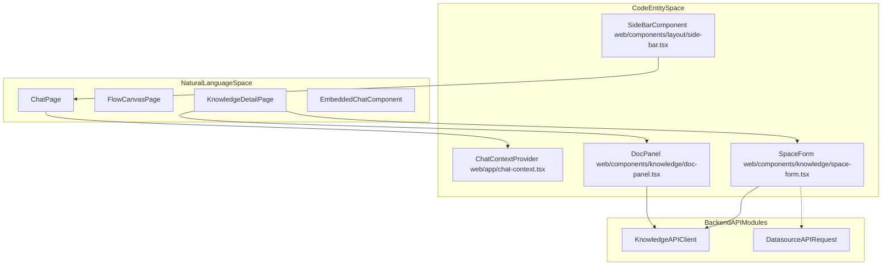
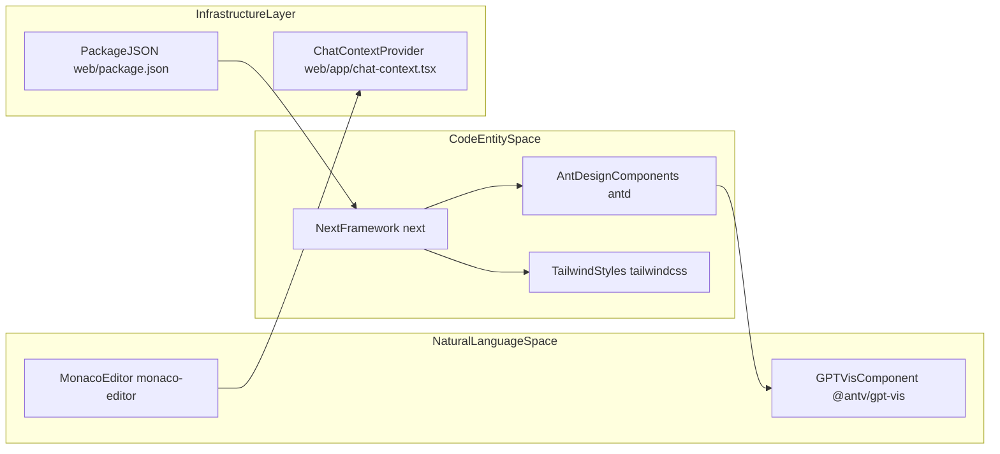

<!-- source: DeepWiki mcp.deepwiki.com · repo eosphoros-ai/DB-GPT · page 8 Web Frontend (Next.js) · fetched 2026-11-09 -->

# Web Frontend (Next.js)

Relevant source files

The following files were used as context for generating this wiki page:

- [packages/dbgpt-ext/src/dbgpt_ext/datasource/conn_neo4j.py](packages/dbgpt-ext/src/dbgpt_ext/datasource/conn_neo4j.py)
- [packages/dbgpt-ext/src/dbgpt_ext/storage/graph_store/neo4j_store.py](packages/dbgpt-ext/src/dbgpt_ext/storage/graph_store/neo4j_store.py)
- [packages/dbgpt-ext/src/dbgpt_ext/storage/knowledge_graph/community/factory.py](packages/dbgpt-ext/src/dbgpt_ext/storage/knowledge_graph/community/factory.py)
- [web/app/chat-context.tsx](web/app/chat-context.tsx)
- [web/components/layout/side-bar.tsx](web/components/layout/side-bar.tsx)
- [web/package-lock.json](web/package-lock.json)
- [web/package.json](web/package.json)
- [web/public/icons/neo4j.png](web/public/icons/neo4j.png)
- [web/yarn.lock](web/yarn.lock)

The DB-GPT web frontend is a modern, responsive application built with **Next.js** [web/package.json:1-75](). It provides the primary user interface for interacting with DB-GPT's multi-model management, knowledge bases, agentic workflows (AWEL), and data analysis tools. The frontend is architected with a component-based modular design that supports capabilities such as visual workflow creation, real-time multi-turn chat with streaming agent responses, knowledge space management with embedded chat, and internationalization (i18n).

The frontend communicates with the backend via REST APIs and is styled using **Ant Design** and **Tailwind CSS** [web/package.json:27-51](). It leverages advanced editors like **Monaco Editor** [web/package.json:41-69]().

---

### System Architecture Overview

The frontend consists of several key functional subsystems that map directly to Next.js pages, React components, and hooks. The major functional areas include the Chat Interface, Flow Canvas / App Builder, and Knowledge Management UI, coordinated via application context providers such as `ChatContextProvider` [web/app/chat-context.tsx:79-188]() and layout components like `SideBar` [web/components/layout/side-bar.tsx:66-192]().

Title: "System Architecture & Feature Mapping"

Sources: [web/app/chat-context.tsx:79-188](), [web/components/layout/side-bar.tsx:66-192]()

---

### Core Functional Modules

#### 1. Chat & Conversation UI

This module encompasses the user interface for multi-turn chat sessions with one or more agents, supporting streaming responses, intermediate reasoning steps, and tool invocation visualization. State management and shared configurations across chat views are handled by `ChatContext` [web/app/chat-context.tsx:13-43]().

For comprehensive details on the chat UI components, hooks, and integration patterns, see child page [Chat & Conversation UI](#8.1).

Sources: [web/app/chat-context.tsx:13-43]()

#### 2. Flow Canvas & App Builder UI

This module covers visual programming of workflows and orchestration of agentic workflows defined in AWEL (Agentic Workflow Expression Language). Key aspects include drag-and-drop flow canvases, custom node renderers, add-nodes sidebars, app construction pages, prompt management, and embedded notebook components [web/package.json:1-93]().

Refer to [Flow Canvas & App Builder UI](#8.2) for in-depth details about components and page designs.

Sources: [web/package.json:1-93]()

#### 3. Knowledge Management UI

The Knowledge Management UI handles creation, configuration, and detailed inspection of knowledge spaces — collections of documents, embeddings, code graphs, and metadata underpinning DB-GPT's RAG capabilities. Sidebar navigation routes users directly to knowledge and datasource configuration views [web/components/layout/side-bar.tsx:153-192]().

Please consult [Knowledge Management UI](#8.3) for comprehensive component and page descriptions.

Sources: [web/components/layout/side-bar.tsx:153-192]()

#### 4. Internationalization (i18n)

DB-GPT frontend uses `react-i18next` for internationalization, allowing multiple languages to be supported seamlessly [web/package.json:62-79]().

- Locale resource files reside under `web/locales`, with namespace routing managed via React i18n hooks [web/components/layout/side-bar.tsx:78-151]().
- Dynamic language switching updates both UI strings and moment.js localizations on the fly [web/components/layout/side-bar.tsx:145-151]().

Sources: [web/package.json:62-79](), [web/components/layout/side-bar.tsx:78-151]()

---

### Technology Stack & Component Layers

The frontend uses a layered component and technology stack integrating well-known libraries with custom-built UI parts:

Title: "Frontend Technology Stack & Layers"

Sources: [web/package.json:1-145](), [web/app/chat-context.tsx:79-188]()

- **Next.js** provides the underlying React SSR and routing framework [web/package.json:72]() along with script optimizations [web/package.json:13-25]().
- **Ant Design** and **Tailwind CSS** form the main UI component library and styling system [web/package.json:49-90]().
- **Monaco Editor** is integrated for rich SQL and code editing [web/package.json:41]().
- **@antv/gpt-vis** enables rendering of agent thought processes and visualization charts [web/package.json:34]().

Sources: [web/package.json:34-72]()

---

### Child Pages

- [Chat & Conversation UI](#8.1) — Detailed coverage of chat index pages, chat-container & chat-content components, session handling, document upload, and hooks.
- [Flow Canvas & App Builder UI](#8.2) — In-depth look at the AWEL visual flow canvas, node renderers, add-node sidebar, prompt & skill management, and connectors.
- [Knowledge Management UI](#8.3) — Detailed documentation of knowledge space pages, creation form, document panel, knowledge tree, search tools, and knowledge API clients.

Sources: [web/package.json:1-145]()

---

