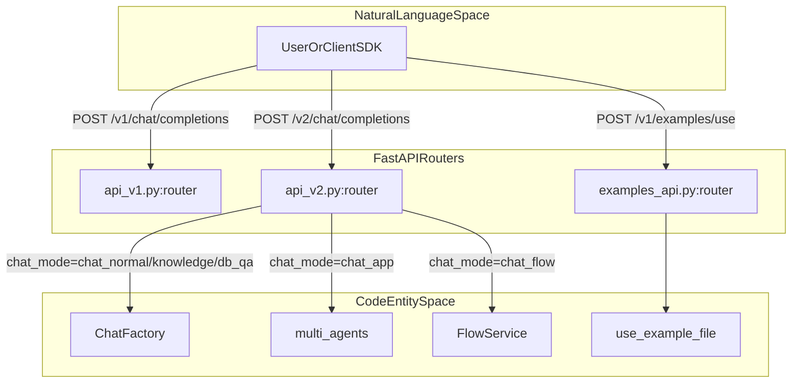
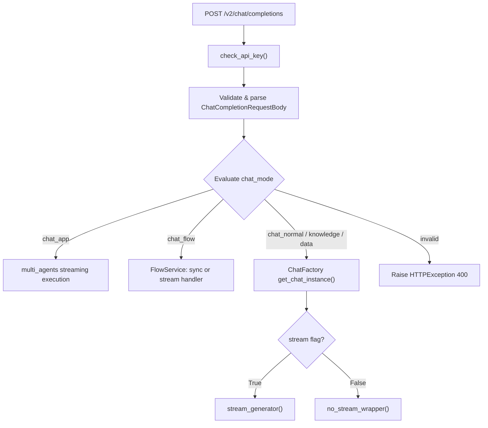
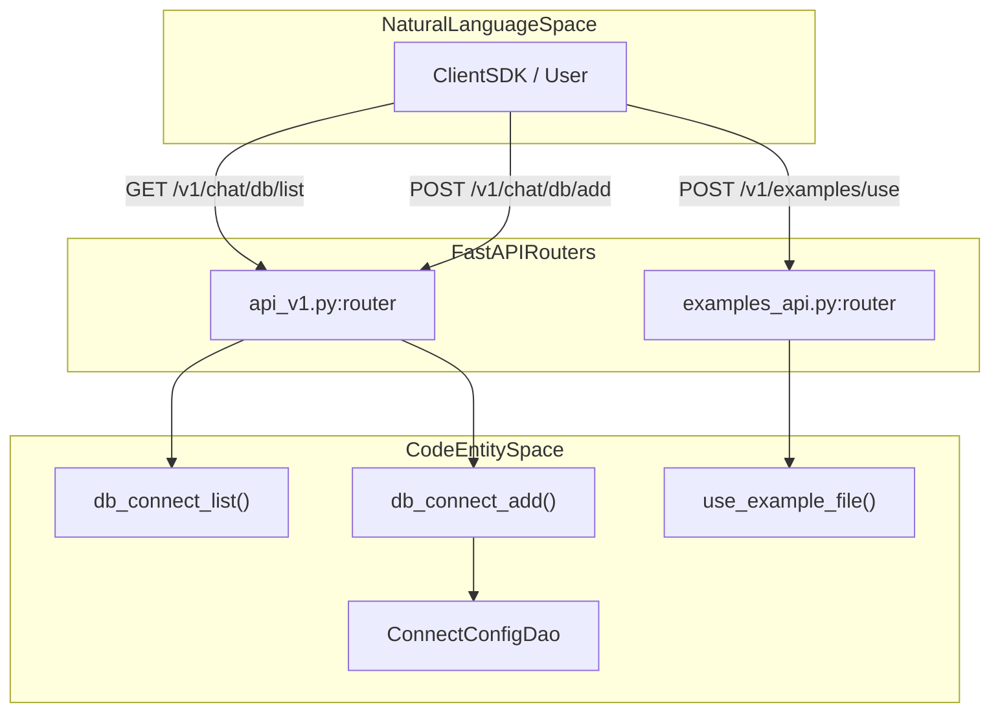

<!-- source: DeepWiki mcp.deepwiki.com · repo eosphoros-ai/DB-GPT · page 9.1 OpenAPI Endpoints (v1 & v2) · fetched 2026-11-09 -->

# OpenAPI Endpoints (v1 & v2)

Relevant source files

The following files were used as context for generating this wiki page:

- [docs/blog/2025-04-29-db-gpt-qwen3-support.md](docs/blog/2025-04-29-db-gpt-qwen3-support.md)
- [packages/dbgpt-app/src/dbgpt_app/openapi/api_v1/api_v1.py](packages/dbgpt-app/src/dbgpt_app/openapi/api_v1/api_v1.py)
- [packages/dbgpt-app/src/dbgpt_app/openapi/api_v1/examples_api.py](packages/dbgpt-app/src/dbgpt_app/openapi/api_v1/examples_api.py)
- [packages/dbgpt-app/src/dbgpt_app/openapi/api_v2.py](packages/dbgpt-app/src/dbgpt_app/openapi/api_v2.py)
- [packages/dbgpt-app/src/dbgpt_app/operators/llm.py](packages/dbgpt-app/src/dbgpt_app/operators/llm.py)
- [packages/dbgpt-app/src/dbgpt_app/scene/chat_db/professional_qa/chat.py](packages/dbgpt-app/src/dbgpt_app/scene/chat_db/professional_qa/chat.py)
- [packages/dbgpt-app/src/dbgpt_app/tests/test_examples_api.py](packages/dbgpt-app/src/dbgpt_app/tests/test_examples_api.py)
- [packages/dbgpt-client/src/dbgpt_client/schema.py](packages/dbgpt-client/src/dbgpt_client/schema.py)
- [packages/dbgpt-core/src/dbgpt/core/awel/trigger/http_trigger.py](packages/dbgpt-core/src/dbgpt/core/awel/trigger/http_trigger.py)
- [packages/dbgpt-core/src/dbgpt/core/interface/media.py](packages/dbgpt-core/src/dbgpt/core/interface/media.py)
- [packages/dbgpt-core/src/dbgpt/core/interface/message.py](packages/dbgpt-core/src/dbgpt/core/interface/message.py)
- [packages/dbgpt-core/src/dbgpt/util/configure/manager.py](packages/dbgpt-core/src/dbgpt/util/configure/manager.py)
- [packages/dbgpt-core/src/dbgpt/util/configure/markdown.py](packages/dbgpt-core/src/dbgpt/util/configure/markdown.py)
- [packages/dbgpt-core/src/dbgpt/util/parameter_utils.py](packages/dbgpt-core/src/dbgpt/util/parameter_utils.py)
- [packages/dbgpt-ext/src/dbgpt_ext/storage/knowledge_graph/open_spg.py](packages/dbgpt-ext/src/dbgpt_ext/storage/knowledge_graph/open_spg.py)
- [packages/dbgpt-serve/src/dbgpt_serve/agent/agents/db_gpts_memory.py](packages/dbgpt-serve/src/dbgpt_serve/agent/agents/db_gpts_memory.py)
- [packages/dbgpt-serve/src/dbgpt_serve/agent/chat/tests/test_gpts_messages_db.py](packages/dbgpt-serve/src/dbgpt_serve/agent/chat/tests/test_gpts_messages_db.py)
- [packages/dbgpt-serve/src/dbgpt_serve/agent/db/gpts_app.py](packages/dbgpt-serve/src/dbgpt_serve/agent/db/gpts_app.py)
- [packages/dbgpt-serve/src/dbgpt_serve/agent/db/gpts_conversations_db.py](packages/dbgpt-serve/src/dbgpt_serve/agent/db/gpts_conversations_db.py)
- [packages/dbgpt-serve/src/dbgpt_serve/agent/db/gpts_messages_db.py](packages/dbgpt-serve/src/dbgpt_serve/agent/db/gpts_messages_db.py)
- [packages/dbgpt-serve/src/dbgpt_serve/datasource/manages/connect_config_db.py](packages/dbgpt-serve/src/dbgpt_serve/datasource/manages/connect_config_db.py)

## Purpose and Scope

This page details the RESTful API surface of DB-GPT, covering legacy version 1 (`v1`) endpoints, the enhanced version 2 (`v2`) service-oriented architecture, application and flow management APIs, datasource connectors, knowledge spaces, model management, feedback, and editor APIs. It describes FastAPI router organization, request/response validation models, authentication mechanisms, and internal routing logic.

---

## API Architecture and Router Organization

DB-GPT leverages the **FastAPI** framework to expose its HTTP REST interface. The API surface is partitioned into multiple routers handling core LLM chat interactions, domain-specific services, and utility operations.

### Router Structure

- **V1 Router**: Defined in `[packages/dbgpt-app/src/dbgpt_app/openapi/api_v1/api_v1.py]()`, exposing legacy endpoints including chat completions, database connector management, and knowledge space APIs [packages/dbgpt-app/src/dbgpt_app/openapi/api_v1/api_v1.py:56-212]().
- **V2 Router**: Defined in `[packages/dbgpt-app/src/dbgpt_app/openapi/api_v2.py]()`, providing a unified service-oriented `POST /v2/chat/completions` endpoint supporting multiple chat modes with streaming or non-streaming execution and API key validation [packages/dbgpt-app/src/dbgpt_app/openapi/api_v2.py:38-168]().
- **Examples API**: Defined in `[packages/dbgpt-app/src/dbgpt_app/openapi/api_v1/examples_api.py]()`, exposing `POST /v1/examples/use` to copy bundled example files into user upload directories [packages/dbgpt-app/src/dbgpt_app/openapi/api_v1/examples_api.py:118-160]().

### Authorization Mechanism

- `v2` endpoints secure access via an API key bearer token scheme implemented through FastAPI's dependency injection (`HTTPBearer`) [packages/dbgpt-app/src/dbgpt_app/openapi/api_v2.py:8-46]().
- The `check_api_key` function validates the bearer token against keys configured in the `FlowService` component, raising an HTTP 401 Unauthorized exception on failure [packages/dbgpt-app/src/dbgpt_app/openapi/api_v2.py:43-68]().

### Natural Language to Code Entity Bridge: Router Architecture

Sources:
- [packages/dbgpt-app/src/dbgpt_app/openapi/api_v1/api_v1.py:56-212]()
- [packages/dbgpt-app/src/dbgpt_app/openapi/api_v2.py:38-168]()
- [packages/dbgpt-app/src/dbgpt_app/openapi/api_v1/examples_api.py:118-160]()

---

## Chat & Completion APIs (v1 & v2)

### Endpoint Summary

| Version | Endpoint | Description |
|---------|----------|-------------|
| v1 | `POST /v1/chat/completions` | Legacy chat completion endpoint for standard chat and database queries [packages/dbgpt-app/src/dbgpt_app/openapi/api_v1/api_v1.py]() |
| v2 | `POST /v2/chat/completions` | Unified multi-mode chat completions endpoint supporting streaming and routing [packages/dbgpt-app/src/dbgpt_app/openapi/api_v2.py]() |

### `v2` Chat Completions Endpoint Detail

- **Path:** `/v2/chat/completions`
- **Method:** `POST`
- **Authorization:** Bearer token checked via `check_api_key` dependency [packages/dbgpt-app/src/dbgpt_app/openapi/api_v2.py:43-68]().
- **Payload Schema:** `ChatCompletionRequestBody` pydantic model specifying messages, model, chat mode, stream flag, and conversation UID [packages/dbgpt-client/src/dbgpt_client/schema.py:16-86]().

### Supported Chat Modes Routing Table

| Chat Mode String | Backend Handler / Class | Notes |
|------------------|-------------------------|-------|
| `chat_app` | `multi_agents` | Streaming-only multi-agent graph execution [packages/dbgpt-app/src/dbgpt_app/openapi/api_v2.py:96-115]() |
| `chat_flow` | `FlowService` | AWEL flow execution supporting sync/stream [packages/dbgpt-serve/src/dbgpt_serve/flow/api/endpoints.py]() |
| `chat_normal` | `ChatFactory` | Standard LLM chat interaction [packages/dbgpt-app/src/dbgpt_app/openapi/api_v1/api_v1.py:58]() |
| `chat_knowledge` | `ChatFactory` + RAG Retriever | Knowledge space augmented QA |
| `chat_data` | `ChatFactory` | Mapped internally to database execution mode (`ChatWithDbExecute`) [packages/dbgpt-app/src/dbgpt_app/openapi/api_v2.py:187-188]() |
| `chat_db_qa` (alias `chat_with_db_qa`) | `ChatFactory` | Professional database schema QA mode (`ChatWithDbQA`) [packages/dbgpt-app/src/dbgpt_app/scene/chat_db/professional_qa/chat.py:12-19]() |
| `chat_dashboard` | `ChatFactory` | GPT-Vis data visualization dashboard generation |

- If `chat_mode` is omitted, it defaults to `chat_normal` [packages/dbgpt-app/src/dbgpt_app/openapi/api_v2.py:180-181]().
- Invalid or unsupported modes raise an HTTP 400 error response [packages/dbgpt-app/src/dbgpt_app/openapi/api_v2.py:156-167]().

### Chat Completion v2 Dispatch Flow Diagram

Sources:
- [packages/dbgpt-app/src/dbgpt_app/openapi/api_v2.py:38-194]()
- [packages/dbgpt-client/src/dbgpt_client/schema.py:16-98]()

---

## Domain Service APIs (Knowledge, Datasource, Flow, App, Model Management)

DB-GPT exposes comprehensive serve endpoints via FastAPI routers registered dynamically or statically through the `SystemApp` component architecture.

### Knowledge Management APIs
- Endpoint group: `/knowledge/*`
- Managed via `KnowledgeService` [packages/dbgpt-app/src/dbgpt_app/knowledge/service.py]() to handle knowledge spaces, document additions, chunk listings, and vector similarity retrieval for RAG.

### Datasource Management APIs
- Endpoints under `/v1/chat/db/*` [packages/dbgpt-app/src/dbgpt_app/openapi/api_v1/api_v1.py:174-212]():
  - `GET /v1/chat/db/list`: Retrieves registered databases, filtering out internal system schemas (e.g., `auth`, `dbgpt`, `test`, `public`) [packages/dbgpt-app/src/dbgpt_app/openapi/api_v1/api_v1.py:174-190]().
  - `POST /v1/chat/db/add`: Adds a new database connection configuration using `DBConfig` and `ConnectConfigDao` [packages/dbgpt-app/src/dbgpt_app/openapi/api_v1/api_v1.py:192-198](), [packages/dbgpt-serve/src/dbgpt_serve/datasource/manages/connect_config_db.py:58-120]().
  - `POST /v1/chat/db/edit`: Updates existing connection properties [packages/dbgpt-app/src/dbgpt_app/openapi/api_v1/api_v1.py:208-212]().

### AWEL Flow & App APIs
- Exposed via `dbgpt_serve.flow` and `dbgpt_serve.agent` serve packages.
- Allows CRUD operations on AWEL DAG flows, visualization parameters, team configurations, and published multi-agent applications (`GptsApp`).

### Model Management & Cluster APIs
- Exposed via SMMF (Service-Oriented Multi-Model Management Framework) router endpoints.
- Manages model controller status, worker registration, inference proxy settings, and OpenAI-compatible model metadata listings (`/v1/models`).

### Feedback & Editor APIs
- Feedback endpoints capture user ratings and review scores on conversation turns (`gpts_messages`).
- Editor APIs support database schema inspection, query execution, and SQL editing interfaces.

---

## Utility and Example Files API

- `POST /v1/examples/use`: Copies bundled example files (CSV datasets, PDF reports, or text skills) into the user's upload directory for testing and demonstration [packages/dbgpt-app/src/dbgpt_app/openapi/api_v1/examples_api.py:118-160]().
- Includes strict filename validation (`_validate_example_filename`) to prevent path traversal vulnerabilities [packages/dbgpt-app/src/dbgpt_app/openapi/api_v1/examples_api.py:65-79]().
- Resolves files across source development trees (`docker/examples/`) and installed package wheels (`_builtin_examples/`) [packages/dbgpt-app/src/dbgpt_app/openapi/api_v1/examples_api.py:82-116]().

### Natural Language to Code Entity Bridge: Utility and Datasource Operations

Sources:
- [packages/dbgpt-app/src/dbgpt_app/openapi/api_v1/api_v1.py:174-212]()
- [packages/dbgpt-app/src/dbgpt_app/openapi/api_v1/examples_api.py:118-160]()
- [packages/dbgpt-serve/src/dbgpt_serve/datasource/manages/connect_config_db.py:58-120]()

---

## Schemas and Data Models

- Chat request and response schemas mirror OpenAI specifications, defined in `dbgpt.core.schema.api` and wrapped by `ChatCompletionRequestBody` [packages/dbgpt-client/src/dbgpt_client/schema.py:16-86]().
- Conversation message persistence relies on SQLAlchemy ORM entities such as `GptsMessagesEntity` and `ConnectConfigEntity` [packages/dbgpt-serve/src/dbgpt_serve/agent/db/gpts_messages_db.py:29-92](), [packages/dbgpt-serve/src/dbgpt_serve/datasource/manages/connect_config_db.py:28-55]().

Sources:
- [packages/dbgpt-app/src/dbgpt_app/openapi/api_v2.py:11-23]()
- [packages/dbgpt-client/src/dbgpt_client/schema.py:1-98]()
- [packages/dbgpt-serve/src/dbgpt_serve/agent/db/gpts_messages_db.py:29-92]()
- [packages/dbgpt-serve/src/dbgpt_serve/datasource/manages/connect_config_db.py:28-55]()

---

