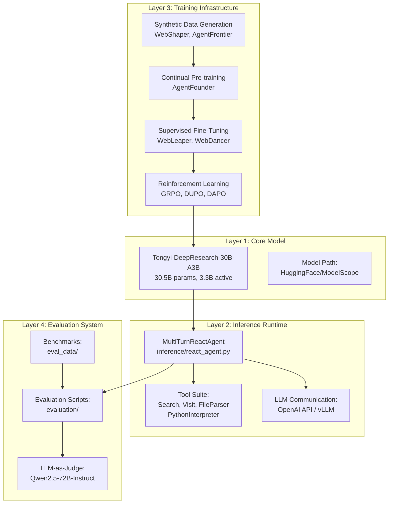
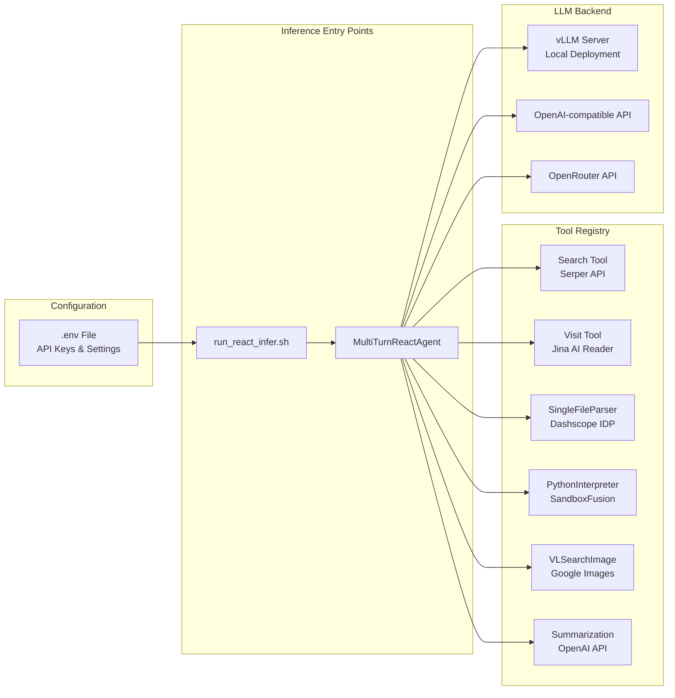
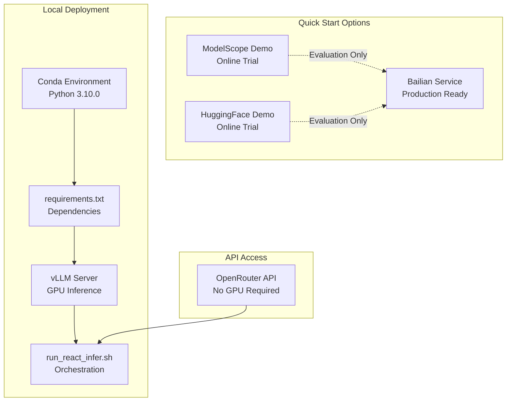

<!-- source: DeepWiki mcp.deepwiki.com · repo Alibaba-NLP/DeepResearch · page 1 Overview · fetched 2026-10-29 -->

# Overview

Relevant source files

The following files were used as context for generating this wiki page:

- [FAQ.md](FAQ.md)
- [README.md](README.md)
- [assets/family.png](assets/family.png)
- [assets/family17.png](assets/family17.png)

This document provides a high-level introduction to the Tongyi DeepResearch repository, an open-source codebase for building and deploying agentic large language models specialized in deep information-seeking tasks. The material covered includes the system architecture, core components, inference paradigms, and the organizational structure of the repository.

For detailed technical implementation of specific components, see:
- Inference system details: [Core Inference Engine](#2)
- Training methodologies: [Training and Data Pipeline](#3)
- Specific agent implementations: [Agent Implementations](#4)
- Evaluation procedures: [Evaluation and Benchmarks](#5)
- Setup instructions: [Setup and Configuration](#6)

## What is Tongyi DeepResearch

Tongyi DeepResearch is an agentic large language model with 30.5 billion total parameters and 3.3 billion activated per token (30B-A3B architecture). Developed by Alibaba's Tongyi Lab, the system is specifically designed for long-horizon, deep information-seeking tasks that require iterative tool use, web navigation, and complex reasoning.

The model achieves state-of-the-art performance across multiple agentic search benchmarks including Humanity's Last Exam, BrowseComp (English and Chinese variants), WebWalkerQA, xbench-DeepSearch, FRAMES, and SimpleQA.

**Key Capabilities:**
- **Autonomous web navigation** and information gathering across multiple pages
- **Tool orchestration** including search engines, web readers, document parsers, and code execution
- **Multi-turn reasoning** with iterative refinement of answers
- **Context management** for handling long conversation histories
- **Multimodal understanding** for vision-language tasks

Sources: [README.md:30-36]()

## Repository Structure

The repository is organized into several major directories:

| Directory | Purpose | Key Contents |
|-----------|---------|--------------|
| `inference/` | Core inference engine | `react_agent.py`, tool implementations, orchestration scripts |
| `evaluation/` | Benchmark evaluation | Evaluation scripts, judge prompts, metrics calculation |
| `eval_data/` | Evaluation datasets | Benchmark data files, reference answers |
| `WebAgent/` | Agent family papers | 18+ research projects with implementations |
| `Agent/` | Foundation training | AgentScaler, AgentFounder frameworks |

Sources: [README.md:1-247]()

## Four-Layer System Architecture

Tongyi DeepResearch is built on a four-layer architecture, with each layer serving a distinct purpose in the overall system:

**Layer 1: Core Model** - The foundational 30B-A3B model weights, downloadable from HuggingFace or ModelScope, trained specifically for agentic tasks.

**Layer 2: Inference Runtime** - The execution environment where the model operates, centered around the `MultiTurnReactAgent` class in `inference/react_agent.py`. This layer handles tool invocation, LLM communication, and conversation management.

**Layer 3: Training Infrastructure** - The methodologies and frameworks used to train the model, including fully automated synthetic data generation, continual pre-training on agentic data (up to 128K context), supervised fine-tuning with trajectory filtering, and reinforcement learning with custom algorithms.

**Layer 4: Evaluation System** - The comprehensive benchmarking infrastructure with 8+ evaluation datasets, automated scoring scripts in the `evaluation/` directory, and LLM-as-judge methodology for open-ended answer assessment.

Sources: [README.md:30-47](), Diagram 1 from high-level system architecture

## Core Inference Components

The inference system is built around several key code entities that work together to enable agentic behavior:

**MultiTurnReactAgent** - The main agent controller class (referenced in [README.md:176]()) that implements the ReAct (Reasoning + Acting) loop. It manages conversation state, coordinates tool invocations, handles token limits, and implements retry logic.

**Tool Suite** - Six specialized tools that extend the agent's capabilities:
- `Search` tool interfaces with Serper.dev for web search and Google Scholar access
- `Visit` tool uses Jina.ai Reader API to extract clean text from web pages
- `SingleFileParser` handles PDF, DOCX, Excel, HTML, and other document formats via Dashscope IDP
- `PythonInterpreter` enables secure code execution through SandboxFusion sandboxing
- `VLSearchImage` provides reverse image search and visual content retrieval
- Summarization tool compresses long content using OpenAI-compatible APIs

**Configuration System** - The `.env` file stores all API keys and settings. An `.env.example` template is provided at [README.md:97]().

Sources: [README.md:68-170](), [README.md:100-110]()

## Inference Paradigms

Tongyi DeepResearch supports two distinct inference modes, selectable at runtime:

**ReAct Paradigm** - The standard inference mode that rigorously evaluates the model's intrinsic abilities. The agent follows a Think → Act → Observe loop where it reasons about the next action, executes a tool call, and observes the result before continuing. This mode is used for benchmark evaluation to measure the model's core capabilities without test-time scaling.

**IterResearch Heavy Mode** - An advanced test-time scaling strategy that maximizes performance by allowing the model to explore multiple reasoning paths, aggregate information from diverse sources, and iteratively refine answers. This mode leverages techniques from the Deep Research Agent Family papers to unlock the model's maximum performance ceiling.

The paradigm selection affects how the `MultiTurnReactAgent` orchestrates the inference loop and determines the complexity of the reasoning process.

Sources: [README.md:47](), [FAQ.md:12-14]()

## Deep Research Agent Family

Beyond the core Tongyi DeepResearch model, the repository includes 18+ research papers organized into the `WebAgent/` and `Agent/` directories. These papers contribute specialized methodologies, training techniques, and architectural innovations:

| Category | Agents | Focus Area |
|----------|--------|------------|
| **Navigation & Traversal** | WebWalker, WebDancer, WebSailor V1/V2 | Web page navigation, autonomous search, reasoning during traversal |
| **Research & Reasoning** | WebResearcher, ReSum, WebWeaver, ParallelMuse | Long-horizon reasoning, context compression, structured evidence gathering |
| **Data Synthesis** | WebShaper, AgentFrontier, Repurposing Synthetic Data | Automated data generation, curriculum learning, fine-grained supervision |
| **Vision & Multimodal** | WebWatcher | Vision-language understanding for web agents |
| **Optimization** | AgentFold, WebLeaper, BrowseConf, NestBrowse | Context management, efficient info seeking, test-time scaling |
| **Foundation** | Scaling Agents via CPT, Environment Scaling | Theoretical foundations for continual pre-training and environment design |

Each agent project typically includes:
- Research paper (arXiv link in [README.md:198-216]())
- Implementation code in subdirectories
- Evaluation scripts and datasets
- Training recipes and hyperparameters

The methodologies from these papers are integrated into the training pipeline that produces the core Tongyi DeepResearch model.

Sources: [README.md:190-216](), Diagram 5 from high-level system architecture

## Deployment Options

The system can be deployed in multiple configurations:

**Online Demos** - Quick evaluation via ModelScope or HuggingFace Spaces (see [README.md:25-28]()). These demos have QPS limits and may experience latency.

**Production Service** - The Bailian platform provides enterprise-grade deployment with guaranteed uptime, SLAs, and scalability (see [README.md:25-28]()).

**Local Deployment** - Full control over the system by running a vLLM server locally. Requires Python 3.10.0 and GPU resources. Instructions in [README.md:68-170]().

**OpenRouter API** - Access the model through OpenRouter without local GPU requirements. Requires modifying `inference/react_agent.py` to use OpenRouter endpoints (see [README.md:172-180]()).

Sources: [README.md:25-28](), [README.md:172-180](), [FAQ.md:3-6]()

## Evaluation Infrastructure

The evaluation system supports rigorous benchmarking across multiple datasets:

**Benchmark Datasets** (stored in `eval_data/`):
- **Humanity's Last Exam (HLE)**: Complex multi-domain reasoning tasks
- **BrowseComp / BrowseComp-ZH**: English and Chinese web browsing benchmarks
- **GAIA**: General agentic intelligence assessment
- **WebWalkerQA**: Web traversal and navigation tasks
- **xbench-DeepSearch**: Cross-domain deep search evaluation
- **FRAMES**: Multi-hop reasoning benchmark
- **SimpleQA**: Factual question answering
- **BrowseComp-VL**: Vision-language web browsing

**Data Format**: Evaluation files use JSON or JSONL format with `question` and `answer` fields. The `answer` field contains ground truth for automatic evaluation ([README.md:115-137]()).

**File References**: For document-based tasks, prepend filenames to the question and place files in `eval_data/file_corpus/` ([README.md:139-153]()).

**Evaluation Pipeline**:
1. Run inference via `run_react_infer.sh` to generate predictions
2. Output JSONL files contain full conversation history, predictions, and metadata
3. Evaluation scripts in `evaluation/` compare predictions against ground truth
4. LLM-as-judge (Qwen2.5-72B-Instruct) scores open-ended answers
5. Metrics calculated: Pass@1, token usage, tool statistics

Sources: [README.md:63-66](), [README.md:115-153](), [README.md:182-184]()

## Configuration and Environment Setup

The system requires several API keys and configuration parameters:

| Configuration | Purpose | Source |
|---------------|---------|--------|
| `SERPER_KEY_ID` | Web search and Google Scholar | [Serper.dev](https://serper.dev/) |
| `JINA_API_KEYS` | Web page content extraction | [Jina.ai](https://jina.ai/) |
| `API_KEY`, `API_BASE` | Page summarization | [OpenAI](https://platform.openai.com/) |
| `DASHSCOPE_API_KEY` | Document parsing (IDP) | [Dashscope](https://dashscope.aliyun.com/) |
| `SANDBOX_FUSION_ENDPOINT` | Python code execution | [SandboxFusion](https://github.com/bytedance/SandboxFusion) |
| `MODEL_PATH` | Path to model weights | Local file system or model hub |
| `DATASET` | Path to evaluation data | `eval_data/` directory |
| `OUTPUT_PATH` | Results output directory | User-specified |

**Setup Process**:
1. Create conda environment with Python 3.10.0 ([README.md:72-80]())
2. Install dependencies: `pip install -r requirements.txt` ([README.md:82-87]())
3. Copy `.env.example` to `.env` and fill in API keys ([README.md:89-111]())
4. Download model weights from HuggingFace or ModelScope ([README.md:49-56]())
5. Configure `run_react_infer.sh` with paths and settings ([README.md:155-162]())
6. Execute: `bash run_react_infer.sh` ([README.md:163-167]())

Sources: [README.md:68-170]()

## Training Data and Methods

The model is trained using a three-stage pipeline:

**Stage 1: Synthetic Data Generation** - Fully automated pipeline that creates diverse, high-quality agentic interaction data. Methods detailed in WebShaper and AgentFrontier papers. Data variants include Basic, Union, and Reverse-Union formats with ISR (Information Seeking Recall) and ISE (Information Seeking Efficiency) metrics.

**Stage 2: Continual Pre-training (CPT)** - Large-scale pre-training on agentic data to extend the base model's capabilities from 32K to 128K context length. Leverages techniques from AgentFounder (Open-World Memory, action synthesis) and AgentScaler (environment scaling, heterogeneous simulation).

**Stage 3: Reinforcement Learning** - Strictly on-policy RL using Group Relative Policy Optimization (GRPO) with token-level policy gradients, leave-one-out advantage estimation, and selective negative sample filtering. Additional algorithms include DUPO (from WebSailor-V2) and DAPO.

The training data is not publicly released, but the synthesis methods are open-sourced in the paper series ([FAQ.md:8-10]()).

Sources: [README.md:44-46](), [FAQ.md:8-10]()

## Getting Started

For first-time users, the recommended path is:

1. **Try online demos** - Quick evaluation without setup ([README.md:25]())
2. **Review Quick Start** - Environment setup and local deployment ([README.md:68-170]())
3. **Explore Agent Family** - Understand specialized techniques ([README.md:190-216]())
4. **Run evaluations** - Test on provided benchmarks ([README.md:182-184]())
5. **Customize tools** - Extend capabilities for specific use cases (see [Custom Tool Development](#7.1))

For production deployment, consult the Bailian service documentation or set up vLLM servers for distributed inference (see [Distributed Inference](#7.3)).

Sources: [README.md:25-170]()

---

