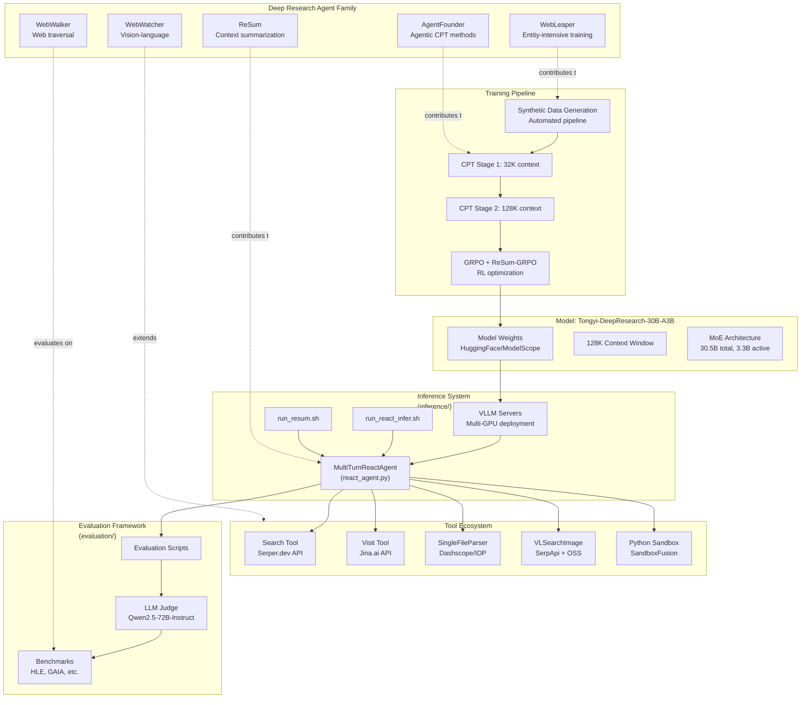
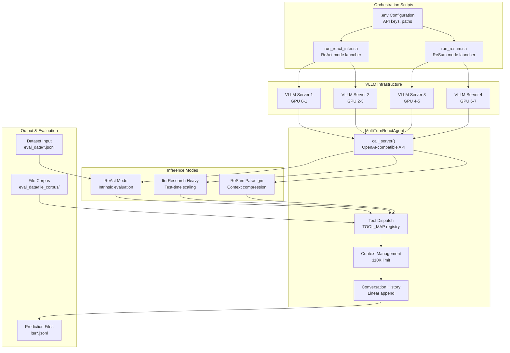
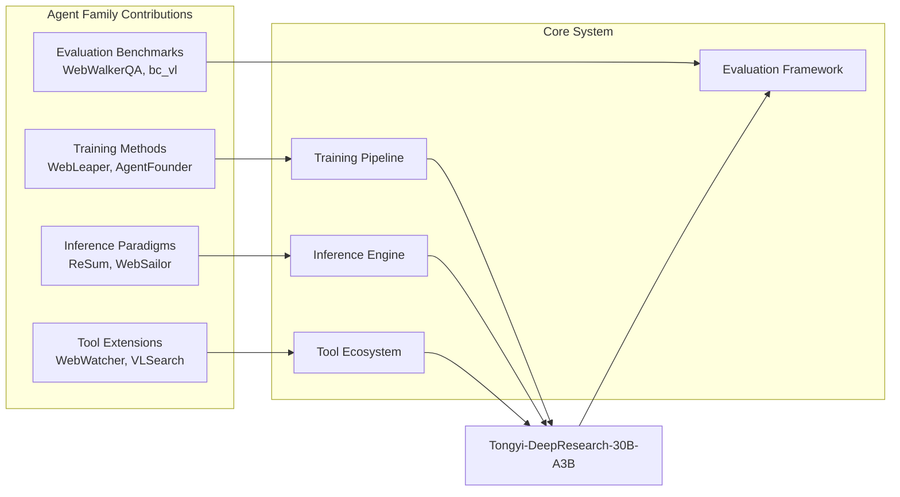

<!-- source: DeepWiki mcp.deepwiki.com · repo Alibaba-NLP/DeepResearch · page 1.1 System Architecture and Components · fetched 2026-10-29 -->

# System Architecture and Components

<details>
<summary>Relevant source files</summary>

The following files were used as context for generating this wiki page:

- [README.md](README.md)
- [WebAgent/README.md](WebAgent/README.md)

</details>


**Purpose:** This document provides a detailed technical overview of the Tongyi DeepResearch system architecture, including the 30.5B parameter model structure, training pipeline stages (synthetic data generation, continual pre-training, reinforcement learning), core inference components, tool ecosystem, and the Deep Research Agent Family integration. For specific deployment instructions, see [Deployment Options](#1.2). For details on the inference engine implementation, see [Core Inference Engine](#2). For training methodology details, see [Training and Data Pipeline](#3).

---

## Overview

Tongyi DeepResearch is an agentic large language model system comprising 30.5 billion total parameters with only 3.3 billion activated per token. The system is designed specifically for long-horizon, deep information-seeking tasks and achieves state-of-the-art performance across multiple agentic search benchmarks. The architecture follows a multi-stage training approach culminating in a flexible inference system that supports multiple paradigms.

**Key Specifications:**
| Property | Value |
|----------|-------|
| Total Parameters | 30.5B |
| Activated per Token | 3.3B |
| Context Length | 128K tokens |
| Architecture Type | Mixture-of-Experts (MoE) |
| Primary Use Case | Long-horizon information seeking |

Sources: [README.md:32-55]()

---

## System Architecture Overview

The following diagram illustrates the complete Tongyi DeepResearch system, mapping major components to their implementation locations in the codebase.

**Diagram: Complete System Architecture with Code Entities**



Sources: [README.md:30-47](), [README.md:190-214]()

---

## Model Architecture: 30B-A3B

The Tongyi-DeepResearch-30B-A3B model employs a Mixture-of-Experts (MoE) architecture where only a subset of parameters are activated for each token, enabling efficient scaling while maintaining high capacity.

**Architecture Characteristics:**

| Component | Specification |
|-----------|---------------|
| Total Parameters | 30.5 billion |
| Active Parameters | 3.3 billion per token |
| Activation Strategy | MoE sparse routing |
| Context Window | 128,000 tokens |
| Model Format | HuggingFace Transformers compatible |

**Model Access Points:**
- HuggingFace Hub: `Alibaba-NLP/Tongyi-DeepResearch-30B-A3B`
- ModelScope: `iic/Tongyi-DeepResearch-30B-A3B`
- OpenRouter API: `alibaba/tongyi-deepresearch-30b-a3b`
- Environment variable: `MODEL_PATH` in `.env` configuration

The model is designed to handle extended reasoning chains required for deep information-seeking tasks, with the 128K context window enabling retention of lengthy web search results, document contents, and multi-turn conversation history.

Sources: [README.md:49-59](), [README.md:172-180]()

---

## Training Pipeline Architecture

The training pipeline consists of three major stages, each building upon the previous to create the final agent model.

**Diagram: Training Pipeline with Implementation Components**

```mermaid
graph LR
    subgraph DataGeneration["Data Generation"]
        RawSources["Raw Data Sources<br/>Wikipedia, Web"]
        TaskVariants["Task Variants<br/>Basic/Union/Reverse"]
        EntityData["Entity-Intensive Data<br/>WebLeaper framework"]
        FAS["FAS Methods<br/>Planning/Reasoning synthesis"]
        HAS["HAS Methods<br/>Decision-making synthesis"]
    end
    
    subgraph CPT["Continual Pre-training"]
        Stage1["Stage 1: 32K Context<br/>Agentic interaction data"]
        Stage2["Stage 2: 128K Context<br/>Extended capabilities"]
        FreshKnowledge["Fresh Knowledge<br/>Reasoning abilities"]
    end
    
    subgraph FineTuning["Fine-tuning & RL"]
        SFT["Supervised Fine-Tuning<br/>Trajectory filtering"]
        ISRFilter["ISR Filter (α)<br/>Coverage metric"]
        ISEFilter["ISE Filter (β)<br/>Efficiency metric"]
        GRPOTrain["GRPO Training<br/>Hybrid rewards"]
        SoftFScore["Soft F-score<br/>Entity task reward"]
        LegacyReward["Legacy Rewards<br/>Benchmark performance"]
    end
    
    RawSources --> TaskVariants
    TaskVariants --> EntityData
    EntityData --> FAS
    EntityData --> HAS
    FAS --> Stage1
    HAS --> Stage1
    
    Stage1 --> Stage2
    Stage2 --> FreshKnowledge
    FreshKnowledge --> SFT
    
    SFT --> ISRFilter
    SFT --> ISEFilter
    ISRFilter --> GRPOTrain
    ISEFilter --> GRPOTrain
    GRPOTrain --> SoftFScore
    GRPOTrain --> LegacyReward
    
    SoftFScore --> FinalModel["Tongyi-DeepResearch-30B-A3B"]
    LegacyReward --> FinalModel
```



### Stage 1: Synthetic Data Generation

The system employs a fully automated synthetic data generation pipeline that creates diverse, high-quality agentic interaction data. This pipeline generates three task variants:

- **Basic Tasks**: Single-source information retrieval
- **Union Tasks**: Multi-source information aggregation
- **Reverse-Union Tasks**: Deductive reasoning from provided information

The **WebLeaper** framework contributes entity-intensive training data designed to improve information-seeking coverage and efficiency. **AgentFounder** methods augment the data stream with specialized synthesis:
- **FAS (Forward Action Synthesis)**: For planning and reasoning tasks
- **HAS (Hybrid Action Synthesis)**: For decision-making scenarios

### Stage 2: Continual Pre-training (CPT)

Continual pre-training occurs in two stages with progressively increasing context lengths:

1. **32K Context CPT**: Initial stage focusing on basic agentic interaction patterns
2. **128K Context CPT**: Extended stage enabling long-horizon reasoning and maintaining data freshness

This approach extends model capabilities beyond the base pre-training while strengthening reasoning performance on agentic tasks.

### Stage 3: Reinforcement Learning

The final training stage employs **Group Relative Policy Optimization (GRPO)** with hybrid reward systems:

- **Trajectory Filtering**: ISR (Information-Seeking Rate, α) and ISE (Information-Seeking Efficiency, β) metrics filter supervised fine-tuning data
- **Hybrid Rewards**: Combines soft F-score for entity-intensive tasks with legacy benchmark rewards
- **ReSum-GRPO**: Specialized RL for the ReSum inference paradigm

The RL approach uses token-level policy gradients, leave-one-out advantage estimation, and selective filtering of negative samples to stabilize training in non-stationary environments.

Sources: [README.md:43-47]()

---

## Inference System Architecture

The inference system supports two primary modes and an advanced context management paradigm, all orchestrated through shell scripts and the `MultiTurnReactAgent` class.

**Diagram: Inference System Components and Data Flow**



### Inference Scripts

Two primary shell scripts orchestrate inference:

- **`run_react_infer.sh`**: Launches ReAct or Heavy mode inference
  - Configures VLLM servers across multiple GPUs (typically 8 GPUs in pairs)
  - Sets environment variables: `MODEL_PATH`, `DATASET`, `OUTPUT_PATH`
  - Manages API keys for external tools
  
- **`run_resum.sh`**: Launches ReSum paradigm inference
  - Includes ReSumTool-30B for context compression
  - Enables unlimited exploration within fixed context windows

### MultiTurnReactAgent Class

Located in `inference/react_agent.py`, this class implements the core agent loop:

**Key Methods:**
- `call_server()`: Communicates with VLLM servers via OpenAI-compatible API (lines 88-90 for content concatenation)
- Tool dispatch through `TOOL_MAP` registry
- Context management with 110K token limit monitoring
- Conversation history maintenance

### Inference Modes

**ReAct Mode:**
- Standard Think → Action → Observe cycles
- Linear context growth
- Optimized for evaluating core intrinsic abilities
- Token limit: 110K (practical limit within 128K context window)

**IterResearch Heavy Mode:**
- Extended exploration with more tool calls
- Parallel/sequential tool execution
- Test-time scaling strategy
- Maximum performance at higher computational cost

**ReSum Paradigm:**
- Periodic context compression via ReSumTool-30B
- Replaces verbose history with compact reasoning states
- Enables theoretically unlimited exploration
- Maintains key evidence, information gaps, and next-step directions

Sources: [README.md:155-167](), [README.md:176-180]()

---

## Tool Ecosystem

The agent's capabilities are enabled by five major tool categories, each integrating with external services or local processing.

**Diagram: Tool System Implementation**

```mermaid
graph TB
    subgraph ToolRegistry["Tool Registration System"]
        TOOL_MAP["TOOL_MAP<br/>Tool registry dict"]
        BaseTool["BaseTool Interface<br/>Abstract base class"]
    end
    
    subgraph SearchTools["Search Tools"]
        SearchTool["Search Tool<br/>Web search"]
        ScholarTool["Google Scholar<br/>Academic search"]
        SerperAPI["Serper.dev API<br/>SERPER_KEY_ID"]
    end
    
    subgraph ContentTools["Content Processing"]
        VisitTool["Visit Tool<br/>Web page reader"]
        JinaAPI["Jina.ai API<br/>JINA_API_KEYS"]
        JinaSumm["Jina Summarization"]
        OpenAISum["OpenAI-compatible API<br/>Page summarization"]
    end
    
    subgraph DocumentTools["Document Processing"]
        FileParserTool["SingleFileParser<br/>Multi-format parser"]
        DashscopeAPI["Dashscope API<br/>DASHSCOPE_API_KEY"]
        IDPAPI["IDP Service<br/>Enhanced parsing"]
        LocalParsers["Local Parsers<br/>pdfminer, pandas"]
        FileCorpus["File Corpus<br/>eval_data/file_corpus/"]
    end
    
    subgraph VisionTools["Vision-Language Tools"]
        VLSearchTool["VLSearchImage<br/>Reverse image search"]
        SerpImgAPI["SerpApi/GoogleSearch<br/>IMG_SEARCH_KEY"]
        OSSAPI["Alibaba Cloud OSS<br/>Image storage"]
    end
    
    subgraph ExecutionTools["Code Execution"]
        PythonTool["Python Interpreter<br/>Sandboxed execution"]
        SandboxAPI["SandboxFusion API<br/>SANDBOX_FUSION_ENDPOINT"]
    end
    
    subgraph LocalProc["Local Processing"]
        TokenCounter["AutoTokenizer<br/>Token counting"]
        ResultCache["Storage/Cache<br/>Parsed results"]
    end
    
    BaseTool --> SearchTool
    BaseTool --> VisitTool
    BaseTool --> FileParserTool
    BaseTool --> VLSearchTool
    BaseTool --> PythonTool
    
    SearchTool --> TOOL_MAP
    VisitTool --> TOOL_MAP
    FileParserTool --> TOOL_MAP
    VLSearchTool --> TOOL_MAP
    PythonTool --> TOOL_MAP
    
    SerperAPI --> SearchTool
    SerperAPI --> ScholarTool
    
    JinaAPI --> VisitTool
    JinaSumm --> VisitTool
    OpenAISum --> VisitTool
    
    DashscopeAPI --> FileParserTool
    IDPAPI --> FileParserTool
    LocalParsers --> FileParserTool
    FileCorpus --> FileParserTool
    
    SerpImgAPI --> VLSearchTool
    OSSAPI --> VLSearchTool
    
    SandboxAPI --> PythonTool
    
    FileParserTool --> ResultCache
    FileParserTool --> TokenCounter
```



### Tool Categories

**1. Search Tools**
- **Search Tool**: Web search via Serper.dev API, supports batched queries
- **Google Scholar**: Academic search for research papers
- Configuration: `SERPER_KEY_ID` in `.env`

**2. Content Processing Tools**
- **Visit Tool**: Reads web pages using Jina.ai API
- Supports Jina native summarization and OpenAI-compatible API summarization
- Configuration: `JINA_API_KEYS`, `API_KEY`/`API_BASE` in `.env`

**3. Document Processing Tools**
- **SingleFileParser**: Multi-format document parser supporting PDF, DOCX, Excel, PPT, images, and more
- Uses Dashscope API or optional IDP service for enhanced parsing
- Falls back to local parsers (pdfminer, pandas, etc.) when APIs unavailable
- Files loaded from `eval_data/file_corpus/` directory
- Configuration: `DASHSCOPE_API_KEY` in `.env`

**4. Vision-Language Tools**
- **VLSearchImage**: Reverse image search functionality
- Integrates SerpApi/GoogleSearch for image queries
- Uses Alibaba Cloud OSS for image storage and retrieval
- Configuration: `IMG_SEARCH_KEY` in `.env`

**5. Code Execution Tools**
- **Python Interpreter**: Sandboxed Python execution via SandboxFusion
- Enables dynamic code generation and execution for complex computations
- Configuration: `SANDBOX_FUSION_ENDPOINT` in `.env`

### Tool Registration System

All tools inherit from `BaseTool` abstract base class and register themselves in the `TOOL_MAP` dictionary. The `MultiTurnReactAgent` dispatches tool calls by looking up tool names in this registry and executing the corresponding tool methods.

Sources: [README.md:102-106](), [README.md:139-153]()

---

## Evaluation Infrastructure

The evaluation system provides comprehensive benchmarking capabilities across multiple datasets with automated judging.

**Evaluation Components:**

| Component | Description | Location |
|-----------|-------------|----------|
| Evaluation Scripts | Dataset-specific evaluation runners | `evaluation/` directory |
| LLM Judge | Qwen2.5-72B-Instruct for response assessment | External API |
| Prediction Files | Agent outputs in JSONL format | `iter*.jsonl` |
| Scored Files | Judged results with scores | `iter*_scored.jsonl` |
| Summary Reports | Aggregated metrics | `.report.json` |

**Supported Benchmarks:**
- **HLE (Humanity's Last Exam)**: Vision-language understanding
- **BrowseComp-EN/ZH**: Web search tasks (English/Chinese)
- **GAIA**: General agentic tasks
- **τ-bench, τ2-Bench**: Agentic reasoning benchmarks
- **WebWalkerQA**: Web traversal evaluation
- **xbench-DeepSearch**: Deep research capabilities
- **FRAMES**: Long-form question answering
- **SimpleQA**: Factual question answering
- **ACEBench**: Environment interaction
- **bc_vl**: Vision-language tasks

**Evaluation Metrics:**
- **Pass@1, Pass@k**: Correctness metrics
- **ISR (Information-Seeking Rate)**: Entity retrieval coverage (α parameter)
- **ISE (Information-Seeking Efficiency)**: Actions per entity retrieved (β parameter)
- **Token Usage**: Prompt and completion token statistics
- **Tool Usage**: Frequency and distribution of tool invocations
- **Trajectory Length**: Average number of reasoning turns

The evaluation pipeline uses parallel processing (`ThreadPoolExecutor`) to judge multiple predictions concurrently, with dataset-specific prompts for accurate assessment.

Sources: [README.md:182-184]()

---

## Deep Research Agent Family Integration

The Deep Research Agent Family comprises 17 specialized research projects that contribute methods, techniques, and capabilities to the core Tongyi DeepResearch system.

**Contribution Categories:**

**Training & Efficiency:**
- **WebLeaper**: Entity-intensive training framework with ISR/ISE metrics
- **AgentFounder**: Agentic continual pre-training methods (FAS, HAS)
- **AgentScaler**: Environment scaling and function-calling training
- **WebShaper**: Data synthesis via information-seeking formalization

**Inference Paradigms:**
- **ReSum**: Context summarization for unlimited exploration
- **WebSailor-V2**: Navigation strategies and scalable RL
- **WebWalker**: Interactive web traversal with button clicking
- **BrowseConf**: Confidence-guided test-time scaling

**Multimodal Extensions:**
- **WebWatcher**: Vision-language agent capabilities
- **WebDancer**: Autonomous information-seeking deployment

**Specialized Applications:**
- **AgentFold**: Biology-specific web agents with context management
- **ParallelMuse**: Agentic parallel thinking for deep information seeking
- **AgentFrontier**: Expanding capability frontiers via ZPD-guided synthesis
- **WebResearcher**: Unbounded reasoning for long-horizon tasks
- **WebWeaver**: Structuring web-scale evidence with dynamic outlines

**Integration Pattern:**



This research ecosystem demonstrates how specialized projects advance shared infrastructure, with each contribution integrating into one or more core system components to enhance overall capabilities.

Sources: [README.md:190-214]()

---

## Configuration and Environment

All system components are configured through environment variables defined in the `.env` file. The system uses a gitignored `.env.example` template for configuration setup.

**Critical Configuration Variables:**

```bash
# Model Configuration
MODEL_PATH=path/to/Tongyi-DeepResearch-30B-A3B
DATASET=eval_data/my_questions.jsonl
OUTPUT_PATH=./outputs

# Search Tools
SERPER_KEY_ID=your_serper_api_key

# Content Processing
JINA_API_KEYS=your_jina_api_key
API_KEY=your_openai_compatible_key
API_BASE=https://api.openai.com/v1

# Document Processing
DASHSCOPE_API_KEY=your_dashscope_key

# Vision-Language
IMG_SEARCH_KEY=your_serpapi_key

# Code Execution
SANDBOX_FUSION_ENDPOINT=your_sandbox_endpoint
```

**File Organization:**

```
project_root/
├── inference/
│   ├── run_react_infer.sh       # ReAct mode launcher
│   ├── run_resum.sh              # ReSum mode launcher
│   └── react_agent.py            # MultiTurnReactAgent
├── evaluation/                   # Evaluation scripts
├── eval_data/
│   ├── *.jsonl                   # Evaluation datasets
│   └── file_corpus/              # Referenced documents
├── .env.example                  # Configuration template
└── requirements.txt              # Python dependencies
```

Sources: [README.md:89-111](), [README.md:145-153]()

---

## Summary

The Tongyi DeepResearch system architecture consists of:

1. **Core Model**: 30.5B parameter MoE model with 3.3B active parameters, 128K context window
2. **Training Pipeline**: Three-stage process (synthetic data → CPT → RL) producing agent-optimized models
3. **Inference Engine**: Flexible system supporting ReAct, Heavy, and ReSum paradigms via `MultiTurnReactAgent`
4. **Tool Ecosystem**: Five tool categories (search, content, documents, vision, execution) with external API integration
5. **Evaluation Framework**: Comprehensive benchmarking across 10+ datasets with automated LLM judging
6. **Agent Family**: 17 specialized research projects contributing methods and capabilities

This architecture enables long-horizon, deep information-seeking through coordinated interaction between the trained model, tool ecosystem, and flexible inference paradigms, all orchestrated through shell scripts and environment configuration.

---

