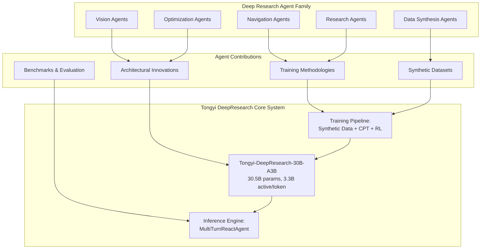
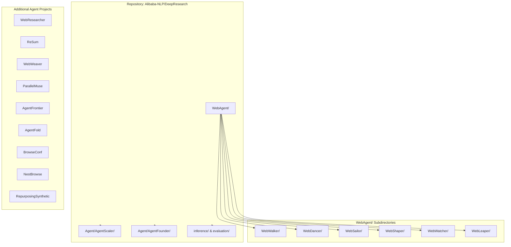
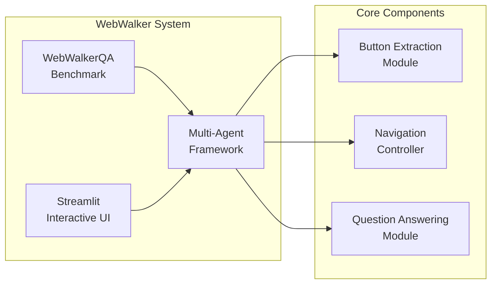
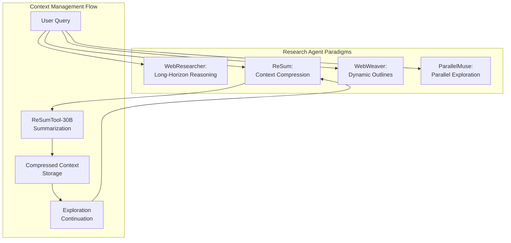
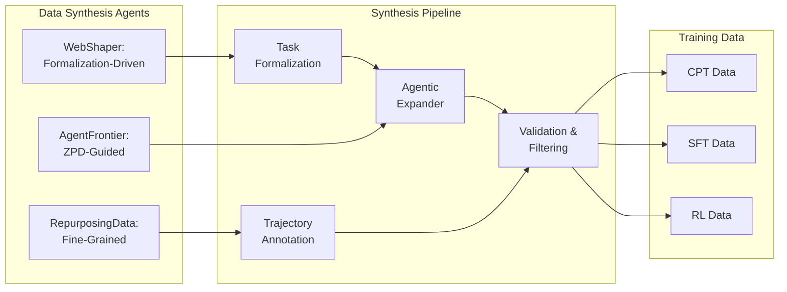
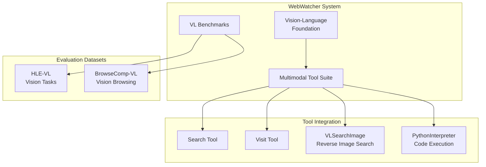
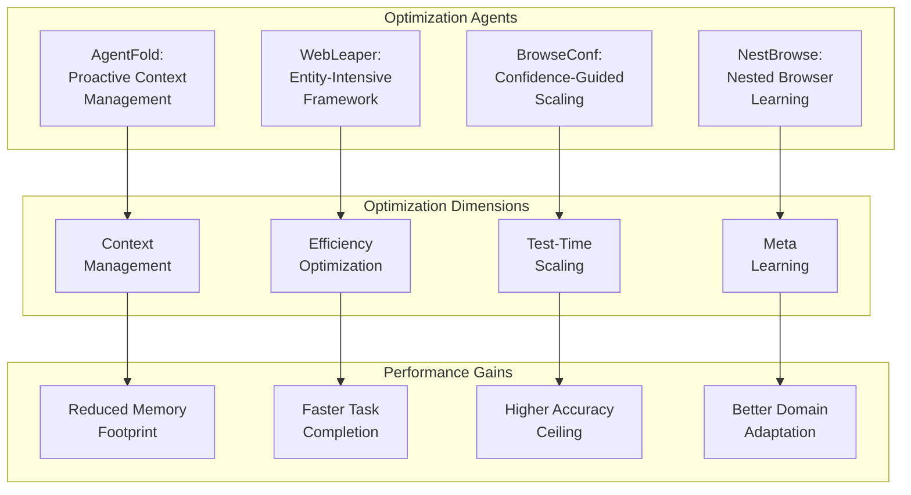
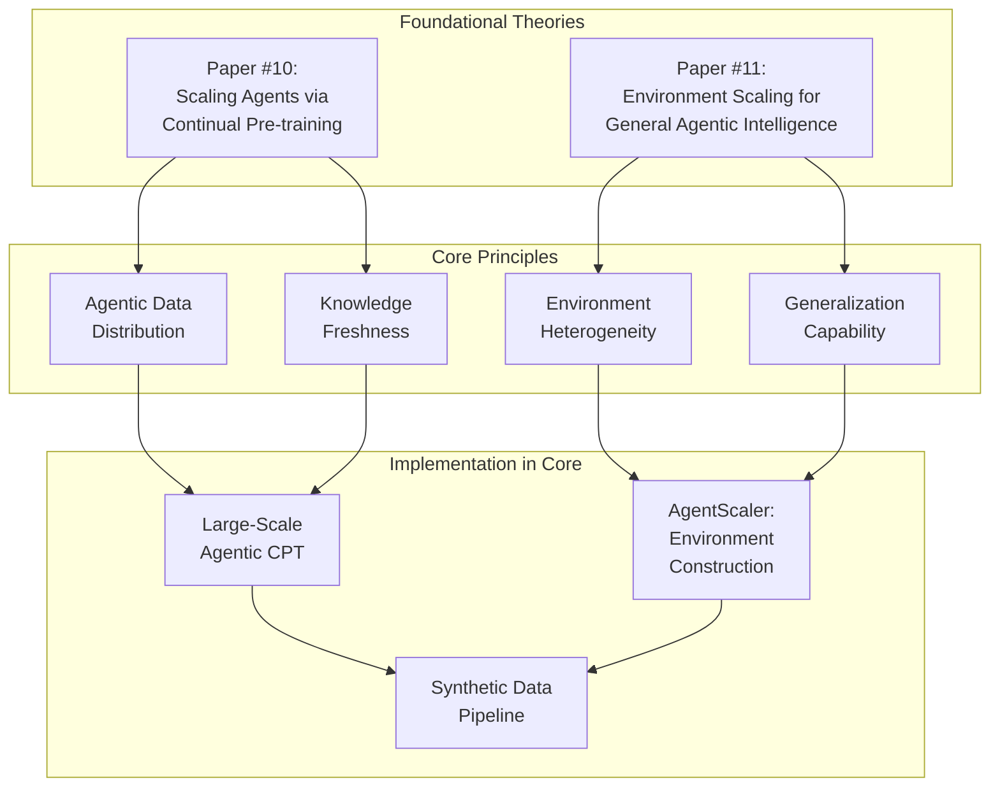
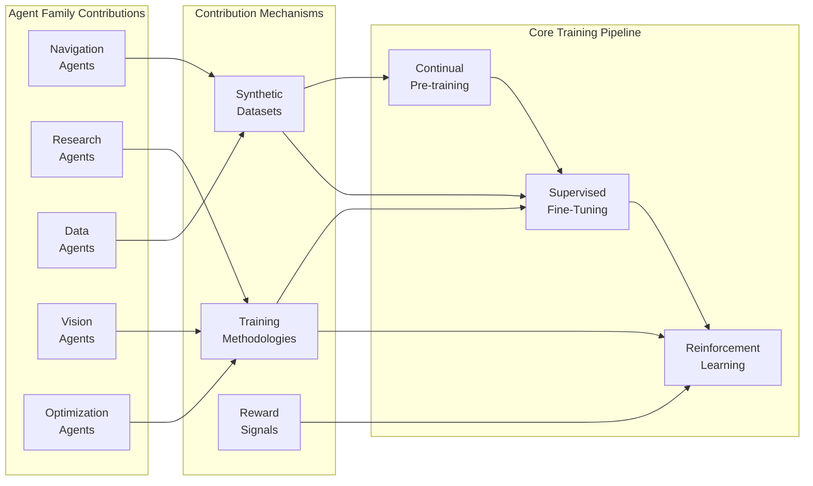

<!-- source: DeepWiki mcp.deepwiki.com · repo Alibaba-NLP/DeepResearch · page 1.3 Deep Research Agent Family · fetched 2026-10-29 -->

# Deep Research Agent Family

Relevant source files

The following files were used as context for generating this wiki page:

- [README.md](README.md)
- [WebAgent/README.md](WebAgent/README.md)

## Purpose and Scope

This document provides a comprehensive overview of the Deep Research Agent Family, an ecosystem of 18+ specialized research agents that contribute methodologies, techniques, and innovations to the Tongyi DeepResearch core system. Each agent addresses specific challenges in agentic information seeking, from web navigation and long-horizon reasoning to data synthesis and vision-language understanding.

For information about the core Tongyi DeepResearch model architecture, see [System Architecture and Components](#1.1). For details on training methodologies, see [Training and Data Pipeline](#3). For specific agent implementations and code details, see [Agent Implementations](#4).

Sources: [README.md:190-216](), [WebAgent/README.md:1-33]()

---

## Overview and Relationship to Core System

The Deep Research Agent Family represents a unified research program where each agent explores specialized aspects of agentic intelligence. These agents are not standalone systems; rather, they contribute specific methodologies, training techniques, datasets, and architectural innovations that are integrated into the core Tongyi DeepResearch model.

### Integration Model

**Diagram: Integration of Agent Family into Core System**

The agent family operates on a contribution-based model where specialized agents develop and validate techniques that are subsequently integrated into the production-ready Tongyi DeepResearch system. This approach enables rapid experimentation while maintaining a cohesive core platform.

Sources: [README.md:32-47](), [README.md:190-196]()

---

## Agent Family Taxonomy

The Deep Research Agent Family is organized into five functional categories, plus two foundational theoretical papers that provide the scientific basis for the entire system.

### Directory Structure to Agent Mapping

**Diagram: Repository Structure and Agent Mapping**

Sources: [README.md:190-216](), [WebAgent/README.md:27-32]()

---

## Category 1: Navigation & Traversal Agents

These agents focus on web page navigation, autonomous information seeking, and reasoning during search operations.

| Agent | Paper | Key Innovation | Repository Path |
|-------|-------|----------------|-----------------|
| **WebWalker** | ACL 2025 | Interactive web traversal benchmark + framework | `WebAgent/WebWalker/` |
| **WebDancer** | NeurIPS 2025 | Native search reasoning with 4-stage training paradigm | `WebAgent/WebDancer/` |
| **WebSailor** | Preprint 2025 | Super-human reasoning via DUPO RL algorithm | `WebAgent/WebSailor/` |
| **WebSailor-V2** | Preprint 2025 | Synthetic data + scalable RL for proprietary-level performance | - |

### WebWalker Architecture

**Diagram: WebWalker System Components**

**WebWalker** [README.md:198]() introduces the WebWalkerQA benchmark for evaluating LLM capabilities in web traversal tasks. It provides both a benchmark dataset and a multi-agent framework that enables interactive web page navigation with button extraction and traversal capabilities.

**WebDancer** [README.md:199]() implements a native agentic search reasoning model using the ReAct framework. Its four-stage training paradigm consists of: (1) browsing data construction, (2) trajectory sampling, (3) supervised fine-tuning for effective cold start, and (4) reinforcement learning (DAPO) for improved generalization. WebDancer achieves Pass@3 scores of 64.1% on GAIA and 62.0% on WebWalkerQA.

**WebSailor** [README.md:200]() introduces Duplicating Sampling Policy Optimization (DUPO), an efficient agentic RL algorithm that enables extended thinking and information seeking for extremely complex tasks. It includes SailorFog-QA, a scalable benchmark with high uncertainty created through graph sampling and information obfuscation. WebSailor-72B achieves 12.0% on BrowseComp-en, 30.1% on BrowseComp-zh, and 55.4% on GAIA.

**WebSailor-V2** [README.md:206]() bridges the gap to proprietary agents through synthetic data generation and scalable reinforcement learning techniques, building upon the original WebSailor methodology.

Sources: [README.md:198-206](), [WebAgent/README.md:23-32](), [WebAgent/README.md:87-92]()

---

## Category 2: Research & Reasoning Agents

These agents specialize in long-horizon reasoning, context management, structured evidence gathering, and parallel exploration strategies.

| Agent | Paper | Key Innovation | Key Feature |
|-------|-------|----------------|-------------|
| **WebResearcher** | Preprint 2025 | Unbounded reasoning for long-horizon tasks | Extended reasoning chains |
| **ReSum** | Preprint 2025 | Context summarization for unlimited exploration | Conversation compression |
| **WebWeaver** | Preprint 2025 | Dynamic outline generation for structured research | Web-scale evidence structuring |
| **ParallelMuse** | Preprint 2025 | Parallel thinking and reasoning aggregation | Compressed state reports |

### Context Management Architecture

**Diagram: Research Agent Context Management**

**WebResearcher** [README.md:203]() unleashes unbounded reasoning capability in long-horizon agents, enabling extended multi-step reasoning processes that maintain coherence across lengthy information-seeking trajectories.

**ReSum** [README.md:204]() addresses the context length limitation through conversation summarization. By periodically compressing the conversation history using ReSumTool-30B, it enables unlimited exploration while maintaining critical information. This paradigm is integrated into the core inference engine (see [Context Management and ReSum Paradigm](#2.9)).

**WebWeaver** [README.md:205]() structures web-scale evidence through dynamic outline generation, organizing gathered information into coherent research structures suitable for open-ended deep research tasks.

**ParallelMuse** [README.md:213]() implements agentic parallel thinking for deep information seeking, aggregating multiple reasoning paths through compressed state reports and information integration mechanisms.

Sources: [README.md:203-205](), [README.md:213]()

---

## Category 3: Data & Training Agents

These agents focus on synthetic data generation, curriculum learning, and fine-grained supervision techniques for training agentic systems.

| Agent | Paper | Key Innovation | Training Contribution |
|-------|-------|----------------|----------------------|
| **WebShaper** | Preprint 2025 | Formalization-driven data synthesis | IS instance generation |
| **AgentFrontier** | Preprint 2025 | ZPD-guided data synthesis | Curriculum learning |
| **Repurposing Synthetic Data** | Preprint 2025 | Fine-grained supervision extraction | Trajectory annotation |

### Data Synthesis Pipeline

**Diagram: Data Synthesis Agent Pipeline**

**WebShaper** [README.md:201]() introduces a formalization-driven data synthesis method grounded in a proposed task formalization for information-seeking agents. It implements an agentic Expander that iteratively generates and validates questions aligned with the formalization. WebShaper achieves 60.19 on GAIA and 52.50 on WebWalkerQA. The WebShaper-32B model is available at `Alibaba-NLP/WebShaper-32B`.

**AgentFrontier** [README.md:214]() expands the capability frontier of LLM agents through Zone of Proximal Development (ZPD)-guided data synthesis, which creates training data at the appropriate difficulty level to maximize learning efficiency through curriculum learning principles.

**Repurposing Synthetic Data** [README.md:212]() extracts fine-grained supervision signals from synthetic trajectories, enabling more efficient training by annotating intermediate reasoning steps and decision points within agent trajectories.

Sources: [README.md:201](), [README.md:212](), [README.md:214](), [WebAgent/README.md:73-77]()

---

## Category 4: Vision & Multimodal Agents

This category extends agentic capabilities to vision-language understanding for multimodal information seeking.

### WebWatcher Vision-Language Architecture

**Diagram: WebWatcher Multimodal Architecture**

**WebWatcher** [README.md:202]() breaks new frontiers of vision-language deep research agents by integrating visual understanding with web-based information seeking. It extends the agent tool suite to include image search, visual content analysis, and code execution for processing visual information.

WebWatcher models are available in two sizes:
- `Alibaba-NLP/WebWatcher-7B` [WebAgent/README.md:55]()
- `Alibaba-NLP/WebWatcher-32B` [WebAgent/README.md:56]()

Both models support a comprehensive tool list: Search, Visit, ImageSearch, and CodeInterpreter, enabling them to tackle highly challenging vision-QA problems requiring multimodal reasoning.

Sources: [README.md:202](), [WebAgent/README.md:27](), [WebAgent/README.md:55-56]()

---

## Category 5: Optimization & Efficiency Agents

These agents focus on improving efficiency, context management, test-time scaling, and meta-learning capabilities.

| Agent | Paper | Key Innovation | Optimization Target |
|-------|-------|----------------|---------------------|
| **AgentFold** | Preprint 2025 | Proactive context management | Memory efficiency |
| **WebLeaper** | Preprint 2025 | Entity-intensive info seeking | Task efficiency |
| **BrowseConf** | Preprint 2025 | Confidence-guided test-time scaling | Performance ceiling |
| **NestBrowse** | Preprint 2025 | Nested browser learning | Meta-learning |

### Optimization Strategies

**Diagram: Optimization Agent Strategies and Outcomes**

**AgentFold** [README.md:209]() implements proactive context management for long-horizon web agents, enabling more efficient use of context windows by strategically folding and unfolding conversation history based on relevance to the current task state.

**WebLeaper** [README.md:210]() empowers efficient, info-rich seeking through entity-intensive tasks and tree-structured information seeking. The WebLeaper training framework includes data variants (Basic/Union/Reverse-Union), ISR/ISE metrics, and a hybrid reward system. The WebLeaper-30B-A3B model implements these efficiency optimizations. For detailed training methodology, see [WebLeaper: Entity-Intensive Training Framework](#3.2).

**BrowseConf** [README.md:211]() introduces confidence-guided test-time scaling for web agents, dynamically allocating computational resources based on the model's confidence in its current reasoning path, enabling the system to achieve higher performance ceilings on difficult tasks.

**NestBrowse** [README.md:215]() implements nested browser learning for agentic information seeking, using meta-learning techniques to enable agents to learn from their own browsing experiences and adapt to new domains more efficiently.

Sources: [README.md:209-211](), [README.md:215]()

---

## Foundation Papers

Two foundational theoretical papers provide the scientific basis for the entire Deep Research Agent Family and the core Tongyi DeepResearch system.

### Foundational Theoretical Framework

**Diagram: Foundational Theories and Implementation**

**Scaling Agents via Continual Pre-training** [README.md:207]() establishes the theoretical foundation for large-scale continual pre-training on agentic interaction data. This work demonstrates how diverse, high-quality agentic data can extend model capabilities, maintain knowledge freshness, and strengthen reasoning performance. This theory is implemented in the core training pipeline through the AgentFounder framework (see [AgentFounder: Agentic CPT and Action Synthesis](#3.4)).

**Towards General Agentic Intelligence via Environment Scaling** [README.md:208]() introduces the concept of environment scaling as a path to general agentic intelligence. It demonstrates that automatically constructing heterogeneous simulated environments enables agents to develop robust generalization capabilities. This principle is implemented through the AgentScaler framework (see [AgentScaler: Environment Scaling](#3.5)).

Together, these papers provide the theoretical justification for the synthetic data generation pipeline, continual pre-training strategy, and environment diversity that underpin the Tongyi DeepResearch system.

Sources: [README.md:207-208]()

---

## Agent Specifications and Availability

The following table provides a comprehensive overview of released models, their specifications, and capabilities:

| Model Name | Release Date | Parameters | Context Length | Tool Suite | HuggingFace | ModelScope |
|------------|--------------|------------|----------------|------------|-------------|------------|
| **Tongyi-DeepResearch-30B-A3B** | 2025-09-17 | 30.5B (3.3B active) | 128K | Full Suite | ✓ | ✓ |
| **WebLeaper-30B-A3B** | 2025-12-24 | 30B-A3B | - | Search/Visit | - | ✓ |
| **WebShaper-32B** | 2025-08-28 | 32B | 32K | Search/Visit | ✓ | - |
| **WebDancer-32B** | 2025-06-23 | 32B | 32K | Search/Visit | ✓ | - |
| **WebSailor-32B** | 2025-08-26 | 32B | 32K | Search/Visit | ✓ | - |
| **WebSailor-7B** | 2025-08-06 | 7B | 32K | Search/Visit | ✓ | - |
| **WebSailor-3B** | 2025-07-11 | 3B | 32K | Search/Visit | ✓ | - |
| **WebWatcher-32B** | 2025-08-27 | 32B | 32K | Search/Visit/ImageSearch/Code | ✓ | - |
| **WebWatcher-7B** | 2025-08-27 | 7B | 32K | Search/Visit/ImageSearch/Code | ✓ | - |

### Tool Suite Definitions

- **Full Suite**: Search, Visit, Summarization, FileParser, PythonInterpreter, VLSearchImage
- **Search/Visit**: Core web search and page reading capabilities
- **Search/Visit/ImageSearch/Code**: Extended with visual search and code execution

Sources: [README.md:49-56](), [WebAgent/README.md:49-57]()

---

## Integration with Core Training Pipeline

All agents in the Deep Research Agent Family contribute to the core Tongyi DeepResearch training pipeline through three primary mechanisms:

### Training Contribution Flow

**Diagram: Agent Contributions to Training Pipeline**

1. **Dataset Contribution**: Navigation and data synthesis agents (WebShaper, AgentFrontier) generate high-quality synthetic trajectories used in CPT and SFT phases.

2. **Methodology Contribution**: Research and optimization agents (WebResearcher, AgentFold, WebLeaper) contribute training methodologies such as context management strategies, entity-intensive task formulations, and efficiency optimizations.

3. **Reward Engineering**: Navigation agents (WebSailor's DUPO, WebDancer's DAPO) contribute reinforcement learning algorithms and reward signal designs that are integrated into the core RL training phase.

This integration model ensures that innovations from specialized agents are systematically incorporated into the production-ready Tongyi DeepResearch system, creating a virtuous cycle of research and development.

Sources: [README.md:32-47](), [README.md:190-216]()

---

## Summary

The Deep Research Agent Family represents a comprehensive ecosystem of specialized agents that collectively advance the state-of-the-art in agentic information seeking. Through careful organization into functional categories—Navigation & Traversal, Research & Reasoning, Data & Training, Vision & Multimodal, and Optimization & Efficiency—each agent contributes unique innovations while maintaining integration with the core Tongyi DeepResearch system.

The family is grounded in two foundational theoretical papers on continual pre-training and environment scaling, ensuring that all innovations are scientifically principled. Released models range from efficient 3B parameter variants to powerful 32B models, with the flagship Tongyi-DeepResearch-30B-A3B model incorporating methodologies from across the entire agent family.

For practical deployment and usage of these agents, see [Deployment Options](#1.2). For detailed training methodologies, see [Training and Data Pipeline](#3). For specific agent implementations, see [Agent Implementations](#4).

Sources: [README.md:1-246](), [WebAgent/README.md:1-243]()

---

