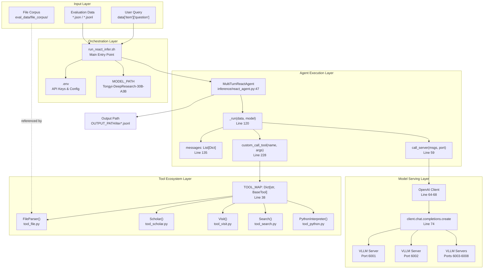
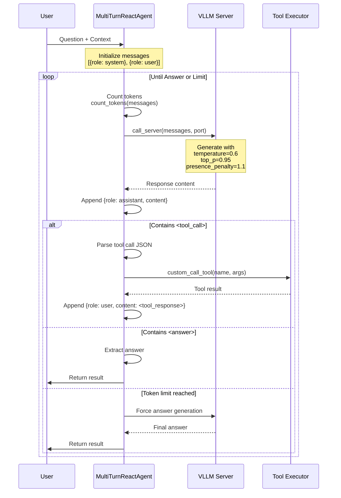
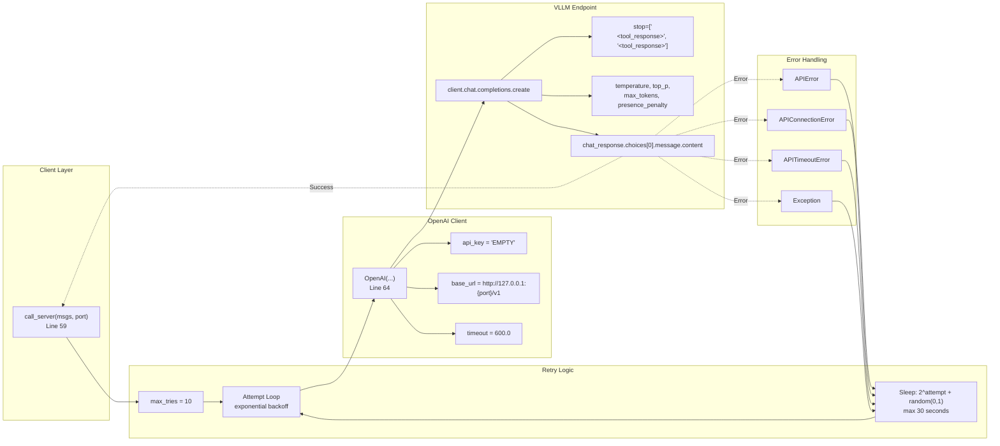
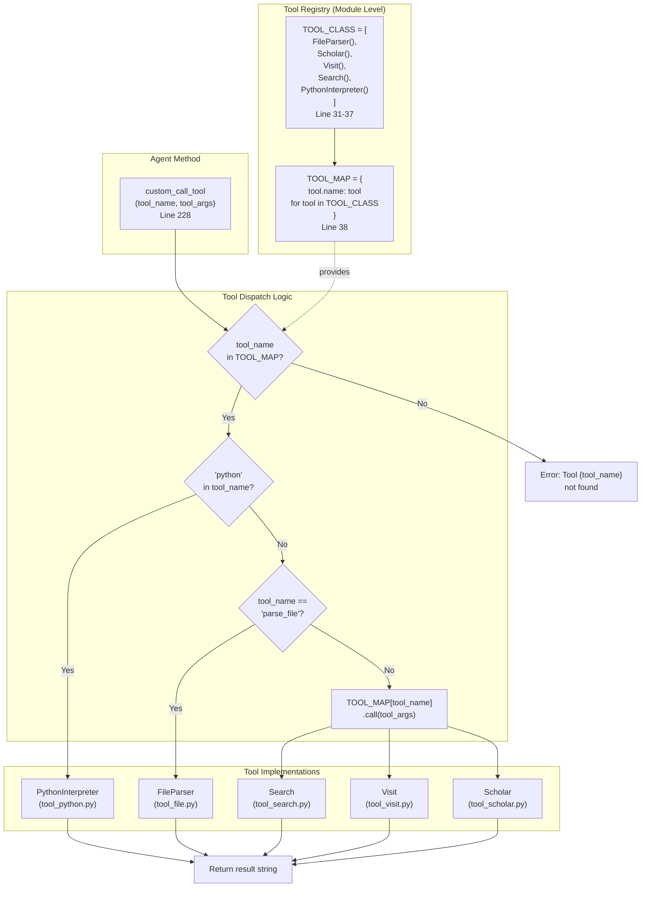
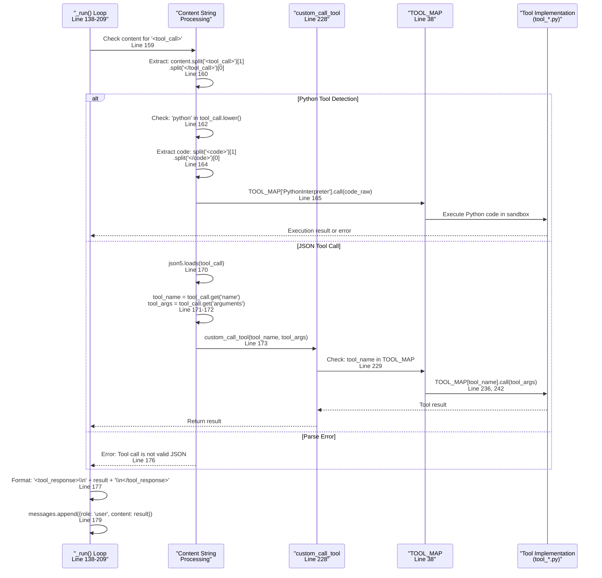

<!-- source: DeepWiki mcp.deepwiki.com · repo Alibaba-NLP/DeepResearch · page 2 Core Inference Engine · fetched 2026-10-29 -->

# Core Inference Engine

<details>
<summary>Relevant source files</summary>

The following files were used as context for generating this wiki page:

- [README.md](README.md)
- [inference/react_agent.py](inference/react_agent.py)

</details>


## Purpose and Scope

The Core Inference Engine is the central runtime system that powers Tongyi DeepResearch's agentic capabilities. It implements the ReAct (Reasoning and Acting) paradigm through the `MultiTurnReactAgent` class ([inference/react_agent.py:47-248]()), orchestrating multi-turn conversations between the 30.5B parameter language model, external tools, and stateful conversation management.

**Position in System Architecture:**

Within the DeepResearch ecosystem, the inference engine sits between the trained model weights (produced by the training pipeline - see page 3) and the evaluation framework (page 5). It consumes the Tongyi-DeepResearch-30B-A3B model and exposes two primary inference modes:
- **ReAct Mode**: Standard reasoning-action cycles for intrinsic capability evaluation
- **IterResearch Heavy Mode**: Extended exploration with test-time scaling for maximum performance

Both modes utilize the same core `MultiTurnReactAgent` execution loop but differ in their exploration strategies and computational budgets.

**Page Organization:**

This page provides an overview of the inference architecture and core execution flow. Detailed subsystem documentation is available on child pages:
- [MultiTurnReactAgent Architecture](#2.1) - Class structure and conversation management
- [ReAct and IterResearch Inference Modes](#2.2) - Mode differences and selection criteria
- [LLM Communication Layer](#2.3) - VLLM server communication and retry logic
- [Tool System Architecture](#2.4) - Tool registration and dispatch mechanisms
- [File Parser and Document Processing](#2.5) - PDF, DOCX, Excel parsing via Dashscope/IDP
- [Web Tools: Search, Visit, and Image Search](#2.6) - Serper, Jina, and OSS integrations
- [Context Management and ReSum Paradigm](#2.7) - ReSumTool-30B for unlimited exploration
- [Inference Orchestration Scripts](#2.8) - `run_react_infer.sh` and VLLM server setup

**Sources:** [README.md:30-48](), [README.md:68-167](), [inference/react_agent.py:47-248]()

## System Architecture Overview

The inference engine implements a five-layer architecture that processes user queries through distributed model serving, stateful agent orchestration, and external tool integration. Each layer has specific responsibilities and communicates through well-defined interfaces.

**Five-Layer Architecture Diagram:**



**Core Components and Code Entities:**

| Layer | Component | Code Entity | Line Reference | Responsibility |
|-------|-----------|-------------|----------------|----------------|
| **Orchestration** | Shell Script | `run_react_infer.sh` | N/A | VLLM server startup, config loading |
| **Agent Core** | Agent Class | `MultiTurnReactAgent` | [inference/react_agent.py:47]() | ReAct loop orchestration |
| **Agent Core** | Main Loop | `_run(data, model)` | [inference/react_agent.py:120]() | Multi-turn execution logic |
| **Agent Core** | State | `messages` list | [inference/react_agent.py:135]() | Conversation history |
| **Communication** | LLM Call | `call_server(msgs, port)` | [inference/react_agent.py:59]() | VLLM API with retry logic |
| **Communication** | OpenAI Client | `OpenAI(...)` | [inference/react_agent.py:64]() | HTTP client initialization |
| **Tool Dispatch** | Tool Router | `custom_call_tool(name, args)` | [inference/react_agent.py:228]() | Tool invocation dispatcher |
| **Tool Registry** | Tool Map | `TOOL_MAP` | [inference/react_agent.py:38]() | `{tool.name: tool}` dictionary |
| **Serving** | VLLM Servers | Ports 6001-6008 | N/A | Distributed inference endpoints |

**Key Parameters:**

| Parameter | Default | Environment Variable | Code Reference |
|-----------|---------|---------------------|----------------|
| Max LLM Calls | 100 | `MAX_LLM_CALL_PER_RUN` | [inference/react_agent.py:29]() |
| Timeout | 150 minutes | N/A | [inference/react_agent.py:140]() |
| Token Limit | 110K | N/A | [inference/react_agent.py:186]() |
| VLLM Timeout | 600 seconds | N/A | [inference/react_agent.py:67]() |
| Max Retries | 10 | N/A | [inference/react_agent.py:59]() |

**Sources:** [inference/react_agent.py:1-248](), [README.md:68-170]()

## The ReAct Inference Loop

The `_run` method ([inference/react_agent.py:120-226]()) implements the core multi-turn ReAct pattern. Each iteration involves model generation, response parsing, optional tool execution, and state updates. The loop continues until an answer is generated or resource limits are reached.

**Control Flow Diagram:**

```mermaid
graph TB
    Start["_run(data, model)<br/>Line 120"]
    
    ExtractQuestion["Extract Question<br/>data['item']['question']<br/>Line 123-126"]
    
    InitMessages["Initialize Messages<br/>messages = [<br/>  {role: 'system', content: SYSTEM_PROMPT + date},<br/>  {role: 'user', content: question}<br/>]<br/>Line 132-135"]
    
    InitState["Initialize State<br/>num_llm_calls_available = MAX_LLM_CALL_PER_RUN<br/>round = 0<br/>start_time = time.time()<br/>Line 128-137"]
    
    LoopCondition{"Loop Condition<br/>num_llm_calls_available > 0<br/>Line 138"}
    
    CheckTimeout{"Timeout Check<br/>time.time() - start_time > 150*60<br/>Line 140"}
    
    IncrementRound["Increment Round<br/>round += 1<br/>num_llm_calls_available -= 1<br/>Line 151-152"]
    
    CallServerMethod["call_server(messages, planning_port)<br/>Line 153"]
    
    StripResponse["Strip <tool_response> if present<br/>Line 155-157"]
    
    AppendAssistant["messages.append(<br/>  {role: 'assistant', content: content.strip()}<br/>)<br/>Line 158"]
    
    CheckToolCallTag{"Check Tag<br/>'<tool_call>' in content<br/>Line 159"}
    
    ExtractToolCall["Extract Tool Call<br/>content.split('<tool_call>')[1].split('</tool_call>')[0]<br/>Line 160"]
    
    CheckPython{"Check Type<br/>'python' in tool_call.lower()<br/>Line 162"}
    
    ExtractCode["Extract Code<br/>split('<code>')[1].split('</code>')[0]<br/>Line 164"]
    
    CallPython["TOOL_MAP['PythonInterpreter'].call(code_raw)<br/>Line 165"]
    
    ParseJSON["json5.loads(tool_call)<br/>Line 170"]
    
    ExtractNameArgs["tool_name = tool_call.get('name')<br/>tool_args = tool_call.get('arguments')<br/>Line 171-172"]
    
    CallCustomTool["custom_call_tool(tool_name, tool_args)<br/>Line 173"]
    
    FormatToolResponse["Format Result<br/>result = '<tool_response>\\n' + result + '\\n</tool_response>'<br/>Line 177"]
    
    AppendUser["messages.append(<br/>  {role: 'user', content: result}<br/>)<br/>Line 179"]
    
    CheckAnswerTag{"Check Tag<br/>'<answer>' in content<br/>Line 180"}
    
    ExtractAnswer["Extract Answer<br/>content.split('<answer>')[1].split('</answer>')[0]<br/>Line 212"]
    
    CheckTokenLimit{"Token Limit<br/>count_tokens(messages) > 110*1024<br/>Line 186-190"}
    
    ForceAnswer["Force Answer Generation<br/>Append prompt, call_server once more<br/>Line 193-195"]
    
    BuildResult["Build Result Dict<br/>{question, answer, messages, prediction, termination}<br/>Line 202-208, 219-225"]
    
    ReturnResult["Return Result<br/>Line 209, 226"]
    
    Start --> ExtractQuestion
    ExtractQuestion --> InitMessages
    InitMessages --> InitState
    InitState --> LoopCondition
    
    LoopCondition -->|Yes| CheckTimeout
    LoopCondition -->|No| BuildResult
    
    CheckTimeout -->|Exceeded| BuildResult
    CheckTimeout -->|OK| IncrementRound
    
    IncrementRound --> CallServerMethod
    CallServerMethod --> StripResponse
    StripResponse --> AppendAssistant
    AppendAssistant --> CheckToolCallTag
    
    CheckToolCallTag -->|Yes| ExtractToolCall
    CheckToolCallTag -->|No| CheckAnswerTag
    
    ExtractToolCall --> CheckPython
    
    CheckPython -->|Yes| ExtractCode
    CheckPython -->|No| ParseJSON
    
    ExtractCode --> CallPython
    CallPython --> FormatToolResponse
    
    ParseJSON --> ExtractNameArgs
    ExtractNameArgs --> CallCustomTool
    CallCustomTool --> FormatToolResponse
    
    FormatToolResponse --> AppendUser
    AppendUser --> CheckTokenLimit
    
    CheckTokenLimit -->|Exceeded| ForceAnswer
    CheckTokenLimit -->|OK| LoopCondition
    
    ForceAnswer --> BuildResult
    
    CheckAnswerTag -->|Yes| ExtractAnswer
    CheckAnswerTag -->|No| CheckTokenLimit
    
    ExtractAnswer --> BuildResult
    BuildResult --> ReturnResult
```



**Execution Control Variables:**

| Variable | Initial Value | Update Location | Purpose |
|----------|--------------|-----------------|---------|
| `num_llm_calls_available` | `MAX_LLM_CALL_PER_RUN` (100) | [inference/react_agent.py:136]() | Remaining tool calls |
| `round` | 0 | [inference/react_agent.py:137](), [inference/react_agent.py:151]() | Current iteration count |
| `start_time` | `time.time()` | [inference/react_agent.py:128]() | For timeout checking |
| `messages` | `[{system}, {user}]` | [inference/react_agent.py:135]() | Conversation state |

**Termination Logic:**

The loop terminates when any of these conditions are met:
1. **Answer Generated**: `<answer>` tag detected → `termination = "answer"` ([inference/react_agent.py:181-182]())
2. **LLM Call Limit**: `num_llm_calls_available == 0` → `termination = "exceed available llm calls"` ([inference/react_agent.py:217-218]())
3. **Timeout**: `time.time() - start_time > 9000` → `termination = "No answer found after 2h30mins"` ([inference/react_agent.py:140-150]())
4. **Token Limit**: `token_count > 110*1024` → `termination = "generate an answer as token limit reached"` ([inference/react_agent.py:190-209]())

**Sources:** [inference/react_agent.py:120-226](), [inference/react_agent.py:29](), [inference/react_agent.py:136-158]()

## Message Flow and State Management

The inference engine maintains conversation state through a structured message list that alternates between user and assistant turns. The message format follows the OpenAI chat completion schema.



**Message Structure:**

| Role | Content Format | Example |
|------|---------------|---------|
| `system` | System prompt + current date | `SYSTEM_PROMPT + "2025-01-15"` |
| `user` | Question or tool response | `"What is X?"` or `"<tool_response>...</tool_response>"` |
| `assistant` | Reasoning + action or answer | `"\n<tool_call>...</tool_call>"` |

**Key State Management Methods:**

- **Token Counting:** [inference/react_agent.py:112-118]() - Uses `AutoTokenizer` to track conversation length
- **Message Appending:** [inference/react_agent.py:158](), [inference/react_agent.py:179]() - Maintains alternating turn structure
- **Context Overflow Handling:** [inference/react_agent.py:190-209]() - Forces answer generation when token limit reached

**Sources:** [inference/react_agent.py:112-118](), [inference/react_agent.py:135](), [inference/react_agent.py:158-179]()

## LLM Communication Architecture

The agent communicates with VLLM servers through the `call_server` method, which implements robust retry logic and exponential backoff to handle transient failures.



**VLLM Communication Parameters:**

| Parameter | Value | Code Reference | Purpose |
|-----------|-------|----------------|---------|
| `api_key` | `"EMPTY"` | [inference/react_agent.py:61]() | Placeholder for local servers |
| `base_url` | `http://127.0.0.1:{port}/v1` | [inference/react_agent.py:62]() | Local VLLM endpoint |
| `timeout` | 600.0 seconds | [inference/react_agent.py:67]() | Request timeout |
| `stop` | `["\n<tool_response>", "<tool_response>"]` | [inference/react_agent.py:77]() | Stop generation at tool response |
| `max_tokens` | 10000 | [inference/react_agent.py:81]() | Maximum response length |

**Retry Strategy:**
- Maximum attempts: 10 tries [inference/react_agent.py:59]()
- Backoff formula: `2^attempt + random(0, 1)` seconds [inference/react_agent.py:102]()
- Maximum sleep: 30 seconds [inference/react_agent.py:103]()

**Sources:** [inference/react_agent.py:59-110](), [inference/react_agent.py:64-68]()

## Tool Execution System

The inference engine integrates with five specialized tools through a registry-based architecture. Tools are initialized at module load time and accessed via the `TOOL_MAP` dictionary.



**Tool Call Parsing and Execution:**

The agent supports two distinct tool invocation formats: Python code execution (inline code blocks) and JSON-formatted tool calls. The parsing logic branches based on content detection.



**Tool Invocation Format Specifications:**

| Format Type | Syntax | Code Detection | Parsing Method | Example |
|-------------|--------|----------------|----------------|---------|
| **Python Code** | `<tool_call>\npython\n<code>...</code>\n</tool_call>` | `'python' in tool_call.lower()` ([inference/react_agent.py:162]()) | String split on `<code>` tags ([inference/react_agent.py:164]()) | Execute calculations, data analysis |
| **JSON Tool** | `<tool_call>{"name": "Search", "arguments": {"query": "..."}}</tool_call>` | Else branch | `json5.loads()` ([inference/react_agent.py:170]()) | Web search, file parsing, etc. |
| **Tool Response** | `<tool_response>\n{result}\n</tool_response>` | N/A (generated by system) | Appended as user message ([inference/react_agent.py:177]()) | Return tool execution results |

**Special Handling in `custom_call_tool`:**

The `custom_call_tool` method ([inference/react_agent.py:228-247]()) provides special handling for certain tools:

```python
# Special case: parse_file requires async execution and file_root_path
if tool_name == "parse_file":
    params = {"files": tool_args["files"]}
    raw_result = asyncio.run(TOOL_MAP[tool_name].call(
        params, 
        file_root_path="./eval_data/file_corpus"
    ))
    # Line 233-236

# Special case: PythonInterpreter (though usually caught earlier)
elif "python" in tool_name.lower():
    result = TOOL_MAP['PythonInterpreter'].call(tool_args)
    # Line 231-232

# Default: Generic tool invocation
else:
    raw_result = TOOL_MAP[tool_name].call(tool_args, **kwargs)
    # Line 242
```

**Error Handling:**

- **Parse Errors**: JSON parsing failures return error message ([inference/react_agent.py:175-176]())
- **Python Execution Errors**: Caught and returned as `"[Python Interpreter Error]: Formatting error."` ([inference/react_agent.py:166-167]())
- **Unknown Tools**: Returns `f"Error: Tool {tool_name} not found"` ([inference/react_agent.py:247]())

**Sources:** [inference/react_agent.py:159-177](), [inference/react_agent.py:228-247](), [inference/react_agent.py:31-38]()

## Response Format and Termination Conditions

The inference engine enforces a structured response format with explicit reasoning and answer tags. Multiple termination conditions ensure graceful handling of edge cases.

**Response Structure:**

```


[Optional: <tool_call>...</tool_call>]

<answer>
Final answer to the user's question
</answer>
```

**Termination Conditions:**

| Condition | Termination String | Code Reference | Behavior |
|-----------|-------------------|----------------|----------|
| Normal completion | `"answer"` | [inference/react_agent.py:181-182]() | Agent provides `<answer>` tag |
| LLM call limit | `"exceed available llm calls"` | [inference/react_agent.py:183-184](), [inference/react_agent.py:218]() | After 100 tool calls |
| Time limit | `"No answer found after 2h30mins"` | [inference/react_agent.py:140-150]() | After 150 minutes |
| Token limit | `"generate an answer as token limit reached"` | [inference/react_agent.py:190-209]() | After 110K tokens |
| Answer not found | `"answer not found"` | [inference/react_agent.py:216]() | No `<answer>` tag in final response |

**Result Object Structure:**

```python
{
    "question": str,        # Original user query
    "answer": str,          # Ground truth (for evaluation)
    "messages": List[Dict], # Full conversation history
    "prediction": str,      # Extracted model answer
    "termination": str      # Termination condition string
}
```

**Sources:** [inference/react_agent.py:140-226](), [inference/react_agent.py:211-225]()

## Alternative Deployment: OpenRouter API

The inference engine supports deployment through OpenRouter, eliminating the need for local GPU infrastructure. This requires minimal code modifications to the `call_server` method.

**Required Modifications:**

| Change | File Location | Purpose |
|--------|---------------|---------|
| Set API key and base URL | [inference/react_agent.py:61-62]() | Point to OpenRouter endpoint |
| Change model name | [inference/react_agent.py:75]() | Use `alibaba/tongyi-deepresearch-30b-a3b` |
| Adjust content concatenation | [inference/react_agent.py:86-88]() | Handle OpenRouter's reasoning format |

**OpenRouter Integration Notes:**
- Reasoning content is provided separately in `chat_response.choices[0].message.reasoning` [inference/react_agent.py:87]()
- Must be manually concatenated with main content [inference/react_agent.py:88]()
- No VLLM server setup required [README.md:172-181]()

**Sources:** [inference/react_agent.py:86-88](), [README.md:172-181]()

## Configuration and Environment Setup

The inference engine reads configuration from environment variables loaded via a `.env` file. Critical paths and API keys are centralized for easy deployment across different environments.

**Required Environment Variables:**

| Variable | Purpose | Code Reference |
|----------|---------|----------------|
| `SERPER_KEY_ID` | Web search and Google Scholar API | [README.md:102]() |
| `JINA_API_KEYS` | Web page content extraction | [README.md:103]() |
| `API_KEY`, `API_BASE` | OpenAI-compatible summarization | [README.md:104]() |
| `DASHSCOPE_API_KEY` | File parsing (PDF, Office, etc.) | [README.md:105]() |
| `SANDBOX_FUSION_ENDPOINT` | Python code execution sandbox | [README.md:106]() |
| `MODEL_PATH` | Local model weights directory | [README.md:107]() |
| `DATASET` | Evaluation dataset path | [README.md:108]() |
| `OUTPUT_PATH` | Results output directory | [README.md:109]() |
| `MAX_LLM_CALL_PER_RUN` | Maximum tool calls per query | [inference/react_agent.py:29]() |

**Date Injection:**

The system prompt is dynamically augmented with the current date to provide temporal context:

```python
cur_date = today_date()  # Returns YYYY-MM-DD format
system_prompt = system_prompt + str(cur_date)
```

[inference/react_agent.py:133-134](), [inference/react_agent.py:44-45]()

**Sources:** [README.md:91-111](), [inference/react_agent.py:29](), [inference/react_agent.py:133-134]()

---

