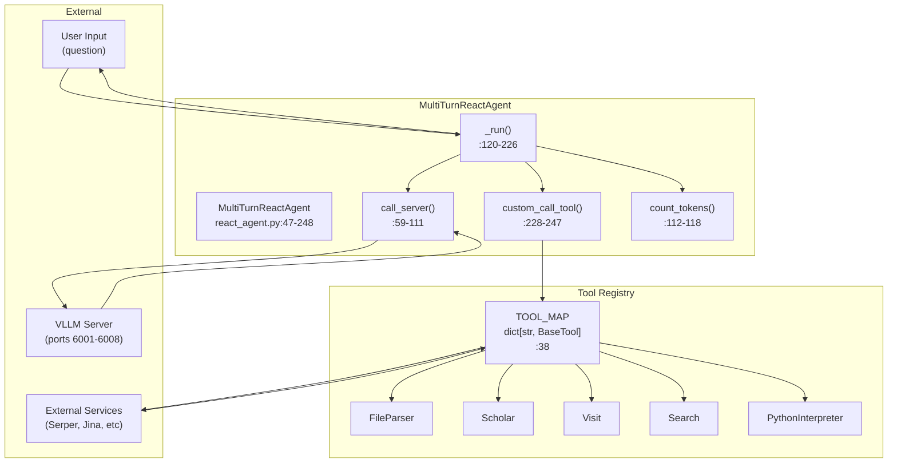
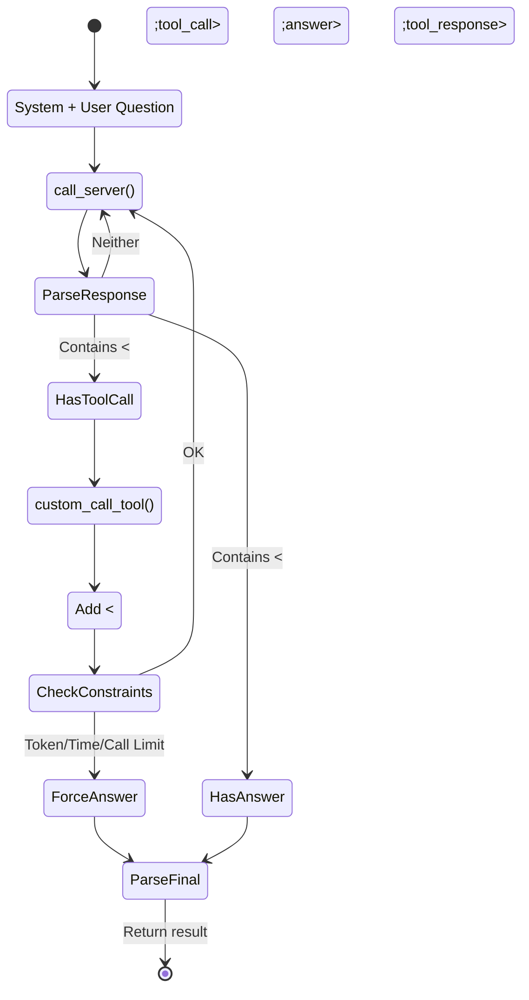
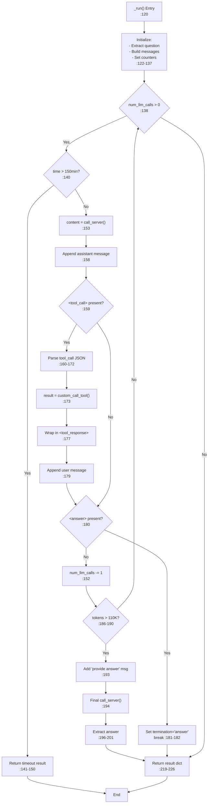
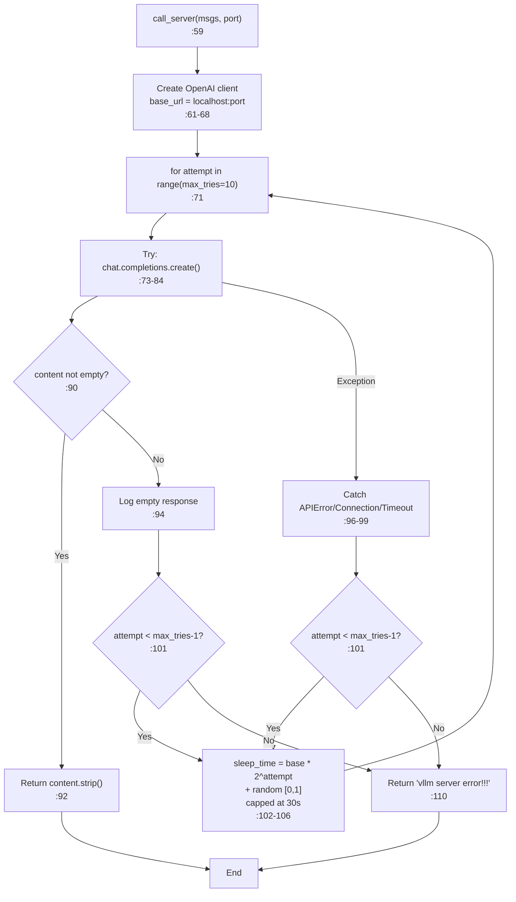
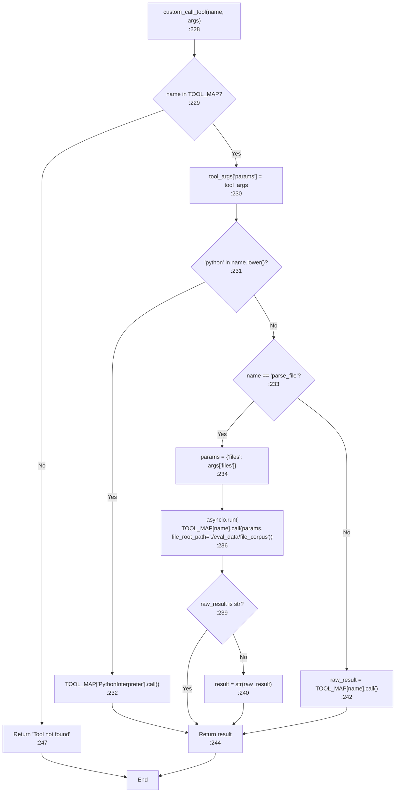
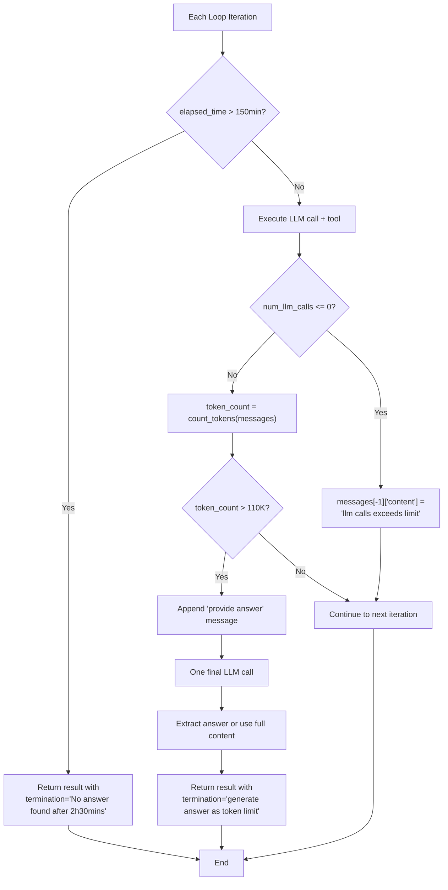

<!-- source: DeepWiki mcp.deepwiki.com · repo Alibaba-NLP/DeepResearch · page 2.1 MultiTurnReactAgent Architecture · fetched 2026-10-29 -->

# MultiTurnReactAgent Architecture

<details>
<summary>Relevant source files</summary>

The following files were used as context for generating this wiki page:

- [WebAgent/WebResummer/src/evaluate.py](WebAgent/WebResummer/src/evaluate.py)
- [WebAgent/WebResummer/src/judge_prompt.py](WebAgent/WebResummer/src/judge_prompt.py)
- [WebAgent/WebResummer/src/main.py](WebAgent/WebResummer/src/main.py)
- [WebAgent/WebResummer/src/prompt.py](WebAgent/WebResummer/src/prompt.py)
- [WebAgent/WebResummer/src/react_agent.py](WebAgent/WebResummer/src/react_agent.py)
- [WebAgent/WebResummer/src/run_resum.sh](WebAgent/WebResummer/src/run_resum.sh)
- [WebAgent/WebResummer/src/summary_utils.py](WebAgent/WebResummer/src/summary_utils.py)
- [WebAgent/WebResummer/src/tool_search.py](WebAgent/WebResummer/src/tool_search.py)
- [WebAgent/WebResummer/src/tool_visit.py](WebAgent/WebResummer/src/tool_visit.py)
- [inference/react_agent.py](inference/react_agent.py)

</details>


## Purpose and Scope

This document details the `MultiTurnReactAgent` class, which implements the core ReAct (Reasoning and Acting) inference engine for Tongyi DeepResearch. The agent manages multi-turn conversations, dispatches tool calls, maintains conversation state, and enforces execution constraints. 

For information about inference modes (ReAct vs IterResearch), see [2.2](#2.2). For details on individual tools, see [2.6](#2.6) (web tools) and [2.5](#2.5) (file parsing). For the orchestration scripts that launch the agent, see [2.8](#2.8).

**Sources:** [inference/react_agent.py:1-248]()

---

## Overview

The `MultiTurnReactAgent` class extends `FnCallAgent` from qwen-agent and implements a stateful conversation loop where the LLM alternates between reasoning (thinking), taking actions (tool calls), and observing results. The architecture follows a simple yet robust pattern:

1. Initialize conversation with system prompt and user question
2. Call LLM to generate reasoning and/or tool calls
3. Execute tool calls and append results to conversation history
4. Repeat until answer found or constraints violated
5. Return conversation transcript with prediction

**Diagram: MultiTurnReactAgent System Context**



**Sources:** [inference/react_agent.py:47-248]()

---

## Class Structure and Initialization

### MultiTurnReactAgent Class

The agent inherits from `FnCallAgent` but overrides the core execution logic to implement the ReAct pattern with specialized tool handling.

**Key Attributes:**

| Attribute | Type | Purpose | Initialized |
|-----------|------|---------|-------------|
| `llm_generate_cfg` | dict | LLM generation config (temperature, top_p, etc) | `__init__:53` |
| `llm_local_path` | str | Path to model weights for tokenizer | `__init__:54` |
| `model` | str | Model identifier for VLLM server | `_run:121` |
| `user_prompt` | str | Original user question | `_run:131` |

**Constructor Signature:**

```python
def __init__(self,
             function_list: Optional[List[Union[str, Dict, BaseTool]]] = None,
             llm: Optional[Union[Dict, BaseChatModel]] = None,
             **kwargs)
```

The constructor expects an `llm` dict containing `generate_cfg` and `model` keys. The `function_list` parameter is inherited from `FnCallAgent` but not directly used in this implementation.

**Sources:** [inference/react_agent.py:47-54]()

### Tool Registry

Tools are registered globally as module-level constants:

```python
TOOL_CLASS = [
    FileParser(),
    Scholar(),
    Visit(),
    Search(),
    PythonInterpreter(),
]
TOOL_MAP = {tool.name: tool for tool in TOOL_CLASS}
```

The `TOOL_MAP` dictionary provides O(1) lookup by tool name during tool execution. Each tool implements a `call()` method that accepts parameters and returns a string result.

**Sources:** [inference/react_agent.py:31-38]()

---

## Conversation State and Message Flow

### Message Format

Conversations are represented as lists of message dictionaries following the OpenAI chat format:

```python
messages = [
    {"role": "system", "content": system_prompt},
    {"role": "user", "content": question},
    {"role": "assistant", "content": "\n<tool_call>...</tool_call>"},
    {"role": "user", "content": "<tool_response>result</tool_response>"},
    # ... more turns
]
```

**Diagram: Message Flow State Machine**



**Sources:** [inference/react_agent.py:120-226]()

### System Prompt Injection

The system prompt is constructed from `SYSTEM_PROMPT` (imported from `prompt.py`) with the current date appended:

```python
system_prompt = SYSTEM_PROMPT
cur_date = today_date()  # Returns YYYY-MM-DD
system_prompt = system_prompt + str(cur_date)
messages = [
    {"role": "system", "content": system_prompt}, 
    {"role": "user", "content": question}
]
```

This allows the model to reason about temporal context when answering questions.

**Sources:** [inference/react_agent.py:44-45, 132-135]()

---

## Execution Loop and State Machine

### Main Loop Architecture

The `_run()` method implements the core agent loop with multiple exit conditions:

**Diagram: _run() Execution Flow**



**Sources:** [inference/react_agent.py:120-226]()

### Loop Variables

| Variable | Initial Value | Purpose |
|----------|--------------|---------|
| `num_llm_calls_available` | `MAX_LLM_CALL_PER_RUN` (100) | Counts down remaining LLM calls |
| `round` | 0 | Tracks iteration number for logging |
| `start_time` | `time.time()` | Used for 150-minute timeout check |
| `messages` | `[system, user]` | Conversation history |

**Sources:** [inference/react_agent.py:136-137]()

---

## LLM Communication Layer

### call_server() Method

The `call_server()` method handles all communication with VLLM servers, implementing exponential backoff retry logic:

**Diagram: call_server() Retry Logic**



**Request Parameters:**

```python
chat_response = client.chat.completions.create(
    model=self.model,
    messages=msgs,
    stop=["\n<tool_response>", "<tool_response>"],  # Prevent generating tool responses
    temperature=0.6,  # From llm_generate_cfg
    top_p=0.95,
    logprobs=True,  # Enable probability logging
    max_tokens=10000,
    presence_penalty=1.1  # Reduce repetition
)
```

The stop sequences prevent the model from hallucinating tool responses, forcing it to wait for actual tool execution results.

**OpenRouter Alternative:**

Lines 86-88 show commented-out code for OpenRouter API integration, which provides reasoning content separately from the main response.

**Sources:** [inference/react_agent.py:59-111]()

### Token Counting

The `count_tokens()` method uses the model's tokenizer to accurately count conversation length:

```python
def count_tokens(self, messages):
    tokenizer = AutoTokenizer.from_pretrained(self.llm_local_path) 
    full_prompt = tokenizer.apply_chat_template(messages, tokenize=False)
    tokens = tokenizer(full_prompt, return_tensors="pt")
    token_count = len(tokens["input_ids"][0])
    return token_count
```

This ensures the agent respects the 110K token context window limit by applying the exact chat template used during inference.

**Sources:** [inference/react_agent.py:112-118]()

---

## Tool Execution Pipeline

### custom_call_tool() Method

Tool execution follows a dispatcher pattern with special handling for different tool types:

**Diagram: Tool Execution Dispatch**



**Sources:** [inference/react_agent.py:228-247]()

### PythonInterpreter Special Handling

The PythonInterpreter tool has two execution paths:

1. **In-loop extraction** (lines 162-167): When detected in the main loop, code is extracted from `<code>` tags and passed directly to the interpreter. This bypasses JSON parsing for code blocks.

2. **Dispatcher path** (line 232): If called through `custom_call_tool()`, uses standard parameter passing.

```python
# In _run() loop
if "python" in tool_call.lower():
    try:
        code_raw = content.split('<code>')[1].split('</code>')[0].strip()
        result = TOOL_MAP['PythonInterpreter'].call(code_raw)
    except:
        result = "[Python Interpreter Error]: Formatting error."
```

**Sources:** [inference/react_agent.py:162-167]()

### Tool Response Formatting

All tool results are wrapped in XML-style tags before being added to the conversation:

```python
result = "<tool_response>\n" + result + "\n</tool_response>"
messages.append({"role": "user", "content": result})
```

This consistent formatting allows the model to distinguish tool results from other user messages and parse them reliably. The constants `OBS_START` and `OBS_END` define these markers.

**Sources:** [inference/react_agent.py:26-27, 177-179]()

---

## Safety Constraints and Limits

### Multi-Level Constraint Enforcement

The agent enforces three types of constraints to prevent runaway execution:

**Table: Execution Constraints**

| Constraint | Limit | Check Location | Action |
|-----------|-------|----------------|--------|
| **LLM Calls** | 100 (configurable) | Line 138, 152 | Force answer generation |
| **Token Count** | 110K | Line 186-190 | Force answer generation |
| **Time Limit** | 150 minutes | Line 140 | Return timeout result |

**Diagram: Constraint Violation Handling**



**Sources:** [inference/react_agent.py:138-209]()

### Force Answer Message

When token or call limits are reached, the agent injects a special message to force answer generation:

```python
messages[-1]['content'] = (
    "You have now reached the maximum context length you can handle. "
    "You should stop making tool calls and, based on all the information above, "
    "think again and provide what you consider the most likely answer in the "
    "following format:\n<answer>your answer</answer>"
)
```

This ensures the agent always provides a response rather than terminating abruptly.

**Sources:** [inference/react_agent.py:193]()

---

## Result Format and Termination Conditions

### Result Dictionary Structure

The `_run()` method returns a dictionary with complete execution metadata:

```python
result = {
    "question": question,          # Original user query
    "answer": answer,              # Ground truth (if available)
    "messages": messages,          # Full conversation history
    "prediction": prediction,      # Extracted answer text
    "termination": termination     # Reason for ending
}
```

**Sources:** [inference/react_agent.py:143-149, 202-209, 219-226]()

### Termination Conditions

| Termination Value | Condition | Code Location |
|------------------|-----------|---------------|
| `'answer'` | Successfully generated `<answer>` tag | 181, 213 |
| `'No answer found after 2h30mins'` | 150-minute timeout reached | 142 |
| `'generate an answer as token limit reached'` | Token limit forced answer | 198 |
| `'format error: generate answer as token limit reached'` | Token limit, but no answer tag in response | 201 |
| `'answer not found'` | Loop completed without answer | 216 |
| `'exceed available llm calls'` | Call limit reached without answer | 218 |

**Sources:** [inference/react_agent.py:142, 181, 198, 201, 213, 216, 218]()

### Answer Extraction

Answer extraction follows a consistent pattern across all termination paths:

```python
if '<answer>' in messages[-1]['content']:
    prediction = messages[-1]['content'].split('<answer>')[1].split('</answer>')[0]
else:
    prediction = 'No answer found.'
```

This extracts the text between `<answer>` and `</answer>` tags, or returns a fallback message.

**Sources:** [inference/react_agent.py:196-201, 211-216]()

---

## Configuration and Environment

### Environment Variables

The agent reads configuration from environment variables:

```python
MAX_LLM_CALL_PER_RUN = int(os.getenv('MAX_LLM_CALL_PER_RUN', 100))
```

This allows tuning the call limit without code changes. The default of 100 calls balances thorough exploration against execution time.

**Sources:** [inference/react_agent.py:29]()

### Input Data Format

The `_run()` method expects a data dictionary with the following structure:

```python
data = {
    'item': {
        'question': str,           # User query
        'answer': str,             # Ground truth (optional)
        # OR
        'messages': [              # Alternative format
            {"role": "system", "content": "..."},
            {"role": "user", "content": "User: {question}"}
        ]
    },
    'planning_port': int,          # VLLM server port
}
```

The agent handles both simple question format and pre-formatted message arrays, extracting the question from the `"User:"` prefix when necessary.

**Sources:** [inference/react_agent.py:122-126]()

---

## Integration Points

### Inheritance from FnCallAgent

The `MultiTurnReactAgent` inherits from `qwen_agent.agents.fncall_agent.FnCallAgent` but overrides the core `_run()` method entirely. The parent class provides:

- Standard agent interface
- Configuration management
- Basic tool registry structure

The custom implementation provides specialized ReAct logic not available in the base class.

**Sources:** [inference/react_agent.py:10, 47]()

### Tool Interface

All tools in `TOOL_MAP` must implement a `call()` method. The tools are instantiated from:

- `tool_file.py`: `FileParser()`
- `tool_scholar.py`: `Scholar()`
- `tool_visit.py`: `Visit()`
- `tool_search.py`: `Search()`
- `tool_python.py`: `PythonInterpreter()`

Each tool's `call()` method signature varies, but all return string results that are wrapped in `<tool_response>` tags.

**Sources:** [inference/react_agent.py:20-24, 31-38]()

---

## Summary

The `MultiTurnReactAgent` implements a robust, constraint-aware ReAct agent with:

- **Stateful conversation management** via OpenAI-format message lists
- **Flexible tool dispatch** with special handling for Python code and file parsing
- **Multi-level safety constraints** (calls, tokens, time) preventing runaway execution
- **Exponential backoff retry logic** for reliable LLM server communication
- **Comprehensive termination tracking** for debugging and evaluation

The architecture prioritizes reliability and observability, capturing full conversation transcripts and detailed termination reasons for every execution.

**Sources:** [inference/react_agent.py:1-248]()

---

