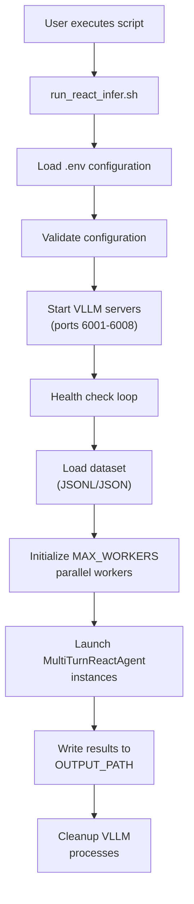
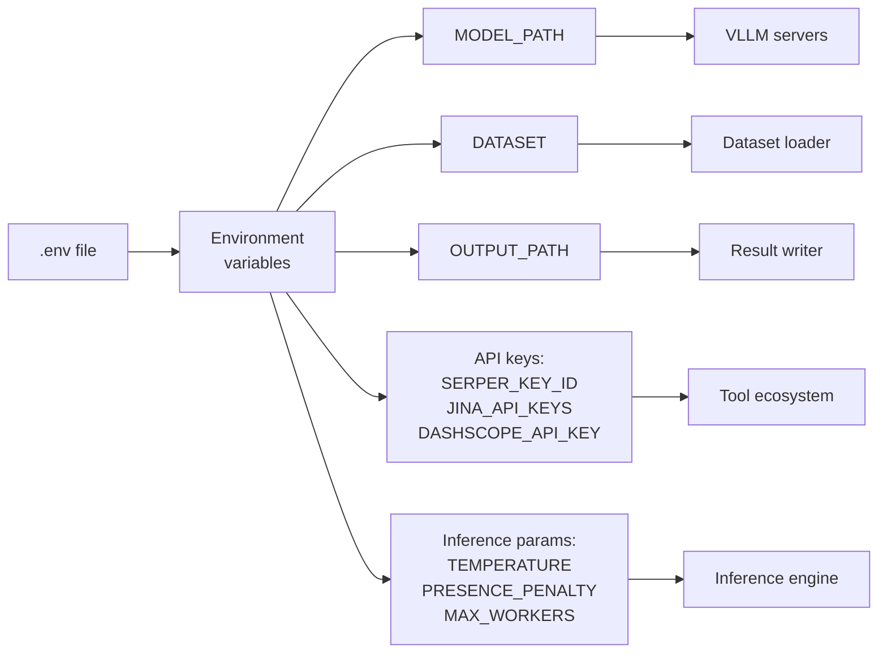
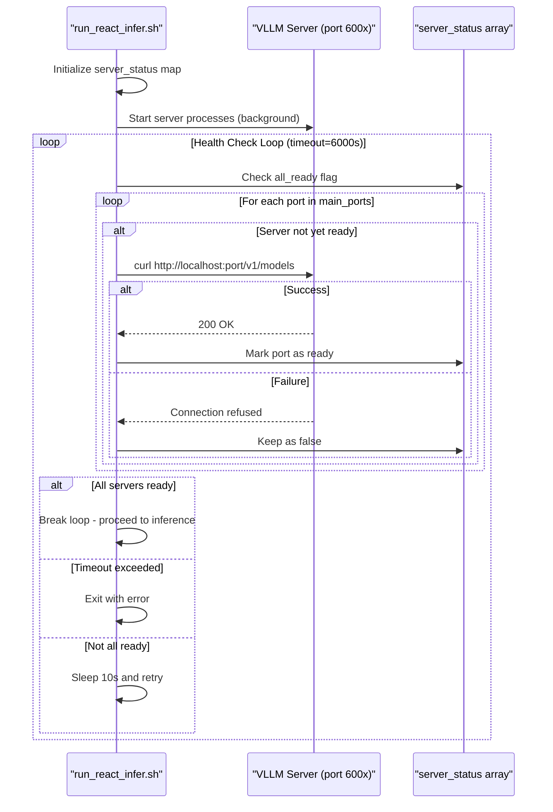
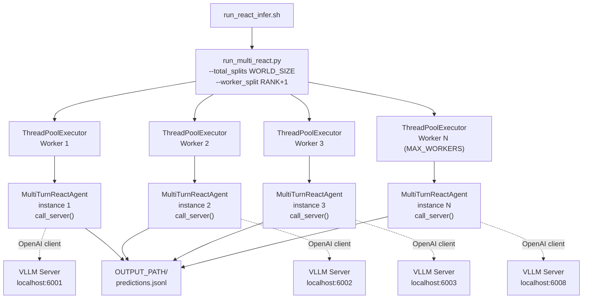
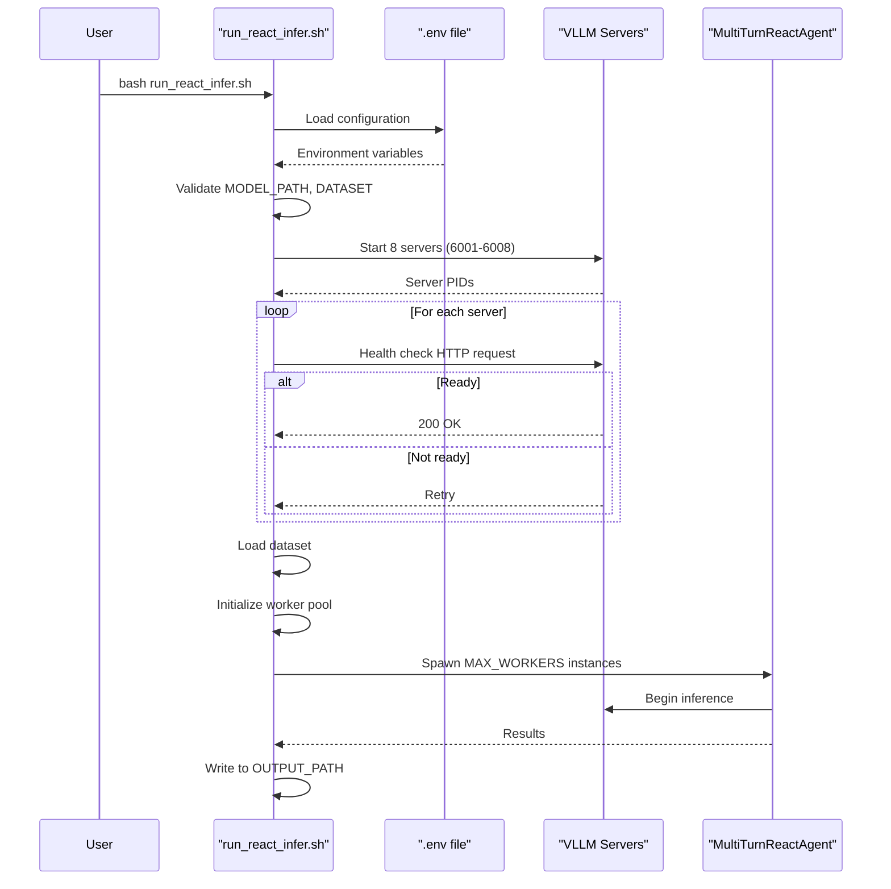

<!-- source: DeepWiki mcp.deepwiki.com · repo Alibaba-NLP/DeepResearch · page 2.11 Inference Orchestration Scripts · fetched 2026-10-29 -->

# Inference Orchestration Scripts

<details>
<summary>Relevant source files</summary>

The following files were used as context for generating this wiki page:

- [README.md](README.md)
- [WebAgent/NestBrowse/toolkit/tool_explore.py](WebAgent/NestBrowse/toolkit/tool_explore.py)
- [WebAgent/NestBrowse/toolkit/tool_search.py](WebAgent/NestBrowse/toolkit/tool_search.py)
- [WebAgent/NestBrowse/utils.py](WebAgent/NestBrowse/utils.py)
- [WebAgent/NestBrowse/vllm_deploy.sh](WebAgent/NestBrowse/vllm_deploy.sh)
- [WebAgent/ParallelMuse/compressed_reasoning_aggregation.py](WebAgent/ParallelMuse/compressed_reasoning_aggregation.py)
- [WebAgent/WebWatcher/infer/scripts_eval/scripts/eval.sh](WebAgent/WebWatcher/infer/scripts_eval/scripts/eval.sh)
- [WebAgent/WebWatcher/infer/vl_search_r1/qwen-agent-o1_search/qwen_agent/tools/private/visit.py](WebAgent/WebWatcher/infer/vl_search_r1/qwen-agent-o1_search/qwen_agent/tools/private/visit.py)
- [WebAgent/WebWatcher/infer/vl_search_r1/qwen-agent-o1_search/qwen_agent/tools/vl_search_image.py](WebAgent/WebWatcher/infer/vl_search_r1/qwen-agent-o1_search/qwen_agent/tools/vl_search_image.py)

</details>


## Purpose and Scope

This document describes the shell scripts that orchestrate the inference pipeline for Tongyi DeepResearch. These scripts manage VLLM server deployment, environment configuration, dataset loading, and parallel execution of the agent inference process. For details about the agent execution itself, see [MultiTurnReactAgent Architecture](#2.1). For information about the ReSum context management paradigm, see [Context Management and ReSum Paradigm](#2.7).

---

## Overview

The inference orchestration layer consists of two primary shell scripts that coordinate all components required for running the Tongyi DeepResearch agent:

- **`run_react_infer.sh`**: Orchestrates standard ReAct and IterResearch Heavy inference modes with 8 parallel VLLM servers
- **`run_resum.sh`**: Orchestrates ReSum mode for unlimited exploration through context summarization, deploying 3 specialized models (main, summary, ReSum tool)

These scripts handle VLLM server lifecycle management, configuration validation, dataset preparation, and parallel execution across multiple worker processes. The scripts invoke different Python entry points:
- `run_react_infer.sh` → `run_multi_react.py`
- `run_resum.sh` → `main.py` with `RESUM=True`

Sources: [inference/run_react_infer.sh:1-118](), [WebAgent/WebResummer/src/run_resum.sh:1-100]()

---

## Script Architecture

### Main Orchestration Flow



**Orchestration Script Execution Flow**
This diagram shows the complete lifecycle from script invocation to cleanup.

Sources: [README.md:156-167](), [README.md:89-111]()

### Configuration Loading Flow



**Configuration Loading and Distribution**
This diagram maps .env variables to their consuming components.

Sources: [.env.example:1-88](), [README.md:89-111]()

---

## VLLM Server Management

### Multi-Server Architecture

The orchestration script manages **8 distributed VLLM servers** for parallel inference serving:

| Port | Purpose |
|------|---------|
| 6001 | VLLM Server 1 |
| 6002 | VLLM Server 2 |
| 6003 | VLLM Server 3 |
| 6004 | VLLM Server 4 |
| 6005 | VLLM Server 5 |
| 6006 | VLLM Server 6 |
| 6007 | VLLM Server 7 |
| 6008 | VLLM Server 8 |

This distributed setup enables:
- **Load balancing** across multiple GPU devices
- **Parallel inference** for multiple agent instances
- **High throughput** for batch evaluation workloads

Sources: [README.md:68-170](), Based on Diagram 2 from high-level architecture

### Health Check Mechanism



**VLLM Server Health Check Sequence**
This diagram shows the startup and health verification process for VLLM servers.

The `run_react_infer.sh` script implements a robust health check mechanism:

1. **Initialization**: Creates associative array `server_status` to track each port's readiness
2. **Background Launch**: All VLLM servers start simultaneously in background
3. **Polling Loop**: 
   - Timeout: 6000 seconds (100 minutes)
   - Check interval: 10 seconds
   - Endpoint: `http://localhost:$port/v1/models`
4. **Success Criteria**: All ports must return HTTP 200 before inference begins
5. **Failure Handling**: Script exits with error if timeout is exceeded

The ReSum script (`run_resum.sh`) uses a different health check approach with the `check_port` function that verifies both `netstat`/`ss` port listening and HTTP endpoint availability.

Sources: [inference/run_react_infer.sh:43-106](), [WebAgent/WebResummer/src/run_resum.sh:45-77]()

### Server Startup and Process Tracking

**ReAct/IterResearch Mode Process Management**

The `run_react_infer.sh` script launches servers with GPU affinity:

```bash
CUDA_VISIBLE_DEVICES=0 vllm serve $MODEL_PATH --host 0.0.0.0 --port 6001 --disable-log-requests &
CUDA_VISIBLE_DEVICES=1 vllm serve $MODEL_PATH --host 0.0.0.0 --port 6002 --disable-log-requests &
# ... (6 more servers on GPUs 2-7)
```

**ReSum Mode Process Management**

The `run_resum.sh` script uses tensor parallelism for multi-GPU models:

```bash
# Main inference model - 4-way tensor parallel
CUDA_VISIBLE_DEVICES=0,1,2,3 vllm serve $MODEL_PATH --host 0.0.0.0 --port 6001 --tensor-parallel-size 4 &

# Summary model - 2-way tensor parallel
CUDA_VISIBLE_DEVICES=4,5 vllm serve "/path/to/Qwen3-30B-A3B-Instruct-2507" --host 0.0.0.0 --port 8001 --tensor-parallel-size 2 &

# ReSum tool model - 2-way tensor parallel
CUDA_VISIBLE_DEVICES=6,7 vllm serve "/path/to/ReSum-Tool-30B-A3B" --host 0.0.0.0 --port 6002 --tensor-parallel-size 2 &
```

Both scripts perform:

1. **Launch**: Spawn VLLM processes with model path, port, and GPU configuration
2. **Verify**: Execute HTTP health checks until all servers are ready
3. **Monitor**: Scripts wait for server readiness before proceeding
4. **Cleanup**: Background processes persist until script termination

The `.gitignore` file excludes process tracking files that may be generated during execution:
- `vllm_processes.json`
- `vllm_pids.txt`

Sources: [inference/run_react_infer.sh:30-37](), [WebAgent/WebResummer/src/run_resum.sh:31-39](), [.gitignore:140-142]()

---

## Environment Configuration

### Configuration File Structure

The `.env` file provides centralized configuration for all inference components:

**Model and Dataset Configuration**
```bash
MODEL_PATH=/path/to/Tongyi-DeepResearch-30B-A3B
DATASET=eval_data/my_questions.jsonl
OUTPUT_PATH=./outputs
```

**Inference Hyperparameters**
```bash
TEMPERATURE=0.85
PRESENCE_PENALTY=1.1
MAX_WORKERS=30
ROLLOUT_COUNT=3
```

**External Service API Keys**
```bash
SERPER_KEY_ID=your_serper_key        # Web search (Search tool)
JINA_API_KEYS=your_jina_key          # Page reading (Visit tool)
API_KEY=your_openai_key              # Summarization (Visit tool)
API_BASE=your_api_base
SUMMARY_MODEL_NAME=your_model        # Summary model name
DASHSCOPE_API_KEY=your_dashscope_key # File parsing (SingleFileParser)
DASHSCOPE_API_BASE=your_api_base
VIDEO_MODEL_NAME=your_video_model    # Video analysis model
VIDEO_ANALYSIS_MODEL_NAME=your_model # Video understanding model
SANDBOX_FUSION_ENDPOINT=http://...   # Code execution (Python Interpreter)
```

**ReSum-Specific Configuration**

Additional environment variables required for ReSum mode:

```bash
RESUM=True                           # Enable ReSum mode
RESUM_TOOL_NAME=/path/to/ReSum-Tool-30B-A3B
RESUM_TOOL_URL=http://localhost:6002/v1/chat/completions
MAX_CONTEXT=32                       # Maximum context in thousands of tokens
MAX_LLM_CALL_PER_RUN=80             # Maximum LLM calls per question
SUMMARY_API_KEY=EMPTY
SUMMARY_API_BASE=http://localhost:8001/v1
SUMMARY_MODEL_NAME=/path/to/summary/model
```

**Feature Flags**
```bash
QWEN_DOC_PARSER_USE_IDP=false
QWEN_IDP_ENABLE_CSI=false
NLP_WEB_SEARCH_ONLY_CACHE=false
NLP_WEB_SEARCH_ENABLE_READPAGE=false
NLP_WEB_SEARCH_ENABLE_SFILTER=false
QWEN_SEARCH_ENABLE_CSI=false
SPECIAL_CODE_MODE=false
PYTHONDONTWRITEBYTECODE=1
```

Sources: [.env.example:1-98](), [WebAgent/WebResummer/src/run_resum.sh:15-27](), [WebAgent/WebResummer/src/react_agent.py:16-21](), [WebAgent/WebResummer/src/summary_utils.py:9-10]()

### Key Configuration Parameters

| Parameter | Purpose | Default/Example | Used By |
|-----------|---------|-----------------|---------|
| `MODEL_PATH` | Local path to model weights | Required | Both scripts |
| `DATASET` | Path to evaluation data (JSONL/JSON) | Required | Both scripts |
| `OUTPUT_PATH` | Directory for saving results | `./outputs` | Both scripts |
| `MAX_WORKERS` | Number of parallel inference workers | 30 (ReAct), 40 (ReSum) | `run_multi_react.py`, `main.py` |
| `TEMPERATURE` | Sampling temperature | 0.85 (ReAct), 0.6 (ReSum) | `MultiTurnReactAgent.call_server` |
| `PRESENCE_PENALTY` | Repetition penalty | 1.1 | `run_react_infer.sh` |
| `ROLLOUT_COUNT` | Rollouts per question (IterResearch) | 3 | `run_react_infer.sh` |
| `WORLD_SIZE` | Total number of distributed workers | 1 | `run_react_infer.sh` |
| `RANK` | Current worker rank (0-indexed) | 0 | `run_react_infer.sh` |
| `MAX_LLM_CALL_PER_RUN` | Maximum LLM calls per question | 100 (ReAct), 80 (ReSum) | `MultiTurnReactAgent._run` |
| `MAX_CONTEXT` | Maximum context in K tokens | 110K (ReAct), 32K (ReSum) | `MultiTurnReactAgent` |
| `RESUM` | Enable ReSum context summarization | False | `MultiTurnReactAgent._run` |

Sources: [.env.example:35-44](), [inference/run_react_infer.sh:117](), [WebAgent/WebResummer/src/run_resum.sh:87-96](), [WebAgent/WebResummer/src/react_agent.py:16-21]()

---

## Parallel Execution Model

### Worker Pool Architecture



**Parallel Worker Pool Execution Model**
This diagram shows how the script distributes work across multiple parallel workers, each running a MultiTurnReactAgent instance that connects to VLLM servers.

The execution model follows this architecture:

1. **Script Layer**: `run_react_infer.sh` launches `run_multi_react.py` with distributed worker parameters
2. **Data Splitting**: The Python script divides the dataset using `--total_splits` and `--worker_split` parameters for multi-machine distribution
3. **Thread Pool**: Python's `ThreadPoolExecutor` manages `MAX_WORKERS` concurrent threads
4. **Agent Instances**: Each worker creates a `MultiTurnReactAgent` instance with its own conversation state
5. **VLLM Connections**: Agents connect to VLLM servers via `call_server()` method using OpenAI-compatible API
6. **Result Aggregation**: All workers write to the same output JSONL file with thread-safe operations

The `MAX_WORKERS` parameter controls the degree of parallelism within a single machine. Each worker:
- Processes a subset of the evaluation dataset
- Maintains its own `MultiTurnReactAgent` instance with independent state
- Connects to VLLM servers via `http://127.0.0.1:600x/v1` endpoints
- Implements retry logic (max 10 attempts) for server communication failures
- Writes results independently to the output file

Sources: [inference/run_react_infer.sh:117](), [WebAgent/WebResummer/src/react_agent.py:43-71]()

### Execution Control Parameters

The orchestration script enforces execution limits to prevent runaway processes:

| Parameter | Purpose | ReAct/Heavy Mode | ReSum Mode | Code Reference |
|-----------|---------|------------------|------------|----------------|
| `MAX_LLM_CALL_PER_RUN` | Maximum LLM calls per question | 100 | 80 | `MultiTurnReactAgent._run:96` |
| `MAX_CONTEXT` | Maximum context tokens | 110,000 | 32,000 | `MultiTurnReactAgent._run` |
| `num_llm_calls_available` | Per-run call counter | Decremented on each `call_server()` | Same | `MultiTurnReactAgent._run:93-98` |
| `round` | Current iteration counter | Incremented per loop | Same | `MultiTurnReactAgent._run:94-97` |
| `summary_iteration` | Trigger for ReSum summarization | N/A | Every N rounds | `MultiTurnReactAgent._run:84` |

**Implementation Details**

The `MultiTurnReactAgent._run` method implements the control flow:

```python
num_llm_calls_available = MAX_LLM_CALL_PER_RUN
round = 0
last_summary, full_trajectory = None, messages.copy()

while num_llm_calls_available > 0:
    round += 1
    num_llm_calls_available -= 1
    content = self.call_server(messages)
    
    # Process tool calls, update messages
    # Check for termination conditions
```

Token counting is performed via `count_tokens()` method which uses either:
- `AutoTokenizer.from_pretrained(self.llm_local_path)` for local models
- `tiktoken.encoding_for_model()` for OpenAI models

The ReSum mode additionally checks context length and triggers summarization when threshold is exceeded.

Sources: [WebAgent/WebResummer/src/react_agent.py:16-21](), [WebAgent/WebResummer/src/react_agent.py:73-83](), [WebAgent/WebResummer/src/react_agent.py:84-157]()

---

## Dataset and Output Management

### Input Data Formats

The orchestration script supports two input formats:

**JSONL Format (Recommended)**
```jsonl
{"question": "What is the capital of France?", "answer": "Paris"}
{"question": "Explain quantum computing", "answer": ""}
```

**JSON Array Format**
```json
[
  {"question": "What is the capital of France?", "answer": "Paris"},
  {"question": "Explain quantum computing", "answer": ""}
]
```

The `answer` field contains the **ground truth reference answer** used for evaluation. The system generates its own responses to the questions, and these reference answers are used for automatic quality assessment during benchmark evaluation.

Sources: [README.md:113-137]()

### File References for Document Processing

When using the file parser tool, prepend the filename to the question field:

```json
{
  "question": "(Uploaded 1 file: ['report.pdf'])\n\nWhat are the key findings?",
  "answer": "..."
}
```

Referenced files must be placed in the `eval_data/file_corpus/` directory:

```
project_root/
├── eval_data/
│   ├── my_questions.jsonl
│   └── file_corpus/
│       ├── report.pdf
│       └── data.xlsx
```

Sources: [README.md:139-153]()

### Output File Structure

Results are written to `OUTPUT_PATH` in JSONL format. Each line contains:

```json
{
  "question": "...",
  "ground_truth": "...",
  "prediction": "...",
  "trajectory": [...],
  "llm_calls": 42,
  "execution_time": 123.45
}
```

Sources: [README.md:156-167]()

---

## Process Lifecycle Management

### Startup Sequence



**Complete Process Startup Sequence**
This diagram shows the orchestration from user invocation through result output.

Sources: [README.md:156-167](), [README.md:89-111]()

### Cleanup and Shutdown

The script implements cleanup mechanisms to ensure proper resource release:

1. **Trap Handlers**: Register signal handlers for SIGINT, SIGTERM
2. **PID Tracking**: Read PIDs from `vllm_pids.txt`
3. **Graceful Shutdown**: Send SIGTERM to VLLM processes
4. **Force Kill**: Send SIGKILL if processes don't terminate
5. **File Cleanup**: Remove tracking files (`vllm_pids.txt`, `vllm_processes.json`)

Sources: [.gitignore:140-142]()

---

## Alternative Deployment: OpenRouter API

For users without GPU resources, the orchestration can be bypassed by using the OpenRouter API:

```python
# In inference/react_agent.py:88-90
# Modify call_server function:
# - Set API key to OpenRouter credentials
# - Change model name to alibaba/tongyi-deepresearch-30b-a3b
# - Adjust content concatenation as per comments
```

This eliminates the need for:
- VLLM server management
- Local GPU infrastructure
- Health check mechanisms

Sources: [README.md:172-180]()

---

## Integration Points

### Connection to MultiTurnReactAgent

The orchestration scripts spawn `MultiTurnReactAgent` instances that:

**Initialization** (`MultiTurnReactAgent.__init__`)
- Extends `FnCallAgent` from qwen_agent framework
- Loads `function_list` (tool registry)
- Configures LLM via `llm` parameter with `generate_cfg` and `model` path
- Sets `system_message` for agent behavior

**Server Communication** (`MultiTurnReactAgent.call_server`)
```python
def call_server(self, msgs, max_tries=10):
    openai_api_key = "EMPTY"
    openai_api_base = "http://127.0.0.1:6001/v1"
    
    client = OpenAI(api_key=openai_api_key, base_url=openai_api_base)
    
    chat_response = client.chat.completions.create(
        model=self.model,
        messages=msgs,
        stop=["\n<tool_responseF", "<tool_response>"],
        temperature=self.llm_generate_cfg.get('temperature', 0.6),
        top_p=self.llm_generate_cfg.get('top_p', 0.95),
    )
```

**Token Counting** (`MultiTurnReactAgent.count_tokens`)
- Uses `AutoTokenizer.from_pretrained(self.llm_local_path)` or `tiktoken`
- Converts messages to prompt via `build_text_completion_prompt`
- Returns token count for context management

**Execution Loop** (`MultiTurnReactAgent._run`)
- Manages conversation state in `messages` list
- Enforces `MAX_LLM_CALL_PER_RUN` limit
- Routes tool calls to registered tools via inherited `FnCallAgent` logic
- Implements ReSum summarization when `RESUM=True`

For detailed agent architecture, see [MultiTurnReactAgent Architecture](#2.1).

### Connection to Tool System

The agent instances access external services configured in `.env`:

**Search Tool** (`tool_search.py:Search`)
- Requires: `SERPER_KEY_ID` (also called `GOOGLE_SEARCH_KEY` in ReSum code)
- Endpoint: `https://google.serper.dev/search`
- Registration: `@register_tool("search", allow_overwrite=True)`

**Visit Tool** (`tool_visit.py:Visit`)
- Requires: `JINA_API_KEYS`, `SUMMARY_API_KEY`, `SUMMARY_API_BASE`, `SUMMARY_MODEL_NAME`
- Jina endpoint: Uses Jina.ai API for page reading
- Summary endpoint: OpenAI-compatible API for content summarization
- Registration: `@register_tool('visit', allow_overwrite=True)`

**ReSum Summarization** (`summary_utils.py:call_resum_server`)
- Requires: `RESUM_TOOL_NAME`, `RESUM_TOOL_URL`
- Default URL: `http://localhost:6002/v1/chat/completions`
- Function: `summarize_conversation(question, recent_history_messages, last_summary)`

**File Parser**
- Requires: `DASHSCOPE_API_KEY`, `DASHSCOPE_API_BASE`, `VIDEO_MODEL_NAME`, `VIDEO_ANALYSIS_MODEL_NAME`
- Optional: `USE_IDP=True`, `IDP_KEY_ID`, `IDP_KEY_SECRET` for enhanced parsing

**Python Interpreter**
- Requires: `SANDBOX_FUSION_ENDPOINT`
- Example: `http://22.16.67.220:8080` (comma-separated list supported)

For tool system details, see [Tool System Architecture](#2.4).

Sources: [WebAgent/WebResummer/src/react_agent.py:24-41](), [WebAgent/WebResummer/src/react_agent.py:43-71](), [WebAgent/WebResummer/src/react_agent.py:73-83](), [WebAgent/WebResummer/src/tool_search.py:13-103](), [WebAgent/WebResummer/src/tool_visit.py:30-82](), [WebAgent/WebResummer/src/summary_utils.py:9-59](), [.env.example:46-91]()

---

## Script Configuration Examples

### Basic ReAct/Heavy Mode Configuration

```bash
# Minimal required configuration for run_react_infer.sh
MODEL_PATH=/models/Tongyi-DeepResearch-30B-A3B
DATASET=eval_data/questions.jsonl
OUTPUT_PATH=./outputs
MAX_WORKERS=30
TEMPERATURE=0.85
PRESENCE_PENALTY=1.1

# Required API keys
SERPER_KEY_ID=your_serper_key
JINA_API_KEYS=your_jina_key
API_KEY=your_openai_key
API_BASE=https://api.openai.com/v1
SUMMARY_MODEL_NAME=gpt-4o
DASHSCOPE_API_KEY=your_dashscope_key
SANDBOX_FUSION_ENDPOINT=http://sandbox-server:8080
```

### ReSum Mode Configuration

```bash
# Configuration for run_resum.sh
MODEL_PATH=/models/Tongyi-DeepResearch-30B-A3B
DATASET=gaia  # or: browsecomp_zh, browsecomp_en
OUTPUT_PATH=./outputs/resum_run

# ReSum-specific settings
RESUM=True
MAX_CONTEXT=32
MAX_LLM_CALL_PER_RUN=80

# ReSum tool configuration
RESUM_TOOL_NAME=/path/to/ReSum-Tool-30B-A3B
RESUM_TOOL_URL=http://localhost:6002/v1/chat/completions

# Summary model configuration
SUMMARY_API_KEY=EMPTY
SUMMARY_API_BASE=http://localhost:8001/v1
SUMMARY_MODEL_NAME=/path/to/Qwen3-30B-A3B-Instruct-2507

# Search and visit tools
GOOGLE_SEARCH_KEY=your_serper_key  # Note: different variable name in ReSum
JINA_API_KEYS=your_jina_key
```

### Advanced Configuration with IDP

```bash
# Advanced configuration with enhanced file parsing
MODEL_PATH=/models/Tongyi-DeepResearch-30B-A3B
DATASET=eval_data/complex_documents.jsonl
OUTPUT_PATH=./outputs/advanced_run
MAX_WORKERS=50
TEMPERATURE=0.6
PRESENCE_PENALTY=1.0

# Enable IDP for advanced document parsing
QWEN_DOC_PARSER_USE_IDP=true
USE_IDP=True
IDP_KEY_ID=your_idp_key_id
IDP_KEY_SECRET=your_idp_key_secret
QWEN_IDP_ENABLE_CSI=true

# Enable advanced search features
NLP_WEB_SEARCH_ENABLE_READPAGE=true
NLP_WEB_SEARCH_ENABLE_SFILTER=true
QWEN_SEARCH_ENABLE_CSI=true
```

### Multi-Machine Distributed Configuration

```bash
# Configuration for distributed evaluation across multiple machines
# Machine 1 (RANK=0):
MODEL_PATH=/models/Tongyi-DeepResearch-30B-A3B
DATASET=eval_data/large_benchmark.jsonl
OUTPUT_PATH=./outputs/distributed_run
WORLD_SIZE=4  # Total machines
RANK=0        # Current machine ID (0-indexed)
MAX_WORKERS=30

# Machine 2 (RANK=1): Same config with RANK=1
# Machine 3 (RANK=2): Same config with RANK=2
# Machine 4 (RANK=3): Same config with RANK=3
```

The distributed setup uses `--total_splits WORLD_SIZE` and `--worker_split RANK+1` parameters in `run_multi_react.py` to partition the dataset across machines.

Sources: [.env.example:35-98](), [inference/run_react_infer.sh:117](), [WebAgent/WebResummer/src/run_resum.sh:1-100]()

---

This orchestration layer provides a robust, production-ready framework for deploying the Tongyi DeepResearch system at scale, with comprehensive error handling, parallel execution, and flexible configuration management.

---

