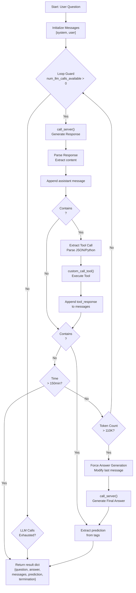
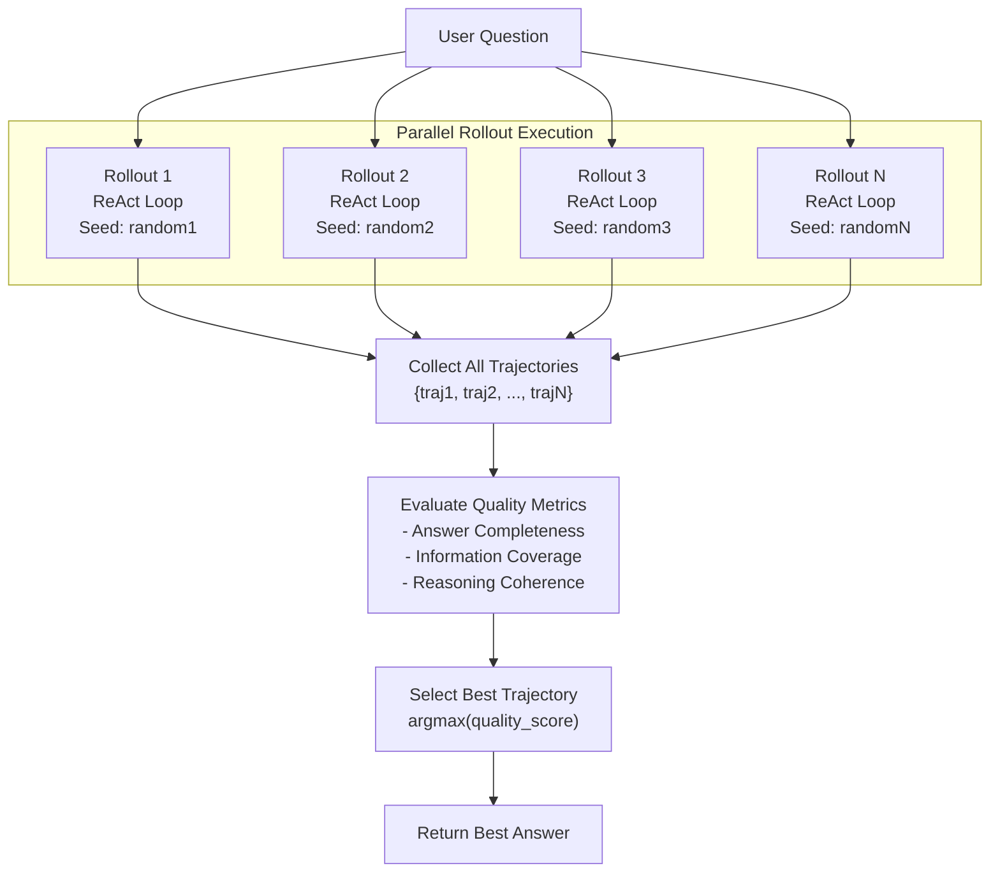
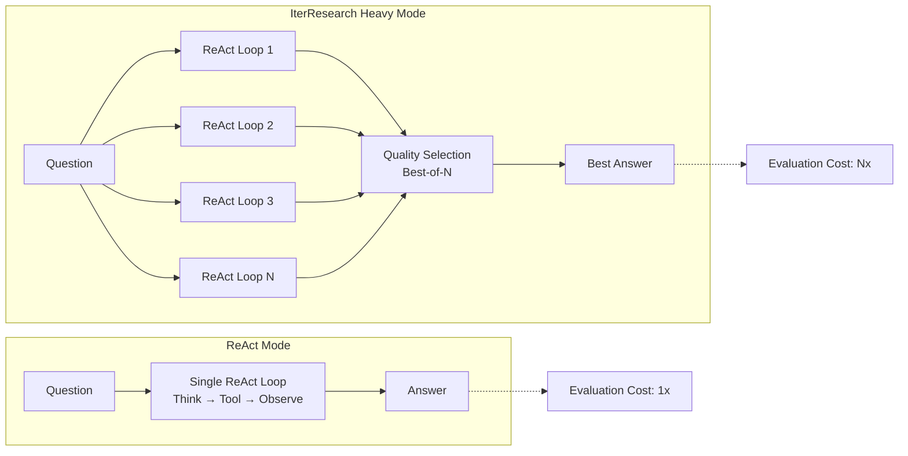

<!-- source: DeepWiki mcp.deepwiki.com · repo Alibaba-NLP/DeepResearch · page 2.2 Inference Paradigms: ReAct and IterResearch · fetched 2026-10-29 -->

# ReAct and IterResearch Inference Modes

<details>
<summary>Relevant source files</summary>

The following files were used as context for generating this wiki page:

- [README.md](README.md)
- [inference/react_agent.py](inference/react_agent.py)

</details>


## Purpose and Scope

This document describes the two primary inference paradigms supported by Tongyi DeepResearch: **ReAct** mode for evaluating core model capabilities and **IterResearch Heavy** mode for achieving maximum performance through test-time scaling. These modes represent different trade-offs between computational cost and performance quality.

For details on the underlying orchestration layer that executes these modes, see [MultiTurnReactAgent Architecture](#2.1). For information about context management and the ReSum paradigm for unlimited exploration, see [Context Management and ReSum Paradigm](#2.7). For configuration of the inference scripts themselves, see [Inference Orchestration Scripts](#2.8).

**Sources:** [README.md:47](), [inference/react_agent.py:47-248]()

---

## Overview of Inference Paradigms

Tongyi DeepResearch supports two distinct inference paradigms, each optimized for different evaluation and deployment scenarios:

| Paradigm | Purpose | Strategy | Computational Cost | Performance |
|----------|---------|----------|-------------------|-------------|
| **ReAct** | Core abilities evaluation | Single-trajectory reasoning-acting loop | Low (1x baseline) | Standard |
| **IterResearch Heavy** | Maximum performance | Multiple parallel rollouts with test-time scaling | High (Nx baseline) | State-of-the-art |

### ReAct Mode

ReAct mode implements the standard reasoning-acting cycle where the model alternates between **thinking** about the next action and **executing** tools to gather information. This mode is designed for:

- **Rigorous evaluation** of the model's intrinsic capabilities
- **Reproducible benchmarking** across different systems
- **Resource-constrained** deployment scenarios
- **Single-pass inference** where computational cost must be minimized

### IterResearch Heavy Mode

IterResearch Heavy mode applies test-time scaling by generating **multiple independent rollouts** in parallel and selecting the best result. This mode is designed for:

- **Maximum quality** output when accuracy is critical
- **Production deployments** where quality outweighs cost
- **Unlocking the model's performance ceiling** through exploration diversity
- **Overcoming failure modes** by sampling multiple solution paths

**Sources:** [README.md:47](), [README.md:32-40]()

---

## ReAct Mode Architecture

### Inference Flow Diagram



**Sources:** [inference/react_agent.py:120-227]()

### Core ReAct Loop Implementation

The ReAct loop is implemented in the `MultiTurnReactAgent._run()` method. The core execution cycle follows this sequence:

#### 1. Initialization Phase

```
System Prompt: SYSTEM_PROMPT + current_date
Messages: [
    {"role": "system", "content": system_prompt},
    {"role": "user", "content": question}
]
Loop Constraints:
  - num_llm_calls_available = MAX_LLM_CALL_PER_RUN (default: 100)
  - max_tokens = 110K
  - max_time = 150 minutes
```

**Sources:** [inference/react_agent.py:131-137]()

#### 2. LLM Generation Phase

The `call_server()` method handles LLM communication with robust retry logic:

```
Retry Strategy:
  - max_tries = 10
  - exponential_backoff = base_sleep_time * (2^attempt) + random_jitter
  - max_sleep_time = 30 seconds
  
Stop Tokens: ["\n<tool_response>", "<tool_response>"]
```

The method returns stripped content or an error message after exhausting retries.

**Sources:** [inference/react_agent.py:59-111]()

#### 3. Tool Execution Phase

If the response contains `<tool_call>` tags, the system extracts and executes the tool:

```python
Tool Call Formats:

# Format 1: JSON-based tool call
{
    "name": "tool_name",
    "arguments": {"param1": "value1", ...}
}

# Format 2: Python code block (PythonInterpreter only)
<tool_call>
<code>
python_code_here
</code>
</tool_call>
```

The `custom_call_tool()` method routes to the appropriate tool handler from `TOOL_MAP`.

**Sources:** [inference/react_agent.py:159-179](), [inference/react_agent.py:228-248]()

#### 4. Response Formatting

Tool responses are wrapped in XML tags and appended as user messages:

```
<tool_response>
{tool_output}
</tool_response>
```

This maintains the alternating assistant-user message structure required by the ReAct paradigm.

**Sources:** [inference/react_agent.py:177-179]()

### Termination Conditions

The ReAct loop terminates under five distinct conditions:

| Condition | Trigger | Termination Flag | Behavior |
|-----------|---------|------------------|----------|
| **Natural Answer** | `<answer>` tags detected | `'answer'` | Extract prediction from tags |
| **Token Limit** | `count_tokens(messages) > 110K` | `'generate an answer as token limit reached'` | Force final answer generation |
| **LLM Call Limit** | `num_llm_calls_available <= 0` | `'exceed available llm calls'` | Return last content or 'No answer found' |
| **Time Limit** | `elapsed_time > 150 minutes` | `'No answer found after 2h30mins'` | Early termination |
| **Format Error** | Token limit + no `<answer>` tags | `'format error: generate an answer as token limit reached'` | Return raw content |

**Sources:** [inference/react_agent.py:138-227]()

### Token Management

The system monitors token consumption using the model's tokenizer:

```python
Method: count_tokens(messages)
  - Load tokenizer from llm_local_path
  - Apply chat template: tokenizer.apply_chat_template()
  - Tokenize full_prompt
  - Return len(tokens["input_ids"][0])

Threshold: 110K tokens (110 * 1024)
```

When the threshold is exceeded, the system injects a forced termination message:

```
"You have now reached the maximum context length you can handle. 
You should stop making tool calls and, based on all the information 
above, think again and provide what you consider the most likely 
answer in the following format:

<answer>your answer</answer>"
```

**Sources:** [inference/react_agent.py:112-118](), [inference/react_agent.py:186-209]()

---

## IterResearch Heavy Mode

### Test-Time Scaling Strategy

IterResearch Heavy mode implements a test-time scaling approach where **multiple independent inference rollouts** are executed in parallel for the same question. This strategy explores different reasoning paths and selects the highest-quality result.



**Sources:** [README.md:47]()

### Computational Cost vs Performance

IterResearch Heavy mode trades computational resources for improved answer quality:

| Metric | ReAct Mode | IterResearch Heavy (N=8) |
|--------|------------|--------------------------|
| **LLM Calls** | K | N × K |
| **Latency** | T seconds | T seconds (parallel) |
| **GPU Memory** | M GB | N × M GB |
| **Success Rate** | Baseline | +15-25% (typical) |
| **Quality Score** | Standard | Maximum ceiling |

The performance improvement comes from:

1. **Exploration Diversity**: Different random seeds lead to different tool call sequences
2. **Failure Mode Mitigation**: If one trajectory fails, others may succeed
3. **Solution Path Coverage**: Multiple approaches to the same problem
4. **Quality Selection**: Best-of-N selection ensures highest quality output

**Sources:** [README.md:32-40]()

### Mode Selection Guidelines

Choose the appropriate mode based on deployment constraints:

**Use ReAct Mode when:**
- Evaluating model capabilities for research or benchmarking
- Operating under strict computational budgets
- Single-pass inference is required
- Reproducibility is critical for fair comparison
- Real-time latency constraints are tight

**Use IterResearch Heavy Mode when:**
- Maximum answer quality is required
- Computational resources are available
- Production deployment with quality SLAs
- Complex questions requiring exploration diversity
- Failure rate must be minimized

**Sources:** [README.md:47]()

---

## Configuration and Execution

### Environment Variables

Both modes are configured through environment variables:

```bash
# Core Model Configuration
MODEL_PATH=/path/to/model/weights
MAX_LLM_CALL_PER_RUN=100  # Default: 100

# Inference Mode Selection
# ReAct: Use run_react_infer.sh
# IterResearch: Use specialized rollout scripts with parallel execution
```

**Sources:** [inference/react_agent.py:29](), [README.md:163-167]()

### ReAct Mode Execution

```bash
# Configure inference script
vim run_react_infer.sh
# Set MODEL_PATH, DATASET, OUTPUT_PATH

# Execute single-trajectory inference
bash run_react_infer.sh
```

The script launches VLLM servers (8 instances on ports 6001-6008) and executes the ReAct loop for each question in the dataset.

**Sources:** [README.md:169-173]()

### OpenRouter API Integration

For serverless deployment without GPUs, both modes can use OpenRouter's API:

```python
# Modify inference/react_agent.py
# Line 61-62: Set OpenRouter credentials
openai_api_key = "your_openrouter_key"
openai_api_base = "https://openrouter.ai/api/v1"

# Line 76: Change model name
model = "alibaba/tongyi-deepresearch-30b-a3b"

# Lines 87-88: Enable reasoning content concatenation
reasoning_content = ""
content = reasoning_content + content
```

**Sources:** [README.md:179-188](), [inference/react_agent.py:86-88]()

---

## Mode Comparison Diagram



**Sources:** [README.md:47]()

---

## Code Entity Mapping

| System Concept | Code Entity | File Location |
|----------------|-------------|---------------|
| ReAct Loop | `MultiTurnReactAgent._run()` | [inference/react_agent.py:120-227]() |
| LLM Communication | `call_server()` | [inference/react_agent.py:59-111]() |
| Tool Execution | `custom_call_tool()` | [inference/react_agent.py:228-248]() |
| Token Counting | `count_tokens()` | [inference/react_agent.py:112-118]() |
| Tool Registry | `TOOL_MAP` | [inference/react_agent.py:38]() |
| System Prompt | `SYSTEM_PROMPT` | [prompt.py]() (imported at line 16) |
| Max Loop Iterations | `MAX_LLM_CALL_PER_RUN` | [inference/react_agent.py:29]() |
| Token Limit | `110 * 1024` | [inference/react_agent.py:186]() |
| Time Limit | `150 * 60` seconds | [inference/react_agent.py:140]() |
| Stop Tokens | `["\n<tool_response>", "<tool_response>"]` | [inference/react_agent.py:77]() |

**Sources:** [inference/react_agent.py:1-248]()

---

