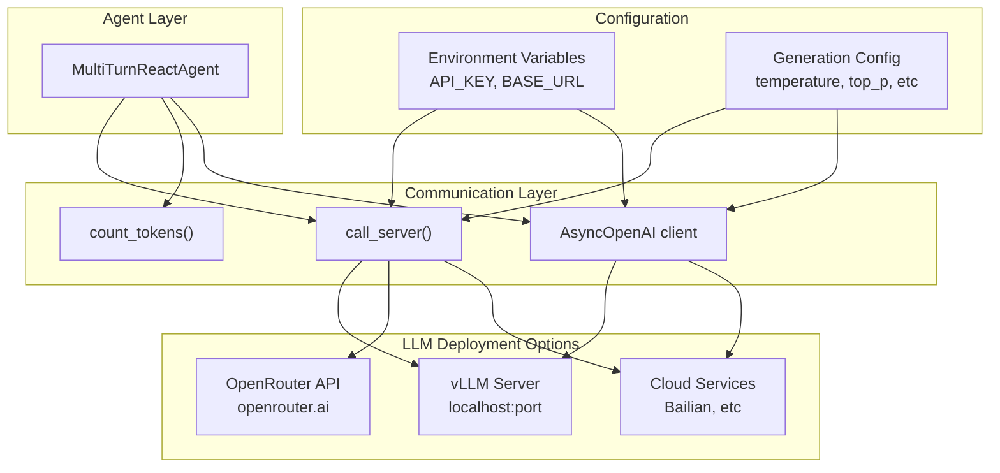
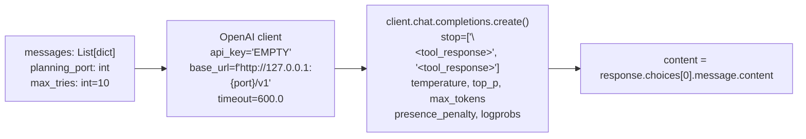
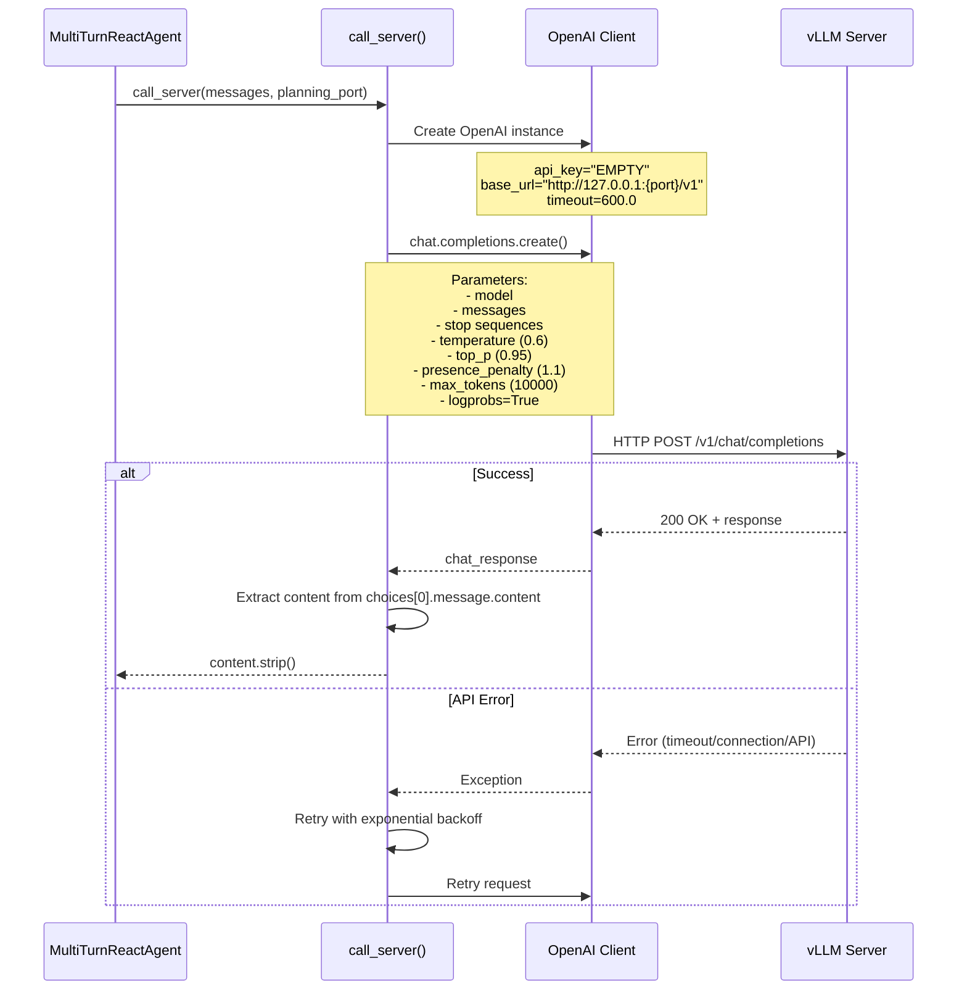
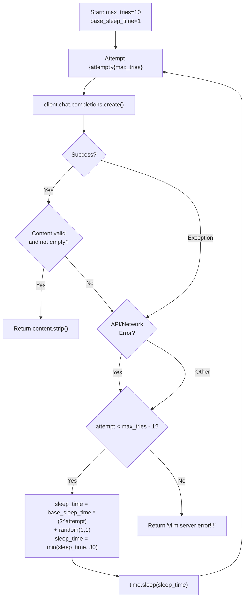
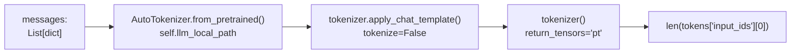

<!-- source: DeepWiki mcp.deepwiki.com · repo Alibaba-NLP/DeepResearch · page 2.3 LLM Communication and Integration · fetched 2026-10-29 -->

# LLM Communication and Integration

<details>
<summary>Relevant source files</summary>

The following files were used as context for generating this wiki page:

- [WebAgent/NestBrowse/toolkit/tool_explore.py](WebAgent/NestBrowse/toolkit/tool_explore.py)
- [WebAgent/NestBrowse/toolkit/tool_search.py](WebAgent/NestBrowse/toolkit/tool_search.py)
- [WebAgent/NestBrowse/utils.py](WebAgent/NestBrowse/utils.py)
- [WebAgent/NestBrowse/vllm_deploy.sh](WebAgent/NestBrowse/vllm_deploy.sh)
- [WebAgent/ParallelMuse/compressed_reasoning_aggregation.py](WebAgent/ParallelMuse/compressed_reasoning_aggregation.py)
- [WebAgent/WebDancer/demos/llm/__pycache__/oai.cpython-313.pyc](WebAgent/WebDancer/demos/llm/__pycache__/oai.cpython-313.pyc)
- [WebAgent/WebDancer/demos/llm/oai.py](WebAgent/WebDancer/demos/llm/oai.py)
- [inference/file_tools/__pycache__/file_parser.cpython-313.pyc](inference/file_tools/__pycache__/file_parser.cpython-313.pyc)
- [inference/file_tools/file_parser.py](inference/file_tools/file_parser.py)
- [inference/react_agent.py](inference/react_agent.py)

</details>


## Purpose and Scope

This document describes how the Tongyi DeepResearch system communicates with Large Language Models (LLMs) for inference. It covers the client implementations, request/response flow, error handling, retry mechanisms, and configuration requirements. For information about how agents orchestrate multiple LLM calls, see [MultiTurnReactAgent Architecture](#2.1). For details on token limits and context management, see [Token Management and Limits](#2.10).

## Communication Architecture Overview

The system supports multiple LLM integration patterns, from local vLLM deployments to cloud-based APIs, all using OpenAI-compatible interfaces.



**Communication Architecture**

The system uses OpenAI-compatible API interfaces for all LLM communications, enabling deployment flexibility. The `MultiTurnReactAgent` class manages synchronous calls via `call_server()`, while async operations use `AsyncOpenAI` clients for parallel processing.

Sources: [inference/react_agent.py:47-111](), [WebAgent/NestBrowse/utils.py:9-63]()

## LLM Client Implementations

### Synchronous Client (MultiTurnReactAgent)

The primary inference client is implemented in the `MultiTurnReactAgent.call_server()` method:

| Component | Description | Location |
|-----------|-------------|----------|
| `call_server()` | Main synchronous LLM call method with retry logic | [inference/react_agent.py:59-110]() |
| `OpenAI` client | OpenAI Python SDK client instance | [inference/react_agent.py:64-68]() |
| Configuration | API key, base URL, timeout, generation parameters | [inference/react_agent.py:61-82]() |

Key implementation details:



**Synchronous Client Request Flow**

The client creates an OpenAI instance pointing to the vLLM server endpoint, sends the chat completion request with stop sequences, and extracts the content from the first choice.

Sources: [inference/react_agent.py:59-92]()

### Asynchronous Client (NestBrowse, ParallelMuse)

For concurrent operations, the system uses `AsyncOpenAI` clients:

```python
# NestBrowse implementation
async def call_llm(sem, prompt, max_tokens, model_name, client=None, mode='agent'):
    LLM_API_KEY = os.getenv('AGENT_LLM_API_KEY')
    LLM_BASE_URL = os.getenv('AGENT_LLM_BASE_URL')
    
    client = AsyncOpenAI(api_key=LLM_API_KEY, base_url=LLM_BASE_URL)
    response = await client.chat.completions.create(
        model="", 
        messages=prompt, 
        stop=["\n<tool_response>", "<tool_response>"],
        temperature=0.6,
        top_p=0.95,
        presence_penalty=1.1,
        max_tokens=max_tokens
    )
```

Sources: [WebAgent/NestBrowse/utils.py:9-56](), [WebAgent/ParallelMuse/compressed_reasoning_aggregation.py:75-98]()

### OpenAI-Compatible Client Wrapper (WebDancer)

The `TextChatAtOAI` class provides a feature-rich wrapper with streaming support and function calling:

| Feature | Implementation | Location |
|---------|----------------|----------|
| Streaming | `_chat_stream()` with delta or full accumulation | [WebAgent/WebDancer/demos/llm/oai.py:96-157]() |
| Non-streaming | `_chat_no_stream()` for single-shot responses | [WebAgent/WebDancer/demos/llm/oai.py:159-176]() |
| Function calling | `_chat_with_functions()` compatibility layer | [WebAgent/WebDancer/demos/llm/oai.py:178-195]() |
| API key validation | Checks for valid API key, rejects 'EMPTY' | [WebAgent/WebDancer/demos/llm/oai.py:36-49]() |

Sources: [WebAgent/WebDancer/demos/llm/oai.py:22-218]()

## Request/Response Flow

### Standard Request Flow



**Request/Response Sequence**

The agent calls `call_server()` which creates an OpenAI client, sends the request with configured parameters, and handles the response or retries on error.

Sources: [inference/react_agent.py:59-110]()

### Message Structure

Messages follow the OpenAI chat format:

```python
# System message with current date
system_prompt = SYSTEM_PROMPT + str(today_date())
messages = [
    {"role": "system", "content": system_prompt}, 
    {"role": "user", "content": question}
]

# After LLM response
messages.append({"role": "assistant", "content": content.strip()})

# After tool execution
messages.append({"role": "user", "content": "<tool_response>\n" + result + "\n</tool_response>"})
```

Sources: [inference/react_agent.py:132-179]()

## Retry Logic and Error Handling

The system implements exponential backoff with jitter for resilient LLM communication:



**Retry Logic with Exponential Backoff**

The system retries failed requests up to 10 times with exponentially increasing wait times (capped at 30 seconds) plus random jitter to avoid thundering herd problems.

### Error Types Handled

| Error Type | Description | Handling |
|------------|-------------|----------|
| `APIError` | OpenAI API errors (rate limits, invalid requests) | Retry with backoff |
| `APIConnectionError` | Network connectivity issues | Retry with backoff |
| `APITimeoutError` | Request timeout (600s default) | Retry with backoff |
| Empty response | Valid response but empty content | Log warning and retry |
| Generic exceptions | Unexpected errors | Log and retry |

Sources: [inference/react_agent.py:70-110]()

### Timeout Configuration

```python
# Synchronous client
client = OpenAI(
    api_key=openai_api_key,
    base_url=openai_api_base,
    timeout=600.0  # 10 minutes
)

# Async client (ParallelMuse)
response = await client.chat.completions.create(
    # ... parameters
)
# Timeout handled by client configuration and retry on "time out" in error message
```

Sources: [inference/react_agent.py:64-68](), [WebAgent/ParallelMuse/compressed_reasoning_aggregation.py:81-93]()

## Configuration and Environment Variables

### vLLM Server Configuration

For local deployment, environment variables configure the LLM endpoint:

```bash
# Agent LLM (primary inference model)
AGENT_LLM_API_KEY="EMPTY"
AGENT_LLM_BASE_URL="http://localhost:8000/v1"

# Summary LLM (optional, for summarization tasks)
SUMMARY_LLM_API_KEY="EMPTY"
SUMMARY_LLM_BASE_URL="http://localhost:8001/v1"
```

The `planning_port` parameter in `call_server()` allows routing to different vLLM instances:

```python
openai_api_base = f"http://127.0.0.1:{planning_port}/v1"
```

Sources: [inference/react_agent.py:62](), [WebAgent/NestBrowse/utils.py:11-16]()

### vLLM Server Deployment

```bash
# Example deployment script
MODEL_PATH="[MODEL_PATH]"
python -m vllm.entrypoints.openai.api_server \
    --model $MODEL_PATH \
    --port 8000 \
    --max-model-len 131072 \
    --tensor-parallel-size 4 \
    --gpu-memory-utilization 0.8
```

Sources: [WebAgent/NestBrowse/vllm_deploy.sh:1-7]()

### OpenRouter Integration

For using OpenRouter API, uncomment the reasoning content extraction:

```python
# In call_server() after receiving response
# reasoning_content = ""
# content = reasoning_content + content
```

OpenRouter provides extended reasoning traces that can be prepended to the response content.

Sources: [inference/react_agent.py:86-88]()

### ParallelMuse Configuration

For report generation and integration tasks:

```python
REPORT_CONVERGE_BASE_URL_POOL = [
    "http://localhost:8000/v1",
    # Add more URLs for load balancing
]
REPORT_CONVERGE_API_KEY = "EMPTY"
```

The system randomly selects from the URL pool to distribute load:

```python
client = AsyncOpenAI(
    base_url=random.choice(REPORT_CONVERGE_BASE_URL_POOL),
    api_key=REPORT_CONVERGE_API_KEY
)
```

Sources: [WebAgent/ParallelMuse/compressed_reasoning_aggregation.py:14-79]()

## Generation Parameters

### Standard Parameters

| Parameter | Default Value | Purpose | Location |
|-----------|---------------|---------|----------|
| `temperature` | 0.6 | Controls randomness (higher = more creative) | [inference/react_agent.py:78]() |
| `top_p` | 0.95 | Nucleus sampling threshold | [inference/react_agent.py:79]() |
| `presence_penalty` | 1.1 | Penalizes token repetition | [inference/react_agent.py:82]() |
| `max_tokens` | 10000 | Maximum generation length | [inference/react_agent.py:81]() |
| `logprobs` | True | Return log probabilities | [inference/react_agent.py:80]() |

Sources: [inference/react_agent.py:74-82]()

### Stop Sequences

The system uses consistent stop sequences to detect tool calls:

```python
stop=["\n<tool_response>", "<tool_response>"]
```

These stop sequences prevent the model from generating tool responses, ensuring the agent maintains control flow.

Sources: [inference/react_agent.py:77](), [WebAgent/NestBrowse/utils.py:40]()

### Mode-Specific Parameters

```python
if mode == 'agent':
    response = await client.chat.completions.create(
        model="", 
        messages=prompt, 
        stop=["\n<tool_response>", "<tool_response>"],
        temperature=0.6,
        top_p=0.95,
        presence_penalty=1.1,
        max_tokens=max_tokens
    )
else:  # summary mode
    response = await client.chat.completions.create(
        model="", 
        messages=prompt, 
        temperature=0.6,
        top_p=0.95,
        max_tokens=max_tokens
    )
```

Summary mode omits `presence_penalty` and stop sequences for cleaner text generation.

Sources: [WebAgent/NestBrowse/utils.py:36-53]()

## Token Counting and Context Management

### Token Counting Implementation



**Token Counting Pipeline**

The system loads the tokenizer for the deployed model, applies the chat template to format messages, tokenizes the result, and counts tokens in the input_ids tensor.

The `count_tokens()` method accurately counts tokens by:
1. Loading the model's tokenizer from `self.llm_local_path`
2. Applying the chat template to format messages consistently
3. Tokenizing the formatted prompt
4. Returning the length of the token sequence

```python
def count_tokens(self, messages):
    tokenizer = AutoTokenizer.from_pretrained(self.llm_local_path) 
    full_prompt = tokenizer.apply_chat_template(messages, tokenize=False)
    tokens = tokenizer(full_prompt, return_tensors="pt")
    token_count = len(tokens["input_ids"][0])
    return token_count
```

Sources: [inference/react_agent.py:112-118]()

### Context Limit Handling

The system enforces a 110K token context limit:

```python
max_tokens = 110 * 1024
token_count = self.count_tokens(messages)
print(f"round: {round}, token count: {token_count}")

if token_count > max_tokens:
    print(f"Token quantity exceeds the limit: {token_count} > {max_tokens}")
    
    messages[-1]['content'] = "You have now reached the maximum context length you can handle. You should stop making tool calls and, based on all the information above, think again and provide what you consider the most likely answer in the following format:\n<answer>your answer</answer>"
    content = self.call_server(messages, planning_port)
    messages.append({"role": "assistant", "content": content.strip()})
```

When the limit is reached, the agent injects a special message forcing the model to provide a final answer.

Sources: [inference/react_agent.py:186-209]()

## Model and Port Configuration

### Model Specification

```python
# Set in _run() method
self.model = model

# Used in call_server()
chat_response = client.chat.completions.create(
    model=self.model,  # e.g., "Tongyi-DeepResearch-30B-A3B"
    messages=msgs,
    # ...
)
```

The model name is passed dynamically, allowing routing to different models or deployments.

Sources: [inference/react_agent.py:121](), [inference/react_agent.py:74-76]()

### Port-Based Routing

Different vLLM servers can be accessed via port numbers:

```python
data = {
    'planning_port': 8000,  # Primary model
    'item': {'question': "...", 'answer': "..."}
}

# In call_server()
openai_api_base = f"http://127.0.0.1:{planning_port}/v1"
```

This enables:
- Multiple model deployments on different ports
- Load balancing across instances
- Dedicated models for different task types

Sources: [inference/react_agent.py:62](), [inference/react_agent.py:129]()

## Response Format and Extraction

### Content Extraction

```python
chat_response = client.chat.completions.create(...)
content = chat_response.choices[0].message.content

# Clean up if tool response marker appears
if '<tool_response>' in content:
    pos = content.find('<tool_response>')
    content = content[:pos]

messages.append({"role": "assistant", "content": content.strip()})
```

The system extracts content from the first choice and removes any premature tool response markers.

Sources: [inference/react_agent.py:84](), [inference/react_agent.py:155-158]()

### Reasoning Content (OpenRouter)

For models that support separate reasoning traces:

```python
# OpenRouter provides reasoning in a separate field
reasoning_content = ""
content = reasoning_content + content
```

This is particularly useful for models like o1 that generate explicit reasoning steps.

Sources: [inference/react_agent.py:86-88]()

## Load Balancing and Concurrency

### Semaphore-Based Concurrency Control

For async operations, the system uses semaphores to limit concurrent requests:

```python
report_sem = asyncio.Semaphore(64)  # Max 64 concurrent report generations
merge_sem = asyncio.Semaphore(32)   # Max 32 concurrent merges
sem = {
    'report': report_sem,
    'merge': merge_sem
}

# In call function
async with sem['llm']:
    response = await client.chat.completions.create(...)
```

This prevents overwhelming the LLM servers with too many simultaneous requests.

Sources: [WebAgent/ParallelMuse/compressed_reasoning_aggregation.py:255-260](), [WebAgent/NestBrowse/utils.py:26]()

### URL Pool Load Balancing

```python
REPORT_CONVERGE_BASE_URL_POOL = [
    "http://localhost:8000/v1",
    "http://localhost:8001/v1",
    # Additional endpoints
]

client = AsyncOpenAI(
    base_url=random.choice(REPORT_CONVERGE_BASE_URL_POOL),
    api_key=REPORT_CONVERGE_API_KEY
)
```

Random selection from a pool of base URLs distributes load across multiple vLLM instances.

Sources: [WebAgent/ParallelMuse/compressed_reasoning_aggregation.py:15-77]()

## Integration Patterns Summary

| Pattern | Use Case | Implementation | Concurrency |
|---------|----------|----------------|-------------|
| Synchronous (`call_server`) | Main agent loop | OpenAI client with retry logic | Sequential |
| Async (NestBrowse) | Parallel tool execution | AsyncOpenAI with semaphores | 64 concurrent |
| Async (ParallelMuse) | Report generation and merging | AsyncOpenAI with dual semaphores | 64 report + 32 merge |
| Streaming (WebDancer) | Interactive responses | OpenAI streaming API | N/A |

Sources: [inference/react_agent.py:59-110](), [WebAgent/NestBrowse/utils.py:9-63](), [WebAgent/ParallelMuse/compressed_reasoning_aggregation.py:75-98](), [WebAgent/WebDancer/demos/llm/oai.py:96-157]()

---

