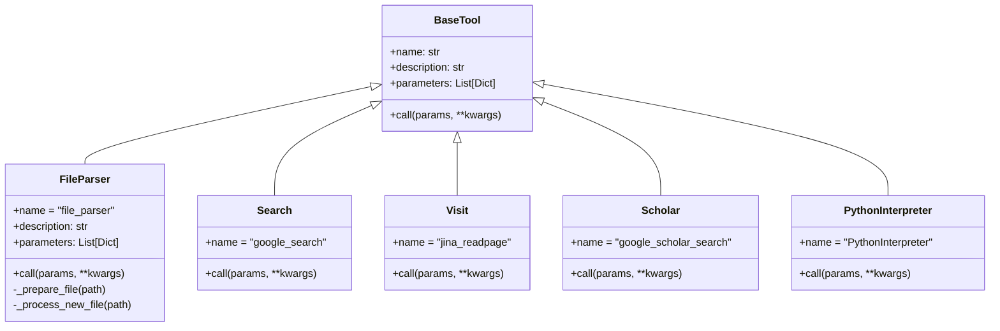
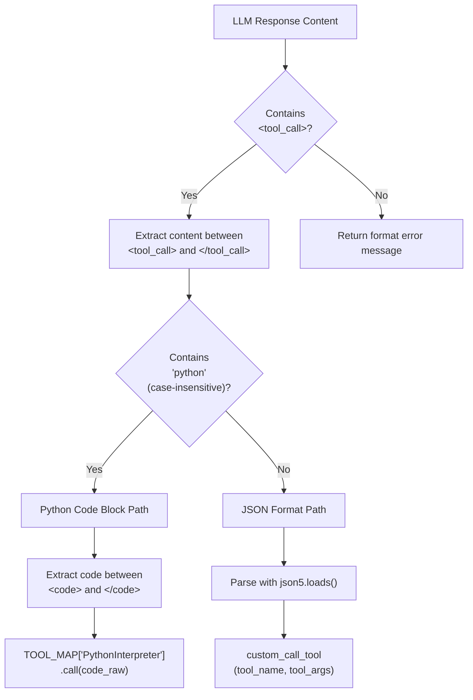
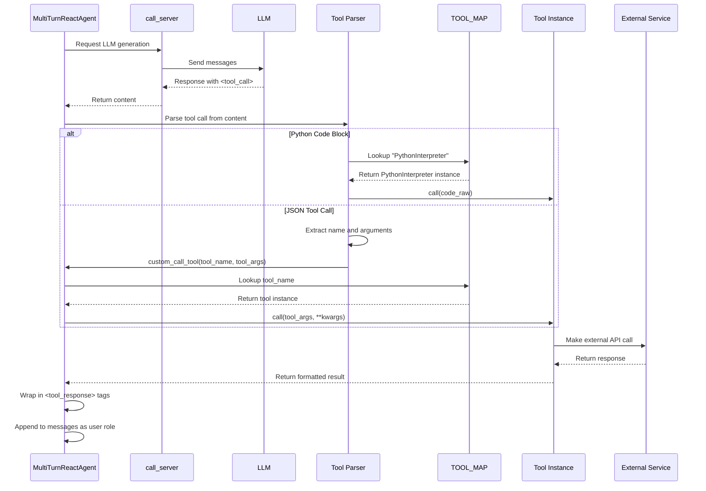
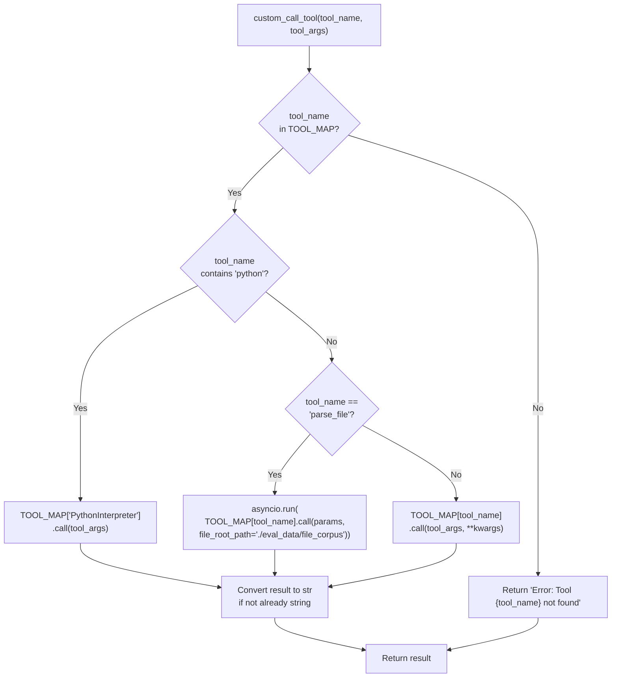

<!-- source: DeepWiki mcp.deepwiki.com · repo Alibaba-NLP/DeepResearch · page 2.4 Tool System Architecture · fetched 2026-10-29 -->

# Tool System Architecture

<details>
<summary>Relevant source files</summary>

The following files were used as context for generating this wiki page:

- [WebAgent/WebWatcher/infer/scripts_eval/scripts/eval.sh](WebAgent/WebWatcher/infer/scripts_eval/scripts/eval.sh)
- [WebAgent/WebWatcher/infer/vl_search_r1/qwen-agent-o1_search/qwen_agent/tools/private/visit.py](WebAgent/WebWatcher/infer/vl_search_r1/qwen-agent-o1_search/qwen_agent/tools/private/visit.py)
- [WebAgent/WebWatcher/infer/vl_search_r1/qwen-agent-o1_search/qwen_agent/tools/vl_search_image.py](WebAgent/WebWatcher/infer/vl_search_r1/qwen-agent-o1_search/qwen_agent/tools/vl_search_image.py)
- [inference/react_agent.py](inference/react_agent.py)

</details>


This document describes the tool system architecture in the Core Inference Engine, which enables the agent to interact with external services and execute actions. It covers tool registration, tool call parsing from LLM outputs (supporting both JSON and Python code blocks), and the tool execution pipeline.

For information about individual tools (Search, Visit, FileParser, etc.), see [Web Tools: Search, Visit, and Scholar](#2.6) and [File Parser and Document Processing](#2.5). For the orchestration layer that manages tool calls within the ReAct loop, see [MultiTurnReactAgent Architecture](#2.1).

## Purpose and Scope

The tool system provides a flexible, extensible architecture for:
- **Tool Registration**: Defining and registering tools with standardized interfaces
- **Tool Call Parsing**: Extracting tool invocations from LLM-generated text (JSON format or Python code blocks)
- **Tool Execution**: Invoking tools with parameters and returning results to the agent
- **Error Handling**: Managing tool call failures and format errors

## Tool Registration System

### Tool Class Registry

The system maintains a global registry of available tools at initialization time. All tools are instantiated once and stored in two data structures:

```mermaid
graph TB
    subgraph "Tool Registration"
        TOOL_CLASS["TOOL_CLASS<br/>[FileParser, Scholar, Visit,<br/>Search, PythonInterpreter]"]
        TOOL_MAP["TOOL_MAP<br/>{tool.name: tool}"]
        
        TOOL_CLASS -->|"dict comprehension"| TOOL_MAP
    end
    
    subgraph "Tool Implementations"
        FP["FileParser()<br/>inference/file_tools/"]
        SCH["Scholar()<br/>tool_scholar.py"]
        VIS["Visit()<br/>tool_visit.py"]
        SEARCH["Search()<br/>tool_search.py"]
        PY["PythonInterpreter()<br/>tool_python.py"]
    end
    
    FP --> TOOL_CLASS
    SCH --> TOOL_CLASS
    VIS --> TOOL_CLASS
    SEARCH --> TOOL_CLASS
    PY --> TOOL_CLASS
    
    subgraph "Agent Usage"
        AGENT["MultiTurnReactAgent"]
        CUSTOM_CALL["custom_call_tool(tool_name, tool_args)"]
    end
    
    AGENT -->|"tool lookup"| TOOL_MAP
    TOOL_MAP -->|"returns tool instance"| CUSTOM_CALL
```



**Sources**: [inference/react_agent.py:31-38]()

The registration happens at module load time:

| Variable | Type | Purpose |
|----------|------|---------|
| `TOOL_CLASS` | `list` | Ordered list of instantiated tool objects |
| `TOOL_MAP` | `dict` | Dictionary mapping tool names (strings) to tool instances for O(1) lookup |

### Tool Interface

All tools inherit from `BaseTool` (from `qwen_agent.tools.base`) and must implement:



**Sources**: [inference/file_tools/file_parser.py:464-472]()

Each tool defines its interface through three metadata fields:

- **`name`**: String identifier used in tool calls (e.g., `"file_parser"`, `"google_search"`)
- **`description`**: Human-readable description of tool functionality
- **`parameters`**: JSON Schema-like list of parameter definitions with name, type, description, and required flag

## Tool Call Parsing

The system supports two distinct formats for tool invocations, both extracted from LLM-generated text.

### Parsing Decision Flow



**Sources**: [inference/react_agent.py:159-176]()

### Format 1: JSON Tool Calls

Standard tool invocations use JSON format with explicit tool name and arguments:

**Structure**:
```
<tool_call>
{
  "name": "tool_name",
  "arguments": {
    "param1": "value1",
    "param2": "value2"
  }
}
</tool_call>
```

**Parsing Implementation**:
```python
tool_call = content.split('<tool_call>')[1].split('</tool_call>')[0]
tool_call = json5.loads(tool_call)
tool_name = tool_call.get('name', '')
tool_args = tool_call.get('arguments', {})
result = self.custom_call_tool(tool_name, tool_args)
```

**Sources**: [inference/react_agent.py:160-173]()

### Format 2: Python Code Blocks

Python code execution uses a special format:

**Structure**:
```
<tool_call>
python
<code>
# Python code here
print("Hello")
</code>
</tool_call>
```

**Parsing Implementation**:
```python
if "python" in tool_call.lower():
    code_raw = content.split('<tool_call>')[1].split('</tool_call>')[0]\
                      .split('<code>')[1].split('</code>')[0].strip()
    result = TOOL_MAP['PythonInterpreter'].call(code_raw)
```

**Sources**: [inference/react_agent.py:162-167]()

### Error Handling

If parsing fails, the system returns a descriptive error message:
```python
result = 'Error: Tool call is not a valid JSON. Tool call must contain a valid "name" and "arguments" field.'
```

**Sources**: [inference/react_agent.py:175-176]()

## Tool Execution Pipeline

### Execution Flow



**Sources**: [inference/react_agent.py:159-179](), [inference/react_agent.py:228-247]()

### custom_call_tool Method

The `custom_call_tool` method handles tool invocation with special cases for different tool types:



**Sources**: [inference/react_agent.py:228-247]()

**Special Cases**:

| Tool Type | Condition | Special Handling |
|-----------|-----------|------------------|
| Python Interpreter | `"python" in tool_name.lower()` | Direct call with `tool_args` as code |
| File Parser | `tool_name == "parse_file"` | Async execution with `asyncio.run()` and explicit `file_root_path` parameter |
| Standard Tools | All others | Standard `call(tool_args, **kwargs)` invocation |

### Result Formatting

All tool results are wrapped in XML-like tags and injected into the conversation as a user message:

```python
result = "<tool_response>\n" + result + "\n</tool_response>"
messages.append({"role": "user", "content": result})
```

This format allows the LLM to distinguish between its own outputs and external tool results.

**Sources**: [inference/react_agent.py:177-179]()

## Registered Tool Inventory

The system includes five core tools registered at initialization:

| Tool Class | Name | Primary Function | External Service |
|------------|------|------------------|------------------|
| `FileParser` | `"file_parser"` | Parse documents (PDF, DOCX, etc.) | Dashscope API, IDP Service |
| `Scholar` | `"google_scholar_search"` | Academic search | Serper API |
| `Visit` | `"jina_readpage"` | Webpage content extraction | Jina AI API |
| `Search` | `"google_search"` | Web search | Serper API |
| `PythonInterpreter` | `"PythonInterpreter"` | Execute Python code | SandboxFusion |

**Sources**: [inference/react_agent.py:20-24](), [inference/react_agent.py:31-37]()

## Error Recovery

The system implements several error recovery mechanisms:

1. **Parse Failures**: Returns error message with guidance on correct format
2. **Tool Not Found**: Returns explicit error message identifying missing tool
3. **Tool Execution Failures**: Caught by individual tool implementations and returned as error strings
4. **Type Conversion**: Non-string results automatically converted to strings for uniform handling

**Sources**: [inference/react_agent.py:175-176](), [inference/react_agent.py:239-247]()

## Integration with ReAct Loop

The tool system integrates tightly with the ReAct loop in `MultiTurnReactAgent._run()`:

1. **Detection**: After each LLM response, check for `<tool_call>` tag presence
2. **Parsing**: Extract and parse tool invocation using format-specific logic
3. **Execution**: Invoke tool via `custom_call_tool` or direct TOOL_MAP access
4. **Response Injection**: Wrap result in `<tool_response>` tags and append to messages
5. **Continuation**: LLM processes tool response in next iteration

The loop continues until an `<answer>` tag is detected or limits are reached.

**Sources**: [inference/react_agent.py:138-226]()

---

