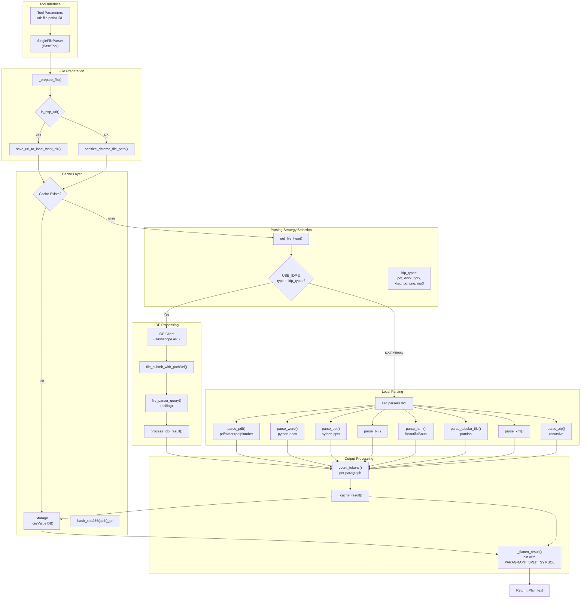
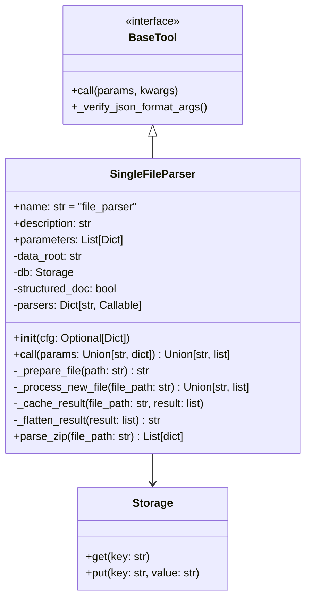
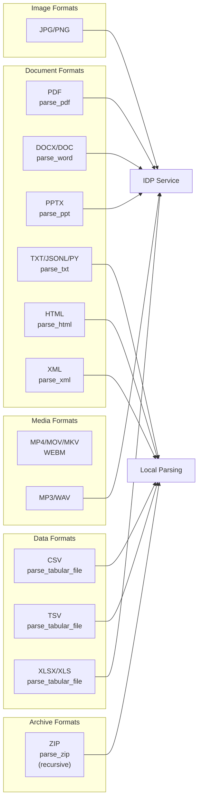
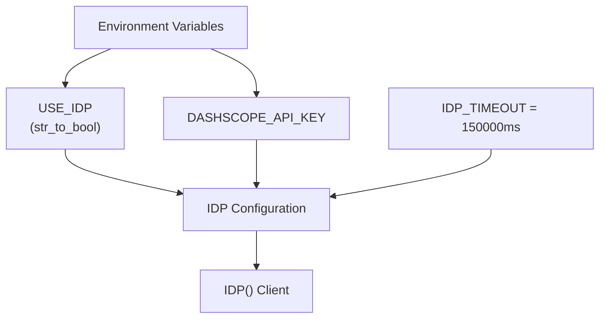
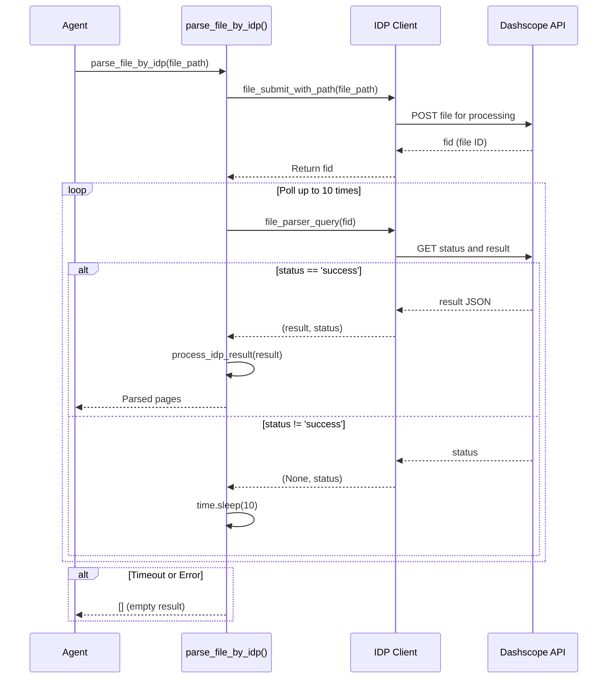
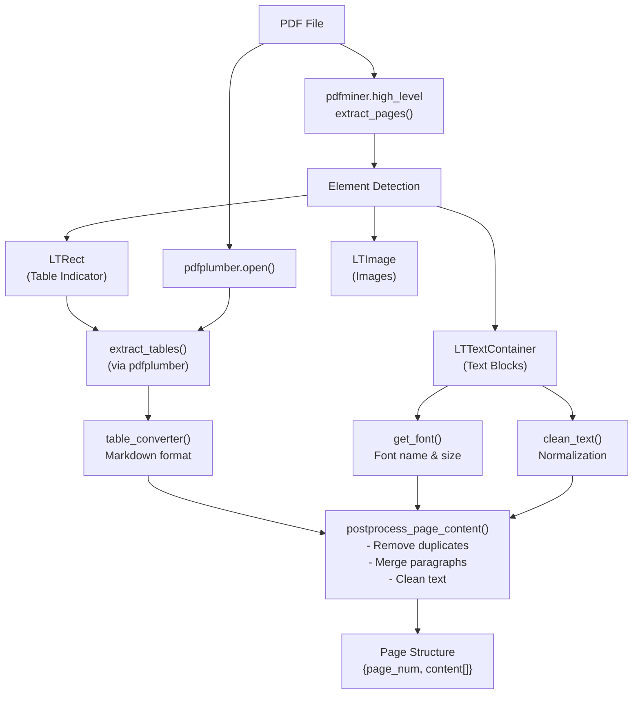
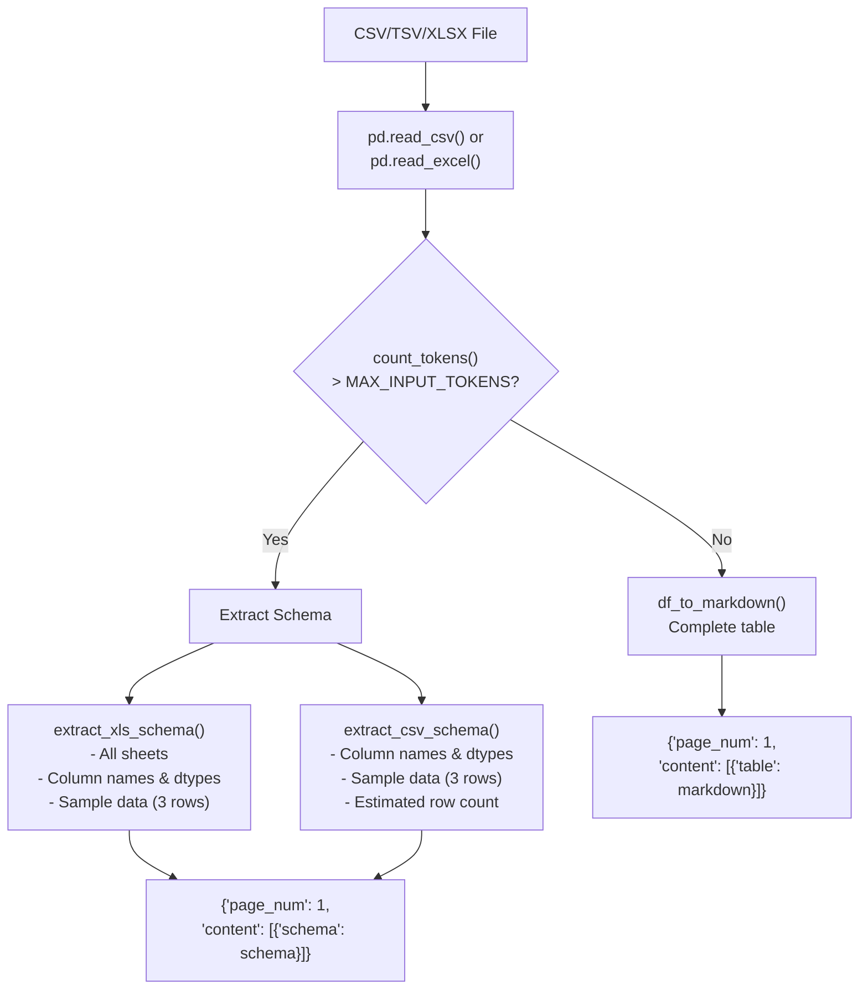
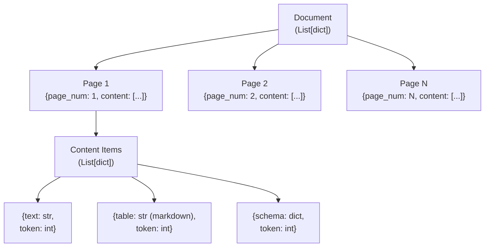
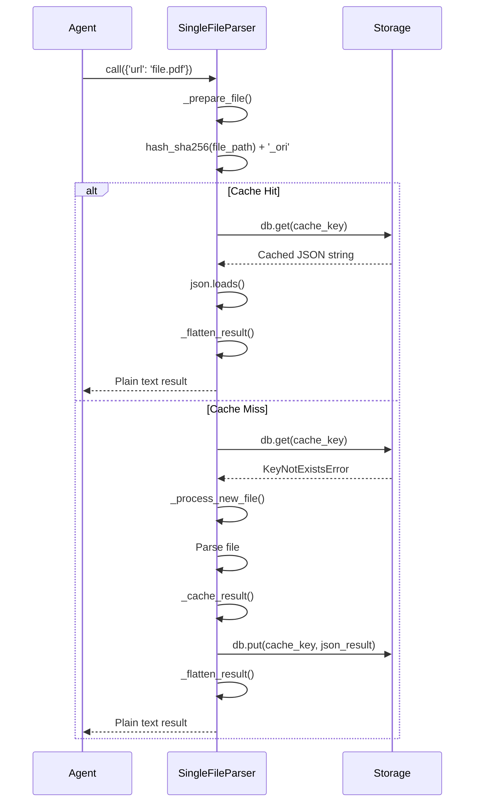
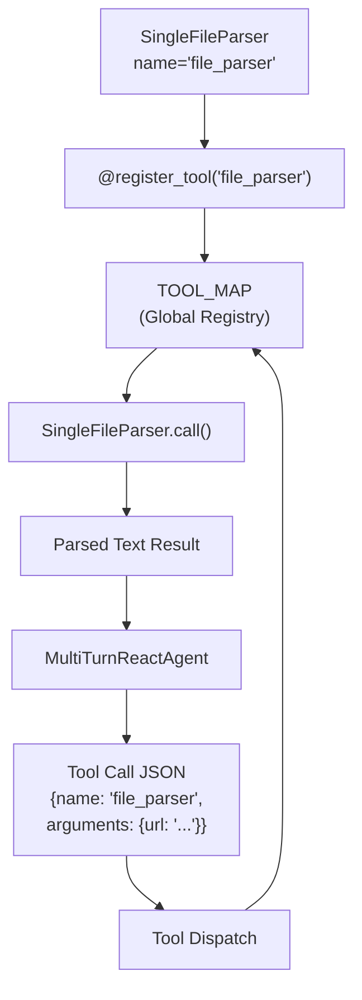

<!-- source: DeepWiki mcp.deepwiki.com · repo Alibaba-NLP/DeepResearch · page 2.5 File Parser and Document Processing · fetched 2026-10-29 -->

# File Parser and Document Processing

<details>
<summary>Relevant source files</summary>

The following files were used as context for generating this wiki page:

- [WebAgent/WebDancer/demos/llm/__pycache__/oai.cpython-313.pyc](WebAgent/WebDancer/demos/llm/__pycache__/oai.cpython-313.pyc)
- [WebAgent/WebDancer/demos/llm/oai.py](WebAgent/WebDancer/demos/llm/oai.py)
- [WebAgent/WebWatcher/infer/docker_env/requirements.txt](WebAgent/WebWatcher/infer/docker_env/requirements.txt)
- [WebAgent/WebWatcher/infer/vl_search_r1/qwen-agent-o1_search/qwen_agent/__init__.py](WebAgent/WebWatcher/infer/vl_search_r1/qwen-agent-o1_search/qwen_agent/__init__.py)
- [WebAgent/WebWatcher/infer/vl_search_r1/qwen-agent-o1_search/qwen_agent/agent.py](WebAgent/WebWatcher/infer/vl_search_r1/qwen-agent-o1_search/qwen_agent/agent.py)
- [WebAgent/WebWatcher/infer/vl_search_r1/qwen-agent-o1_search/qwen_agent/memory/memory.py](WebAgent/WebWatcher/infer/vl_search_r1/qwen-agent-o1_search/qwen_agent/memory/memory.py)
- [WebAgent/WebWatcher/infer/vl_search_r1/qwen-agent-o1_search/qwen_agent/tools/private/nlp_web_search.py](WebAgent/WebWatcher/infer/vl_search_r1/qwen-agent-o1_search/qwen_agent/tools/private/nlp_web_search.py)
- [WebAgent/WebWatcher/infer/vl_search_r1/qwen-agent-o1_search/qwen_agent/tools/private/prompt.py](WebAgent/WebWatcher/infer/vl_search_r1/qwen-agent-o1_search/qwen_agent/tools/private/prompt.py)
- [WebAgent/WebWatcher/infer/vl_search_r1/qwen-agent-o1_search/qwen_agent/tools/simple_doc_parser.py](WebAgent/WebWatcher/infer/vl_search_r1/qwen-agent-o1_search/qwen_agent/tools/simple_doc_parser.py)
- [WebAgent/WebWatcher/infer/vl_search_r1/qwen-agent-o1_search/setup.py](WebAgent/WebWatcher/infer/vl_search_r1/qwen-agent-o1_search/setup.py)
- [inference/file_tools/__pycache__/file_parser.cpython-313.pyc](inference/file_tools/__pycache__/file_parser.cpython-313.pyc)
- [inference/file_tools/file_parser.py](inference/file_tools/file_parser.py)

</details>


This document describes the **SingleFileParser** tool and the document processing infrastructure that enables the DeepResearch agent to parse and extract content from various file formats. The file parser is a core component of the tool ecosystem (see [Tool System Architecture](#2.4) for tool registration) and integrates with both local parsing libraries and external Intelligent Document Processing (IDP) services.

For information about how parsed files are used during agent execution, see [ReAct and IterResearch Inference Modes](#2.2).

**Sources:** [inference/file_tools/file_parser.py:1-579]()

---

## System Architecture

The file parser system provides a unified interface for extracting structured content from diverse document formats, supporting both automated IDP-based parsing and local library-based parsing with fallback mechanisms.



**Diagram: File Parser Architecture and Workflow**

The system follows a multi-stage pipeline: file preparation (downloading or sanitizing paths), cache lookup, parser selection (IDP vs local), parsing execution, token counting, caching, and result flattening.

**Sources:** [inference/file_tools/file_parser.py:464-579]()

---

## SingleFileParser Class

The `SingleFileParser` class is the main entry point, implementing the `BaseTool` interface for integration with the agent's tool system.

### Class Definition



**Diagram: SingleFileParser Class Structure**

**Sources:** [inference/file_tools/file_parser.py:463-498]()

### Tool Registration

The `SingleFileParser` is configured as a tool with the following metadata:

| Property | Value |
|----------|-------|
| **name** | `"file_parser"` |
| **description** | "File parsing tool, supports parsing data in pdf/docx/pptx/txt/html/csv/tsv/xlsx/xls/doc/zip/mp4/mov/mkv/webm/mp3/wav formats, and returns the parsed markdown format data." |
| **parameters** | Single parameter `url` (required string): "The full path of the file to be parsed, which can be a local path or a downloadable http(s) link." |

**Sources:** [inference/file_tools/file_parser.py:465-472]()

### Initialization

The `__init__()` method establishes the parser infrastructure:

```python
# Key initialization steps:
# 1. Set data root directory
self.data_root = self.cfg.get('path', os.path.join(DEFAULT_WORKSPACE, 'tools', self.name))

# 2. Initialize cache storage
self.db = Storage({'storage_root_path': self.data_root})

# 3. Configure structured document mode
self.structured_doc = self.cfg.get('structured_doc', True)

# 4. Build parser dispatch table
self.parsers = {
    'pdf': parse_pdf,
    'docx': parse_word,
    'pptx': parse_ppt,
    'txt': parse_txt,
    'csv': lambda p: parse_tabular_file(p, sep=','),
    'xlsx': parse_tabular_file,
    'zip': self.parse_zip,
    # ... more parsers
}
```

**Sources:** [inference/file_tools/file_parser.py:474-498]()

---

## File Type Support and Parser Mapping

The system supports 18+ file formats through a combination of specialized parsing libraries.

### Supported File Types



**Diagram: File Format Coverage and Parsing Routes**

**Sources:** [inference/file_tools/file_parser.py:28](), [inference/file_tools/file_parser.py:481-498](), [inference/file_tools/file_parser.py:518]()

### Parser Library Dependencies

| File Type | Primary Library | Secondary Libraries | Purpose |
|-----------|----------------|---------------------|---------|
| PDF | `pdfminer` | `pdfplumber` | Text extraction, table detection |
| DOCX/DOC | `python-docx` | - | Paragraph and table extraction |
| PPTX | `python-pptx` | - | Slide content extraction |
| HTML | `BeautifulSoup` | `lxml` | DOM parsing |
| CSV/TSV/XLSX | `pandas` | `openpyxl` | Tabular data reading |
| XML | `xml.etree.ElementTree` | - | Structure skeleton extraction |
| TXT | Built-in | - | Simple text reading |
| ZIP | `zipfile` | Recursive parsers | Archive extraction and nested parsing |

**Sources:** [inference/file_tools/file_parser.py:120-579]()

---

## IDP Integration and Workflow

When `USE_IDP` is enabled (default: `True`), the parser attempts to use Dashscope's Intelligent Document Processing service for supported file types before falling back to local parsing.

### IDP Configuration



**Diagram: IDP Configuration Sources**

**Sources:** [inference/file_tools/file_parser.py:29-36](), [inference/file_tools/idp.py:1-50]()

### IDP Parsing Workflow

The `parse_file_by_idp()` function implements asynchronous document processing:



**Diagram: IDP Asynchronous Parsing Sequence**

**Sources:** [inference/file_tools/file_parser.py:56-73]()

### IDP Result Processing

The `process_idp_result()` function converts IDP's JSON response to the standard page structure:

```python
def process_idp_result(result: dict) -> List[dict]:
    pages = []
    current_page = None
    
    for layout in result.get('layouts', []):
        page_num = layout.get('pageNum', 0)
        content = layout.get('markdownContent', '')
        
        # Aggregate layouts by page number
        if current_page and current_page['page_num'] == page_num:
            current_page['content'].append({'text': content})
        else:
            current_page = {'page_num': page_num, 'content': [{'text': content}]}
            pages.append(current_page)
    
    return pages
```

**Sources:** [inference/file_tools/file_parser.py:76-90]()

---

## Local Parsing Implementations

When IDP is unavailable or unsupported, the system falls back to local parsing using specialized libraries.

### PDF Parsing

The `parse_pdf()` function combines `pdfminer` for layout analysis and `pdfplumber` for table extraction:



**Diagram: PDF Parsing Pipeline**

Key steps:
1. **Layout Analysis**: `pdfminer` extracts page elements with bounding boxes
2. **Element Classification**: Distinguishes LTRect (tables), LTTextContainer (text), LTImage (images)
3. **Table Extraction**: `pdfplumber` extracts structured tables when LTRect detected
4. **Font Analysis**: Extracts font name and size for paragraph merging
5. **Post-processing**: Removes duplicate text from overlapping table/text regions, merges broken paragraphs

**Sources:** [inference/file_tools/file_parser.py:175-224](), [inference/file_tools/file_parser.py:237-254](), [inference/file_tools/file_parser.py:256-272](), [inference/file_tools/file_parser.py:275-309]()

### Tabular Data Parsing

The `parse_tabular_file()` function handles CSV, TSV, and Excel files with automatic schema extraction for large files:



**Diagram: Tabular File Parsing with Adaptive Schema Extraction**

For large tables exceeding token limits, the system returns a schema summary instead of full content, allowing the agent to query specific columns/rows using Python code execution tools.

**Sources:** [inference/file_tools/file_parser.py:366-378](), [inference/file_tools/file_parser.py:312-363]()

### XML Skeleton Extraction

For XML files, the `extract_xml_skeleton_markdown()` function generates a tree-like markdown representation:

```
## Root: configuration
    *Attributes:* `version`
    *Has text content*
├── **server**
│   *Attributes:* `port`, `host`
│   ├── **ssl**
│   │   *Attributes:* `enabled`
│   └── **logging**
└── **database**
    *Attributes:* `type`
```

This skeleton representation allows the agent to understand XML structure without overwhelming context with full content.

**Sources:** [inference/file_tools/file_parser.py:403-450]()

### ZIP Archive Handling

The `parse_zip()` method recursively extracts and parses archive contents:

```python
def parse_zip(self, file_path: str) -> List[dict]:
    extract_dir = os.path.join(self.data_root, f"zip_{hash_sha256(file_path)}")
    os.makedirs(extract_dir, exist_ok=True)
    
    results = []
    for extracted_file in parse_zip(file_path, extract_dir):
        if (ft := get_file_type(extracted_file)) in self.parsers:
            try:
                results.extend(self.parsers[ft](extracted_file))
            except Exception as e:
                logger.warning(f"Skip files {extracted_file}: {str(e)}")
    
    if not results:
        raise ValueError("No parseable content found in the ZIP file")
    return results
```

This enables the agent to process complex archives containing multiple document types.

**Sources:** [inference/file_tools/file_parser.py:564-578](), [inference/file_tools/file_parser.py:381-384]()

---

## Document Structure and Output Format

All parsers return a standardized list structure that is subsequently flattened for agent consumption.

### Structured Page Format

The internal representation uses a nested structure:



**Diagram: Internal Document Structure**

**Sources:** [inference/file_tools/file_parser.py:535-542]()

### Token Counting

Each content item has its token count computed and stored:

```python
for page in results:
    for para in page['content']:
        if 'schema' in para:
            para['token'] = count_tokens(json.dumps(para['schema']))
        else:
            para['token'] = count_tokens(para.get('text', para.get('table')))
        tokens += para['token']
```

This enables downstream components to make informed decisions about context management.

**Sources:** [inference/file_tools/file_parser.py:534-542]()

### Result Flattening

The `_flatten_result()` method converts the structured format to plain text for agent consumption:

```python
def _flatten_result(self, result: list) -> str:
    return PARAGRAPH_SPLIT_SYMBOL.join(
        para.get('text', para.get('table', ''))
        for page in result for para in page['content']
    )
```

Where `PARAGRAPH_SPLIT_SYMBOL = '\n'`. This produces a newline-separated string of all text and table content.

**Sources:** [inference/file_tools/file_parser.py:558-562](), [inference/file_tools/file_parser.py:37]()

---

## Caching Mechanism

The parser implements a persistent cache to avoid redundant parsing of the same files.

### Cache Storage


**Diagram: Cache Key Generation and Storage Flow**

**Sources:** [inference/file_tools/file_parser.py:553-556](), [inference/file_tools/file_parser.py:504-505]()

### Cache Lookup Flow



**Diagram: Cache Lookup and Population Sequence**

**Sources:** [inference/file_tools/file_parser.py:500-507]()

---

## Configuration and Environment Variables

The file parser system is configured through a combination of initialization parameters and environment variables.

### Configuration Parameters

| Parameter | Type | Default | Description |
|-----------|------|---------|-------------|
| `cfg.path` | `str` | `DEFAULT_WORKSPACE/tools/file_parser` | Storage root for cache and extracted files |
| `cfg.structured_doc` | `bool` | `True` | Enable structured document mode (currently unused) |

**Sources:** [inference/file_tools/file_parser.py:474-478]()

### Environment Variables

| Variable | Type | Default | Purpose |
|----------|------|---------|---------|
| `USE_IDP` | `bool` (via `str_to_bool`) | `"True"` | Enable IDP service for supported file types |
| `DASHSCOPE_API_KEY` | `str` | Required if `USE_IDP=True` | Authentication for Dashscope IDP API |

The `str_to_bool()` helper function converts various string representations to boolean:

```python
def str_to_bool(value):
    """Convert string to boolean, handling common true/false representations"""
    if isinstance(value, bool):
        return value
    return str(value).lower() in ('true', '1', 'yes', 'on')
```

**Sources:** [inference/file_tools/file_parser.py:29-36]()

---

## Integration with Tool Ecosystem

The `SingleFileParser` integrates with the broader tool system through the `BaseTool` interface.

### Tool Registration and Dispatch



**Diagram: File Parser Tool Registration and Dispatch**

The tool is registered via the `@register_tool` decorator (commented out in current implementation but configured through tool name) and dispatched through the `TOOL_MAP` when the agent generates appropriate tool call JSON.

**Sources:** [inference/file_tools/file_parser.py:463-472]()

### Error Handling

The parser implements comprehensive error handling:

```python
try:
    # Attempt IDP or local parsing
    results = parse_file_by_idp(file_path=file_path)
except Exception as e:
    # Fallback to local parser
    results = self.parsers[file_type](file_path)

if not results or not tokens:
    logger.error(f"Parsing failed: No information was parsed")
    raise FileParserError("Document parsing failed")
```

The custom `FileParserError` exception includes error codes and nested exceptions for debugging.

**Sources:** [inference/file_tools/file_parser.py:47-53](), [inference/file_tools/file_parser.py:526-551]()

---

## Summary

The File Parser and Document Processing system provides:

1. **Unified Interface**: `SingleFileParser` tool with single `url` parameter
2. **18+ File Format Support**: Documents, spreadsheets, presentations, archives, media
3. **Dual Parsing Strategy**: IDP service (Dashscope) with local library fallback
4. **Intelligent Caching**: SHA256-based cache with persistent storage
5. **Adaptive Output**: Full content vs. schema summaries based on token limits
6. **Structured Pipeline**: File preparation → cache check → parsing → token counting → flattening

The parser enables the DeepResearch agent to seamlessly process diverse document types during information-seeking workflows, converting complex file formats into accessible text representations.

**Sources:** [inference/file_tools/file_parser.py:1-579]()

---

