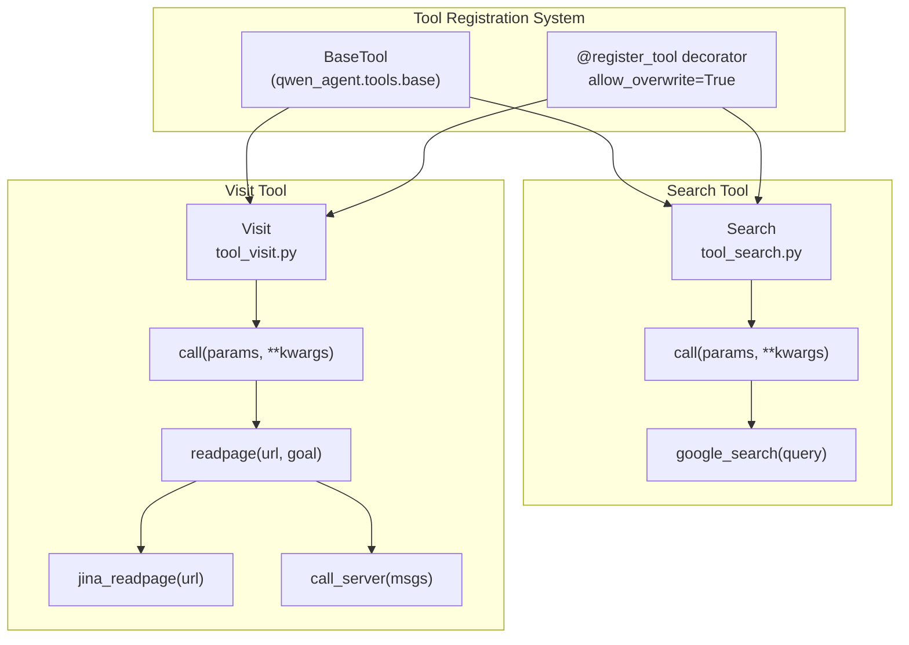
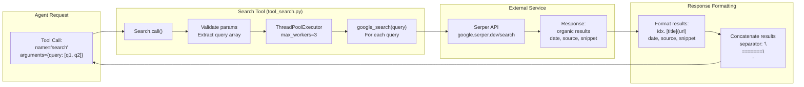
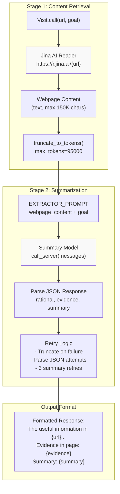
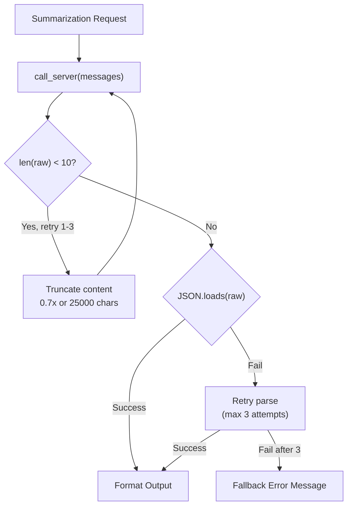
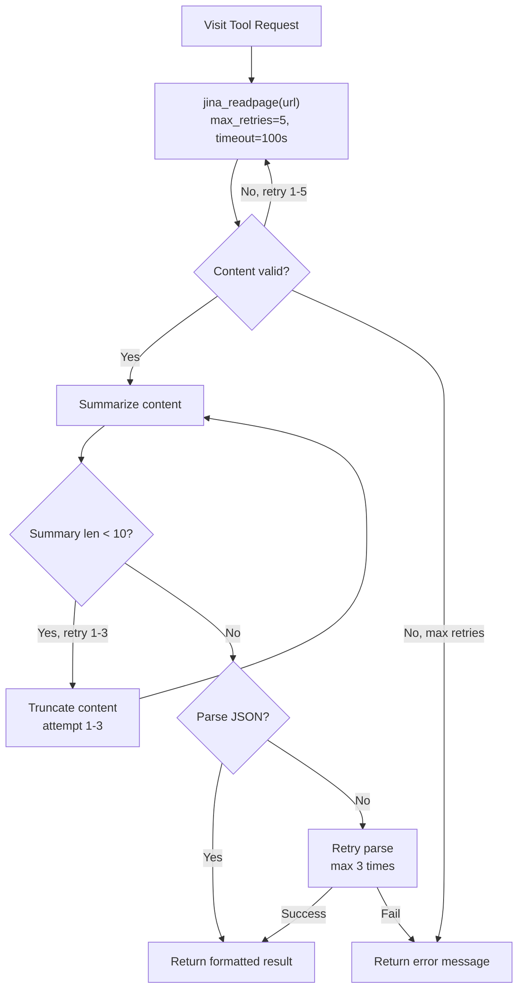
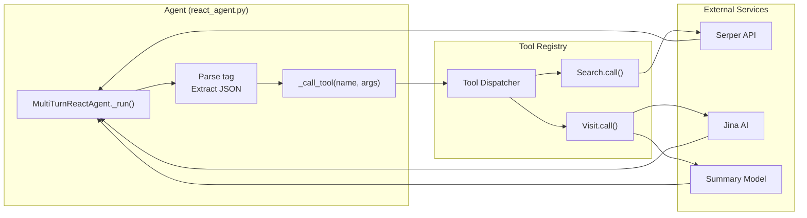

<!-- source: DeepWiki mcp.deepwiki.com · repo Alibaba-NLP/DeepResearch · page 2.6 Web Tools: Search and Visit · fetched 2026-10-29 -->

# Web Tools: Search and Visit

<details>
<summary>Relevant source files</summary>

The following files were used as context for generating this wiki page:

- [WebAgent/WebResummer/src/evaluate.py](WebAgent/WebResummer/src/evaluate.py)
- [WebAgent/WebResummer/src/judge_prompt.py](WebAgent/WebResummer/src/judge_prompt.py)
- [WebAgent/WebResummer/src/main.py](WebAgent/WebResummer/src/main.py)
- [WebAgent/WebResummer/src/prompt.py](WebAgent/WebResummer/src/prompt.py)
- [WebAgent/WebResummer/src/react_agent.py](WebAgent/WebResummer/src/react_agent.py)
- [WebAgent/WebResummer/src/run_resum.sh](WebAgent/WebResummer/src/run_resum.sh)
- [WebAgent/WebResummer/src/summary_utils.py](WebAgent/WebResummer/src/summary_utils.py)
- [WebAgent/WebResummer/src/tool_search.py](WebAgent/WebResummer/src/tool_search.py)
- [WebAgent/WebResummer/src/tool_visit.py](WebAgent/WebResummer/src/tool_visit.py)
- [WebAgent/WebWatcher/infer/evaluation/evaluate_hle_official.py](WebAgent/WebWatcher/infer/evaluation/evaluate_hle_official.py)
- [WebAgent/WebWatcher/infer/evaluation/prompt.py](WebAgent/WebWatcher/infer/evaluation/prompt.py)
- [WebAgent/WebWatcher/infer/evaluation/run_eval.sh](WebAgent/WebWatcher/infer/evaluation/run_eval.sh)
- [WebAgent/WebWatcher/infer/scripts_eval/agent_eval.py](WebAgent/WebWatcher/infer/scripts_eval/agent_eval.py)
- [WebAgent/WebWatcher/infer/scripts_eval/download_image.py](WebAgent/WebWatcher/infer/scripts_eval/download_image.py)
- [WebAgent/WebWatcher/infer/scripts_eval/scripts/eval.sh](WebAgent/WebWatcher/infer/scripts_eval/scripts/eval.sh)
- [WebAgent/WebWatcher/infer/vl_search_r1/qwen-agent-o1_search/qwen_agent/tools/private/jialong_visit.py](WebAgent/WebWatcher/infer/vl_search_r1/qwen-agent-o1_search/qwen_agent/tools/private/jialong_visit.py)
- [WebAgent/WebWatcher/infer/vl_search_r1/qwen-agent-o1_search/qwen_agent/tools/private/visit.py](WebAgent/WebWatcher/infer/vl_search_r1/qwen-agent-o1_search/qwen_agent/tools/private/visit.py)
- [WebAgent/WebWatcher/infer/vl_search_r1/qwen-agent-o1_search/qwen_agent/tools/vl_search_image.py](WebAgent/WebWatcher/infer/vl_search_r1/qwen-agent-o1_search/qwen_agent/tools/vl_search_image.py)

</details>


This page documents the Search and Visit tools, which are the primary web interaction tools used by agents in the DeepResearch system to gather information from the internet. The Search tool provides web search capabilities via Serper API, while the Visit tool reads and summarizes webpage content via Jina AI.

For information about other tools in the system, see [Tool System Architecture](#2.4). For file parsing capabilities, see [File Parser and Document Processing](#2.5). For code execution, see [Python Interpreter and Code Execution](#2.8).

## Tool Registration and Base Architecture

Both Search and Visit tools inherit from `BaseTool` and are registered using the `@register_tool` decorator, making them available to the agent system through the tool dispatcher.



**Tool Registration Pattern:**
- Tool name: String identifier used in tool calls (e.g., "search", "visit")
- Description: Natural language description for LLM understanding
- Parameters: JSON schema defining expected input format
- Call method: Main entry point that validates input and executes tool logic

Sources: [WebAgent/WebResummer/src/tool_search.py:1-113](), [WebAgent/WebResummer/src/tool_visit.py:1-241]()

## Search Tool: Web Search via Serper API

### Architecture and Data Flow

The Search tool provides batched web search capabilities using Google's Serper API. It supports multiple queries in a single call and returns formatted search results with titles, URLs, snippets, and metadata.



Sources: [WebAgent/WebResummer/src/tool_search.py:13-104]()

### Implementation Details

**Class: `Search`** [tool_search.py:13-104]()

The Search tool is registered with the name `"search"` and implements batched query support.

**Tool Schema:**
```json
{
  "name": "search",
  "description": "Performs batched web searches: supply an array 'query'; the tool retrieves the top 10 results for each query in one call.",
  "parameters": {
    "type": "object",
    "properties": {
      "query": {
        "type": "array",
        "items": {"type": "string"},
        "description": "Array of query strings. Include multiple complementary search queries in a single call."
      }
    },
    "required": ["query"]
  }
}
```

**Method: `google_search(query: str)`** [tool_search.py:31-87]()

This method handles individual search queries:

| Configuration | Value | Purpose |
|--------------|-------|---------|
| API Endpoint | `https://google.serper.dev/search` | Serper API URL |
| Results Per Query | 10 | Number of search results |
| Retry Attempts | 5 | Maximum retry count on failure |
| Headers | `X-API-KEY`, `Content-Type` | Authentication and format |
| Request Data | `{"q": query, "num": 10, "extendParams": {...}}` | Search parameters |

**Response Format:**

Each search result is formatted as:
```
{idx}. [{title}]({link})
Date published: {date}
Source: {source}
{snippet}
```

Multiple queries are concatenated with `\n=======\n` separator.

**Error Handling:**
- Returns timeout message after 5 failed attempts
- Handles missing "organic" results with fallback message
- Suggests using more general queries on failure

Sources: [WebAgent/WebResummer/src/tool_search.py:31-87]()

### Configuration Requirements

**Environment Variable:**
- `GOOGLE_SEARCH_KEY`: Serper API key (required)

**Example Tool Call:**
```json
{
  "name": "search",
  "arguments": {
    "query": ["climate change 2024", "renewable energy statistics"]
  }
}
```

Sources: [WebAgent/WebResummer/src/tool_search.py:10](), [WebAgent/WebWatcher/infer/scripts_eval/scripts/eval.sh:7-23]()

## Visit Tool: Webpage Reading and Summarization

### Two-Stage Architecture

The Visit tool implements a sophisticated two-stage pipeline: (1) webpage content retrieval via Jina AI, and (2) LLM-based summarization to extract goal-relevant information.



Sources: [WebAgent/WebResummer/src/tool_visit.py:30-229](), [WebAgent/WebWatcher/infer/vl_search_r1/qwen-agent-o1_search/qwen_agent/tools/private/visit.py:1-239]()

### Visit Tool Implementation

**Class: `Visit`** [tool_visit.py:30-229]()

The Visit tool is registered with the name `"visit"` and supports both single and batched URL visiting.

**Tool Schema:**
```json
{
  "name": "visit",
  "description": "Visit webpage(s) and return the summary of the content.",
  "parameters": {
    "type": "object",
    "properties": {
      "url": {
        "type": ["string", "array"],
        "items": {"type": "string"},
        "description": "The URL(s) of the webpage(s) to visit. Can be a single URL or an array of URLs."
      },
      "goal": {
        "type": "string",
        "description": "The goal of the visit for webpage(s)."
      }
    },
    "required": ["url", "goal"]
  }
}
```

### Content Retrieval: Jina AI Integration

**Method: `jina_readpage(url: str) -> str`** [tool_visit.py:115-150]()

Retrieves raw webpage content using Jina AI's reader service:

| Configuration | Value | Purpose |
|--------------|-------|---------|
| API Endpoint | `https://r.jina.ai/{url}` | Jina reader URL with embedded target |
| Authentication | `Authorization: Bearer {JINA_API_KEY}` | API key header |
| Max Retries | 5 | Retry attempts on failure |
| Timeout | 100 seconds | Request timeout |
| Sleep Between Retries | 0.5 seconds | Backoff interval |

**Response Handling:**
- Status 200: Returns `response.text` (webpage content)
- Failure: Returns `"[visit] Failed to read page."`
- Content is truncated to `WEBCONTENT_MAXLENGTH` (150,000 chars by default)

Sources: [WebAgent/WebResummer/src/tool_visit.py:115-150](), [WebAgent/WebWatcher/infer/vl_search_r1/qwen-agent-o1_search/qwen_agent/tools/private/visit.py:121-155]()

### Summarization: LLM-Based Extraction

**Method: `call_server(msgs, max_retries=2)`** [tool_visit.py:84-113]()

Calls a dedicated summary model to extract goal-relevant information:

**Configuration:**
- Environment Variables:
  - `SUMMARY_API_KEY`: API key for summary service
  - `SUMMARY_API_BASE`: Base URL (default: `http://localhost:8001/v1`)
  - `SUMMARY_MODEL_NAME`: Model name for summarization
- Temperature: 0.7
- Max Retries: 2 (configurable via `VISIT_SERVER_MAX_RETRIES`)

**Extraction Prompt:** [prompt.py:1-15]()

The `EXTRACTOR_PROMPT` instructs the model to:
1. **Content Scanning (Rational)**: Locate specific sections related to the goal
2. **Key Extraction (Evidence)**: Extract full original context (multiple paragraphs)
3. **Summary Output (Summary)**: Organize into concise paragraph with logical flow

**Expected JSON Response:**
```json
{
  "rational": "...",
  "evidence": "...",
  "summary": "..."
}
```

**JSON Parsing with Retry Logic:** [tool_visit.py:198-216]()

The implementation includes robust retry logic:



Sources: [WebAgent/WebResummer/src/tool_visit.py:152-229](), [WebAgent/WebResummer/src/prompt.py:1-15]()

### Batch Processing and Array URLs

**Method: `call(params: Union[str, dict], **kwargs) -> str`** [tool_visit.py:55-82]()

The Visit tool supports both single and multiple URLs:

- **Single URL**: Direct call to `readpage(url, goal)`
- **Array of URLs**: Sequential processing with timeout protection
  - Maximum batch time: 900 seconds (15 minutes)
  - Results concatenated with `\n=======\n` separator
  - Errors captured per-URL without blocking others

Sources: [WebAgent/WebResummer/src/tool_visit.py:55-82]()

### Output Format

**Success Case:**
```
The useful information in {url} for user goal {goal} as follows:

Evidence in page:
{extracted evidence from JSON}

Summary:
{summary from JSON}
```

**Failure Cases:**
```
The useful information in {url} for user goal {goal} as follows:

Evidence in page:
The provided webpage content could not be accessed. Please check the URL or file format.

Summary:
The webpage content could not be processed, and therefore, no information is available.
```

Sources: [WebAgent/WebResummer/src/tool_visit.py:209-228]()

## Configuration and Environment Variables

### Required Environment Variables

Both tools require specific environment variables for operation:

**Search Tool:**
| Variable | Purpose | Example |
|----------|---------|---------|
| `GOOGLE_SEARCH_KEY` | Serper API authentication | `"your-serper-api-key"` |

**Visit Tool:**
| Variable | Purpose | Example |
|----------|---------|---------|
| `JINA_API_KEY` | Jina AI Reader authentication | `"your-jina-api-key"` |
| `JINA_API_KEYS` | Alternative for multiple keys | `"key1,key2,key3"` |
| `SUMMARY_API_KEY` | Summary model authentication | `"EMPTY"` (for local) |
| `SUMMARY_API_BASE` | Summary model endpoint | `"http://localhost:8001/v1"` |
| `SUMMARY_MODEL_NAME` | Model name for summarization | `"/path/to/Qwen3-30B-A3B-Instruct-2507"` |
| `WEBCONTENT_MAXLENGTH` | Max webpage content length | `150000` (default) |
| `VISIT_SERVER_MAX_RETRIES` | Summary server max retries | `3` (default) |

**Shell Script Configuration Example:** [scripts/eval.sh:16-22]()

```bash
export TEXT_SEARCH_KEY="your-serper-api-key"
export JINA_API_KEY="your-jina-api-key"
export SUMMARY_API_KEY="EMPTY"
export SUMMARY_API_BASE="http://localhost:8001/v1"
export SUMMARY_MODEL_NAME="/path/to/Qwen3-30B-A3B-Instruct-2507"
```

Sources: [WebAgent/WebWatcher/infer/scripts_eval/scripts/eval.sh:16-22](), [WebAgent/WebResummer/src/run_resum.sh:15-27]()

## Error Handling and Reliability

### Search Tool Error Handling

**Retry Logic:** [tool_search.py:46-53]()
- 5 retry attempts with immediate retry
- Returns timeout message after exhausting retries
- Handles HTTP errors with exception messages

**Result Validation:**
- Checks for "organic" key in response
- Provides fallback message for no results
- Suggests query refinement strategies

### Visit Tool Error Handling

**Multi-Level Retry Strategy:**



**Error Messages by Stage:**

1. **Jina API Failure** (after 5 retries): `"[visit] Failed to read page."`
2. **Summary Generation Failure** (after 3 truncation attempts): Returns with error evidence
3. **JSON Parse Failure** (after 3 parse attempts): Returns with generic error message

Sources: [WebAgent/WebResummer/src/tool_visit.py:126-229](), [WebAgent/WebWatcher/infer/vl_search_r1/qwen-agent-o1_search/qwen_agent/tools/private/visit.py:138-239]()

## Tool Invocation in Agent System

### Integration with MultiTurnReactAgent

The Search and Visit tools are invoked by agents through the standardized tool call mechanism:



**Tool Call Format in Agent Messages:** [react_agent.py:109-122]()

```xml
<tool_call>
{"name": "search", "arguments": {"query": ["query1", "query2"]}}
</tool_call>

<tool_call>
{"name": "visit", "arguments": {"url": "https://example.com", "goal": "Find pricing information"}}
</tool_call>
```

**Tool Response Format:**
```xml
<tool_response>
{tool output content}
</tool_response>
```

Sources: [WebAgent/WebResummer/src/react_agent.py:109-122](), [WebAgent/WebWatcher/infer/scripts_eval/agent_eval.py:285-373]()

## Performance Characteristics

### Search Tool Performance

| Metric | Value | Notes |
|--------|-------|-------|
| Average Latency | 1-3 seconds | Per query to Serper API |
| Concurrent Queries | 3 | ThreadPoolExecutor max_workers |
| Results Per Query | 10 | Configurable in API request |
| Token Output | ~1000-2000 | Varies by result content |

### Visit Tool Performance

| Metric | Value | Notes |
|--------|-------|-------|
| Jina Read Latency | 2-10 seconds | Depends on page complexity |
| Summary Latency | 5-30 seconds | Depends on content length |
| Total Latency | 7-40 seconds | Combined for typical page |
| Max Content Length | 150K chars | Truncated before processing |
| Max Summary Tokens | ~4096 | Output from summary model |
| Batch Processing | Sequential | No parallelization for safety |

**Token Usage Tracking:** [evaluation/evaluate_hle_official.py:174-179]()

Evaluation scripts track token usage per tool invocation:
- `token_usage['completion_tokens']`
- `token_usage['prompt_tokens']`
- Used for cost estimation and performance analysis

Sources: [WebAgent/WebWatcher/infer/evaluation/evaluate_hle_official.py:174-179]()

## Usage Examples from Evaluation Scripts

### Search Tool Usage

**From WebResummer:** [tool_search.py:107-112]()
```python
search = Search()
query = ["Hong Kong Actor Tony Leung Chiu wai", "Tokyo Food Restaurant"]
result = search.call({"query": query})
```

### Visit Tool Usage

**From WebResummer:** [tool_visit.py:232-240]()
```python
visit = Visit()
params = {
    "url": "https://arxiv.org/pdf/2509.13313", 
    "goal": "Please provide a summary of the paper."
}
result = visit.call(params)
```

**Multi-URL Visit:** [tool_visit.py:62-79]()
```python
params = {
    "url": ["https://site1.com", "https://site2.com"],
    "goal": "Compare pricing across both sites"
}
# Returns concatenated summaries with \n=======\n separator
```

Sources: [WebAgent/WebResummer/src/tool_search.py:107-112](), [WebAgent/WebResummer/src/tool_visit.py:232-240]()

## Alternative Visit Implementation: WebWatcher

The WebWatcher project includes a variant Visit implementation with additional features:

**Key Differences:** [WebAgent/WebWatcher/infer/vl_search_r1/qwen-agent-o1_search/qwen_agent/tools/private/visit.py:1-239]()

1. **Multiple Backend Services**: Attempts `jina_readpage()` with fallback strategies
2. **Different Summary Endpoint**: Uses port 6002 instead of 8001
3. **Content Length Limit**: Also uses `WEBCONTENT_MAXLENGTH` environment variable
4. **Similar Retry Logic**: Implements comparable truncation and JSON parsing

The core architecture remains the same: retrieve webpage content → summarize with LLM → format output.

Sources: [WebAgent/WebWatcher/infer/vl_search_r1/qwen-agent-o1_search/qwen_agent/tools/private/visit.py:1-239]()

---

